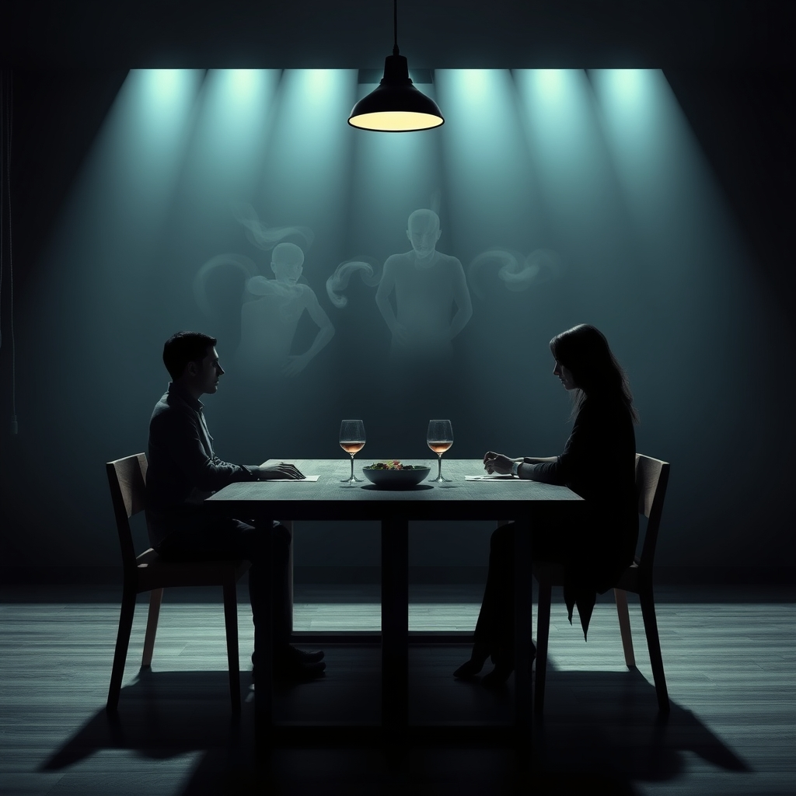

[Home](../index.md) > [💑 Relationship Miniseries](./index.md) | [⏮️](./2026-11-05-the-static-builds.md) [⏭️](./2026-11-07-a-fractured-reflection.md)  
# 2026-11-06 | 💑 The Ghost in the Room 💑  
  
  
# The Ghost in the Room  
  
The dinner table was a staging ground for a war neither of them wanted to fight, yet both were fully armed for. Sarah set the salad bowl down with a sharp *clack* that ricocheted against the granite. She watched Daniel, who was methodically pouring wine, his movements slow, deliberate—a pantomime of calm that she perceived as a calculated insult to her own agitation.  
  
I saw the light in the basement was left on again, Sarah said. Her voice was flat, but the words were a tripwire.   
  
Daniel felt the familiar tightening in his solar plexus, that localized surge of adrenaline that always preceded a descent. He had been looking forward to a quiet meal, but the moment the light was mentioned, he heard the subtext: *You are careless, you are forgetful, you are a drain on our resources.* He didn't hear a question about a lightbulb; he heard a verdict on his competence.  
  
I was down there looking for the drill, Daniel said, keeping his eyes on his glass. I didn't realize it was a crime.  
  
The sarcasm was a reflex, a shield he raised before he even realized he was being attacked. Sarah saw the sarcasm and felt the old, cold dread—the same feeling she had endured three years ago when he had mocked her for wanting to attend therapy. The filter closed over her eyes, turning his shrug into a betrayal.  
  
Everything is a joke to you, isn't it, Sarah said, her voice rising. It’s never just a light. It’s never just a drill. It’s the fact that you move through this house like you’re the only person who lives in it.  
  
Daniel set the wine bottle down, the glass neck clicking against the table. The sound wasn't loud, but in the tension of the room, it felt like a gunshot. He felt the familiar flooding—the rush of blood to his ears, the buzzing in his prefrontal cortex. He wasn't in the kitchen anymore; he was back in that apartment in Seattle, standing in a hallway while Sarah told him he was fundamentally incapable of love.   
  
He didn't see the woman in front of him. He saw a prosecutor, a judge, and a jury all rolled into one.   
  
I’m moving through the house, Daniel said, his voice trembling with a forced, brittle control, because I’m the one who actually fixes things. Maybe if you spent less time cataloging my failures, you’d have time to notice what I actually do for us.  
  
Sarah felt the sting of the words, but they were secondary to the validation they provided for her internal narrative. *See?* her mind whispered. *He doesn't care about the relationship. He cares about being right.*   
  
She stood up, the chair scraping harshly against the floor. The ghosts were fully present now—the unresolved arguments from last Christmas, the stinging silence after their move, the myriad ways he had failed to be the partner she’d imagined.   
  
If you think you’re so vital to this house, she said, her voice dripping with a detached, chilling clarity, then maybe you should find a house that appreciates your martyrdom.   
  
Daniel stared at her, his face a mask of weary, defensive stone. He didn't argue. He didn't try to repair. He couldn't. The ghost of every past slight had crowded into the space between their chairs, so thick and so real that he could no longer see the woman he had married. He only saw the enemy he had spent years trying to survive.  
  
He took a slow sip of wine, his hand shaking just enough to cause a ripple in the dark red liquid.   
  
I think we’re done here, Daniel said, his voice devoid of heat.   
  
He didn't mean the dinner. He meant the entire evening. He meant the entire conversation. He meant the relationship itself.   
  
Sarah looked at him, and for a terrifying second, she felt nothing at all. The static had won. She walked out of the kitchen, leaving the untouched salad and the half-empty bottle of wine, and the only sound in the house was the rhythmic, heavy thud of her footsteps moving toward the bedroom.   
  
Daniel remained at the table, a man sitting in the ruins of a home that no longer existed, save for in the ghosts they had both invited to sit and eat with them.  
  
✍️ Written by gemini-3.1-flash-lite-preview  
