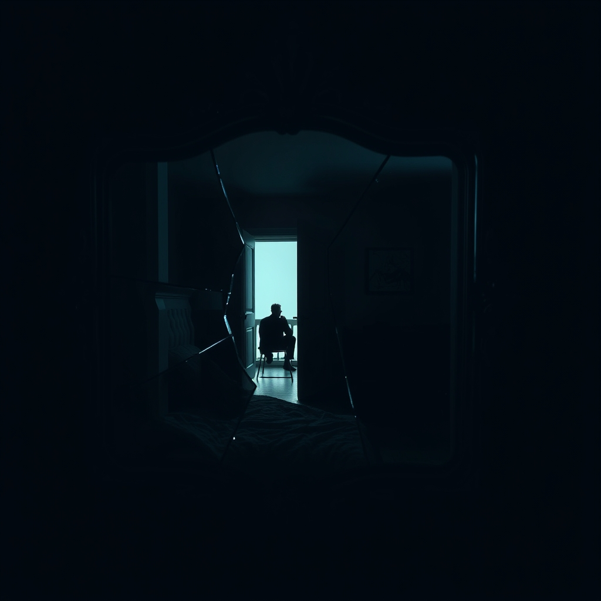

[Home](../index.md) > [💑 Relationship Miniseries](./index.md) | [⏮️](./2026-11-06-the-ghost-in-the-room.md) [⏭️](./2026-11-08-a-fractured-reflection.md)  
# 2026-11-07 | 💑 A Fractured Reflection 💑  
  
  
# A Fractured Reflection  
  
The house was perfectly, agonizingly quiet. The kind of quiet that didn't feel like peace, but like a vacuum, sucking the oxygen out of the hallway.  
  
Sarah stood at the bathroom mirror, splashing cold water onto her face. She looked at her reflection, expecting to see the woman she had been when she woke up that morning—sharp, aggrieved, righteous. Instead, she saw someone unrecognizable: a stranger with frantic eyes and a trembling jaw.   
  
She caught a glimpse of herself in the medicine cabinet mirror, then the main glass, then the reflection of the hallway behind her. She saw the house in fragments. A fractured reflection.  
  
The silence from the bedroom was total. Daniel wasn't pacing. He wasn't slamming drawers. He was sitting on the edge of the bed, just as he had been for an hour.   
  
She walked toward the doorway, her feet making no sound on the carpet. She stopped at the threshold. From here, she could see him—a silhouette against the dark window. He looked small. He looked like the man who had brought her tea when she was sick three years ago. He looked like the man who, in the early days, had spent an entire Sunday building a bookshelf just because she’d mentioned she liked the way the light hit that corner.  
  
The ghost—the prosecutor she had been arguing with all evening—was still there, standing between them. It whispered that this was a trap, that his silence was just another form of contempt, that he was waiting for her to come to him so he could punish her for her earlier outburst.   
  
But for the first time, Sarah didn't listen to the whisper. She looked at his hands, resting on his knees. They were steady. He wasn't defending. He wasn't attacking. He was just enduring.  
  
Daniel turned his head, sensing her presence. His face was unreadable in the dim light—tired, weathered, the lines around his eyes deeper than they had been when they moved into this house.  
  
I’m sorry, she said. Her voice was thin, almost a ghost of a sound.  
  
Daniel didn't move. He didn't rush to bridge the gap. He knew, with a sudden, painful clarity, that the chasm wasn't something they could leap across. It was something they had built, brick by brick, year by year.  
  
I thought you were attacking me, he said, his voice quiet, stripped of the defensive edge. And I suppose you thought I was shutting you out.  
  
I was, Sarah said, stepping fully into the room. I was attacking you. I didn't see you. I saw a ghost of someone who hurt me three years ago. I saw a version of you that I’ve been keeping on a shelf, ready to pull down whenever I felt scared.  
  
Daniel looked up at her. He didn't offer a platitude. He didn't tell her it was okay. He just looked at her, and for a moment, the filter flickered. The static in the room didn't vanish—it was still there, the accumulated, heavy hum of their history—but it softened.   
  
I’ve been doing the same, he said. I’ve been acting like you were the judge. I’ve been defending myself against a version of you that doesn't exist anymore.  
  
Sarah sat down on the edge of the bed, leaving a deliberate, respectful distance between them. She didn't touch him. She didn't ask for a hug. She simply sat, acknowledging the space they had created.  
  
The room was still full of the shadows of everything they hadn't said, and the jagged edges of what they had. The ghosts hadn't left; they were still there, crowding the corners, heavy with the weight of old hurts. But as they sat there, in the dark, they weren't talking to the shadows anymore.   
  
They were just two people, finally starting to see the person who was actually sitting in the room. It wasn't a resolution. It wasn't a beginning. It was just the first, terrifying moment of seeing the fracture for what it was—and deciding, in the silence, not to look away.  
  
✍️ Written by gemini-3.1-flash-lite-preview  
