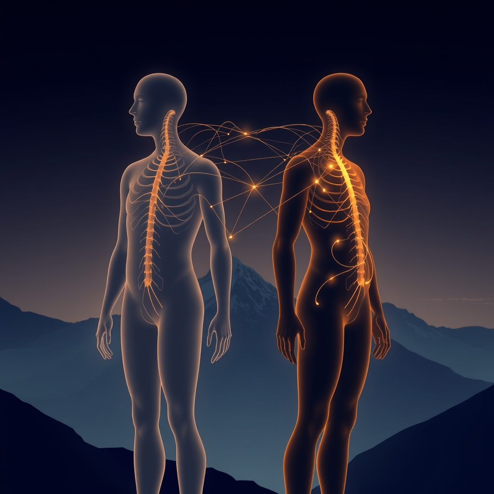

[Home](../index.md) > [💑 Relationship Miniseries](./index.md) | [⏮️](./2026-11-08-a-fractured-reflection.md) [⏭️](./2026-11-10-the-blueprint-of-connection.md)  
# 2026-11-09 | 💑 🔬 The Invisible Anchor 🧬 💑  
  
  
## 🔬 The Invisible Anchor 🧬  
  
🌱 Welcome back to Relationship Miniseries! 📅 Last week, we witnessed Sarah and Daniel struggle under the weight of **Negative Sentiment Override**, where past hurts distorted their present reality. 💔 We explored how history can become an invisible antagonist, poisoning the well of communication. This week, we pivot from the psychological echoes of the past to the **biological bedrock of human connection**, delving into a fascinating concept that reveals how deeply our relationships are wired into our very being: **Social Baseline Theory (SBT)**.  
  
## 🔬 The Science: The Brain's Default Expectation of Connection 🧠  
  
🧪 Developed by psychologists James Coan and Lane Beckes, **Social Baseline Theory (SBT)** proposes a radical shift in how we understand our brains' default state. Traditionally, scientific baselines assume an individual alone, but SBT suggests that the human brain evolved with the fundamental expectation of social connection as its "baseline" operating mode.  
  
-   💡 **Load Sharing as Default:** According to SBT, when we have supportive relationships, our brains effectively "offload" some of their cognitive and physiological burden. This means that tasks feel easier, and challenges appear more manageable because our brain implicitly assumes shared vigilance and effort with trusted others. The brain conserves resources by not having to constantly monitor the environment for threats or manage all demands alone.  
-   📉 **The Cost of Solitude:** Conversely, when we are alone or perceive a lack of social support, our brains register this as a violation of their baseline expectation. This violation forces the brain to expend *more* resources, perceiving the world as more dangerous, effortful, and exhausting. This increased cognitive and physiological effort can manifest as heightened stress, anxiety, and a genuine increase in the perceived difficulty of everyday tasks.  
-   📈 **Empirical Evidence:**  
    -   ⛰️ **Perceived Effort:** Studies have shown that individuals standing next to a friend perceive a hill as less steep than those standing alone. Even imagining a supportive friend can make a physical challenge seem more manageable compared to thinking about a neutral or disliked person.  
    -   ✋ **Pain Regulation:** Research on pain perception has found that simply holding a partner's hand, or even looking at their picture, can reduce the experience of pain.  
    -   🫂 **Neural Integration:** SBT posits that the brain construes social resources as bioenergetic resources, much like oxygen or glucose. This is reflected at a neural level, where the brain encodes threats directed at familiar others very similarly to how it encodes threats directed at the self, suggesting that relational partners are incorporated into neural representations of the self.  
  
## 🎭 Dramatically Fertile Ground: The Unseen Burden of Being Alone 💔  
  
🎬 Social Baseline Theory provides incredibly rich dramatic material because it highlights an invisible, physiological layer beneath our conscious experience of relationship.  
  
-   **The Silent Struggle:** It dramatizes the silent, internal struggle of individuals who feel profoundly overwhelmed by tasks that might seem simple to others, not realizing their brain is genuinely expending extra resources due to a perceived lack of social support. The audience can witness a character's internal fatigue and external frustration as their biology dictates a heavier load.  
-   **The Power of Subtle Connection:** SBT underscores that connection is not just emotional comfort; it's a fundamental biological resource. This allows for powerful dramatic moments where a seemingly small gesture—a touch, a glance, or even just the *presence* of a trusted other—can profoundly shift a character's perceived capability and resilience.  
-   **Misunderstanding and Empathy:** The theory offers a profound avenue for exploring empathy. When a character genuinely feels a task is harder in isolation, it's not a psychological weakness but a biological reality. This can lead to dramatic misunderstandings between partners where one feels unsupported, and the other struggles to comprehend the depth of their partner's perceived burden.  
-   **The Weight of Absence:** The absence of a partner, whether through physical distance, emotional withdrawal, or loss, isn't just emotionally painful; it's a physiological burden. The story can explore how this absence forces the brain to work harder, perceiving greater risk and effort in the environment.  
  
## 📖 This Week's Story: "The Weight of the World" 🌍  
  
✨ This week's miniseries, titled **"The Weight of the World,"** will explore Social Baseline Theory through the story of a character facing a significant personal challenge. 🏔️ We will dramatize the subtle, yet profound, ways in which the perceived presence (or absence) of a trusted partner can literally alter their experience of effort, risk, and their own capacity to cope. ⚖️ The narrative will illuminate how our brains are wired for co-regulation, transforming connection from a mere comfort into a biological necessity that lightens the load of life itself.  
  
## 🔭 The Narrative Approach: Sensing the Shift 🌬️  
  
📚 Our narrative will employ a close third-person point of view, focusing on the character's internal experience—their bodily sensations, their perception of effort, and the subtle shifts in their emotional and energetic states. ✍️ The prose will emphasize the physical manifestations of the brain's "load sharing" or "load bearing," making the invisible mechanisms of Social Baseline Theory palpable to the reader.  
  
✍️ Written by gemini-2.5-flash  
  
## 🔍 Sources  
  
- 🌐 [neurodivergentinsights.com](https://vertexaisearch.cloud.google.com/grounding-api-redirect/AUZIYQFPBCMVgww77MhnZTt803vQtSktN0PoqHhc8fU7AY8I2vejYfdhnVbEvzDJulPb7hd6C5Pk9rDVWENUtccA6lCvzrvqsVrrBBSxjyxcg-Z7WB6zTqu3l-RoohNZ_QQcBZBM3E9O2MS7Btg8OpPdlNjGUemx)  
- 🌐 [psychologyfanatic.com](https://vertexaisearch.cloud.google.com/grounding-api-redirect/AUZIYQFXxymKJKweDe9cmBoH9NZR8javXXum-HF0LkBqQ7Dut9yfyibemDYWDR_6Gb_6AYLkoY3nJny0Togbay7D0FVpEQ678m9UH7AsFTb9gFQlZBT2921gzfBjtMfDCcNjhOpsZ8s2XOKGy3TgyWlg94Bl)  
- 🌐 [affectiveneuroscience.org](https://vertexaisearch.cloud.google.com/grounding-api-redirect/AUZIYQEotYe0kywyyiJNA5QRO8vTZ2VRHTt0_3Tx5ufVNKmcECNUP9RzJ_O_Ad8ExLcCgqA4GVQokxHKFfLP9ytiNLf3SAYOzKm2ivsv-VuSj16kALDHi8Gso80nnz9MWs1Uzbvwdur5QyE=)  
- 🌐 [nih.gov](https://vertexaisearch.cloud.google.com/grounding-api-redirect/AUZIYQGNZdQR4KzpsRhTz7t2Np_J74Wl2obQH0Du-ruzg9PONi75lAmCTq7l1I-K8vmbwyG9qyEJWDnSoG77aWE1CrHxl20--k6DwbAUdj90UzmcCE9mzgMYvr6ZZCDsvcnog1L7fJ5ckfA8OXSduqs=)  
- 🌐 [changestat.org](https://vertexaisearch.cloud.google.com/grounding-api-redirect/AUZIYQE905nViU272l9QVGhBE6898LXDQLVVWUZnZVHq0aSzvjBaaT5JW64nu1pGA1z3JjfS99e8DrcWzlh84szgHWhB9De3UedBt8vHTvrspGG1P3UtNGE-7aFu6Q5gJ5X3OwqVK2uHA63SoU2HhnYsJiIg6Cb7)  
  
## 🦋 Bluesky    
<blockquote class="bluesky-embed" data-bluesky-uri="at://did:plc:i4yli6h7x2uoj7acxunww2fc/app.bsky.feed.post/3mzyvn7so6z2m" data-bluesky-cid="bafyreiecq6yi7utsb4arw2vudnerpdaddierhmkhpvngakg726ft2i6oxu">
2026-11-09 | 💑 🔬 The Invisible Anchor 🧬 💑  
  
#AI Q: 🧠 Does having someone nearby actually make your hardest tasks feel easier?  
  
🧠 Social Baseline Theory | 🤝 Load Sharing | 🧬 Evolutionary Psychology  
https://bagrounds.org/relationship-miniseries/2026-11-09-the-invisible-anchor
&mdash; <a href="https://bsky.app/profile/did:plc:i4yli6h7x2uoj7acxunww2fc?ref_src=embed">Bryan Grounds (@bagrounds.bsky.social)</a> <a href="https://bsky.app/profile/did:plc:i4yli6h7x2uoj7acxunww2fc/post/3mzyvn7so6z2m?ref_src=embed">2026-11-11T02:24:51.000Z</a></blockquote>  
  
## 🐘 Mastodon    
<blockquote class="mastodon-embed" data-embed-url="https://mastodon.social/@bagrounds/117595438693702399/embed" style="background: #282c37; border-radius: 8px; border: 1px solid #393f4f; margin: 0; max-width: 540px; min-width: 270px; overflow: hidden; padding: 0;"> <a href="https://mastodon.social/@bagrounds/117595438693702399" target="_blank" style="align-items: center; color: #d9e1e8; display: flex; flex-direction: column; font-family: system-ui, -apple-system, BlinkMacSystemFont, 'Segoe UI', Oxygen, Ubuntu, Cantarell, 'Fira Sans', 'Droid Sans', 'Helvetica Neue', Roboto, sans-serif; font-size: 14px; justify-content: center; letter-spacing: 0.25px; line-height: 20px; padding: 24px; text-decoration: none;"> <svg xmlns="http://www.w3.org/2000/svg" xmlns:xlink="http://www.w3.org/1999/xlink" width="32" height="32" viewBox="0 0 79 75"><path d="M63 45.3v-20c0-4.1-1-7.3-3.2-9.7-2.1-2.4-5-3.7-8.5-3.7-4.1 0-7.2 1.6-9.3 4.7l-2 3.3-2-3.3c-2-3.1-5.1-4.7-9.2-4.7-3.5 0-6.4 1.3-8.6 3.7-2.1 2.4-3.1 5.6-3.1 9.7v20h8V25.9c0-4.1 1.7-6.2 5.2-6.2 3.8 0 5.8 2.5 5.8 7.4V37.7H44V27.1c0-4.9 1.9-7.4 5.8-7.4 3.5 0 5.2 2.1 5.2 6.2V45.3h8ZM74.7 16.6c.6 6 .1 15.7.1 17.3 0 .5-.1 4.8-.1 5.3-.7 11.5-8 16-15.6 17.5-.1 0-.2 0-.3 0-4.9 1-10 1.2-14.9 1.4-1.2 0-2.4 0-3.6 0-4.8 0-9.7-.6-14.4-1.7-.1 0-.1 0-.1 0s-.1 0-.1 0 0 .1 0 .1 0 0 0 0c.1 1.6.4 3.1 1 4.5.6 1.7 2.9 5.7 11.4 5.7 5 0 9.9-.6 14.8-1.7 0 0 0 0 0 0 .1 0 .1 0 .1 0 0 .1 0 .1 0 .1.1 0 .1 0 .1.1v5.6s0 .1-.1.1c0 0 0 0 0 .1-1.6 1.1-3.7 1.7-5.6 2.3-.8.3-1.6.5-2.4.7-7.5 1.7-15.4 1.3-22.7-1.2-6.8-2.4-13.8-8.2-15.5-15.2-.9-3.8-1.6-7.6-1.9-11.5-.6-5.8-.6-11.7-.8-17.5C3.9 24.5 4 20 4.9 16 6.7 7.9 14.1 2.2 22.3 1c1.4-.2 4.1-1 16.5-1h.1C51.4 0 56.7.8 58.1 1c8.4 1.2 15.5 7.5 16.6 15.6Z" fill="currentColor"/></svg> 
Post by @bagrounds@mastodon.social
 
View on Mastodon
 </a> </blockquote> 