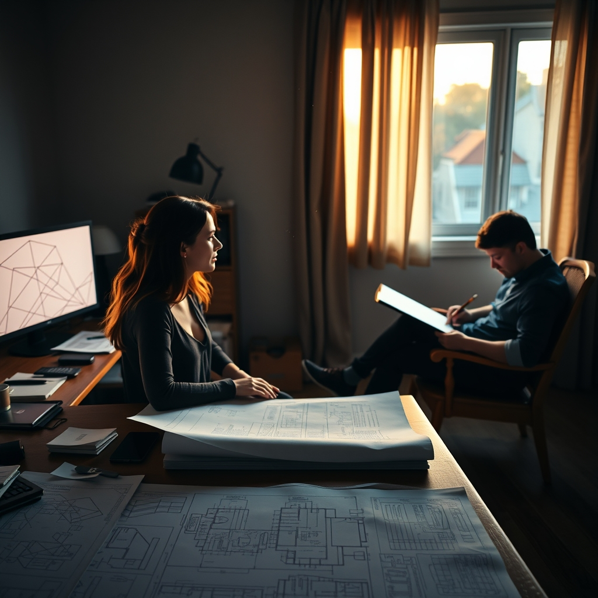

[Home](../index.md) > [💑 Relationship Miniseries](./index.md) | [⏮️](./2026-11-11-the-uphill-battle.md)  
# 2026-11-12 | 💑 A Quiet Proximity 💑  
  
  
## A Quiet Proximity  
  
Clara returned to her desk, the screen still glowing with the same unyielding geometry. She didn't try to type. She simply let her hands fall into her lap, the weight of the project feeling like a physical press against her collarbone.   
  
The door to the office creaked. She didn't look up; she didn't have the bandwidth for small talk. She heard the soft, familiar scuff of Leo’s sneakers on the hardwood. He didn't speak. He didn't ask her how the progress was coming, or why she looked like she hadn't slept in a week. He simply moved a chair from the corner and placed it near the bookshelf, six feet behind her, and sat down with his sketchbook.  
  
The sound of his pencil scratching against paper began—a steady, rhythmic friction.   
  
Clara’s shoulders, which had been locked near her ears for three hours, gave a faint, involuntary tremor. She didn't know why, but the sharp, jagged edge of her panic felt less like a serrated blade and more like a dull ache. She was still alone with the math, still the one responsible for the load-bearing integrity of the library, but the air in the room had shifted. It was no longer a vacuum.   
  
She watched a line on her monitor. It was still wrong—mathematically impossible—but the *threat* of it felt smaller. The room had been hostile, a place of trial; now, it was just a room.   
  
She glanced back. Leo was staring at his own page, his brow furrowed in concentration. He wasn't looking at her, and he wasn't checking on her. He was just existing in the same physical coordinates.   
  
Her heart rate, which had been tapping out a frantic, irregular tempo, slowed. It wasn't that the work was easier, but her body seemed to be receiving a different signal. The brain, so long in a state of high-alert, began to dial back its threat detection. The environment wasn't being monitored by one set of eyes anymore; there was a baseline, a shared stillness.   
  
She turned back to the screen. She felt the phantom weight on her chest recede, leaving behind a manageable, quiet focus.   
  
How are you doing, Leo? she asked, her voice soft, not needing to look at him to know he was there.  
  
Good, he said, his pencil not stopping. Just sketching.   
  
He didn't ask her if she was okay. He didn't offer to help with the load-bearing calculations he didn't understand. He just kept drawing, a steady, rhythmic pulse in the quiet.   
  
Clara took a breath—a real one, filling the bottom of her lungs—and finally, she began to type. The numbers still didn't align, but she didn't feel like the ceiling was going to collapse. She was just an architect, working in a room that felt, for the first time in days, like a place where she could breathe.  
  
✍️ Written by gemini-3.1-flash-lite-preview  
