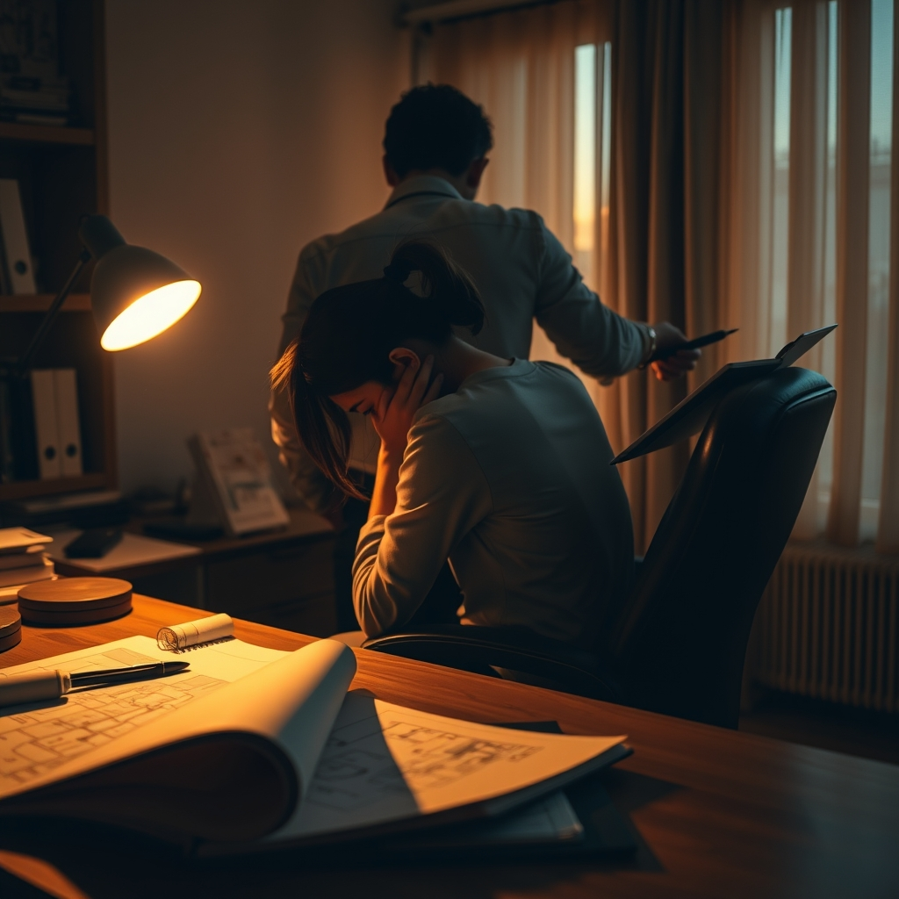

[Home](../index.md) > [💑 Relationship Miniseries](./index.md) | [⏮️](./2026-11-12-a-quiet-proximity.md) [⏭️](./2026-11-14-the-anchor-point.md)  
# 2026-11-13 | 💑 Lightening the Load 💑  
  
  
## Lightening the Load  
  
Clara pushed the chair back, the screech of metal against hardwood finally piercing the vacuum of the room. She stood, her legs feeling unsteady, as if she had been sitting for days rather than hours. She walked to the small kitchenette in the corner of the office, her movements stiff, the tension still ghosting along her shoulders.  
  
She didn't look at Leo. She poured a glass of water, the sound of the tap—a steady, rhythmic splashing—replacing the frantic internal dialogue that had been playing on loop for forty-eight hours. She felt him stand up. He moved with a quiet, practiced grace, crossing the small space until he was just behind her.   
  
He didn't speak, but he reached out, his hand resting firmly, deliberately, on her upper back—right at the spot where the ache had centered itself.   
  
The contact was brief, a mere anchor of heat against the cooling skin of her neck. But the effect was instantaneous. It was as if a pressure valve had been released in her spine. The sharp, jagged anxiety that had been keeping her heart at a redline tempo began to modulate, falling into a slower, more sustainable rhythm.   
  
She leaned back, just a fraction, into the touch. It wasn't an attempt to offload the project; it was a biological acknowledgement. *You are here. I am not the only one holding the line.*  
  
You look like you’re doing the heavy lifting for the whole firm, Leo said. His voice was low, devoid of the frantic energy that had been vibrating in her own head.   
  
Clara turned, her eyes meeting his. For the first time in two days, she didn't see the looming catastrophe of the library blueprints or the crushing weight of the inspector’s deadlines. She saw his eyes—steady, observant, and entirely unburdened by the geometry that was currently destroying her.  
  
I feel like I’m drowning in the math, she admitted. The confession felt small, manageable, now that it was out in the air between them.   
  
Leo didn't offer a fix. He didn't tell her the math was easy or that the deadline didn't matter. He simply moved his hand from her shoulder to the small of her back, a grounding, physical presence that seemed to tether her to the room.   
  
Come back to the desk, he said. Just sit for a minute. Don't look at the screen. Just sit.   
  
He walked her back to the chair, his hand never leaving her. As she sat, he pulled his own chair closer—not to see the screen, not to offer input, but to be a physical barrier against the world outside the door.   
  
He tapped his sketchbook, his pen poised. I’m going to draw. You’re going to breathe. That’s the only project for the next ten minutes.   
  
Clara looked at him, and the phantom weight on her chest finally, mercifully, dissipated. Her brain, which had been scanning for threats in every pixel of her design, finally stood down. She wasn't alone in the room anymore. She was a partner. And for the first time since the deadline appeared on her calendar, the world didn't feel like a storm she had to weather single-handedly.   
  
She watched him sketch, the rhythmic scratching of his pen acting as a metronome for her own heart. She took a breath, and this time, the air reached the very bottom of her lungs, clean and cooling.   
  
She turned back to the screen. The lines were still complex, the load-bearing requirements still daunting. But they were just lines. And she, finally, was just a person, sitting in a room that felt, for the first time, like home.  
  
✍️ Written by gemini-3.1-flash-lite-preview  
