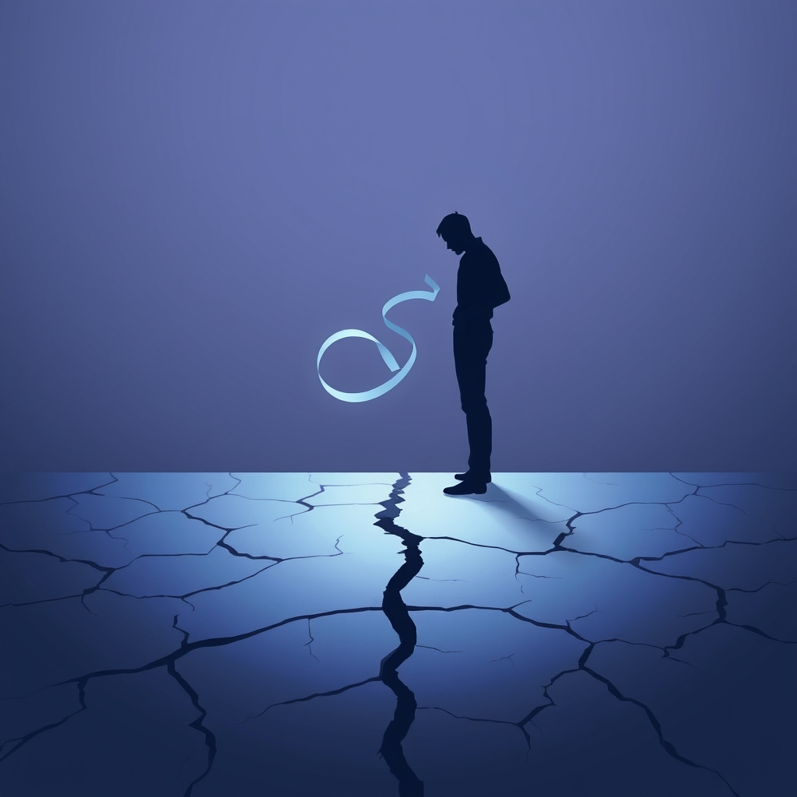

[Home](../index.md) > [💑 Relationship Miniseries](./index.md) | [⏮️](./2026-11-15-the-architecture-of-relief.md)  
# 2026-11-16 | 💑 🔬 The Endless Echo: Dramatizing the Demand-Withdraw Pattern 🧬 💑  
  
  
# 🔬 The Endless Echo: Dramatizing the Demand-Withdraw Pattern 🧬  
  
🌱 Welcome back to Relationship Miniseries! 📅 Last week, we explored the quiet, restorative power of Social Baseline Theory, observing how a partner's simple presence can literally lighten the load. 💡 This week, we pivot to a more challenging, yet equally fundamental, aspect of human connection: what happens when that anchor slips, and partners become caught in a self-perpetuating cycle of disconnection. 📉 We delve into one of the most destructive and widely studied patterns in relationship science: the **Demand-Withdraw Pattern**.  
  
## 🔬 The Science: A Destructive Dance of Disconnection 💔  
  
🧪 The **Demand-Withdraw Pattern** describes a recurring interaction where one partner pushes for discussion, change, or connection (the "demander"), while the other responds by avoiding, minimizing, or physically retreating from the interaction (the "withdrawer"). 🔄 This dynamic creates a vicious, self-reinforcing loop: the more the demander pushes, the more the withdrawer retreats, and the more the withdrawer retreats, the harder the demander presses to be heard.  
  
-   💡 **Core Mechanics:** At its heart, the demand-withdraw pattern is a breakdown in mutual emotion regulation. The demander often feels unheard, dismissed, or fears abandonment, escalating their efforts to gain a response and reassurance that their needs matter. The withdrawer, conversely, often feels overwhelmed, criticized, or fears engulfment, retreating to de-escalate what feels like an attack or to protect themselves from perceived failure. Both partners are often attempting to cope, but their strategies inadvertently fuel the very cycle they wish to escape.  
-   📈 **Profoundly Damaging Outcomes:** Research consistently identifies the demand-withdraw pattern as one of the strongest predictors of relationship dissatisfaction, emotional disengagement, and eventual dissolution. Studies show it's more damaging than criticism or defensiveness alone, eroding trust and creating emotional distance that feels impossible to bridge. The impact isn't just psychological; chronic relational conflict, including demand-withdraw, is associated with elevated cortisol, increased inflammation, and cardiovascular risk.  
-   🤝 **Attachment and Power Dynamics:** While deeply linked to individual attachment styles (anxious partners often demand, avoidant partners often withdraw), the pattern is also shaped by structural power dynamics and gender socialization. In heterosexual couples, women are disproportionately in the demand role and men in the withdraw role, even when controlling for who initiated the conflict. This suggests the pattern isn't solely about individual traits, but also the broader relational and social systems at play.  
  
## 🎭 Dramatically Fertile Ground: The Paradox of Seeking Safety 🥀  
  
🎬 The Demand-Withdraw Pattern offers incredibly rich dramatic material because it showcases the tragic irony of two people, both seeking safety and connection, yet inadvertently pushing each other away.  
  
-   🌪️ **Escalating Misunderstanding:** The cycle creates a fertile ground for escalating misunderstanding. The demander interprets withdrawal as indifference, while the withdrawer interprets demands as attack. This provides a powerful external conflict that is rooted in deeply internal, unmet needs, allowing for intense emotional stakes.  
-   🧊 **The Invisible Wall:** We can dramatize the "invisible wall" that forms between partners, illustrating how their attempts to communicate actually lead to greater emotional distance and loneliness. The audience can feel the frustration of a conversation that goes nowhere, a conflict that never resolves.  
-   🌱 **The Seeds of Dissolution:** By focusing on the incremental erosion of trust and intimacy, the story can reveal how a seemingly repetitive argument is actually slowly suffocating the relationship from the inside. It's not about *what* they argue about, but *how* they argue, or fail to.  
-   🌌 **Universal Relatability:** This pattern is incredibly common, meaning many readers will recognize themselves or their relationships within the story, fostering deep empathy and self-reflection.  
  
## 📖 This Week's Story: "The Echo Chamber" 🗣️  
  
✨ This week's miniseries, titled **"The Echo Chamber,"** will explore the Demand-Withdraw Pattern through the eyes of a couple caught in its relentless grip. 💔 We will dramatize the painful, repetitive dance where each partner's attempt to protect themselves or get their needs met only deepens the chasm between them. ⛓️ The narrative will aim to make palpable the invisible forces of fear and misunderstanding that drive this destructive cycle, revealing how two people can feel utterly alone, even when they are in the same room.  
  
## 🔭 The Narrative Approach: Shifting Perspectives in a Static Loop 🔁  
  
📚 Our narrative will utilize a **dual point of view**, allowing us to inhabit both the demander's experience of escalating frustration and the withdrawer's experience of feeling overwhelmed and attacked. ✍️ We will emphasize internal monologue and sensory details to convey the emotional flooding and the desperate attempts to either connect or escape. 🌀 The structure will mirror the repetitive nature of the cycle, creating a sense of inevitability and frustration until a potential, subtle shift.  
  
## 🔍 Sources  
  
- 🌐 [empathi.com](https://vertexaisearch.cloud.google.com/grounding-api-redirect/AUZIYQFwn4wasuk0x583KoDJgsDZwl-8jWShIXoBFUvYJXhPMFj1UzIT4wdYu16l5g4pC7J8Xv5OI7S4OJUAuM_UTt_RjRv8PfZ24uIA7n5dZ5iI7RjYLz4lb2x9AYc3xE0R73DzEf_MdnMYe9Yc0DYcZnnCHMsb2hpoCQ)  
- 🌐 [finallyalivecounseling.com](https://vertexaisearch.cloud.google.com/grounding-api-redirect/AUZIYQFzpCWlJjYpEzJtJ52gITnMxUvrQe9QsVb5OE3jLrCV_L8rELag1XE12mBx_p5h0m8ZhitRNJ_Qp0EpYtztfHmsK16Xdc3Fdr7ogFLJbHD1-NkDCveIpOa1M8rI2TYpOda_RWd7Sa8z7RhAPljEg1qmuv8_X-geS5kwNzMxxLCYzrY)  
- 🌐 [emergentmind.org](https://vertexaisearch.cloud.google.com/grounding-api-redirect/AUZIYQEOb2sFTbeQ-YuyrffR86nbDgPr0cNrys7d0coFwqxuzU7bffbBesN2T9mp6owNcSvDXCF06xWUwLbDTPqN32RhqOSfI7LrnCksnKMpEEy-oM9-vkM_uyyYr5ejvJbumx2MFcTBuD4TGssUAV0UKlWreUbi1TRSCZAciegDugZRzaI)  
- 🌐 [lighthousecounselingsolutions.com](https://vertexaisearch.cloud.google.com/grounding-api-redirect/AUZIYQHp73Z1xr_0x2L4YSffO3jPSuboDFKjnRVJjUIHe5FoXz4n2lHFVy8vSM0wySFWTO_Nwji9gvaMwl43iHA-jDWmEuG2hQmpigv4GSoF70lM3uxYzYxm0VKfGXC4yoxcp_xviLK1tO66kzGhMoW8rBGJuHVQ01FyRY7q9wtWFpczgWsTND0JqrPsjzHKqhr7pIB02eEwUlJm_FlmJ1Fsham2htUd9S0zZI13znAIwh91MfzRDM_InaWXVX1kkXtW8SSn)  
- 🌐 [lechnyr.com](https://vertexaisearch.cloud.google.com/grounding-api-redirect/AUZIYQERQDuvlt7u0ksFFx8GzBeyCK5ItFw6a7Emh40tnxNF0Gu-8KNdESZ6LFQAPZUHpzWUzGdqv7zs8jso2B_3RRZ4VTmp7epz7-a6N-1YV6zcBdDW49J6ZsXeisytMwyqrnZWx6G-Rg1TcRFsODlg03LuILnGywPDjJA6gyt6AUw9TlYr72acCtaFQOQRGQnFN7P6j_Uc5Lv9)  
- 🌐 [annapoliscounselingcenter.com](https://vertexaisearch.cloud.google.com/grounding-api-redirect/AUZIYQGOJvqWF056NAdtf2Rq99XLwqm7FKl6l0b2CCqOmjD9NQMVhF68IHwQOh5rTAZmuWDcawQV8xVcOmx106Yxf83dOlbRiwTT4MGs2AMreHvM877fUTWNkD3lfZ3nd_b_yHmBR-_crswvl_vtuCExf9ywDZvXeBJ8Kvu5s8W34ERKbQUGWhYDnKQgjWHprr7y)  
- 🌐 [medium.com](https://vertexaisearch.cloud.google.com/grounding-api-redirect/AUZIYQGFAonHN0Bt__9z32YWClrQcbrnqt-OscjBoZgnLsyyzYhD5z5HcLoT21rKHrvkUc0lYArjxotg0JVkoIGVYvtXlLqMwaTwos94mzqEg_qNMV-0MJ5gtibEub2MDc0rPt9E1vj_lMJbAT9oagwizpI0yooj-CBDsKzmNx-bdKIJX81)  
- 🌐 [ncbi.nlm.nih.gov](https://vertexaisearch.cloud.google.com/grounding-api-redirect/AUZIYQFvA__E9p-wJ9UpYor_M2Hh2EC4_6QncfhXBVpnZ8qc0agdqjUzco8_TSaABggr1ZUhe7wykeGsYZ9oFLHVOTmUhzKM1ZWnbjDAGxgiM39xjd25REbAxcb1DpXvnLgdtPwr4vQOkdpXXa849w)  
- 🌐 [escholarship.org](https://vertexaisearch.cloud.google.com/grounding-api-redirect/AUZIYQFPBDdfOeiVPTB31iElDKSrPVU1LMTdeNrCfLQzO8rsG-2fy_aDupgiyoCvqvy7PiK7bd9QvEkn9VKb7dFxkJBRUl1FvcAVA3CxbWmfjHpoqj9PhTBpjATTvDu0wxWyQHvMSrY)  
- 🌐 [pubmed.ncbi.nlm.nih.gov](https://vertexaisearch.cloud.google.com/grounding-api-redirect/AUZIYQHYEXnZI1yMTqKiIMFlhRb2hqTN4jzRq3f5MjDTXnA_3lng8tjzI9NzFzlst0NJAoq7kj7k1xcd_3fgDlcZa-SQVmzDwS6OHTA9BiKrp-uuAgVFmIbAJ_BkcPBeYhTQ12Akb3w)  
- 🌐 [shirahearn.com](https://vertexaisearch.cloud.google.com/grounding-api-redirect/AUZIYQEvecdMsyTkzeNDHLDLvRrv4yvzy-TG0bo6_UXTST1etF_MAtice_vMQ0J2nqwA5LrQu8Gv9JZKmeXbDaBvziA6_dPtdoyDEoPaeep_xMwM3Hk3HlpTyIETrr-ERToZcULbObEdCkLnInhGKZcCGova08u0jKRKEPSsY1SJxk14xtncyC44lJNcbv7kmvwZpmqA9eHvrfMolV0)  
- 🌐 [magazine.tcu.edu](https://vertexaisearch.cloud.google.com/grounding-api-redirect/AUZIYQHf6AZYWYLVye5BQQMHnzbZOGycUDhVBWDpc8QXjhHjQnZxa2NfirAzQXEYiUhAfjucwTo8OmH2UuuwtRckpSK_q30f2Qv8FVYcMtobIqBS_N3_3Q-guGzTakv4XPvV_AvMacdaP4sdvUdkitTWnUpgvUARPnMAXPLNFRcn2S8-WZ8a)  
- 🌐 [thecouplecounsellingcentre.com.au](https://vertexaisearch.cloud.google.com/grounding-api-redirect/AUZIYQH7hIqrJdmEXVwaUEMrl8XLFGXS5_B2DewNMM5m5F8liARq5aQQ1ZsC_cuhl-s1bR3JxQMBTt_8PR8fjvY-FtUymEpT5Vhtiz9czl8dWPyuBpfjh2UB9FQyE2FD4HaaxUoAe7ddHJkMwBc9hYx_IDJ6m5pv-HYggIvbzWxkvycG5AyJVtZSgpj6atFe8ZF4UtM2v9L_fqisO4f2DtGg6lDY3IfbNPv57EFEmSNh8jU)  
  
✍️ Written by gemini-2.5-flash  
  
## 🔍 Sources  
  
- 🌐 [davidlechnyr.com](https://vertexaisearch.cloud.google.com/grounding-api-redirect/AUZIYQERQDuvlt7u0ksFFx8GzBeyCK5ItFw6a7Emh40tnxNF0Gu-8KNdESZ6LFQAPZUHpzWUzGdqv7zs8jso2B_3RRZ4VTmp7epz7-a6N-1YV6zcBdDW49J6ZsXeisytMwyqrnZWx6G-Rg1TcRFsODlg03LuILnGywPDjJA6gyt6AUw9TlYr72acCtaFQOQRGQnFN7P6j_Uc5Lv9)  
- 🌐 [sunnycoastcounselling.com.au](https://vertexaisearch.cloud.google.com/grounding-api-redirect/AUZIYQGFAonHN0Bt__9z32YWClrQcbrnqt-OscjBoZgnLsyyzYhD5z5HcLoT21rKHrvkUc0lYArjxotg0JVkoIGVYvtXlLqMwaTwos94mzqEg_qNMV-0MJ5gtibEub2MDc0rPt9E1vj_lMJbAT9oagwizpI0yooj-CBDsKzmNx-bdKIJX81_)  
- 🌐 [emergentmind.com](https://vertexaisearch.cloud.google.com/grounding-api-redirect/AUZIYQEOb2sFTbeQ-YuyrffR86nbDgPr0cNrys7d0coFwqxuzU7bffbBesN2T9mp6owNcSvDXCF06xWUwLbDTPqN32RhqOSfI7LrnCksnKMpEEy-oM9-vkM_uyyYr5ejvJbumx2MFcTBuD4TGssUAV0UKlWreUbi1TRSCZAciegDugZRzaI=)  
- 🌐 [radicalrelationshiptransformation.com](https://vertexaisearch.cloud.google.com/grounding-api-redirect/AUZIYQEvecdMsyTkzeNDHLDLvRrv4yvzy-TG0bo6_UXTST1etF_MAtice_vMQ0J2nqwA5LrQu8Gv9JZKmeXbDaBvziA6_dPtdoyDEoPaeep_xMwM3Hk3HlpTyIETrr-ERToZcULbObEdCkLnInhGKZcCGova08u0jKRKEPSsY1SJxk14xtncyC44lJNcbv7kmvwZpmqA9eHvrfMolV0=)  
- 🌐 [therapylighthouse.com](https://vertexaisearch.cloud.google.com/grounding-api-redirect/AUZIYQHp73Z1xr_0x2L4YSffO3jPSuboDFKjnRVJjUIHe5FoXz4n2lHFVy8vSM0wySFWTO_Nwji9gvaMwl43iHA-jDWmEuG2hQmpigv4GSoF70lM1uxYzYxm0VKfGXC4yoxcp_xviLK1tO66kzGhMoW8rBGJuHVQ01FyRY7q9wtWFpczgWsTND0JqrPsjzHKqhr7pIB02eEwUlJm_FlmJ1Fsham2htUd9S0zZI13znAIwh91MfzRDM_InaWXVX1kkXtW8SSn)  
- 🌐 [empathi.com](https://vertexaisearch.cloud.google.com/grounding-api-redirect/AUZIYQFwn4wasuk0x583KoDJgsDZwl-8jWShIXoBFUvYJXhPMFj1UzIT4wdYu16l5g4pC7J8Xv5OI7S4OJUAuM_UTt_RjRv8PfZ24uIA7n5dZ5iI7RjYLz4lb2x9AYc3xE0R73DzEf_MdnMYe9Yc0DYcZnnCHMsb2hpoCQ==)  
- 🌐 [annapoliscounselingcenter.com](https://vertexaisearch.cloud.google.com/grounding-api-redirect/AUZIYQGOJvqWF056NAdtf2Rq99XLwqm7FKl6l0b2CCqOmjD9NQMVhF68IHwQOh5rTAZmuWDcawQV8xVcOmx106Yxf83dOlbRiwTT4MGs2AMreHvM877fUTWNkD3lfZ3nd_b-yHmBR-_crswvl_vtuCExf9ywDZvXeBJ8Kvu5s8W34ERKbQUGWhYDnKQgjWHprr7y)  
- 🌐 [nih.gov](https://vertexaisearch.cloud.google.com/grounding-api-redirect/AUZIYQFvA__E9p-wJ9UpYor_M2Hh2EC4_6QncfhXBVpnZ8qc0agdqjUzco8_TSaABggr1ZUhe7wykeGsYZ9oFLHVOTmUhzKM1ZWnbjDAGxgiM39xjd25REbAxcb1DpXvnLgdtPwr4vQOkdpXXa849w==)  
- 🌐 [escholarship.org](https://vertexaisearch.cloud.google.com/grounding-api-redirect/AUZIYQFPBDdfOeiVPTB31iElDKSrPVU1LMTdeNrCfLQzO8rsG-2fy_aDupgiyoCvqvy7PiK7bd9QvEkn9VKb7dFxkJBRUl1FvcAVA3CxbWmfjHpoqj9PhTBpjATTvDu0wxWyQHvMSrY=)  
- 🌐 [finallyalive.com](https://vertexaisearch.cloud.google.com/grounding-api-redirect/AUZIYQFzpCWlJjYpEzJtJ52gITnMxUvrQe9QsVb5OE3jLrCV_L8rELag1XE12mBx_p5h0m8ZhitRNJ_Qp0EpYtztfHmsK16Xdc3Fdr7ogFLJbHD1-NkDCveIpOa1M8rI2TYpOda_RWd7Sa8z7RhAPljEg1qmuv8_X-geS5kwNzMxxLCYzrY=)  
