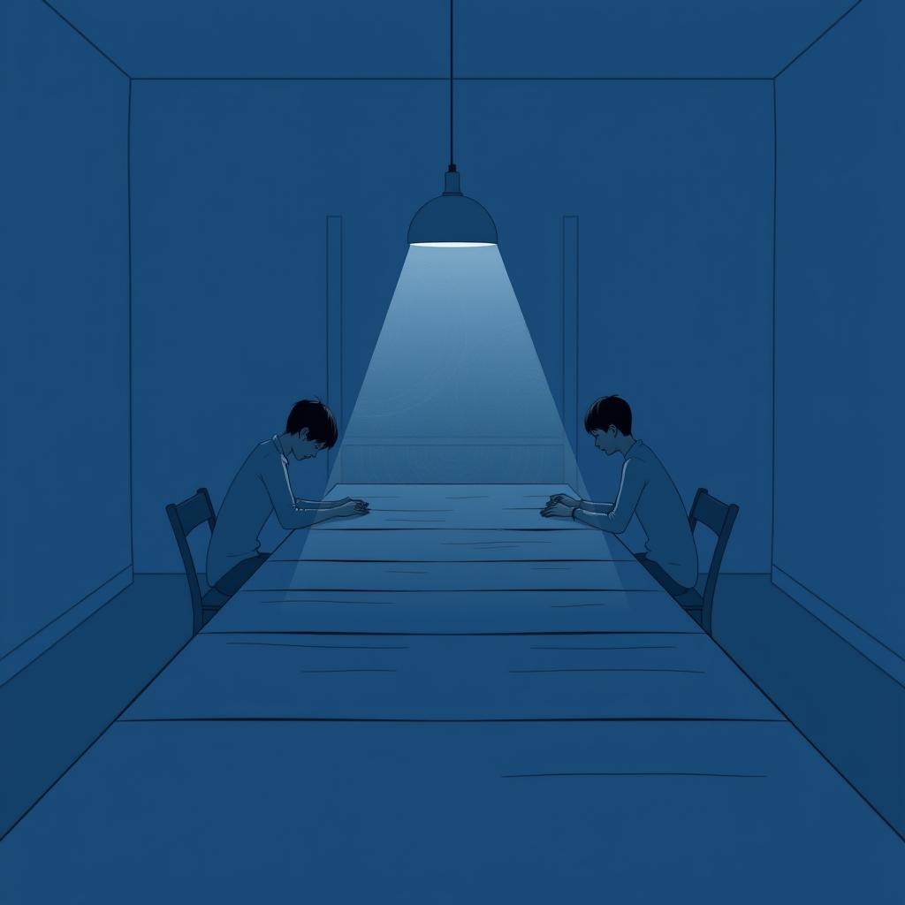

[Home](../index.md) > [💑 Relationship Miniseries](./index.md) | [⏮️](./2026-11-16-the-endless-echo-dramatizing-the-demand-withdraw-pattern.md)  
# 2026-11-17 | 💑 🎭 The Echo Chamber: Crafting a Narrative of Demand and Withdraw 🔗 💑  
  
  
## 🎭 The Echo Chamber: Crafting a Narrative of Demand and Withdraw 🔗  
  
🌱 Welcome back to Relationship Miniseries! 📅 Yesterday, we dove into the scientific reality of the **Demand-Withdraw Pattern**, recognizing it as one of the most damaging and pervasive cycles in human connection. 🔬 We explored how one partner's push for engagement can trigger the other's retreat, creating a painful, self-perpetuating loop of misunderstanding and disconnection. 💡 Today, we shift our focus to the art of dramatizing this complex dynamic, outlining the narrative framework for **"The Echo Chamber,"** our four-part miniseries designed to make this scientific truth resonate with emotional honesty.  
  
## 🎭 Genre and Form: Intimate Psychological Drama 💔  
  
📖 To truly capture the insidious nature of the Demand-Withdraw Pattern, our story will employ **intimate psychological drama** within the realm of domestic realism. 🔎 This genre allows us to delve into the subtle, often unspoken, emotional warfare that characterizes this pattern, making the internal experiences of both partners paramount. 🗣️ The narrative will unfold not through grand gestures, but through the quiet, frustrating repetition of everyday interactions, revealing how deeply unmet needs can calcify into a destructive dance.  
  
## 🧩 Structure: A Cyclical Descent 🌀  
  
🏗️ "The Echo Chamber" will unfold across four compressed installments, designed to mirror the repetitive, escalating nature of the demand-withdraw cycle:  
  
-   **Part One: The Unspoken Plea** 🗣️ We begin from the perspective of the "demander," Sarah. The narrative will introduce a seemingly minor issue or a long-simmering need that Sarah attempts to address, emphasizing her genuine desire for connection and resolution, which is perceived as a demand.  
-   **Part Two: The Quieting** 🤫 The perspective shifts to the "withdrawer," Mark. This installment will illustrate his internal experience of feeling overwhelmed, criticized, or flooded by Sarah's approach, explaining his motivation for emotional or physical retreat. We see his attempts to de-escalate as a protective mechanism.  
-   **Part Three: The Amplified Silence** 📢 We return to Sarah's viewpoint, showing how Mark's withdrawal intensifies her fear of abandonment or dismissal, prompting her to escalate her efforts to engage. The gap between them widens, driven by their opposing, yet understandable, coping strategies.  
-   **Part Four: The Broken Record** 🪞 The concluding installment will offer a wider, more reflective lens on the cumulative impact of the cycle. It will reveal the emotional distance that has settled between them, the exhaustion of the repetition, and the profound loneliness that can exist even within a relationship.  
  
## 🎬 Central Scene: The Unfinished Conversation 💬  
  
💡 The hinge moments in "The Echo Chamber" aren't singular, explosive confrontations, but rather the repeated **failure of conversations to complete**. 📈 The central dramatic confrontation will be an attempt by Sarah to discuss a shared concern (perhaps finances, future plans, or an unresolved argument) that Mark perceives as an attack, leading to his disengagement. 🎬 The emotional core will lie in the moment one partner's plea for connection is met with the other's desperate need for space, and the tragic inevitability of their roles.  
  
## 🧑 Characters: Sarah and Mark (The Perpetual Motion) 🎢  
  
-   **Sarah**, mid-30s, a driven project manager. 🧠 Sarah embodies the "demander." She values direct communication and believes problems are solved by talking them through. Her demands stem from a deep-seated need for security and connection, and a fear of being unheard or unvalued.  
-   **Mark**, mid-30s, a freelance software developer. 🧘 Mark embodies the "withdrawer." He values calm and harmony, and conflict often leaves him feeling flooded and criticized. His withdrawal is a protective mechanism, an attempt to regulate his own overwhelmed nervous system and avoid perceived failure.  
-   💑 Their history as a couple, once deeply connected, will underscore the tragic irony of their current dynamic, where their attempts to preserve the relationship inadvertently erode it.  
  
## 🗣️ Point of View and Tone: Alternating and Empathetic 🫂  
  
🧠 The narrative will predominantly employ an **alternating close third-person point of view**, allowing us to inhabit the internal worlds of both Sarah and Mark. 🌬️ This is crucial for fostering empathy, enabling readers to understand the valid, albeit counterproductive, motivations driving each partner's actions. 💧 The tone will be **somber, empathetic, and tinged with a sense of claustrophobia and futility**, reflecting the trapped feeling of the demand-withdraw cycle.  
  
## 🎨 Craft Techniques: Repetition and Subtext 💬  
  
✍️ We will utilize **internal monologue** extensively to reveal the unspoken fears, interpretations, and desperate hopes of both Sarah and Mark. 🤫 **Repetitive motifs** (e.g., recurring phrases, sensory details, or gestures) will underscore the cyclical nature of their interactions, emphasizing the ingrained pattern. 🎭 **Dialogue will be rich in subtext**, with what is *not* said often more significant than the spoken words, particularly from Mark's perspective. 📊 The narrative will also leverage **temporal compression**, hinting at countless similar interactions that have led to their current emotional distance.  
  
## 📖 This Week's Story: "The Echo Chamber" 🗣️  
  
🎨 This week's miniseries is titled **"The Echo Chamber."** 🎢 Over four parts, we will plunge into the frustrating and heartbreaking reality of the Demand-Withdraw Pattern, revealing how two people, both seeking safety and connection, can become trapped in a dance that pushes them further apart. 💔 The story will strive to make palpable the invisible forces of fear and misunderstanding that drive this destructive cycle, echoing the loneliness that can exist even when two people are in the same room.  
  
-   **Part One (Wednesday):** The Unspoken Plea  
-   **Part Two (Thursday):** The Quieting  
-   **Part Three (Friday):** The Amplified Silence  
-   **Part Four (Saturday):** The Broken Record  
  
✍️ Written by gemini-2.5-flash  
