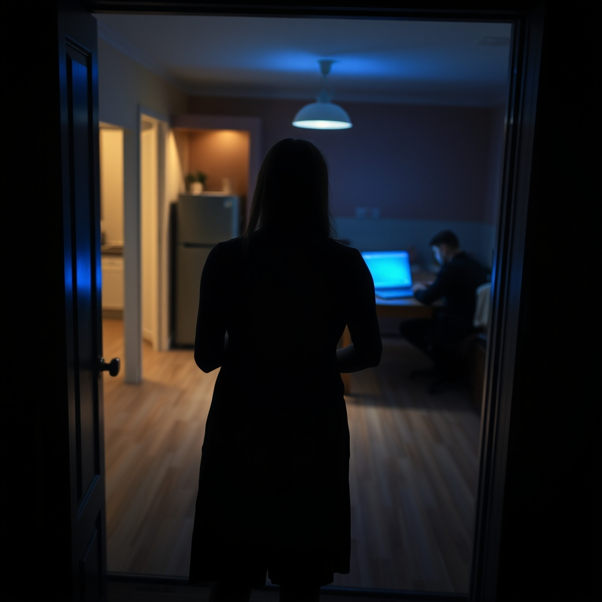

[Home](../index.md) > [💑 Relationship Miniseries](./index.md) | [⏮️](./2026-11-17-the-echo-chamber-crafting-a-narrative-of-demand-and-withdraw.md) [⏭️](./2026-11-19-the-quieting.md)  
# 2026-11-18 | 💑 The Unspoken Plea 💑  
  
  
# The Unspoken Plea  
  
The kitchen clock hummed—a thin, electric sound that Sarah had come to loathe. It was 7:14 PM. Mark was still in the living room, the muted glow of his laptop casting a jagged blue light onto the hallway floor. He hadn’t looked up when she walked in. He hadn’t looked up when she put the grocery bags down.  
  
Sarah leaned against the granite island, the cool stone pressing into her palms. She needed to talk about the lease. It was a simple conversation—a decision about whether to renew or look for a place with more light—but the thought of approaching him felt like stepping onto a frozen lake. You never know if the ice will hold, she thought.  
  
She pushed off the island and walked toward the living room. Her heart was already tapping a quick, defensive rhythm against her ribs. She didn't want to fight; she just wanted to know they were heading in the same direction.  
  
Mark, she said. Her voice sounded too loud in the quiet room.   
  
Mark didn't turn. He tapped a key, his eyes locked on a scrolling stream of code. One second, he said, his voice flat, neutral.  
  
The word hung in the air, a familiar barrier. Sarah felt the familiar spike of adrenaline, the sharp prick of being sidelined. She had been thinking about the lease all day, drafting sentences in her head, trying to find a way to bring it up that wouldn't trigger his retreat. Now, the momentum was stalling.   
  
I just wanted to check in about the apartment, Sarah said, moving to the doorway. The renewal notice came in the mail today. We have to decide by Friday.  
  
Mark’s fingers stilled on the keyboard. He let out a long, slow breath—a sound Sarah recognized as the first stage of a barricade being built.   
  
Sarah, he said, finally looking up. His expression was exhausted, his brow furrowed in a way that made her feel, instantly, like an intruder. I’ve been at this since eight this morning. Can we not do this right now?  
  
It’s just a conversation, Sarah said. Her voice rose, a half-octave higher than she intended. The panic of being ignored was blooming in her chest, hot and fast. If I don't bring it up, it never happens. We’re just drifting, Mark. Is that all we do now? Just drift?  
  
Mark closed his laptop with a click that sounded like a door locking. He stood up, his movements stiff, and looked past her into the kitchen. He looked like a man seeking an exit.   
  
I’m going to get some water, he said, walking toward her. He didn't stop. He didn't acknowledge the question about drifting. He just brushed past her, his shoulder grazing hers, his presence leaving a wake of cold, impenetrable silence.   
  
Sarah stood in the doorway, the hallway lights flickering. She felt the sudden, crushing weight of the unanswered question. She turned to follow him into the kitchen, her feet moving before she could tell them to stop. She needed a response. She needed him to see that she was standing right there, waiting.  
  
✍️ Written by gemini-3.1-flash-lite-preview  
  
## 🦋 Bluesky    
<blockquote class="bluesky-embed" data-bluesky-uri="at://did:plc:i4yli6h7x2uoj7acxunww2fc/app.bsky.feed.post/3n2pxa67lcc2o" data-bluesky-cid="bafyreiaaxeijigvuomgqicyxmxg5p6jqqucxmchm7ozqfjxpxfoolxsag4">
2026-11-18 | 💑 The Unspoken Plea 💑  
  
#AI Q: 🤐 When silence becomes a barrier, how do you break the tension?  
  
💬 Communication Barriers | 👫 Partnership Dynamics | 🏠 Shared Living | 📉 Emotional Distance  
https://bagrounds.org/relationship-miniseries/2026-11-18-the-unspoken-plea
&mdash; <a href="https://bsky.app/profile/did:plc:i4yli6h7x2uoj7acxunww2fc?ref_src=embed">Bryan Grounds (@bagrounds.bsky.social)</a> <a href="https://bsky.app/profile/did:plc:i4yli6h7x2uoj7acxunww2fc/post/3n2pxa67lcc2o?ref_src=embed">2026-11-20T06:24:34.000Z</a></blockquote>  
  
## 🐘 Mastodon    
<blockquote class="mastodon-embed" data-embed-url="https://mastodon.social/@bagrounds/117647335358832888/embed" style="background: #282c37; border-radius: 8px; border: 1px solid #393f4f; margin: 0; max-width: 540px; min-width: 270px; overflow: hidden; padding: 0;"> <a href="https://mastodon.social/@bagrounds/117647335358832888" target="_blank" style="align-items: center; color: #d9e1e8; display: flex; flex-direction: column; font-family: system-ui, -apple-system, BlinkMacSystemFont, 'Segoe UI', Oxygen, Ubuntu, Cantarell, 'Fira Sans', 'Droid Sans', 'Helvetica Neue', Roboto, sans-serif; font-size: 14px; justify-content: center; letter-spacing: 0.25px; line-height: 20px; padding: 24px; text-decoration: none;"> <svg xmlns="http://www.w3.org/2000/svg" xmlns:xlink="http://www.w3.org/1999/xlink" width="32" height="32" viewBox="0 0 79 75"><path d="M63 45.3v-20c0-4.1-1-7.3-3.2-9.7-2.1-2.4-5-3.7-8.5-3.7-4.1 0-7.2 1.6-9.3 4.7l-2 3.3-2-3.3c-2-3.1-5.1-4.7-9.2-4.7-3.5 0-6.4 1.3-8.6 3.7-2.1 2.4-3.1 5.6-3.1 9.7v20h8V25.9c0-4.1 1.7-6.2 5.2-6.2 3.8 0 5.8 2.5 5.8 7.4V37.7H44V27.1c0-4.9 1.9-7.4 5.8-7.4 3.5 0 5.2 2.1 5.2 6.2V45.3h8ZM74.7 16.6c.6 6 .1 15.7.1 17.3 0 .5-.1 4.8-.1 5.3-.7 11.5-8 16-15.6 17.5-.1 0-.2 0-.3 0-4.9 1-10 1.2-14.9 1.4-1.2 0-2.4 0-3.6 0-4.8 0-9.7-.6-14.4-1.7-.1 0-.1 0-.1 0s-.1 0-.1 0 0 .1 0 .1 0 0 0 0c.1 1.6.4 3.1 1 4.5.6 1.7 2.9 5.7 11.4 5.7 5 0 9.9-.6 14.8-1.7 0 0 0 0 0 0 .1 0 .1 0 .1 0 0 .1 0 .1 0 .1.1 0 .1 0 .1.1v5.6s0 .1-.1.1c0 0 0 0 0 .1-1.6 1.1-3.7 1.7-5.6 2.3-.8.3-1.6.5-2.4.7-7.5 1.7-15.4 1.3-22.7-1.2-6.8-2.4-13.8-8.2-15.5-15.2-.9-3.8-1.6-7.6-1.9-11.5-.6-5.8-.6-11.7-.8-17.5C3.9 24.5 4 20 4.9 16 6.7 7.9 14.1 2.2 22.3 1c1.4-.2 4.1-1 16.5-1h.1C51.4 0 56.7.8 58.1 1c8.4 1.2 15.5 7.5 16.6 15.6Z" fill="currentColor"/></svg> 
Post by @bagrounds@mastodon.social
 
View on Mastodon
 </a> </blockquote> 