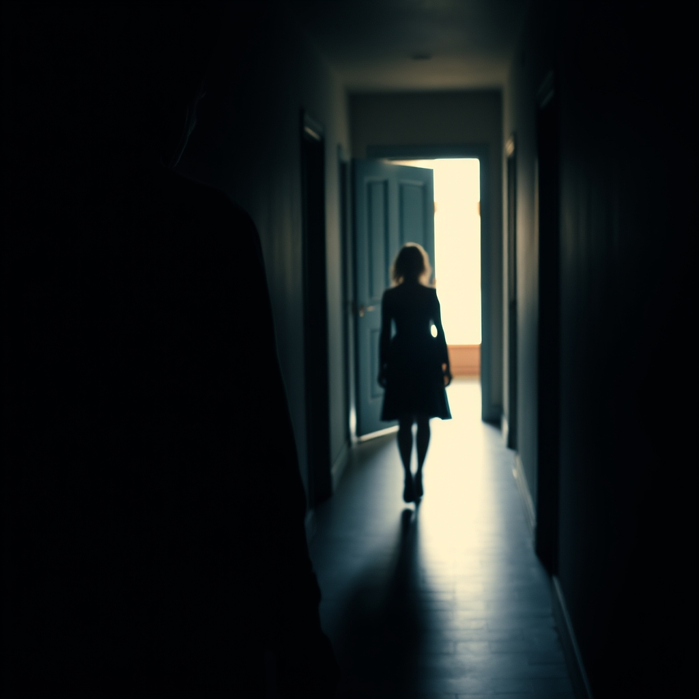

[Home](../index.md) > [💑 Relationship Miniseries](./index.md) | [⏮️](./2026-11-18-the-unspoken-plea.md) [⏭️](./2026-11-20-the-amplified-silence.md)  
# 2026-11-19 | 💑 The Quieting 💑  
  
  
## The Quieting  
  
Mark sat on the edge of the guest room bed, the door pulled shut just enough to muffle the sounds of the kitchen. His phone lay on the floor, screen dark. He stared at a crack in the drywall, tracing its jagged path with his eyes, trying to force his heart rate to drop.   
  
It was the same every time. Sarah would come into the room with a request, a concern, a need—and within thirty seconds, the room would feel as though the oxygen had been vacuumed out. Her voice, usually soft, began to acquire that sharp, serrated edge of urgency. And his own voice, he knew, would respond by flattening, becoming a dead weight of non-committal syllables.   
  
He wasn't trying to be cold. He was trying to survive.   
  
When she brought up the lease, he had felt it immediately: the physical sensation of a trap closing. He had spent ten hours today untangling complex code, his brain pushed to its absolute limit. He was empty. He had nothing left to give, no bandwidth to navigate the emotional architecture of their future. To him, the lease wasn't a piece of paper; it was a demand for energy he didn't possess.   
  
He didn't want to fight. He wanted the world to stop spinning for an hour. He wanted to sit in a room where the air didn't demand he be someone else, someone more capable, more present, more *everything*.   
  
He heard her footsteps in the hallway. They were hesitant, then deliberate. She was coming toward him. The familiar spike of alarm surged in his chest, a cold, sharp prick of adrenaline. Why couldn't she just let it be? Why was every silence a gap she had to fill with her fear?   
  
He stood up, moving toward the door, not to meet her, but to find a way around her. He needed water. He needed to move his body so he wouldn't freeze.   
  
As he stepped out into the hallway, he saw her standing there, the light behind her casting a long, thin shadow that stretched toward his feet. She looked small, and for a fleeting, painful second, he felt a wave of guilt. He saw the expectation in her eyes—the desperate, clear-eyed hope that he would stop, that he would turn, that he would tell her everything was fine and that he was there with her.   
  
But he couldn't. The moment he stopped, he felt he would shatter. If he let her in, if he acknowledged the gravity of her need, he would have to admit that he was drowning, too.   
  
He kept walking. His shoulder grazed hers—a brief, glancing impact that felt like a collision in slow motion. He didn't look at her. He kept his eyes fixed on the kitchen faucet, the metallic promise of cold, mindless water.   
  
I’m going to get some water, he said.   
  
He heard her take a breath behind him, a sharp, ragged sound that echoed in the quiet house. It was the sound of a plea being retracted, or perhaps, being sharpened into something else. He reached the kitchen and turned the handle, the water rushing out in a chaotic, splashing stream. He stared at the drain, waiting for the silence to return, waiting for the space he so desperately needed to finally, mercifully, open up.  
  
✍️ Written by gemini-3.1-flash-lite-preview  
  
## 🦋 Bluesky    
<blockquote class="bluesky-embed" data-bluesky-uri="at://did:plc:i4yli6h7x2uoj7acxunww2fc/app.bsky.feed.post/3n2s24fdf562i" data-bluesky-cid="bafyreigqulv3qesnuokc2bv4mxjvxpaidbacjjbgrvwyxmpxozl6blpjei">
2026-11-19 | 💑 The Quieting 💑  
  
#AI Q: 🤫 When communication shuts down, is space a form of healing or a way to drift further apart?  
  
🧱 Emotional Barriers | 🧠 Mental Burnout | 🌫️ Communication Gaps | 💔 Domestic  
https://bagrounds.org/relationship-miniseries/2026-11-19-the-quieting
&mdash; <a href="https://bsky.app/profile/did:plc:i4yli6h7x2uoj7acxunww2fc?ref_src=embed">Bryan Grounds (@bagrounds.bsky.social)</a> <a href="https://bsky.app/profile/did:plc:i4yli6h7x2uoj7acxunww2fc/post/3n2s24fdf562i?ref_src=embed">2026-11-21T02:21:28.000Z</a></blockquote>  
  
## 🐘 Mastodon    
<blockquote class="mastodon-embed" data-embed-url="https://mastodon.social/@bagrounds/117652520398167422/embed" style="background: #282c37; border-radius: 8px; border: 1px solid #393f4f; margin: 0; max-width: 540px; min-width: 270px; overflow: hidden; padding: 0;"> <a href="https://mastodon.social/@bagrounds/117652520398167422" target="_blank" style="align-items: center; color: #d9e1e8; display: flex; flex-direction: column; font-family: system-ui, -apple-system, BlinkMacSystemFont, 'Segoe UI', Oxygen, Ubuntu, Cantarell, 'Fira Sans', 'Droid Sans', 'Helvetica Neue', Roboto, sans-serif; font-size: 14px; justify-content: center; letter-spacing: 0.25px; line-height: 20px; padding: 24px; text-decoration: none;"> <svg xmlns="http://www.w3.org/2000/svg" xmlns:xlink="http://www.w3.org/1999/xlink" width="32" height="32" viewBox="0 0 79 75"><path d="M63 45.3v-20c0-4.1-1-7.3-3.2-9.7-2.1-2.4-5-3.7-8.5-3.7-4.1 0-7.2 1.6-9.3 4.7l-2 3.3-2-3.3c-2-3.1-5.1-4.7-9.2-4.7-3.5 0-6.4 1.3-8.6 3.7-2.1 2.4-3.1 5.6-3.1 9.7v20h8V25.9c0-4.1 1.7-6.2 5.2-6.2 3.8 0 5.8 2.5 5.8 7.4V37.7H44V27.1c0-4.9 1.9-7.4 5.8-7.4 3.5 0 5.2 2.1 5.2 6.2V45.3h8ZM74.7 16.6c.6 6 .1 15.7.1 17.3 0 .5-.1 4.8-.1 5.3-.7 11.5-8 16-15.6 17.5-.1 0-.2 0-.3 0-4.9 1-10 1.2-14.9 1.4-1.2 0-2.4 0-3.6 0-4.8 0-9.7-.6-14.4-1.7-.1 0-.1 0-.1 0s-.1 0-.1 0 0 .1 0 .1 0 0 0 0c.1 1.6.4 3.1 1 4.5.6 1.7 2.9 5.7 11.4 5.7 5 0 9.9-.6 14.8-1.7 0 0 0 0 0 0 .1 0 .1 0 .1 0 0 .1 0 .1 0 .1.1 0 .1 0 .1.1v5.6s0 .1-.1.1c0 0 0 0 0 .1-1.6 1.1-3.7 1.7-5.6 2.3-.8.3-1.6.5-2.4.7-7.5 1.7-15.4 1.3-22.7-1.2-6.8-2.4-13.8-8.2-15.5-15.2-.9-3.8-1.6-7.6-1.9-11.5-.6-5.8-.6-11.7-.8-17.5C3.9 24.5 4 20 4.9 16 6.7 7.9 14.1 2.2 22.3 1c1.4-.2 4.1-1 16.5-1h.1C51.4 0 56.7.8 58.1 1c8.4 1.2 15.5 7.5 16.6 15.6Z" fill="currentColor"/></svg> 
Post by @bagrounds@mastodon.social
 
View on Mastodon
 </a> </blockquote> 