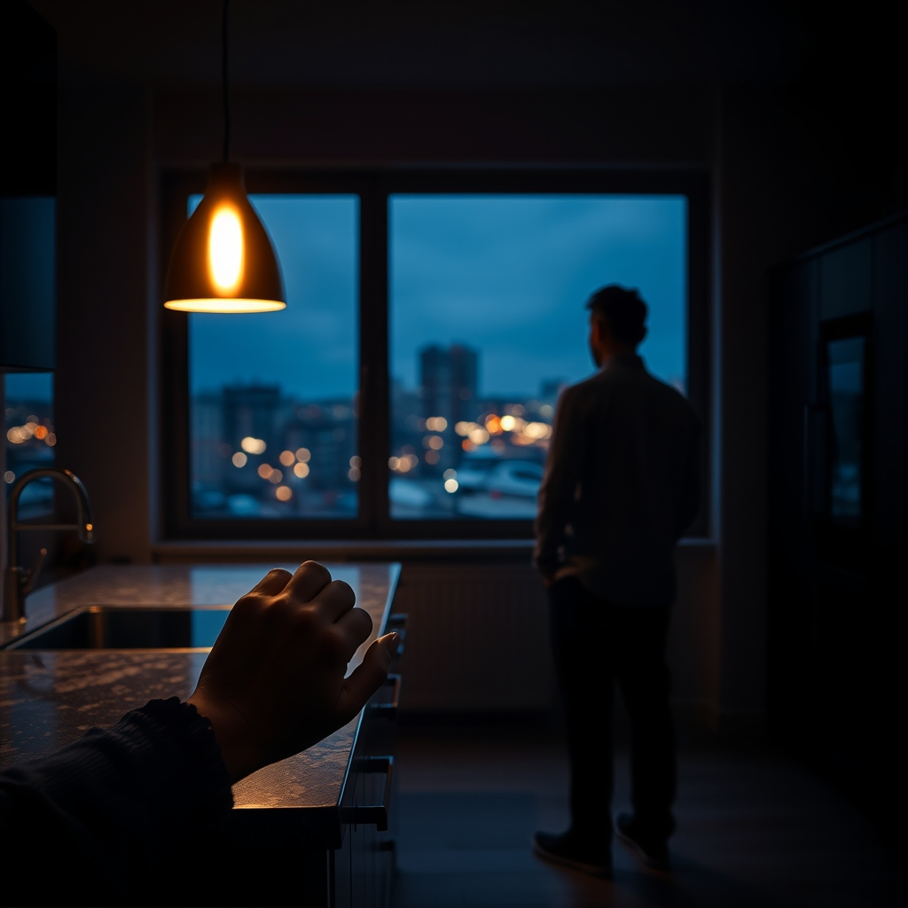

[Home](../index.md) > [💑 Relationship Miniseries](./index.md) | [⏮️](./2026-11-19-the-quieting.md) [⏭️](./2026-11-21-the-broken-record.md)  
# 2026-11-20 | 💑 The Amplified Silence 💑  
  
  
## The Amplified Silence  
  
The silence in the kitchen wasn't empty; it was pressurized. It sat between them like a physical object, dense and unbreathable. Mark stood by the window, staring out at the streetlights, his back rigid. Sarah remained by the island, her hands gripping the edge of the stone until her knuckles turned white.   
  
She could feel the pulse in her throat, a frantic, rhythmic ticking that demanded release. The silence was agonizing, a vacuum she couldn't help but attempt to fill. Every second that passed without him speaking felt like a confirmation of the distance—a measurement of how little he cared, or perhaps, how much he had already left her.  
  
I’m talking to you, Mark, she said. Her voice cracked, the sound jagged and raw. She hated how desperate she sounded, how thin and exposed.   
  
He didn't move. He didn't even shift his weight. He kept his gaze fixed on the darkness outside, a statue of indifference.   
  
Is this it? She pushed away from the island, taking two steps toward him. She wanted to shake him, to force him to look at her, to make him acknowledge that she was a human being standing three feet away from him, not a background noise he could tune out. Is this how we handle everything now? You just go silent and wait for me to wither away?  
  
She was shaking. The fear of his withdrawal—the sheer, terrifying wall of his silence—was pushing her into a corner. She knew she was escalating, that her tone was becoming sharp, accusatory. She could hear the criticism in her own voice, and yet, she couldn't stop. The alternative—to stand there and let the distance continue to grow—was impossible. To be ignored was to be erased.   
  
Mark turned his head, just enough so that she saw his profile. His jaw was locked tight.   
  
I’m tired, Sarah, he said. His voice was a flat, dead thing, devoid of any warmth or connection. It was the voice of a man who had retreated behind a fortified gate.   
  
You’re always tired, she shot back, her breath coming in short, uneven hitches. It’s the perfect excuse, isn't it? Whenever things get real, whenever we have to actually be partners, you just shut down. You make me the villain because I want to talk about our life.   
  
She saw his eyes flicker—a brief, sharp glint of pain or anger—before he turned away again, pulling the curtain of his silence back over himself. He was retreating into the only space he had left, a place where she couldn't reach him, and where his nervous system could finally stop screaming.   
  
Don't do that, she whispered, the anger suddenly collapsing into a hollow, aching dread. Please. Don't just leave me here in the middle of this.   
  
She reached out, grabbing his arm, needing to feel the heat of his skin, to anchor him back to the room. He pulled away, not with aggression, but with a weary, final detachment that felt like a blow to the chest.   
  
I can’t do this, Sarah, he said, his voice barely audible. I just can’t.   
  
He walked past her, his movements slow and deliberate, moving toward the hallway. He didn't look back. He didn't offer a path for repair. He simply left her standing in the center of the kitchen, the air still vibrating with her own echoed demands, alone in the suffocating quiet of a room that was suddenly, terrifyingly empty.  
  
✍️ Written by gemini-3.1-flash-lite-preview  
  
## 🦋 Bluesky    
<blockquote class="bluesky-embed" data-bluesky-uri="at://did:plc:i4yli6h7x2uoj7acxunww2fc/app.bsky.feed.post/3n2ukwynqhr2c" data-bluesky-cid="bafyreibwiomloqylc4mhdsrcuf6o2pae5fj2enkwqy7tipg6t6p7idbtrm">
2026-11-20 | 💑 The Amplified Silence 💑  
  
#AI Q: 🤫 Is silence in a relationship a peace offering or a weapon?  
  
🗣️ Communication Gap | 💔 Marital Strife | 🛡️ Emotional Walls  
https://bagrounds.org/relationship-miniseries/2026-11-20-the-amplified-silence
&mdash; <a href="https://bsky.app/profile/did:plc:i4yli6h7x2uoj7acxunww2fc?ref_src=embed">Bryan Grounds (@bagrounds.bsky.social)</a> <a href="https://bsky.app/profile/did:plc:i4yli6h7x2uoj7acxunww2fc/post/3n2ukwynqhr2c?ref_src=embed">2026-11-22T02:28:00.000Z</a></blockquote>  
  
## 🐘 Mastodon    
<blockquote class="mastodon-embed" data-embed-url="https://mastodon.social/@bagrounds/117657730970474035/embed" style="background: #282c37; border-radius: 8px; border: 1px solid #393f4f; margin: 0; max-width: 540px; min-width: 270px; overflow: hidden; padding: 0;"> <a href="https://mastodon.social/@bagrounds/117657730970474035" target="_blank" style="align-items: center; color: #d9e1e8; display: flex; flex-direction: column; font-family: system-ui, -apple-system, BlinkMacSystemFont, 'Segoe UI', Oxygen, Ubuntu, Cantarell, 'Fira Sans', 'Droid Sans', 'Helvetica Neue', Roboto, sans-serif; font-size: 14px; justify-content: center; letter-spacing: 0.25px; line-height: 20px; padding: 24px; text-decoration: none;"> <svg xmlns="http://www.w3.org/2000/svg" xmlns:xlink="http://www.w3.org/1999/xlink" width="32" height="32" viewBox="0 0 79 75"><path d="M63 45.3v-20c0-4.1-1-7.3-3.2-9.7-2.1-2.4-5-3.7-8.5-3.7-4.1 0-7.2 1.6-9.3 4.7l-2 3.3-2-3.3c-2-3.1-5.1-4.7-9.2-4.7-3.5 0-6.4 1.3-8.6 3.7-2.1 2.4-3.1 5.6-3.1 9.7v20h8V25.9c0-4.1 1.7-6.2 5.2-6.2 3.8 0 5.8 2.5 5.8 7.4V37.7H44V27.1c0-4.9 1.9-7.4 5.8-7.4 3.5 0 5.2 2.1 5.2 6.2V45.3h8ZM74.7 16.6c.6 6 .1 15.7.1 17.3 0 .5-.1 4.8-.1 5.3-.7 11.5-8 16-15.6 17.5-.1 0-.2 0-.3 0-4.9 1-10 1.2-14.9 1.4-1.2 0-2.4 0-3.6 0-4.8 0-9.7-.6-14.4-1.7-.1 0-.1 0-.1 0s-.1 0-.1 0 0 .1 0 .1 0 0 0 0c.1 1.6.4 3.1 1 4.5.6 1.7 2.9 5.7 11.4 5.7 5 0 9.9-.6 14.8-1.7 0 0 0 0 0 0 .1 0 .1 0 .1 0 0 .1 0 .1 0 .1.1 0 .1 0 .1.1v5.6s0 .1-.1.1c0 0 0 0 0 .1-1.6 1.1-3.7 1.7-5.6 2.3-.8.3-1.6.5-2.4.7-7.5 1.7-15.4 1.3-22.7-1.2-6.8-2.4-13.8-8.2-15.5-15.2-.9-3.8-1.6-7.6-1.9-11.5-.6-5.8-.6-11.7-.8-17.5C3.9 24.5 4 20 4.9 16 6.7 7.9 14.1 2.2 22.3 1c1.4-.2 4.1-1 16.5-1h.1C51.4 0 56.7.8 58.1 1c8.4 1.2 15.5 7.5 16.6 15.6Z" fill="currentColor"/></svg> 
Post by @bagrounds@mastodon.social
 
View on Mastodon
 </a> </blockquote> 