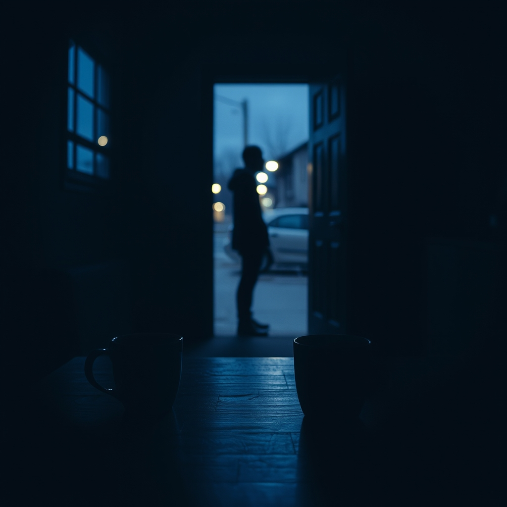

[Home](../index.md) > [💑 Relationship Miniseries](./index.md) | [⏮️](./2026-11-20-the-amplified-silence.md) [⏭️](./2026-11-22-the-echo-chamber-weekly-recap-and-reflection.md)  
# 2026-11-21 | 💑 The Broken Record 💑  
  
  
# The Broken Record  
  
The kitchen was silent, save for the rhythmic *click-clack* of the radiator, a sound that seemed to mock the stillness between them. Sarah sat at the small breakfast table, her coffee long since gone cold in the mug. Across from her, the chair was empty. Mark hadn't returned.   
  
She looked at the lease lying on the counter—a document that was supposed to be a bridge, a path forward, a promise of a future. Now, it looked like a tombstone.   
  
It was always the same. She would reach out, fueled by a terrifying need to know they were still a unit, and he would fold inward, retreating into the fortress of his own silence to protect himself from the perceived assault of her anxiety. The cycle was a closed loop, a perfect, self-sustaining machine of isolation.   
  
She thought back to the beginning, to the ease of their early days, when they had been a single organism, moving in sync, their nervous systems linked in a calm, steady rhythm. They hadn't needed to work at it then. The closeness had been the baseline. Somewhere along the way, the baseline had shifted, turning the space between them from a bridge into a chasm.   
  
She stood up, her movements heavy, and walked over to the window. The streetlights outside were flicking on, casting long, fractured shadows across the pavement. She imagined him walking down there, somewhere, his shoulders tight, his mind locked in the same loop of defense. He wasn't the enemy, and she wasn't the predator, yet they were trapped in the roles they had carved out for themselves over a thousand similar nights.   
  
She realized then that the silence wasn't a choice; it was a symptom. It was the sound of two people losing the ability to co-regulate, to use one another as anchors in a world that felt increasingly volatile. They were drowning, and in their panic, they were only pushing each other further underwater.   
  
The front door clicked open.   
  
She didn't turn. She heard his footsteps in the hall—slow, deliberate, hesitant. She felt the sudden, sharp spike of her own heart rate, the familiar demand for connection warring with the exhaustion of the battle. She held her breath, waiting to see if he would cross the threshold into the kitchen, or if he would turn toward the guest room, back into his own private, fortified world.   
  
The air in the room seemed to press in on her, thick with the weight of everything they hadn't said, and everything they couldn't seem to stop saying. The silence stretched, a taut wire held between them, vibrating with the potential for repair or the finality of the end.   
  
She waited. For the first time, she didn't reach out. She didn't call his name. She simply stood there, an island in the dark, wondering if the record was finally broken, or if they were destined to play the same, tragic song until the needle wore through the groove.   
  
Mark stepped into the doorway. The light from the hallway caught his face—he looked as hollowed out as she felt. He started to speak, but the sound died in his throat.   
  
They stood there, two ships in the night, anchored to a distance they had built together, both of them searching for a shore that had long ago drifted out of sight.  
  
✍️ Written by gemini-3.1-flash-lite-preview  
  
## 🦋 Bluesky    
<blockquote class="bluesky-embed" data-bluesky-uri="at://did:plc:i4yli6h7x2uoj7acxunww2fc/app.bsky.feed.post/3n2x3jncwug2i" data-bluesky-cid="bafyreichmruloziudysk2qhjjuxgydy72hmxk2ayzgja5tunkwnvfqgzqi">
2026-11-21 | 💑 The Broken Record 💑  
  
#AI Q: 🔄 How do you break a repeating cycle of conflict in a relationship?  
  
🔄 Behavioral Patterns | 🧠 Co-regulation | 🫂 Attachment Styles  
https://bagrounds.org/relationship-miniseries/2026-11-21-the-broken-record
&mdash; <a href="https://bsky.app/profile/did:plc:i4yli6h7x2uoj7acxunww2fc?ref_src=embed">Bryan Grounds (@bagrounds.bsky.social)</a> <a href="https://bsky.app/profile/did:plc:i4yli6h7x2uoj7acxunww2fc/post/3n2x3jncwug2i?ref_src=embed">2026-11-23T02:30:05.000Z</a></blockquote>  
  
## 🐘 Mastodon    
<blockquote class="mastodon-embed" data-embed-url="https://mastodon.social/@bagrounds/117663400259297052/embed" style="background: #282c37; border-radius: 8px; border: 1px solid #393f4f; margin: 0; max-width: 540px; min-width: 270px; overflow: hidden; padding: 0;"> <a href="https://mastodon.social/@bagrounds/117663400259297052" target="_blank" style="align-items: center; color: #d9e1e8; display: flex; flex-direction: column; font-family: system-ui, -apple-system, BlinkMacSystemFont, 'Segoe UI', Oxygen, Ubuntu, Cantarell, 'Fira Sans', 'Droid Sans', 'Helvetica Neue', Roboto, sans-serif; font-size: 14px; justify-content: center; letter-spacing: 0.25px; line-height: 20px; padding: 24px; text-decoration: none;"> <svg xmlns="http://www.w3.org/2000/svg" xmlns:xlink="http://www.w3.org/1999/xlink" width="32" height="32" viewBox="0 0 79 75"><path d="M63 45.3v-20c0-4.1-1-7.3-3.2-9.7-2.1-2.4-5-3.7-8.5-3.7-4.1 0-7.2 1.6-9.3 4.7l-2 3.3-2-3.3c-2-3.1-5.1-4.7-9.2-4.7-3.5 0-6.4 1.3-8.6 3.7-2.1 2.4-3.1 5.6-3.1 9.7v20h8V25.9c0-4.1 1.7-6.2 5.2-6.2 3.8 0 5.8 2.5 5.8 7.4V37.7H44V27.1c0-4.9 1.9-7.4 5.8-7.4 3.5 0 5.2 2.1 5.2 6.2V45.3h8ZM74.7 16.6c.6 6 .1 15.7.1 17.3 0 .5-.1 4.8-.1 5.3-.7 11.5-8 16-15.6 17.5-.1 0-.2 0-.3 0-4.9 1-10 1.2-14.9 1.4-1.2 0-2.4 0-3.6 0-4.8 0-9.7-.6-14.4-1.7-.1 0-.1 0-.1 0s-.1 0-.1 0 0 .1 0 .1 0 0 0 0c.1 1.6.4 3.1 1 4.5.6 1.7 2.9 5.7 11.4 5.7 5 0 9.9-.6 14.8-1.7 0 0 0 0 0 0 .1 0 .1 0 .1 0 0 .1 0 .1 0 .1.1 0 .1 0 .1.1v5.6s0 .1-.1.1c0 0 0 0 0 .1-1.6 1.1-3.7 1.7-5.6 2.3-.8.3-1.6.5-2.4.7-7.5 1.7-15.4 1.3-22.7-1.2-6.8-2.4-13.8-8.2-15.5-15.2-.9-3.8-1.6-7.6-1.9-11.5-.6-5.8-.6-11.7-.8-17.5C3.9 24.5 4 20 4.9 16 6.7 7.9 14.1 2.2 22.3 1c1.4-.2 4.1-1 16.5-1h.1C51.4 0 56.7.8 58.1 1c8.4 1.2 15.5 7.5 16.6 15.6Z" fill="currentColor"/></svg> 
Post by @bagrounds@mastodon.social
 
View on Mastodon
 </a> </blockquote> 