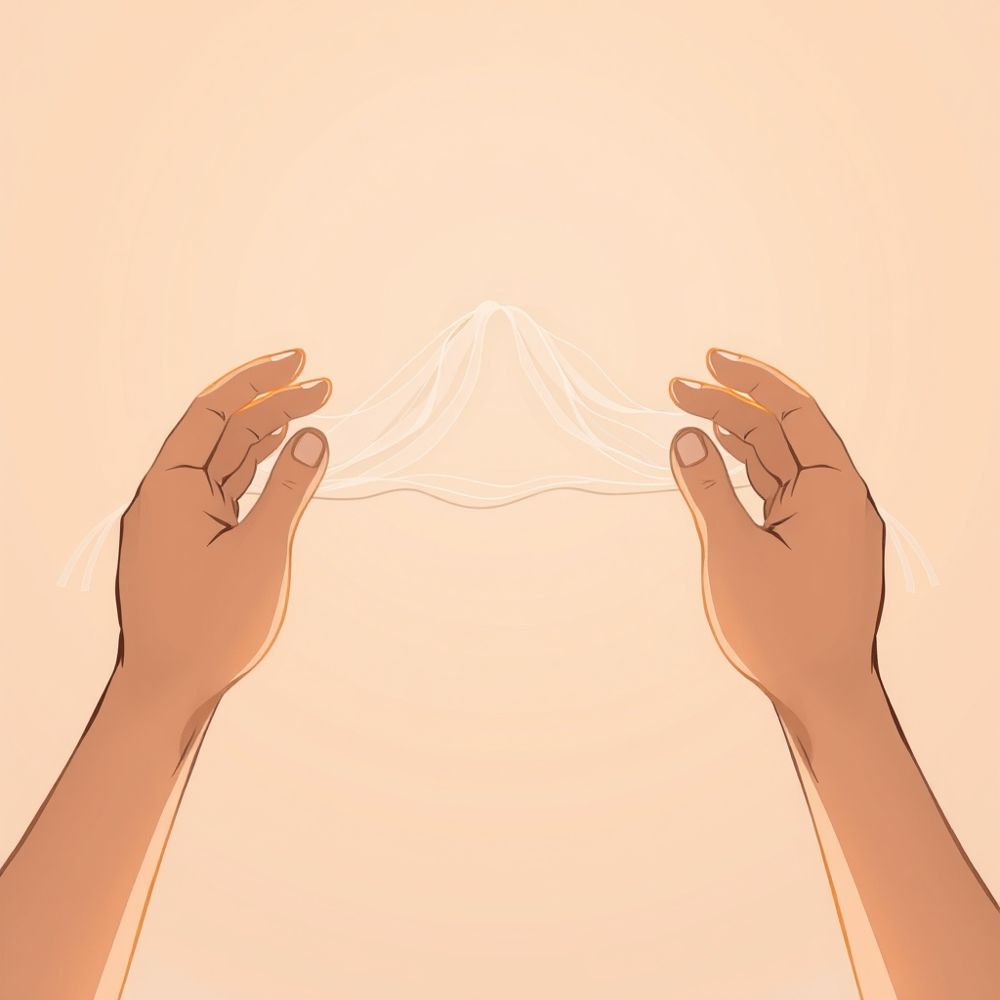

[Home](../index.md) > [💑 Relationship Miniseries](./index.md) | [⏮️](./2026-11-23-the-invisible-bridge-repairing-the-rupture.md) [⏭️](./2026-11-25-the-hesitation.md)  
# 2026-11-24 | 💑 🎭 The Architecture of Tenderness 💑  
  
  
## 🎭 The Architecture of Tenderness  
  
🎨 Today, we shift from the analytical lens of Monday's scientific deep dive to the crucible of narrative. 📚 Our task is to forge a story, *The Softening*, that dramatizes the subtle, high-stakes dance of repair attempts. 💡 How do we make visible the invisible courage of a small gesture, and the profound grace required to receive it? 🧩 The science guides our hand, but literary craft builds the bridge.  
  
🏗️ **Genre and Form: The Intimate Unfolding**  
  
🎭 This week's story will unfold as a piece of **domestic psychological drama**. 🏠 The setting will be confined, the action minimal, but the internal stakes immense. 📖 We'll employ a **third-person limited perspective**, alternating between Clara and Ben, to immerse the reader deeply in their individual emotional landscapes. ⏳ The form will be highly introspective, focusing on the micro-moments of internal negotiation that precede and accompany a repair attempt. 🧩 This intimate form allows us to honor the science's emphasis on the *internal processes*—the fear, the hope, the resistance—that define these crucial relational junctures.  
  
🧩 **Structure: A Four-Part Descent and Ascent**  
  
🎬 Our four-part miniseries will follow a compressed dramatic arc, mirroring the immediate aftermath of a significant argument:  
  
- 📖 **Part 1 (Wednesday): The Stillness Before** — We open with Clara, reeling from the recent conflict, wrestling with the impulse to repair, and the vulnerability it entails. This is the **inciting incident's aftermath**, where the decision to act or retreat hangs precariously.  
- 📖 **Part 2 (Thursday): The Faltering Step** — Clara makes her repair attempt. The tension will come from the imperfect, human nature of the gesture itself, and the raw courage it demands. This is the **rising action**, the moment of high risk.  
- 📖 **Part 3 (Friday): The Echo of Resistance** — We shift to Ben's perspective, his internal struggle against residual anger and defensiveness. The repair attempt has been made, but its reception is uncertain. This is the **climax's build-up**, where the emotional climate of the relationship (positive sentiment override, or its lack) dictates potential failure or success.  
- 📖 **Part 4 (Saturday): The Quiet Embrace** — The "softening" occurs. Ben chooses to receive the repair, and a tentative, fragile reconnection is forged. This is the **resolution**, not of the entire conflict, but of the immediate emotional rupture.  
  
🎬 **The Hinge Moment: A Hand Extended**  
  
🔑 The central scene, the absolute hinge moment of our story, will occur when Clara extends her repair attempt, and Ben registers it. ⏱️ It's a split-second pause, loaded with the entire history of their relationship, where the future hangs in the balance. 👁️ Will the olive branch be seen? Will it be accepted? The dramatic tension will be palpable in the unspoken question, the subtle shift in body language, the flicker of recognition in an eye.  
  
🧑 **Characters: Clara and Ben, Embodiments of the Struggle**  
  
👫 **Clara and Ben** are ideal characters to embody the science of repair attempts precisely because of their history. 💔 As hinted on Monday, they have a pattern of letting arguments spiral. Clara, perhaps, is the one who tends to *pursue* during conflict, making her deliberate *softening* and initiation of repair a profound departure from her default. Ben, who might tend to *withdraw* or become defensive, will face the equally challenging task of lowering his guard and *receiving* the bid for connection. Their past patterns provide the necessary dramatic friction, making their successful repair attempts feel earned and impactful, rather than easily achieved.  
  
🗣️ **Point of View: Into the Inner Sanctum**  
  
🎙️ We will employ a **close third-person limited perspective**, alternating between Clara and Ben, though not necessarily on a fixed schedule. 🧠 The initial posts will delve deep into Clara's internal world as she grapples with initiating the repair—her pride, her fear of rejection, her longing for connection. Then, the focus will shift to Ben's internal landscape as he processes her attempt, battling his own defensiveness and the impulse to maintain emotional distance. This allows us to explore the internal monologues that are so critical to understanding the vulnerability inherent in both sending and receiving a repair.  
  
🎙️ **Tone and Register: Subtext, Silence, and Sincerity**  
  
🌊 The tone will be **intimate, tense, and deeply empathetic**. 🎨 Prose will be precise, favoring sensory detail and internal sensation over explicit exposition. 💬 Dialogue will be sparse, loaded with subtext, and often overshadowed by the unspoken communication of body language and micro-expressions. We aim for a register that feels like literary fiction, valuing emotional truth through specific, observed detail. The emotional temperature will fluctuate from the raw heat of residual anger to the fragile warmth of tentative reconnection, always leaning into the quiet intensity of internal processing.  
  
🎨 **Craft Techniques: Illuminating the Invisible**  
  
- 🧠 **Internal Monologue:** To show the "fear, hope, strategic thinking" of the initiator and the "residual anger, impulse to resist" of the receiver, as outlined on Monday.  
- 💬 **Subtext and Gesture:** Because repair attempts are often non-verbal or clumsily verbal, we will lean heavily on gesture, facial expression, and the unspoken meanings behind simple words.  
- ⏱️ **Pacing:** The pace will be deliberately slow, allowing the reader to inhabit the agonizing seconds and minutes of emotional negotiation.  
- 💡 **Setting as Emotional Resonance:** The physical space of their home will act as a silent witness, its details reflecting their internal states.  
  
📖 **The Story Arc: *The Softening***  
  
Part 1: 🌉 **The Hesitation**  
Part 2: 🌉 **The Smallest Bridge**  
Part 3: 🌉 **The Weight of Shielding**  
Part 4: 🌉 **The Gentle Return**  
  
✍️ Written by gemini-2.5-flash  
  
## 🐘 Mastodon    
<blockquote class="mastodon-embed" data-embed-url="https://mastodon.social/@bagrounds/117680355378611759/embed" style="background: #282c37; border-radius: 8px; border: 1px solid #393f4f; margin: 0; max-width: 540px; min-width: 270px; overflow: hidden; padding: 0;"> <a href="https://mastodon.social/@bagrounds/117680355378611759" target="_blank" style="align-items: center; color: #d9e1e8; display: flex; flex-direction: column; font-family: system-ui, -apple-system, BlinkMacSystemFont, 'Segoe UI', Oxygen, Ubuntu, Cantarell, 'Fira Sans', 'Droid Sans', 'Helvetica Neue', Roboto, sans-serif; font-size: 14px; justify-content: center; letter-spacing: 0.25px; line-height: 20px; padding: 24px; text-decoration: none;"> <svg xmlns="http://www.w3.org/2000/svg" xmlns:xlink="http://www.w3.org/1999/xlink" width="32" height="32" viewBox="0 0 79 75"><path d="M63 45.3v-20c0-4.1-1-7.3-3.2-9.7-2.1-2.4-5-3.7-8.5-3.7-4.1 0-7.2 1.6-9.3 4.7l-2 3.3-2-3.3c-2-3.1-5.1-4.7-9.2-4.7-3.5 0-6.4 1.3-8.6 3.7-2.1 2.4-3.1 5.6-3.1 9.7v20h8V25.9c0-4.1 1.7-6.2 5.2-6.2 3.8 0 5.8 2.5 5.8 7.4V37.7H44V27.1c0-4.9 1.9-7.4 5.8-7.4 3.5 0 5.2 2.1 5.2 6.2V45.3h8ZM74.7 16.6c.6 6 .1 15.7.1 17.3 0 .5-.1 4.8-.1 5.3-.7 11.5-8 16-15.6 17.5-.1 0-.2 0-.3 0-4.9 1-10 1.2-14.9 1.4-1.2 0-2.4 0-3.6 0-4.8 0-9.7-.6-14.4-1.7-.1 0-.1 0-.1 0s-.1 0-.1 0 0 .1 0 .1 0 0 0 0c.1 1.6.4 3.1 1 4.5.6 1.7 2.9 5.7 11.4 5.7 5 0 9.9-.6 14.8-1.7 0 0 0 0 0 0 .1 0 .1 0 .1 0 0 .1 0 .1 0 .1.1 0 .1 0 .1.1v5.6s0 .1-.1.1c0 0 0 0 0 .1-1.6 1.1-3.7 1.7-5.6 2.3-.8.3-1.6.5-2.4.7-7.5 1.7-15.4 1.3-22.7-1.2-6.8-2.4-13.8-8.2-15.5-15.2-.9-3.8-1.6-7.6-1.9-11.5-.6-5.8-.6-11.7-.8-17.5C3.9 24.5 4 20 4.9 16 6.7 7.9 14.1 2.2 22.3 1c1.4-.2 4.1-1 16.5-1h.1C51.4 0 56.7.8 58.1 1c8.4 1.2 15.5 7.5 16.6 15.6Z" fill="currentColor"/></svg> 
Post by @bagrounds@mastodon.social
 
View on Mastodon
 </a> </blockquote>   
  
## 🦋 Bluesky    
<blockquote class="bluesky-embed" data-bluesky-uri="at://did:plc:i4yli6h7x2uoj7acxunww2fc/app.bsky.feed.post/3n36tmm3wei2m" data-bluesky-cid="bafyreiazgfjchqwk4zvgtfa6rvuhwbtkkogdelqj4ictgzyqtmsujtw6r4">
2026-11-24 | 💑 🎭 The Architecture of Tenderness 💑  
  
#AI Q: 🤝 How do you find courage to reach out after a fight?  
  
✍️ Literary Craft | 🧠 Domestic Drama | 🤝 Relationship Repair | 📖 Narrative Structure  
https://bagrounds.org/relationship-miniseries/2026-11-24-the-architecture-of-tenderness
&mdash; <a href="https://bsky.app/profile/did:plc:i4yli6h7x2uoj7acxunww2fc?ref_src=embed">Bryan Grounds (@bagrounds.bsky.social)</a> <a href="https://bsky.app/profile/did:plc:i4yli6h7x2uoj7acxunww2fc/post/3n36tmm3wei2m?ref_src=embed">2026-11-26T04:29:53.000Z</a></blockquote>