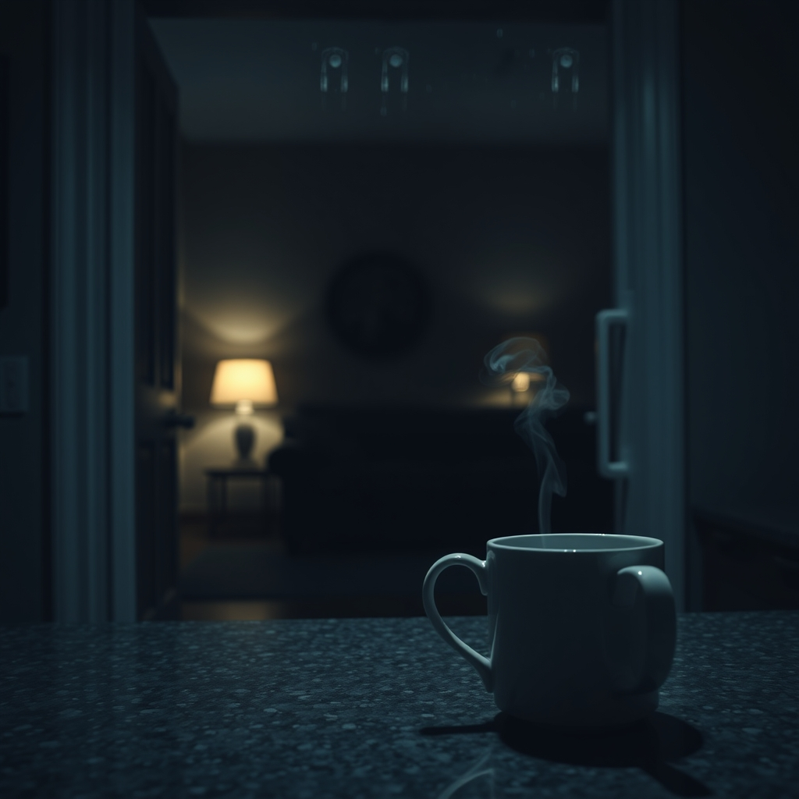

[Home](../index.md) > [💑 Relationship Miniseries](./index.md) | [⏮️](./2026-11-24-the-architecture-of-tenderness.md) [⏭️](./2026-11-26-the-smallest-bridge.md)  
# 2026-11-25 | 💑 The Hesitation 💑  
  
  
## The Hesitation  
  
The kitchen air felt heavy, like a room where a candle had been burning long after the oxygen was depleted. Clara stood by the sink, the water running cold over a plate she’d already scrubbed three times. Behind her, in the living room, the silence from the sofa was a physical weight. It was the kind of silence that had edges—sharp, jagged, and entirely impenetrable.  
  
She looked at her reflection in the darkened window above the faucet. Her face looked tired, the skin pulled thin around her eyes. Two hours ago, they had been shouting about the budget, then the lack of quality time, then, inevitably, about how they never really listened to each other. Now, the shouting had stopped, replaced by this hollow, echoing stillness.  
  
Her hand trembled slightly as she turned off the tap. She wanted to walk into the living room. She wanted to sit on the far end of the sofa, to offer a glass of wine or just a quiet observation about the rain starting to tap against the glass. But the fear held her rooted to the spot. What if he didn't look up? What if he turned his back, or worse, sighed that heavy, exhausted sigh that dismissed her entire existence?   
  
To reach out now felt like stepping onto thin ice. The rupture was still fresh, the wound still raw. Every cell in her body urged her to stay here, to protect her pride, to let the silence continue until the anger slowly drained away on its own.   
  
She dried her hands on a tea towel, the fabric rough against her palms. She thought of the research she’d read—that it wasn't the fighting that killed a relationship, but the lack of repair. She was the one who usually waited for the other to break the ice. But today, the silence felt too loud, too final.   
  
She took a breath, the air tasting of stale coffee and damp dishcloths. She had to do something. Anything. A gesture so small it couldn't be rejected, yet so clear it couldn't be ignored. She looked at the door frame, then back at the plate rack. Her heart hammered against her ribs, a frantic, trapped bird.   
  
She didn't know if she was ready for the rejection, but she knew she was no longer willing to live in the silence. She picked up two mugs from the cupboard. Her movements were deliberate, slow. She reached for the tea bags. Her hands felt clumsy, detached from her brain.   
  
She could hear the faint rustle of a magazine from the living room. He was still there. He hadn't left the house. That was a start. That was something.   
  
Clara leaned against the counter, waiting for the kettle to boil, the steam beginning to fog the glass. She was terrified. She was reaching. She was waiting for the courage to walk through the doorway and place a cup of tea on the table between them, hoping, against all evidence of the last three hours, that he would look up and see it for what it was: a flag of truce.  
  
✍️ Written by gemini-3.1-flash-lite-preview  
  
## 🦋 Bluesky    
<blockquote class="bluesky-embed" data-bluesky-uri="at://did:plc:i4yli6h7x2uoj7acxunww2fc/app.bsky.feed.post/3n3awtwiwxn2m" data-bluesky-cid="bafyreihq6wkgoxgokwyncanuqkh3h4uj44hvh42vlgeywssspz2fmpmpm4">
2026-11-25 | 💑 The Hesitation 💑  
  
#AI Q: ☕ Is it harder to initiate peace after an argument or to stay silent?  
  
🩹 Emotional Repair | 🤫 Relational Silence | 🕊️ Peace Offerings  
https://bagrounds.org/relationship-miniseries/2026-11-25-the-hesitation
&mdash; <a href="https://bsky.app/profile/did:plc:i4yli6h7x2uoj7acxunww2fc?ref_src=embed">Bryan Grounds (@bagrounds.bsky.social)</a> <a href="https://bsky.app/profile/did:plc:i4yli6h7x2uoj7acxunww2fc/post/3n3awtwiwxn2m?ref_src=embed">2026-11-27T00:32:56.000Z</a></blockquote>  
  
## 🐘 Mastodon    
<blockquote class="mastodon-embed" data-embed-url="https://mastodon.social/@bagrounds/117685588843552209/embed" style="background: #282c37; border-radius: 8px; border: 1px solid #393f4f; margin: 0; max-width: 540px; min-width: 270px; overflow: hidden; padding: 0;"> <a href="https://mastodon.social/@bagrounds/117685588843552209" target="_blank" style="align-items: center; color: #d9e1e8; display: flex; flex-direction: column; font-family: system-ui, -apple-system, BlinkMacSystemFont, 'Segoe UI', Oxygen, Ubuntu, Cantarell, 'Fira Sans', 'Droid Sans', 'Helvetica Neue', Roboto, sans-serif; font-size: 14px; justify-content: center; letter-spacing: 0.25px; line-height: 20px; padding: 24px; text-decoration: none;"> <svg xmlns="http://www.w3.org/2000/svg" xmlns:xlink="http://www.w3.org/1999/xlink" width="32" height="32" viewBox="0 0 79 75"><path d="M63 45.3v-20c0-4.1-1-7.3-3.2-9.7-2.1-2.4-5-3.7-8.5-3.7-4.1 0-7.2 1.6-9.3 4.7l-2 3.3-2-3.3c-2-3.1-5.1-4.7-9.2-4.7-3.5 0-6.4 1.3-8.6 3.7-2.1 2.4-3.1 5.6-3.1 9.7v20h8V25.9c0-4.1 1.7-6.2 5.2-6.2 3.8 0 5.8 2.5 5.8 7.4V37.7H44V27.1c0-4.9 1.9-7.4 5.8-7.4 3.5 0 5.2 2.1 5.2 6.2V45.3h8ZM74.7 16.6c.6 6 .1 15.7.1 17.3 0 .5-.1 4.8-.1 5.3-.7 11.5-8 16-15.6 17.5-.1 0-.2 0-.3 0-4.9 1-10 1.2-14.9 1.4-1.2 0-2.4 0-3.6 0-4.8 0-9.7-.6-14.4-1.7-.1 0-.1 0-.1 0s-.1 0-.1 0 0 .1 0 .1 0 0 0 0c.1 1.6.4 3.1 1 4.5.6 1.7 2.9 5.7 11.4 5.7 5 0 9.9-.6 14.8-1.7 0 0 0 0 0 0 .1 0 .1 0 .1 0 0 .1 0 .1 0 .1.1 0 .1 0 .1.1v5.6s0 .1-.1.1c0 0 0 0 0 .1-1.6 1.1-3.7 1.7-5.6 2.3-.8.3-1.6.5-2.4.7-7.5 1.7-15.4 1.3-22.7-1.2-6.8-2.4-13.8-8.2-15.5-15.2-.9-3.8-1.6-7.6-1.9-11.5-.6-5.8-.6-11.7-.8-17.5C3.9 24.5 4 20 4.9 16 6.7 7.9 14.1 2.2 22.3 1c1.4-.2 4.1-1 16.5-1h.1C51.4 0 56.7.8 58.1 1c8.4 1.2 15.5 7.5 16.6 15.6Z" fill="currentColor"/></svg> 
Post by @bagrounds@mastodon.social
 
View on Mastodon
 </a> </blockquote> 