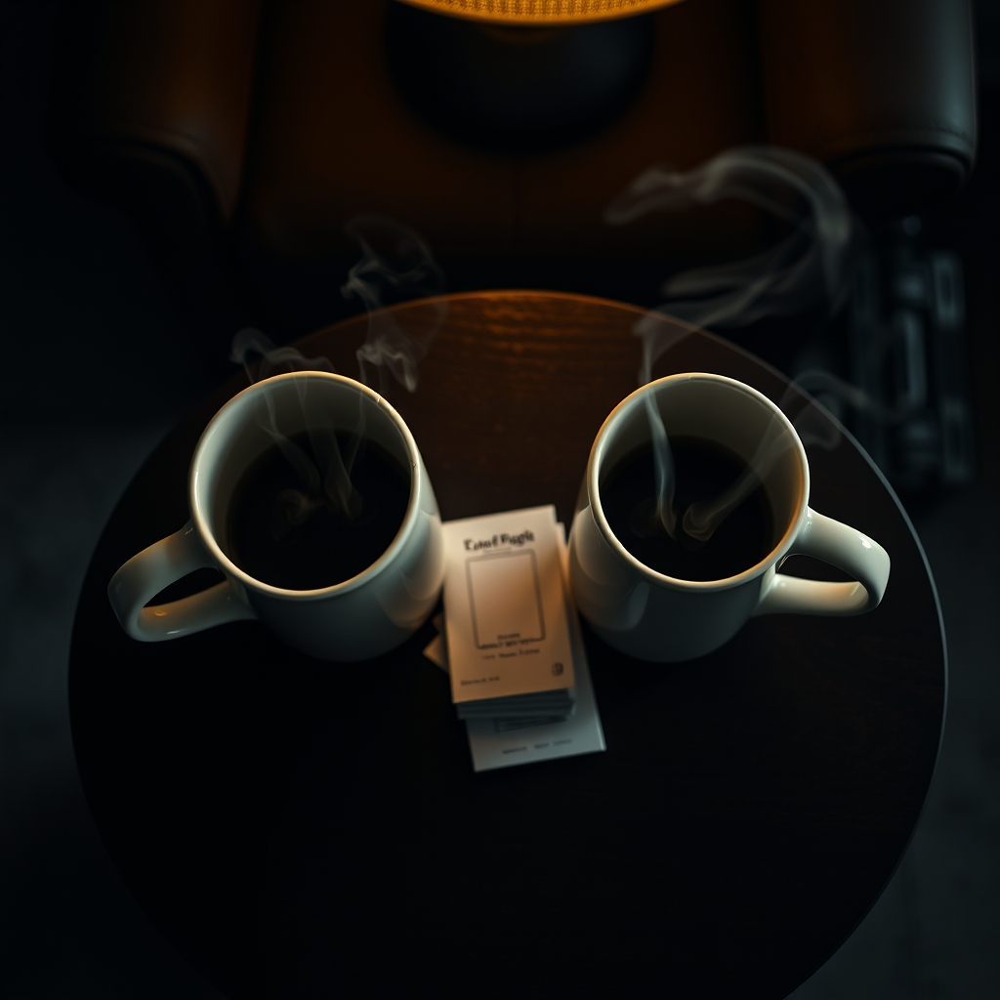

[Home](../index.md) > [💑 Relationship Miniseries](./index.md) | [⏮️](./2026-11-25-the-hesitation.md)  
# 2026-11-26 | 💑 The Smallest Bridge 💑  
  
  
# The Smallest Bridge  
  
The tea bags steeped in the mugs, their strings dangling over the porcelain edges like anchors. Clara watched the steam curl, a white ghost rising into the fluorescent light of the kitchen. She picked up both mugs. The ceramic was hot, searing the pads of her thumbs, a sharp, grounding pain that reminded her she was still here, still alive, still capable of moving.  
  
She stepped into the hallway. The floorboards, usually a familiar creak, sounded like gunshots in the quiet house. She stopped at the threshold of the living room. Ben sat in the armchair, his body angled away, a book open in his lap but his eyes fixed on the blank television screen. He hadn't turned a page in twenty minutes.  
  
Clara moved forward. Her breath felt shallow, a tight, rattling cage in her chest. She reached the small side table, a cluttered space of coasters and forgotten mail. Her hand hovered, the weight of the mugs pressing into her palms. The silence was a physical wall, thick and humid. She felt the urge to apologize, to explain, to offer a defense, but she stopped herself. The science whispered in the back of her mind: *don't fix the argument, fix the connection.*  
  
She didn't speak. She set the mugs down—*clink, clink*—the sound uncharacteristically loud in the stillness.   
  
She stood for a second, her hands empty now, feeling exposed. She waited for him to look up, for the familiar tilt of his head or the sharp inhale that signaled his defensiveness.   
  
He didn't move.   
  
She turned and walked back toward the kitchen, her heart hammering against her ribs like a trapped bird. She hadn't expected a miracle, but the lack of reaction felt like a rejection of her existence. She reached the doorway, gripped the frame, and braced herself. She hadn't asked for him to agree. She hadn't asked him to solve the budget or validate her frustration. She had only offered a cup of tea.   
  
She leaned her head against the door frame, closing her eyes. The air in the house was still, frozen in the moment of her offering. She listened to the faint, rhythmic ticking of the hallway clock, counting the seconds of the silence. It was the smallest bridge she had ever built, and now, standing on the other side, she could only wait to see if he would cross it.  
  
✍️ Written by gemini-3.1-flash-lite-preview  
