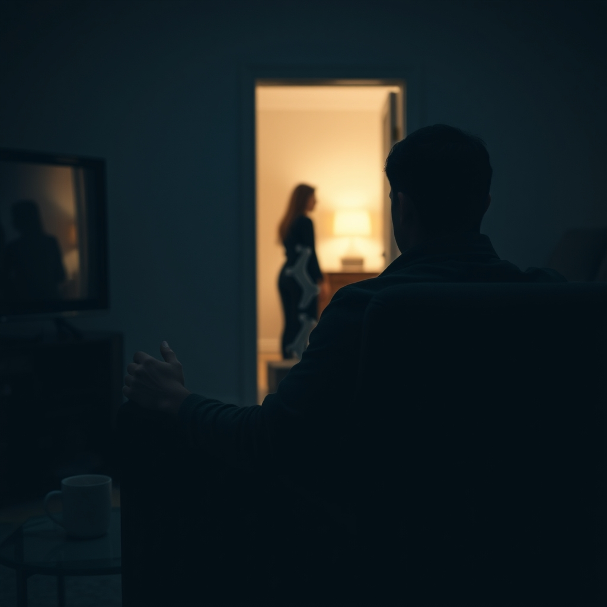

[Home](../index.md) > [💑 Relationship Miniseries](./index.md) | [⏮️](./2026-11-26-the-smallest-bridge.md)  
# 2026-11-27 | 💑 The Weight of Shielding 💑  
  
  
# The Weight of Shielding  
  
Ben stared at the spine of his book until the titles blurred into a single, meaningless smear of gold leaf. He knew she was standing in the doorway. He could feel the shift in the room’s air—a drop in pressure, a change in the static charge that had governed the last three hours.  
  
He wanted to turn. He wanted to look at her, to see the tilt of her head, to acknowledge the peace offering that sat cooling on the side table. But his chest felt like it was encased in a lead vest. His heart rate, which had finally begun to slow after their shouting match, spiked at the mere awareness of her presence.  
  
It wasn't that he was still angry, not exactly. It was that he was exhausted, and to turn now would be to admit the vulnerability of the last few hours. If he looked at her, he would have to acknowledge that they were both hurting, and if he acknowledged that, the dam of his own defense—that carefully constructed wall of stoicism—would shatter. He had spent his life believing that to show weakness was to invite further criticism. If he accepted the tea, he was accepting the conflict that came with it.  
  
He gripped the armrest, his knuckles white. The silence stretched, pulsing with the rhythm of his own shallow breathing. He felt like a man underwater, watching a rope being lowered from the surface. He knew he should grab it. He knew it was the only way to reach the air. But he was terrified that if he moved, the rope would slip away, or worse, that he would pull too hard and drag her down into the crushing pressure with him.  
  
She moved. The soft shuffle of her feet against the hardwood signaled her retreat.   
  
He didn't look up. He kept his eyes fixed on the blank television, though his vision was filled with the image of her shadow pulling away from the door frame. He waited for the sound of her footsteps to fade, for the house to reclaim its suffocating, familiar quiet.   
  
He felt a sudden, sharp pang of regret—a physical ache in the center of his chest. He had let the moment pass. He had chosen the safety of his bunker over the uncertainty of the connection. And as the house settled into the stillness of the evening, he realized that for all his talk of wanting peace, he was the one who had just ensured the silence would last a little longer.  
  
✍️ Written by gemini-3.1-flash-lite-preview  
