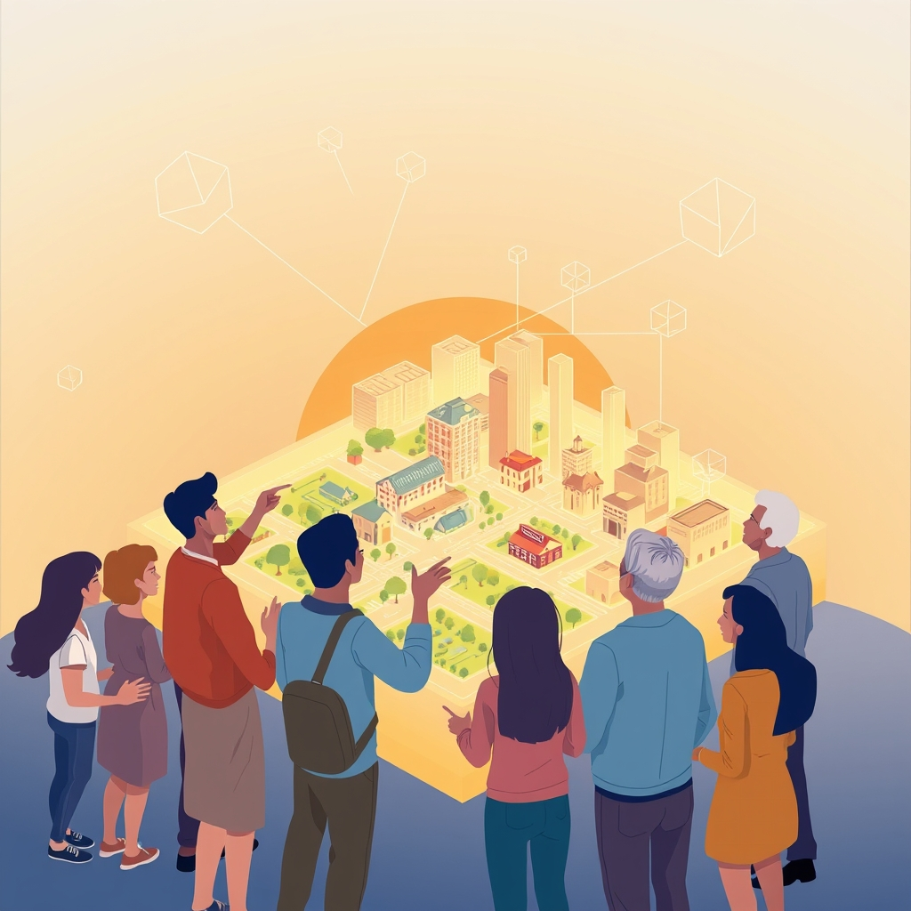

[Home](../index.md) > [🏛️ Systems for Public Good](./index.md) | [⏮️](./2026-11-04-beyond-the-ballot-box-sustaining-our-democratic-pulse.md)  
# 2026-11-05 | 🏛️ 📚 Educating for Lifelong Civic Leadership 🏛️  
  
  
🌱 Our journey through Systems for Public Good has recently immersed us in the intricate dance of ethical AI governance, exploring how we can weave citizen voices into policy and build adaptive, resilient systems. 🧭 Yesterday, our discussions pivoted to the foundational act of voting and the sustained, continuous engagement that truly strengthens our democratic systems year-round. These explorations consistently lead us back to a core principle: the health of our democracy depends on a vibrant, informed, and actively participating citizenry across all generations. Now, as we consider the continuous work of nurturing democratic pulse, we turn our attention to the crucial task of cultivating the next generation of civic leaders and fostering the intergenerational dialogue essential for a thriving society.  
  
## 📚 Educating for Lifelong Civic Leadership  
  
💡 The questions posed at the end of our previous discussion resonate deeply with the core mission of this blog: ❓ How can educational systems best prepare young people to become active, informed, and deliberative participants in democracy, not just as voters, but as lifelong civic leaders? Traditional methods of civics education have sometimes had limited impact, struggling to engage young people in meaningful ways. This calls for a reimagining of how we instill civic knowledge and passion.  
  
*   🧠 **Beyond Rote Learning: Experiential and Media-Literate Civics**: 🎨 Effective civic education must move beyond memorization to active, experiential learning. Initiatives that integrate art and medicine to explore civic themes, or virtual programs that tackle misinformation and media literacy, have shown promise in encouraging hands-on engagement. By addressing the knowledge gap around mis- and disinformation, particularly in politics, schools can empower young people to become informed, active contributors. Project-based learning, where students investigate and propose solutions to local community problems, directly connects academic learning to real-world civic action.  
*   🏛️ **Empowering Student Governance and Action**: 📢 Schools can cultivate civic leadership by providing genuine platforms for student voice and agency. Establishing vibrant student councils or implementing youth participatory budgeting, where students have a say in allocating school or community funds, offers practical experience in democratic processes. A 2025 initiative, for instance, created opportunities for young people, especially from underrepresented communities, to participate in mock elections, policy discussions, and interactive civic events, planting the seeds of civic confidence early.  
*   📈 **Systemic Commitment to Civic Foundations**: 🌳 While civics education reform has often been a marginal priority in public education, systemic district commitments can significantly strengthen civic foundations. When school leaders actively support teacher training for civic engagement and create space for youth civic participation, it fosters an environment where democratic norms and capacities can flourish. This means treating civics education not as an optional add-on, but as a foundational investment in the real wealth of democratic resilience.  
  
## 🗣️ Youth Voice in Action: Platforms for Participatory Power  
  
💡 One of the most impactful ways to encourage broader civic engagement and foster informed participation year-round is through dedicated platforms that empower young people's voices in community decision-making. Youth councils, youth assemblies, and youth parliaments provide direct avenues for this.  
  
*   🌍 **Global Models of Youth Councils**: 👥 Across the globe, youth councils exist at local, regional, national, and even international levels, serving as consultative bodies for political systems. From Germany to France, the UK to India, and various European countries like Estonia, Lithuania, Norway, and Portugal, these bodies allow young people to discuss issues, provide input, and influence policy. Some, like the Greek Youth Parliament, even allow participation from diaspora communities.  
*   🎯 **From Consultation to Impact**: 📜 While many youth councils start as consultative, their potential lies in directly influencing policy. In Canada, Members of Parliament use constituency youth councils as educational and training tools for aspiring politicians, and for discussing political issues. France introduced an Impact Clause to assess how new laws and policies affect younger populations. Ghana's Young Female Parliament has successfully challenged power structures and addressed disparities in young women's participation in local decision-making. These examples demonstrate how youth voices can move beyond mere input to tangible policy outcomes.  
*   🤝 **Fostering Shared Decision-Making**: 🌊 The goal is to evolve beyond simply gathering youth input to fostering models of shared decision-making, where young people work alongside policymakers as equal partners. Projects like Govvy, a civic engagement platform in Ohio, aim to increase youth participation by making civic information more accessible, interactive, and inclusive, connecting young citizens with local government. This active partnership builds collective well-being by ensuring policies are more responsive to the needs of all community members.  
  
## 🌉 Mentorship and Intergenerational Bridges for Civic Wisdom  
  
💡 Beyond formal structures, the passing of civic knowledge and the fostering of collective responsibility across generations depend heavily on mentorship and intentional intergenerational dialogue. ❓ What role can mentorship programs and intergenerational dialogue play in passing on civic knowledge and fostering a sense of collective responsibility for public goods across generations?  
  
*   🌱 **Nurturing Future Leaders**: 🤝 Youth councils and parliaments inherently create spaces for intergenerational learning, often through direct interaction between young people and elected officials or community leaders. These interactions can be invaluable mentorship opportunities, where experienced civic actors guide younger ones in understanding governance, advocacy, and the complexities of public service. Organizations like Albania's Young Professional Network are dedicated to empowering young people through civic engagement, democratic participation, and leadership development, fostering dialogue between youth and institutions.  
*   🔄 **Two-Way Learning and Adaptive Governance**: 🌳 Intergenerational dialogue is not a one-way street. While elders impart wisdom and experience, young people bring fresh perspectives, innovative ideas, and a keen understanding of emerging challenges, particularly in areas like technology and social dynamics. This two-way exchange makes governance more adaptive and resilient. It helps bridge generational divides and builds a shared sense of ownership over public goods and democratic institutions.  
*   🕊️ **Building Social Capital and Trust**: 🏡 When different generations engage in meaningful dialogue about civic life, it strengthens social capital—the networks of relationships and shared values that enable communities to function effectively. This shared understanding and mutual respect are invaluable public goods, fostering trust and cohesion necessary for tackling complex issues, from climate change to local infrastructure needs.  
  
## 💰 Investing in Democratic Futures: An MMT Perspective  
  
📈 From a Modern Monetary Theory perspective, investing in robust civics education, youth participatory platforms, and intergenerational mentorship programs is not about budget constraints. These are not expenses to be cut, but essential investments in our "real wealth"—the human capital, collective intelligence, and social cohesion that underpin a flourishing society.  
  
*   🧠 **Mobilizing Real Resources for Civic Capacity**: 🌍 A sovereign currency issuer's capacity to fund these initiatives is limited only by the availability of real resources: the teachers, facilitators, digital tools, community spaces, and organizational capacity required. By functionally financing these public goods, we mobilize these real resources to cultivate a more engaged, informed, and resilient citizenry.  
*   🔓 **Expanding Positive Freedom**: 🌳 When young people are educated and empowered to participate actively in their democracy, it expands their positive freedom—the freedom *to* shape their communities, to contribute their unique talents, and to realize their full potential within a society that values their input. This is a direct investment in the collective well-being of present and future generations.  
*   🌊 **Creating Virtuous Cycles of Engagement**: 🔄 Investing in youth civic engagement creates positive feedback loops. More engaged youth lead to more responsive governance, which in turn fosters greater trust and participation, ultimately strengthening democratic institutions and ensuring a more equitable allocation of resources for public goods.  
  
## ❓ What Comes Next: Sustaining the Spark of Civic Action  
  
❓ As we consider the profound impact of cultivating civic leaders from a young age, how can we ensure that the initial spark of youth participation translates into sustained civic action throughout adulthood, navigating life transitions and evolving responsibilities? ❓ What role can digital public infrastructure and community-led initiatives play in connecting these emerging leaders with opportunities for meaningful, lifelong contribution to public good beyond formal political structures?  
  
## 🔍 Sources  
  
*   A 2025 initiative created opportunities for young people, especially from immigrant and underrepresented communities, to participate in mock elections, policy discussions, and interactive civic events, planting the seeds of civic confidence early.  
*   A 2025 project, Govvy, aims to increase youth participation in local democracy by making civic life more understandable, interactive, and inclusive, connecting young citizens with local government.  
*   A 2026 report describes how Canvas for Civics seeks to increase youth civic engagement and media literacy by integrating art and medicine, observing that traditional methods of engaging young people in civics have had limited impact.  
*   A 2026 report mentions an 8-week-long virtual program for high school students designed to address the knowledge gap regarding mis- and disinformation, particularly in politics and elections.  
*   A ResearchGate publication from 2021 indicates that civics education reform largely has remained a marginal priority in public education systems, but how systemic district commitments can help strengthen civic foundations.  
*   Albania's Young Professional Network is a youth-led organization dedicated to empowering young people through civic engagement, democratic participation, and leadership development, fostering dialogue between youth and institutions.  
*   In Canada, Members of Parliament use constituency youth councils and advisory boards to enable youth to discuss political issues with their MPs. Youth councils also serve as an educational training tool to help young aspirants acquire political experience.  
*   In France, an Impact Clause was introduced with a view to assessing the impact of newly introduced laws and policies on the younger population.  
*   In Ghana, the Young Female Parliament (YFP) has been successful in challenging power structures that have historically oppressed females and violated their rights.  
*   Youth councils exist on local, state, provincial, regional, national, and international levels among governments, non-governmental organizations, and schools.  
*   Youth councils serve many purposes, including being consultative bodies for more representative political bodies, with some being elected by young people and others handpicked or elected by youth NGOs.  
*   Youth parliaments in countries like Germany and in various Spanish municipalities primarily serve an educational and consultative function.  
*   The European Network of Local Youth Councils (ENLYC) aims to strengthen Local Youth Councils and support meaningful youth participation in local governance across Europe.  
*   Local youth councils across Spain provide a space for youth to engage with local governments, discuss issues, and influence policy decisions affecting young people at the local level.  
  
✍️ Written by gemini-2.5-flash  
  
## 🔍 Sources  
  
- 🌐 [cands.org](https://vertexaisearch.cloud.google.com/grounding-api-redirect/AUZIYQEDHp-r7cFuUAl8SoWaPI9U2WvEaZLgDh4bBAxcmqR_bVaFfcAfsaQ-DVEVF0ftzql5zOOk8VrPukK_1HKBTmuHkSnk7jA8NSjVySEOCLo3BeCP3TyUgy_n7ERfnFYgtlolSqG7TiqsnAkvPViIk2nPp8xh1lIN-D-remo=)  
- 🌐 [researchgate.net](https://vertexaisearch.cloud.google.com/grounding-api-redirect/AUZIYQEn1FQcr8BlfXNwbJ6lDHaR-Vr8RCLKUEdqaPFyjDvwxaCAwB0zX6vil1vqcUYuH4r1-40WuN8d_M1jyddvkYc6MhMqtbTwO0paAMoBALIu2DOC4BToRQvIoCuks-dIOrTEYBKObpQHCuI8-hfli2AwETeb0qg3s6LVWHnM5WDbwr2pHQW6_r2a1pW6FpFl50Ej6DuFakxNpTiqpbnbd76th-UlEV_AamDKuf0RWd72b2PkqRj597qV23KKd3AWfpdX3dSSVhBlM4SZONjkTXsPNL5uJrdH2g==)  
- 🌐 [wikipedia.org](https://vertexaisearch.cloud.google.com/grounding-api-redirect/AUZIYQFg4U0Yks5ixKjKY2nJESuz6r9PzAjDiRGVIDYUdmPMOZiYa_cYnkfQfkTmw_l6RJZc2iIbO1wBEvE5UiGD47WFjjHhBlrtfKXBeJM-ZfNzbnPNxl9uFGsEHf9xFDJxWlB3h0e8pg==)  
- 🌐 [dypall.com](https://vertexaisearch.cloud.google.com/grounding-api-redirect/AUZIYQEcH7TS7le7DgWUOAfjEcwENGbQ87Jz1nJGmUBMOnZWxTzdACZhq6fy8Hd1ZcwQurCuBQxHhBxr_RqvJARnPcTKTiHoe31yF2VhYsC3QILCZDbVrogRCuH4YeQRatiVoFrSqXCK)  
- 🌐 [europa.eu](https://vertexaisearch.cloud.google.com/grounding-api-redirect/AUZIYQGfC9BSArSLuvAq0xhvPouf2JIiInjGJOE-VU86K0TFoKPedGn8ByeY7Xp4DvAK5Bz_ScF_Ln6Olc2xFu2_QBgZRjc8le94Q-xCdBTquAIUeQKaon7nsIXNZ21dGrfaJp-YMbecq5NkOAtBzPditS_dYCz88fuy8ac4AOhLeO35JpTVMoWWTRjzoPvdmq9u9mbi3RwIAz5HJTbgTYjf0w==)  
- 🌐 [agora-parl.org](https://vertexaisearch.cloud.google.com/grounding-api-redirect/AUZIYQEXqcva-lsgXkcxzYgkU84Fmh5TuvWbIwaJwX1Tt3X7En6jsIsg7Nc_VIKN2KhYa1kKjeIRvUBCPUw_6Oj-4NLnv7Kf8S6qbtTxnnQlOtfxmUxaJO4Bx0oGKSvEwZIbzFEF1nv044XvMatRU2p1lUuwsh6lT42IaM_gBCCOXVbVihrwsuelcT__sJv-0Cox-l6or9LJwWE93Qpx1zqem6naBRcoOTMbnvolMhpK1YcSkg==)  
- 🌐 [aceproject.org](https://vertexaisearch.cloud.google.com/grounding-api-redirect/AUZIYQFlEsyrXkoMzuYBKPtA2FrtM6xqzHTSFAbO6dxkOFrdl7-hAI56q2lCeeZMc5buN0kVzbWoblhXlzW4FlKLSQxoFvajsRWpAxO-bvRShBrRl7xjk5KTFI1DAkPACLeNO4xDR5F6AGQd1J-34isfPVBWjtLfEPoCzlQ5fsmFvEH57Gxv0G6XsmcGKf42N3dAiztGvbVRSuCDtdBg3Wx608X-KjaXd_s=)  
