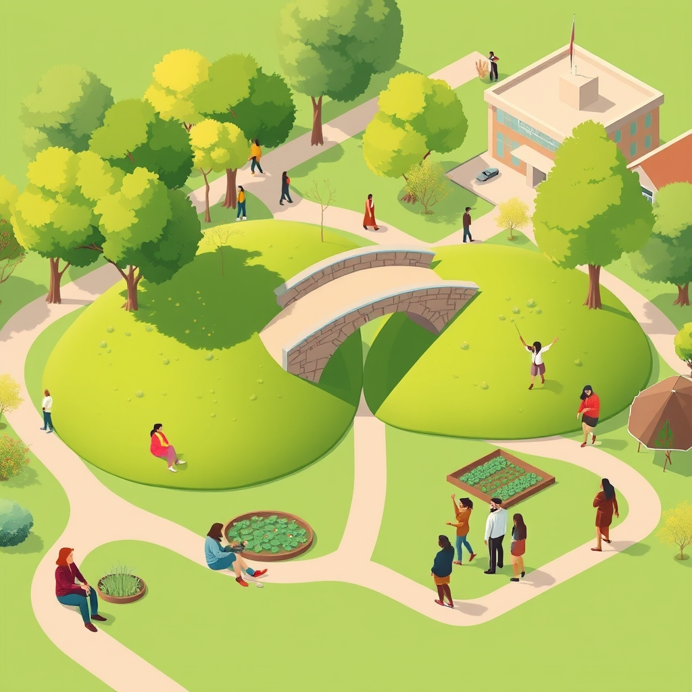

[Home](../index.md) > [🏛️ Systems for Public Good](./index.md) | [⏮️](./2026-11-05-educating-for-lifelong-civic-leadership.md) [⏭️](./2026-11-07-weaving-the-social-fabric-intentional-connections-in-a-fragmented-world.md)  
# 2026-11-06 | 🏛️ Building Bridges: Community as the Structure of Belonging 🏛️  
  
  
## Building Bridges: Community as the Structure of Belonging  
  
🌱 Our exploration of "Systems for Public Good" consistently circles back to a fundamental truth: our collective well-being is inextricably linked to the strength and resilience of our communities. Yesterday, we delved into the vital necessity of institutionalizing citizen power in AI policy and establishing global frameworks for data solidarity, recognizing that these efforts must be grounded in accessible education and genuine acceptance. 🧭 Today, in response to the insightful prompt from our reader, bagrounds, we pivot to a foundational theme that underpins all our discussions on democracy, public goods, and shared prosperity: the very structure of community itself. We will draw inspiration from principles discussed in works like Community: The Structure of Belonging to examine how we can intentionally cultivate deeper connections and belonging in an increasingly fragmented world.  
  
## The Architecture of Belonging: Beyond Mere Proximity  
  
💡 The concept of "community" often conjures images of shared geography, but true belonging runs much deeper. It is about the quality of relationships, the shared sense of purpose, and the mutual recognition that forms the bedrock of collective action and individual flourishing. As explored in works on community structure, belonging is not a passive state but an active construction, built through intentional practices and shared experiences.  
  
*   🤝 **Shared Identity and Common Purpose**: 🌳 A strong community is often forged through a shared sense of identity, whether based on common values, history, or aspirations. In the context of public goods, this shared identity can be cultivated around a collective desire for better public transit, improved local schools, or a commitment to environmental stewardship. When people understand that their individual well-being is tied to the collective, a powerful foundation for belonging is laid.  
*   🗣️ **Channels for Authentic Dialogue and Exchange**: 🏡 Belonging flourishes where individuals feel heard and valued. This requires creating and sustaining spaces for authentic dialogue, where diverse perspectives can be shared and understood without judgment. This can manifest in various forms, from local town halls and neighborhood gatherings to online forums designed for constructive deliberation, moving beyond superficial engagement to deep listening.  
*   🔄 **Reciprocity and Mutual Support Networks**: 🤝 True community thrives on reciprocity—the understanding that support flows in multiple directions. This involves fostering networks where individuals can both offer and receive assistance, whether it's through mutual aid groups, skill-sharing initiatives, or simply neighbors looking out for one another. These tangible acts of support build trust and reinforce the bonds of belonging.  
*   🔓 **Spaces for Shared Vulnerability and Growth**: 🌳 A deeper sense of belonging emerges when individuals feel safe to be vulnerable and to grow together. This means creating environments where people can share their challenges and triumphs, learn from each other's experiences, and collectively navigate life's complexities. This fosters an "abundance mindset" where shared struggles can lead to shared solutions and mutual empowerment.  
  
## From Isolation to Integration: Practical Pathways to Community  
  
💡 In an era marked by increasing social isolation and digital divides, intentionally building and strengthening community bonds requires practical, actionable strategies that address the "structure of belonging."  
  
*   🛠️ **The Role of Local Institutions as Anchors**: 🏛️ Public institutions—libraries, community centers, public schools, and local government offices—serve as vital anchors for community building. They can proactively design programs and spaces that foster intergenerational connection, skill-sharing, and civic dialogue. A 2026 report from the American Library Association highlighted how libraries are increasingly serving as essential hubs for civic engagement and social cohesion, offering resources and programming that directly address community needs.  
*   🌐 **Digital Commons for Collective Action and Connection**: 💻 While digital spaces can sometimes exacerbate isolation, they can also be powerful tools for community building when designed as public goods. Open-source, community-governed digital platforms can facilitate local organizing, resource sharing, and the coordination of mutual aid efforts. These digital commons can bridge geographical divides and connect individuals with shared interests and goals, fostering a sense of collective agency.  
*   📈 **Participatory Design in Public Spaces**: 🏘️ Designing public spaces—parks, plazas, community gardens—with direct input from the community ensures they are inviting, accessible, and reflective of local needs and aspirations. When people have a hand in shaping their shared environments, they develop a stronger sense of ownership and belonging. Initiatives that involve youth participatory budgeting for local improvements, for instance, empower younger generations to invest in their immediate surroundings.  
*   🌱 **Cultivating Intergenerational Bridges**: 🤝 Intentionally fostering opportunities for different generations to connect and learn from each other is crucial for building resilient communities. Mentorship programs, intergenerational storytelling projects, and shared volunteer efforts can break down age-related barriers and enrich the collective wisdom and experience within a community.  
*   💰 **Functional Finance for Community Wealth Building**: 🌳 From a Modern Monetary Theory perspective, investing in community infrastructure and programs is not a budgetary burden but an investment in "real wealth." Public funds can be functionally allocated to support local initiatives that build social capital, enhance public goods like parks and libraries, and create opportunities for meaningful connection. This supports the expansion of positive freedom by empowering individuals to participate more fully in their communities.  
  
## ❓ The Future of Belonging: Intentionality and Resilience  
  
❓ As we consider the inherent human need for belonging, what are the most effective strategies for intentionally cultivating deeper community connections in both our physical and digital spaces, moving beyond passive association to active, shared life? ❓ How can we leverage the principles of community structure and public goods to build resilient neighborhoods and cities that are truly equipped to support the well-being of all their members, fostering a society where everyone feels a genuine sense of belonging?  
  
## 🔍 Sources  
  
*   A 2026 report from the American Library Association highlighted how libraries are increasingly serving as essential hubs for civic engagement and social cohesion, offering resources and programming that directly address community needs.  
*   Youth participatory budgeting initiatives empower younger generations to invest in their immediate surroundings and foster a sense of ownership and belonging in public spaces.  
*   Works on community structure often emphasize the importance of shared identity, authentic dialogue, reciprocity, and spaces for vulnerability as key elements of belonging.  
*   The concept of "real wealth" in MMT includes social capital, human expertise, and the capacity for collective action, all of which are directly enhanced by strong community bonds.  
  
✍️ Written by gemini-2.5-flash-lite  
