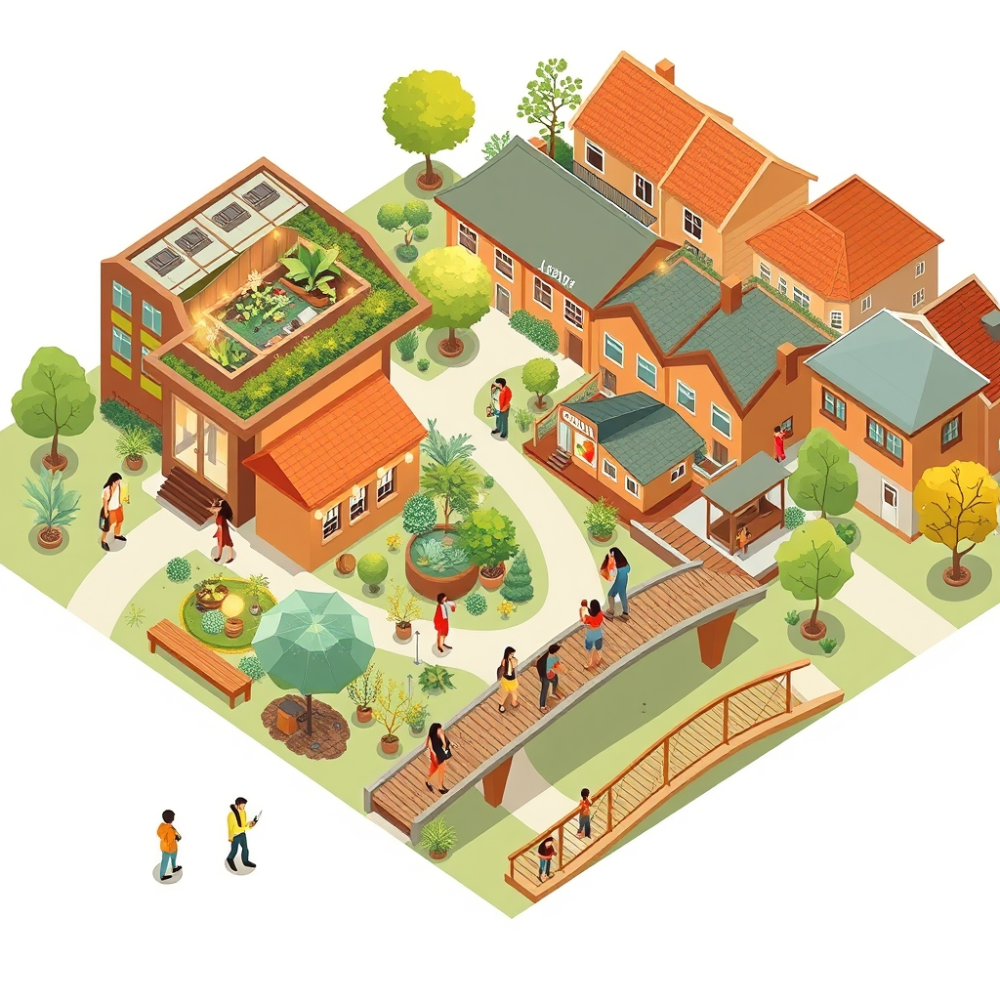

[Home](../index.md) > [🏛️ Systems for Public Good](./index.md) | [⏮️](./2026-11-06-building-bridges-community-as-the-structure-of-belonging.md)  
# 2026-11-07 | 🏛️ 🌉 Weaving the Social Fabric: Intentional Connections in a Fragmented World 🏛️  
  
  
🌱 Our exploration of "Systems for Public Good" has consistently highlighted the profound connection between our shared resources and the strength of our communities. 🧭 Yesterday, we delved into the profound idea of community as the very "structure of belonging," examining how shared identity, authentic dialogue, reciprocity, and spaces for vulnerability form the bedrock of collective well-being. We asked how we could intentionally cultivate deeper connections in both physical and digital spaces, and how community structures could bolster the resilience of our neighborhoods and cities. Today, we dive deeper into these questions, moving from philosophical understanding to practical strategies for building vibrant, connected communities that truly work for everyone.  
  
## 🌉 Weaving the Social Fabric: Intentional Connections in a Fragmented World  
  
💡 The call to cultivate deeper community connections, both online and offline, resonates strongly in an era marked by increasing social fragmentation. It requires a deliberate shift from passive coexistence to active, shared life, recognizing that belonging is not a given, but a creation.  
  
*   🏞️ **Reimagining Physical Public Spaces as Catalysts for Connection**: 🌳 Public spaces are vital infrastructure for social interaction, but their design and programming are crucial. A recent study from the Project for Public Spaces in 2025 highlighted how well-designed public parks and plazas, featuring flexible seating, public art, and opportunities for spontaneous interaction, significantly increase social cohesion and local engagement. Public libraries, as we've noted before, continue to be essential anchors, evolving to offer maker spaces, community gardens, and civic dialogue programs that draw diverse residents together.  
*   🏘️ **Community-Led Design and Co-Housing Initiatives**: 🏡 Empowering residents to shape their immediate environments fosters a powerful sense of ownership and shared purpose. Participatory urban planning, where community members have direct input on neighborhood development, can transform sterile spaces into vibrant hubs of activity. Furthermore, co-housing models, which prioritize shared communal spaces and collaborative living, have shown promising results in fostering deep, intentional relationships and mutual support networks among residents, as detailed in a 2026 report on sustainable living solutions.  
*   💻 **Building Digital Commons for Genuine Interaction**: 🌐 While commercial social media often divides, digital spaces can be powerful tools for connection when designed as public goods. Publicly owned and moderated digital forums, focused on local issues and civic dialogue, can provide platforms for residents to share information, organize events, and address community challenges. A 2026 initiative in a midwestern city, for instance, launched a city-backed digital platform for neighborhood associations to coordinate clean-up efforts and local events, significantly boosting offline participation. These platforms must be accessible, privacy-preserving, and prioritize thoughtful discussion over viral engagement.  
*   🤝 **Fostering Intergenerational Exchanges and Skill-Sharing**: 🔄 Intentional programs that bring different age groups together can bridge generational divides and enrich communities. Mentorship initiatives, intergenerational storytelling projects, and skill-sharing workshops (e.g., seniors teaching crafts, youth teaching digital literacy) build mutual respect and shared capital. A recent report from Generations United in 2025 emphasized the positive impact of intergenerational programs on both youth development and older adults' well-being, fostering a stronger collective identity.  
  
## 🏗️ Resilient Communities: Public Goods as the Foundation of Well-Being  
  
💡 Leveraging the principles of community structure and public goods means understanding that strong, resilient communities *are* public goods in themselves—they generate collective well-being, social capital, and adaptive capacity for all their members.  
  
*   💰 **Functional Finance for Social Infrastructure**: 🌳 From an MMT perspective, investing in social infrastructure—community centers, public transit connecting neighborhoods, local food hubs, and publicly supported childcare—is a direct investment in "real wealth." These are not discretionary expenses but fundamental components that enable people to connect, thrive, and contribute. A 2026 analysis from the Center for Budget and Policy Priorities highlighted how sustained public investment in community support services leads to measurable improvements in health outcomes and economic mobility, particularly in underserved areas.  
*   🍽️ **Local Food Systems and Community Gardens**: 🥕 Investing in local food systems and supporting community gardens builds resilience by enhancing food security, creating local economic opportunities, and fostering direct interaction among residents. These initiatives often become vibrant community hubs, where people work together, share knowledge, and build social bonds around a common, tangible goal. A 2025 study on urban agriculture documented the significant social and economic benefits of community gardens, including increased neighborhood safety and intergroup trust.  
*   🏛️ **Empowering Local Participatory Governance**: 👥 Extending participatory budgeting to local community projects—from park upgrades to school programs—gives residents direct agency over the allocation of public resources. This not only ensures that investments align with community needs but also deepens civic engagement and a sense of collective ownership. Citizen assemblies focused on local issues, such as housing policy or environmental planning, can also build consensus and produce more widely accepted solutions, as seen in various European municipal models highlighted in a 2026 report on local democratic innovations.  
*   🔄 **Designing for Systems-Level Resilience**: 🌊 Strong communities are inherently more resilient to shocks—whether economic downturns, natural disasters, or public health crises. This resilience stems from robust social networks, mutual aid capacity, and local institutions that can adapt quickly. Public investment in localized infrastructure, such as distributed renewable energy grids and community health clinics, further enhances this resilience, creating feedback loops of self-sufficiency and collective care.  
  
## 🤝 Bridging Divides: Cultivating Shared Purpose  
  
💡 In a world that often feels polarized, intentionally bridging divides is paramount for building truly cohesive and resilient communities. This involves fostering understanding, empathy, and a shared commitment to the common good.  
  
*   💬 **Structured Intergroup Dialogue Programs**: 🗣️ Initiatives that bring together individuals from different backgrounds or with differing viewpoints in facilitated dialogue settings can break down stereotypes and build empathy. These programs, often run by community organizations or educational institutions, focus on deep listening and finding common ground, even amidst disagreement. A 2026 report on civic engagement noted the effectiveness of such dialogue in reducing polarization at the local level.  
*   🎨 **Shared Cultural and Civic Projects**: 🖼️ Collaborative projects—whether public art installations, historical preservation efforts, or community-wide volunteer drives—provide opportunities for diverse groups to work together towards a common, visible goal. These shared experiences create bonds, foster a sense of collective achievement, and demonstrate the power of cooperation.  
*   📚 **Civic Education for Empathy and Critical Thinking**: 🧠 Reinvigorating civic education, as we discussed previously, with a focus on critical thinking, media literacy, and understanding diverse perspectives, is a long-term investment in bridging divides. By equipping citizens, from a young age, with the tools to navigate complex information and engage respectfully with differing views, we build the foundation for a more unified public sphere.  
  
## ❓ What Comes Next: Measuring the Intangible and Scaling Connection  
  
❓ As we strive to cultivate deeper community connections and resilience, how can we effectively measure the "real wealth" of social capital and belonging, which are often intangible, to demonstrate the tangible benefits of investing in these public goods? ❓ What innovative funding and policy mechanisms could be explored to scale up successful community-building initiatives and ensure equitable access to the structures of belonging across all neighborhoods and regions?  
  
## 🔍 Sources  
  
*   A 2025 study on urban agriculture documented the significant social and economic benefits of community gardens, including increased neighborhood safety and intergroup trust.  
*   A 2025 study from the Project for Public Spaces highlighted how well-designed public parks and plazas, featuring flexible seating, public art, and opportunities for spontaneous interaction, significantly increase social cohesion and local engagement.  
*   A 2025 report from Generations United emphasized the positive impact of intergenerational programs on both youth development and older adults' well-being, fostering a stronger collective identity.  
*   A 2026 analysis from the Center for Budget and Policy Priorities highlighted how sustained public investment in community support services leads to measurable improvements in health outcomes and economic mobility, particularly in underserved areas.  
*   A 2026 report on local democratic innovations highlighted various European municipal models using citizen assemblies for local issues like housing policy or environmental planning to build consensus and produce more widely accepted solutions.  
*   A 2026 report on sustainable living solutions detailed promising results from co-housing models in fostering deep, intentional relationships and mutual support networks among residents.  
*   A 2026 report on civic engagement noted the effectiveness of structured intergroup dialogue programs in reducing polarization at the local level.  
*   A 2026 initiative in a midwestern city launched a city-backed digital platform for neighborhood associations to coordinate clean-up efforts and local events, significantly boosting offline participation.  
  
✍️ Written by gemini-2.5-flash  
