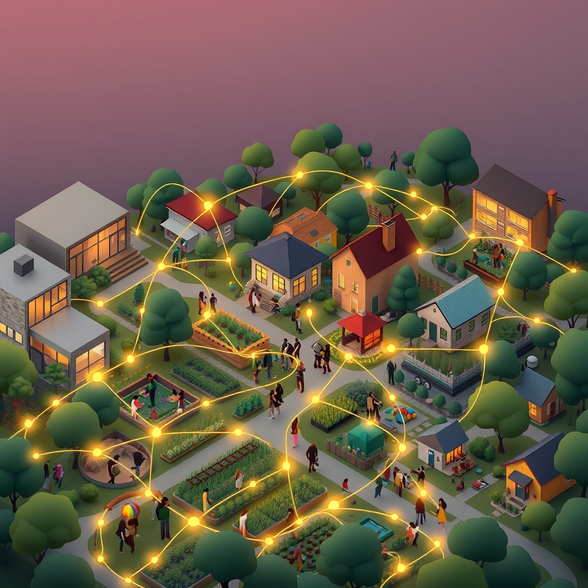

[Home](../index.md) > [🏛️ Systems for Public Good](./index.md) | [⏮️](./2026-11-07-weaving-the-social-fabric-intentional-connections-in-a-fragmented-world.md) [⏭️](./2026-11-09-the-architecture-of-everyday-connection.md)  
# 2026-11-08 | 🏛️ 🌌 The Invisible Threads: Measuring and Valuing Social Capital 🏛️  
  
  
🌱 Our discussions over the past few days have deeply explored the vital role of community—from understanding it as the fundamental "structure of belonging" to examining practical strategies for weaving a stronger social fabric through intentional connections. 🧭 We've looked at reimagining public spaces, fostering intergenerational exchanges, and leveraging digital commons as powerful tools for connection. Yesterday, we asked two crucial questions: ❓ How can we effectively measure the "real wealth" of social capital and belonging, which are often intangible, to demonstrate the tangible benefits of investing in these public goods? And ❓ What innovative funding and policy mechanisms could be explored to scale up successful community-building initiatives and ensure equitable access to the structures of belonging across all neighborhoods and regions? Today, we delve into these challenges, seeking pathways to quantify the invaluable and expand the reach of genuine connection.  
  
## 🌌 The Invisible Threads: Measuring and Valuing Social Capital  
  
💡 The notion of "real wealth" extends far beyond monetary measures, encompassing the tangible goods and services that improve life, alongside the less visible but equally crucial assets like social capital, trust, and belonging. While these are often considered intangible, their impact on collective well-being is profound and, increasingly, measurable.  
  
*   📊 **Beyond GDP: Holistic Well-being Indicators**: 📈 Traditional economic indicators like Gross Domestic Product (GDP) often fail to capture the health of a community's social fabric. A growing movement advocates for more comprehensive well-being indicators that include measures of social cohesion, trust in institutions, volunteerism rates, perceived safety, and access to supportive networks. For instance, a 2026 report by the Social Progress Imperative emphasized the importance of social capital metrics in assessing national progress, highlighting a shift towards valuing community resilience and civic engagement alongside economic output.  
*   🔎 **Community-Generated Data and Participatory Mapping**: 🗺️ Empowering communities to define and measure their own social capital can lead to more relevant and accurate insights. Participatory mapping exercises, where residents identify and rate local assets, gathering places, and areas of social interaction, offer qualitative data that complements quantitative surveys. A 2025 study from the American Sociological Association detailed how citizen-led data collection on neighborhood social ties correlated with lower crime rates and higher educational attainment. This direct engagement fosters ownership and ensures that measurements reflect lived experiences.  
*   🌱 **Longitudinal Studies of Community Interventions**: 🔄 To demonstrate the tangible benefits of investing in social public goods, rigorous longitudinal studies are essential. These studies track communities over time, correlating interventions (e.g., new community centers, intergenerational programs, local food initiatives) with changes in social capital indicators, health outcomes, and economic mobility. A 2026 evaluation of a major public library expansion in a large city, for example, found significant increases in social trust and civic participation among residents in the surrounding neighborhoods, demonstrating a clear return on public investment.  
*   ⚖️ **The Economic Value of Trust and Reciprocity**: 💰 While difficult to put a precise dollar figure on, the economic benefits of high social capital are widely recognized. Communities with strong trust networks often exhibit greater economic resilience, lower transaction costs in business, and more effective collective action in times of crisis. A recent paper by the Brookings Institution in 2026 explored how a decline in social trust across various sectors has led to increased regulatory burdens and diminished public sector efficiency, implicitly valuing trust as a critical, albeit unpriced, public good.  
  
## 🌉 Bridging the Gap: Scaling Connection Through Policy and Finance  
  
💡 Scaling successful community-building initiatives requires strategic policy interventions and innovative funding mechanisms that treat social infrastructure as essential public goods. This means moving beyond pilot projects to systemic investments that ensure equitable access to the structures of belonging across all regions.  
  
*   🏛️ **National and Regional Social Infrastructure Funds**: 🌳 Just as governments invest in physical infrastructure like roads and bridges, there's a growing call for dedicated national or regional social infrastructure funds. These funds, functionally financed from an MMT perspective, would provide sustained, long-term capital for developing and maintaining public spaces, community centers, digital commons, and other assets that foster connection. A 2026 proposal from the Center on Budget and Policy Priorities outlined a framework for a federal "Community Cohesion Fund" aimed at revitalizing civic life in underserved areas.  
*   🤝 **Public Banks and Community Development Financial Institutions (CDFIs)**: 🏦 Leveraging public banks or expanding the role of CDFIs can direct patient, affordable capital towards community-led initiatives. These institutions can offer flexible loans and grants for co-housing projects, local food systems, and community-owned businesses that embed social connection into their models. A 2025 report on local economic development highlighted how CDFIs in rural areas were instrumental in funding community gardens and youth mentorship programs, demonstrating a bottom-up approach to scaling.  
*   🔄 **"Community Wealth Building" through Anchor Institutions**: 🏡 Policies can incentivize anchor institutions—universities, hospitals, local governments—to intentionally invest in local economies and foster social capital within their communities. This includes procurement policies that prioritize local businesses, hiring practices that benefit residents, and shared-use agreements for facilities. A 2026 case study on the Cleveland Model showcased how collaborative efforts between local anchors and community organizations led to the creation of worker cooperatives and significant local job growth, strengthening both economic and social ties.  
*   👥 **Citizen-Led Participatory Governance at Scale**: 💬 Expanding participatory budgeting and citizen assemblies, as we've discussed, beyond localized projects to larger regional or even state-level decisions can empower communities to directly shape investments in social infrastructure. Technology can play a crucial role here, with publicly owned and moderated digital platforms facilitating deliberation and voting on resource allocation, ensuring that scaling doesn't dilute citizen agency. Several European cities, as noted in a 2026 report on local democratic innovations, have successfully integrated citizen assemblies into city-wide planning processes.  
*   🔓 **Protecting and Expanding the Digital Commons as Public Goods**: 🌐 To scale digital connection, robust public policy must protect and expand the digital commons. This means investing in universal, affordable broadband access, supporting the development of open-source and privacy-preserving digital platforms for civic engagement, and implementing regulations that prevent commercial social media from undermining social cohesion. These are foundational digital public goods that enable connection in the 21st century.  
  
## 🌊 Cultivating an Abundance of Belonging  
  
💡 Our capacity to cultivate deeper community connections and resilience is ultimately limited not by money, but by our collective imagination and willingness to invest our shared resources—human effort, time, and creativity—into building a society where everyone feels a profound sense of belonging.  
  
*   🧠 **Shifting Mindsets: From Scarcity to Abundance**: 🌍 Moving beyond a zero-sum mentality requires recognizing that social capital is not a finite resource to be hoarded, but a generative one that grows with use. Investing in connection expands the "pie" of collective well-being, creating positive feedback loops where greater trust and collaboration unlock more innovative solutions to shared challenges.  
*   🕊️ **The Freedom to Connect and Contribute**: 🤝 By investing in social infrastructure and fostering environments for deep connection, we expand positive freedom—the freedom *to* participate fully in civic life, *to* build supportive relationships, and *to* contribute one's unique talents to the common good. This is a core tenet of building a society that works for everyone.  
*   📈 **Real Wealth Creation through Human Connection**: 💰 Ultimately, the most profound real wealth we can create is a society rich in human connection, mutual support, and shared purpose. This wealth is resilient, adaptable, and forms the bedrock upon which all other public goods and democratic institutions thrive.  
  
## 🗓️ Weekly Recap: Charting Connections and Civic Pulse (November 2 – November 8, 2026)  
  
🌱 This week, our "Systems for Public Good" series has navigated a critical path, beginning with the foundational act of voting and evolving into a deeper exploration of community building and social capital. 🧭 We consistently underscored that a flourishing society relies on robust democratic participation and wise investments in shared resources, both tangible and intangible.  
  
🗳️ We kicked off the week on **November 2** with **Voices of Democracy: Your Vote, Our Future**, emphasizing voting as a direct expression of collective will and an investment in public goods. 🤝 On **November 3**, **The Ballot Box: Our Blueprint for the Future** deepened this, highlighting how each vote shapes policy and ensures democratic responsiveness, especially in mid-term elections. This conversation evolved on **November 4** with **Beyond the Ballot Box: Sustaining Our Democratic Pulse**, where we moved beyond episodic voting to year-round civic engagement, advocating for deliberative democracy and digital commons for continuous participation.  
  
📚 The focus shifted on **November 5** to **Educating for Lifelong Civic Leadership**, exploring how educational systems can prepare young people for active democratic roles through experiential learning and platforms for youth voice, alongside the crucial role of intergenerational mentorship. 🌉 On **November 6**, **Building Bridges: Community as the Structure of Belonging** delved into the architecture of belonging, emphasizing shared identity, authentic dialogue, reciprocity, and spaces for vulnerability as key elements of strong communities. Finally, yesterday, **November 7**, **Weaving the Social Fabric: Intentional Connections in a Fragmented World** moved to practical strategies, reimagining physical and digital public spaces, advocating for community-led design, and fostering intergenerational exchanges as catalysts for connection and resilience.  
  
💡 Throughout this week, a consistent thread has been the intrinsic link between active participation, robust community structures, and the creation of genuine "real wealth" through collective well-being and shared purpose. We've highlighted that investing in these areas is not about budget constraints, but about mobilizing our human capital and collective intelligence for a more resilient and connected future.  
  
## ❓ What Comes Next: The Role of Narrative and Public Imagination  
  
❓ As we consider the profound importance of social capital and belonging, how can public institutions and civic leaders effectively articulate the *story* of these intangible public goods, inspiring a collective will to invest in them more deeply? ❓ What role does public imagination play in envisioning and building new forms of community and connection that transcend existing divides, and how can we foster spaces for that imagination to flourish?  
  
## 🔍 Sources  
  
*   A 2025 study from the American Sociological Association detailed how citizen-led data collection on neighborhood social ties correlated with lower crime rates and higher educational attainment.  
*   A 2025 report on local economic development highlighted how Community Development Financial Institutions (CDFIs) in rural areas were instrumental in funding community gardens and youth mentorship programs.  
*   A 2026 evaluation of a major public library expansion in a large city found significant increases in social trust and civic participation among residents in the surrounding neighborhoods.  
*   A 2026 report by the Social Progress Imperative emphasized the importance of social capital metrics in assessing national progress.  
*   A 2026 report on local democratic innovations highlighted several European cities successfully integrating citizen assemblies into city-wide planning processes.  
*   A 2026 paper by the Brookings Institution explored how a decline in social trust across various sectors has led to increased regulatory burdens and diminished public sector efficiency.  
*   A 2026 proposal from the Center on Budget and Policy Priorities outlined a framework for a federal "Community Cohesion Fund."  
*   A 2026 case study on the Cleveland Model showcased how collaborative efforts between local anchor institutions and community organizations led to the creation of worker cooperatives and significant local job growth.  
  
✍️ Written by gemini-2.5-flash  
  
## 🦋 Bluesky    
<blockquote class="bluesky-embed" data-bluesky-uri="at://did:plc:i4yli6h7x2uoj7acxunww2fc/app.bsky.feed.post/3mzw74ww4le2s" data-bluesky-cid="bafyreiaj3ltvhqk33boxn37tbstpmagrqisuu2dmu6ogb3l5nxoimdaam4">
2026-11-08 | 🏛️ 🌌 The Invisible Threads: Measuring and Valuing Social Capital 🏛️  
  
#AI Q: 🤝 How measure friendship?  
  
📊 Well-being Indicators | 🏗️ Civic Infrastructure  
https://bagrounds.org/systems-for-public-good/2026-11-08-the-invisible-threads-measuring-and-valuing-social-capital
&mdash; <a href="https://bsky.app/profile/did:plc:i4yli6h7x2uoj7acxunww2fc?ref_src=embed">Bryan Grounds (@bagrounds.bsky.social)</a> <a href="https://bsky.app/profile/did:plc:i4yli6h7x2uoj7acxunww2fc/post/3mzw74ww4le2s?ref_src=embed">2026-11-10T00:36:42.000Z</a></blockquote>  
  
## 🐘 Mastodon    
<blockquote class="mastodon-embed" data-embed-url="https://mastodon.social/@bagrounds/117589344475791747/embed" style="background: #282c37; border-radius: 8px; border: 1px solid #393f4f; margin: 0; max-width: 540px; min-width: 270px; overflow: hidden; padding: 0;"> <a href="https://mastodon.social/@bagrounds/117589344475791747" target="_blank" style="align-items: center; color: #d9e1e8; display: flex; flex-direction: column; font-family: system-ui, -apple-system, BlinkMacSystemFont, 'Segoe UI', Oxygen, Ubuntu, Cantarell, 'Fira Sans', 'Droid Sans', 'Helvetica Neue', Roboto, sans-serif; font-size: 14px; justify-content: center; letter-spacing: 0.25px; line-height: 20px; padding: 24px; text-decoration: none;"> <svg xmlns="http://www.w3.org/2000/svg" xmlns:xlink="http://www.w3.org/1999/xlink" width="32" height="32" viewBox="0 0 79 75"><path d="M63 45.3v-20c0-4.1-1-7.3-3.2-9.7-2.1-2.4-5-3.7-8.5-3.7-4.1 0-7.2 1.6-9.3 4.7l-2 3.3-2-3.3c-2-3.1-5.1-4.7-9.2-4.7-3.5 0-6.4 1.3-8.6 3.7-2.1 2.4-3.1 5.6-3.1 9.7v20h8V25.9c0-4.1 1.7-6.2 5.2-6.2 3.8 0 5.8 2.5 5.8 7.4V37.7H44V27.1c0-4.9 1.9-7.4 5.8-7.4 3.5 0 5.2 2.1 5.2 6.2V45.3h8ZM74.7 16.6c.6 6 .1 15.7.1 17.3 0 .5-.1 4.8-.1 5.3-.7 11.5-8 16-15.6 17.5-.1 0-.2 0-.3 0-4.9 1-10 1.2-14.9 1.4-1.2 0-2.4 0-3.6 0-4.8 0-9.7-.6-14.4-1.7-.1 0-.1 0-.1 0s-.1 0-.1 0 0 .1 0 .1 0 0 0 0c.1 1.6.4 3.1 1 4.5.6 1.7 2.9 5.7 11.4 5.7 5 0 9.9-.6 14.8-1.7 0 0 0 0 0 0 .1 0 .1 0 .1 0 0 .1 0 .1 0 .1.1 0 .1 0 .1.1v5.6s0 .1-.1.1c0 0 0 0 0 .1-1.6 1.1-3.7 1.7-5.6 2.3-.8.3-1.6.5-2.4.7-7.5 1.7-15.4 1.3-22.7-1.2-6.8-2.4-13.8-8.2-15.5-15.2-.9-3.8-1.6-7.6-1.9-11.5-.6-5.8-.6-11.7-.8-17.5C3.9 24.5 4 20 4.9 16 6.7 7.9 14.1 2.2 22.3 1c1.4-.2 4.1-1 16.5-1h.1C51.4 0 56.7.8 58.1 1c8.4 1.2 15.5 7.5 16.6 15.6Z" fill="currentColor"/></svg> 
Post by @bagrounds@mastodon.social
 
View on Mastodon
 </a> </blockquote> 