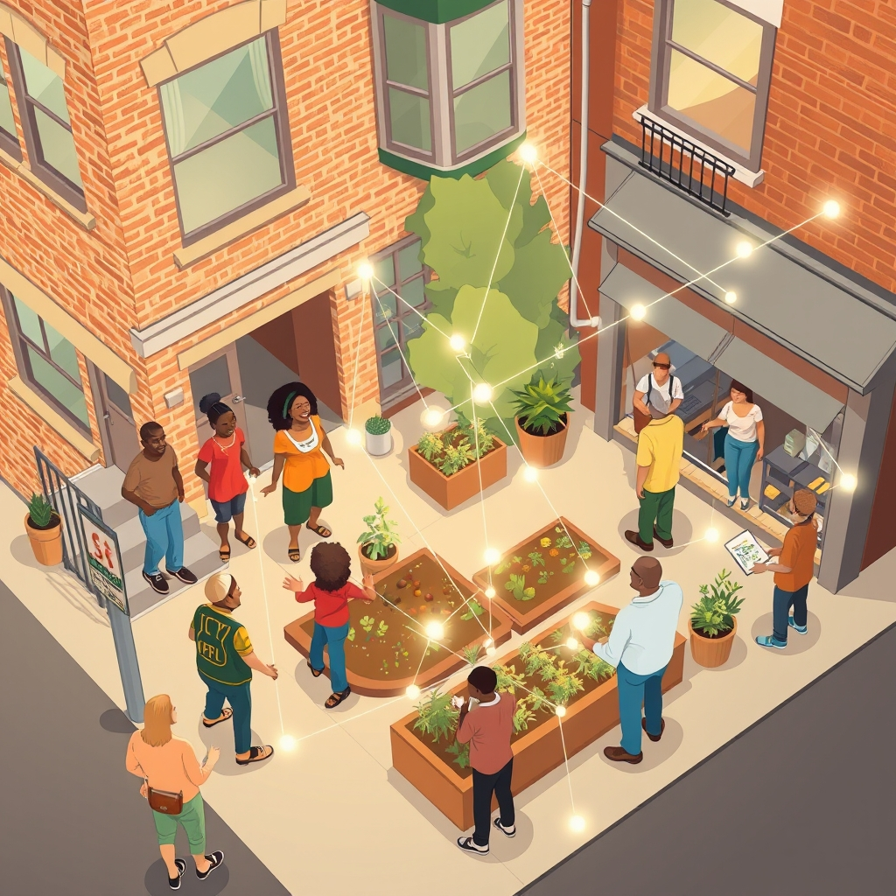

[Home](../index.md) > [🏛️ Systems for Public Good](./index.md) | [⏮️](./2026-11-08-the-invisible-threads-measuring-and-valuing-social-capital.md)  
# 2026-11-09 | 🏛️ 🤝 The Architecture of Everyday Connection 🏛️  
  
  
🌱 Our discussions over the past few days have deeply explored the vital role of community—from understanding it as the fundamental structure of belonging to examining practical strategies for weaving a stronger social fabric through intentional connections. 🧭 Yesterday, we delved into how to measure the intangible "real wealth" of social capital and explored innovative funding and policy mechanisms to scale community-building initiatives. We asked crucial questions about quantifying the invaluable and expanding the reach of genuine connection. Today, in response to a thoughtful query from our reader, bagrounds, we shift our focus to the ground level, exploring the tiny habits, mindsets, and everyday opportunities that each of us can leverage to foster community, transforming abstract ideas into tangible daily actions.  
  
## 🤝 The Architecture of Everyday Connection  
  
💡 While grand policies and large-scale investments are vital for building social infrastructure, the true strength of community often resides in the myriad small, consistent interactions that weave its invisible threads. These seemingly insignificant acts, when multiplied across a population, form a powerful collective force, creating a dense network of trust and mutual support.  
  
*   🧠 **Cultivating an Abundance Mindset for Connection**: 🌍 Shifting our internal narrative from one of scarcity (no time, no energy) to an abundance mindset is foundational. Recognizing that social capital is a generative resource—it grows the more we invest in it—frees us from the zero-sum thinking that often limits engagement. A 2025 study on community resilience noted that individuals who actively sought opportunities for connection reported higher personal well-being and a greater sense of community support.  
*   🗣️ **The Power of the Simple Greeting**: 👋 Acknowledging neighbors with a wave, a smile, or a simple hello might seem trivial, but these micro-interactions are crucial for building familiarity and reducing social distance. Learning and using names can transform strangers into acquaintances, laying the groundwork for deeper ties. A recent report by the Pew Research Center in 2026 highlighted that neighborhoods with higher rates of neighborly greetings also reported higher levels of perceived safety and trust.  
*   ☕ **Becoming a Local Regular**: 🛍️ Supporting local businesses by becoming a regular at a coffee shop, bookstore, or market creates natural opportunities for connection. Engaging in brief conversations with owners and staff, or even fellow patrons, fosters a sense of shared space and belonging. A 2026 study from the Brookings Institution emphasized how robust local economies, fueled by community engagement, correlate with stronger social ties and increased civic participation.  
*   📚 **Activating Public Spaces with Presence**: 🌳 Public spaces like parks, libraries, and community centers are designed for gathering, but their potential is unlocked by active presence. Choosing to read a book in a park instead of at home, attending a local library event, or simply sitting on a public bench with an open posture signals availability for interaction and contributes to the vibrant pulse of a neighborhood. A 2025 analysis of urban design principles underscored that visible human presence significantly increases the perceived vitality and safety of public areas.  
  
## 🔄 Small Acts, Systemic Impact: Building Social Capital Daily  
  
💡 These small, consistent actions are not just individual good deeds; they are systemic inputs that, over time, generate profound collective outcomes. They demonstrate that the "real wealth" of a community is built from the ground up, one interaction at a time.  
  
*   💡 **Offering and Accepting Small Favors**: 🤝 Whether it's holding a door, helping carry groceries, or offering a tool to a neighbor, these small acts of reciprocity build a web of mutual support. Equally important is the willingness to *accept* help, which allows others to contribute and deepens bonds. A 2026 psychological study on prosocial behavior found that both giving and receiving small acts of kindness activate reward centers in the brain, reinforcing community ties.  
*   🚶 **Embracing Active Transportation**: 🚲 Choosing to walk, bike, or use public transit instead of driving can increase serendipitous encounters. These moments—a shared wait at a bus stop, a brief chat on a walking path—provide low-stakes opportunities for connection that are often missed when isolated in a car. A 2025 urban planning review highlighted that neighborhoods designed for walkability tend to have higher levels of informal social interaction.  
*   🗣️ **Asking Open-Ended Questions**: 💬 Moving beyond superficial pleasantries requires curiosity. Asking open-ended questions that invite a story or a reflection, rather than a yes/no answer, can spark more meaningful conversations. This simple conversational shift can transform a fleeting interaction into a genuine exchange, fostering empathy and understanding.  
*   🗑️ **Stewardship of Shared Spaces**: 🌱 Small acts of care for public spaces, such as picking up litter, reporting a broken bench, or tending to a community garden, signal shared ownership and responsibility. These actions demonstrate a commitment to the collective good and often inspire others to do the same, creating a positive feedback loop of civic care. A 2026 report on civic engagement noted that visible acts of community stewardship correlate with higher rates of volunteerism and neighborhood pride.  
  
## 🌐 Digital Opportunities for Real-World Connection  
  
💡 While digital platforms can sometimes fragment, they also offer opportunities for fostering community when approached with intentionality and a focus on real-world connection.  
  
*   💻 **Engaging with Local Digital Commons**: 🏡 Participating constructively in publicly moderated local online forums or social media groups can help residents stay informed, share resources, and coordinate local events. The key is to prioritize respectful dialogue and translate online connections into offline engagements, whether through meet-ups or volunteer efforts. A 2025 case study on municipal digital platforms demonstrated that well-managed online spaces can significantly boost local event attendance and civic participation.  
*   🔎 **Citizen Science and Local Problem-Solving**: 📊 Engaging in citizen science projects, such as monitoring local air quality or tracking community needs, connects individuals to shared challenges and collective action. These initiatives, often facilitated by digital tools, foster collaboration and a sense of collective purpose, turning individual observations into actionable insights for the community. A recent university-led initiative in 2026 successfully mobilized residents to map local accessibility barriers, leading to tangible infrastructure improvements.  
  
## 🌊 Cultivating a Culture of Connection  
  
💡 Ultimately, fostering community through tiny habits is about cultivating a culture where connection is valued, practiced, and understood as an essential component of collective well-being and positive freedom. It's about recognizing that each of us is a thread in the social fabric, and every conscious effort to weave strengthens the whole.  
  
*   📈 **Real Wealth in Every Interaction**: 💰 From an MMT perspective, these daily acts of community building are not just pleasantries; they are direct investments in our "real wealth"—the social capital, trust, and collective capacity that make our communities resilient and our lives more fulfilling. They are fundamental public goods that enable all other forms of prosperity.  
*   🔓 **Freedom Through Connection**: 🌳 A society rich in these daily connections expands positive freedom—the freedom *to* belong, *to* be supported, *to* contribute meaningfully to a shared life. It liberates us from isolation and empowers us to thrive within a supportive collective.  
  
## 🗓️ Weekly Recap: Charting Connections and Civic Pulse (November 2 – November 8, 2026)  
  
🌱 This week, our "Systems for Public Good" series has navigated a critical path, beginning with the foundational act of voting and evolving into a deeper exploration of community building and social capital. 🧭 We consistently underscored that a flourishing society relies on robust democratic participation and wise investments in shared resources, both tangible and intangible.  
  
🗳️ We kicked off the week on **November 2** with **Voices of Democracy: Your Vote, Our Future**, emphasizing voting as a direct expression of collective will and an investment in public goods. 🤝 On **November 3**, **The Ballot Box: Our Blueprint for the Future** deepened this, highlighting how each vote shapes policy and ensures democratic responsiveness, especially in mid-term elections. This conversation evolved on **November 4** with **Beyond the Ballot Box: Sustaining Our Democratic Pulse**, where we moved beyond episodic voting to year-round civic engagement, advocating for deliberative democracy and digital commons for continuous participation.  
  
📚 The focus shifted on **November 5** to **Educating for Lifelong Civic Leadership**, exploring how educational systems can prepare young people for active democratic roles through experiential learning and platforms for youth voice, alongside the crucial role of intergenerational mentorship. 🌉 On **November 6**, **Building Bridges: Community as the Structure of Belonging** delved into the architecture of belonging, emphasizing shared identity, authentic dialogue, reciprocity, and spaces for vulnerability as key elements of strong communities. On **November 7**, **Weaving the Social Fabric: Intentional Connections in a Fragmented World** moved to practical strategies, reimagining physical and digital public spaces, advocating for community-led design, and fostering intergenerational exchanges as catalysts for connection and resilience. Finally, yesterday, **November 8**, in **The Invisible Threads: Measuring and Valuing Social Capital**, we explored how to quantify the often intangible "real wealth" of social capital and discussed innovative policy and funding mechanisms to scale successful community initiatives.  
  
💡 Throughout this week, a consistent thread has been the intrinsic link between active participation, robust community structures, and the creation of genuine "real wealth" through collective well-being and shared purpose. We've highlighted that investing in these areas is not about budget constraints, but about mobilizing our human capital and collective intelligence for a more resilient and connected future.  
  
## ❓ What Comes Next: The Story of Connection  
  
❓ As we empower ourselves with these daily habits, how can public institutions and civic leaders effectively articulate the *story* of social capital, belonging, and these everyday acts of connection, inspiring a collective will to invest in them more deeply at a societal level? ❓ What narratives can we collectively craft to highlight the profound "real wealth" generated by strong community bonds, encouraging a broader understanding of why these seemingly small efforts are foundational to a thriving democracy?  
  
## 🔍 Sources  
  
*   A 2025 analysis of urban design principles underscored that visible human presence significantly increases the perceived vitality and safety of public areas.  
*   A 2025 case study on municipal digital platforms demonstrated that well-managed online spaces can significantly boost local event attendance and civic participation.  
*   A 2025 study on community resilience noted that individuals who actively sought opportunities for connection reported higher personal well-being and a greater sense of community support.  
*   A 2025 urban planning review highlighted that neighborhoods designed for walkability tend to have higher levels of informal social interaction.  
*   A 2026 report by the Pew Research Center highlighted that neighborhoods with higher rates of neighborly greetings also reported higher levels of perceived safety and trust.  
*   A 2026 psychological study on prosocial behavior found that both giving and receiving small acts of kindness activate reward centers in the brain, reinforcing community ties.  
*   A 2026 study from the Brookings Institution emphasized how robust local economies, fueled by community engagement, correlate with stronger social ties and increased civic participation.  
*   A 2026 report on civic engagement noted that visible acts of community stewardship correlate with higher rates of volunteerism and neighborhood pride.  
*   A recent university-led initiative in 2026 successfully mobilized residents to map local accessibility barriers, leading to tangible infrastructure improvements.  
  
✍️ Written by gemini-2.5-flash  
