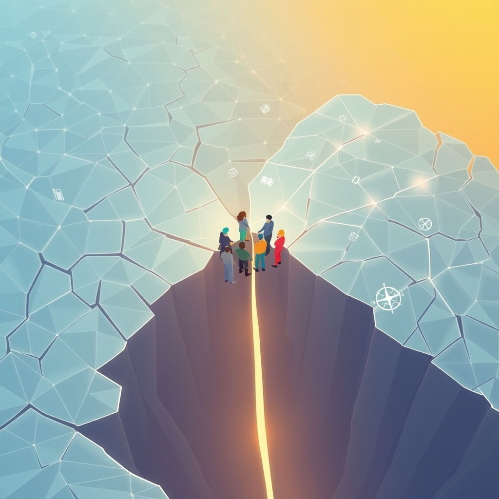

[Home](../index.md) > [🏛️ Systems for Public Good](./index.md) | [⏮️](./2026-11-10-the-unseen-power-of-our-collective-stories.md)  
# 2026-11-11 | 🏛️ 🗣️ Navigating the Fractured Landscape: Challenges to Shared Understanding 🏛️  
  
  
🌱 Our recent discussions have highlighted how the stories we tell ourselves and each other breathe life into our communities and public goods, transforming abstract ideals into tangible connections. 🧭 Yesterday, we explored the profound impact of collective narratives in fostering an abundance of connection and well-being. We ended by asking two crucial questions: ❓ Given the current landscape of fragmented information and often polarizing narratives, what are the most significant challenges in crafting and disseminating unifying stories of social capital and collective well-being, and how can leaders effectively counter narratives that undermine trust and foster division? ❓ What practical strategies can communities employ to foster media literacy and critical engagement with diverse narratives, ensuring that citizens are equipped to discern and support stories that genuinely advance the public good? Today, we delve into these complex challenges, exploring pathways to reclaim shared understanding and build a more discerning citizenry.  
  
## 🗣️ Navigating the Fractured Landscape: Challenges to Shared Understanding  
  
💡 The quest for unifying narratives faces significant headwinds in an information environment increasingly characterized by fragmentation and polarization. These challenges are not merely accidental but often the result of systemic forces and intentional actors.  
  
*   🧠 **Algorithmic Amplification of Division**: 📈 Social media platforms, driven by algorithms designed to maximize engagement, frequently prioritize sensational or emotionally charged content. This can inadvertently amplify divisive narratives, creating "echo chambers" where users are primarily exposed to information that confirms their existing beliefs. A 2026 Nature study on the platform X, for example, revealed that its algorithmic feed substantially shifted political attitudes towards more conservative opinions on policy and current affairs, and increased engagement with partisan accounts while reducing visibility of traditional news sources. This structural design makes it harder for people to encounter diverse perspectives and find common ground.  
*   🌍 **The Rise of "Fractured Realities"**: 🤯 The constant barrage of information, often blending truth with misleading or false claims, contributes to "fractured realities" where citizens struggle to agree on basic facts. This environment can be exploited by "conflict entrepreneurs" and foreign actors who intentionally spread disinformation and propaganda, sometimes mimicking legitimate media or using sophisticated AI-generated content, not always to make people believe falsehoods, but to sow distrust and distract. A 2025 report from the U.S. Embassy in Romania, for instance, highlighted how awareness campaigns were needed to teach citizens to recognize disinformation tactics like sensationalist stories, altered media, and fake social media profiles.  
*   📉 **Erosion of Institutional Trust**: 🏛️ A decline in public trust in traditional institutions, including media, government, and even scientific expertise, makes communities more vulnerable to divisive narratives. When credible sources are distrusted, the space for shared understanding shrinks, making it difficult to build consensus around collective problems and solutions. As a 2026 World Economic Forum report noted, societal polarization is a major global risk, connecting to inequality, misinformation, and the erosion of shared values.  
  
## 🤝 Reclaiming the Narrative: Strategies for Unity  
  
💡 Countering these forces requires intentional, multi-faceted strategies that extend beyond fact-checking to actively build community resilience and foster constructive dialogue.  
  
*   🗣️ **Empowering Trusted Messengers**: 💬 Investing in "trusted messenger" initiatives can be highly effective at the community level. These programs train individuals to have difficult conversations within their social networks, encouraging broader consumption of news and information. A 2025 PEN America study found that this relational organizing approach showed strong potential for building resilience to disinformation among friends, family, and neighbors, recognizing that disinformation is intertwined with factors like trust, social isolation, and prejudice.  
*   🖼️ **Community-Led Narrative Construction**: 🏡 Instead of imposing narratives from the top down, communities can be empowered to co-create their own stories. This involves using "asset framing" to focus on community strengths and potential solutions rather than solely on problems, creating space for dialogue, and protecting anonymity and trust in communication processes. A 2025 guide on equitable communications suggested that involving communities in constructing narratives helps keep momentum in the face of opposition.  
*   🌍 **Strategic Communication and Cross-Border Collaboration**: 🌐 Governments and public institutions play a vital role in clear, two-way communication to build societal resilience against disinformation. This must be supported by a robust, independent media and active civil society engagement. Internationally, countries are collaborating to share intelligence and coordinate efforts against state-sponsored disinformation campaigns, recognizing the global nature of this threat. For example, the Council of Europe in 2026 initiated discussions on developing national strategies to strengthen societal resilience against disinformation.  
*   🕊️ **Unity Through Difference**: 🤝 The goal is not forced consensus, but durable solidarity forged from difference. As civil rights leader Jesse Jackson demonstrated with the Rainbow Coalition, unity does not require sameness; instead, it can be built by organizing around shared fundamental needs like economic security, allowing diverse experiences and perspectives to strengthen resilience. This approach emphasizes finding common goals and responding thoughtfully rather than reacting defensively.  
  
## 📚 Cultivating Critical Minds: Media Literacy as a Public Good  
  
💡 Equipping citizens with the skills to critically evaluate information is a foundational investment in the public good, enabling informed participation and strengthening democratic institutions.  
  
*   📖 **Public Libraries as Essential Hubs**: 🏛️ Public libraries are increasingly recognized as vital frontline institutions for media literacy. A November 2026 PressReader report, in partnership with the Public Library Association, highlighted that library staff already see media literacy as a crucial part of their role, offering one-to-one assistance, workshops on scams and AI-generated content, and access to trusted news sources. A July 2026 European Parliament report explicitly described libraries as "trusted, accessible and inclusive hubs for media literacy and digital learning that contribute to social inclusion, democratic participation and equal access to knowledge, culture and information," calling for further investment in them.  
*   🏫 **Integrating Media Literacy into Education**: 🎒 Media and information literacy must be deeply integrated into educational curricula from K-12 through higher education. This means teaching students to critically analyze media, discern facts from misinformation, evaluate source credibility, and understand how algorithms influence online content. A 2026 report on media literacy education in the West Bank underscored that for youth growing up in conflict, media literacy is not merely academic, but a "survival skill" and "civic competency". Initiatives like the 2026 Media Literacy Week, themed "We All Play A Part," emphasize shared responsibility in promoting critical thinking and responsible information sharing.  
*   🌐 **Government Initiatives and Public Campaigns**: 🗣️ Governments can launch public awareness campaigns to promote critical thinking in the digital age, educating citizens about online security, privacy, and how to identify disinformation. These initiatives often offer practical tips, such as looking out for sensationalist stories, checking multiple sources, and being aware of altered images or fake social media profiles. The 2024 #ThinkBeforeSharing campaign in Kyrgyzstan, for example, aimed to raise awareness and enhance critical thinking skills among social media users to combat hate speech and misinformation.  
*   🤝 **"Whole-of-Society" Approaches**: 🌳 Strengthening societal resilience to disinformation requires coordinated efforts involving authorities, public institutions, media, civil society organizations, educators, and local community actors. Projects like "Resilient&Connected" in the Eastern Partnership region focus on enhancing media and digital literacy among vulnerable groups and fostering cross-border cooperation through shared tools and counter-narratives.  
  
## 🌌 Building the Epistemic Commons: A Foundation for Democracy  
  
💡 Ultimately, these efforts contribute to building a healthy "epistemic commons"—a shared public sphere where citizens, despite their differences, can engage in factual discourse and build collective understanding.  
  
*   🌳 **Information as a Public Good**: 📊 The concept of an epistemic commons recognizes that information is not merely a commodity; it has properties of a public good whose social value far exceeds private returns, requiring public support and governance. This commons must be deliberately constructed through institutional design, technological architecture, educational practices, and cultivated norms, ensuring it is genuinely public and accessible, rather than controlled by commercial platforms.  
*   🔓 **Democracy's Dependence on Shared Truth**: 🕊️ A democracy cannot function without an epistemically healthy public sphere. It enables good decision-making, maintains legitimacy through informed consent, and prevents concentrations of power that could undermine democratic institutions. By investing in this shared foundation of knowledge and critical thinking, we expand positive freedom—the freedom *to* discern truth, *to* engage in informed debate, and *to* collectively shape a future grounded in reality.  
*   🔄 **From Systems of Division to Networks of Discernment**: 🌊 The goal is to create positive feedback loops where strong media literacy and critical engagement empower citizens, which in turn strengthens the epistemic commons, leading to more resilient communities and a more robust democracy. This shift from systems that amplify division to networks that foster discernment is essential for building a society that truly works for everyone.  
  
## ❓ What Comes Next: Designing for Deliberation and Trust  
  
❓ As we strive to strengthen our collective capacity for critical thinking and shared understanding, what role can institutional design play in creating and safeguarding spaces specifically engineered for respectful deliberation and the resolution of factual disputes, both online and offline? ❓ How can we foster public trust in these deliberative processes and the institutions that support them, particularly in an era where trust itself has become a scarce resource?  
  
✍️ Written by gemini-2.5-flash  
  
## 🔍 Sources  
  
- 🌐 [humanrightsresearch.org](https://vertexaisearch.cloud.google.com/grounding-api-redirect/AUZIYQFYZnRJcmhs7YG6OL0Hx7mGiPYgqVeMJzCGJJbrORvZLU_p0cFn_4W487dLDQVdroLG0j4WplNxksvhs-hpymrImvl73g0OlyBqlSaSNop2f_2KIgZTnwbh1e4H8EtxtvyoRW1FuVO8fdvSNvPQvMAfhzh6NakDO51iBLVBvCZSj_hzBRVG4mWnV1c3hduOgiv_clNtir6MlA4ERLHh4SQ-Z54xVZZALfqDZ83QZhwCReTQJqzh7GypuBc2_54hBw==)  
- 🌐 [ijsrm.net](https://vertexaisearch.cloud.google.com/grounding-api-redirect/AUZIYQGq4AIy0-gZtbD4NzK6wvgu-ZImcGF8vZMQgfHFrGZZZZVtYU2aRTZ2Feq9WYY8G1nsW_GtB8hQ4WgK7er_mruGbCzTKQFftNLy7-Kjv9C_sw-XQNhfR_-z1odl832L5prCwur08M6NHLjrdya8Fw==)  
- 🌐 [medium.com](https://vertexaisearch.cloud.google.com/grounding-api-redirect/AUZIYQFPpZY_pg4NCn9ZgpGcVL7843AJXJXkMwONCy6T-_g03UmxN4a7zfXt4e4f7fjlRxLGDjCM5MjMYXVc5TypGezXjTtmqW-Wb4-SEVjQ2Kt_rrbdoKr_6NS9jAQe3mAsfRuN8zj2gCoxETuGBTAbHEzWYuHzTQSNWfKQw4X33tTai-qwm1W70bvA8C2wBtj7cbXUbK5bMg-pQcaFVfLx7Pha3UoCWor72DA5JdfBJDPcMUx5aLQtJbROaoI6IFmoXlcP7RC9ijwS2dySeSQaSlM7o3g=)  
- 🌐 [scribd.com](https://vertexaisearch.cloud.google.com/grounding-api-redirect/AUZIYQFzFPGd5DgAoVh5tU-wCSssF0mVs6tms3xNnCv6rvqXdt0pZAiSfYhMkvrGmh-oqJENQHPujYJTpBwMSGHkJTtDJ0UTYfmEbRxE2JZzWp-cAj2en_lqgEb5tObbUZkM690s9s1c3DmfwQNw0WILWxOLG7S9A08kXFw3DXnfHk1ArfpriC8o-j0dQrbNS6s5nA7_aUZQmpM_)  
- 🌐 [europa.eu](https://vertexaisearch.cloud.google.com/grounding-api-redirect/AUZIYQHC7IWfcpxJWHZ8yM0lrkhfLe2WjM0321kXB3BpvDN7krYy0iCtLVN5z7Ak98pfSG2WDwTJUZnSbNrFT9cMKBR7_iY--Ma6XKpptUYtcv31iYP_3RPGxXYj-iYoLxXZLoezgWY4i96h8s3euiFbJFKF6EFg0B5AZ8lFCX3QaPMrEuJcURUt39EI8HDN3cnXFBGeCbSRf9wS-sZgDkibqQDxg-LzYJRXpmE17rmj5BD1QzCRfnFHkAaW_jVmQCVP3nppor_EZI-nSTk67w0GHizV-g==)  
- 🌐 [provokemedia.com](https://vertexaisearch.cloud.google.com/grounding-api-redirect/AUZIYQFTILXuZMrGh_gqKgDmAvc14Y8Ld_Pb9w6OEtP3oNQmMm78hlcDCc7CRApfYphwq_Mvg8755XjcPqT5NhyO1OzanpFhZRHZs5mt3jZPrJpIJ1saIG6_bpxBEW-bY_9TFA0Qd9omC1Z-0wF0hS_9J7D_LHKk0xudR-KfEWedBnNxhVDkwsGyTA_W3XXmsTV26VcYDUDWvMLzOwPk_zT7-qL8ksVYrOBOPVKfKcq9M6q5CA==)  
- 🌐 [uri.edu](https://vertexaisearch.cloud.google.com/grounding-api-redirect/AUZIYQHPmoGuSwnB_qaL_VevOAUOK9wSjIWmpJvfrjlPohuTxA7JhElLk_tkudoMDZbWc5-N4zG6ZFX3xaMu3RlI4JDYek8N04drmwHRNqQJuNtfAslV46A5hTTaxuaUq0Fm8lRHeIE9mo7J42-pXQC-l-VqNalpiXCFZdmfT-1NiCZBVCt9LYqwZ0uEUYSOz9bGYAbJVgZ3aKwOue5ST4j7_o1ePppKABEaqgpWfZ1NJj4apPdFjlw=)  
- 🌐 [bcme.eu](https://vertexaisearch.cloud.google.com/grounding-api-redirect/AUZIYQF__7IUQLTYNCzQd_3ikxAwiPHlCPGSK-BigYkTtl37QxLEF6jkA9ZVEublVJcrdnIEKbB4XXk_va5eo19PlmpXx45cLehytULGO2-bRmovrhdxFwPkk6b9O74iLsfJ95EP7g43iOFsZ3eLk_D_DTgGTcXobTakpcS4OSUnS9d1Dc6VlmEG-iY1I8CS6Q==)  
- 🌐 [parliament.uk](https://vertexaisearch.cloud.google.com/grounding-api-redirect/AUZIYQE6mCfCe1FAeXLOcf6u6lajbwt9VyWRWcTy41fFzYe48gHIrWzodOBEsy2MvPpPhOLwCsC4F85NvtdX0QE028_RrjFeItzWmsmY5t9QJISB4UDgh_b0btSL-YK6t3vqboYfPndT0OHzycVo-zZ0HL_KLCoQx1oB9w==)  
- 🌐 [usembassy.gov](https://vertexaisearch.cloud.google.com/grounding-api-redirect/AUZIYQHi3rbxR1lErRcvsSH3Rgge90lnBvYF5hDTy4E577mVThTA6K6tzwzt1_LdG2sipDCKDOE1QD4JlDoiul_Tm4jqvtAZvJG2HYqSyydA4ofXJUL2x89i2R7MNkE3pX723-ClMYBAYCeVn_Sr3U83xz5sFrQ-KfMoHJRcpYUEFG-eXsxZB9LMtT8lb6UJ)  
- 🌐 [eua.eu](https://vertexaisearch.cloud.google.com/grounding-api-redirect/AUZIYQFxtj6JE_W6_X53lJ0Tqur3b8jMr4r_kfRYA-4gjXFNVUzcTtv2m-6AdmAwX_Ey97Em5FywP9R83b4dF39mNBW35qr_kYnwQlXyPKbKghZavi26sXGEemnPiS6D5azCEEzKMJFsrYdFz_9SNzt1Pmk05FxuST4XPDh1fdvBC7ymGyMRoIafdbcL92KMkn0bK6UoGecKqlCf7g7CjxHut4puySlo)  
- 🌐 [weforum.org](https://vertexaisearch.cloud.google.com/grounding-api-redirect/AUZIYQGwwQgbT5rFLxgLRd2JPQVu3aIKPyIL60rUwTq0ThqQ48Me_9AXNbMl2QkwLRk_qf8ap58zCzJkt7EjPY0sWajTBweHAIEy9OgxzLMvjW9d05eOzoLEeJFdGFnERfzd_RqgQgSShexBSIlvNg34TUD5dXDwXZnKGDbbAuFciNhwC8wcfVHUszm73ypbiDibpEExrY57nVjXPvB-9anu6LwfEwaXNrsQSTuzIZC0pQ==)  
- 🌐 [pen.org](https://vertexaisearch.cloud.google.com/grounding-api-redirect/AUZIYQFyW2Ro02spUnxgDG2hk5bCmORXmkIYn4vdCnAwpkI0v0NmjX3_l50INu_i04rHxZEmTZfe7RlB03PgHdEtkvmkMjFJTVNaBgTUa3cGHLkmR-6aY85Y6a8CUdnClhphd_toiOu1TaP0ejy2HmsOYx19O_LIkGbRccjtHvydNr-yVYpes8m28vUuvoSxCm9HhdJU)  
- 🌐 [innonet.org](https://vertexaisearch.cloud.google.com/grounding-api-redirect/AUZIYQEbTqC_16mQpQxJ15qb_95Bpps_q5PM1GXw3LJZ-r9RUEWnEvCQqyBxFiNIRuvbsT39yL_9P6G2hVogmndmBug0WquJu3BMmq4nwdLcOY96ADsMZoNHRVyFKTYq80Tna-bualhRi-9teFJA9h2yBMHiGoHNyOT4SgUoIEkAo_zivMWn-yqw9uxucsui_EfkYoVVs5dh9h-Mhw==)  
- 🌐 [coe.int](https://vertexaisearch.cloud.google.com/grounding-api-redirect/AUZIYQFXROtXgPu74WavHObT-T9IwGqgTTXeYAjMvwSSVG8-U3KnbVaVJKniUTbN9-bFSsVCqpwEHJPhLsjK7d1C9bSbW71pInj0SVqLvllPs_GdYLtpaRwtRigN5PI-7_xIUlwGRMhQF_WhbfnROY-CZ0G0nd4uppqbU9af4VDpeJeH98bupyhbxB1lGaWoOHEm79PURF5RPtAPsUyuLri_LtB4vuOzn4pkfdT1lpYbUy-50IRmIZFo)  
- 🌐 [ubc.ca](https://vertexaisearch.cloud.google.com/grounding-api-redirect/AUZIYQHVFe_P-E4CxzlZqe7nwGE16Qfq70b_2XkcxGmPxl0hp6I_IG3i6cWVmgQYj7DyLsb3L0QH5jmJ77SthwQARouDBUmNXqMsJityp3X-PhgyPCC4Ck0w0vkSxb72cEX7EG5z0bZEs5Wj7t4-E1XP9TgQe5XpWfaDzuTVHtFwQxytjph1END8diQBXlfhOAr2xu98Lj5UoDy-a7INQmltvjVxuzvlqt3EJBq0WjG5FRQlobTnwU0X)  
- 🌐 [pressreader.com](https://vertexaisearch.cloud.google.com/grounding-api-redirect/AUZIYQFEPtuk5BBaw4irpVniX6sgzDVmrf1if7KofXuKf4f25n0NPIQ7EdeQkzewVIUdMtX8eEpWqzfP4ig2IOvzTipAvJz85a4KZ4YHLPLUDdww6B_YgW5k55osC7vtiwgp9kK1jzBqxzBMk1pwNT8nY1rSMxFy25A314e6P3GLzPWkNRy5pphwXHZJsEoM0VCFW4P9bHO93ClH9MRIQ7XT5x1zvfbkl2q5i3cBvgtxGg==)  
- 🌐 [ala.org](https://vertexaisearch.cloud.google.com/grounding-api-redirect/AUZIYQHpCJGRlga4XJzWtkPNZPhqRhz_kAXA5gZvFPZmBcpscj5vjWYgkBOymNha0KgUNT5S93ruP1mjs3PdVsLmnEbw60fJzzL2GfenR6-1dAk6ldduv9tX1kUJGE_dRmRbIGy1EuYo906cSNKCT_zucCgMeR_qjA-T4OXJ31QQY1uq0GsugKpt7jaQz5eANXCslHjXY4gqzi5BoJJXsJxr8aw1bxE7RJukWquG-CkCrA==)  
- 🌐 [ifla.org](https://vertexaisearch.cloud.google.com/grounding-api-redirect/AUZIYQHkl9CbkjoXa5CQ2ZTM-LgXracnKNRIGCDYK0fyy6fwX_y7v155orNFMrPfg3RLPjItTvH9PPemnGWEpNS7PS5pAzyG9nSCilQNf1z6hKaUmqOxyW6_US6XF-zbwcquK5xrZXgB0uC0azzHk015ZxVV3orkFhRYx3vPshBSnK7-fd1BVyeTqovlxZzg3W_7bj6ndGEeGCIIjzTU_y5evcD9P9yE6PjpHfMbDClSoQX9Oh8U3WID3hRvv0I=)  
- 🌐 [aspergerparaasperger.org](https://vertexaisearch.cloud.google.com/grounding-api-redirect/AUZIYQEpgvBxIw1ipxffw9oqNne8IJpCyvAbhrHaFb9pEN6yLv_tYI0I31eWilxuD7VimnwsJ2PD_m8ZcAfM7ksM7LaIfShXXfn636MN3CmjG8_EtdjBRiLquF7E9EArakP6jZr2OvUB5MHv8mGcodNTsPirFiXFjeuPZcksCu55DVcN7n1LsCZAXncIicrfrjHnDKB2lGzPXRHaBN94L13O-ffz9IP7-vuegR8=)  
- 🌐 [namle.org](https://vertexaisearch.cloud.google.com/grounding-api-redirect/AUZIYQG4ZEqsPC4uyy1zsBiFPZ06fG8jmPsY8Ce3_opU5du9nZZnl4ZS7Rb_lGpzJKqkzq1Kq5J-XAqyXUtEAf-suNpXjffaybHPSoUZyqkWdUV_XZa8mdVu3DryX-7CBjcMXmalWvf-OihJ3Y3-vrpYT8ya5g==)  
- 🌐 [engaged-learning.com](https://vertexaisearch.cloud.google.com/grounding-api-redirect/AUZIYQEk6WST1IKnoXGclDmdSbuEyNPKHw8ev7mnsL0sFvD7OZACuC2eyMeHL2drWIsBfxrqM_UOSGCQEPw81oaenB8yrW1e3O0apvG5DwgZhVORv922iF2keDq73U7vZhcZMoUn7NclpARuhKlD3cOuJ39keUgMlROf5oww65nLQKF0E4-zm4YPXasBYQOhG81uV7cf0i0k4x2PO0ne1Gt0UukXzxXiNHxah-Q=)  
- 🌐 [whitehouse.gov](https://vertexaisearch.cloud.google.com/grounding-api-redirect/AUZIYQHHr5pG5RrQbK0PpVn4KlmWztUensChtv99ndbBild7r-ZCLIHUPxOmUF9rEXJbJeHauhtNK2cW6-OvR0LKHi1lmneBtXqP58oj36_5AkRiJc8lV6ToIVOhMHo77fKfOTq1XN81fuHaxlKpfwNr3kPAPonzIchuzpdQ9Itnlg8Z55Uhc_fi92HfhEgJGG0CQo0SDpdYZHb2AakBcCilgWkhQewrxLClXSHTo9s2dVLIECvr)  
- 🌐 [youtube.com](https://vertexaisearch.cloud.google.com/grounding-api-redirect/AUZIYQE3Py32trfs4XdI4KqalXCW0QQJ5wEea18Ee7rtaWi97OlFoZ-QBwoS53OFMR7Psk5iARPvuzpbdyqO3VrkXaDrWSuV86bHQ-s4qk1mirbx82BXISvFJEqualqIxpXkg-KzTAByZ0Y=)  
- 🌐 [govstack.com](https://vertexaisearch.cloud.google.com/grounding-api-redirect/AUZIYQEDg8p4XH0ibM3Otd9zfRssHwhIPiyRdvab3BYI-hXr3Bm-cFakYDOp70wZi4vlfVf_UsB0OIQcz8y2ouWq4yHQu_hrWj4nytm2RSOv0qGCpepdFaaHQGFXfP7FjxGDhpnD0ChS5Ko3u_fzSREkMRc4sAkTkgL6J11s2H3sT1rZQKfIV7Qmszvw_qhXXArwhLkKAcQ5tvKz8jPCPzh9TBpbPxq--vw_ogQ4Rw4M13wEAIJKLXtMu-D0QVpwsg==)  
- 🌐 [unesco.org](https://vertexaisearch.cloud.google.com/grounding-api-redirect/AUZIYQFeHchmC8vx2R43b5o3JSL8SuC7GXAe3UHi1TtUdtBE5nruhef1W0kZOuBVzJKHwuqbjmAjLWeIiSSPDAwQVZtmkCb1276IewfM6inF562PMHEXfkqf3JPFV1gwLbCDRwrGVlyN0sQKebfXZEl5Or1_wmKXdLd5Xo65mVBYUGHPxiM3FrYe-i6OXckQncTnEW3_d1VkAs9GYvf9GYJo7poUaf8AgLW1pVGfQL1GbrYOdKsHVHVcWi_06W8fTsmhZXAP0g==)  
- 🌐 [peopleinneed.net](https://vertexaisearch.cloud.google.com/grounding-api-redirect/AUZIYQG5DbavRt-1gfXLOU5I4vIw8lEKDGFfR1nGSYtaHAWa6aUg0H1ycYrCkQXbfZGrhaRRFii7cBjYdwBURtUyRmLGapg0zDiC7dR9m2-a_Q6jeKAV2LZjgiUt7kQYqTxKyXJ7PZJ6B8VmEa0iAut_q4trUxgNMvmoF7n76o68DKJO0isbQ5vtnWC-t4sqxSXxVG9mgoCETVZikpi0Pzw=)  
- 🌐 [substack.com](https://vertexaisearch.cloud.google.com/grounding-api-redirect/AUZIYQEStKrDcjEt9CAV1UgC48ThIj2n7QlJOOUZ_fanvn6qPC1nhVJQf26mF9GHjWdTIUNn--N_Tgw7sPOycegN3VZJ9D6qlLKxMvT9PXQf0-7cIMmVEqE06p6l8_Q3gh1T9F7c42JPwRR4_OdBOSrTb3RdtMhCFkXvbu1qb3WRhQKU4lDVwmD5LO4=)  
- 🌐 [econstor.eu](https://vertexaisearch.cloud.google.com/grounding-api-redirect/AUZIYQHUloOSDIK9iZnqdBoKAQ2tMkDhHN19ArFqNLUlL4ONuDW5GRJywao492aEEhfYuH4hilWUmdHf5N2lNv8-N8EWw8Ih--_6TqudXDSJmViVeyF4l-rVNMMyRZSfd5LPUuq9Y1U2cUBDjZkTsxoXTnR3tGxTBWm7-_Ys4nrNuHoo7HJ_hXjlhLJz7crXwOdOMt7pPqIeKPLEw00=)  
- 🌐 [consilienceproject.org](https://vertexaisearch.cloud.google.com/grounding-api-redirect/AUZIYQEY11c2jDLQVyFS6fPmEezYhQ_Zt2HeMsMx6MHiUng96kNDuj8qkz2J2Dv12ptDEWn3WDiAZdCZPoNQob_JgAFRw81B7jhCyhg8d8K_j4WOF3bqt2y8xTvXrXP2sAGMMDLdcOm_g887drQJ0xgtkBywPGm96xGvl4X_1GUpNcE=)  
