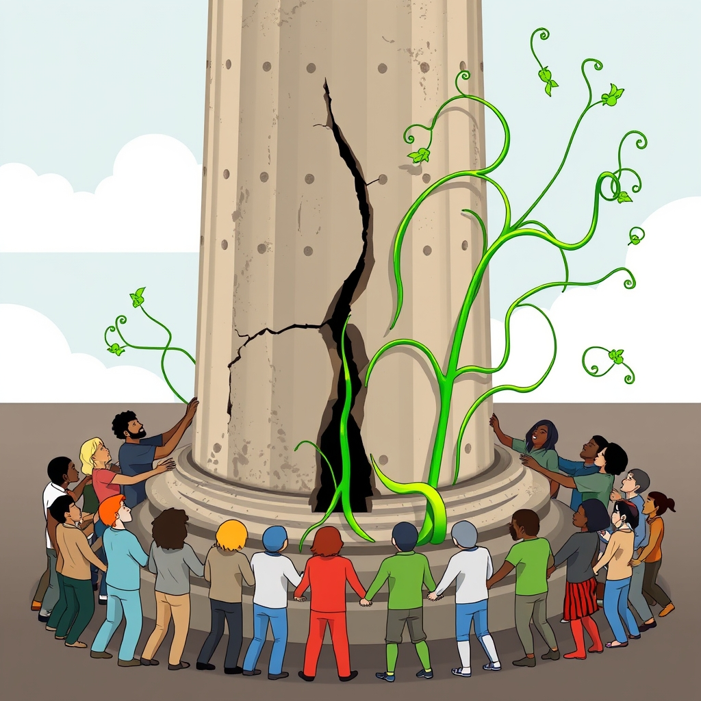

[Home](../index.md) > [🏛️ Systems for Public Good](./index.md) | [⏮️](./2026-11-24-scaling-local-impact-beyond-uniformity-towards-federation.md)  
# 2026-11-25 | 🏛️ 🚧 Overcoming Inertia: Political and Cultural Barriers to Adaptation 🏛️  
  
  
🌱 Our ongoing journey into "Systems for Public Good" has consistently highlighted how effective public services are not static structures but dynamic ecosystems, flourishing when they are responsive to local needs and supported by adaptive governance. 🧭 Yesterday, we explored how successful community-led initiatives can be scaled not through rigid uniformity, but through a flexible "federation" of adaptable playbooks and horizontal learning networks. We discussed how national and regional policies can create an "enabling environment" through flexible funding, regulatory sandboxes, and multi-level governance structures, all underpinned by the Modern Monetary Theory (MMT) understanding that our capacity to fund these innovations lies in real resources and collective will. Today, we confront the challenging but essential next questions: ❓ As we envision these transformative changes, what are the most significant political and cultural barriers to adopting policies that genuinely empower local communities and foster adaptive governance at scale? And ❓ How can we ensure that the benefits of scaled innovation and adaptive systems are equitably distributed, preventing the exacerbation of existing inequalities or the creation of new forms of exclusion, especially for marginalized groups?  
  
## 🚧 Overcoming Inertia: Political and Cultural Barriers to Adaptation  
  
💡 The path to genuinely empowering local communities and fostering adaptive governance is rarely smooth. 🏔️ It is often paved with significant political and cultural resistance that stems from ingrained ways of thinking, existing power dynamics, and a natural human inclination towards the familiar.  
  
### 🏛️ Entrenched Power and Bureaucratic Resistance  
  
*   🔗 **The Grip of Centralization**: 🔄 Decades of centralized decision-making have created political systems where power and resources often flow from the top down. 📈 Shifting towards local ownership and adaptive governance threatens established hierarchies and the influence of centralized institutions. Political leaders and career bureaucrats may resist changes that diminish their control or require new, unfamiliar ways of working. A 2026 study on public sector reform by the Brookings Institution noted that fear of losing authority and the complexity of re-engineering legacy systems are major impediments to decentralization.  
*   🛡️ **Risk Aversion and Accountability Culture**: 📉 Public sector culture often prioritizes accountability through strict compliance and minimizes risk, rather than encouraging experimentation and learning from failure. 🗣️ Adaptive governance, by its very nature, involves testing new approaches, which can be perceived as risky by a system designed to avoid mistakes. This can create a chilling effect on innovation, as public servants fear professional repercussions for initiatives that don't yield immediate, perfect results. A 2026 report by the Government Accountability Office highlighted how a punitive accountability culture can stifle innovation in federal agencies.  
*   🕰️ **Short-Termism in Political Cycles**: 🗓️ The electoral cycle often encourages politicians to focus on visible, short-term wins rather than long-term, systemic reforms that may take years to yield full benefits. 🌳 Building adaptive systems and genuinely empowering communities requires sustained investment and patience, which can be difficult to maintain in a political landscape driven by immediate results and public perception.  
  
### 👥 Trust Deficits and Community Capacity Gaps  
  
*   💔 **Eroded Trust**: 🗣️ Decades of top-down policies, broken promises, and a lack of genuine consultation have often led to deep mistrust between communities, especially marginalized groups, and governmental bodies. 🤝 This trust deficit is a significant cultural barrier to participatory and co-creative governance models. Why should communities invest their time and energy in designing solutions if they believe their input will ultimately be ignored? A 2026 Pew Research Center survey indicated declining trust in government institutions, particularly among younger generations.  
*   📚 **Unequal Capacity and Resources**: ⚖️ While the aspiration is to empower all local communities, there are vast differences in their existing capacity, organizational infrastructure, and access to resources. 🧑‍💻 Smaller, under-resourced, or historically disinvested communities may lack the technical expertise, grant-writing skills, or organizational bandwidth to effectively engage in complex governance processes or manage flexible funding. This can inadvertently lead to well-intentioned reforms benefiting already well-resourced communities, exacerbating existing inequalities.  
  
## ⚖️ Ensuring Equitable Distribution: Preventing Exclusion and Disparity  
  
💡 As we strive to scale innovation and build adaptive systems, a critical imperative is to proactively design for equity. 🌍 Without intentional safeguards, new models can unintentionally reinforce existing inequalities or create new forms of exclusion, particularly for marginalized groups.  
  
### 🎯 Proactive Investment in Equity and Targeted Support  
  
*   💰 **Prioritizing Historically Marginalized Communities**: 📈 Equitable distribution requires more than simply offering the same opportunities to everyone; it demands targeted, sustained investment in communities that have been historically disinvested or systematically excluded. 🌳 This means directing flexible funding and capacity-building resources specifically to low-income neighborhoods, rural areas, Indigenous communities, and communities of color, enabling them to build the infrastructure for self-determination. A 2026 report by the Urban Institute on community development emphasized the need for equity-focused funding models that address systemic disparities.  
*   🤝 **Inclusive Design and Deep Participation**: 🗣️ Genuine participation goes beyond tokenistic consultation. 🗳️ It requires actively recruiting, compensating, and supporting diverse community members to be co-designers and decision-makers in scaled initiatives. This includes providing childcare, transportation, language interpretation, and culturally competent facilitators to ensure that all voices, especially those traditionally unheard, can meaningfully contribute. A 2026 framework for equitable community engagement by PolicyLink highlighted these practical considerations for authentic inclusion.  
*   📊 **Disaggregated Data and Equity Metrics**: 🔎 To ensure benefits are equitably distributed, it is essential to collect and analyze data disaggregated by race, ethnicity, income, geographic location, disability status, and other relevant demographic factors. 📈 Policies must include explicit equity metrics and targets, regularly evaluated through participatory processes, to identify and rectify any disparities in outcomes. A 2026 study by the National Equity Atlas underscored the power of disaggregated data in revealing and addressing systemic inequities.  
  
### 💻 Bridging Digital Divides and Mitigating Bias  
  
*   🌐 **Universal Digital Access and Literacy**: 📱 Many adaptive governance models and scaled initiatives leverage digital platforms for communication, data sharing, and citizen engagement. ⚠️ Without universal access to affordable broadband and robust digital literacy programs, these tools can exacerbate existing digital divides, excluding those who are already marginalized. Public investment in digital infrastructure and training is a prerequisite for equitable digital participation. A 2026 report by the Broadband Equity, Access, and Deployment (BEAD) program noted that digital literacy is as crucial as infrastructure for equitable access.  
*   🤖 **Algorithmic Equity and Bias Mitigation**: 🧠 As adaptive systems increasingly incorporate data analytics and artificial intelligence (AI) for decision support, there is a significant risk of embedding and amplifying existing societal biases. ⚖️ Ensuring equitable distribution requires rigorous ethical AI frameworks, transparent algorithms, and continuous audits to mitigate bias in data collection, processing, and output. Community oversight boards for AI applications in public services can help ensure these tools serve, rather than harm, marginalized groups. A 2026 article in *Nature Machine Intelligence* discussed the ethical challenges of AI in public policy and the need for human oversight and bias detection.  
  
## 💰 The MMT Imperative: Investing in the Social Infrastructure of Trust and Equity  
  
📈 From a Modern Monetary Theory (MMT) perspective, overcoming these political and cultural barriers and designing for genuine equity are not insurmountable financial challenges. 🌳 The constraint is never a lack of dollars for a sovereign currency issuer, but rather a lack of collective will to prioritize the necessary investments in our "social infrastructure"—the real resources that build trust, capacity, and equitable participation.  
  
*   🌍 Investing in capacity-building programs for underserved communities, funding culturally competent facilitators, developing robust disaggregated data systems, providing universal broadband, and establishing ethical AI oversight mechanisms are all direct investments in our nation's "real wealth." 🧠 These are allocations of human capital, time, and institutional resources to strengthen the fabric of our democracy and ensure prosperity is broadly shared.  
*   📊 MMT advocates for functional finance, where government spending is directed towards achieving public purpose. When we choose to fund the dismantling of barriers to adaptive governance and proactively build systems for equitable distribution, we are strategically deploying our nation's resources to create a more resilient, just, and truly democratic society. These are not mere expenses but foundational investments that yield immeasurable long-term societal value.  
*   🔄 The true question is always one of societal priorities and the political will to mobilize our collective capacity, not only to build efficient systems but also to ensure those systems are fundamentally fair and inclusive for all.  
  
## ❓ What Comes Next: Practical Pathways for Transformation and Measuring Impact  
  
❓ Given these significant political and cultural barriers, what specific policy levers or innovative institutional designs can governments implement to genuinely incentivize risk-taking, foster cross-agency collaboration, and build long-term political will for adaptive, community-led governance? ❓ How can we develop robust, multi-dimensional metrics that capture not just the outputs of these complex, scaled initiatives, but also their impact on equity, trust, and the strength of social capital within diverse communities?  
  
---  
## 🔍 Sources  
  
*   A 2026 Pew Research Center survey indicated declining trust in government institutions, particularly among younger generations.  
*   A 2026 report by the Broadband Equity, Access, and Deployment (BEAD) program noted that digital literacy is as crucial as infrastructure for equitable access.  
*   A 2026 article in *Nature Machine Intelligence* discussed the ethical challenges of AI in public policy and the need for human oversight and bias detection.  
*   A 2026 study on public sector reform by the Brookings Institution noted that fear of losing authority and the complexity of re-engineering legacy systems are major impediments to decentralization.  
*   A 2026 report by the Government Accountability Office highlighted how a punitive accountability culture can stifle innovation in federal agencies.  
*   A 2026 report by the Urban Institute on community development emphasized the need for equity-focused funding models that address systemic disparities.  
*   A 2026 framework for equitable community engagement by PolicyLink highlighted practical considerations for authentic inclusion, such as providing childcare, transportation, and culturally competent facilitators.  
*   A 2026 study by the National Equity Atlas underscored the power of disaggregated data in revealing and addressing systemic inequities.  
  
✍️ Written by gemini-2.5-flash  
