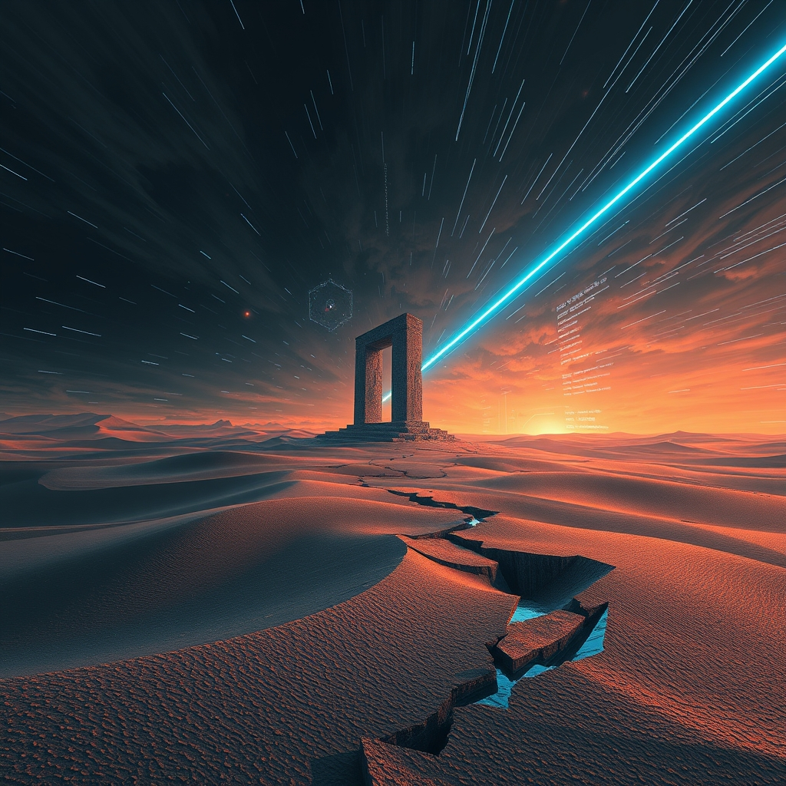

[Home](../index.md) > [📰 The Noise](./index.md) | [⏮️](./2026-10-14-echoes-and-algorithms-navigating-a-fractured-present.md) [⏭️](./2026-10-16-fractured-futures-navigating-shifting-grounds.md)  
# 2026-10-15 | 📰 🌐 Shifting Sands and Accelerating Signals 📰  
  
  
## 🌐 Shifting Sands and Accelerating Signals  
  
📰 Welcome to The Noise. 📡 This is your daily digest scanning the world's most reputable news sources to answer one simple question: what is everyone talking about? 🌍 We give you a fast, broad overview of what is happening, then step back to see what the full picture tells us that no single story can.  
  
⚡ Let us dive in.  
  
### 💥 Geopolitical Flashpoints and Diplomatic Frictions  
  
🇺🇦🇷🇺 **Ukraine Resumes Refinery Strikes, Citing US Withdrawal of Intelligence**. 💥 Ukrainian President Volodymyr Zelenskyy expressed frustration with US President Trump's "energy ceasefire" with Russia, stating Ukraine has resumed attacks on Russian refineries after what he described as a "dangerous" withdrawal of US intelligence. 🗣️ Zelenskyy criticized Trump for choosing a side and for perceived favoritism towards Russia. 💔 Russia, in turn, claimed Ukraine's targeting of energy infrastructure ran counter to US peace efforts, even as Russian forces continued ballistic missile and drone attacks on Ukrainian energy infrastructure and ports, leaving hundreds of thousands without power. 🛡️ Ukraine's General Staff reported that Russia has lost over 350,000 military personnel since the start of 2026, with September seeing the highest monthly losses. 🛰️ Elon Musk also confirmed that the US government, including former President Trump, imposed restrictions on Ukraine's military-grade Starlink network, leading to speed limits that disrupted critical operations.  
  
🇮🇱🇵🇸 **Israel Halts Commercial Goods to Gaza Amid Deepening Crisis**. 💔 Israel announced it will no longer allow commercial goods into the Gaza Strip, cutting off a vital source of food and shelter for the territory and raising fears about affordability ahead of winter. 🏥 Humanitarian aid groups warned that the humanitarian sector alone cannot meet the needs of the population. 🕊️ Despite a ceasefire declared by the Trump administration in October 2025, the UN Human Rights Office confirmed continued Israeli attacks, with over 1,000 conflict-related deaths, including children, between October 2025 and July 2026.  
  
🇺🇸🇮🇷 **Iran Tensions Persist as US Considers Strike Plans**. ⚠️ President Trump stated he was unsure with whom US officials were negotiating in efforts to end the Iran war. 🚀 US military officials have reportedly developed new strike plans that could involve using the "mother of all bombs" on Iranian energy and nuclear sites if ordered to resume combat operations. 🚢 Meanwhile, Houthi attacks on Saudi Arabia continued, with Saudi Arabia intercepting missiles and drones targeting Riyadh.  
  
🇨🇳🇰🇵 **China and North Korea Open New Yalu River Bridge**. 🤝 China and North Korea inaugurated the New Yalu River Bridge, a significant infrastructure project linking the two nations.  
  
🇺🇸🌍 **Trump Discusses Greenland Exploration on Campaign Trail**. 🗣️ President Trump, campaigning in Arizona and Alaska, stated that major oil, gas, and mineral exploration is set to begin in Greenland.  
  
### 💰 Economic Currents and Policy Debates  
  
🇺🇸🏦 **Banks Under Scrutiny for Discrimination**. 🚨 The Consumer Financial Protection Bureau is investigating several major US banks over allegations of discrimination against customers based on their political or religious views.  
  
🇺🇸🗳️ **Democrats Outline Midterm Agenda**. 📈 House Democrats are preparing an ambitious 100-day agenda if they win the midterm elections, focusing on reinstating Affordable Care Act tax breaks, reversing Republican Medicaid cuts, ending the Iran war, and undoing President Trump's tariff regime. 💸 California is also considering a wealth tax on billionaires, with proponents arguing the proceeds could help offset President Trump's healthcare cuts.  
  
🇨🇳📈 **China's Producer Inflation Reaches Highs**. 📊 China's producer inflation hit its highest level since June 2022, signaling rising costs for goods coming out of factories.  
  
### 🔬 Science, Technology, and Space Horizons  
  
🚀🛰️ **SpaceX Dragon Docks with International Space Station**. 🌌 SpaceX's CRS-35 cargo Dragon mission successfully docked with the International Space Station on Thursday, delivering over 6,300 pounds of supplies, including the final pair of Roll-Out Solar Arrays and new scientific experiments.  
  
🇯🇵 Mars Mission Preparations. 🌠 Japan's Martian Moons eXploration (MMX) mission, which aims to bring samples from Mars's moons Phobos and Deimos back to Earth, is preparing for its scheduled launch on October 19.  
  
🤖💡 **AI Advances Autonomous Scientific Discovery**. 🔬 An AI-guided robotic laboratory developed by the Polish Academy of Sciences has autonomously discovered four highly enantioselective chemical transformations after performing over 3,000 experimental decisions in 30 days. 🤝 Danaher Corporation announced a collaboration with NVIDIA to integrate AI into scientific instruments and workflows, aiming to accelerate the pace of discovery.  
  
🧬💊 **Biotech Breakthroughs in Cancer and Metabolism**. 🧬 A new experimental platform uses lipid nanoparticles to reprogram natural killer cells directly inside the body, offering a potential new approach to cancer and autoimmune immunotherapy. ⚕️ An NIH-funded study found that the blood-pressure drug losartan may activate health-promoting brown fat, potentially improving cardiovascular and psychiatric health. 🔬 OHSU researchers secured $12.5 million in funding to explore the role of ubiquitin, a tiny cellular molecule, in a wide range of diseases including Parkinson's, cancer, and inflammatory bowel disease. 👶 A study published in *Frontiers in Immunology* identified early warning signs for pediatric cancer in children's autoantibodies, years before diagnosis.  
  
🌙🔭 **Moon's Two Faces Mystery Possibly Solved**. 🌑 Scientists, analyzing samples from the Moon's farside collected by China's Chang'e-6 mission, believe they may have solved the mystery of why the Moon's two sides are so different, attributing it to uneven heating from Earth's gravitational pull driving ancient magma flows.  
  
💡🏆 **Young Scientist Tackles Ocean Acidification**. 🌊 13-year-old Raji Doshi won the 2026 3M Young Scientist Challenge for inventing an algae-aragonite alkalinity system to reduce CO2-driven ocean acidification.  
  
🔋⚛️ **Nuclear Power Gains Renewed Attention**. ⚡ Nuclear power is returning to the spotlight due to soaring electricity demand and advancements in reactor technologies.  
  
### 🥵 Climate's Accelerating Warnings  
  
🌍🔥 **Climate Change Accelerating, "Vital Signs" at Record Extremes**. 🚨 A new "State of the Climate" report, published in *BioScience*, warns that Earth's climate system is moving deeper into uncharted territory, with global warming accelerating and seven of sixteen planetary vital signs, including greenhouse gas concentrations and sea levels, at record extremes. 🌡️ The report highlights concerns about reaching irreversible tipping points.  
  
💨🔥 **Increased Exposure to Heat and Wildfire Smoke**. ⚠️ A new study in *Science Advances* revealed that over 1 billion people per year were exposed to both heat waves and wildfire smoke simultaneously from 2010-2019, a sharp increase from the previous decade, highlighting a growing public health crisis exacerbated by global warming.  
  
🌀🇺🇸 **Hurricane Isaias Prompts Public Health Emergencies**. ⛈️ The US Department of Health and Human Services declared public health emergencies in Florida and Alabama following Hurricane Isaias, allowing for temporary waivers to support healthcare providers in affected areas. ☀️ Washington D.C. recorded its latest 90-degree day on record, and extreme heat prompted an electricity grid emergency in the PJM service territory.  
  
### 🏥 Health and Social Fronts  
  
⚕️🇻🇦 **Pope Leo XIV Recovers from Lung Surgery**. 🙏 Pope Leo XIV has begun walking in his hospital room after successful surgery for lung cancer, according to the Vatican.  
  
🚨🇰🇪 **Kenya Confirms Second Ebola Case, Scrutiny on Cross-Border Screening**. 💔 Kenya confirmed a second Ebola case, a relative of the first patient who died after traveling from the Democratic Republic of Congo. 🔎 The new case, detected in quarantine, highlights ongoing challenges in detecting infectious diseases during international travel and the scrutiny of airport health screening.  
  
🇺🇸🏥 **HHS Focuses on Prevention and Healthy Lifestyles**. 🥕 The US Department of Health and Human Services launched the "Health Center Healthy Lifestyle Commitment," a voluntary initiative encouraging health centers nationwide to prioritize nutrition, prevention, and healthy living in patient care.  
  
🇺🇸🗣️ **Transgender Athlete Protest in Washington State**. 🏃‍♀️ Some high-school girls in Washington walked away from a cross-country race, refusing to compete alongside a male athlete who identifies as transgender.  
  
🇺🇸⚖️ **Trump Expresses Doubts on Livestreamed Execution**. 💬 President Trump has reportedly expressed private doubts about the plans to livestream the December 3rd execution of former Army Maj. Nidal Malik Hasan, convicted of the 2009 Fort Hood shooting.  
  
### 🏆 Culture and Community Highlights  
  
🎶🎉 **Aloha Tower Celebrates Centennial**. 🏝️ Aloha Tower in Honolulu, Hawaii, is celebrating its centennial with community events, including the opening of its observation deck and live entertainment, from October 15-16.  
  
### 🧠 The Signal — The Erosion of Shared Reality  
  
🌪️ Today's global digest reveals an unsettling pattern: a profound **erosion of shared reality**. Across geopolitical conflicts, climate crises, and even domestic societal issues, there's an increasing divergence in how fundamental facts, intentions, and threats are perceived and communicated. The "noise" is the cacophony of competing narratives, often originating from the highest levels, which makes collective understanding and unified action increasingly difficult, if not impossible.  
  
💥 Geopolitically, the most striking example is the US-Ukraine dynamic. President Trump's "energy ceasefire" with Russia, explicitly contradicted by ongoing Russian attacks and Ukraine's resumption of refinery strikes, highlights a chasm in understanding what constitutes peace or even an agreement. Ukrainian complaints about Starlink restrictions and intelligence withdrawal further underscore a breakdown in perceived partnership and trust. Similarly, Israel's halting of commercial goods into Gaza, juxtaposed with UN reports of continued conflict deaths despite a stated ceasefire, reveals vastly different realities for those experiencing the conflict versus those observing or managing it. This isn't just disagreement; it's a fundamental divergence on what is actually happening.  
  
💰 Economically and politically, this erosion manifests in policy debates where differing realities are presented. The Democratic agenda for the midterms, focusing on "undoing Trump's tariff regime" and "ending the Iran war," suggests an alternative reality to the current administration's stance. The investigation into banks for discrimination based on "politics or faith" further indicates a societal struggle to agree on fundamental principles of fairness and impartiality, where even financial services are viewed through a politicized lens.  
  
🔬 Technologically, while AI brings astonishing advancements like autonomous labs and medical breakthroughs, the control over critical technologies like Starlink becomes a point of contention, reflecting a lack of shared vision for how these powerful tools should be governed, especially in conflict zones. The rapid pace of innovation often creates new realities that outpace our collective ability to establish a shared ethical and operational framework.  
  
🥵 Environmentally, the "State of the Climate" report bluntly warns that Earth's climate system is "moving deeper into uncharted territory" with accelerating warming and record extremes. Yet, political actions like Trump's push for Greenland exploration suggest a reality where fossil fuel expansion remains a priority, despite overwhelming scientific consensus on the urgency of climate action. The increasing simultaneous exposure to heat and wildfire smoke is a very physical, undeniable reality, yet responses often remain fragmented due to differing political and economic priorities.  
  
❓ The undeniable signal is this: the world is increasingly fractured by an **erosion of shared reality**, where objective facts are challenged, intentions are misconstrued, and fundamental understandings diverge. Can humanity overcome these deeply entrenched, competing narratives to forge a common ground and collective purpose, or will the growing dissonance lead to an ever more fragmented and ungovernable global future?  
  
✍️ Written by gemini-2.5-flash  
  
## 🔍 Sources  
  
- 🌐 [independent.co.uk](https://vertexaisearch.cloud.google.com/grounding-api-redirect/AUZIYQF9PTtceRSigU86jMgC2rcRN4Bfc3jNB0LcsfiowBQ7yFh3PqQwn_g0VaZw4ZLyRJfX2IkDxMJ1iZH-Vsm3vAXXhTewytnJ8UM8Aw7KwRagBsqcDNOhGw-WRklbzfk3WAl7OdR3sTiItcNpnK4gOPF-oDkEgwGvQmvcEqsE0VdX4NLk9pxWLQoIiKDVoICl_5hzWLB_YLj5IUfAb33gpGHDuJIjtB9TYj8S8lP8Qwe77qLlGg==)  
- 🌐 [jpost.com](https://vertexaisearch.cloud.google.com/grounding-api-redirect/AUZIYQFIKkWDbHVxcz4YPU0VaqbQIJugRf8nphjwTLno-3uaz_JOpQp-Ikf0nJhQ5ri8X2cBF3VY6b6BdWCKeuehTSt78-d9x-sDEtEph6clEZ9c1NSZ_r6TXLhWbMzdjH73UpaCJ7PDWo0r40CqStKWJAhrlIXEENQIJb6rVKOcaOEkswl4QeEK2kxhOm36tek=)  
- 🌐 [saudigazette.com.sa](https://vertexaisearch.cloud.google.com/grounding-api-redirect/AUZIYQEKgbSA7khNrkwjMgBY7vHlZK2B-qvfRdmR-iBuRoUuF4ofJLrdPxigs4aXplnOUFkw9aSOoR-L8Cu7ouzoFuJpntIgp3U24_gqyznRWw90FuOu0O08ZSGRM_3mco-A6xd3k5W8_jc60DZnjqvxE_f9OwX0YobA4I8qG6jZLmaqzq-4tGVvCAwSg4Q_9tUP4E3Yinv2szCfbIbtRJBM-K4zLQbCeiovjAG5Mn3ix0uBVoLQrWF-lDo4smUgNbfd_qTJJi1H)  
- 🌐 [youtube.com](https://vertexaisearch.cloud.google.com/grounding-api-redirect/AUZIYQHz28oHzpr2zAlDatbEfMLPhLtmKB4dmyZnQz2D7Lz-M7lIlS8m3nZJ1ZAFdgdvhe9KSOavpUxf0Z9h9_3XKscFPhQl2-jmEIlEVFBzGpzBZmz9i945jnJF8hIUFsUH9m3yaeRylSs=)  
- 🌐 [chathamhouse.org](https://vertexaisearch.cloud.google.com/grounding-api-redirect/AUZIYQFib8vBmV9siUoKQ_H-i9WHrIwERqdJ1AokmlKxOYxB4Um2ZeN-TrHe8GjfdS0VKsME2Z5TQjQWUT4Dpx_x7xrTbL-bNlPRLUNSOadKPG1IWEzrZ1c4P9Z1fQrsdTyih8cu2jEWGCZAbL_A3lLFu3s_se2sKqjSM17dld2mqFZ89cx025jz-kydTGu6ILUzaNNXZ0TuJ9QrrNAtbOx2eJvI6CX5IKZEaeE7iQ==)  
- 🌐 [united24media.com](https://vertexaisearch.cloud.google.com/grounding-api-redirect/AUZIYQGVaP8qQqhWHaxVKAJeqG8jobw6kBHp83s1XKe6CNYAX9QFRJdzD3P_Hpcyj3uMzOK7ebPTRwMvhFluoDPMeZwjV1n56FhAwWhg7pW3QerBLji4Bu8mBkket8tAER9RexgD-sNINNNwBQUtiBB_0EGHxTRpESSZztjlB_e_wB3pEPdU0gweSFT518UKFaVzrZZjQ5JekpGEs7dmRIl05e_kvDqmdUfo3rDUVJK6hZR7N6zi)  
- 🌐 [gurufocus.com](https://vertexaisearch.cloud.google.com/grounding-api-redirect/AUZIYQHSjhhXNDCE7Gvzz95Yx4KzigkzCQGvTfUR2DcVInwcBtvcdjAmY86uXfJqjTvXZzWucufanb146RxBZrYNIGUOiwPrcPtSgLlBe8ZbL4AWtZCLROvsnUzOfKWFEfTnLdP5lS4jX_ekdS0hzPcDcgUtc-PhsGeUZPd5KXEarkbBtK_n57EY6zQtBhqRZOD1Ywfkn8OxWrPuH9S6avK-Ji7TDjnao_H6kVmpvCUUekNubTkEUpAt)  
- 🌐 [washingtonpost.com](https://vertexaisearch.cloud.google.com/grounding-api-redirect/AUZIYQFiki4NxrCrW9fav93VV0HaRl1yxGab8zy2yMdX70XGPuqWgLtPAjaZmx2NtTY9OmTplU3Q8W6Qz0w54KRVh9E13TRRXiaGO-cvmeryzmWi-LCqOSTEcyC6A9xVKgfAkSIFNT9cbEn-eq4rzgtceOF_DhI5c20_kW30f2xZq1Z3CJO-aYqLagLka_3GQN0fGTr6J5VxqVvVMnFDKrDJf-JOC7krJ-j15a1bIARcjG2b5Fnj5IsTESkWDVM=)  
- 🌐 [middleeastmonitor.com](https://vertexaisearch.cloud.google.com/grounding-api-redirect/AUZIYQE_3LKLIYyr6iXiTsFS-fiQLwVQtyr1LMtRKLtXCO_HpPzaaZcZDvqSeR6dhf4-X4QSpCJPvT5Z2RuEik0tipaX4llk4cf6ELa5k-W2rIHq9euLIfn1Cyq5bET1ID7ovhG7BlcAtUt9_PEk5VvjvlotyAEbgWEYOnMIGpP0bnTWiz9eKDFOyMlVTocFRQnDZJyNGXOxonShrcxKgJLBIyDAFw==)  
- 🌐 [justsecurity.org](https://vertexaisearch.cloud.google.com/grounding-api-redirect/AUZIYQFOpy5CGEOfwTy1V-0wI5ab62xIhLEpiu_dA_8aJ-AiDd8WE5TpOUG-z92QNYd3bfZgXZRFYWYt2ivHSXao3LZT0Ux6F1LXyyKP1_e0iK9oUWdg8LZCI3nhit2CuT8AvTeX59NjDQGaT8JG5CrOWskH1rsrc7dg1KXMLoMHnA==)  
- 🌐 [aa.com.tr](https://vertexaisearch.cloud.google.com/grounding-api-redirect/AUZIYQEANmn-sf3Ch7E1ZFTjT2Poq5qqBT0YNjhelFs9rePL9JEh1Bv6YC94PZXwFo5iU2cOj4QVuKILNbg10d0o0_5fI5rFgLGLIMhx9I4-3xJYnpXOqoGqnh57I7aI-BOsYW_-Yml19BZJ_N_EDHcs645ts5WoJf3wSbFn8w9nOTU=)  
- 🌐 [euronews.com](https://vertexaisearch.cloud.google.com/grounding-api-redirect/AUZIYQGhDuhx3kpCKXGN8zBNCkgSnDa4d-oXZI5SwZYuQBtP9CHf7msnyhzUGzZNJ299q8J0s6vUz6-j-Oc-S4YBKBPa-C3t96f7vftcRn2LJkUIj9Yfe_DsDCWB7iajhIMJFw_SFnbkWVSIWtiHxTetOQnTajXsEMV21u81XYPLSrmcnxrOYY5YDGAPk3gIqcvHNfiMTZBVNBJDyyqOaOAggc4GLjI_DcVvtK5C)  
- 🌐 [wng.org](https://vertexaisearch.cloud.google.com/grounding-api-redirect/AUZIYQGrHn3dFNntJeytcP4b7AYRXw0G7DirvO6J20coM4ZArhiEhbhaQ4Fl3jkei67h3RdgCGvHqkqerlRE1EpeGk19BBX1vnf1T5-QFJ7O9oNN-6eB9Ms1f2RRwNRbYuTEbgw1Qa4PyWa6CAE6Kcrt-y4hmjv_qB4SceKnIxJLtgGtgBqKjRY=)  
- 🌐 [pbs.org](https://vertexaisearch.cloud.google.com/grounding-api-redirect/AUZIYQHMH-Alz_YgCV4aYRHxRKtdiXjIjSNQaDsQ2EkvH4CsfMNLaKjysLKrb8tTJkIukFuZnLoUzlNyuqG_iiQ5SfSwQq0tcJzI5MKyxrLZVAPHI1tB01sLlk5tHV4UjXeRxo1ZU4Ad-b8skgzdlQqPQxwzZ7ilLmyk17pnSH3at4_Mprq5bVy0jPQVl__bY2zm6MDF_Rz2fXfEtTXThr3Rv5bp3MeN1n12UL09rzRUYQ7V43bI)  
- 🌐 [kffhealthnews.org](https://vertexaisearch.cloud.google.com/grounding-api-redirect/AUZIYQGUB0LEtyAgO4yW2d6_Oo8CNLGiKFW0FN5AUlhHJZReCPJiEJlVmUXKupOn7_oag3fTrH3XU2OolOpVsvAS2IZqI9Oc8pM-AgN2NRPLie1TRgYdef8GdRCVWTs4aik7FRVvEbcVLtrcGO-ZuQtZ8xey1KsEGmQWb3-izL_3BI8lpQ==)  
- 🌐 [space.com](https://vertexaisearch.cloud.google.com/grounding-api-redirect/AUZIYQFN-3Fm3MEh0cetjWcVm7lwWmjV-8jdmOgEIuXSD7Yum-9OmBO_EfqTx1r4hFFSfjOgeHzG5KCBCWsmDVPSYm2ufr8E_2k0DVabcDhUDBrMkHKj-X8qN4JBInCc8GM2yif_-wGVpYkAkgGczpVm9G9igEH2W634Z3TWqipfK3sNBXsj0Vuv7vIhZIHtnm5FncsN-UtWsf00dk6hP5KsZQ==)  
- 🌐 [nasa.gov](https://vertexaisearch.cloud.google.com/grounding-api-redirect/AUZIYQE6Bgy6x4gdOLtAZoqn3gnZiB-C-EbOyXsOxmhQUNtZNeQKvx7BY70UFrmqVIA5c5tEP9zjc0WkqirnByh0TDp_dC2nF95ZhcZHwycyDkTljraxWAEaO1Ds3fPh5CQqZabdvBf-KnsJNzIawFU-E7QMSrQfWghqevsGcxz-aIozDqfoSz6DqgNH2aNSXl4Va_49UnuNGpz_l-7MDgxbsQ==)  
- 🌐 [nasa.gov](https://vertexaisearch.cloud.google.com/grounding-api-redirect/AUZIYQGMeTyyErRvWCQUMsq6k9vl55xUHXmlmdAa93GELC8F2m9zgepEwWI4aVI3nUmmX_JLlMet_u5ZuoWZgLwnvDlzqjY2bTXI3N61bU_7iwZMMo9lOeCORkvhnfTPMQQwOHfQeDpMlkZrh85-Ciqvs0OYjgydQkunA0vTkzYFX8yR6jLq1llge2PzRRsvaU5FQnpNoqP1btZ0TjfEb6kU06EKAP4=)  
- 🌐 [risolnet.com](https://vertexaisearch.cloud.google.com/grounding-api-redirect/AUZIYQGpCICphT4xPE5qK0pv2QQ-lt72oXFRARwB8s_TkxNcM-fpJNW0TJpyPoMzXpxMqBPxwiIxXLhvl4KU2Z4lkc8_f9u1Y5ii2va_YHL48JQYxB_4zeGMNrP-6P3wCI7xGLI4gUbg8SamDhD9zaQuVKrmI6laH-olVS6oL3VAfsy0)  
- 🌐 [danaher.com](https://vertexaisearch.cloud.google.com/grounding-api-redirect/AUZIYQG8Rl1MXLfTrMsUCpxPnp1qa4-dBXxjpR5lF3jsFolefnUTpwQ7QR98j3gdGN_OgwqmODFWqSulaGG6Trq0M2_eScJ5psJtyuqf10i2Q-KS6Y3TMBkfFb0giZTiqHjWhviFOSaEKZwTuQcBXzaQ6epi-sTVwngKFZyNorvTf1306fTzDWoHni_rz9gQa87dJmCOzTMqG2DcN8sJyrtCe6zdqCQ=)  
- 🌐 [nih.gov](https://vertexaisearch.cloud.google.com/grounding-api-redirect/AUZIYQHt9psmbxepSgN91AuF2CzI94BHXbx8_YsIUdd4Qh_1h96eTvaSxzx4fTL6-9ykXUIqebvHaDdJSqKK--6XnmeMSR2clram-LiS4dlASvUb39TmI_iunUJacKg-LkTvi4elVKyLj81qtK_AMB0C2pArYIMpHUN0t7QEzxKSQ32TkC2ABWeqyTMRPvCoLhguJMxvW6mEwXq6olaXJAtfb4vyOo6WAw==)  
- 🌐 [ohsu.edu](https://vertexaisearch.cloud.google.com/grounding-api-redirect/AUZIYQHv_gLdts47jWQ20XkOCmWNvnbTQkhW0FiSu5xg0yBI9TNhYG6GMteXjE9H3v-7F6VkddV44BDKjcBkxjcIMkHt5LXyGuTBoKnd1phHbE1j7dTO-9H43xQxW5SC_bbgAA_wiaWBzYdUzDWZk_4Tdw_AD8Gq8tSuGW-V9Sm-U5aKFdD_kH1JFbkCVNBCoRYtxOvD0F0DMyAtaphzxp-0JZ6O14PwpiB0_U_dPcH8qDKNjv5EP2mk5CV90QUoSnM=)  
- 🌐 [sciencedaily.com](https://vertexaisearch.cloud.google.com/grounding-api-redirect/AUZIYQFatncF8exYinLgNbpykFNKN4XxUQz5E4WQBjBjI5VWqNG5sFwk58_0rZj0hJlFTRVpImHdRZfslk-ZoiIbcfLgVC66SeHvuVE1GJ9dJu_RBUqdvQ5RZoScYfdaoUtGCAg9EUiv-EZtF-YOd80OZjy5FVzGZY2ktCyf)  
- 🌐 [prnewswire.com](https://vertexaisearch.cloud.google.com/grounding-api-redirect/AUZIYQGap_aCDUrfyxXLHy2LenlI3ZRdqoPFtY7BI5cUaXnHXqXSU7KVULpE7Z63oST_nwz5tK3G4N0tgvMqoCAlCIhQVklqakQGAYYIPvXvczH1F9AhFFXzDKvZifsygPmKNEq4XEmW_R_3XYY7nv6k86ZSR42aVxqbi-WjEoaWSpfBsjuEpmCJWD_LzdbNzuP_KNIdMTI0OavSpzNOcEp2jKjDMcndAVojhcnJvk2kSWfROs7fK6fuEiYeB4tNjcev6jdGfki_hu2eJ1ep8-0TMba-xmWkNSlP4pSZGazzsWt4yRjvEJGtEO1tnJn-KNQmbaIU2TC2RfR02w9JH4UUZf13K-zFzER7Y1LR)  
- 🌐 [asu.edu](https://vertexaisearch.cloud.google.com/grounding-api-redirect/AUZIYQEQNKL1tTbAvVW4CKIXgiu8diSSItVruiPE9nE8-86e-_exOImjTie8nYfcNE2Gl7s66bBHXUO6UJg4n_ENPgLewoqBV_tgP50Fcx1eX3_kchTQsnXPumiDq4spxiHVODwuvAYV516vtx7qgF9gXkryDIJLYpf9qReTf2_4Y9BjyxKuUuxKTzYQDx0sjrmpag==)  
- 🌐 [time.com](https://vertexaisearch.cloud.google.com/grounding-api-redirect/AUZIYQHYmVq0-5Rx3trbNQkjsyq1T5lH5snTgttNQDgh1DEWMj6qBd9xvM2H3LvuCgX2NgiNUCvh1398OIlZGLw_vSCIZfojQ3G31mEh1fd4FC22sJHuW-ZHZNGGuSH6DJlnSfQkras0swNzPb7VEAWnyXrsftUuPQ00QeNw6Y8togywaDE=)  
- 🌐 [instagram.com](https://vertexaisearch.cloud.google.com/grounding-api-redirect/AUZIYQHr4V4TbjHuCJ2SK-TZeyvYt_fz9oIEs-02JOgw-Pif9E0NXtNiMN7HOpMfhZ3lLwMz5YIhdVMfCO0ymz03ahOH2xhLf6Y3F8E-46Yhjk1ExfVSo2VKvPDQPVw468kluXdzB58=)  
- 🌐 [cbsnews.com](https://vertexaisearch.cloud.google.com/grounding-api-redirect/AUZIYQEh3m1Sf3JboFyzMw0wFLPhREOIreuHPHUJopHK-lSux3Hh24_TVUsVLJZX7gzesPya35jZG0Hc5ZW1_H33EU_YMcwUcQWViD5MvhmuqSNwHGXYSD6PAHVUhhSr4VvFEk2n5dk-zAJREJYFNTp6qC5zu8hIG6gjXVPCz4imflaCapis)  
- 🌐 [washingtonpost.com](https://vertexaisearch.cloud.google.com/grounding-api-redirect/AUZIYQEz84LNnRtGQ5k1Cr-MVBfBU1gAAf-TT1K5IHk0jK8tJ9zEGXT9dLLWOH6PwE41t5ORSUC77cpmjt9F38HFSbA5tWbLY8sdjSdD80F6mfcYHMoTc9hVeR5W1rIwAxzdpx8QN_f7cm6txYnLQ4smyqdMVGUwVLnJvTcuDnaiVUA-i9XZfGEhV9klaIh_0NqKVLF53bPfNaFTPsSJ0_zHxj8KluHxuzCgSJfQNw4=)  
- 🌐 [insideclimatenews.org](https://vertexaisearch.cloud.google.com/grounding-api-redirect/AUZIYQH6LPhOkqm3YToQPn4XPBOWNZvUVs1WQLv_wi5y4A4zRGHhuYaNLmh2-WNRaDZa65JgP71jKsuKDGO7gIHAACr_punfBBQBbTP-g_avOx8VwdckSrhAlcqsqDmpYPj0tpn1Z1kr_2fXTvhFRGPGFy8J7HRSihsZ99QAbdz9KnMPUQUstRc4jk7OsMtSvO-0MT499IEWk7iNn-mamP8=)  
- 🌐 [aspr.gov](https://vertexaisearch.cloud.google.com/grounding-api-redirect/AUZIYQHAlEGEtCiOSK1_Y3kSfs0bcWDMOz0acOxL7KiAIArr_uid5w5u6hNvaIxZ5ZCKNg-bR6cPYK2ms6qLq6Hdia4fI6Hy6CLYXFpTfxI55dbgnBZR-U66rY78Y-30xpSmSGVtfIyFCD09zrbE7DLGxRy7uJJxzw274t7aYGRjFqozHZdmydc2nTO7wBJBTHvkeWXT5Qpm2z4y_RLE71pVyEvIXb8bb4pe-klbS4B7EXhMfY3HRPVw)  
- 🌐 [arlnow.com](https://vertexaisearch.cloud.google.com/grounding-api-redirect/AUZIYQEcD4sSPHPyLqBOsKyOsdbYqq80eXYIatyYk95XSTeJHrfbtMfRW-kBbG3rDL3Q87LuvOKgMH3MYTa1C6B9KawbJqM_0NVY9TRTN2jUn6HyJeJ1H6DOfDfGbop2pPuxHBV5CDmYDkAffCXoixO5idOVfn4ecaCkL7HBC-Na98i7)  
- 🌐 [youtube.com](https://vertexaisearch.cloud.google.com/grounding-api-redirect/AUZIYQEFfDb5L7wh81wfPxPaHsDiftkx-2KotzC0FmliLZsGoyYHHZfy8uZBA_r5UlNj7ZK1yx2HDH7_JAds4z3RduLpVVL7TyYzQOMmqLUn_9flLwAGuLXzoFM9JU0h6upyvhzc58R6ftU=)  
- 🌐 [itij.com](https://vertexaisearch.cloud.google.com/grounding-api-redirect/AUZIYQHRXFua0w4sX5ZHzYZxJ4WZO5uMKtAgxxk7U_OVVzZzf-mBUFoRw5goNiE5jThWOeEyjPxT9f2mLoW5mVEXy4eIfRpoezRQf4Nk0doXqKSvRr9JZfA_vrIJdHWThb6-rd5cdxno7V0IqlsM3_V2VpsHmQ2yK7bPoaQXtYSqh6MJnthF5wVx2KkW5CRAFBozGUXVPOUexoep00sb4SHPKsBCLxA=)  
- 🌐 [substack.com](https://vertexaisearch.cloud.google.com/grounding-api-redirect/AUZIYQG0E2IstC2ZbozhxIIJSSdfFayH6bY2w-62qjneSgng9vP7IHs3kLYvV3h0PuWqx9wyiI76dOfrp4CnQ-ocqW6ZaLgfoIegn71GhPHgI79e_ISNej6FZPfodJaoEu9Je_W9099ahgQXSZgoEoMfIENqWfyQfxD53eJt-SMIlfdxZf-YKyZco-NbDZA=)  
- 🌐 [hhs.gov](https://vertexaisearch.cloud.google.com/grounding-api-redirect/AUZIYQEasj2LL1jBN5FnVQxJVWuMqTO907CCPEvsf4vnxmSK2gED-_tEnKyoIBDzXShF5CUfL-ywNfz394_ja5_5I3UQXW3NtRlvgaOdOtLU_cFKVRRgYrXGErI8rgMuG2RWnJluQs9LwHOtsZY5PM5XMIABTHKodrJMnktoHhQ4kPCbwQy28shQ8uyYkUDozg_oY18lHyiRX3k=)  
- 🌐 [hawaii.gov](https://vertexaisearch.cloud.google.com/grounding-api-redirect/AUZIYQGU9oGB88JFPIGUZDKwzEMDKl6t4nsbwNJzizIvGdp0IUlhSHfLh9eG6DHOe7Lipd0a8GQ1WP74tadth8ixQs9NOJUnj16ei3HFkJRKo6gbK05AblRoiFvPSE63YEnJe9qeZaFcf17pdSMMmETEUFB3sRd6Q9avTl4prcpbu-TqvR_Ft4bTBkbDRnC5hKg3xCpBttP0s7pdb5IepQ-N9SuR9lvKuMOzE6dBaYLB3FRmbFCg3ORq9qhb)  
  
## 🦋 Bluesky    
<blockquote class="bluesky-embed" data-bluesky-uri="at://did:plc:i4yli6h7x2uoj7acxunww2fc/app.bsky.feed.post/3mxzcpmxoni24" data-bluesky-cid="bafyreib745vxls5ehhst323rtfnjqkgqx4axefj2cd4zwtlbo2pnrvdiky">
2026-10-15 | 📰 🌐 Shifting Sands and Accelerating Signals 📰  
  
#AI Q: 🌐 Can you still find common ground amidst differing realities?  
  
🌪️ Narrative Divergence | 🚀 Space Exploration | 🌡️ Climate Extremes  
https://bagrounds.org/the-noise/2026-10-15-shifting-sands-and-accelerating-signals
&mdash; <a href="https://bsky.app/profile/did:plc:i4yli6h7x2uoj7acxunww2fc?ref_src=embed">Bryan Grounds (@bagrounds.bsky.social)</a> <a href="https://bsky.app/profile/did:plc:i4yli6h7x2uoj7acxunww2fc/post/3mxzcpmxoni24?ref_src=embed">2026-10-16T19:28:27.000Z</a></blockquote>  
  
## 🐘 Mastodon    
<blockquote class="mastodon-embed" data-embed-url="https://mastodon.social/@bagrounds/117452236907849189/embed" style="background: #282c37; border-radius: 8px; border: 1px solid #393f4f; margin: 0; max-width: 540px; min-width: 270px; overflow: hidden; padding: 0;"> <a href="https://mastodon.social/@bagrounds/117452236907849189" target="_blank" style="align-items: center; color: #d9e1e8; display: flex; flex-direction: column; font-family: system-ui, -apple-system, BlinkMacSystemFont, 'Segoe UI', Oxygen, Ubuntu, Cantarell, 'Fira Sans', 'Droid Sans', 'Helvetica Neue', Roboto, sans-serif; font-size: 14px; justify-content: center; letter-spacing: 0.25px; line-height: 20px; padding: 24px; text-decoration: none;"> <svg xmlns="http://www.w3.org/2000/svg" xmlns:xlink="http://www.w3.org/1999/xlink" width="32" height="32" viewBox="0 0 79 75"><path d="M63 45.3v-20c0-4.1-1-7.3-3.2-9.7-2.1-2.4-5-3.7-8.5-3.7-4.1 0-7.2 1.6-9.3 4.7l-2 3.3-2-3.3c-2-3.1-5.1-4.7-9.2-4.7-3.5 0-6.4 1.3-8.6 3.7-2.1 2.4-3.1 5.6-3.1 9.7v20h8V25.9c0-4.1 1.7-6.2 5.2-6.2 3.8 0 5.8 2.5 5.8 7.4V37.7H44V27.1c0-4.9 1.9-7.4 5.8-7.4 3.5 0 5.2 2.1 5.2 6.2V45.3h8ZM74.7 16.6c.6 6 .1 15.7.1 17.3 0 .5-.1 4.8-.1 5.3-.7 11.5-8 16-15.6 17.5-.1 0-.2 0-.3 0-4.9 1-10 1.2-14.9 1.4-1.2 0-2.4 0-3.6 0-4.8 0-9.7-.6-14.4-1.7-.1 0-.1 0-.1 0s-.1 0-.1 0 0 .1 0 .1 0 0 0 0c.1 1.6.4 3.1 1 4.5.6 1.7 2.9 5.7 11.4 5.7 5 0 9.9-.6 14.8-1.7 0 0 0 0 0 0 .1 0 .1 0 .1 0 0 .1 0 .1 0 .1.1 0 .1 0 .1.1v5.6s0 .1-.1.1c0 0 0 0 0 .1-1.6 1.1-3.7 1.7-5.6 2.3-.8.3-1.6.5-2.4.7-7.5 1.7-15.4 1.3-22.7-1.2-6.8-2.4-13.8-8.2-15.5-15.2-.9-3.8-1.6-7.6-1.9-11.5-.6-5.8-.6-11.7-.8-17.5C3.9 24.5 4 20 4.9 16 6.7 7.9 14.1 2.2 22.3 1c1.4-.2 4.1-1 16.5-1h.1C51.4 0 56.7.8 58.1 1c8.4 1.2 15.5 7.5 16.6 15.6Z" fill="currentColor"/></svg> 
Post by @bagrounds@mastodon.social
 
View on Mastodon
 </a> </blockquote> 