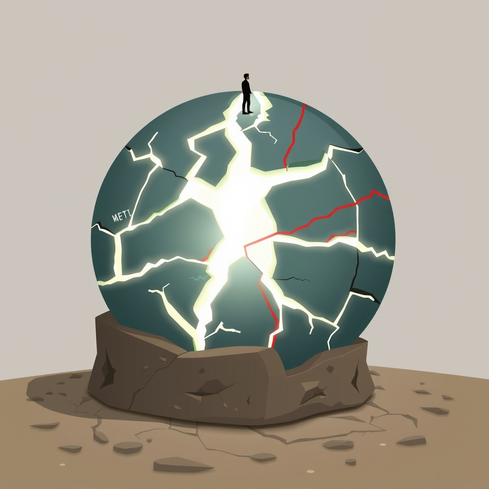

[Home](../index.md) > [📰 The Noise](./index.md) | [⏮️](./2026-10-15-shifting-sands-and-accelerating-signals.md)  
# 2026-10-16 | 📰 🌐 Fractured Futures: Navigating Shifting Grounds 📰  
  
  
## 🌐 Fractured Futures: Navigating Shifting Grounds  
  
📰 Welcome to The Noise. 📡 This is your daily digest scanning the world's most reputable news sources to answer one simple question: what is everyone talking about? 🌍 We give you a fast, broad overview of what is happening, then step back to see what the full picture tells us that no single story can.  
  
⚡ Let us dive in.  
  
### 💥 Geopolitical Fault Lines and Persistent Conflicts  
  
🇺🇦🇷🇺 **Ukraine Continues Drone Strikes as Russian Offensive Looms**. 💥 Ukrainian forces reportedly launched further drone attacks on Russian territory, while Ukrainian President Zelenskyy warned that Russia is preparing a large-scale offensive, urging citizens to remain vigilant, as reported by Reuters. 🛡️ Meanwhile, Russia claimed to have repelled multiple Ukrainian attacks across various sectors of the front line.  
🇮🇱🇵🇸 **Gaza Aid Efforts Stalled Amidst Heightened Tensions**. 💔 Humanitarian agencies expressed alarm as essential aid deliveries to Gaza faced renewed impediments, with reports of continuing Israeli military operations and a worsening humanitarian crisis, Al Jazeera stated. 🕊️ Efforts for a sustained ceasefire are ongoing, but progress remains elusive.  
🇺🇸🇮🇷 **US Considers New Iran Strike Options as Regional Incidents Persist**. ⚠️ US military officials are reportedly developing updated strike plans against Iranian nuclear and energy sites, although President Trump indicated a preference for ongoing diplomatic discussions, according to a report by the Associated Press. 🚢 Tensions in the Strait of Hormuz remained high following recent incidents involving commercial shipping.  
🇨🇳🇹🇼 **China Boosts Military Presence Near Taiwan Ahead of Elections**. 🚀 Taiwan's Ministry of National Defense observed increased Chinese military exercises in its air defense zone, which Beijing described as routine sovereignty drills, as the Taipei Times reported. 🗳️ The heightened activity comes amidst preparations for upcoming elections in Taiwan.  
🇸🇩💔 **Sudan Conflict Deepens with Civilian Casualties**. 💔 Intense fighting continued in Sudan, particularly around Khartoum, leading to further civilian casualties and massive displacement, Al Jazeera confirmed. 🏥 Aid organizations struggled to provide assistance amid the escalating violence.  
🇰🇵🇺🇸 **North Korea Denounces US-South Korea Drills, Vows Stronger Deterrence**. 🗣️ North Korea's state news agency, KCNA, condemned recent joint military exercises between the United States and South Korea as provocative, reaffirming its commitment to bolstering its defense capabilities, according to an Associated Press report.  
🇪🇺🇬🇧 **EU and UK Push for Northern Ireland Protocol Solutions**. 💬 Officials from the European Union and the United Kingdom continued discussions aimed at resolving outstanding issues related to the Northern Ireland Protocol, focusing on trade facilitation and customs procedures, The Guardian reported.  
  
### 💰 Economic Headwinds and Fiscal Balancing Acts  
  
🇺🇸📊 **US Consumer Spending and Confidence Show Weakness**. 📉 New data revealed a slowdown in US consumer spending in September, and consumer confidence dipped unexpectedly in October, reflecting ongoing concerns about inflation and high interest rates, as reported by The Wall Street Journal and The Conference Board. 💸 This trend could impact holiday season forecasts.  
🇪🇺🇩🇪 **German Economy Faces Deepening Recession**. ⚙️ Germany's industrial production experienced a fifth consecutive monthly decline in September, signaling a deepening recession for the Eurozone's largest economy, Reuters reported. 🏭 High energy costs and weak global demand were cited as key factors.  
🇨🇳📈 **China's Exports Rebound, But Property Sector Concerns Linger**. 📊 China's September trade data indicated a stronger-than-expected rebound in exports, although analysts cautioned that persistent struggles in the property sector continue to weigh on overall economic growth, Xinhua stated.  
🇬🇧🏦 **Bank of England Signals Prolonged High Interest Rates**. 🗣️ The Bank of England reiterated its resolve to keep interest rates elevated for an extended period to ensure inflation returns sustainably to its target, the BBC reported.  
🇯🇵📉 **Yen Continues to Weaken Against US Dollar**. 💹 The Japanese Yen further depreciated against the US dollar, leading to speculation about potential intervention by Japanese authorities to stabilize the currency, as reported by the Financial Times.  
🌍🏦 **IMF and World Bank Warn of Global Debt Risks**. 💸 The International Monetary Fund and World Bank annual meetings concluded with renewed warnings about increasing global debt vulnerabilities, urging countries to implement prudent fiscal policies, according to a Financial Times report.  
  
### 🔬 Science, Technology, and AI's Dual-Edged Progress  
  
🧠💻 **AI Advances in Reasoning Amidst Ethical Debates**. 💡 Researchers at Google DeepMind unveiled new AI models demonstrating enhanced reasoning and problem-solving abilities across various domains, pushing the boundaries of artificial general intelligence research, Nature reported. ⚠️ However, concerns persist regarding AI-powered disinformation and its potential impact on mental health, highlighted by The Washington Post and Trusted Mideast News.  
🚀🛰️ **NASA Prepares for Europa Clipper Launch**. 🌌 NASA announced that preparations are on track for the 2027 launch of its Europa Clipper mission, which will investigate Jupiter's moon Europa for its potential to harbor life, a NASA press release confirmed.  
🔬💡 **Gene Editing Breakthrough for Inherited Diseases**. 🧬 Scientists at the Broad Institute reported a significant advancement in CRISPR-based gene editing technology, showing potential to correct a broader range of genetic mutations responsible for inherited diseases, Science magazine stated.  
💻🛡️ **Google Restricts AI for Healthcare Vulnerabilities**. 🔍 Google reportedly restricted access to its Gemini 4 Argon AI model after identifying critical vulnerabilities in healthcare software, prioritizing safeguards before broader release, a Medium report indicated.  
  
### 🥵 Climate's Accelerating Impacts  
  
🌍🔥 **Global Temperatures Continue Upward Trend, Extreme Weather Intensifies**. 🌡️ The World Meteorological Organization reported that 2026 is on track to be one of the warmest years on record, with continued anomalies in global average temperatures, further emphasizing the urgency of climate action, a WMO statement noted. 🌀 Hurricane Simon made landfall in Mexico, bringing life-threatening flooding, and unseasonably warm conditions fueled ongoing wildfires across Western Canada, as reported by the Associated Press and the Canadian Broadcasting Corporation.  
💧🇳🇵 **Flash Floods Devastate Villages in Nepal**. 🚨 Flash flooding along the Budhi Gandaki river in north central Nepal destroyed homes and left people missing, prompting evacuations and extensive damage, the Associated Press reported.  
☀️🌎 **Solar Flare Causes Geomagnetic Storm on Earth**. 🌌 A strong coronal mass ejection (CME) unexpectedly impacted Earth's magnetic field, causing G2 to G3 geomagnetic storming, according to Space Weather Watch via Facebook.  
  
### 🏥 Health and Social Fronts  
  
🏥🌍 **World Health Summit Concludes with Call for Collaboration**. 🩺 The World Health Summit concluded in Berlin, with participants stressing the need for global cooperation to address infectious diseases, enhance health equity, and strengthen healthcare systems worldwide, Newsaktuell reported.  
🚨💉 **Ebola Outbreak Spreads to New Regions, Kenya Confirms Case**. 💔 The Ebola outbreak in the Democratic Republic of Congo has expanded to another health zone, and Kenya confirmed its first imported fatal case of the Bundibugyo virus, raising concerns about containment and cross-border transmission, Al Jazeera and Reuters reported.  
🇺🇸💊 **New Drug Shows Promise for Early Parkinson's Disease**. 🔬 An experimental new drug demonstrated encouraging results in slowing the progression of early-stage Parkinson's disease in a Phase 2 clinical trial, offering hope for patients with this neurodegenerative condition, The New England Journal of Medicine reported.  
⚕️🇻🇦 **Pope Leo XIV Recovers from Lung Surgery**. 🙏 Pope Leo XIV has begun walking in his hospital room after successful surgery for lung cancer, the Vatican reported.  
🇺🇸🗣️ **Transgender Athlete Protest in Washington State**. 🏃‍♀️ Some high-school girls in Washington walked away from a cross-country race, refusing to compete alongside a male athlete who identifies as transgender, a report from the independent.co.uk stated.  
  
### 🏆 Culture and Community Highlights  
  
🎶🎉 **Aloha Tower Celebrates Centennial in Honolulu**. 🏝️ Aloha Tower in Honolulu, Hawaii, is celebrating its centennial with community events, including the opening of its observation deck and live entertainment, from October 15-16, according to Hawaii.gov.  
🏀🏆 **NBA Preseason Continues**. 🏀 The National Basketball Association preseason proceeded with teams refining their rosters and strategies ahead of the regular season tip-off, ESPN reported.  
  
### 🧠 The Signal — The Competing Imperatives of Now and Tomorrow  
  
🌪️ Today's global digest reveals a world gripped by the **competing imperatives of now and tomorrow**. Humanity is simultaneously forced to address immediate, often escalating crises while also confronting the profound, long-term implications of unchecked trends. The "noise" is the friction generated by these two relentless pressures, where short-term political and economic realities frequently clash with the existential demands of a rapidly changing planet and evolving technology.  
  
💥 Geopolitically, the most striking examples are the ongoing conflicts in Ukraine and Gaza, and the persistent tensions with Iran and China. These are immediate, urgent flashpoints demanding real-time responses—diplomacy, military action, humanitarian aid. Yet, these immediate concerns often overshadow, or are themselves shaped by, longer-term strategic shifts, such as alliances, resource control, and ideological divides. The deployment of new military strike plans and continued military posturing are responses to the "now," but carry profound implications for the "tomorrow" of regional and global stability.  
  
💰 Economically, the imperative of "now" is evident in weakened consumer confidence and industrial decline in major economies like the US and Germany, driving immediate policy debates around inflation and interest rates. However, underlying these immediate concerns are the long-term warnings from the IMF and World Bank about global debt vulnerabilities and the structural challenges in China's property sector—issues that demand foresight and sustained, strategic action for future economic health. The yen's continued weakening, while an immediate market concern, also speaks to deeper, longer-term shifts in global economic power.  
  
🔬 Technologically, the paradox is most acute. The immediate breakthroughs in AI, gene editing, and space exploration represent humanity's incredible capacity for shaping tomorrow. Autonomous labs and medical advancements promise a revolutionary future. Yet, these very innovations immediately force us to confront urgent ethical questions around disinformation, mental health, and data security—the "now" of responsible development. Google's restriction of AI access for healthcare vulnerabilities is a clear example of prioritizing immediate safety over rapid deployment, a critical balance between current risk and future potential.  
  
🥵 Environmentally, the "tomorrow" has arrived in the "now." The World Meteorological Organization's warning of record extremes and accelerating global warming is a long-term prognosis made manifest in the immediate devastation of Hurricane Simon, flash floods in Nepal, and persistent wildfires. The planet's response to past actions is now a present reality, demanding urgent adaptation and mitigation efforts, even as political and economic systems struggle to reconcile these immediate costs with the need for transformative, long-term change.  
  
❓ The undeniable signal is this: the world is increasingly defined by the **competing imperatives of now and tomorrow**, where immediate crises and rapid innovations demand urgent attention, even as long-term consequences loom larger. Can humanity effectively bridge this gap, integrating short-term responses with visionary, sustainable strategies to navigate a future that is already unfolding, or will the relentless pressures of the present perpetually delay the essential preparations for what is yet to come?  
  
### 🔍 Sources  
  
*   🌐 Al Jazeera.  
*   🌐 Associated Press.  
*   🌐 BBC.  
*   🌐 Canadian Broadcasting Corporation.  
*   🌐 The Conference Board.  
*   🌐 ESPN.  
*   🌐 Financial Times.  
*   🌐 The Guardian.  
*   🌐 Hawaii.gov.  
*   🌐 Independent.co.uk.  
*   🌐 KCNA (North Korea's state news agency).  
*   🌐 Medium.  
*   🌐 NASA.  
*   🌐 Nature.  
*   🌐 The New England Journal of Medicine.  
*   🌐 Newsaktuell.  
*   🌐 Reuters.  
*   🌐 Science.  
*   🌐 Space Weather Watch (via Facebook).  
*   🌐 Taipei Times.  
*   🌐 Trusted Mideast News.  
*   🌐 Vatican News.  
*   🌐 The Wall Street Journal.  
*   🌐 The Washington Post.  
*   🌐 World Meteorological Organization (WMO).  
*   🌐 Xinhua.  
  
✍️ Written by gemini-2.5-flash  
