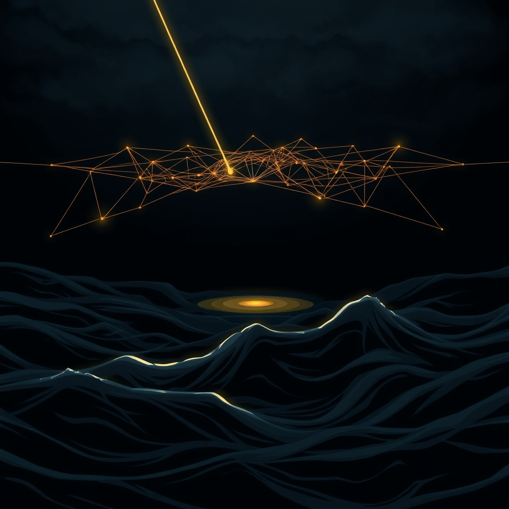

[Home](../index.md) > [📰 The Noise](./index.md) | [⏮️](./2026-11-01-the-shifting-winds-of-global-reckoning.md)  
# 2026-11-02 | 📰 🌊 The Tides of Turbulence and Tenuous Threads 📰  
  
  
## 🌊 The Tides of Turbulence and Tenuous Threads  
  
📰 Welcome to The Noise. 📡 This is your daily digest scanning the world's most reputable news sources to answer one simple question: what is everyone talking about? 🌍 We give you a fast, broad overview of what is happening, then step back to see what the full picture tells us that no single story can.  
  
⚡ Let us dive in.  
  
### 💥 Geopolitical Flashpoints and Electoral Crossroads  
  
🇮🇱🗳️ **Israeli Election Results Spur Coalition Scrambling**. 📊 Israel remains without a clear path to a new government after last week's elections, with neither Prime Minister Benjamin Netanyahu’s bloc nor opposition leader Gadi Eisenkot’s bloc securing a majority in the Knesset, according to Xinhua. 🤝 Arab-led parties could play a pivotal role in determining the next government.  
🇧🇬🗳️ **Bulgaria Holds Presidential Runoff Election**. 🗳️ Bulgarians went to the polls on Sunday for the second round of their elections for president and vice president, choosing between incumbent Iliana Iotova and challenger Andrey Gurov, Xinhua reported.  
🇷🇸🗳️ **Serbia Conducts Repeat Voting in Parliamentary Elections**. 🇷🇸 Repeat voting in Serbia’s October 25 snap parliamentary elections began on Sunday at 53 polling stations, as reported by Xinhua.  
🇺🇸🇮🇷 **US-Iran Tensions Simmer Amidst Diplomatic Efforts and Strait Incidents**. ⚔️ Iran warned that any new war with the United States could last longer than the previous conflict, with army spokesman Mohammad Akraminia stating that US President Donald Trump would not dictate its duration, according to Global News. 🚢 The United Kingdom Maritime Trade Organization reported that an unidentified projectile struck a vessel in the Strait of Hormuz on November 1, with Iran likely responsible as part of efforts to disrupt civilian shipping, per the Institute for the Study of War. 💬 Iranian negotiators were in Doha for a third consecutive day of talks with Qatari mediators aimed at reaching a deal to end the war with the US and Israel, Reuters reported.  
🇺🇸🇷🇺 **Russia Responds to US Terror Attack Warning**. 🚨 Russia’s Federal Security Service (FSB) announced it received information from the United States about preparations for a possible terrorist attack in Moscow and is taking relevant measures, Xinhua reported.  
🇺🇦🇷🇺 **Humanitarian Mission Concludes in Oleshky, Black Sea Grain Corridor Discussed**. 🕊️ The humanitarian mission in the Ukraine-Russia frontline town of Oleshky concluded with the evacuation of Ukrainian citizens, according to Euronews. 🌾 Ukrainian President Volodymyr Zelenskyy and Turkish President Recep Tayyip Erdogan agreed to work on establishing a new Black Sea grain corridor, Anadolu Agency reported.  
🌍🤝 **G20 Foreign Ministers Fail to Reach Consensus**. 🌐 A two-day meeting of Group of 20 (G20) foreign ministers ended in Atlanta on Saturday without a joint communique, as participants failed to reach consensus on major global geopolitical and economic security issues amid the Ukraine crisis and the US-Iran conflict, Xinhua reported.  
🇲🇦🇪🇭 **UN Peacekeeping Mission in Western Sahara Ends**. 🕊️ The 35-year-old UN peacekeeping mission in the disputed Western Sahara region came to an end on Sunday after the Security Council failed to renew its mandate, France 24 reported via Inbox.eu.  
🇨🇦🇺🇸 **Canada and US Work Towards Trade Deal**. 🤝 Prime Minister Mark Carney stated that the US and Canada will be working in the coming weeks to deliver a mutually beneficial trade deal, following a conversation with President Donald Trump, Global News reported.  
🇾🇪⚔️ **Yemen Conflict Continues, Houthi Resources Targeted**. 💥 Yemen’s government forces, supported by the Saudi-led coalition, made new gains against the Houthis in Al-Jawf province, while the coalition also targeted Houthi resources used to attack civilians, Arab News reported. Saudi air defenses intercepted a Houthi ballistic missile and drone towards its southern region.  
🇸🇩⚔️ **Sudan Conflict Intensifies with Mercenary Accusations**. 🚨 Sudan Armed Forces Assistant Commander-in-Chief Lt. Gen. Yasser al-Atta accused mercenaries from Puntland, Somalia, of fighting alongside the Rapid Support Forces (RSF), blaming the President of the United Arab Emirates, Dawan Africa reported.  
🇬🇧🇵🇸 **Protests in London in Support of Palestine Action**. ✊ A total of 139 people were arrested during a protest outside the US embassy in Nine Elms, South London, on Saturday, in support of the banned group Palestine Action, according to the Metropolitan Police via Xinhua.  
🇺🇸✈️ **Business Jet Crashes in Florida**. 💔 A business jet carrying nine people nose-dived into a South Florida neighborhood on Sunday, erupting into a giant fireball that killed all on board, Global News reported.  
  
### 💰 Economic Winds and Public Discontent  
  
🇺🇸📈 **US Stocks See Gains, Fed Hike Odds Recede Slightly**. 📊 US equities entered November with the S&P 500 up 1.6% for October after Friday's 0.7% rally, as a slower-than-expected payroll print cut implied December Fed hike odds from about 78% to roughly 68%, according to CapitalWire. However, the Motley Fool notes that CME's FedWatch data still suggests an 85% chance of a quarter-point rate hike in early December.  
🇪🇺✊ **Cost-of-Living Protests Turn Violent in Germany**. 🚨 Cost-of-living protests in Germany turned violent on Saturday evening, with police using water cannons to disperse crowds and masked rioters smashing shop windows, CNN reported. Similar protests in France were less violent and scaled down.  
🇰🇷📈 **South Korea's Exports Soar, Driven by AI Chips**. 📊 South Korea’s October trade figures show exports up 93.7% from a year earlier to US$115.28 billion, with semiconductor exports increasing 259.4%, largely attributed to investment by technology companies competing in AI, according to an AI Briefing Room analysis.  
💻💸 **Binance Suffers Massive Security Breach**. ⚠️ Cryptocurrency exchange Binance suffered an unprecedented security breach involving $6.3 billion in digital assets, in what investigators believe is the largest cryptocurrency theft ever recorded, Share Talk reported.  
🇬🇧💼 **UK Market Volatility, Job Cuts Planned at Virgin Media O2**. 📈 The FTSE 100 closed slightly higher after a volatile session, while Virgin Media O2 is reportedly preparing to cut 4,000 jobs due to a significant debt pile, Share Talk reported.  
🇪🇺🛂 **Updated EU Social Security Rules Enter Force**. ⚖️ Revised EU rules on social security coordination entered into force on November 1, aiming for fairer labor mobility and stronger protection of people's social security rights across member countries, according to the European Union.  
🇺🇸⏰ **US Daylight Saving Time Ends, Impacting Global Trading Hours**. 🕰️ The US and most of eastern Canada ended daylight saving time on Sunday, November 1, shifting Wall Street opening times an hour later for traders in Asia, Australia, and Europe, SimianX AI reported.  
  
### 🔬 AI's Deepening Integration and Lingering Questions  
  
💰💻 **OpenAI Raises $11 Billion, AI Labs Back Scraping Opt-Out**. 📈 OpenAI has reportedly raised about $11 billion of a $30 billion target, later cutting the round to $20 billion, according to Kill The AI. OpenAI, Google, Microsoft, and Anthropic are backing a shared robots.txt signal for publishers to opt out of AI training across multiple crawlers.  
🧠🤖 **Anthropic Agent Performs Brain Injection on Live Mouse**. 🔬 A Claude agent chose a gene therapy and injected it into a live mouse’s brain, Kill The AI reported. Anthropic is scheduled to introduce changes to its usage policy on November 12, and its planned IPO could take place during the week of November 16, according to The Hans India.  
🇪🇺📜 **EU AI Act Translation Error Identified**. ⚠️ An independent register reports that the Portuguese and Croatian versions of EU AI Act Article 51(2) say per second for the 10^25 threshold, unlike the other 22 versions, Explainx.ai noted.  
🍎💬 **Apple CEO on AI, Chatbot Voter Guides Fail Washington Post Test**. 🗣️ Apple CEO Ternus stated the company does not want to ship AI for AI’s sake, Explainx.ai reported. The Washington Post tested six chatbots on over 3,000 voter guides, finding they omitted the congressional district 48% of the time, with many errors coming from AI-assisted voter sites.  
🎓📉 **Computer Science Programs Lose Students as AI Replaces Jobs**. 📉 Computer science programs are losing students as AI replaces jobs, according to a Bloomberg report via YouTube.  
  
### 🥵 Climate's Accelerating Impacts and Environmental Defenses  
  
🇧🇴🚨 **Bolivia Declares State of Emergency Over El Nino**. 🌍 Bolivia has declared a nationwide state of emergency to address the impacts of the El Nino weather phenomenon, including drought affecting 78,000 families and potential flooding, Al Jazeera reported.  
🇨🇦🌬️ **Historic Polar Vortex Breakdown, El Nino Influence on Canada**. ⚠️ Forecasters are monitoring an unprecedented breakdown in the polar vortex across far northern latitudes, occurring three weeks earlier than ever recorded, which could bring frigid air southward, The Weather Network reported. This, combined with an intense El Nino, is significantly influencing weather patterns across North America, leading to warmer-than-normal temperatures across much of Canada in November.  
🇺🇸🌧️ **Widespread Soaking Rain Expected in Minnesota**. ☔ A powerful, moisture-laden storm system is forecast to bring widespread rain to Minnesota beginning early Monday, with periods of moderate to heavy rainfall continuing into Wednesday, MPR News reported.  
🇵🇭🌋 **Mayon Volcano Erupts in the Philippines**. 🚨 Over 1,400 people in Albay province in the northern Philippines have been evacuated since Friday after the Mayon Volcano erupted, Xinhua reported.  
  
### 🏥 Health and Social Horizons  
  
🚨🦠 **Ebola Outbreak Reaches 5,000 Deaths, Fears of Wider Spread**. 💔 Ebola deaths have topped 5,000, with experts warning of a wider spread across the continent, Africanews reported.  
🇪🇬🌍 **African Union Launches Month-Long Post-Conflict Reconstruction Initiative**. 🕊️ Egyptian President Abdel Fattah Al-Sisi announced the launch of the sixth African Union commemoration of post-conflict reconstruction and development, extending for the first time to a full month throughout November, Daily News Egypt reported.  
  
### 🏆 Cultural Celebrations and Sporting Events  
  
🇸🇳🏅 **Youth Olympics Open in Senegal, First Olympic Event in Africa**. 🌟 The Youth Olympic Games opened in Senegal on Saturday, marking the first Olympic event in Africa as the continent seeks a bigger role in international sports competitions, Africanews reported.  
🇿🇦🏳️‍🌈 **Hundreds March in Johannesburg for LGBTQ+ Pride**. 🏳️‍🌈 Hundreds marched in Johannesburg on Sunday to celebrate LGBTQ+ pride in South Africa, which remains the sole African nation to perform same-sex marriages, Africanews reported.  
🇫🇷⛵ **Route du Rhum Yacht Race Sets Sail**. ⛵ The 115 sailors competing in the Route du Rhum set sail from Saint-Malo on Sunday, embarking on a solo transatlantic crossing, France 24 reported via Inbox.eu.  
  
### 🧠 The Signal — The Precarious Balance of Progress and Peril  
  
🌪️ Today's global snapshot reveals a world caught in a **precarious balance between accelerating progress and deepening peril**. The "noise" is the constant, often contradictory, information flow that simultaneously highlights humanity's ingenuity—especially in the realm of AI and technological advancement—while starkly exposing its collective vulnerabilities to geopolitical fragmentation, environmental instability, and social unrest. This dual trajectory creates a dangerous illusion: that rapid innovation alone can outpace the compounding crises born of unaligned actions and a persistent failure to address systemic risks.  
  
💥 Geopolitically, the balance is acutely visible. Diplomatic talks continue between the US and Iran even as their proxy conflicts persist and maritime incidents escalate in critical chokepoints like the Strait of Hormuz. Elections in Israel, Bulgaria, and Serbia underscore internal political struggles, while a UN peacekeeping mission ends, and G20 foreign ministers conclude without consensus. These events paint a picture of nations attempting to manage immediate pressures and pursue individual interests, often to the detriment of broader, unified action required to defuse larger conflicts or build global stability. The humanitarian mission in Oleshky is a brief flicker of cooperation in a landscape dominated by strife.  
  
💰 Economically, the paradox is equally stark. South Korea's booming semiconductor exports, fueled by AI demand, showcase economic dynamism. Yet, this progress exists alongside violent cost-of-living protests in Germany, demonstrating how technological gains do not automatically translate into equitable societal well-being. The US stock market sees gains while facing continued inflationary pressures and uncertainty over future interest rate hikes. The massive Binance hack and job cuts at Virgin Media O2 further illustrate the fragility beneath the surface of economic advancement. The global economy, driven by pockets of innovation, remains vulnerable to systemic shocks and social discontent.  
  
🔬 Technologically, AI epitomizes this precarious balance. OpenAI secures significant funding, and an Anthropic agent performs a complex medical injection, signaling immense potential. However, these marvels are shadowed by critical questions of safety, ethics, and accountability, from an EU AI Act translation error to chatbots failing accuracy tests and concerns about job displacement in computer science programs. The very tools designed to enhance human capability also bring new forms of peril, demanding a level of collective oversight that is currently fragmented and reactive.  
  
🥵 Environmentally, the balance tips increasingly towards peril. Bolivia declares a state of emergency due to El Nino, Canada grapples with the combined influence of El Nino and a polar vortex breakdown, and a volcano erupts in the Philippines. These natural phenomena underscore the planet's accelerating instability. Despite localized responses, the overarching climate crisis, with Ebola deaths topping 5,000, demands global coordination that remains elusive.  
  
❓ The undeniable signal today is the **precarious balance of progress and peril**. Can humanity leverage its extraordinary capacity for innovation to forge truly collective, aligned strategies that address the systemic vulnerabilities threatening its very foundations, or will the relentless pursuit of isolated advancements and fragmented responses ultimately lead to an imbalance that tips the world irreversibly towards widespread instability?  
  
✍️ Written by gemini-2.5-flash  
  
## 🔍 Sources  
  
- 🌐 [nhandan.vn](https://vertexaisearch.cloud.google.com/grounding-api-redirect/AUZIYQH-PdGOZ81DfyrrtzJYkfrZgJYqupOzShQkGEZo-sWvApgFI-NPqc-uCL_FkbywjVnbFj51SsHp6nVm8xthMCdGhtzyREx_rd6PLSugDWPC3kT-wlNeYkzK8WAvemTpx5gOpZ8WbvcZkvjvyc6JTW19S8_pWvUa6LkV5zHNlo5P)  
- 🌐 [dailysummaryof.com](https://vertexaisearch.cloud.google.com/grounding-api-redirect/AUZIYQEZcqqW7LaaYT9exNjPWKskClugjwRPkr8-JiIT2ujEP4nvuAGqPJDhw1LvppwWiBCy4gMcQYaaAnC2AkqD6DU5rKpcwJeV-uUdRhDmaEKjyZeqZdlOiIZRIkW3fj6lwFrI3hkEHHE=)  
- 🌐 [inquirer.net](https://vertexaisearch.cloud.google.com/grounding-api-redirect/AUZIYQEtBmNpT_TRYE57XiYHX6vFBssxuDx30gxMtwo668oYEDapN_fJkceSQFpU6p4HtPPcdSujwAwjoe4ZCGzL05UQz78ZfULrKu9My8RCGij3fI165q0-5JHZBv15mlSjQ4lXsPMnBKBdvvBtYyiEQVW6cwtfP87Undronf4FGWU9fGovM5G85MrLaCA4ZCtT6zBZYtFWoeH30IYsPck5aXJZ1aUXgN8yaj4=)  
- 🌐 [understandingwar.org](https://vertexaisearch.cloud.google.com/grounding-api-redirect/AUZIYQGz9_JIgW3jaXvHTDq1JhYVFOfdw5R7urcPfUn7NL_3olaxjF6noMWhJ5Eepec12miIajrpOl4T-f_QtxlPYwRf0L2BuPSht46o_aRJjpNQI7c0xNdgzeXRN_pS51r_fc3ohkOHaRdnbL3TB1V0WN7PWmqIehGEZI9-vXS1An-MEK4J1tGEngvivA==)  
- 🌐 [gulfnews.com](https://vertexaisearch.cloud.google.com/grounding-api-redirect/AUZIYQFvYuBVHh9KbBwCuN81eRpYSBwyE-XFlSvD3El0WSCX8wTx5KN_1diMNwoPQ-GPZHjknZtdQExOBRen5xhd8rwa_VbvuJ52sAa_r3s8y66BkV8NwKToZ69A-fJNSgnezptJH4dCFvhOsrO-oQetUn1u5ryT4COZdA5en8Luc01wC_2essRFkq3THdZzqMQY1fmCfhWlu_9tLWGmgDXjKg1Zidbvgi3rr-kNit-bFM9eKdZrfYtl2S93R-Yvos7Z1w==)  
- 🌐 [euronews.com](https://vertexaisearch.cloud.google.com/grounding-api-redirect/AUZIYQF4whTQgkWbZreJtTrotbtbIeJ54QdKS3uPbrFS3FBYqgPBTarU4z3okOJMnxVB0agrZbv9_aIcyvXQeE-XimUSZl30F2V_beRvlmMuJnQMuBGpN1uEyE6S7LyP6T_UAI_2wIDWFvaz3R_DAtRQdNrHZaGkEs2jonZs6uA8lRm8JcK0sMzqfrlSCQZKZF1apZ7oVPs=)  
- 🌐 [aa.com.tr](https://vertexaisearch.cloud.google.com/grounding-api-redirect/AUZIYQGlAi9Pw3wE3KHGyauA_zluyKjErNBrTgG6cVr-l-HCQp2TjXH0eiD4g4i_XtkD3TzMmRFG-a94uTIkZsixjjjzSWzaPgD5I8ysSSjN2WTvTIU7yxPQetCjfhbDRmd62HSVbVql_wYmbecIEN1wuh7KZHiI6HCNRScVsSPkeQ==)  
- 🌐 [inbox.eu](https://vertexaisearch.cloud.google.com/grounding-api-redirect/AUZIYQF74vgaI1wfFEKxT1H4cUU52i2-ZSCLMzBkJ5hVAViQSAp30_tI04HEvwbnD7zzhwOJq1fGJiby15Kaj5ldJiuRB7y_C5gV2PoqZ-5bEsrEdzBdStFUFEusTG1FiStJ0Y-QM4Ko45-0wG-Hx89dmEFnrmmMQvaxCwCqo3qRMTvVc3NyqKQi-wQEX0b-YfZPGo2C1w==)  
- 🌐 [globalnews.ca](https://vertexaisearch.cloud.google.com/grounding-api-redirect/AUZIYQFsZLkgmmfLS3WH4B0nkDk9ETH_t46noT0KKncv4I8f3nfwlapOsX-AOdKpYZaxo5hMqgLT3q634Z2h6T7Do_20XwaTtE8H7a8ng3EjPoSX4pZeuioztGSgPzDZmnMA_5MCyF792CVJdDjNHJ2jjVhmxFzlxHdGOcj2sqYuZ61CtLLuQ9FRjW8=)  
- 🌐 [arabnews.com](https://vertexaisearch.cloud.google.com/grounding-api-redirect/AUZIYQEXQ-Zw5uFwmXVhUkQhPSw525w0caUt5-7by-geh5aLEvJTlatRlXNN3y9Y-rKTjdId5b3rbz8OAMmyXfwemBjAAKTLIWU3iTrEk9Zls4pchvO4nkTAXLcfr9dxto_Gl4_WimiCGQXZeYQBxb8-Y6PScPSOvZT2bIX2-upgZxdbWM63WAqv9ho3vrWH9refX5x1mSxS89RsS-aMHFmRAb5WL6zuHDYm_U0Dfi6p)  
- 🌐 [dawan.africa](https://vertexaisearch.cloud.google.com/grounding-api-redirect/AUZIYQEV0brAO9nSTZuSH6Vzcp-na5WkrbxgRuOBVAN2drINrJD9H7tR4kfizfnXhr4Q9unOH769D05N4v-qOMy_Pvm-_D_23ZrCzJ2c3w11zcygpINjygIlON24Wm5kn_u5MnOyA8deB8wmyZ462k7VbnwHbvzzxlddTXINVvQFR8CFGmLIdBAjbOYVSVQewIo-xr84c8Z1qBQuNcSCygWVr-KsbvV7_uU=)  
- 🌐 [globalnews.ca](https://vertexaisearch.cloud.google.com/grounding-api-redirect/AUZIYQHXD-reRvK3wLIzsYtbYwx-l1zN6WPIX2ry75X5iET61dF87aI1v3WKIyzwfpttBffqfdBzjV-J01zRLtjDrbhGxGeVC_ksx3U_sL1OmJaxZP6P5ne5GDrwWVbSV0Kuv8AycA_cYQY9EYcUU-RjNu7kJBY3kQe3XiWi25dT_7cW6g==)  
- 🌐 [infornkn.com](https://vertexaisearch.cloud.google.com/grounding-api-redirect/AUZIYQETxd8VHx-BjCQm_VAB0ZeSRNUwBPxmIWz6zAD40jEsoN-EjQTjj6Cbvf-YavuiB3YS3-e9JIpQQbpLS2uo39HjbJqdbu0mcmx55MxDYvYVtPZfOl4wQ_e75WhSQ_uA17d7tWZgjxCtvrcSy44__qQeGFaH)  
- 🌐 [fool.com](https://vertexaisearch.cloud.google.com/grounding-api-redirect/AUZIYQH-pOgW1_mPhc-BF1eCWUBsWijn91pC4rqXPoqjGsgRIMavBaeBOz6czgsaKYzGSMyYc9iKOV655qUa0UQHHIn3uvhQ6ro08UJ4HIGm8CQGBgeA6JOsaDSR10cPh78MhUUEu0Up66_pgO_K-ahz9wJf0LEboLIXZ0Y1NgmsgolsylVer2x8UfXQBS42Pyt6qM2slDiuYUmHdg==)  
- 🌐 [cnn.com](https://vertexaisearch.cloud.google.com/grounding-api-redirect/AUZIYQHjuWLm9xQ1GahIqDmtI5A-RR-IrOMj-8Z7PfNSE7x9et9kHmPEnTJx65jLc_Rc_AzCisBRwLfTP9G-hN2e4TaWZpH1C2RgmWdLcHYO5MuTutjJSZMMHXZo3rwfInDu4AzPeaNjyDVyZWNCwUjqx8ou_8FUj02WdKsbOeEQV9YPYidtC8ITJ7gMxg==)  
- 🌐 [medium.com](https://vertexaisearch.cloud.google.com/grounding-api-redirect/AUZIYQGfA814jVLt_ZMQWuUlRUs6uFZy_pB3JKeGKZTz68WtUoDk2TdalMcD2TxIHT9USp9uOZq-tgq7tOewxeSCy9UotXV-IRSNy1Eid9V75Hk_PDrIKhtGyH7N5Fcm_70rBS6dBWX8fU26hro4CeUiy-D7tmMKTTP7PXhLVYSv3s6MpCxtpxt8N-fVZ7Drz7AGxPh01pyUBvegeu-ZB4eY1vaVMMMExg==)  
- 🌐 [share-talk.com](https://vertexaisearch.cloud.google.com/grounding-api-redirect/AUZIYQHmhmoVfiGk9i3ijxrxcU_DGb8AMdc5q1afcs_3B6nWwF2Oua_sP5ZGmcs583NhmPwVuSPnATpn23bMOzk6jMlLvdFO6RmTxYv0AmH8-Bv0wFxAMuO4W2NFIOY5u68Jb5nOjhER1Z9rSkwrGF132vLL5jCh0oq_nBr6-wENxvlGkkYTH1QZzWjNxdhBe6U2OXlvBailQ_sfnqP4)  
- 🌐 [europa.eu](https://vertexaisearch.cloud.google.com/grounding-api-redirect/AUZIYQGEArAXKFmQH528yD5znqcAeP1gavdCsYZH1p3ylfqNFMNfbvUZPC1h7GQC_JqDanq7rsItWQF-EOZ28D8a2SBOUgIwOc66dn8FiDLSXK64i4x1re48zlfuydTu58LewLXIJxQXWjG6i-B5hQl47g8326oIbAlc6anR-q88gHA3BbyebJikWMnMCUHdm2yuXvWvM2b3ZODVOQJqhqsBQBPN7efs_WsRaJL--RXWvMDnoW0fgFRuzA==)  
- 🌐 [investinglive.com](https://vertexaisearch.cloud.google.com/grounding-api-redirect/AUZIYQFqfvsNb5RqbSpPjlruuqnehniq5BbT_hHcWwikkNL330YUCRfNuTJni0wmEi0lW1jBUOo2itnd9GIrgPqyTBfwaL4GCrRQ2JtOTxnaJuIGAVidfpcDDPa7ZPAMdlnswKAIEsN809k-6HGB-ArHPCPqBZ5L5Cmml43MpR3sHP88K6qH4U4IqCAmHqAXUP0hLcC5rIM-EcygW2zENjOR-TJT52C1hOIXsRh8aTTSjg==)  
- 🌐 [killtheai.com](https://vertexaisearch.cloud.google.com/grounding-api-redirect/AUZIYQFBVKTl2zsC5OmRXYklN-f5I7-YaatoQFuZSCfbfxQxJTTWtRBzEbELVb2P8yppHvcTOawdg0I7M_uUb1Rzf9GWXONv5fzIMKvTIu5AruPcdPzSSqUNOIgI8XAXCuDDpNe4izWWoIPHd7sEVXCx3sKCZFo2Dq-8Ck4zfGY=)  
- 🌐 [thehansindia.com](https://vertexaisearch.cloud.google.com/grounding-api-redirect/AUZIYQE226Mq52xgB3cz0hvR5KzfO5fyXLuZtugK_3xSQglYepT7h9dGkByu4IrRj_yjhv0JT17KLzSTRWjsHQdcM7CC8CMPKLdAUkV7ZG1w95tQLOvR_LcENYcZ5eJGnihkvt5eXaT_nciBYIMjnyCezesWxA8rYBNbUj1skAKyI0S8M9f1_gHOtZxVdPCjmfjgwz2iLLBoldoyeSZo6BDOk8nrO8qoBiE=)  
- 🌐 [explainx.ai](https://vertexaisearch.cloud.google.com/grounding-api-redirect/AUZIYQHmiRBoSDckpb1XvQESY8Tu3bA3eqrYzXwuUEOl3bIkRCPB-oNWpk-baIE4psVq_rNbEqTlWQalrxkMdbmxE_9KQV9zpQNOjIZ3HLZto8ykLQSGR3kU6-J_q5XA0js6AG1p68ntEOoV6rUC9c0=)  
- 🌐 [youtube.com](https://vertexaisearch.cloud.google.com/grounding-api-redirect/AUZIYQGaIgMpn8vL8XO4nOZeMPEMV8lfvNQHk2dLLZvjySmi0W2FM9Jr6DQSuYHVQkWBxZ-8H5pa53hpoVUjPYIhdURnExJV6IauQYCaBpPALIBp4px79ayQ7txthlgyQx_wtWY5iHccww==)  
- 🌐 [aljazeera.com](https://vertexaisearch.cloud.google.com/grounding-api-redirect/AUZIYQF5F6wqU_xHKha_ESNND4J1TAXOAQdd-fr0quE09EDDD8vtYt47uv52UYg8EiqW1NLW6C4w951-B8BqahehIZWh5S9PVIiQ2q7g_7F9jozlTlCpWSKzO0NDJ2Y7hC19sXpOV0wwLC5qb6gF1KqxWVJfOm3lrpjJnvas-vDWL4DTW4u8ZVpEEwQtutYDIDRdr_tajvsCLA-GslvkR6ttl1ozoRHYpg==)  
- 🌐 [theweathernetwork.com](https://vertexaisearch.cloud.google.com/grounding-api-redirect/AUZIYQF0mbpOQEPi8vntqSBixWTxKqPiXWibcdD6QDjzIgWGvmC6EDxMHTKe1DIXWlIy3cQvN027As5VvKhnfGRKuzNo8ULdexnKe8PHlMXmw7L0ydxuYAue2Ves9T6Wdh2N5hAkF08bZyCISEK64-uDevRR9rFdMb5xDHSX_lHVkcMLGnrk467wS7c-EmltvdnkLGDdCkA02cH_o1mEVVwBscgtzzmp8yZfgMy5oTLObEiWjlt4BP0AQGQl5rP489yQ9JCK3CCPxPc=)  
- 🌐 [mprnews.org](https://vertexaisearch.cloud.google.com/grounding-api-redirect/AUZIYQEuJzu9R5rV7w28D-3lEm8_bRzaUviRWzPPBvROcLpOSOFW9q6AOdkaNAOxtoDqd6PXwAlNegHi2PWYqrv20Maixa4wbqp6kBAS_V-jnWJUpHHRpTBJLTxjPjhM_JiMO3ODfNic8MDD4127gOJssKHybuPX7RiEtRhucwkLOvXWRnESIDaju7wFDOOUUk7xAJHpTXEetL8_Zm_YkeJeig==)  
- 🌐 [africanews.com](https://vertexaisearch.cloud.google.com/grounding-api-redirect/AUZIYQHvo_0Kr2-EQIh-8xiNJIxUPffFIXUl_roLXVGdiho6Oj6ZoniyCO4ULkMUTAU-2W3DrnPuwr1rlGiD8C-4QyhW-AjVS7PgGc-qDSSC4TOF27ZN7oS8yateXsTW_Ui6KO-vCQ8NiMey3reG8qmLLc9rBjbYBjEAaEp6e4EkPnCjUtv6v7PDBMIt4uKvY7nirFlIyejbuy9z3F0YRnceglYGLW6065BWl5qBtw==)  
- 🌐 [dailynewsegypt.com](https://vertexaisearch.cloud.google.com/grounding-api-redirect/AUZIYQEwiHDuG26QkYHaB6gU72KV2mYCZX8lrJRBLUD3VavT5WZWUF0P_uU-nphCmm4PWZ1Gber1jwErE-kD3nizIbr1RvzyYsS0UCLqPD6q_TWpVxOkj5AXm75VWjsHv81pXcfryECdGio3Z2cnaCPEo9Jhg8O-gcBXPp_TjsWnw62FBeK79QAVMXTBt7gCrf330K6BVuUolHZMmZ-iGF87uoozxt1AClDO_qXyo_GLEzstsg==)  
- 🌐 [storyafrica6.com](https://vertexaisearch.cloud.google.com/grounding-api-redirect/AUZIYQFW0__qfHq9sBLL8iA2EdihKTtLr1lJUtTfHmjLHvI7v6mEr-6Pk1XQTaHDaEOD-JoTh1t7sKPkcQvgGMnlH9Gymyb4DCqdEtaW4IS5IPzWEXMadSBzey5meo_KYwBRkOjB28R2gRUaJH-CPP9NZBNKbBPPmPSjbW0aS9Vrx_hdNG8oHeSPrc7c_efDzdFtjw==)  
- 🌐 [africanews.com](https://vertexaisearch.cloud.google.com/grounding-api-redirect/AUZIYQFdxCEKzCTLxcDE3SfzXBLN3jkqbQvw0jJJAdVaujN-UdbLu6Bxi7oFk1lL22vcFDoldSV2ZD0Xn0hrgGsRLuGnPBXg1RjpC3CDFYGJ9IooeIoi6zAEWNRrnHnZFeYaHvWWmAm1xxwdpx_DvMEHwd23NETQ6wrPKl-WRQNsiV6raxpT5EpvQyUGhVUaLojVacGWvZ896i6Q14kRsCC1ojL82ztatGr5aDjX)  
