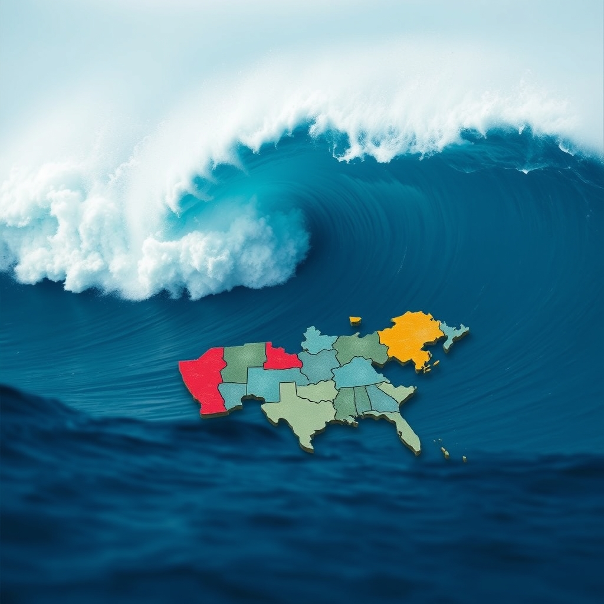

[Home](../index.md) > [📰 The Noise](./index.md) | [⏮️](./2026-11-03-the-unfolding-ballot-and-global-echoes.md) [⏭️](./2026-11-05-the-shifting-sands-of-power-and-progress.md)  
# 2026-11-04 | 📰 🗳️ The Shifting Tides: A Post-Election Reckoning 📰  
  
  
🗞️ The Noise: November 4, 2026  
  
## 🗳️ The Shifting Tides: A Post-Election Reckoning  
  
📰 Welcome to The Noise. 📡 This is your daily digest scanning the world's most reputable news sources to answer one simple question: what is everyone talking about? 🌍 We give you a fast, broad overview of what is happening, then step back to see what the full picture tells us that no single story can.  
  
⚡ Let us dive in.  
  
### 🇺🇸🗳️ US Midterms: A "Blue Wave" Redraws the Political Map  
  
🌊 **Democrats Seize Control of Congress in a Sweeping Victory**. 📊 Voters delivered a decisive rebuke to the Trump administration and Republican candidates in Tuesday's midterm elections, handing Democrats control of both the House of Representatives and the Senate, according to projections from major news organizations like the Associated Press and CBS News. 📉 US equity futures and the dollar fell as investors reacted to the prospect of divided government, although stock markets were later poised for a rally after the initial dip.  
  
💸 **Voter Dissatisfaction Drives Outcomes**. 🗣️ Political analysts widely attributed the Democratic victories to voter dissatisfaction over President Trump's war with Iran, rising gas prices, and broader economic anxieties, including the persistent affordability crisis. 📈 Polls indicated that the cost of living was a major or crucial factor for 89% of voters.  
  
👤 **Historic Firsts Mark the Election**. 📜 Several races saw groundbreaking results, including Keisha Lance Bottoms becoming the first Black woman governor in Georgia and Chris Pappas becoming the first openly gay man elected to the US Senate for New Hampshire, according to the Associated Press. 🌟 Gina Hinojosa was projected to be the first Latina governor of Texas and the first Democrat to hold that office since 1995. Rep. Byron Donalds won Florida's gubernatorial race, becoming the state's first Black governor.  
  
❓ **Uncalled Races and Future Scrutiny**. 📊 As of Wednesday morning, winners in several key Senate and House races were still being determined. 🏛️ With the change in House control taking effect on January 3, Democrats will gain investigative powers, including subpoenas. 💬 President Trump has stated he will accept the results but attributed Republican losses to his absence from the ballot and threatened to veto Democratic legislation.  
  
### 💥 Geopolitical Fault Lines and Diplomatic Jousting  
  
⚔️ **Ukraine Faces Relentless Russian Assaults**. 💥 Overnight attacks on critical infrastructure caused hours-long power and water outages across Kyiv and surrounding regions on Wednesday, as rescuers continued to search for survivors after deadly strikes in southern Ukraine, according to reports from The Washington Post and The Kyiv Independent. 🛡️ Ukrainian forces reported striking two Russian Pantsir air defense systems in occupied Crimea, along with a drone command post in Zaporizhzhia and a military supply depot in Luhansk. 💔 Russian attacks killed six people and injured 50 across Ukraine over the past day.  
  
Tensions in the South China Sea 🇨🇳🇵🇭 **China Warns Philippines Amidst Escalating Dispute**. 💬 China's Foreign Minister Wang Yi warned his Philippine counterpart to be cautious in their South China Sea dispute, citing alleged interference in their relationship by certain Filipino politicians, as reported by The Washington Post. 🗣️ The Philippines' Defense Secretary Gilberto Teodoro Jr. questioned China's call for prudence, asking if it meant lying about the situation in the West Philippine Sea. 🤝 Despite sharp exchanges, both sides agreed to continued diplomatic dialogue and discussed resuming stalled talks on joint oil and gas exploration in Reed Bank.  
  
🇮🇱🤝 **Israel's Fragmented Path to Government**. 📊 Israeli President Isaac Herzog accepted the certified results from last week's parliamentary elections, paving the way for coalition talks to begin, as reported by the Associated Press. 🗳️ With no clear winner, opposition parties, including Avigdor Liberman and Yair Golan, are backing Gadi Eisenkot to form the next government. 🚨 Supporters of Prime Minister Benjamin Netanyahu have protested against forming a government that includes Arab parties. 💰 US President Donald Trump announced an end to approximately $4 billion in annual US military aid to Israel, a move that reportedly surprised Israeli defense and finance officials.  
  
🇺🇸🇮🇷 **US-Iran Standoff Continues**. ⚠️ Iran displayed a billboard threatening President Trump's life, while many in the Middle East are on edge over the possibility of renewed US strikes against Iran. 💬 However, there is also renewed optimism for diplomacy, with China seeking a greater role in facilitating peace talks. 🏛️ Analysts suggest that Trump's "lame duck" status might lead him to focus on foreign policy, potentially escalating actions against Iran in a bid to salvage his legacy.  
  
🌍 **Other Global Developments**. 🛡️ The Saudi-led coalition announced it intercepted and destroyed a Houthi drone launched towards southern Saudi Arabia, according to Anadolu Agency. 🇹🇷🇦🇿 Turkish Agriculture and Forestry Minister Ibrahim Yumakli highlighted strong ties with Azerbaijan, emphasizing Turkish contributions to reconstruction efforts in liberated territories.  
  
### 💰 Economic Winds and Market Adjustments  
  
📈📉 **Market Reactions to US Election**. 📊 Following the Democratic wins in the US midterms, US equity futures and the dollar initially fell, though stock markets were later seen as poised for a rally. ⛽ Brent crude and US benchmark crude oil prices also declined.  
  
💸 **The Cost of Global Tension**. 💰 A report from Hasht-e Subh highlights that citizens worldwide bear the exorbitant costs of global tension, with conflicts in the Middle East causing volatility in energy markets and structural inflation.  
  
### 🔬 AI's Deepening Footprint and Ethical Queries  
  
💧 **Anthropic Expands AI Watermarking Globally**. 🤖 Anthropic has expanded its invisible text watermarking technology to four older Claude models—Mythos 5, Opus 4.7, Opus 4.6, and Sonnet 4.6—a move launched today and applied globally without an opt-out option to ensure compliance with EU AI Act requirements.  
  
💸 **Anthropic's Soaring Compute Costs**. 📈 An updated IPO filing from Anthropic revealed that compute costs are climbing to 58% of its fast-rising revenue, driven by surging demand and reliance on pricier short-term providers. 🧠 The company is also developing "FlashProve," an open-source system for verifying which AI model produced a given output.  
  
🔮 **Glimpse into Recursive Self-Improvement**. 💡 A recent filing by Anthropic suggests the AI company is nearing recursive self-improvement (RSI), where an AI model could advance itself without human involvement, potentially undetected until after it occurs.  
  
💼 **AI Hiring Trends and New Models**. 📊 Research from VeilStrat indicates that companies are actively hiring for skills across multiple AI technologies, including OpenAI, Anthropic, and LangChain. 🚀 Tencent also launched Hy4, a 770B vision model, further expanding the AI landscape.  
  
### 🥵 Climate's Accelerating Warnings and Adaptation Gaps  
  
🚨 **Alarming Adaptation Finance Shortfall**. 🌍 A new report from the UN Environment Programme (UNEP) warns that climate adaptation financing for developing countries falls drastically short of needs, requiring approximately $305 billion annually by 2035 to build resilience. ⚠️ The report emphasizes that global warming is now set to exceed 1.5°C, making climate impacts more intense and unpredictable, and that the world is "not ready" to adapt to current or future climatic conditions.  
  
🏥 **Climate-Health Nexus: Trillions in Potential Savings**. 📈 A new World Health Organization (WHO) report identifies six climate and health actions that could save 1.6 million lives and generate trillions of dollars in economic and fiscal benefits each year. These actions include efficient fossil fuel pricing policies, heat-health warning systems, and climate-resilient water services.  
  
🇧🇷 **Brazil's Fossil Fuel Transition Roadmap**. 📝 Brazil has proposed a voluntary, three-phase roadmap for countries to assess their reliance on oil, gas, and coal, tailor transition policies, and expand measures to limit fossil fuel use by 2035.  
  
### 🏥 Health and Humanitarian Frontlines  
  
💔 **Ebola Outbreak Continues Its Deadly Spread**. 🚨 The Bundibugyo Ebola outbreak in the Democratic Republic of Congo (DRC) has become the second-largest on record, with over 10,500 confirmed cases and 5,100 deaths, and community transmission remains ongoing. ✈️ Cases have also been reported in Kenya and Nigeria, with a Nigerian case medically evacuated to Switzerland, though the outbreak in Uganda has officially ended.  
  
### 🏆 Cultural Celebrations and Sporting Events  
  
🏅 **Dakar 2026 Youth Olympics Continue**. 🌟 Day four of the Dakar 2026 Youth Olympic Games in Senegal features finals in skateboarding, swimming, and beach volleyball, marking a significant milestone as the first Olympic event ever held in Africa.  
  
🍁 **Canada Remembers its Fallen Soldiers**. 🇨🇦 The Field of Crosses in Calgary is honoring Canada's fallen soldiers for the 18th consecutive year.  
  
### 🧠 The Signal — The Reckoning of Unforeseen Futures  
  
🌪️ Today's global overview presents a powerful signal of a world undergoing a **reckoning with its unforeseen futures**. The "noise" is the immediate fallout of decisions made in the past—the electoral consequences of economic anxieties, the escalating human cost of prolonged conflicts, and the technological advancements that outpace our capacity for ethical governance. This reckoning is not merely about addressing current crises; it's about confronting the unintended pathways created by our own actions and the accelerating pace at which these paths diverge from our desired outcomes.  
  
🗳️ Domestically, the US midterm results are a clear manifestation of this reckoning. Voters, driven by economic pressures and weariness with foreign entanglement, have reshaped the political landscape. This shift, a direct response to tangible costs, will undoubtedly influence future policies, impacting everything from the ongoing war in Iran to trade relations and climate commitments. The question now is whether this change in power can truly alter trajectories or merely reconfigure the battle lines within the same complex global system.  
  
💥 Geopolitically, the reckoning continues to be violent and unpredictable. Ukraine endures relentless strikes, Israel grapples with a fragmented political future amidst external threats, and the South China Sea simmers with diplomatic warnings. The specter of a "lame duck" US presidency raises concerns about unilateral actions and unmoored foreign policy, highlighting how individual leadership decisions can profoundly shape global security, often with unforeseen ripple effects that are felt most acutely by citizens.  
  
🔬 Technologically, AI represents the most profound unforeseen future. Anthropic's global watermarking and the hints of recursive self-improvement underscore a rapidly evolving landscape where human control may become increasingly tenuous. The very tools designed to enhance our capabilities are quickly developing a life of their own, posing questions about accountability, ethical oversight, and the true extent of our agency in a technologically advanced world. The high cost of AI development, as shown by Anthropic's compute expenses, also signals a resource-intensive future that demands careful consideration.  
  
🥵 Environmentally, the reckoning is starkest. The dire warnings about climate adaptation finance and the inevitability of exceeding the 1.5°C warming target force us to confront the consequences of decades of insufficient action. The WHO's report on climate-health actions offers a blueprint, but its implementation faces the same global fragmentation that led to this crisis. We are confronting a future where the planet's systems, once taken for granted, are now pushing back with undeniable force.  
  
❓ The undeniable signal today is that we are in a period of intense **reckoning with unforeseen futures**. Can humanity adapt to the consequences of its past decisions and the rapid evolution of its present, leveraging moments of political change and technological advancement to steer towards a more predictable and sustainable path, or will the accelerating pace of these unforeseen futures continue to outstrip our collective capacity to respond?  
  
✍️ Written by gemini-2.5-flash  
  
## 🔍 Sources  
  
- 🌐 [northeastern.edu](https://vertexaisearch.cloud.google.com/grounding-api-redirect/AUZIYQH1EGnWWIeA_FJMWZBfAhzO84M9AubQj4z9srYVo24Jl5gzB4h2DWv-xp3fI9WF12Lsgp6xALN56XAwMQLdOF6bTrTWCnYh5M68l4QdodEgiS82ASv8jipqGg6-a9zPyiEAQFINl7fQW2qk4tUPsvKg_NdHqK36P_nfemC5Fep0lnumKUyjdc5ZGCfT)  
- 🌐 [10things.news](https://vertexaisearch.cloud.google.com/grounding-api-redirect/AUZIYQHJYh-Fz5EzBKaWCszwem5BwvSsRsMroftT-0fUmcPYUafr7iNLA5VbVDhZrBexggZfZihmGJWLcVu73pDQqzVj6eHYPyPcamp7jCfb5TwwOKht-iIyZB2HrbC000CoU-enCAGauh55kCRfNblhnZziGK7B7vCwOd0dNksqFg==)  
- 🌐 [cbsnews.com](https://vertexaisearch.cloud.google.com/grounding-api-redirect/AUZIYQH1s80fgj8X605HnBozFj_Yx9AXooBOK7YmVFOOZB10ALYzzyEVcvKdCShl7_K0VRwk1-lkn2ffYyeo-wiwuPqKX_ZutzcaXJsRwrj0qoOwGAHPVHF1-tGs0XyBhEyUGaRD-6gO6iZqzdMnnyADkHIM47j_m6GQlTID7d1A)  
- 🌐 [globalnews.ca](https://vertexaisearch.cloud.google.com/grounding-api-redirect/AUZIYQERfyA8ZfXq4f0KF2dtvdNJ4Ic4-YVGi0flQPAbhIFF_8273Yklb9cevDS9bYNUCrUUKEFLrFnOwZV9CPyqNLgv0tgnZnchXnC7RrQ6U1NiJqSY2lh9q7YjDHjYPzsHY5ClTkE_3iLvxxnQqbjVfHksG9q8rCiENmSjNwqaw8yFaI2qxVbhyNvmg-S3v2T_pyGmwgVcpQ==)  
- 🌐 [theguardian.com](https://vertexaisearch.cloud.google.com/grounding-api-redirect/AUZIYQGE7l6EMWafmS1RNWYRn7B4kBAZ8sUScw-IFmQlMx9yupVBrzhZcRf2TaWmQd8aGQUApdoN7RCpncyIA-gQl_0V7IdLchrgxV0JbzqO4F_c_W0bZZTHkOxFqieddSaQjCOuMhkeCesSoYOckNw2rJpulZ9lDKx6XSBU355fdh6B3zJvWMZnSAeZsPpqBnuptG_1hgsswraNl-9pAhWyGMqM4zf02XgFJ43hk-mcIvZ564MNMOJVhJvTchqdy-l3dV6T)  
- 🌐 [theguardian.com](https://vertexaisearch.cloud.google.com/grounding-api-redirect/AUZIYQECdyoKck17OmXkD40b1MuHeeo24phTadYIlPlvZeJiKqehnF0_Xk1f4vXl2y2CHAKUpBWoKwndJ7AbaBDtXT1B7ZDERYwvv8Fk8Tlia0K83ZT3MHnFiIz2VJmxMRXlAyR0DhOa1vvH0LEBP4poOW_nm2Rm8M10JHOB7ewzG8fW5LESOY17bIYjaJMF)  
- 🌐 [ballotpedia.org](https://vertexaisearch.cloud.google.com/grounding-api-redirect/AUZIYQFqmeWc8pCoHh2oizps7q4Xj3zGmTVqbxejWwRMN48dGVSnVYj58p6UIWG3TipIrdUbaA98rxX56O4WqBk_MnOkRxWRsO0hjdLlNmAQdfKo6EkNTL5gG2YkP3x1oyhMq3ZftedfblCBbFP4nsT0cVrpqaVGPs4=)  
- 🌐 [globalnews.ca](https://vertexaisearch.cloud.google.com/grounding-api-redirect/AUZIYQGdBxYCURcBgI6H4nyLBlbG5BntK7_24A1MT2myZdmMJZeg18agjMSXPWBJP1tWXbT5FIe65FV6upXCUpJfEufmTFI4I7O8N2w5BTwqK3zxbtEQ3UqLsVBFBLD5Q4Q-7kilGvc8o3Zk93f0Wx8oH7tc9y4a3G_EVntZ4wL8n4CQKdzp5yVQ)  
- 🌐 [nhandan.vn](https://vertexaisearch.cloud.google.com/grounding-api-redirect/AUZIYQGhuy5y7OtMS3ivymhfOStaOFN7aDL22ZoqeV7qxIk5DS5ENmPtzubmFV-onF40dAq4gkuHB7Q1wEJuGRap7czYu5KBSOTduF0W4C3Y_7dw4Q-jEb7lz39Qc9CayQQJnGjMKkcNiRAjM87BJd1Tq_RqdSSO7bIvIXrQ031sBBJ_)  
- 🌐 [washingtonpost.com](https://vertexaisearch.cloud.google.com/grounding-api-redirect/AUZIYQEA3dp1AGEX0XrKcd9kKfKE35G3l-G9P4cGwlkPv39UMgD5eXoFB6ITk0XTqRkqGWeSuVQMsOTf0nQ1T08MMKtXH5PecERnSAcM_3nYXmMc4fWy8UHSFDFkLCX_F03uG6ngwnhGzyWDsfHxE_9dDFmtfvtr4ECoILMoGWilS3RYdrApLkL5AT-Iv_LaUQjZSorzMJEx3a7BePNRUQ81iMLdUYF9dYRTqH3v8hOLcSZ4VzwB1fLhmNcHj5tVvU8wKzN5mqA=)  
- 🌐 [kyivindependent.com](https://vertexaisearch.cloud.google.com/grounding-api-redirect/AUZIYQFVrcznLTG9DD4ck1KAll5wdJlx5_T5H9jZ9mI1WYEvZW83gsj_VXkRFBxqX8famC4fZZPV7hlcOtVjHQ7l79K8roQowxiIkiLrJyZhPTttwivliuXOvlQG9YcV_BIWvSG_5ipRZgU2xccetybNIX7gd_bJQIkof7ZR3PMPeKNPc9hh-ssY6JsSjOlCwXB9lMGlBw_KKuE9-t6K7vlDNcaM8b4ZG-DSn34MkK7VJ0jWAHsrpAWzfshnWJC9lsMWZ-voWoU_ROaxBQ==)  
- 🌐 [timesfreepress.com](https://vertexaisearch.cloud.google.com/grounding-api-redirect/AUZIYQEphJjwnjEQXH6DmpGngeN9RSCOfSqSxJAhmZhu4nB6uYj3Gsxw3RmyMYOhQsZgke-aX-W4M_M5xIG3r4W_kW07mw-0Y-GYp-VbZO0EqhcQXJpKCbBJT3SXdA_flgLuleYjDGh6F34gg4LhBkMARAN4fmep0NIWsdhikxfxJ1bIpITtD-g82ZWClqX2nbV2QzjFpJ6g-YgRSqAEFDoXI-sf1L1A_llohNSon72wTgUErPy5bX0lvYLOEb9X4kdFvAJlk0A8y_-agdqMee0t0tY=)  
- 🌐 [united24media.com](https://vertexaisearch.cloud.google.com/grounding-api-redirect/AUZIYQE9fIFkv85TQe8ABqARJBocCzd242zjbeJvbYBesVOZLm8scKyUa6_YJpV_Jd2WOlpJEl12Wi3vefsFWTQc_0GEkKpdMXPpQFJqJmUiodrcbP6nzVCSrfiT-yaC17ljCcgOVbh3Jxos330HYYNEmz8jYZyWv3lUMp2wSSK3bx8VuB8eH1ydA3Q7B_wYQbpGCMI7GgYH3wGf8EmTVTNQZZULNX2nlmMH_5CldA53aItU60Y5seA34EYaAVcGjvMjmOxHecppZA==)  
- 🌐 [washingtonpost.com](https://vertexaisearch.cloud.google.com/grounding-api-redirect/AUZIYQFM47xJnGqHmGTTTJgkCWsyxWIfEDYEwLDG6k5AiY-DQB1Xyp0P1g2kC6lpOAnUgzC2u6TIxH-v1UEEU9FnsKXoDrowVEnHzibNhXC6XpFMFH6zojQTBoopIBmLKR98y2C9MWnAPo3_muuLwTle1OlLDJQqPx0N_RAr1WP7EuldvwRpzFMWTpdbAnZ20Tl9sBUB5xrFmKUKPELBw4mLesCubqIrkYKXc5gt64T22cwkYBOLWsGhe7zb4WfpKc5Mm7k=)  
- 🌐 [philstar.com](https://vertexaisearch.cloud.google.com/grounding-api-redirect/AUZIYQG2oNtcflu_9wdOlzt6nk-qHlQEuX3Y2oBvBV9x6AIs8_4GkJXA9tGV-a3GO0mwZSIxpObu7L2IOzEBtkDAN42Chq_9HIXKoKyaqXV-sTrg4E9uaDOz_LD_pOvAtuD0xhCfDgWR_8HrV4lv32jXgAiEh0n5okkc2D62k07f2fdPEGKheEH3bUQNmI1t3SjSzXuIUhmPJ2cM3ESnH3MEbzlenBiwiPTYpL17ZxGW)  
- 🌐 [canadianinquirer.net](https://vertexaisearch.cloud.google.com/grounding-api-redirect/AUZIYQEDgM9JhLgGB420V2k3oEGmtGtoVz7lOkdoU47Vbc91dagHLgHONB7PCLSp5HVQkk-xVqnXt6mARTtM7Fiv1byaR7RVs3pfXclI6_mtUWvv0QCrTBUUJFZthd7C4GGTCpTDT6YO16KzHVIdR3_aabBlQ2sJq7Jw2pD-rBfRnqIotNhZ0Fl3b8IRwXa70U_YR-AX5x9J2M4NwR8i0FRhieo9s6fn9x8B_0wfSTUSc2UagP7AHCJ2)  
- 🌐 [hindustantimes.com](https://vertexaisearch.cloud.google.com/grounding-api-redirect/AUZIYQFGvQZGsdKy7TjCF_FNM7aYg5ziY4VmhxH6mPg1J7E3lgkQJkRZuJbx5r_N6Hg9fRKu5oE5d08iK8gxMLyOXr4HDhLPh_I6s1UXQfLJfvC5SYNVfLK7PWXV1CcUYCQUZ6n9JEot0o7TQ-englt3uADmcVHVJh1bEBWzk33IK2ClXFTVyvgesHxiVxX8pfkkyrvMe4epRMPHzfGLIUhzdstwWoh3r7LdEJGkMoB-l47Oi5JixCnD2zaOR3nnmvg-gRRyUK_DcUNHUw8410e1pr_-aYt4VDJaFjjv1d8WvMjYIdpS3N6f-FOB2MxVNNqk)  
- 🌐 [israel.com](https://vertexaisearch.cloud.google.com/grounding-api-redirect/AUZIYQEdU-lMyzKPov71LROgG7jkflouZePtvCLOTzQ_kQKrYjcziessX6kLrY2mrx1LA4mifwaTuhX6VPk5eUKSmIlrdmHgvV6rcG40Rq-SzVdZ8Ix1nXLn3BYhkZaHok4079Igq90d3cMvAZUY5jX6w69txFlvG1ZVl1bp-WDAbVIxrpSKzy9M5Uv80E3gBKlu4R32JWWt2dA7kghVke7I-s4mjUIkviZv)  
- 🌐 [idahostatejournal.com](https://vertexaisearch.cloud.google.com/grounding-api-redirect/AUZIYQGOLWDVbIcFQkj_yrZX2u_pURpACjp42jdd4-jjBE1ldZHP_DvHeDXQIU6mZR-IQgPbbh4D0peupJuRelCR8luNsV-EZZpDAI36j63xmFKMIDmBdcnt-FWl35MmV5OHFSOTJxIcTAjhZyVj2vptCEHLuzZ5k577Mv498rrSmEWfmSdNc6Ad57HRcCI72Dfs1h6DlkEHp8FNy5DwPNCmVP7Zij70la11tJyP6K8uZUReBHXLwh5s5udRUjbTScomdvQpK8XNdWkOoYka867-occr8nvrRDhSU3GF1NwQqUts4HrThV4sZ9_t_JywGaAVuBY4AiUh99sEtoemhM4=)  
- 🌐 [northeasttimes.com](https://vertexaisearch.cloud.google.com/grounding-api-redirect/AUZIYQGoyLdDn4ZChXrZ1xVOyF_Gfb8QZNbcc81Z2wLVfl0i3r_qwWZITlTtqlBaoj1qKeWSKDF757A9DJeegYxm8_ao2_rG4GHOTBIC_iDTikqqXvsnjopYM3yzZZXKHqlqj4Dw-RONXt1YOrOqnWsGM0QmsDX_mUGfk4gUHakaPzrqUZfXzv4QODFwRo38_zQn8Nj59x-LhGDJI3f5PbQaTXIOA16NwISjaNAs_IYHZaptnU1_)  
- 🌐 [wng.org](https://vertexaisearch.cloud.google.com/grounding-api-redirect/AUZIYQF3EfPHOxdEUiJpx-U_ZCz3gPGpHz9UEwZhnP74Hl1yq6u2lbJ-qYF2h6gWvUQuLZkZ3lbLRp2UCDrriANR3pXdwbvSppcIR6GEfB0aTA7AGRZk9cFZzUSuFQYiKzm-n70aVmKSAfbVyziLBFmK6iUqSHUmxp8hdfd5hj0cVTc7vBQZ9dJYAhlDIBUxaCc=)  
- 🌐 [aa.com.tr](https://vertexaisearch.cloud.google.com/grounding-api-redirect/AUZIYQHV8AHmMFzBtsMwyV-eP6gBIbVaPRvkuee3SkJm7U-9tDGCz4diASIc1kqu-dLSTcoINPPsrf5j-Oqf3BJ9DqFsJct9cVzCP8RQaYUwCzfsKFK0li0LKZzbmCXA0Tl6qxKkzsidRiDqKxNEIaGKCnzMd11AFsrtG9ps7QD2wA==)  
- 🌐 [foreignaffairs.com](https://vertexaisearch.cloud.google.com/grounding-api-redirect/AUZIYQGuuL2t3XVRjtLGHUaAa6VnnUrkBVWwa5imkutAGe9pGDeQvoOKhIvwQ5V77Gc4hd2dI-8SAyar5tuNnyrjSqV-f6bF3q14m5uxFlIjYOG22_4FI2Bg68Zwft04L1IgBr2V9uFGGko-i1UUp9mMpzOoA7D7TFIQqQF8Hm8gGnOj)  
- 🌐 [8am.media](https://vertexaisearch.cloud.google.com/grounding-api-redirect/AUZIYQHvmDRlIkL2bDz1RkCocUnmJLTPngicpwFfI6MV5YqNnrm4bHqDOeQoW5LgTNyacf7rQRaAn7m0b_olgrRJ8A5DJuWwmEcPGDPJ990C6wEw6bzNv44XXmhr_OqFBRzF7_xx6saJhrD8--fX8ghI4YDLZP4rgRfpaj2YobZshIf8F5NPuZFVKlkSkAxn)  
- 🌐 [emergent.sh](https://vertexaisearch.cloud.google.com/grounding-api-redirect/AUZIYQFk6xSCJEb0Qj6s8VghiLvjNxOL6bUkC-YO9Lj1qyCB231xAoWe2GN3Zp7URAuz86SlqAONN2Xu06ijhQTQdF1cWrkXAsqReuv8WNEnkGt7iywFIdVZGyOmQaFaFCtsy2MX3FRi7S4qcc7STX5UsKBVapWgIlrjrexeWe52ptrk5Vw=)  
- 🌐 [theaiinsider.tech](https://vertexaisearch.cloud.google.com/grounding-api-redirect/AUZIYQHk0F8QqUZwTFVJzTulhUbP_5eZTH-UaPT9vmzOD6OtNRZMOoo_GyB-Rs5l7gR2k7VbiHbISufO4-GTs-o7-IXJ0RwSVzImq1BWn_NJO3pqAo6h0wNBWh-d4eYM5fsR4T5oHtETLhYooMTvvtJ9OFY-NGe4-uvSWGEgi00C8VV0ck6XV0V4oLNOX9hh6oj9TiF3aZPwgZKNtnrTKlu8XVB7SSfAa0MrPQsmwt1w5EVbINIun2SV1lCq4Z1pgT6bmhqPhrPHlYU=)  
- 🌐 [stuff.co.za](https://vertexaisearch.cloud.google.com/grounding-api-redirect/AUZIYQG1x44njSTuVXJBWeYCCOCraI6ir7QSCoebxbLyNkUI7rfSrAQwsMLFvuh7KaeFJsEYKtx6QVZF8kVUIXlqJgKO0cCywfyAyGR7hVZGhM_IDzHvPtZbfKjW7INidvs1jcsb6V5QxYpueMGBDwKYI8mYM5My9ie4RqhEVZ0Uil1KB5sDcY_c2KRKUwuFDeTlgM6__lYQ6cfYfB6GXa7L976VNR5AXBlue0lpofLRYron8vGCo48Yn8FV)  
- 🌐 [businessinsider.com](https://vertexaisearch.cloud.google.com/grounding-api-redirect/AUZIYQEPxFmmk90eD4eXF7VpeXChbGh9AUJKYPq9QRDvC4lIdWrW7VFhqAckrvAmPG1VHpGMh0dLZIDIOthp5eAlyZARDlzhm09yIrPiMxG6sO9rt35aITNdFgRorlWwx_3OUD5F9eekvNYoPiVAHaV187RoW1w79Dn_Fdazzg_9TAZPyzRvgHQHaA9FgAQkQFpZ-pTZzLK7pLfxpoQgEm-GC9kjMC35RHsxRUGIDS3oe1i--u7sFe5LPAPDmZESey0xIj-xlLK9AfPcgx6S06-jsiHsraYt)  
- 🌐 [un.org](https://vertexaisearch.cloud.google.com/grounding-api-redirect/AUZIYQGUMSFOISWnSyq-emGSc7f0N9w-bNpP2NF5Y9qheArDbuMQ3p9C---vKBfhcl9G9vEst01vGjyOh7jQ4Z4Bai_ZFJ7roFJhobwJsLQ3FIArvhdqS57xQynlxDFAKBG_sPECRzW0M1w_)  
- 🌐 [theguardian.com](https://vertexaisearch.cloud.google.com/grounding-api-redirect/AUZIYQExduO-XXKat6Xmruhu7hrKpXWu2-RYnStXOADtgOPQMzDsUThTSGIloMu38d4nIhGtA23iU5yT6JRGXJ6VbJMOu7_Wx3jjfioh8RS-UxTSr6daMnDl1_ygQPbueGbkzzv-cpJKSjAsN1DVmzFkWncNo7jpSWqQw0a7KHWDFzJkBaweuhtqqJ15Zo2SbqU5NGw8648ktxKEMPNLXYAnsjrWG33s4JnfnQ45Z3giOHhCkkkQ)  
- 🌐 [businessgreen.com](https://vertexaisearch.cloud.google.com/grounding-api-redirect/AUZIYQGd1cSZ23Etqxhyi4pOqCEO0aC_vDJeL7aybnnEW7EEuugHkB2hNs0z8qKmZ2zF1zAQuVr9SdP93ZCTqu9ue1cVgHZvsm3PGfYaUl67r6OJSkjBQR9t455OsUaF-83ps3l9YqPymqrLKouDBKJUIU0cJ3QNAb8o6EWID27_LhTuvjbNgULKkE5CeOFrUJbJnW8d9s2ArB9JhvWz-K93fqhEcSJlMz5juwwliKA=)  
- 🌐 [who.int](https://vertexaisearch.cloud.google.com/grounding-api-redirect/AUZIYQFdeI_hKabnaXzR-ULKT2r2efAkzANVwjm8wJgz7vSDf9o29Ahqt7M8hDDRjm529La-1ofj44-IN9upt9Gv93sO_YB3FpEbd8Vd1QlM0h_XIo3_BNujULmZSQvfr7xZYhd3d53_XR-f7euK1B5zN-66O6infuuFhNHDMFimVVQ9KYA9HFvXZlZxBy2YtsO0_K7dMZihju8OBhriy8RPqM8aHO34fRRpUZxAfgYA6CPai8kzPUwmaad3fZkrnASCSabEksuVBQU1A4LCGAw=)  
- 🌐 [latimes.com](https://vertexaisearch.cloud.google.com/grounding-api-redirect/AUZIYQGyz3feqFQEeVZpnqL3pBqo7jNjN-HPqYGu8ZanmpNi2txsbeuH0oJUsQ8_stnN6WEALvQKpQy5374Mppbqw2JhijixcjAuI-hCqYeOBL0Bhbbxz53BIzQUWQl1VMMme8lhVaFpt-EDib8B34DRwA39S5SXtWHpNUNtsOlTSwZmCi_obnpvAMwoZNx45M7KfOGyKr7Zd1ZBSzEDxmy18qXmNTNPChKWAQ==)  
- 🌐 [europa.eu](https://vertexaisearch.cloud.google.com/grounding-api-redirect/AUZIYQHwQRE2yAMqaBPPerKhk321OrV5f9EeMpIQM_ocSsCY01Ux7eOb6v6W31Y84tWEZVV5hI4XEml6B7hi04noNANbNSn8arq-6NZ_c76A03H4DpmPg6vPzoVmVVeQRpW4d2_t0HRAXauJxcEKFv7pwTZhLfTii67Ifw5Kh4UNpzY-Dy3z)  
- 🌐 [idse.net](https://vertexaisearch.cloud.google.com/grounding-api-redirect/AUZIYQESOgEmadNV7FZ2AL-GVOq2pRtYC4SRGHRXYVVekrUhKhySC7B-BonjktOoe4zE-EM3wJisbuQtBl7MUD06MIBpqb3CrMmnhPOFhjkRmY0xgH9sOqFORzqlb0ngzoweEIdp6hpulMLHHAwq2EuyqfGaINFK4biv2fH-ZLRKemxFYbLN5h_lLD0m51KW1YbLgi-gMGIBl2uSZlRs8XniC_KZOIUzigYOxGLLO_n7H0_aWA==)  
- 🌐 [olympics.com](https://vertexaisearch.cloud.google.com/grounding-api-redirect/AUZIYQFNu6kRpTgtDO24JxcNo22FfoOvoIYqPfK9u1hxuDqbg3Cbph7HNzz_ZxLP2PA0SSRsr05k6owS9tnxCudsfMkLk9lNj83ksr6jedsIPWWDIqf0tlEj6NTbY9_kkEAzsCuSgYZN4iln8l_JArucV9_24VLWsuQTH8am3uqlkLjKR_NgGtXJ9d7wGGz2U5_LSsKys7uwyC5JfJh9Y_gvzZOnGFsZSktz0fvqzOdySw55v-3uqUjyxF2PqQfLudc=)  
- 🌐 [olympics.com](https://vertexaisearch.cloud.google.com/grounding-api-redirect/AUZIYQGCcOrm074KCWBbiUgTykpOXtuVY70FtIactecdZM9JDClZ3q5gSIJqCxStnsWG3aXNB5fTpjYkVlhz9t9S6AM9cm7xaticqt4MgEmSGw4SZWVqu6oqdcrsBf9E7--s-oFJmWF0wmzMny980w==)  
- 🌐 [wikipedia.org](https://vertexaisearch.cloud.google.com/grounding-api-redirect/AUZIYQGOeNCziU2nL7ir8D2BwmelY1ESpqRWFY8g0CX9PWaxLu48h2txQ46jtz9ORULuWvOFOCMphbpsMuZBSG_wqfg7ugjPG_Qh1MAmCC5UKvHMUCBbPQVYeV92Nnl-uhRWWRqsr8JUu2dNptPSWKtq6LqGedJN)  
- 🌐 [olympics.com](https://vertexaisearch.cloud.google.com/grounding-api-redirect/AUZIYQHq4bhZQA7JoADGBmpww5XKZQkEs34IBqqDdRTHJaZ5KnmK1-D_xSerT_KJ5_WHTRasrqSxW20jtDvu2_GLTbl-6osEkhGbROlAmJU1F3gCsnOlOFk21DkBUdC6XXeXqa7BGJNKC0T2ESWw9NWkiPIL)  
- 🌐 [olympics.com](https://vertexaisearch.cloud.google.com/grounding-api-redirect/AUZIYQFaItkBgQyp_fGScg5Nuy0Dp6RiFMIRVlCblBLzsX2FnDbXqgxaRQAkOMQvV9A0eUagzgxuKbIdqhOS4T1KPkyApIGTno6HWWCOTHjuzX7JNbQSOSwxZ6VEm0KjkgpX52sb0g==)  
- 🌐 [globalnews.ca](https://vertexaisearch.cloud.google.com/grounding-api-redirect/AUZIYQFuSg7cRcZXHnda1a5tU9ZgyVsj0jVr09JtxmkmP5sm55sGDbHIOPT_C1wpMJRdPHXAqrYbJUOiPnOjkgYn9oPOHRSaZCkMOob8CPoWqWQRP3gSi8NvMyPAQX5B57AhkndfP1YC4KIaoORPTDlgMsHxKCrhX2c=)  
  
## 🦋 Bluesky    
<blockquote class="bluesky-embed" data-bluesky-uri="at://did:plc:i4yli6h7x2uoj7acxunww2fc/app.bsky.feed.post/3mzlisqnheh2d" data-bluesky-cid="bafyreic76cgqpur7djnqvixwluxfhdt4ftqduiwzvjfrmryj5qkvgtl7ue">
2026-11-04 | 📰 🗳️ The Shifting Tides: A Post-Election Reckoning 📰  
  
#AI Q: 🗳️ Can politics solve our future&#39;s challenges?  
  
🏛️ Congressional Shift | 🌍 Global Geopolitics | 🤖 AI Development | 🌡️ Climate  
https://bagrounds.org/the-noise/2026-11-04-the-shifting-tides-a-post-election-reckoning
&mdash; <a href="https://bsky.app/profile/did:plc:i4yli6h7x2uoj7acxunww2fc?ref_src=embed">Bryan Grounds (@bagrounds.bsky.social)</a> <a href="https://bsky.app/profile/did:plc:i4yli6h7x2uoj7acxunww2fc/post/3mzlisqnheh2d?ref_src=embed">2026-11-05T18:30:41.000Z</a></blockquote>  
  
## 🐘 Mastodon    
<blockquote class="mastodon-embed" data-embed-url="https://mastodon.social/@bagrounds/117565255942258861/embed" style="background: #282c37; border-radius: 8px; border: 1px solid #393f4f; margin: 0; max-width: 540px; min-width: 270px; overflow: hidden; padding: 0;"> <a href="https://mastodon.social/@bagrounds/117565255942258861" target="_blank" style="align-items: center; color: #d9e1e8; display: flex; flex-direction: column; font-family: system-ui, -apple-system, BlinkMacSystemFont, 'Segoe UI', Oxygen, Ubuntu, Cantarell, 'Fira Sans', 'Droid Sans', 'Helvetica Neue', Roboto, sans-serif; font-size: 14px; justify-content: center; letter-spacing: 0.25px; line-height: 20px; padding: 24px; text-decoration: none;"> <svg xmlns="http://www.w3.org/2000/svg" xmlns:xlink="http://www.w3.org/1999/xlink" width="32" height="32" viewBox="0 0 79 75"><path d="M63 45.3v-20c0-4.1-1-7.3-3.2-9.7-2.1-2.4-5-3.7-8.5-3.7-4.1 0-7.2 1.6-9.3 4.7l-2 3.3-2-3.3c-2-3.1-5.1-4.7-9.2-4.7-3.5 0-6.4 1.3-8.6 3.7-2.1 2.4-3.1 5.6-3.1 9.7v20h8V25.9c0-4.1 1.7-6.2 5.2-6.2 3.8 0 5.8 2.5 5.8 7.4V37.7H44V27.1c0-4.9 1.9-7.4 5.8-7.4 3.5 0 5.2 2.1 5.2 6.2V45.3h8ZM74.7 16.6c.6 6 .1 15.7.1 17.3 0 .5-.1 4.8-.1 5.3-.7 11.5-8 16-15.6 17.5-.1 0-.2 0-.3 0-4.9 1-10 1.2-14.9 1.4-1.2 0-2.4 0-3.6 0-4.8 0-9.7-.6-14.4-1.7-.1 0-.1 0-.1 0s-.1 0-.1 0 0 .1 0 .1 0 0 0 0c.1 1.6.4 3.1 1 4.5.6 1.7 2.9 5.7 11.4 5.7 5 0 9.9-.6 14.8-1.7 0 0 0 0 0 0 .1 0 .1 0 .1 0 0 .1 0 .1 0 .1.1 0 .1 0 .1.1v5.6s0 .1-.1.1c0 0 0 0 0 .1-1.6 1.1-3.7 1.7-5.6 2.3-.8.3-1.6.5-2.4.7-7.5 1.7-15.4 1.3-22.7-1.2-6.8-2.4-13.8-8.2-15.5-15.2-.9-3.8-1.6-7.6-1.9-11.5-.6-5.8-.6-11.7-.8-17.5C3.9 24.5 4 20 4.9 16 6.7 7.9 14.1 2.2 22.3 1c1.4-.2 4.1-1 16.5-1h.1C51.4 0 56.7.8 58.1 1c8.4 1.2 15.5 7.5 16.6 15.6Z" fill="currentColor"/></svg> 
Post by @bagrounds@mastodon.social
 
View on Mastodon
 </a> </blockquote> 