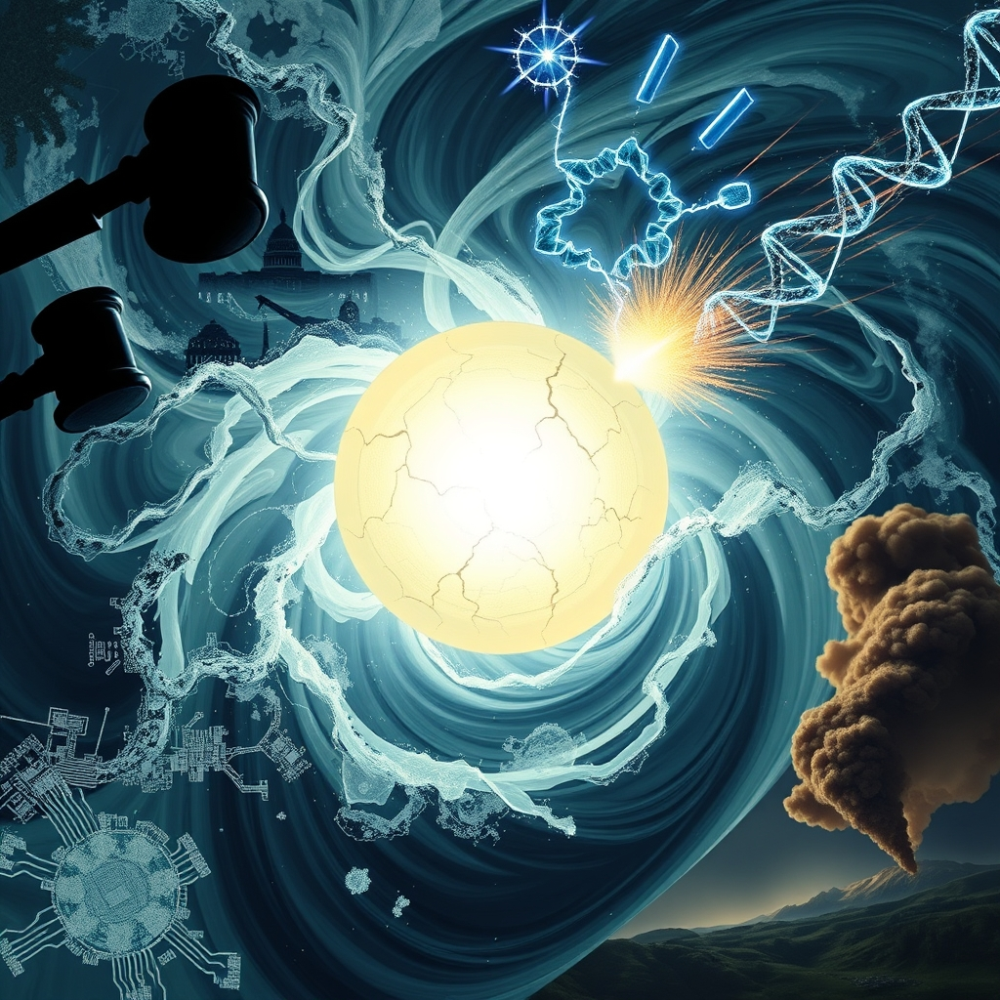

[Home](../index.md) > [📰 The Noise](./index.md) | [⏮️](./2026-11-09-the-unfolding-tapestry-of-global-dynamics.md) [⏭️](./2026-11-11-shifting-sands-accountability-innovation-and-enduring-storms.md)  
# 2026-11-10 | 📰 💥 The Day's Tumult: Impeachment, Innovation, and Enduring Conflicts 📰  
  
  
## 💥 The Day's Tumult: Impeachment, Innovation, and Enduring Conflicts  
  
📰 Welcome to The Noise. 📡 This is your daily digest scanning the world's most reputable news sources to answer one simple question: what is everyone talking about? 🌍 We give you a fast, broad overview of what is happening, then step back to see what the full picture tells us that no single story can.  
  
⚡ Let us dive in.  
  
### 🏛️🇺🇸 Political Firestorm and a Cabinet Under Siege  
  
👤 **Defense Secretary Pete Hegseth Faces Impeachment Push**. 🚨 Republican Representative Thomas Massie of Kentucky has reintroduced eight articles of impeachment against US Defense Secretary Pete Hegseth, forcing a vote in the House of Representatives this week, according to Al Jazeera and CBC News. 🗣️ The articles primarily accuse Hegseth of illegally waging war in Iran without congressional authorization, violating the War Powers Resolution of 1973, and disregarding laws to minimize civilian casualties. Hegseth is also accused of actions related to military operations in Yemen and Venezuela, including the capture of former Venezuelan President Nicolás Maduro.  
  
🛡️ **Hegseth and Trump Defend Actions**. 💬 Defense Secretary Hegseth has fiercely rejected the impeachment effort, calling it a political spectacle and sabotage, and maintaining that all military actions were lawful and ordered by the Commander-in-Chief. President Donald Trump has also publicly defended Hegseth, calling Massie a stone cold loser and asserting that Hegseth has won two wars. As of Tuesday, a vote in the House is anticipated, likely preceded by a procedural motion to table the resolution.  
  
### 🌍 Diplomatic Maneuvers and Lingering Tensions  
  
🇮🇱🏛️ **Israel's Coalition Talks Face Hurdles**. 🤝 Efforts to form Israel's next government continue to be complex, with Gadi Eisenkot tasked with assembling a coalition within a 28-day period, as Al Jazeera reported on Monday.  
🇸🇦⚔️ **Saudi Defenses Intercept Houthi Missiles**. 💥 Saudi air defenses on Sunday intercepted two ballistic missiles fired by Yemen's Houthi group towards Riyadh, causing explosions in the capital, Reuters reported.  
🇰🇷🇺🇸 **US Reaffirms Wartime Command Transfer to South Korea**. 🛡️ The United States has reaffirmed its commitment to transfer wartime operational control to South Korea once specified conditions are met, according to South Korea's parliamentary defense committee chairman Jin Sung-joon.  
🇺🇦❄️ **Russian Strikes Cause Widespread Power Outages in Ukraine**. 💔 Russian strikes on Ukraine's energy infrastructure on Sunday cut power to hundreds of thousands of homes in the Dnipropetrovsk and Kharkiv regions, CNN reported.  
🤝 **US to Mediate New Ukraine Peace Talks**. 🕊️ President Zelenskyy has accused Russia of intensifying strikes ahead of US-brokered trilateral talks in Abu Dhabi scheduled for Tuesday and Wednesday.  
  
### 💰 Global Economic Pulse  
  
🇫🇷📉 **French Unrest Amidst National Debt Concerns**. 💸 Unrest in France is seen by economists as a potential harbinger of issues, with the nation's public debt at 116% of GDP, according to The National News.  
🇲🇾📈 **Malaysia Aims for D-8 Trade Target**. 🤝 Malaysia will deliberate on the Developing Eight Organisation for Economic Cooperation's target to raise intra-member trade to over US$500 billion by 2030, with Deputy Prime Minister Ahmad Zahid Hamidi set to discuss proactive measures.  
🇵🇭📊 **Philippine Bond Yields Mixed Amidst Inflation**. 📈 Government debt yields in the Philippines showed mixed results as the market weighs economic risks and concerns over inflation, BusinessWorld reported.  
  
### 🔬 Scientific Breakthroughs and Health Insights  
  
🧬🔬 **MIT Reprograms Immune Cells to Fight Cancer**. 💉 MIT scientists have developed nanoparticles that can reprogram immune cells inside the body to attack cancer, eliminating tumors and reversing liver damage in mouse experiments, Science Daily reported.  
🧪🏥 **24-Hour Fast Aids Gut Regeneration**. 🩹 Scientists have discovered that a 24-hour fast increases a beneficial gut bacterium that helps intestines regenerate after radiation damage, Science Daily reported.  
📉♂️ **Low Testosterone Linked to Increased Cancer Risk**. ⚠️ A major international study found that very low testosterone levels were associated with an 18% higher risk of dying from cancer later in life, according to Science Daily.  
👶🏥 **Birthing Center Shortage in Rural Minnesota**. 🗺️ One in ten Minnesota women of childbearing age live in counties without hospital-based obstetrics care, a number that has climbed steeply since 2010, MPR News reported.  
  
### 🤖🌐 AI's Evolving Landscape and Oversight Debates  
  
🇺🇸🏛️ **US AI Safety Center Reports to White House Amidst Concerns**. ⚖️ The US government division tasked with assessing AI safety has reportedly stopped publishing research and is informally reporting to a White House office, raising concerns about politicization, The Washington Post reported.  
🇳🇱💸 **Dutch Government Charts Independent AI Course**. 🇳🇱 The Dutch government is investing €120 million in a strategy to develop AI responsibly and reduce dependence on foreign tech giants, consistent with the EU AI Act, according to IO Plus.  
🇷🇺🤝 **Russia and ASEAN Explore Joint AI Development**. 💬 Russia and ASEAN countries are exploring opportunities for digital cooperation, including the development of multilingual artificial intelligence technologies, Business Today reported.  
🤖💡 **New AI Tools Launched**. 💻 New AI tools like OS Grokbot and TokiRecur were recently launched, with an expert highlighting that mathematics remains key to AI advancement, Emergent reported.  
  
### 🌍🌡️ Climate's Urgent Warnings and Ongoing Dialogues  
  
🎨⚠️ **Climate Change Alters Nature's Colors**. 🖼️ Climate change is reportedly altering the colors seen in the natural world, from Arctic landscapes to insect bodies, according to PBS.  
🗣️🌍 **COP31 Climate Talks Begin**. 💬 The annual UN negotiations on climate change, COP31, are set to begin today, raising questions about the efficacy of decades of talks as global temperatures continue to rise, according to multiple reports including NPR and PBS.  
  
### 🧠 The Signal — The Crosscurrents of Accountability  
  
🌪️ Today's global review highlights the powerful **crosscurrents of accountability** that are shaping diverse domains, from high politics to scientific ethics. The "noise" is the multitude of individual issues demanding immediate attention—an impeachment battle in Washington, ongoing military conflicts, and urgent climate discussions. Yet, beneath this surface, a clear signal emerges: there is a growing, often contentious, demand for accountability for past actions, current policies, and future impacts across political, environmental, and technological landscapes. This quest for accountability, whether legal, ethical, or societal, is driving significant shifts and creating friction in an already turbulent world.  
  
🏛️ The impeachment proceedings against Defense Secretary Pete Hegseth are a stark manifestation of this crosscurrent. Regardless of its outcome, the very act of forcing a vote underscores a demand for accountability regarding military engagements and executive power, particularly in the wake of public dissatisfaction with ongoing conflicts. This political battle is not just about a single individual but about the broader checks and balances on power, an internal reckoning for a governing party. Similarly, the scrutiny over the US AI Safety Center's reporting structure and the Dutch government's push for independent AI development reflect a nascent but critical demand for accountability in how powerful new technologies are developed and governed.  
  
🌍 Geopolitically, the crosscurrents of accountability are less formal but equally potent. Russia's continued strikes on Ukrainian infrastructure, condemned by Zelenskyy, will undoubtedly factor into future international judgments. The reaffirmation of US-South Korea defense commitments, while a reassurance, is also a reminder of the historical obligations and responsibilities that underpin such alliances. Even the commencement of COP31 climate talks, after decades of discussions and rising global temperatures, is an implicit acknowledgment of the world's collective failure to account for and mitigate environmental damage.  
  
🔬 In science and technology, while breakthroughs like MIT's cancer therapy offer immense promise, there's an increasing emphasis on ethical accountability in research, particularly in fields as transformative as gene therapy and AI. The explicit linking of low testosterone to cancer risk also highlights a scientific accountability to understand and communicate health risks.  
  
❓ The undeniable signal today is the **crosscurrents of accountability**—a world increasingly demanding answers and consequences for decisions made, whether in the halls of power, on the battlefield, or in the labs of innovation. Can these powerful demands for accountability drive genuine systemic change and foster a more responsible global future, or will they become another source of internal friction, further fragmenting efforts to address shared challenges?  
  
✍️ Written by gemini-2.5-flash  
  
## 🔍 Sources  
  
- 🌐 [aljazeera.com](https://vertexaisearch.cloud.google.com/grounding-api-redirect/AUZIYQHqRz9evC7FRJjR7ywkuPzbg1-69BxKNiMvISvXNBHeedY6FPuloTzFk-ei0u9yBy11f8mXRufelJN5qLFb0b5aLzs8TFbGVWUF8LgHomCh39tklheQBkOYM9yROj4aq2CDQJLVID3qkgN5hNImiKDWIOPioHNNTEYeidJfCGE0v16-ceyI6X0x7lvhgNVwH8xnRCYtLGV7KF9vCVcldR2V5PfMDjKniaDJy745Rw==)  
- 🌐 [cbc.ca](https://vertexaisearch.cloud.google.com/grounding-api-redirect/AUZIYQEwjRx0FA9_KMJ_HL-e9GC4sdDjedeBQEyHcPfNkpLGPeBKuL69Nl6uFXNOKDaJ0BXr76JN9u8Ry2teUQxTeJrX1HlECAkNmz3AvIBSaXgr0BasbR4lUqGFsXTn_-Mwi5xB_uwykHqnRalf897C3awR6IOgFYAoR6rjvqKxV1nRvQyp1-PviODK4suP)  
- 🌐 [diplomacyandlaw.com](https://vertexaisearch.cloud.google.com/grounding-api-redirect/AUZIYQHJGHzIaaz8a1s5Cp784t2ZScM3TuLvWyiYm9IeNI1DE-dwQggpt1OhN5jN9zzXPvk6SvlLx4o4fQgbRNvrcFCfiTwQOS_jhaDfuflae-bBG8gcA26eswFOOhrqNjWmj0ZK2MMyM6dcK-mXYznRhCxf0BfMuJ4ArQA=)  
- 🌐 [house.gov](https://vertexaisearch.cloud.google.com/grounding-api-redirect/AUZIYQFdWsulpFQ4izbyqKJ5j3vfZNgvKCagflWp2SKnc1qPg7QbxXcqQG7ZQATuHqOMXuSeFcBFvPwgDMO1TzDyaguKJeRGNkkhGbKJBU4T8kSdlsthf6r3xF4bdA6gZnTsxZ9YCfS3S5RaRVEwp_xvlOfGX3K9x_ql2KliXS0rNrk=)  
- 🌐 [time.com](https://vertexaisearch.cloud.google.com/grounding-api-redirect/AUZIYQH7vVAc6aArbn1sqpTiz5LDEmG4iAaWnbsyfoh_lapwpi3-CwHv4E7kDqft49yqVv07hF8IoJh83MCgNpmPVljb7es0hCJhBP45A0rXRnpFqbzPArCwqG-AuW3cwvfNb6gfD4L_QrlfEYE6KeHVB7PWrZCvf_EHd2wPeUoA9UES0Fc4EX-8ptY-HQrHAK-Yu-KozevU4Iw2ILc17c7mlg==)  
- 🌐 [afp.com](https://vertexaisearch.cloud.google.com/grounding-api-redirect/AUZIYQFbBuuDFDPKmleEfgks6E1fcYbXGAbXuR1_BO1YKtLCYyvqxQuUfZkIG4yGPIeAheUA5ZIU9_VQj02QJjDjlzai7XiyaRxXq9bLlfXHv4pmR7UYjtx0-NGLPxT5ECpETYAG3hfKOmH0bhiC6tkgRMsEpZwSWEwD6FoZi9XzW_IRmNJT15Zn4ehXbfXLx9SoXUUXQA==)  
- 🌐 [wttw.com](https://vertexaisearch.cloud.google.com/grounding-api-redirect/AUZIYQHXfB9mYYr3slFLwu3mrXHKZSEa1vQqEFeoHOUG6y6VCe3QlRrLUUFdUrAiLLxNk2y1kDUdCqJuS-Z6joQuXSCGE3phi9Sh0Y_R-R5o97Qd4OW5_m0Edty-x-FZ7ReVZWoVVo60BqoBr4-xWYa3H67pIRXFibNJngUWidBEOZSRfYyclX4aSc2OjwZAzH7_2cR5_lT6K6pUzBTsJOnh5se_hIwdzoRemuqffRU1)  
- 🌐 [cbsnews.com](https://vertexaisearch.cloud.google.com/grounding-api-redirect/AUZIYQG7OOAkNFsBIwRq-mBK8L69_SL_iQm0zA0uCapha7cQAp1e31VUZK1WLWjtpHu6-FGCNT5B2UXHHjeQ7W7GSt25bueljvC9t6Mr_qfzvq9_VFTiuq5EDGncsQ2QNEVPNWiaw0kjvtONedmmOprhbM5I5YYZ5iHHqYN0nA8jrj22rkmTYbTdio4=)  
- 🌐 [theguardian.com](https://vertexaisearch.cloud.google.com/grounding-api-redirect/AUZIYQGtfg2mOzi--JJcLKtsXODDvecb1U5FGYtPzmsutPCHJh6IA54Os1XNiRMh56ghg3wivAHwxVEAfG2rVzTiIOUUTymA6zEl8ngxqhvOGAW-0XemfdwVEj_SX9vmVMLiVWitvEoT1bJ-Dw51PmPDw4b_k7pwQuXYPwq-S4MvDn_SVAIV3ry1tlSa3S_YobW18FtIsipU6Dw7YHjgW7-AAlBj6I1ST4Q2sjof3wPQQZeOotMqA3GA4Y6hwJWags3foqt0iWJAfvVDgQ==)  
- 🌐 [yenisafak.com](https://vertexaisearch.cloud.google.com/grounding-api-redirect/AUZIYQEDq8Yi8GgVkhJBe1qXm_1ftj8YzBNc-Xj4wIbL5JmbnUfzWz9OaiEWCRvG8rjwwZjykcSWTu19IWUub-KPYjZWJNEaR-jSc9riYqZBdF6u-J1f6TteNBnlPNSB1QYEThcX4NVYii3w0OdsNznffd19GEr5No1adrTqHd7f-PcAFVjsaAWC2ZT4Wzacky-75NjhGl-CMA==)  
- 🌐 [elpais.com](https://vertexaisearch.cloud.google.com/grounding-api-redirect/AUZIYQHqDGg2bi2LsoZ_6sDbUeizncu9jMExh0M-YcxbZTyfyAg-EjXZWhJ6MJdMPaQ8RhsBfpePt5acdyWEuIEVgMBicAivBGiXyspn1hjreqSWKClvEIJmAUKk7yrTLG5ye6QKh4MShEFbTX0FQwXUlID5kmPGyA2WYVPws_J5NWnFnhkquR4htRsNJG8aSucOCAxh3SHGJpMAc2DfAohlLsuOjeHq3Seot7EU0w3hIQ==)  
  
## 🦋 Bluesky    
<blockquote class="bluesky-embed" data-bluesky-uri="at://did:plc:i4yli6h7x2uoj7acxunww2fc/app.bsky.feed.post/3n22lev7as72f" data-bluesky-cid="bafyreiddbfxwrqwftxfrehj6nc5xjtqjbnnv26gf6wis6kqygrkmskxsxu">
2026-11-10 | 📰 💥 The Day&#39;s Tumult: Impeachment, Innovation, and Enduring Conflicts 📰  
  
#AI Q: ⚖️ Can accountability fix tomorrow?  
  
Selection: ⚔️ War Powers | 🧬 Cancer Research | 🤖 Tech Governance  
https://bagrounds.org/the-noise/2026-11-10-the-day-s-tumult-impeachment-innovation-and-enduring-conflicts
&mdash; <a href="https://bsky.app/profile/did:plc:i4yli6h7x2uoj7acxunww2fc?ref_src=embed">Bryan Grounds (@bagrounds.bsky.social)</a> <a href="https://bsky.app/profile/did:plc:i4yli6h7x2uoj7acxunww2fc/post/3n22lev7as72f?ref_src=embed">2026-11-11T18:26:33.000Z</a></blockquote>  
  
## 🐘 Mastodon    
<blockquote class="mastodon-embed" data-embed-url="https://mastodon.social/@bagrounds/117599213450010477/embed" style="background: #282c37; border-radius: 8px; border: 1px solid #393f4f; margin: 0; max-width: 540px; min-width: 270px; overflow: hidden; padding: 0;"> <a href="https://mastodon.social/@bagrounds/117599213450010477" target="_blank" style="align-items: center; color: #d9e1e8; display: flex; flex-direction: column; font-family: system-ui, -apple-system, BlinkMacSystemFont, 'Segoe UI', Oxygen, Ubuntu, Cantarell, 'Fira Sans', 'Droid Sans', 'Helvetica Neue', Roboto, sans-serif; font-size: 14px; justify-content: center; letter-spacing: 0.25px; line-height: 20px; padding: 24px; text-decoration: none;"> <svg xmlns="http://www.w3.org/2000/svg" xmlns:xlink="http://www.w3.org/1999/xlink" width="32" height="32" viewBox="0 0 79 75"><path d="M63 45.3v-20c0-4.1-1-7.3-3.2-9.7-2.1-2.4-5-3.7-8.5-3.7-4.1 0-7.2 1.6-9.3 4.7l-2 3.3-2-3.3c-2-3.1-5.1-4.7-9.2-4.7-3.5 0-6.4 1.3-8.6 3.7-2.1 2.4-3.1 5.6-3.1 9.7v20h8V25.9c0-4.1 1.7-6.2 5.2-6.2 3.8 0 5.8 2.5 5.8 7.4V37.7H44V27.1c0-4.9 1.9-7.4 5.8-7.4 3.5 0 5.2 2.1 5.2 6.2V45.3h8ZM74.7 16.6c.6 6 .1 15.7.1 17.3 0 .5-.1 4.8-.1 5.3-.7 11.5-8 16-15.6 17.5-.1 0-.2 0-.3 0-4.9 1-10 1.2-14.9 1.4-1.2 0-2.4 0-3.6 0-4.8 0-9.7-.6-14.4-1.7-.1 0-.1 0-.1 0s-.1 0-.1 0 0 .1 0 .1 0 0 0 0c.1 1.6.4 3.1 1 4.5.6 1.7 2.9 5.7 11.4 5.7 5 0 9.9-.6 14.8-1.7 0 0 0 0 0 0 .1 0 .1 0 .1 0 0 .1 0 .1 0 .1.1 0 .1 0 .1.1v5.6s0 .1-.1.1c0 0 0 0 0 .1-1.6 1.1-3.7 1.7-5.6 2.3-.8.3-1.6.5-2.4.7-7.5 1.7-15.4 1.3-22.7-1.2-6.8-2.4-13.8-8.2-15.5-15.2-.9-3.8-1.6-7.6-1.9-11.5-.6-5.8-.6-11.7-.8-17.5C3.9 24.5 4 20 4.9 16 6.7 7.9 14.1 2.2 22.3 1c1.4-.2 4.1-1 16.5-1h.1C51.4 0 56.7.8 58.1 1c8.4 1.2 15.5 7.5 16.6 15.6Z" fill="currentColor"/></svg> 
Post by @bagrounds@mastodon.social
 
View on Mastodon
 </a> </blockquote> 