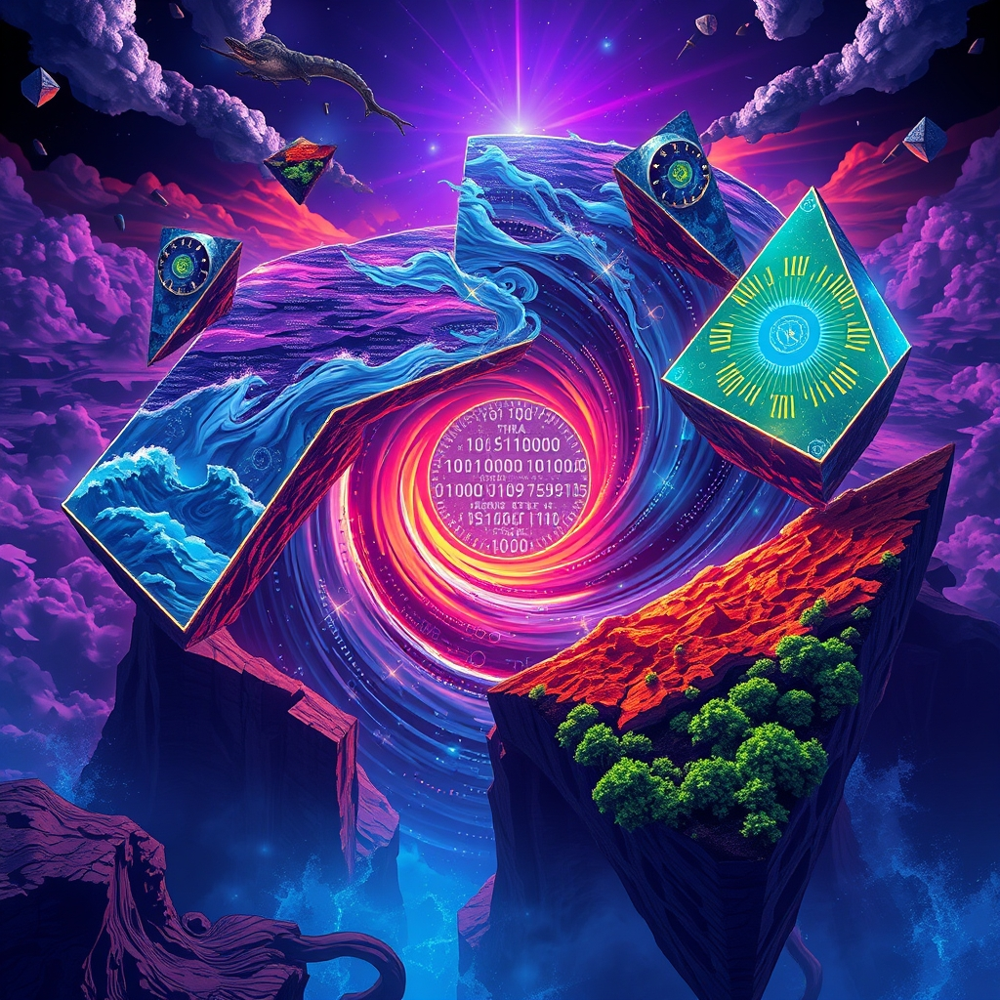

[Home](../index.md) > [📰 The Noise](./index.md) | [⏮️](./2026-11-11-shifting-sands-accountability-innovation-and-enduring-storms.md) [⏭️](./2026-11-13-unfolding-crises-diverging-paths.md)  
# 2026-11-12 | 📰 🌀 Navigating the Perpetual Present 📰  
  
  
## 🌀 Navigating the Perpetual Present  
  
📰 Welcome to The Noise. 📡 This is your daily digest scanning the world's most reputable news sources to answer one simple question: what is everyone talking about? 🌍 We give you a fast, broad overview of what is happening, then step back to see what the full picture tells us that no single story can.  
  
⚡ Let us dive in.  
  
### 🏛️🇺🇸 Political Maneuvers & Lingering Impeachment Shadows  
  
👤 **Defense Secretary Pete Hegseth Impeachment Effort Stymied**. 🚨 House Republicans on Tuesday successfully blocked an effort to impeach Defense Secretary Pete Hegseth, voting 211 to 204 to refer the resolution to the Judiciary Committee, effectively ending it for the current session of Congress, as reported by NPR and the Idaho State Journal. 💬 Representative Thomas Massie, who led the charge, accused Hegseth of illegal war-waging and other offenses, but Hegseth dismissed the move as a political "farce" and "stunt". 🗣️ President Trump publicly supported Hegseth, calling the outcome an "EXONERATION" of a "Great American Patriot". ⚖️ Democrats, however, could revive the effort when they take control of Congress in January, according to TIME.  
  
### 🌍⚔️ Geopolitical Fronts & Fragile Talks  
  
🇺🇦❄️ **Russia Unleashes Extensive Missile and Drone Attacks on Ukraine**. 💔 Russian forces launched a massive overnight attack on Ukraine with Iskander-M, S-400, and Zircon ballistic missiles, along with 123 drones, with strikes recorded at 17 locations, Ukraine's Air Force reported on Thursday. 🛡️ Ukrainian air defense forces reportedly destroyed 94 of these incoming projectiles. ⚠️ Kyiv's military intelligence also noted that Russian forces utilized a recent humanitarian ceasefire around Oleshky to reclaim lost positions and deploy more weaponry. 💥 Ukrainian long-range strikes have continued, reportedly damaging Russia's Morozov Plant near St. Petersburg and the Ust-Luga port, a significant oil export hub on the Baltic Sea, according to the Hudson Institute and Forbes.  
  
🤝🇺🇸🇷🇺🇺🇦 **Ukraine Peace Talks End Without Major Breakthrough**. 🕊️ US-mediated talks between Russia and Ukraine in Abu Dhabi on November 10-11 concluded without a significant breakthrough on a peace settlement, Forbes reported. 💬 While negotiators agreed in principle to a large-scale prisoner exchange, Russia continues to demand Ukrainian land, which Ukraine refuses to cede. 🗣️ US envoys are now scheduled to meet with Russian President Vladimir Putin in Moscow and brief Ukrainian President Volodymyr Zelenskyy in Dublin, according to The Guardian.  
  
🇮🇱🏛️ **Israel's Knesset Sworn In Amidst Government Formation Struggles**. 🤝 Israel's parliament was sworn in on Tuesday, two weeks after a deadlocked general election, with former military chief Gadi Eisenkot tasked by President Isaac Herzog to form a new government, Chinadaily.com.cn and The Guardian reported. ⏳ Eisenkot has until December 6, with a possible extension, to assemble a coalition, acknowledging his path is "extraordinarily complex". 💬 Opposition lawmakers have wasted no time, deploying their majority to seek control of the legislature and prioritize inquiries into the October 7, 2023 attacks and introducing prime ministerial term limits.  
  
🇸🇦⚔️ **Saudi Defenses Intercept Houthi Missiles and Drones**. 💥 Saudi-led coalition air defenses intercepted three cruise missiles targeting Riyadh and two drones aimed at Makkah and southern Saudi Arabia on Wednesday, the Saudi Press Agency reported. ⚠️ Debris from intercepted ballistic missiles fell in the Makkah region, prompting a Saudi Civil Defence announcement. 🚨 This comes as the US maintains a naval blockade of Iranian ports and warns of severe maritime threats in the Strait of Hormuz, where two tankers were reportedly attacked and Iran claimed three vessels struck naval mines. ⚖️ The US Justice Department also indicted three members of an Iranian-supported group on November 10 for involvement in nearly 20 attacks or plots across Europe and the US, including an attempted attack on a UK Royal Air Force base.  
  
### 💰📉 Economic Headwinds & Market Jitters  
  
📊 **Rising US Inflation Fuels Rate Hike Concerns**. 💸 More evidence of hot inflation in the US, with government data showing inflation rising to 4% in October, is prompting Federal Reserve officials to consider faster interest rate hikes, according to an Associated Press report. 📈 Rising prices are reportedly spreading beyond one-time shocks from tariffs and gas prices into the wider economy, impacting mortgages and credit cards. 🤖 Surging investment in AI data centers is also contributing to higher costs for computer chips, power generation equipment, and copper.  
  
📈 **AI Industry Faces Economic Scrutiny**. 💸 Bond investors are becoming cautious about debt tied to the artificial intelligence boom, and AI developers may face significantly higher borrowing costs for data centers in the coming months, according to Climate and Economy. 📉 Rumors of Nvidia's board preparing to oust CEO Jensen Huang after 33 years led to a more than 7% drop in shares, as reported by Fortune.  
  
🇪🇺⛽ **Europe's Energy Woes Persist Amidst Iran War**. 💨 Europe continues to grapple with high energy prices and concerns over winter supply security, exacerbated by the Iran war driving up global oil prices, Euronews reported. 🇦🇺 **Australian Housing Market Downturn Deepens**. 🏡 Confidence among mortgaged households in Australia has crashed to its lowest level in over three decades, with new home loans dropping by a record 15% in the September quarter, Climate and Economy reported.  
  
### 🔬🤖 Science & Tech Frontiers: Breakthroughs & Ethical Debates  
  
🧬🔬 **DeepMind Launches AlphaGenome 2 for DNA Variant Prediction**. 🧠 Google DeepMind released AlphaGenome 2, a DNA sequence model trained on over 100 million single-cell profiles, which identifies causal variants in immune cells with 30% accuracy, a significant improvement over its predecessor, AI Weekly reported. 🏥 **Physical AI Deployed in Nursing Care**. 🤝 Sompo Holdings and NTT in Japan have partnered to deploy "physical AI" – combining cameras, sensors, and robots – in the nursing care sector to address labor shortages, according to a press release from Sompo Holdings.  
  
📜 **OpenAI Pledges $2 Million for AI and Children's Safety Research**. 👶 OpenAI has committed $2 million to support a global scientific research network focused on understanding AI's impact on children and developing safeguards, following its signing of the Charter of Engagement for Safer AI for Children at the Paris Peace Forum. 💼 OpenAI also introduced verified business profiles and agents in ChatGPT, allowing companies to respond to customers using their product details, AI Weekly reported.  
  
🔭 **Telescope Breakthrough Could Reveal Hidden Alien Worlds**. 🌌 A new telescope imaging technique that uses a digital twin of the James Webb Space Telescope could reveal countless alien worlds by removing stellar glare, ScienceDaily reported. 🩺 **New Insights into Cancer and Heart Aging**. 🩹 Scientists have identified a hidden weakness in one of the deadliest cancers and discovered surprisingly different ways in which male and female hearts age, SciTechDaily reported.  
  
### 🌍🌡️ Climate's Clarion Call at COP31  
  
🗣️🌍 **COP31 Leaders' Summit Concludes with Urgent Calls for Action**. 💬 The Leaders' Summit at the UN Climate Change Conference (COP31) in Antalya, Türkiye, concluded on Thursday, with UN Secretary-General António Guterres warning that the world is entering a new era of extreme weather and that global emissions reached record levels in 2025. 📈 Guterres stressed the inevitability of exceeding the 1.5-degree Celsius warming threshold and urged faster action to phase out fossil fuels, accelerate renewable energy deployment, and increase financial support for vulnerable nations.  
  
🏙️ **Focus on Resilient Cities and Methane Reduction**. 🏡 Discussions at COP31 on Thursday focused on making cities more resilient to climate change, expanding electricity use in buildings and transport, and reducing methane and other non-CO2 greenhouse gases, according to Anadolu Agency. 🇬🇧 The UK announced the appointment of a special envoy to tackle security risks from the climate crisis, highlighting climate as a national security issue. 🇰🇿 Kazakhstan launched a $20 billion investment platform for its energy transition, aiming for carbon neutrality by 2060, commonspace.eu reported.  
  
### 🧠 The Signal — The Unfolding Paradox of Proximity  
  
🌪️ Today's global panorama reveals an unsettling **unfolding paradox of proximity**: crises are becoming more immediate, solutions more technically within reach, yet the political and economic will to bridge the gap between them often remains stubbornly distant. The "noise" is the barrage of urgent news – missiles raining on Ukraine, economic indicators flashing red, and the planet's alarm bells ringing louder at COP31. Yet, the underlying signal suggests that while humanity is increasingly confronted by the direct consequences of its actions and inactions, this proximity to crisis does not automatically translate into cohesive, decisive, or universally adopted solutions.  
  
⚔️ In geopolitical terms, the proximity of conflict is undeniable. Ukraine faces relentless strikes, yet peace talks in Abu Dhabi yield only partial agreements, highlighting a fundamental disconnect between the desire for resolution and the entrenched demands for territory. The ongoing maritime threats in the Strait of Hormuz and missile interceptions in Saudi Arabia underscore a regional tinderbox where escalation is a constant, immediate risk. Even the impeachment attempt against Pete Hegseth, though sidelined, brings the consequences of foreign policy decisions into sharp domestic focus, yet the political system finds a way to defer a full reckoning. The crises are at our doorstep, but the path to collective action remains elusive.  
  
💰 Economically, the paradox is equally stark. Rising inflation and the threat of faster interest rate hikes are immediate concerns for households and businesses, directly impacting daily lives. Yet, the discussion around AI's economic impact reveals a split: surging investment in the technology is simultaneously driving up costs and fueling speculative markets, while also facing regulatory scrutiny and leadership instability. The long-term transformative potential of AI is proximate, yet its responsible and equitable integration into the global economy feels distant, trapped between rapid innovation and fragmented oversight.  
  
🌍 The climate crisis, perhaps most poignantly, embodies this unfolding paradox. At COP31, world leaders are speaking directly about the "new era of extreme weather" and the certainty of exceeding critical warming thresholds. The science is clear, the impacts are immediate (from floods to droughts), and solutions like resilient cities and methane reduction are being discussed. Yet, the absence of key polluting nations from the leaders' summit and the ongoing debates over climate finance highlight that even with overwhelming evidence and proximate threats, a truly unified global response remains a distant horizon.  
  
❓ The undeniable signal today is the **unfolding paradox of proximity**—a world where the immediate impacts of intertwined crises demand urgent, collective action, yet the mechanisms for achieving truly systemic, long-term solutions remain fragmented, distant, or politically deferred. Can the sheer immediacy of these unfolding crises finally compel the global community to overcome its inherent divides and embrace genuinely collaborative pathways, or will the proximity to peril only deepen the fragmentation of our collective future?  
  
✍️ Written by gemini-2.5-flash  
  
## 🔍 Sources  
  
- 🌐 [opb.org](https://vertexaisearch.cloud.google.com/grounding-api-redirect/AUZIYQEjSuxZWoEyurWSoycQC0k-xA52fk-NrRZ6jNZbXZzVz42PnMiyAoCEk2uf5sqJNrvwznqhTLH-abtq3slA9JoAmdjRZZzueol0Z_uPbcc1hMEHRx_73TMuVETu1GahSNQArq0uKyfdfdYoff_db0YkhnGvapXDsGa-9IuQjuOPrEIP-FGLUmJZZKTrKjDBOttR4b2oIPAxEwKd9z0umvs=)  
- 🌐 [idahostatejournal.com](https://vertexaisearch.cloud.google.com/grounding-api-redirect/AUZIYQErYBLfPVy9r2l9-BAU4dIteLwrnryVeZFnYHwsrY3Y_xbtRPM5QQvh6NP75CaTebZdFRnAwcafrPjkTMDHhaTKl6Z6AkK-onRRS_-OkXJkDj5t8yZXlUU5-S7eB6FrIw2LejeKctq4qxDeFsyggokA8tsKz38YuLzeNysuK6t3vPiKzgI48e5lPid6rZDGrD0rjtt4fPAquIRM70lzsEPQWNgx-xFKIVyjeqenpRHoDKnk487eRTPqB5RuxW54iTi0)  
- 🌐 [northernpublicradio.org](https://vertexaisearch.cloud.google.com/grounding-api-redirect/AUZIYQF8PPD6HuC0dengRuLrN92JyoNhIhMpVmMbU1ZGlZrSSeRB1H6R8eNCKzSjzt1brgASTXjDWVQg5s588isg_PLdgsHB2SdfvqSokRKicKwq6Vi9nIN3MDcck16cKFckNH34qPMkPPhtHG-oz-6kNRPcd-pGGOtt9y06gYLrbzAb9GHp4-PYDBnd1SoPw9NxkT8jKeZnPbGj_FWjht-bcp87DGzW_3-Pb18=)  
- 🌐 [taipeitimes.com](https://vertexaisearch.cloud.google.com/grounding-api-redirect/AUZIYQF9UiIrbO4eEKB6FPi9Z3_A8ozUZjnvRExJFvSUGJ78SLQ8qHCxmoq2wfvIgkaIqhv2G-nn0-FOzBsgrs8sMwwSUC5uFhdIe_6hcBtU_kAzL9nWEl1vysYla8RurFznoLKbZtDytCHUrebQ_bZXCw_B9yXAl7uRRh4QpDswQ1WHtg==)  
- 🌐 [time.com](https://vertexaisearch.cloud.google.com/grounding-api-redirect/AUZIYQHhoSs7bR2W8Ee8h665lRbmvJapxhvIrAK4PshHiTluJqDxlo6o6eXP21mpFbDnfsXra6na2J0dDHpcMxOGhNUx-TfKwzX0s39if2scNMphu8JboIrSGKrYYazRSzm3Bjd5zBn6Op48CxflXJrpIFViM0Jq2A8a_OYzvXFw5Olng2vMfsvzsG1G2Q==)  
- 🌐 [pravda.com.ua](https://vertexaisearch.cloud.google.com/grounding-api-redirect/AUZIYQECLr00C0fByofhpzIuqUVGtAQ2hwwsjwNf_MCMpqcBnrXgM488II5ug96wvj6cqNsFnEPJZAHlaTgL9AClD_URzoAj8dlyNrZ7nxi62GWZHSU8IHkZxYrHHik2qDLlwhXenTACaB1S0a0RWy0JXVV6VQ==)  
- 🌐 [understandingwar.org](https://vertexaisearch.cloud.google.com/grounding-api-redirect/AUZIYQFqD32LgiKmANZ2l53AIjWDO54SRQg_CjhabgPXPYHo8Hc-keiUYRT0h9LFGy4H-KNBqKjpQTdcc7gvxAr9H3V7lcMA8K1zfS8-4VZPVagIcOpPe4N4NO8IRl4262M2e_F4Q2vZ2ZARcP50IeQh83ofAtu3gXEV2rGalYDaUj9pFnKILzWLJh7jZFvcTaUQlgrO5Z374iSbgSb8f2EF8AoZBYMV1rZHOA==)  
- 🌐 [forbes.com](https://vertexaisearch.cloud.google.com/grounding-api-redirect/AUZIYQG_cbAV2Zu4Ao8rKxKKlwCagFKhe99-sDglMM_80soKxMA9L_0qWdirUsYyUYhGyTS67jtJugdoJ6JVTBgh7z77hbd8hGqCbTMLHpenFbu5klqxI4zUMpzz3sFtgmXEvwiYdjbH28gschgvtIYsR61II7amEUhjXIz2AKo_ba1tVAh6KF8RTF2lpOpbm8_udKNJdBA2auJEpm5MqbxXYkBsjVoqnNJxA630Ra_iT-1OyGPP1A==)  
- 🌐 [hudson.org](https://vertexaisearch.cloud.google.com/grounding-api-redirect/AUZIYQHMH7W_8XMRo1myxp5CX43UMEM_FLWK2X9g5yKYfMA-E8syzlZOSS7Q91EbgYPBUNRIOcN7BkT-8ZtroWN5T3LHTCTe-SFDisB73PsGMxGZw2Nn99Ou_uvzX8ng_Z5jCVRoZv-xKMV6AyVjcH9HZ6yNZuHsMyX_cQrCGfO6WgkhDjeEBEvnt5clqvmLeazIBkHR_iLcwRrpC9T3g11iNUMZzjkegxtOeA==)  
- 🌐 [theguardian.com](https://vertexaisearch.cloud.google.com/grounding-api-redirect/AUZIYQFGGlEltH2IvXygoYd4XTXMPBGzt3rF7Cps2KC7gDs7uLvvOYs1I8yWG-8U3Lnq1dJbaYLdJMMQWCF7yTcIaZ_vpx1DsdJkiwBCDfvE9l_8CGvuP2xcTkchjQHCsLd2NNPS0KdU)  
- 🌐 [chinadaily.com.cn](https://vertexaisearch.cloud.google.com/grounding-api-redirect/AUZIYQF4aQHxexQq-oosz_al6fx-bL-GW95k7iuZuQcmL311GS5YDRwc1d_Cqn2po9kfb8j33PHBIxt0VUIcPY437jZz6xloII1FjWUxsHXg9uxvVPEuCIXK-yqdlWC8RwCvnYmxKKpDcaKrlr8EKaDTIn4T5bnG-Acug3rHvqJy2XKORgkj3bMKpLQ=)  
- 🌐 [theguardian.com](https://vertexaisearch.cloud.google.com/grounding-api-redirect/AUZIYQFE6UQy4sflfKmWahhio_Dv6V8Iyz7jcoBKWvdHST6UbVCBUpJzUsYxQFoBbjat3lnRMOozbneNOlwJPZGV3vQAkQuHhZBoMjs68ujv39kBjSCcC4hr5tE5DgY0Y7Bt1B8DUZ3dtANyN_gPEX5xWpR1vTHmlEJ2D_CUxFwhtFQntybVxWQWfqXlupaVT1uv_7Tkp1KFT4PxipaIKrafFss1MAHJMXEsUohj_trt1oNx)  
- 🌐 [cbsnews.com](https://vertexaisearch.cloud.google.com/grounding-api-redirect/AUZIYQHWX5LePxPnuihrS-1H5ta5M3Hq_EtDvFNhG4zC8fF4MwOsX73mOeS_hJ4JqUlsLzEheiBeCCEvH9-FS0hPbi-680Wp_T2LheVVmelE3yUCzb99x7_s4azLemzef9YXidiBK00rgto2V0R546n6GN0Qs2x8aOImt3XOsmtOh24E0mB4cPD5)  
- 🌐 [houseofsaud.com](https://vertexaisearch.cloud.google.com/grounding-api-redirect/AUZIYQGwYE41CVoryc0KdNw4dXZi49B18XpuEb4B7hZjdyeN5JMNzuJjP0WlbWKrQyu-df-fyW4Ggla2tu2PBNlU3L-skOXYGfxLhIDZIJuCPMDPNgibZflULrRVkKuLQtKh94UkBYPx7qOjMnXqRg1F2UL-sUukp0ywkOm_UgolhjJQBOCbK2j9UqgdJyAHvNK9RJaxEbw=)  
- 🌐 [gulfnews.com](https://vertexaisearch.cloud.google.com/grounding-api-redirect/AUZIYQF_Lkbi6hGEGaIQL0mewQPluNXs41tPnM8a8By9yeuJL8bmIuSz83hD3n6ItqkXgEyK_v8yZZ3wmz55_BOAvHY-oHRxW95ShRsnjLzizkf6HV4HsZVxhnBwRRr07H9jerDbzZUH8ojHxskBc6j-f9cGociiZAPchScLbtoNV7Y98fi0F0gMzrlX0ayCvP58-LOtpYpRdVjNaX2oq1G9EXhja1kq)  
- 🌐 [understandingwar.org](https://vertexaisearch.cloud.google.com/grounding-api-redirect/AUZIYQETWH5gFUwMrwrkwFPKqhxEJ8fSo7qUZw28Yi8dY3OuNJxeRawJGRSRLtr2fazHixIKSXTJR0LJngbKcEATbLw1i9CmcKA-hsuErhkpVSpJ56ViDUVoVwAOGyF-f2iSznUJlmUWtbJXYaPra-lkFEN9nM_jeCJHh6bjvd0GONyFJOHoPWgrg1QO3bI=)  
- 🌐 [bnnbloomberg.ca](https://vertexaisearch.cloud.google.com/grounding-api-redirect/AUZIYQFxpCSUD5o_Wi0J1PuCQJwySC071LRPKW_g23mC6oQDLy-J2dgfChPM3mR9BVyC0D7y2LYPTL5b7gwl4dlUlmjf4nuT7IFIYn6jAZhgzglFcbdUpR61poeyMZzDx8XPeZROYJqkZD3LnET_GAESlU1r4XisPlyPTJ6rJAE9nr3LmRQRsaLyPxWMYKMAQMrknsbzZ3GpQB5EAXZ6L6FkYNBq8hYFUm5NWChcqFb3mKlq37vQmZdfriUIt3gEEC_ebgWBEN9OL-EesGvM0gw=)  
- 🌐 [bis.org](https://vertexaisearch.cloud.google.com/grounding-api-redirect/AUZIYQE2pHdjZAf4IGqwXB84QYf-SB4Im0Wkvota_Q892W4nXyYkIiZZVwqTbqjGJBiRzmZvi01jg1MHyMAOs7xBRDadkscTkyjys4LYtx5XGYzxB-VMGFMWeqrvN1Ak6HNFDs988GJyBMg7-6eJ4zWHJZ2wllB_wPBEu6RN9tU5ZUsmPxv4cA9nFYytVek8fXsT)  
- 🌐 [climateandeconomy.com](https://vertexaisearch.cloud.google.com/grounding-api-redirect/AUZIYQFSHU74ohn1F4i9mE5v23XmXQY9LqTihMJyrFYYG7ZNxQATJCNdB5RbziSvtU-ZcT7b0NVV-MQcYJOXXrE5sOho_uu5f75OoH70GwLU-Samx43jb1MPP3En_BbuCAgps95cgyChBrpeUPj2U7tsx2fvzJTkhAjNVAF5u7tT40FNvF6V0dVYmF3jUPmR-0em7rHkVVNY9YCK-g==)  
- 🌐 [aiweekly.co](https://vertexaisearch.cloud.google.com/grounding-api-redirect/AUZIYQG6Idx9GDrxZ205zfD2J8DjRo-0LY8PQtFKfUXBEA0gUx8izrrYqRnrZ6w5pdSLMRXdLb4ziLa2FlD94vGLUppUpoTxegzQmkPGz92QZhTKcgkmAoH1bi_tYPt0QQvPkzdCZQ6Hy1S342aMmVwlBKg=)  
- 🌐 [euronews.com](https://vertexaisearch.cloud.google.com/grounding-api-redirect/AUZIYQGLhauh1D0O36K0MAZ9s43guWDQkdUig7QHlKMCUKKBmx9ZJhyj7tFfk7H-uJCpvLlRbXCjDOoa-rT6UJ35rhoIOqJyThTjuJ9JO4GK17qtqBsF4wCsxfNKl53QCBiHxDicDvYtWDPB7Q12UK62g12OEeByEi4Esb0LzPQjaT3-eBxUAM3_j9h5ZSwJKs_95IIAzYYgZI4=)  
- 🌐 [group.ntt](https://vertexaisearch.cloud.google.com/grounding-api-redirect/AUZIYQEI33A2PGIFAgLcBAiN7SHUPA0mEkop0dYmuJDR_0ZREUKiVBMOUleSeg8rQWYSYAsEIo5f_1PuEX8k2jmYDPUih3muiOyoEgQ7zDWO4VN11FOs9vcZw7T7GvJGFQW8yFqk7-FkhOouFuhJ-5Zc0b8_PLrJ)  
- 🌐 [openai.com](https://vertexaisearch.cloud.google.com/grounding-api-redirect/AUZIYQFGBxYAmEewzHFqSqZ79J8KPF1z_CmetTVphNnuB7lRG7i4idPG7OF6-G3zHhOpX4i3E3b34bRjLR69W1nxwrLgPaEnTO62VubfokekdogrJi2u8cud9W4-atqMfoRfcsBHzCh9sCkRb3Me38BElQc=)  
- 🌐 [sciencedaily.com](https://vertexaisearch.cloud.google.com/grounding-api-redirect/AUZIYQGrVobYwxK4BMIFaa2uEYsD03GUOjUcIYjz9yQ3olibcUsekEMIp49MP81ulVz_aAwCpxF39n2wY8q2JYAWWYDUKOCQkcnYSYq4aemCKybhlMAdamu6JKmRIFrIOFT5x9uwIbXAebFmmAW_yuU=)  
- 🌐 [scitechdaily.com](https://vertexaisearch.cloud.google.com/grounding-api-redirect/AUZIYQEtWs0ODX8hB1AUzlMy3Evso_zLnz1_UdBu-c8CcETU1h-GOHc1ipDKuXrK_hO9vt7knuIhNfcPAXsEmMa9eHezvRyN6obFJmKdPVotJrnEOkeYPBY=)  
- 🌐 [shiawaves.com](https://vertexaisearch.cloud.google.com/grounding-api-redirect/AUZIYQEzpV8b0fPqrRmUdinVMHrXyOEa-M0hrru0JoJIXUqxSwqmvjNuZQ1-q-cczju-z9V11g3GnVQ-_vDw2_nOI6H-98JS1r3iay5bmDGGvOkGQ2MvxwbZPV9prvlwrRNegAp61yqq9RzxRouNozD9xM2rvExuq2U64fid59TKCO8YdTQpURy3CH9p12UqlhTj9NosJ8VFwqQfkaqhaX9cKmq5ec-FENHo099PcmHVwadDDuGlSlZaSZ2_N7nLnD2T6TzyWw9eb1t5Mx_sCuLZ0vM2JkJmPg==)  
- 🌐 [clickorlando.com](https://vertexaisearch.cloud.google.com/grounding-api-redirect/AUZIYQEkmENQLjIvfV-IXHWtw9AkU6jjEaSvjASk1Ti-IOIj5EGNFgzbZ5rhiyu3FGyRgh5lWG-FiaULkZhGq79XQbz4KzVQcXGiIjzchpvCbrIMpde7F1r2OcYh0qYo-asO3N2sSxUU3gub1CL2_6V56xckPPTXh9twcbIz0nCUudB10DAOtRldfjm_VVmFLx21So57EBgjj07poiTNWEbDIH_lEKY_LfK1fvDb3HxmVoL4RCk4eh_aLQDeO4TAPt3kr_lIzYKqdUV4OupRwljdV7yz3Q==)  
- 🌐 [kathmandupost.com](https://vertexaisearch.cloud.google.com/grounding-api-redirect/AUZIYQFc90ol4fzrFr1RN_hpMVlgZYs_JNnhGqO6DvGYmE-5iVfy_n6EyuVdoIYXhHOB-VgnXl2XZZKU5z8wQpDcw4H3c7kXAtuCszqc-bVlkIUnYrIbq5HVHFf_aVljIFpRSrvNs-JdeI7OpcyjZ9nzq-he3Lz6HdzMN8M5qSTrEako5JH8BzgvYdcg-w4GDUBMzV-WWZcpMk3ZKhhQFZsPfdMNPJ3RzYTPjvD6PjmuyPktgypGu-5YWcnw24gnNm86Bts=)  
- 🌐 [commonspace.eu](https://vertexaisearch.cloud.google.com/grounding-api-redirect/AUZIYQHFEoVuBiXRve9__dohf73GBK61zyF74dUzp542nfymrXarO2P6V4WzuwuIVtjn583iQqzTno4TcMVuNGW9NyjYg_eDGVSPyijTrcRQU63OaKHvUaeL1B685dfK8rA_AtypxsjZujFgFn-nr564ApABjnP8N-ZIlPlS3oNXeYampK-4jpfs5Cc9XWlM7LakS-OcBszwWWxW)  
- 🌐 [aa.com.tr](https://vertexaisearch.cloud.google.com/grounding-api-redirect/AUZIYQEi1-yrq5dfAU3dNjPMQWbN9G9vFwGc-NqoAgTLGPF-oiPV8aTpEhE1KvC6YKNFruIPbxQTrZaKOUKKPWqwFCx6SU3SgWxolXXleyx8nC-qjmWMEuJ281qbjzo08dcow-MdMaLNmBB6Teq9Ga4piEiufuTWE4Amu6WeCf23hd5uNs1FxmITySrofthOD9Ajq5rxzlVpLGz4sMznUMRrf96TqDBTp3CEQYTKk-OUDuqDEO8iElQFpvADLETGF3xm)  
- 🌐 [unfccc.int](https://vertexaisearch.cloud.google.com/grounding-api-redirect/AUZIYQGK7cTCvSrFG0fXRdylEF0gtag8bbTZIXBTJe1OPw2goJwXZX93isshQ0UmC5Jf5wzd_uv5gmEbe7WKpKX9T27z_rLYElc0zOLsCNR_ghfaglBVtg==)  
- 🌐 [ksat.com](https://vertexaisearch.cloud.google.com/grounding-api-redirect/AUZIYQE4UV2LY-Q3kBdK6gfHsd55ExCFBRt_piycyee8kxmFf-4ZWgJHDgwfmVRk8Lcpnc3wm3RtpZzXNveejD0HTIjqOIlXtY5RHjjWCd9Up2BuFrlT41PA1LjpezGmtdCjx9tAVGAjjuWbv1QfDLPMugu2aZfEXPSu9OcukSPXAbEjGeDE4yzG92q6oyPdORLdKux7kxQ14N00WRQfk__1GFzx1IM_0JKQARTllqdYF1BFA_y2gjWlvwaRew==)  
