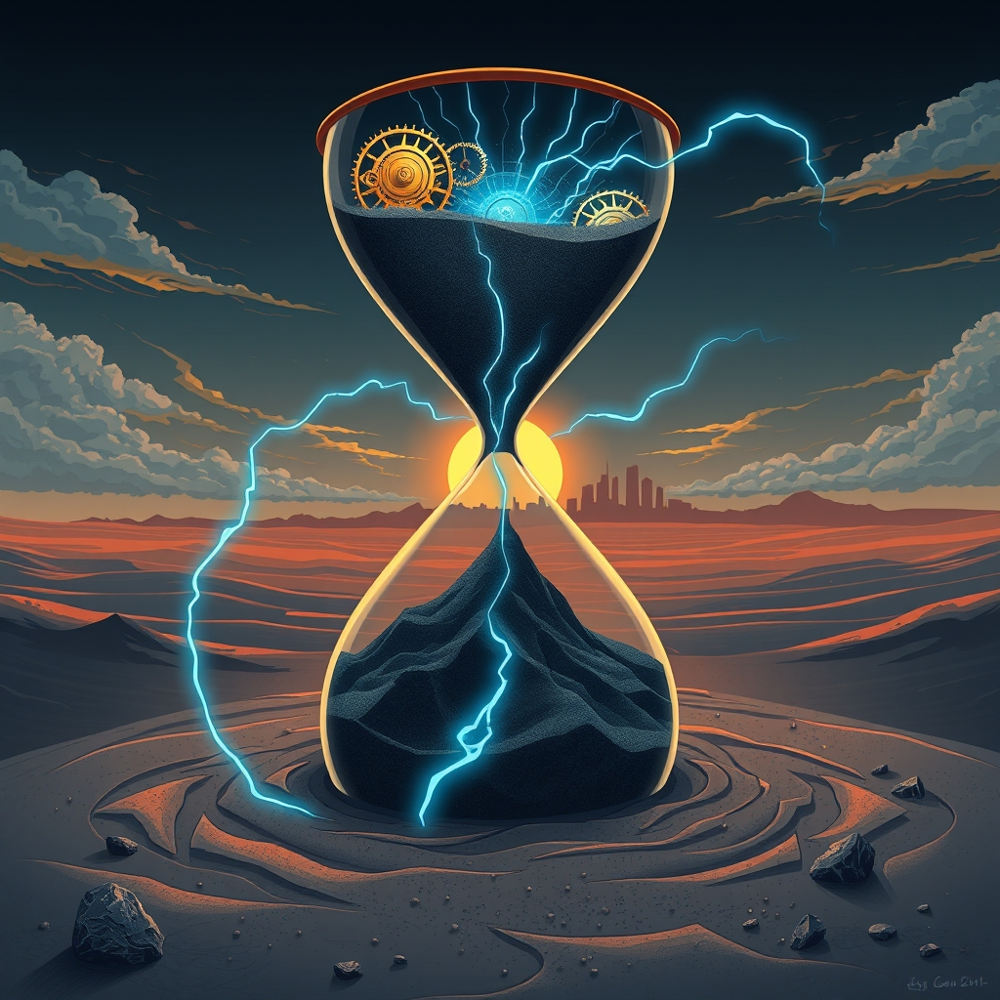

[Home](../index.md) > [📰 The Noise](./index.md) | [⏮️](./2026-11-13-unfolding-crises-diverging-paths.md) [⏭️](./2026-11-15-currents-and-crosscurrents-a-world-in-motion.md)  
# 2026-11-14 | 📰 The Shifting Sands of Power and Progress 📰  
  
  
# 📰 The Shifting Sands of Power and Progress  
  
📰 Welcome to The Noise. 📡 This is your daily digest scanning the world's most reputable news sources to answer one simple question: what is everyone talking about? 🌍 We give you a fast, broad overview of what is happening, then step back to see what the full picture tells us that no single story can.  
  
⚡ Let us dive in.  
  
### 🏛️🇺🇸 Political Echoes and Diplomatic Shifts  
  
🗳️ **U.S. Congressional Leadership Battles Emerge**. 🏛️ House Republicans elected Representative Jim Jordan as their new leader, while Senate Republicans reelected Senator John Thune, according to the Bank Policy Institute. 🗣️ Meanwhile, Senate Democrats face a leadership challenge, with Senator Chris Van Hollen announcing a bid against current Majority Leader Chuck Schumer.  
💬 **Democrats Weigh Post-Midterm Strategy**. 🤝 At a three-day conference in Denver, Democrats, celebrating a sweeping midterm victory that delivered majorities in both chambers, debated whether to prioritize legislative action on affordability or pursue investigations into the previous administration, The Guardian reported.  
🌐 **Trump, Xi, and Putin to Hold Historic Trilateral Meeting**. 🌍 The White House announced that US President Donald Trump, Chinese President Xi Jinping, and Russian President Vladimir Putin will hold their first-ever three-way meeting in Shenzhen, China, next week on the sidelines of the Asia-Pacific Economic Cooperation summit, according to Agence France-Presse. 🗣️ Trump plans to discuss nuclear arsenal reduction and the war in Iran, but not the conflict in Ukraine.  
💸 **US and China Discuss Tariff Reductions**. 📈 China and the US held the inaugural meeting of a new bilateral trade council on Friday, discussing a reciprocal tariff-reduction arrangement covering $30 billion of imports from each side, as reported by The Print and China Daily.  
  
### 💥🌍 Global Hotspots and Humanitarian Appeals  
  
💔 **Ukraine Faces Continued Attacks Amidst Diplomatic Proposals**. 🚨 Russian attacks across Ukraine over the past day killed at least seven civilians and injured 80, with Ukrainian air defenses intercepting 81 of 96 launched drones, according to reports. 🗣️ Ukrainian President Volodymyr Zelenskyy revealed that the United States had, for the first time, suggested Ukraine cede territory in the Donbas region in exchange for NATO membership, a proposal Zelenskyy said he would put to the Ukrainian public if confirmed. 🚫 Russia rejected an energy target ceasefire during recent talks in Abu Dhabi.  
⚠️ **Middle East Tensions Remain Elevated**. 💥 The Middle East conflict remains volatile following a Friday incident where the US military intercepted two Iranian attack drones heading towards Bahrain, Gulf News reported. 🚢 Iran’s Revolutionary Guards Navy claimed two oil tankers exploded and caught fire after striking sea mines in the Strait of Hormuz, a critical shipping lane where traffic remains 65% below pre-war levels according to UKMTO. 🚀 Houthi forces in Yemen also claimed new ballistic missile attacks against Saudi forces in Jazan province and other targets, though Saudi authorities had not confirmed all claims. 🛡️ Iran’s UN ambassador called on the US to end its aggression and lift its maritime blockade, warning of a decisive response to any renewed attacks.  
🚨 **EU Expresses Grave Concern for Gaza Humanitarian Crisis**. 💔 The European Union reiterated its grave concern over the persistent and devastating humanitarian crisis in Gaza, urging Israel to allow immediate and unimpeded access for humanitarian assistance, especially amidst severe flooding and winter conditions.  
  
### 💰📉 Economic Currents and Tech Market Dynamics  
  
🇨🇳 **China's Loans Rise, Fueling Economic Recovery**. 📊 China's yuan-denominated loans rose by 11.42 trillion yuan (approximately $1.7 trillion USD) in the first ten months of 2026, with outstanding loans up 4.7% year-on-year, central bank data showed on Friday. 💡 This growth provided an appropriate monetary and financial environment for economic recovery and upgrading.  
🏡 **US Home Sales Decline, UK Property Outlook Negative**. 📉 US home sales in October fell to their lowest level since 2016, declining 8.8% from a year earlier amidst record-high mortgage rates, while UK property agents expressed the most negative outlook on sales in over three years.  
📉 **Nvidia CEO Jensen Huang Resigns Amidst Controversy**. 👤 Jensen Huang, CEO of Nvidia, abruptly resigned after being implicated in an alleged extramarital affair with a Chinese woman suspected of espionage, raising national security concerns over the diversion of advanced semiconductors to China, The Japan News reported. 💸 Nvidia's stock fell 12.7% over the past week, contributing to volatility in the tech market.  
📈 **Nvidia Dominates AI Market, But Competition Looms**. 💻 Nvidia continues to control over 80% of the AI accelerator market, serving as the infrastructure backbone for the entire AI economy, Emergent reported. ⚔️ However, competition from AMD, Intel, and custom chip designs is expected to gradually reduce Nvidia's market share through late 2026 and into 2027.  
📊 **Cryptocurrency Market Fluctuates**. 📉 Bitcoin experienced a 3% dip, while Avalanche (AVAX) price fell over 5% in 24 hours, erasing recent gains tied to a NYSE announcement about tokenized stock settlement, according to Pluang and The Motley Fool.  
  
### 🔬🧪 Science, Space, and Health Advances  
  
🚀 **SpaceX Starship Completes Orbital Flight, Booster Catch Aborted**. 🌌 SpaceX's Starship completed its 15th test flight on Friday, successfully reaching Earth's orbit and deploying 26 Starlink V3 satellites, but the Super Heavy booster's planned "chopsticks" catch landing was aborted due to a guidance, navigation, and control issue, leading to its controlled splashdown in the Gulf of Mexico, reported CNA and The Hindu. 🌎 The Starship upper stage was on track for its own debut catch landing back at the Texas launch site on Saturday after 14 orbits.  
🔭 **New Dwarf Planet Discovered Beyond Pluto**. 🪐 Astronomers at the University of Washington have uncovered a potentially enormous new icy dwarf planet beyond Pluto, temporarily named 2026 ED138, which could become the solar system's sixth officially recognized dwarf planet, ScienceDaily reported.  
🧠 **Quantum Computing Achieves New Milestones**. 💡 QuiX Quantum, a Dutch-German firm, received a grant to build a 100-plus-qubit photonic quantum computer by 2028, according to Dealroom News. 🔬 The US Department of Commerce also awarded Atom Computing up to $100 million through the CHIPS Act to advance neutral-atom quantum computing hardware. ⚙️ Researchers successfully linked a high-performance classical computer to real quantum hardware to perform power flow calculations, demonstrating a complete route for quantum algorithms, Quantum Zeitgeist reported.  
🔬 **Hidden Brain Signals Predict Alzheimer's**. ⚕️ Stanford Medicine researchers discovered that subtle patterns of brain activity can predict Alzheimer's risk years before memory problems appear, offering potential for earlier warnings and insights into unusually resistant aging brains, ScienceDaily reported.  
☕ **Coffee Waste Transformed into Biofuel**. 🌱 Scientists at Universitat Rovira i Virgili have developed an efficient method to turn used coffee grounds into a potential source of biodiesel and other valuable chemicals, ScienceDaily reported.  
📅 **World Diabetes Day Highlights Insulin Discovery**. 🏥 World Diabetes Day, observed on November 14, offers a moment to reflect on the 1921 discovery of insulin, a medical breakthrough that transformed the lives of millions with diabetes, according to an article commemorating the day.  
  
### 🤖🌐 AI Governance and Industry Shifts  
  
🖥️ **Microsoft Services Restored After Global Outage**. ⚙️ Microsoft announced Saturday that its services, including Outlook, Teams, and the AI assistant Copilot, were fully restored after a massive worldwide outage that began on Thursday and affected governments, businesses, and public services globally, The Guardian and CBS News reported. ⚠️ The company attributed the disruption to a technical issue during a network capacity upgrade, not a cyberattack or AI agents, but experts raised concerns about overreliance on single tech providers.  
🏛️ **Philippines Establishes National AI Council**. 🇵🇭 President Ferdinand R. Marcos Jr. has signed an executive order creating the National Artificial Intelligence Council to oversee the responsible development and use of AI in the Philippines, aiming to improve citizens' lives and drive regional growth, the Philippine News Agency reported.  
🇦🇲 **Armenia Discusses AI Development and Responsible Use**. 💬 The "AI Agora" discussion in Yerevan brought together government, tech, and international organization representatives to explore opportunities for AI development in Armenia, its responsible use, and its impact on the economy and society.  
💼 **OpenAI Expands and Restructures**. 🛒 OpenAI launched ChatGPT Wallet, allowing its AI agents to complete purchases for a limited group of US ChatGPT Pro subscribers, CNBC reported. 🤖 The company also dissolved its standalone robotics team, reassigning researchers to other divisions.  
🗳️ **Public Anxiety Over AI Influences US Midterms**. 😟 Forty local ballot measures in 10 US states to tighten restrictions on data center construction passed with overwhelming public support, reflecting growing anxiety among Americans about AI's expansion, its safety, job displacement, and energy consumption, TIME reported.  
📱 **Apple Launches HomeView with Siri AI**. 🍎 Apple opened sales of its new HomeView smart display, a 7-inch Liquid Retina device built around an overhauled Siri AI, in seven countries, skipping the EU, AI Weekly reported.  
  
### 🧠 The Signal — The Intricate Dance of Control and Chaos  
  
🌪️ Today's global overview reveals an intricate dance between humanity's attempts to assert **control** and the persistent forces of **chaos** that challenge every effort. The "noise" is the daily drumbeat of events: diplomatic maneuvers, technological breakthroughs, and escalating conflicts. Yet, the underlying signal is a stark demonstration of how quickly order can unravel, how deeply interconnected global systems are, and how frequently the pursuit of progress clashes with unforeseen vulnerabilities or entrenched resistance.  
  
🏛️ In geopolitics, we see a fragile attempt at control through unprecedented dialogue. The trilateral meeting between Trump, Xi, and Putin signifies a rare convergence of global powers, an effort to manage complex challenges like nuclear arsenals and the Iran conflict. Yet, this push for control is immediately offset by the chaos in Ukraine, where a US proposal for territorial concessions for NATO membership highlights the desperate measures considered amidst ongoing devastation, and in the Middle East, where drone interceptions and tanker explosions underscore a region perpetually on the brink. The EU's plea for Gaza's humanitarian crisis is a desperate call for control over escalating suffering.  
  
💻 The tech world, too, showcases this dynamic. Microsoft's massive global outage, though attributed to a technical issue, vividly illustrated the inherent fragility of highly centralized digital infrastructure, temporarily disrupting governments and businesses worldwide. This moment of chaos highlights the vulnerabilities in systems designed for seamless control. Simultaneously, the resignation of Nvidia's CEO amidst espionage concerns, coupled with public anxiety over AI's rapid expansion reflected in US midterm votes to restrict data centers, points to a growing societal unease about who truly controls these powerful technologies and their far-reaching impacts. Even as the Philippines and Armenia proactively move to establish national AI governance, they grapple with the dual nature of AI as both a tool of progress and a potential source of disruption.  
  
🚀 Even in space, where precision is paramount, the dance between control and chaos is evident. SpaceX's Starship achieved orbital flight, a triumph of engineering control, but the failure to catch its booster was a reminder of the immense challenges and inherent risks in pushing technological boundaries. This mixed success underscores that even the most ambitious ventures are subject to the unpredictable nature of complex systems.  
  
🔬 Amidst these struggles, science offers glimmers of control over previously intractable problems. Discoveries like predicting Alzheimer's years in advance, converting coffee waste to biofuel, and advancements in quantum computing represent humanity's relentless pursuit of understanding and mastery over the natural world. These breakthroughs offer a contrasting narrative, suggesting that focused, collaborative effort can indeed bring order to chaos, even if on a smaller scale.  
  
❓ The undeniable signal today is the **intricate dance of control and chaos**: a world where unprecedented efforts to manage global challenges are constantly met by unexpected disruptions and the inherent unpredictability of human and natural systems. Can the lessons learned from these moments of chaos strengthen our collective resolve to build more resilient and equitable forms of control, or will the sheer scale of interconnected vulnerabilities ultimately overwhelm our capacity to govern our shared future?  
  
✍️ Written by gemini-2.5-flash  
  
## 🔍 Sources  
  
- 🌐 [bpi.com](https://vertexaisearch.cloud.google.com/grounding-api-redirect/AUZIYQHDqpKi73sFmIwn9n7osfJQN_fOZ1TkWClfKBZoyP6yjlYC0fDIMvSTTU7I7ZGFcYUcG1qRc0I-eW74K9NWTAuWF8bl075GJ1ooRk3wMI6nc4u2hmnGlD7tnovpPBKNZI_19fO6dJtK)  
- 🌐 [theguardian.com](https://vertexaisearch.cloud.google.com/grounding-api-redirect/AUZIYQG-dHwW0dqrqn5k5DWhLYxM7cbFFIHBPD1mk-OA-BB_u3UvYdifBZoH9isuevTZfEpNFIFs7vS9ybRpJevu0cg8E8sP13s0o9QVedAul_lKnooF9Xju7EHu0fltTjwzD9KpjU9J-ol7-9SP5ZTgk2ynmR-vrbntwFN6C4m6TO15Likwjl99mYk3sANX36KorfUv)  
- 🌐 [afp.com](https://vertexaisearch.cloud.google.com/grounding-api-redirect/AUZIYQGyiOydH0_wqwQe0fKaM3U55qddj2W7Y3kjBqxn8NqGU3-6wR7qTwCMhTKs9qwTJ-_AJVZq6j42eMBaxqa89n7IaCV1t8ky1Rm-6hexsATiSQa-xrRpLU0YGgYdiuaSw9hjUFp544fSfmLDYPo8AVvsadtp8kKTw_Zw9KDXbYhpu7lSB7HXaIOx)  
- 🌐 [theprint.in](https://vertexaisearch.cloud.google.com/grounding-api-redirect/AUZIYQH3ogVqMezedrMveIs6qYp8EnWpdBLK06fTt0ATghDOLkxAAafMMm8YIHn7JdXqeu0FHe1929tNMUP_anWHzTRIrsfRKxUdxoKcmSIvYnImlKVArinZLptp_pYj6tUMi3dsxSa-VTyickImO_8jN_nXW-ZhNr7ScgqsjgIRM6Pu3lkHx09NgeGDwC5U_opzvfuG6PcpreVDOotnz8Pe)  
- 🌐 [babushahi.com](https://vertexaisearch.cloud.google.com/grounding-api-redirect/AUZIYQHoP5vQTXV_fsiI50VKjK5zVoNwmQwBbPz2AZTdSJDKR7umNtFdX4unhKZXYsNT1aZrI3j747yvAL9twKuznZ8lhsGk0J5iqrKtexK-KXYTiexnY4d0hqO-KiSeqid8VVY7B9371IIp2j4cMLo=)  
- 🌐 [eaworldview.com](https://vertexaisearch.cloud.google.com/grounding-api-redirect/AUZIYQF6-2lLBBsVufSZ5WaSGw7QaH5CSpbO3Y-W4oqZ2AfyeQZ97T3D0YdBiWStWeQ9rGpeeiwVw5t9i4lGVyWSn28GD-fdoM46sp-fp84V8_0igpKcWkEsKTx19yWKrHQS3SbL6IOyUd-MEWEjnPkjYPHLK7dUvI4YlW5vcvBHYG_Wga-sKwDaUMAukCaQIMcv3H1ZM0fnCVcftXtJplWqeQ==)  
- 🌐 [citynews.ca](https://vertexaisearch.cloud.google.com/grounding-api-redirect/AUZIYQH_0crM_UOboZACgv8yy8LTJu44tIeRB6BA0jDUed1KUN9u39JzcypqQW81c7-XZjQn-X1kNcjijNA7wbYq5Lcwj3_Kh09CY8PolD1FF5VMsnkS6GNzKfm6JaxhN3FHxbDVxfHEWVfsunZQjW7T6RMKMiezm0JAZBwGYhFAJ7Q-S_phqnglMRpAkXzbJlJM_TihIlaWrcw7XZdZGuiedKUaK5qIAFB0bZxj_qbjM6PLWvuYouh0e6yuUw==)  
- 🌐 [afp.com](https://vertexaisearch.cloud.google.com/grounding-api-redirect/AUZIYQFElZkp29fjGMD2MkUONuM2UIicp0hvx_vkD1J4qVUpE4qmmfC1fdshcvjVRriDrt-r-3JNe62h6qOZs7eb6ko9hkp50fZUFVV40ZFVVZBedXiR5zv28TFBYD_tqcD88TYjSm-QWxs7WnAtnzFREBky7JjzeTH5h2K5-m13v7GTDssJ-sIgY6rk4g8VpQQf21DBo1Q=)  
- 🌐 [cnn.com](https://vertexaisearch.cloud.google.com/grounding-api-redirect/AUZIYQEAM5Bw5gbGbZlsgvWRf_mGSXeJcH-f4gLO9sbuaZytUZTI_xDQuirfvLMXmQzVoysVhL-V32ZcbrZlhR1J65ZZMQ2Y91TG6PobBxxuFvgdG3lBf0XlKSnh4wLmo_7qHTC0xyi6nDjD6t0HXtf9-bw45zqpbeNgPRy1Ex8r0fw=)  
- 🌐 [gulfnews.com](https://vertexaisearch.cloud.google.com/grounding-api-redirect/AUZIYQFeUb1H0yhT0HuE6KteVd8K-vcYR8WJNYmdtqs02vzEsWao9MRIS0ogAhlAonX7UoD0Siq5UsEPwnS4HT99w686XrYC5_Of6Y9MXHo_fUY3cVfNGVLcfkFjhq3XZLFomoQO0GJEGPw1i2qMsTSGC8pf-TDImmfSknObL26cb_zJNbr9YZd8iU0kLJC3Xzxw4TeFvujDE-HMMRh-BFboYUWRf06A7lE=)  
- 🌐 [thenationalnews.com](https://vertexaisearch.cloud.google.com/grounding-api-redirect/AUZIYQGVZpWdXBhDuRLYe78pCaJs044bozEyUSTt3i4UvzGpPVWhVmb80IrUDPAUOtAsLTFDvLD7-2aKLt94rPpcySbByg14iA4xbis9aGxgixyokgf3dNaYd6kJWAmNSX0KlU-HCR_G4Q58Y7pwudBYzUQuYfnih4L-Qn2MD5f9qgs0QrWq5VTePXOaVyG7XOn5kjQpnfIj)  
- 🌐 [usembassy.gov](https://vertexaisearch.cloud.google.com/grounding-api-redirect/AUZIYQFp7FhwxoaU7J-tK6synzcF2Rkx-So6jSE_Hr_GHu24phqEdRF-3_LzuNlDz9n1SnNg2Lnuo72aUt4Cob4QQpdIWXQho9RFl4t-mtafHACPmSKljD0_2UlC4trA0hMix5E-gWWBwN6mtIHLq17WD_psp-u3VYfcj5H4ynny10Tf2H6upbN4VKLfCiRiMgd8a20=)  
- 🌐 [tasnimnews.ir](https://vertexaisearch.cloud.google.com/grounding-api-redirect/AUZIYQGOOv4UrluAc1ungRE-oLEwYCksxdFini-ek-7fGn4UOx4bYDO95GJabB64EvwDF21MO8KCiZE5drSChJs2hwbnqRoZoqrHmbhvcFeJ1ifdXaVoeUGEmM9CKejf9r3CbTGSYeCAs2T-Zj1awDEk5VCu1_iOhFZ0RZiXuRtSZ34ELPr2_X2XcqKfZUuXE_WdWrDkp9ewnOKdMvBYG_lJF7HYxHD-SNKVQ8h9xwk=)  
- 🌐 [europa.eu](https://vertexaisearch.cloud.google.com/grounding-api-redirect/AUZIYQGcDA3JTiJWF2GW4BGebP0oNjqULjxIPdufC-M27Lj5YLYjIO3D_uEuRbRttlPAul7bvb34L9PGSofOFpx6P3x4G0gXq8LRwghP-p8DDE4KDO03lm8af9BrOumlWcXh-bguM8M4atFIt5hsLPgyST4XWXCFpO8K_Lv5vad0aEE5uEgm9HslmILp)  
- 🌐 [businesstoday.com.my](https://vertexaisearch.cloud.google.com/grounding-api-redirect/AUZIYQET-u4uaH4b5dYssNIiw69-qx-D6MXQafxTFWyGePvGQgS8u1gIlurhiZ6moPcWfyrb3YZeXF5kD08QUzX3wt9KtPoBR9eaQFyhjyeJM7-x4DE_7WwFrGOuKu1i-5t_I55iIZfhHtEPuWkv8waCb-wncxn09ZiBU3LIDqGYm4fx4uyGIaX1EClYtfWp0hXg0WmWJRKUbZcYddD3auxeFg==)  
- 🌐 [meridian.email](https://vertexaisearch.cloud.google.com/grounding-api-redirect/AUZIYQGaU7WQmHxUQTRKKAxVeSS3AY3vi15Lqh-oFqVLuClijTKQ7ETao7kxrsuBorucXMrMszQbmUF315Hy2MNxhQ_mJMSVxVS_zeZeHLaLTrCJglwfqbosXoA5NECwiMXpFOG9IMvhpnV1Og==)  
- 🌐 [yomiuri.co.jp](https://vertexaisearch.cloud.google.com/grounding-api-redirect/AUZIYQFKEcFaysr-rOQgkyAHU_bxgfjIZ7bxycFn0V4FmKgws58RUInS84DrELpjfmDEXxT-GKxxa0P5n1CKTNQeiTzryXSFuP2ZI2vPii8VLM-nvI374puaqcZZw1InDyAXet6_T58tY5NOxHn1qWFT2-c1Vn2v5erVFSi6_s7ULO2jp7tq4HcQBlM=)  
- 🌐 [openingbelldailynews.com](https://vertexaisearch.cloud.google.com/grounding-api-redirect/AUZIYQHGXIX9Flsv5_W26Ff2qBhwNBAiHHgN4Q3LofjlAw_5M6km3zjvy_BQRRKvu43r96mK0BnZm5HnNtTFMf1PXzvvtNQPnZ2eRA-i9lFXfPQfxjlL3WqjY1CC1LYJRfaVZvYEvkSWYouhpY9FBjfbjVR8MOp9J9d8W3BJQ0ZhK6yWjJ4iKK36fb5lTDZ7egMKeJhp_wtam9kXzQ==)  
- 🌐 [emergent.sh](https://vertexaisearch.cloud.google.com/grounding-api-redirect/AUZIYQHaA0gU6xyEEH0f1xBvnk_U-XErVR3jaV3ZfhHZlDSeYEuSr8hsLsPNXmCnLnkUjKoaVr8V6YLRgqNn6U_5oG8rRH9R7_exM9UTSIYk-W7DuTbMuNgQMYlmYDVkikRtW2V1eTaxHxL8v_6shVrkq3_47K4hackhzGnk1c2sNi7otMs=)  
- 🌐 [fool.com](https://vertexaisearch.cloud.google.com/grounding-api-redirect/AUZIYQFhl0ytwyc4j5aEfObVMPr6piP1KKbwfvwWhYaW_OOS0y8ISI01mkwOxjvcJPOG7pEzlkBg3RIJgn9Mx6Czon_237jcQh6yvXKui4aovpu4AvTgwjou5QuqO06p0EdYfvNKfpDPxNyrv37hSoHbGA12EFdkLFG5F3DEvuCtKCoZcqUUzNpCDuSwjzYIwx1Z8iB7qmyKMAquNQ==)  
- 🌐 [pluang.com](https://vertexaisearch.cloud.google.com/grounding-api-redirect/AUZIYQEUAa5qtl6755mC-ES_CgE0H7Hv15aRPe2effOyAtfVHtZrvqlW5pJWinHPEhcHBBwGbeq78s7zAQlCafglaB80WD5-SKic4w6O__z0P7uJSNebq20Bqa81rLNSm0jXGxXbcPdI6ZTbkh81Sno5RrpBX8wWnXdTJaDeb5k7XUvEoNDLp8LzG6z-gBgbBjlV)  
- 🌐 [thehindu.com](https://vertexaisearch.cloud.google.com/grounding-api-redirect/AUZIYQFcU5uM6wgTqDkAghWn3ki5O6adveVBjlX2QkC3tZMXX9_mghO7rmLAi_UvjbrPNhDY5FsSyBDvXWG5oBXZ-AXQ_fOZmSkkUhbLf5w0yCVfPq5uMkLUdAFQs9lFkZcZmgM4FF-WTK-16_G9ed6R0v69MZyskeecHVGG5czc8nXIl1HfUpvYgT3UcB8kLNH5Y1id14cAVK7nQft5Pzuor8gPxTENDxb4boqH-LkY9Rk7ZWuaW3jpes3OvkFbVQiRn9RxOBUPb9KZ)  
- 🌐 [channelnewsasia.com](https://vertexaisearch.cloud.google.com/grounding-api-redirect/AUZIYQHPNT3LCSInCse-oU8NKqSDzB_CHcBu8cYbKh31fde0p9f91Dn4S5EApu5iOjywSOFdBLYriSSGCJnEdMChf9VJzmliJwSKZGt0xTqAoLwOOGLzmELUkvpuSHHSHj_BY0ECuZUQ9yXDdicXgxDEDjENbkCIe8Eq7clmESaw34jHF0fuFy5oIGj8niCjoHQ17XD0u1gprg1UIA==)  
- 🌐 [space.com](https://vertexaisearch.cloud.google.com/grounding-api-redirect/AUZIYQHNYgvIPdZdfYvS1-lJnqk1Y2SWxw9ugrzA_YE5u0x0z4-sWt1s42qQQ4nB4ztRfGImPJ9jmdXuuQUqNgRFNYHMv5arepn1GP_ldPwQxruje1Kx0nNZ2t5deGzovybYiHbUxl6W1tQce_dtE83rjCFtakeCYfmiLCH9EbcMM7n4JXIxip5Y_WeH46YdCkW6SfrCUhFdSubqBzyAuYPJulDnWPDBiFJpZRv42G9bxA==)  
- 🌐 [afp.com](https://vertexaisearch.cloud.google.com/grounding-api-redirect/AUZIYQGmgKhZ0iZwGoQ0sGGwbfYzBttXeYWj2t6_h_NAoS61nTSpvny150sX7wHaBhOGBSr0eypjdS02f1A4BdsRsvvFjIIdyO-Ev-gjGvVS6TlVwnXwidxLubbDGcjzU-T4JPyCZ5M9KujX6OOkNvYXJfqLGi-cqh-tfBx-iSPHZeTLNgPEqPtlC8It7xe1ajeRSw==)  
- 🌐 [sciencedaily.com](https://vertexaisearch.cloud.google.com/grounding-api-redirect/AUZIYQFOwzKsL6_ZbOCFwdGHc0Oi7toAu1O7DKNk3W57g172sFjP8gQSnsYuV2hkI-7FnpvpwGj-LKkX1tDPXOlmkNTa2iFs5soBN3VEEolLE1HgSeJpQAziV4gjmLh9IGCVNBSuiiMwSEofaLexfCWJ4ZCLuCxytl2aFCep)  
- 🌐 [dealroom.co](https://vertexaisearch.cloud.google.com/grounding-api-redirect/AUZIYQFzwjY7eFvLcV1MTQybAWhOA1rN2Zj8bFkHLWbQsKYkVBmbxIJWbquG6ip7irvz_uWfh9UqLjixdpdY2aY9pK7382QpfCYhnsqzyrbxlM7damB2xUZHj6l2uRSQ8-MP0RCY_XLtO97VpVXsgHZT0IlPH3mHgV2VSe_tqE89YzPYEmOSy5tkYEcsYhgA1qzFbhQVnE8tuzMaPxn0j9ho)  
- 🌐 [quantumzeitgeist.com](https://vertexaisearch.cloud.google.com/grounding-api-redirect/AUZIYQEy151WcdIDgohYU5_LG6F38MbBHeqlBEzCDPkGhunwm2XwHOwGTNGQMWzbcqBKn3W3338A5QfM8u8ycr41HxASi-2dLETncm2ksW0xgMRQhmyccop0aOZgsDPpE9m4ZISMErtgxhpk9VKsKBXiH0BcHq2EDxsb6r5hT40jdixTWWlD)  
- 🌐 [quantumzeitgeist.com](https://vertexaisearch.cloud.google.com/grounding-api-redirect/AUZIYQEhhW-ugJU_Eb8bFOIY6IxlsIjygK61O7XM3XZFFm9kJ0gwqyDi8UiY0ocPJZDKZ9pGa3pe_MKfzMH6qeFBPIP3QtiKiRMiQjFFQLKbQylkFqzOrp9kobu8GFE-T3uSr1SOFksSK2DVhiNYelyNBjidje85aCIn3TT6754K55NK5PEACV60)  
- 🌐 [sciencedaily.com](https://vertexaisearch.cloud.google.com/grounding-api-redirect/AUZIYQGgqm4Ne8KxtGewIwn4HYtSMFFffdZwcxzpTfl_nweqOtnGp5EV1vwPgbFZQsU-17nIja1ylrdeeF_tvdLHpZfxpCMTGOYWuVtHGiEzEhzxlyw9S0XfiLA_qB5Hf4pB85wc9UdqxCFbElJQa8B2jeTLqP8r5uM0xSzb)  
- 🌐 [sciencedaily.com](https://vertexaisearch.cloud.google.com/grounding-api-redirect/AUZIYQE_gUvZFXYvx2Mqg499TtdjLWKXaKz7nTuMydZtpGVY8Gi871byn7VGMx-k9oYo0Eolywza3seDmMuVWCnv_lsiEMEyRdJv-xlv9XsoWHCGxoq6D1JXOLPq9flYSZ3KQBQR9JbQB2AftkvDauGUZAGiDIScTyZbtbSz)  
- 🌐 [greekreporter.com](https://vertexaisearch.cloud.google.com/grounding-api-redirect/AUZIYQEl8Sv_vfP4XY5k2c51pUJctScdJT896x9dUH0Y87SN0AIvmk2BXUs1iSPEYxGv-nV3LvhxXfG6Xw61qKFvhqSvu5g0VqFdOPL74wKxFV4X7HdLwSaOwA5pbRHwI5KYw7MOrKq_CpDzmOV-Hy6yEBqloHPYcnlN6r_v26TvR_AShE0NsHU=)  
- 🌐 [theguardian.com](https://vertexaisearch.cloud.google.com/grounding-api-redirect/AUZIYQHqVy4jqHFdETGOtuAUMotPV6TmX-kRHWr6Ap4VDUhTst-ZJzZKiDwcLLO5Z2aschUefdAm1iNpKw-T04OE_oKj-9kxXVw1Y3JKDDBxOR-xqHkPLq0GiT0dhJrpFf-RNhwK71mJEfXtnyIdkCCjqabsGqY-GH9Nm4Pf0P7zZuI1ZRtC5aYLluSlUKIODGYaU5qXSrVBWhpdPFIKeIEtDIVV0Uny6jbEFZM=)  
- 🌐 [cbsnews.com](https://vertexaisearch.cloud.google.com/grounding-api-redirect/AUZIYQEuv1Cgbw46y6kvmoEgVAmzkEaNiW8rRgzeQkgT6Tpybw35jamT7SpV_uSEVj0CY4qiYBww8qpHUm8alGZo-CRdFyY8yhe8Fl03i0IM0s291FH9yfL5Qx1cy3kcOf1batwsUrjMiLQ6lDlrhsZLA4kNs0nF_Ff2CMo=)  
- 🌐 [theguardian.com](https://vertexaisearch.cloud.google.com/grounding-api-redirect/AUZIYQElS_iEEasSAMidNKcQLZv8ZKz5tZBw5JSTbsif8HRBh1D8HWCWYrBDIo2PtPT0l2YDZbm2GTGgBj6KpEzNr9R5h1xhM9oQ2wYBAyJ_JuKt5EselUwt-VrLlpMlyzbQXFVS6pkz1YyWDvAaXd-t8SzeyNkR63kMwQr--Sv4by-9cJxJlRC6OerbQarYmfXHRoQVfymIUJXihsvM8b2yAupTUHx3v3iYhgmYM8ysr41r8D2kx4lxR-eNUByS1KQFE0w7_b9WHLVpk-j1QHSWJ70fXDY=)  
- 🌐 [pna.gov.ph](https://vertexaisearch.cloud.google.com/grounding-api-redirect/AUZIYQEek6P6gtU1dneV7utBInZ6YVDZJWkfvrfZkPWCWhQn1fmFkuIZsa8J1w1wxIkkIPNfQwT3R1ZguJLfi6X-ko-uZgYq2_iVcj_ZBDaUZXBCVWc6BRuBJQHCA1to7Z40kdUkEB0jbe2Qm5jBFKDPzzP6guHGnHnMByQjhhoCi_OEfslhqBCVyHldmJxyVJ6n4UhWhRsg1LWxaqf0eUI=)  
- 🌐 [armenpress.am](https://vertexaisearch.cloud.google.com/grounding-api-redirect/AUZIYQH8Rb7nDpwT-qFHigwpqhSIygBoQ3VXLQ-KFHGL1IpES0lXXz0cgcMoKrNmcJEeYjQ1AtGyAEkg9SOePWQDdvg9qmJbnSy12hXFId808KrvcFLsbx_G5bcuD6zUeKmQ0K7Gozs=)  
- 🌐 [aiweekly.co](https://vertexaisearch.cloud.google.com/grounding-api-redirect/AUZIYQFulFTsLk39wMH88K7fsGI-VNVJjZPi18TRRKXy383B3H3asQaVnMBrG8IH0YgqLMIyDvi5BBjP7FeNojVK5o6MsvVmDdmPLOFfJVCfsgA_UUn7ws822DVmkrX_WVJkZOLs78Q_tGW8qkIN-BPkjZo=)  
- 🌐 [time.com](https://vertexaisearch.cloud.google.com/grounding-api-redirect/AUZIYQFoWTSGJSmgx9JNV7DbBS-GBRsKl6vQFpRMYH7mfJXuvCM4PpOPliGJ-fouo95qCfkILbSTCHDrXwGfhBHvg5N7uvx-CQZIIBaAYyiOXxn0MN1DE3_zXM91r25KRHCts74pSPzSoya1F8AqSCfvYHK3sHL9SV0rTxNL7Az53A==)  
