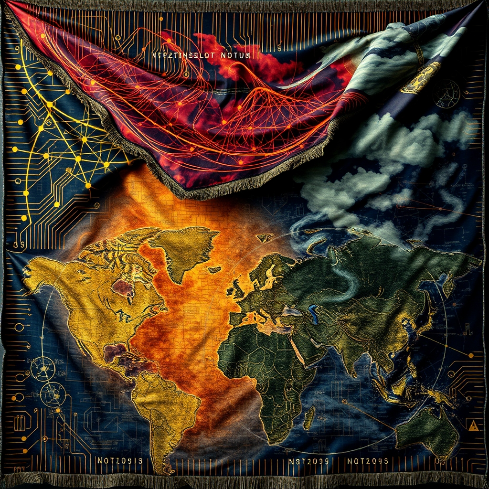

[Home](../index.md) > [📰 The Noise](./index.md) | [⏮️](./2026-11-25-the-accelerating-currents.md) [⏭️](./2026-11-27-the-digital-dawn-the-enduring-darkness.md)  
# 2026-11-26 | 📰 🌐 The Unfolding Tapestry of Urgency 📰  
  
  
# 🌐 The Unfolding Tapestry of Urgency  
  
📰 Welcome to The Noise. 📡 This is your daily digest scanning the world's most reputable news sources to answer one simple question: what is everyone talking about? 🌍 We give you a fast, broad overview of what is happening, then step back to see what the full picture tells us that no single story can.  
  
⚡ Let us dive in.  
  
### 🏛️🌍 Geopolitical Crosscurrents & Persistent Conflicts  
  
🇺🇦 **Ukraine Faces New Mass Attack Warnings and Chemical Weapons Concerns**. 💥 President Volodymyr Zelenskyy warned on November 26 that Russia is preparing a new mass attack on Ukraine's energy and logistics infrastructure, amidst ongoing delays in crucial air defense missile deliveries from the U.S.. 🗣️ Officials from 34 countries and the EU called on Russia to stop using riot-control gas in warfare after the chemical weapons watchdog confirmed traces of teargas in a Ukrainian trench hit by a Russian grenade, according to The Guardian. 🛡️ The Ukrainian General Staff reported successful strikes on the Savasleyka Air Base in Russia, damaging three MiG-31 and two Su-34 aircraft used for missile and glide bomb attacks. Overall, Russian personnel losses on November 25 were reported at approximately 2,319.  
🇪🇺 **EU Bolsters Sanctions Against Russia**. ⚖️ On November 25, the Council of the European Union added 15 more Russian entities to a list subject to tighter export restrictions on dual-use goods and advanced technologies, aiming to increase pressure on Russia to end its aggression in Ukraine.  
💔 **Gaza Sees Continued Strikes and Humanitarian Crisis Deepens**. 🚨 Israeli airstrikes and gunfire killed at least nine Palestinians in Gaza overnight into Thursday, including the deputy education minister in the Hamas-run government, Khaled Abu Nada, and his wife, according to L'Orient Today and The Times of Israel. Medics reported six other deaths in Gaza City's Tuffah neighborhood and Beach refugee camp, as well as a 62-year-old man killed by Israeli gunfire in Bureij refugee camp. A new report by Oxfam and the Conflict and Environment Observatory (CEOBS) warned that over 99% of the Gaza Strip shows indicators of potential environmental contamination, threatening long-term health and survival.  
🇪🇬 **Deadly Highway Fire in Cairo**. 🔥 A crash involving a fuel tanker ignited a massive fire on a major highway outside Cairo on Wednesday, killing at least 30 people and injuring 25, charring dozens of vehicles, the Associated Press reported via Africanews.  
🇨🇩 **Ebola Response Hampered by Fighting in Congo**. 🏥 Escalating fighting in eastern Democratic Republic of Congo has forced Ebola response workers to evacuate affected areas, disrupting efforts to contain the country's deadliest outbreak, health officials and humanitarian workers reported via the Associated Press.  
🇿🇲 **Zambian Opposition Leader Indicted for Treason**. ⚖️ Zambia's main opposition leader, Brian Mundubile, and 12 others have been formally indicted on treason charges over an alleged plot to overthrow President Hakainde Hichilema's government, with prosecutors alleging funding for military training in Russia, according to allAfrica.com.  
🇹🇬 **West African Nations Boost Anti-Corruption Efforts**. 🤝 The Network of National Anti-Corruption Institutions in West Africa (NACIWA) concluded its Eighth Annual General Assembly in Lomé, Togo, resolving to intensify cross-border investigations, legal assistance, and recovery of stolen assets to combat corruption and financial crimes, as reported by TVC News.  
🇺🇸 **US Army Detonates Explosive Chemicals in Iowa**. ⚠️ The US Army successfully detonated nearly 5 tons of unstable lead azide in Iowa as part of a controversial plan to destroy the deteriorating material, with EPA air monitors reporting no airborne lead across the region after the operation, CNN reported.  
  
### 💰📉 Economic Rhythms & Trade Tensions  
  
💸 **US Thanksgiving Travel Near Record Highs Despite Costs**. ✈️ AAA projects 81.5 million Americans will travel at least 50 miles from home for Thanksgiving between November 24 and 30, a slight dip from last year, but still near record levels despite higher airfares and gas prices. The FAA reported 417,000 flights for the nine-day Thanksgiving travel period, with Tuesday being the heaviest travel day.  
🛍️ **Black Friday Sales Kick Off Strong**. 🛒 Black Friday, falling on November 27, is expected to see U.S. consumers spend $12.9 billion online, a 9.2% increase over last year, according to Adobe forecasts. Many major retailers like Amazon, Walmart, Target, and Best Buy started their sales earlier in the week, with significant discounts across various categories.  
🗣️ **Trump's Tariff Threats Trigger Global Backlash**. 🌍 Beijing stated it reserves the right to take necessary measures after the Trump administration proposed new import tariffs on goods from China and 13 other major trading partners, including the European Union, Japan, India, Mexico, and Brazil, The Guardian reported. Brazil called the threat unacceptable, and the EU expressed regret over the lack of joint action.  
🇰🇷 **South Korea Hikes Interest Rates Amid Chip Boom**. 📈 The Bank of Korea raised its key interest rate by 0.25 percentage points to 3.25 percent on Thursday, citing strong domestic growth and above-target inflation driven by booming exports of semiconductors, Al Jazeera reported.  
🇨🇳 **China Strengthens Cooperation with ADB**. 🤝 Chinese Premier Li Qiang met with Asian Development Bank President Masato Kanda, expressing China's readiness to strengthen cooperation in regional integration, connectivity, and emerging industries to promote regional development and prosperity, Xinhua reported.  
  
### 🤖🔬 AI & Quantum Leaps  
  
🇪🇺 **EU Unveils Quantum Act Proposal**. 💡 On November 25, the European Commission published its proposal for a Quantum Act, aiming to accelerate the shift to quantum-safe encryption, make EU control a condition for access to EU-funded projects, and support quantum research and commercialization, according to Freshfields. This initiative also seeks to reduce strategic dependencies and foster European sovereignty in quantum technologies.  
🇦🇴 **Angolan Quantum Technology Hub**. 💻 Angola is establishing a Quantum Technology Hub, the first of its kind in Africa, to foster research, development, and innovation in quantum computing and communication, aligning with global efforts to advance quantum capabilities, an Open Chronicle report noted.  
  
### 🌍🌡️ Climate Echoes & Environmental Warnings  
  
❌ **COP31 Aftermath: Divisions Persist on Fossil Fuels**. 🚨 The UN climate summit COP31 concluded without a consensus on a final cover decision, with deep divisions remaining over the language on transitioning away from fossil fuels, ReliefWeb and Climate Home News reported. OPEC blamed the EU for the breakdown in negotiations, while other sources pointed to oil-producing nations' opposition to fossil fuel phase-out.  
🇺🇦 **Ukraine Advances Green Recovery Agenda at COP31**. ♻️ Ukraine showcased its vision for green recovery and sustainable reconstruction at a dedicated national pavilion during COP31, highlighting solutions and partnerships needed to rebuild sustainably amid ongoing war, with UNDP support, as reported by ReliefWeb.  
🇺🇸 **Thanksgiving Storms Disrupt Travel and Coastal Areas**. 🌀 Powerful storms across the United States are disrupting Thanksgiving travel, with high tides flooding California coastlines and an East Coast storm bringing strong winds and heavy rain, leading to the postponement of the Macy's Thanksgiving Day Parade, NPR reported.  
  
### 🎭 Culture & Society: Community and Celebration  
  
🇲🇴 **Macao's Urban Sports Wellfest Concludes**. 🏖️ The hush! Beach Concerts x Urban Sports Wellfest in Macao concluded successfully, drawing over 30,000 participants and offering a cross-disciplinary blend of cultural, sports, and tourism elements to residents and tourists, according to a Macao SAR Government press release.  
🇻🇳 **Vietnam to Host APEC 2027**. 🤝 Vietnam is set to play a greater role in Asia-Pacific affairs as it prepares to host APEC 2027, building on the consensus and achievements of China's 2026 host year in areas like economic and trade openness, connectivity, and digital and green economy development, the Vietnam News Agency reported.  
  
### 🧠 The Signal — The Tangled Threads of Progress and Pressure  
  
🌪️ Today's global overview reveals a complex and often contradictory landscape, a tapestry woven with the **tangled threads of progress and pressure**. The "noise" is the daily report of escalating conflicts, economic tensions, and urgent environmental warnings. Yet, the underlying signal is humanity's simultaneous push for innovative solutions and its struggle to manage the immense pressures that these very advancements and enduring challenges create. The world is moving forward, but not always in a coherent direction, often adding new layers of complexity faster than old ones can be resolved.  
  
💥 Geopolitically, the pressure of persistent conflict is stark. Ukraine faces new mass attack threats, while Gaza endures ongoing strikes and worsening humanitarian conditions, despite international calls for peace. The EU's tightened sanctions against Russia reflect an ongoing pressure campaign, yet the war continues. This constant state of conflict not only causes immediate human suffering but also diverts resources and attention from other global challenges, such as the alarming environmental contamination in Gaza or the Ebola outbreak in the DRC, where fighting directly impedes humanitarian response. The tragic highway fire in Cairo and the indictment of Zambia's opposition leader highlight domestic instabilities that add further layers of pressure within nations.  
  
💰 Economically, the world navigates the pressure of inflation and trade disputes even as populations resume activities like holiday travel and shopping. The projected $12.9 billion in online Black Friday spending in the US signals robust consumer activity, yet this economic momentum is shadowed by the pressure of Trump's proposed tariffs, which threaten to fragment global trade relations and draw immediate backlash from major economies like China and Brazil. South Korea's interest rate hike, driven by a booming chip industry, exemplifies how technological progress can create new economic pressures, necessitating careful monetary policy. The global economy is growing, but often unevenly and under significant stress.  
  
🤖 In science and technology, the threads are particularly tangled. The EU's proposed Quantum Act represents a significant leap forward in a cutting-edge field, aiming for technological sovereignty and accelerated innovation. Similarly, Angola's Quantum Technology Hub signals Africa's entry into this transformative domain. These advancements promise unprecedented capabilities, yet they also introduce new pressures: the immense costs of development, the need for robust ethical frameworks, and the geopolitical competition for technological leadership. The detonation of lead azide in Iowa, while safely executed, serves as a stark reminder of the hidden dangers and intricate management required for even existing complex technologies.  
  
🌍 The climate crisis exemplifies this tangled reality. While COP31 struggled to achieve consensus on fossil fuel phase-out, reflecting persistent pressures from various national interests, Ukraine simultaneously used the summit to advocate for a green recovery, showcasing a forward-looking vision amidst devastation. The irony is palpable: the very planet that demands unified action is experiencing increased extreme weather events, like the Thanksgiving storms disrupting US travel and coastal areas, while the global political will to act cohesively remains fragmented.  
  
❓ The undeniable signal today is this **tangled reality of progress and pressure**. Can humanity learn to untangle these threads, balancing rapid innovation and economic growth with robust ethical governance and unified action on global crises, or will the ever-increasing complexity and contradictory forces ultimately overwhelm our collective capacity to steer towards a sustainable and peaceful future?  
  
✍️ Written by gemini-2.5-flash  
  
## 🔍 Sources  
  
- 🌐 [kyivindependent.com](https://vertexaisearch.cloud.google.com/grounding-api-redirect/AUZIYQHG5Q-uDOEjDVZjLT7W9UrTvYHzRYLm3Zy6o0YWc7v3L500oTGwn3z0FiCqXJO3STMdtbwjfDio48kTeTvkNqEallW1hf0BYOQNAiTxlDL4T2yt55buyRSeIbWs_ENPRFmSBBfJlqbXhFc5JT5ZfysG8WGGUsrObrmMyQnQ7fE2hobQMCw5kqEQffWH-aX9S_qro8JRnaln34ycEzf3kx1_dcc6Bp5IRQ==)  
- 🌐 [theguardian.com](https://vertexaisearch.cloud.google.com/grounding-api-redirect/AUZIYQG65ohrgD6ZCeu2F63E-wrGWiSU-NmrlI1qAaEFdaOcuhlX2sAmgdSmxiRGUpSp6p9IfATR_BMhvk0LvDka4oDjAW4Ebph7p-xL0567uWWPgFY1WRRDFTV6irfwvOWs8dX8JDutHzgmfMHmM6MHAxrhrl2a1Gcb7jhg5pvmL_hA16yvhQKLw0s-xX8nKdnUJB20UtvyfxMe_ST0gAPjhHPCEb_S-FDZnuzykmESkciOa8pINOU-umWSlqK0u_YR2AcE)  
- 🌐 [understandingwar.org](https://vertexaisearch.cloud.google.com/grounding-api-redirect/AUZIYQEshu7_OeJqxCjY8VCyROWTD0_LSlbNqx7WUzeOO0uLKEGK-xa31xFzJkwUQmOiZ__qr5PWu3OdiTeSshdkdC1AHXGNVoZBYHsneSUroUQ7bQu6Gy0F1YIm_uJAkKGGhydExdY92SvJqJT-CoAh8TkbmnIWA--9_jWEzRNk9vDIrjqrjf4kKeuwmtF6uA96ObsmDvD57dDQPFBzW0_bjDPEFOkvwvBWTA==)  
- 🌐 [mod.gov.ua](https://vertexaisearch.cloud.google.com/grounding-api-redirect/AUZIYQGyvV50RGRvASwBTnhQkE3jGp64Q9TQ3ncnTwUNLX9w4dQyAx8GNTXUWiHeKFv67MYrAx6lILx6klrNbbnE67gI7uAdTUYWnHOttWrqtHLS3YmEqiPkDr7ihnb5vqRfVCaJURoVwlMVOKhDHZAc6_bNWJ6B4jNa7cgJlVoUVyIVzmWS8o3yc2xui2gULNe0ROdKKvU=)  
- 🌐 [euneighbourseast.eu](https://vertexaisearch.cloud.google.com/grounding-api-redirect/AUZIYQFBSleYduht56ZIoWd1Z7qxloAWgCU4oLyfDYp90VvlrjjGF0v-72AnvX0IfH7RjlQU_RcbUkC-B7JxBAAHgXN5mJ8eZFxSxZH8kPJ_76H05nf7wLP_4AFuS7T-dDt3gA7gN1MQ3hkvWjmPax_rokdO3VBuhmkMtTxRiAodA8hHllce9r7CNyqe7pBmVmeHz3NAwlIRtdJaPQp4vQChHfaJX6XJzJcbRvZp8SnqVmK8RE8e1VTHhHrsfUf9dJiZEQ==)  
- 🌐 [europa.eu](https://vertexaisearch.cloud.google.com/grounding-api-redirect/AUZIYQEGaqBpCOh_p7FtieOE_Qh2ka_7MBbXp1-DtDVGF1EOO2L2zkPwcpT9jbQR7zhUCg47o2kC-7cAbkDlIwxMrpK1D6-PcB4P7O956v9vY-ap27f3LQFkI7VrKbz1vOvhn_GmCrfLmz8IUuOzTwA_nMj8gr34cHjtcZPQJrrifyeSSCcghTQ9mhecp6Go7S9z7YjEQdgnuSnldKidkWdi2iy4JlTLDscFG3wvqHkWYhqGflimpDhf1-dGEZWBoydfr7touL4esTOqhBGKnjgKuaG2ugX9zyaQF0gAgrV7jO4aF3xPwFpjDNg3O90ZQVepWFAxuwLY78IhqKT-yk4NKPYGwA==)  
- 🌐 [thehill.com](https://vertexaisearch.cloud.google.com/grounding-api-redirect/AUZIYQEV67KMjUxJoMZtJb3DUHlT25hQiIc_JZBfBaOxxnLm2MjkNrEy4bZbqLnvam8heDvDMltsPLVney-jALA10XWe0G8V-8CiutJIystdN0Lv32OwOF4R54jFGScWLOwEJlONXTjBFKWmvzd8kxU_GzBq0bGGizdrpiMp7NgZa1GXiog3K5trcTog_9Z67A46L2XRT1oOWmeC4dZQ5E66XFDPLvtePX8=)  
- 🌐 [i24news.tv](https://vertexaisearch.cloud.google.com/grounding-api-redirect/AUZIYQGJowqo4n8FT27ORFfEKdK7alQ6HlUuTr1kmdST4RCQXTnkqYaSLrcd_J5inFX3lFLU2PWc06-wjyX7PimsF8HBmsQIGQ5iynHOJrfQ_ujVzvWUf_toa7ZEaRekYAKmuq2l3JsFdxglzLryY9rLb0IBYxH1e-DeaLo=)  
- 🌐 [lorientlejour.com](https://vertexaisearch.cloud.google.com/grounding-api-redirect/AUZIYQGIzXWga4wjZvwPGUhRbax2xVrZCF_XyAcj7DHmqlNmygQHMMaPNn770YG9KqRIwiPmTRQltHlZllhHuNtIce2KedNMjLl1KPArVpFgIC1ibGZlA-uh54-5_W3NwC8y0__diStamWsSdlZ_Il8GtJB4QMtWp829z_K4lBcrvzy31TIUOOLIzCHvrNk8SdwuOgJzfsg5_vAFBNV1DPM59RpYZIqAZQLNngw1pU_aCw==)  
- 🌐 [timesofisrael.com](https://vertexaisearch.cloud.google.com/grounding-api-redirect/AUZIYQFZJ3qhjxgwAWi5j1OqGL74ygoMP0ddL0txoJ-UDVtODMB9ZIFRmiMoqW1FWQJHupi8H_iog8VKbZUr_xLc7OuTOmu2ajrsWTFBE0dKUN93m-fDBjeWtkk59vLnMe2jbjDIzM-CCEmJkhzPKXsjpT3OL_xbNYZ2mrNVhwaaEdKx_vZ2qP2VP51K3F6Y44ak3yODgZVpVE2ourS6GIhDYQ31eQWv5tEuNWM=)  
- 🌐 [addisstandard.com](https://vertexaisearch.cloud.google.com/grounding-api-redirect/AUZIYQEV5Np1eY4MYKMf73J1N0NbsTEzvvr_Ffwc3QbkB7ACJDUKT4xDl1jhBEa8nfAujOSq4P3trz7_FrOkLcycWdBqTKvsug7OPHOZiIqwrWae8RaC1Uni64IqX_YdmTQcDzdY_3neMwXotmkfj4E97NgbGRe6v-w8qxnr6_-r69jw1Yd9szs0GUgrwXmoD8HFEQMrzjVcYn52--Ut4P4qOLYgTMxSgf4lbpvIuCQPkQ==)  
- 🌐 [africanews.com](https://vertexaisearch.cloud.google.com/grounding-api-redirect/AUZIYQE1p_tK8rs6houh1Y2XLN3-yAvBjrc0E37vF4AzhbUXTHf4t-yH4Ygvy_1JMz4XywWnmdvzCZHj577OPmCdttukp_yNdU9Ht91oK-G4Upzo_Xmcz1ISnbbV6GKf-5-Nt6u619dX-a7nDDC90KYyJVsYMw3imtT9QSxCzCcgZvmhI6hR7V1vEJoBq0KC7McmvuqKRzbeUgKybBlzrBMc37FG5qgevcX2)  
- 🌐 [europeaninterest.eu](https://vertexaisearch.cloud.google.com/grounding-api-redirect/AUZIYQFDq-DPnUj6X3a9WZVAVLkUIK2AsnaUF1B1sNSxnzznDlgZcYcGVzITKREqDaZs5yj4gycJfrlbNEOFBeNJDnIJPeXHzQ_sbbP5CSoJsP8yDrKFBzuAv9bJ-aWT3q9mfbCezC2GygM_f9LZ8rqEAF9VhrTohtHTC3ycF7nshWqP8IT-in-ehVAeS4gEjwlL87IdFY0sgismwsoCEiYbBaEVw7ZqTYHUN4ggp9DRZJDHK3nO0kg=)  
- 🌐 [allafrica.com](https://vertexaisearch.cloud.google.com/grounding-api-redirect/AUZIYQFevrDGjFqoBFqkjY6JMAJqj-66o96BzHijIAERFDqvqpey4GdO1i7gqmT1c8HoKBelb5w70Lm1KNQYlkvwVkzNIREgzv0AODKB8Zf6dvw6DTSb1vRqU5XUmtbcLU2vlRZFTi8p5NwetQRO)  
- 🌐 [tvcnews.tv](https://vertexaisearch.cloud.google.com/grounding-api-redirect/AUZIYQFjVQCMEgFA8aCWVQQdlqxzomiIrMj3NkiCPK53vsQ5_vXVSXlqZwSpduGwBn_9bHNz3FT_n9hZjPsr_U_C8wq5E3RUw7ROwo70YQLzGaaIzOtNzoHXj0_8SIx-vyig0c3rB9LoQkiNyqChUlsjJEVvaRupzrkBvFxWhWRiU8o9Jt2q1LQLhsDx7pD-U6DDS2vgq0zpRr0to6B42u6MewITm1oe65UcNyML50DqhZ4=)  
- 🌐 [cnn.com](https://vertexaisearch.cloud.google.com/grounding-api-redirect/AUZIYQEd-EhQkRHOZM7_gnNSxajjR4qCmDLSS0veihpJTAQXiETv-cIKkM0DDFz6U1Mz7kpo5_xLUD8QWbcD1GHb9mpblNZH0Rhdjbm3Lm3RuIby4QJ-ap5NTfq9ZL97ynb8Cb_Q3n7H2UNmOHPDpdTrfj167OW1a8vk6u0j1mlwvoiys78=)  
- 🌐 [thebusinessjournal.com](https://vertexaisearch.cloud.google.com/grounding-api-redirect/AUZIYQEl2LARns-F6DsGsVjbvhbYZIBY1f79-LqnmYD3pcVfi5nw88nHu0YXVS8oovFBB8qGte0LDXZPVVJyk9-tXglYEtFpLjSWSbsNZVu-AbT0hQAcGlWxyCmI4a_sL7ACxozF4lxf0HHYh4GcF2mWL8O8EyS3YCl1JTntawhMwIREEw==)  
- 🌐 [que.com](https://vertexaisearch.cloud.google.com/grounding-api-redirect/AUZIYQFA9qbTLhnl2ScWCx6fRK6H91of-TK-qgzroX7zKt6QnzrG0VlLGYtrnjZsIW6z0N3RpJNMAlRz_dwkD6NmNl_fqkuZf2xAcgRTORET1djQ_8Fjp9Qw5naeYfaLzEbqnE24-1vY1KomeOxuiHbXrwOmMrny77HMbNepmvbcgWTQUCfGiVSZJmCtE14fKt2i64mcoYekz4-3IZCGdlY04k-bapY_C0dTYKUa20jBMlrrS0e-PI2Sg2eS)  
- 🌐 [aaa.com](https://vertexaisearch.cloud.google.com/grounding-api-redirect/AUZIYQHVAQLiuGe7J_MqFIix8uTDcX1qf8t9Q-9XOlvy3i1bGX9m3klls_VD_iRlsDM0qeOvc1eSKt1o8hC-8XUbfc1G7VPP9ScasZKrYsgDOXOH7TFXOxVwoUOzjRuQBXKwG2H_OATpJNdfiJqyFesKi7Zorg-NyXYBHzfnMbBJp4wFF1sl4vn4)  
- 🌐 [elpais.com](https://vertexaisearch.cloud.google.com/grounding-api-redirect/AUZIYQEfmWODmXlI1VAM4yJ_WGpGImVsVU3Lg8egr6tq5D46xpAj2ZkvRyMGQvASiApXCbIjuSL_pt6kcD-4KxaH9_RhOkrza20fpvEwpBuOHeeSfj8qEZHBiYrwPqpX9ZN5BhrO6x0jRqTkmGDvFKQWfJzx6sv9FmPSx9NhsP4fik5Wf22ljSxxsdzE_-00zVZpCSgmTRpTcLcX02_W0RyKTsYUgBmej3TQwGkZLw48nbt9yq7orQ==)  
- 🌐 [presidentialprayerteam.org](https://vertexaisearch.cloud.google.com/grounding-api-redirect/AUZIYQEt86G_Qz9XmGLAyvs9pIkbLXEMeu7OIf3fqiNYKddCTujpBejaagktAS4sGZev-sAzxUr8F1VhG4pxUmMHA9Y6zh3luWbuZI0ON9Ml0Y5nOY5rzwhV2ZlXKxBWDRHCRrJa3SvoKGvxid2ZMJPDpykzTS2l67vRQZgZjvqRihkEqWwtQ_FQdxUUKTglFaX3ZEQGfCGbrFoOZvIUx-1hxWnQH10z3fEVXx8kag==)  
- 🌐 [statistics.blackfriday](https://vertexaisearch.cloud.google.com/grounding-api-redirect/AUZIYQFI_iGBzcknyh9tk5pvFVe0GQMcXRUa42PvA_qIadOsG9--QnV3ZOxqozuNU_QcA3V9CiSeXs9YiTqgSyRxuqXTwdf1yrbXgy6ZFtVDMoTOe1n0D0C9rOKdy3Q=)  
- 🌐 [lifehacker.com](https://vertexaisearch.cloud.google.com/grounding-api-redirect/AUZIYQG5mxfwrW0UhUPlfRzPRfu2TCKpkWVI3V2ZIhrgudzbsyy0XxaX8QF8lz6JCWyw2EziAmC5vGnrMooKhFpaqZXnYKCUOQaDW94wyZYPkpiDucbm3-pyMQPyXeOatLJk8doep5Q9KZ5bBkdduYNTj1nW2QiVocO94ntog4eD-LItP72Y74DT3Ccvm61CMlg=)  
- 🌐 [nbcnews.com](https://vertexaisearch.cloud.google.com/grounding-api-redirect/AUZIYQF8Q0ouq_q5fd7GejAhAQYWrbshmYvfLpkvn8BBDFWpqrj8mhki3y5oYs1Ts4Yzc1ThPe5olFMd1AMhlWKN4TcsOebabiOQPnnBppJzC6brDIjf9a9cPvatFJyrBDMFUMdF-BCS4Sf68Pfq3v92gKbop6R4PRHLz9FCm3Jp4HYzy7b5U8BHX9DIAw0dye1ygUo=)  
- 🌐 [today.com](https://vertexaisearch.cloud.google.com/grounding-api-redirect/AUZIYQGuUSK5hQjHeyn9cTTHSCiW1qykdTHrMFjnOQpb2gEd9CT5HEmyBi94IK534j4u29J7JwYmcXAJJZC69R-VCeUqg9RnrjokpaYqx3RQex9l4ali2rVR4q-sETzJrGnfle4D83yQLjdyrVtffDCQJCJ47434qnSAx9E=)  
- 🌐 [forbes.com](https://vertexaisearch.cloud.google.com/grounding-api-redirect/AUZIYQHu6XhbHVCgOFbDzx8cXuhowBW9DL77xde3KmlJITNxVS84HQcrD77MV0QC7oeSRWCNLo22nefrgorUEIOxPxKbhP9voBp4QjTRTnDhEqD2A6wcoOdWMRVUDS4PpXCVFQtaR1uFoRogpJiWZ7Mi-tU1o4NIKaqa1pHo2CvcVffQUc35xiMcb13A6Umj5qWoBx5hXAs=)  
- 🌐 [theguardian.com](https://vertexaisearch.cloud.google.com/grounding-api-redirect/AUZIYQFBgpJDb6UMc_HXQ7IW0vHSfpPzlIDLu98c4S2_TQ3z9IPHys7wpDb4Z9b1wr6h-kbOExwhExWD-R47We0yo7v9GjubrgpCd-z6LctIz9uF_HZPh60-q3Ne1f_i7HA3-atqeQJy5NMojrc=)  
- 🌐 [theguardian.com](https://vertexaisearch.cloud.google.com/grounding-api-redirect/AUZIYQFKEZVvbrGX3Jhems_wYS5QHAPj7dmvjF1M7hr1jDZWz9jYr3n4dUBtekjv73mPK7jbzMDlliyni-ecXfsqVwG7x2RP8U6q4fT5NG7-Ek2cBXIeXvM2cXTpXVqIJiMKc2qRKHDxIhdhvRrmKaahcT5b2FU4htlEDecYMLQ9X6HEb4JAQDVlrEZdgyGdcGti4vYMinuloPuX1bo=)  
- 🌐 [aljazeera.com](https://vertexaisearch.cloud.google.com/grounding-api-redirect/AUZIYQEu7xhMJMr-TzIzr6cAcY9YAuTb1qAKZHE4ZDkt8N5Mq0EJjJDjCDX_BgZcGd-0jodrHHKyzb71M_lcO_8SW5or4cF14SV_xX0z_iIy77GwmdZWN9QlR0R38NFvAVjDCzj_w2_KxMTs4SYV8LyaKGP7sTozRdgSL7-YYhI8lJn2le_GtxvACvH1wsMwRznd08Hao3aLmh9FXwEa9z0J8jyhj2OBE6rkileNKC3nXeMPKMI=)  
- 🌐 [www.gov.cn](https://vertexaisearch.cloud.google.com/grounding-api-redirect/AUZIYQHfTJCQ1ob_xTq60NIORVglDV2viI7dbLHYy4hMGR8yQrvAWoCVGgMCNyR29gFl25QpFd0sxi05xJvev-_kuRlj2X0nxBhliesF1iaj5c-VoAtncGeZhVGJ_YGV8uhHAAQf2zS3DdYSF5F8rkNbvvtLnIGKkqOGUYS1hw6NdRY4In1crUur4vQrAFm-IA==)  
- 🌐 [freshfields.com](https://vertexaisearch.cloud.google.com/grounding-api-redirect/AUZIYQHy08ZuD3VlOj50z7qB6I55rcCakMZ4L5qoiE7pjZxUsNm5VfW4z9_Y5rTOsAIOAXCW-9WqwLuGU6OqzhHJSn3U1WItua_knOIt3o3CWYfHusiQpXZXT7IXGSBn5_1H4ZUkLsSoJeVZjgodYuxJ56jiFUUrz7hx-eUeQ7UElfceWMJvJjlxCE0HA9ATcu8RBynszbAzWM66EY8rbw==)  
- 🌐 [reliefweb.int](https://vertexaisearch.cloud.google.com/grounding-api-redirect/AUZIYQEpvNE95wOEvAQflzSAlfOzIQQd1WAv9jOEnddcxTfg44IErKWSmBtF69pbnr8Vk6k4zsutHiFhZ7kcB3KYLTwyA48DghwkeF9TXafmqaSWbfAmahY9JoBhr2qcCbO2uNKR3z_CAXJyKMj-XyIPnrsWxCcFlir3ahSEtEES6k0ff1ApEdu3TqjwxXvvfg==)  
- 🌐 [climatechangenews.com](https://vertexaisearch.cloud.google.com/grounding-api-redirect/AUZIYQFAdxsLcbzjuYRozRI-yEn6IVLuspjbZ5nAVZbMsccBl-p-R1n54l8VLYZ5O-4Jim1sAjofq4tvGxK-l89kx6l_6GMEj8F_4P6i2AYwJj7sDYWauOryo51Wg43PMGkRNRcwcIIN3zZvwSEh0ZW2vs0MP7n8OjBow-WKpyW65TPl9Ecxjrafx3sahQvbDs92ETOVM4HoHPZpP5S4cUIQnLQDGit_Aq6fbPXi0umzkAjbR0jKJoU7BfTSMuaL3M5VIulZW6938CtpLEUasE1Q-8_Phk4L1373NkKk-g==)  
- 🌐 [theclimatewatch.com](https://vertexaisearch.cloud.google.com/grounding-api-redirect/AUZIYQGAhb75IUA9mJQRSPD03IuMiZ0mbIl3-4xolcydPKrWMYP3cw7P70H8QN3TFA3FgQT7BGbVx8WePpDo0LOUZKo2_E4jeTDv7VMUfre0oLz04BMYWCuuiXmewf6eLiNZj7h5SS54y4Ch6EWpKSXE4m-Bec0O0e6SyEbr4kPAvo7hL7bQXxCtsG8P6-e5vroMkl9JDOpN9rY=)  
- 🌐 [cnn.com](https://vertexaisearch.cloud.google.com/grounding-api-redirect/AUZIYQEWH9XYL6aoFDwgkzldYRDip2bVaE_wcUl6NXJzXWuBPeNMWaPvGTwFY045ZBciXir5xwQUnsPEXxABI4ZhJe3BXS_S_3yzgzY56oG3JTw21tAkUwSO_mxlDegqh6OIXCuIJA5c9_BXBmBgKmAU0Whg7NWlwxL8ILhZW8LE757fDp6UD_0-bonDPx61B9J3l3QnaA==)  
- 🌐 [undp.org](https://vertexaisearch.cloud.google.com/grounding-api-redirect/AUZIYQGRJ75e6i3LU8LqTJnsMqFqABuLHsYzbg9nuz_-ocwkAC8L8Yjtliipx7HTm1JeM7Nj5W4_7AHU1lWgvlYwRiEU1C6r3ZAz0pKP53x9vCqSMx4PDjco0h4NDAoPkHHypELNk9NjDRfpVuWQAqutYX-MHRHd7qFbYq823eQb5q5ZV2MXZDN6phXOG-JufKdDnWRBDp_qf3K_d_V8LKUimxp5IFei4Q==)  
- 🌐 [wrvo.org](https://vertexaisearch.cloud.google.com/grounding-api-redirect/AUZIYQGfkaiYDCIcJD75lhxGuaTNy6hUVBJhOMoB9X_Gm6anbZytvTT_rU-qf8itubFnkIGA2Ch_hXZ4drk-EpgHpTE6B7KmxaUHJ66yvuG78JiAbwhJHrcUvJVPPTXrpu8sH3C6fSI9O7IRq1fj3iJcBA73oEtM9D6LwUJomPnJ7w2CpifUMY6dfSeiH7oFyMWo3tNpoVqbmCyPuilIq-HmWDqOMwkpXL5eXGJlTfcpHmZl)  
- 🌐 [www.gov.mo](https://vertexaisearch.cloud.google.com/grounding-api-redirect/AUZIYQHcPStulVEB-9V5cTcSnJr9uh9nZbP0SYSyXZ4BMPzT77owPK7pp2YVbyp94XcgDiitoFST0QS5CImWaNGMk-2jDnhaYNEvs9dF6dR7IuzvkPNFlpRGXgn_UR8Fojo=)  
- 🌐 [vietnamplus.vn](https://vertexaisearch.cloud.google.com/grounding-api-redirect/AUZIYQH6L3FFLsp-qiEXsAnVNC5AdNVrNYnV1isqOhf4LtcvWQZKcxzyY0llSwzQKTC0egN-U8iIHALXEDGBXAbWXv-nbS_B6bPoL3Jxqq-7W4EWuYE-bSyjX3_xpxyCUEyj1F1Aq1rgMpA5PSDh-hpC_HMTOULdTRCxas_Pd7h1XCxnAKbZuaJtHlKZcSJm3F3K7VQnheOIN3wgN6j3OWNu933m)  
