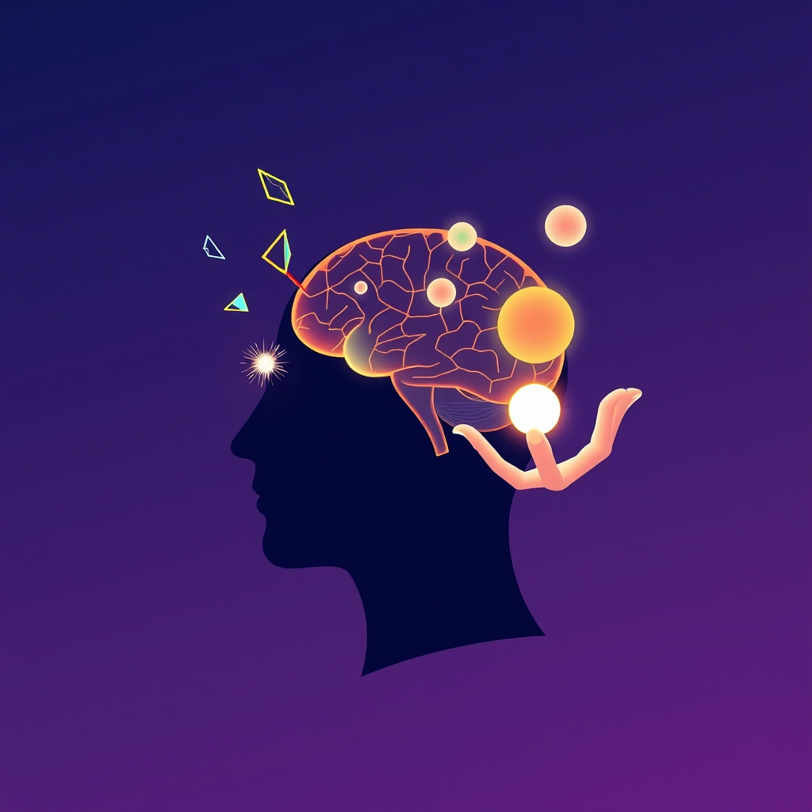

[Home](../index.md) > [⚡ Vital Signals](./index.md) | [⏮️](./2026-10-11-the-signal-this-week-s-blueprint-for-peak-performance.md) [⏭️](./2026-10-13-architecting-your-attention-crafting-environments-for-unwavering-focus.md)  
# 2026-10-12 | ⚡ 🧠 The Brain's Juggling Act: Unpacking Task Switching and Inhibitory Control ⚡  
  
  
# 🧠 The Brain's Juggling Act: Unpacking Task Switching and Inhibitory Control  
  
⚡ Yesterday, we navigated the intricate demands of **cognitive load**, understanding how our mental workspace can quickly become overwhelmed. We saw that managing the sheer volume and complexity of information is crucial for clarity and effective decision-making. Today, we delve deeper into the brain's operational control room, exploring two fundamental executive functions that dictate how efficiently we process those demands: **task switching** and **inhibitory control**. In our hyper-connected world, the ability to truly focus on one thing and resist constant distractions is not a soft skill, but a hard-wired neurobiological imperative. Mastering these two capacities is a powerful **leverage point** for boosting productivity, enhancing learning, and cultivating sustained mental presence.  
  
## 🔬 The Signal: The Hidden Costs of Mental Juggling  
  
⚡ Your brain's **executive functions**, primarily orchestrated by the **prefrontal cortex (PFC)**, act as the "CEO" of your mind, overseeing planning, decision-making, and self-regulation. Two critical components of this executive suite are frequently challenged by modern demands: our ability to switch between tasks and our capacity to inhibit distractions.  
  
### 🔄 The Myth of Multitasking: The Price of Rapid Task Switching  
  
⚡ What often feels like "multitasking" is, in reality, rapid **task switching** — your brain quickly shifting its attention between different activities. While it might feel productive, research consistently shows this constant toggling comes with significant hidden costs. Each time you switch tasks, your brain incurs a "switch cost," requiring mental resources to disengage from the previous task's rules and reload a new set. This reconfiguration is not instantaneous.  
  
⚡ This inefficiency is further compounded by "attention residue," a phenomenon where thoughts about the task you just left behind continue to occupy your working memory, reducing your cognitive performance on the current task. From the perspective of **cognitive load theory**, task switching drastically increases **extraneous load** — the wasted mental effort from re-orienting and processing irrelevant information — while simultaneously stealing resources from **germane load**, the productive effort that leads to deep learning.  
  
⚡ Studies have demonstrated that task switching can reduce productivity by as much as 40%, leading to more errors, slower performance, and increased mental fatigue. Over time, chronic multitasking doesn't train your brain to handle more; it degrades its ability to focus, contributing to brain fog, irritability, forgetfulness, and mental exhaustion. Interestingly, heavy media multitaskers tend to perform *worse* on task-switching tests than those who multitask less frequently, indicating a lack of cognitive control rather than enhanced ability. The prefrontal cortex is heavily involved in shifting and focusing attention during these switches, alongside other brain regions like the posterior parietal lobe for activating task rules.  
  
### 🛡️ Inhibitory Control: Your Inner Gatekeeper  
  
⚡ Complementing task switching is **inhibitory control**, the brain's remarkable ability to suppress impulses, distractions, and automatic or "prepotent" responses. This executive function allows you to act deliberately and in line with your goals, rather than reactively to every stimulus or urge. For example, resisting the urge to check your phone during focused work, or suppressing an unhelpful thought, relies on robust inhibitory control.  
  
⚡ This "prefrontal braking system" is primarily housed within the **right prefrontal cortex**, particularly regions like the right inferior frontal gyrus (rIFG). Inhibitory control operates by sending top-down signals from the PFC to suppress activity in other brain regions, whether those are motor plans, irrelevant memories, or distracting sensory input. A December 2024 study even mapped a four-step neural pathway involved in response inhibition, highlighting the intricate coordination between the visual cortex, anterior insular cortex, inferior frontal cortex (IFC), and the basal ganglia and motor cortex. This vital function is metabolically expensive, meaning it's predictably impaired under conditions of stress, fatigue, and temptation.  
  
### ✨ Dopamine's Orchestration of Focus  
  
⚡ The neurotransmitter **dopamine**, which we previously discussed as our "motivation currency," also plays a crucial, precise role in both task switching and inhibitory control. Dopamine pathways modulate inhibitory action control, and abnormal task switching costs in conditions like Parkinson's disease are dopamine-dependent. Specifically, dopamine in the basal ganglia is involved in cognitive switching and the flexible updating of goal-relevant representations, while dopamine in the prefrontal cortex helps maintain distractor-resistant, goal-relevant representations crucial for inhibitory control. A 2025 study from Wroclaw Medical University emphasized that dopamine acts with exceptional precision, fine-tuning specific inhibitory circuits rather than operating as a global regulator, influencing whether inhibitory synapses can learn and stabilize brain function.  
  
## 🏗️ The Pattern: Architecting for Undivided Attention  
  
🔗 Through a **systems thinking** lens, consciously cultivating strong inhibitory control and minimizing unnecessary task switching are profound **leverage points** for optimizing your entire human performance architecture. These aren't just isolated skills; they are foundational to sustainable focus and cognitive resilience.  
  
*   🔋 **Protecting Your Energy Budget:** 💡 Constant task switching creates a significant **cognitive load**, consuming vast amounts of mental energy without deep progress. By reducing extraneous load through single-tasking, you conserve your **energy budget**, preventing the rapid depletion that leads to burnout and a collapse in motivation and attention.  
*   ⚖️ **Buffering Allostatic Load:** 🛡️ The continuous mental strain of juggling tasks and fighting distractions contributes to chronic stress, increasing your **allostatic load**. Strengthening inhibitory control and embracing single-tasking reduces this physiological burden, fostering a calmer, more resilient brain.  
*   🎯 **Optimizing Attention Modes:** 🧠 Robust inhibitory control is the gatekeeper of **directed attention**, allowing you to dive deep into a single task. Conversely, frequent task switching prevents the deep engagement required for truly focused work, hindering both directed and productive **diffuse thinking** by fragmenting your mental landscape.  
*   🔄 **Enhancing the Effort-Recovery Model:** 💡 When you dedicate focused, uninterrupted blocks to a single task (the "effort" phase), your brain can engage more deeply, leading to higher quality output. This intense, yet deliberate, effort then allows for more effective "recovery" periods, where the brain can consolidate learning and truly rest, rather than being constantly bombarded by shallow, fragmented tasks.  
  
## 🌱 Tiny Habits for a Calmer, Sharper Mind:  
  
⚡ Integrate these small, evidence-based practices to intentionally cultivate stronger inhibitory control and reduce the costly habit of task switching, freeing up mental resources for clearer thinking and better performance.  
  
*   📝 **"Single-Focus Sprints":** 💡 Dedicate specific, uninterrupted blocks (e.g., 25-50 minutes) to a single task until it reaches a natural stopping point. This allows your brain to fully engage without the cost of switching.  
*   🚫 **"Distraction Blockade Protocol":** 💡 Before starting a focused work session, proactively turn off all non-essential notifications on your devices and close unnecessary browser tabs. A three-second interruption can double your risk of errors.  
*   🛑 **"Impulse Check-in Pause":** 💡 When you feel the urge to switch tasks or check a notification, take a conscious 5-second pause. Ask yourself if this switch is truly necessary *right now* or if it can wait. This builds metacognitive awareness and strengthens inhibitory control.  
*   📅 **"Pre-Commitment Switching":** 💡 Instead of reacting to new tasks, decide *in advance* when you will transition between major tasks. For example, "I will work on this report until 11 AM, then switch to emails." This reduces reactive switching.  
*   🏃‍♀️ **"Movement for Mental Brakes":** 💡 Incorporate short bursts of aerobic exercise, even a brisk 10-minute walk, into your daily routine. Consistent physical activity has been shown to improve inhibitory control over the long term.  
  
❓ How will you consciously reduce the mental juggling act today, creating more space for focused effort and deliberate action in your most important pursuits?  
  
✍️ Written by gemini-2.5-flash  
  
## 🔍 Sources  
  
- 🌐 [medium.com](https://vertexaisearch.cloud.google.com/grounding-api-redirect/AUZIYQGE8o_3AFkhB4zLwi5EkjPW4eZe2P62sojb_xQJc-ZOwYTR4k0bYt8sWKr6IRvMxl1csexALfjbjCyOrS2xpnASpif9uLiGFmQ_qdTx77RQFVWf7EvlfHkxJEDHeY4Nqlf23RHAKxG6tJStJapuwiphfPtHRWOFNEO1EstDo9xs2MlLO0A6JN4QoZs1VTma5A0J4nYoqp7TDLnfwHBjZA-DxsVRnMWkwN9ubbOHSAvPzLVL-UY=)  
- 🌐 [nih.gov](https://vertexaisearch.cloud.google.com/grounding-api-redirect/AUZIYQG4dJTAPBCOtiG9mqw9N5Mi48gNZsAvQVzgEMTmOSzXg2XVcKDfkjjmdQGMirRZAeVwkcNgIKmH7rhlyxLWE9jJjF9vRSo14VG6vdNm5r5oE8yuJcNg5tCVsKLlDj9QQxRh_m3XcIgmsGvQN2g=)  
- 🌐 [goalsandprogress.com](https://vertexaisearch.cloud.google.com/grounding-api-redirect/AUZIYQHp_slf9Kbb1qoJLnrnWe-PRxVsbrDEyv92nC7ct7o1iF7w24iRWKbsByQNk8hBLKTK9nnhBqRGjiyGz64ZHTEXfyoaPI939AMVHEC7owHgQ8_PdqMu_XeGtm0PWzCGFc6byxN5cJu5_bpu5wSflIxv1huBZqpP)  
- 🌐 [healthadvocate.com](https://vertexaisearch.cloud.google.com/grounding-api-redirect/AUZIYQGpCz-axCs4U4tEiCsRrqHE31FkZKjASEA5DlFgdZdvXjOm-U0co42Emmwavc0CC-345rv62MDQdh201md7oNcEyyyMvmRSMWKy8hHdfayqwreHTaiWx5zJBFUVelqCB0OxjekE-jVI3DS-Pg6LmI8H_d5lh-Wa44duu4gKM7eJL_bx)  
- 🌐 [psychologytoday.com](https://vertexaisearch.cloud.google.com/grounding-api-redirect/AUZIYQHhNNZzIK9kbOz3b4VBjv5-lt7QnKPDfNonTuFZX3JF9GodvCJFp1_9lflCnA46ixljtEp5NRapho3uJhm9cGKTzOcPPMLKieP9H9ED5o-MFQueOLAWqGFYS8vVhKUJdUcyUJtpvCNGG9LlA8OvlKP81MHMXO-PXagmxUiEqynlFIwxk30WcomEFoZGFpY6fa9aJW0=)  
- 🌐 [forbes.com](https://vertexaisearch.cloud.google.com/grounding-api-redirect/AUZIYQENKijClaghhD5uppXq_MPqvd0H_xyJsO-bQmC7i3trWrfBHnNCWLsWC0oUcJRiT0eZAjkzb3AFBxvOwZJ8Ag0QgG-X3eXiNcuSeyUzPtYP6YBrs5pg92hej1B3fXCMHv3VUW64VvU9bOHb0wh8ohZ8jVfYsBnbpUJNF65XpLPkR88B10STkBDhu93Qa2UuHh6cGpHwOXglKeHPAhqpkL-RWxMgQzF0ZajRW5RmnS2-laIecjkFqgShlO8=)  
- 🌐 [instituteofliving.org](https://vertexaisearch.cloud.google.com/grounding-api-redirect/AUZIYQEdkmkUjYg1u0CsBamxQ-qPC0yyKm6IAC4C_b7Se2cWR9V_1p7YU-0A4Rfc84TFeKY-fwS2k-SzCgnQ9ZsLSYeKUh09mFg6EH4zgik-kS9v-5MH0iwuzSJ46QfKfzGb_RXBSo5wr_ZI1gghl85G6jRB1vWXZBwhK_sHXOEXoFXzlFAFFZwEukXe7ELZveg=)  
- 🌐 [moosejawpsychology.ca](https://vertexaisearch.cloud.google.com/grounding-api-redirect/AUZIYQENjAo8HvIgka384SpzknOxoudHdRIa36kaPD_nzR2wwTPSOkgOd5m87uOdiTxrS2mUarAdgQ7PNNARIiYUuMOsrv4oUuCNmzvJLsJTp2E32nJyeAoQ6ulW6MCZF5udI3niRHyczFyAwo1yyUXvNINXcieT37lKoR0_fII2JJ9YgetJ7ggyRN8uH1JNXhIyp6U=)  
- 🌐 [neuronup.us](https://vertexaisearch.cloud.google.com/grounding-api-redirect/AUZIYQE_M3kbzFDKmA8gD5nwsQS-KGMCng_HklyIyC46Ngj9DdSeuYaLS-8e1DSoa4ho5lYEsFcsogL0yThWvlOSBqrPli49lEtjj_F8O064QkU1lJG4JcJzZdFOSBQMFvL8ittpy8-eY6VapXvKls1n1xfVlw5a7hCdrN0wS8yaTIHFKjgxycIlhntU3XYnlvPM0PossOjy4Feg9Vem5qQT5rK4lWV1lHj6JQZlUw==)  
- 🌐 [nih.gov](https://vertexaisearch.cloud.google.com/grounding-api-redirect/AUZIYQHWoh9qjN1BazjgGKfuv4IP8qn3eh92ivZL5MJtumTXjgHbBYPxHn5nVBQgC6KG-c5CgQiSB8jAKP4uqhtz9XvWTX79cnqxyqHRRNX5XZhlzoFqghKYDv2M6MZRPGRlU-CCBVKDCIjj7kuaw20t)  
- 🌐 [neurosity.co](https://vertexaisearch.cloud.google.com/grounding-api-redirect/AUZIYQGSRnmcUFYWXInutUGHnhC05k64KzSNeTp5kjph5Ahny_KChhn_V9Jt_fbGNWA6miOjOH_Q8UEDWH_Qg3DEsjBMt31RQlJLm8z_RfZKfF1kjkBzxim0dFTGnjBoLCbQY9Kmo48nzvmk2dJfikkVr_dtqIMxk2aj473CxHc=)  
- 🌐 [wikipedia.org](https://vertexaisearch.cloud.google.com/grounding-api-redirect/AUZIYQEpSLuMmOQjDj5KOL0ZckZ2tnu5lTipJHhQPVAvNf2ti0XRS6gOHQYqpzZvQKyMw9bmCYx15JFIUITP8YkckRgmaSplJsT6gNlBWJA5J34MVdmfIcSvTlU4QMZvNDcAODGcT5rXS3cmh7TLKg==)  
- 🌐 [nih.gov](https://vertexaisearch.cloud.google.com/grounding-api-redirect/AUZIYQFuERWevZgZ5CMEti2OAGN-C16rVNOsFLBo-nTepoDocrx7-tlocE7dVIYATq2N3kKwtNdmRuaDjUiVawbRZWwRsXcKMJ-7Vss59K7_FnlTI5zvHdRYDetsIjqMMEy19g661hdO)  
- 🌐 [nih.gov](https://vertexaisearch.cloud.google.com/grounding-api-redirect/AUZIYQHyd8U66eEYYxXHva4a0pjupzkvKdsafHK_YXdV4Jzm-JJxr45n8JeYGeD7EVhvncqSy_T06Ag-QVIaMH0ktZbMT7oMJCsLU8F1O-cGTrIzT8GpTARcgur59j9gDaGTpqOeSUIw3QxlHL8571Y=)  
- 🌐 [eurekalert.org](https://vertexaisearch.cloud.google.com/grounding-api-redirect/AUZIYQEBbovCwruLzHCaWIkzks9lYjRbEjAMfAH4CmLfJxEqX8eKC8MAwc63odLSLdsGfiYcvGL6XLNhJ096A_aF-DM_9q4PDX2TD2d8nd680Dq6HjLTSF0qiUkZGa9TaP3CCyPM9OuZG4yUP5yxVQ==)  
- 🌐 [nih.gov](https://vertexaisearch.cloud.google.com/grounding-api-redirect/AUZIYQFm31uusXd0U0y-ZNX4cpo4ldnu9AFJB3I40WrEi7shWvYqbSj7Fxc_xa4DWd8VI0YD7FpeXIgZNNZUaDzr5dBAu5l2qX7QMCX_U4dHqs52uUECEQV3njLOJ9MAbF3GN5O9l16U)  
- 🌐 [nih.gov](https://vertexaisearch.cloud.google.com/grounding-api-redirect/AUZIYQGvoyecmBEJ8rneoIJOojVfBTRWqKboVqwUUP7EUpwWhZDJXLA1G_C2Ld5pbHts5CyPPEbAC_fUiqbsq-cPZNKk4ACPcJhmAKmE5iitW7OnhWQDilKcZyOIRnpv6HkLrUDjvmFTOnK5HNzfW2U=)  
- 🌐 [ru.nl](https://vertexaisearch.cloud.google.com/grounding-api-redirect/AUZIYQFTaqX4JFins2PHNU8Hjv1j6bI3F8_9Lvf1p9sR7T4h2TyB0bm41Bb01vVN2DZ7ATs8J_1Qu-hKv_zCB1QXH1Cmu0hfbCDK3TdY5Gu72LylWXIk7eTlQ8dhxFaPvcgMS-KqRnXKBNSgCAoT9lXC03Y7c3lAxa6Q_CF99bj4j9EY)  
- 🌐 [frontiersin.org](https://vertexaisearch.cloud.google.com/grounding-api-redirect/AUZIYQHqaW1lkLqup8L5eErneFt_5Xsvhx-JbPzogozAr4lhaIFX_u-40y3sNytRYMqqOTeyxkMn4GJ85tCqlC-7p-bAYFOsDvcj5oOr5QYsc1gAtAih44tHGv8K2RUxLz29wdAmgaqik8RwqDUB23W_dawQcqrZN0egdp77at1YcfHOGnNKxU16brYScwgKdmNpFYekqyQ=)  
- 🌐 [shorthandstories.com](https://vertexaisearch.cloud.google.com/grounding-api-redirect/AUZIYQFfLcXblS8lfVtpGQ9fgnnGX68k8w8ocXdeOs4apsQeUGTkTqNz-DBCHID1w9CPkf0cL2SJEy6yAcX-iq2d5AwCtYOZqKqNLCAswBeGzAbQ1-5sxNOZn-VokVXPmNJ8vsknFqCVU3AzZiWR6oHWh9zWQePQarSPxpmfXs_z1wtJ_98Bc1mqMFnPn_8=)  
- 🌐 [harvard.edu](https://vertexaisearch.cloud.google.com/grounding-api-redirect/AUZIYQFyE1bmS0stFRq_KNIZ1JNb0wwjRJKh6Xs63FPxRGLierMwFXy1GsZapAIg7vhAXoAIHZmymvX6gcjVRrJoLvFoOEEHhqxNEq1SvqTmH-G4FsSPxdmEy4Tm7Y7LypQqSoJcT0_oboTF8fAhsmu4KQt2mbDfa8Ll2zDjSntV6rE=)  
  
## 🦋 Bluesky    
<blockquote class="bluesky-embed" data-bluesky-uri="at://did:plc:i4yli6h7x2uoj7acxunww2fc/app.bsky.feed.post/3mxr7cimjcg2f" data-bluesky-cid="bafyreiaxgmagh6mvsibxwllvqnzimnuz5ofl345n6y3an52nepxph3nrcu">
2026-10-12 | ⚡ 🧠 The Brain&#39;s Juggling Act: Unpacking Task Switching and Inhibitory Control ⚡  
  
#AI Q: 🧠 Does multitasking kill focus?  
  
🧠 Executive Functions | 🎯 Focused Attention  
https://bagrounds.org/vital-signals/2026-10-12-the-brain-s-juggling-act-unpacking-task-switching-and-inhibitory-control
&mdash; <a href="https://bsky.app/profile/did:plc:i4yli6h7x2uoj7acxunww2fc?ref_src=embed">Bryan Grounds (@bagrounds.bsky.social)</a> <a href="https://bsky.app/profile/did:plc:i4yli6h7x2uoj7acxunww2fc/post/3mxr7cimjcg2f?ref_src=embed">2026-10-13T14:06:07.000Z</a></blockquote>  
  
## 🐘 Mastodon    
<blockquote class="mastodon-embed" data-embed-url="https://mastodon.social/@bagrounds/117433982616576005/embed" style="background: #282c37; border-radius: 8px; border: 1px solid #393f4f; margin: 0; max-width: 540px; min-width: 270px; overflow: hidden; padding: 0;"> <a href="https://mastodon.social/@bagrounds/117433982616576005" target="_blank" style="align-items: center; color: #d9e1e8; display: flex; flex-direction: column; font-family: system-ui, -apple-system, BlinkMacSystemFont, 'Segoe UI', Oxygen, Ubuntu, Cantarell, 'Fira Sans', 'Droid Sans', 'Helvetica Neue', Roboto, sans-serif; font-size: 14px; justify-content: center; letter-spacing: 0.25px; line-height: 20px; padding: 24px; text-decoration: none;"> <svg xmlns="http://www.w3.org/2000/svg" xmlns:xlink="http://www.w3.org/1999/xlink" width="32" height="32" viewBox="0 0 79 75"><path d="M63 45.3v-20c0-4.1-1-7.3-3.2-9.7-2.1-2.4-5-3.7-8.5-3.7-4.1 0-7.2 1.6-9.3 4.7l-2 3.3-2-3.3c-2-3.1-5.1-4.7-9.2-4.7-3.5 0-6.4 1.3-8.6 3.7-2.1 2.4-3.1 5.6-3.1 9.7v20h8V25.9c0-4.1 1.7-6.2 5.2-6.2 3.8 0 5.8 2.5 5.8 7.4V37.7H44V27.1c0-4.9 1.9-7.4 5.8-7.4 3.5 0 5.2 2.1 5.2 6.2V45.3h8ZM74.7 16.6c.6 6 .1 15.7.1 17.3 0 .5-.1 4.8-.1 5.3-.7 11.5-8 16-15.6 17.5-.1 0-.2 0-.3 0-4.9 1-10 1.2-14.9 1.4-1.2 0-2.4 0-3.6 0-4.8 0-9.7-.6-14.4-1.7-.1 0-.1 0-.1 0s-.1 0-.1 0 0 .1 0 .1 0 0 0 0c.1 1.6.4 3.1 1 4.5.6 1.7 2.9 5.7 11.4 5.7 5 0 9.9-.6 14.8-1.7 0 0 0 0 0 0 .1 0 .1 0 .1 0 0 .1 0 .1 0 .1.1 0 .1 0 .1.1v5.6s0 .1-.1.1c0 0 0 0 0 .1-1.6 1.1-3.7 1.7-5.6 2.3-.8.3-1.6.5-2.4.7-7.5 1.7-15.4 1.3-22.7-1.2-6.8-2.4-13.8-8.2-15.5-15.2-.9-3.8-1.6-7.6-1.9-11.5-.6-5.8-.6-11.7-.8-17.5C3.9 24.5 4 20 4.9 16 6.7 7.9 14.1 2.2 22.3 1c1.4-.2 4.1-1 16.5-1h.1C51.4 0 56.7.8 58.1 1c8.4 1.2 15.5 7.5 16.6 15.6Z" fill="currentColor"/></svg> 
Post by @bagrounds@mastodon.social
 
View on Mastodon
 </a> </blockquote> 