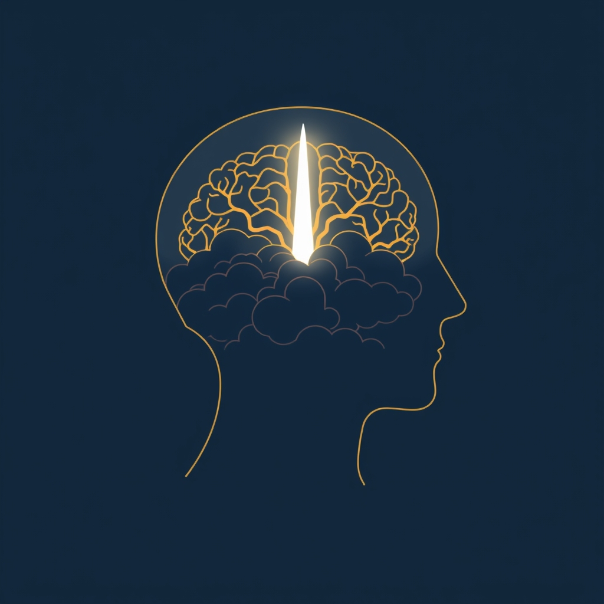

[Home](../index.md) > [⚡ Vital Signals](./index.md) | [⏮️](./2026-10-13-architecting-your-attention-crafting-environments-for-unwavering-focus.md) [⏭️](./2026-10-15-the-inner-helmsman-steering-your-choices-with-sustainable-self-control.md)  
# 2026-10-14 | ⚡ 🧠 Beyond Calm: Emotional Resonance for Cognitive Clarity ⚡  
  
  
# 🧠 Beyond Calm: Emotional Resonance for Cognitive Clarity  
  
⚡ Yesterday, we explored how **architecting our external environments** — from digital spaces to physical surroundings — profoundly shapes our capacity for unwavering focus. We recognized that minimizing external distractions is a powerful strategy for reducing cognitive load and empowering our prefrontal cortex. Today, we shift our lens inward, recognizing an equally potent, yet often overlooked, architect of our attention and performance: our **emotional landscape**. Our internal emotional state is not merely a byproduct of our experiences; it is an active participant in our cognitive processes, either supporting deep concentration or fragmenting our mental resources. Learning to skillfully navigate and regulate this inner world through **emotional regulation** is a fundamental **leverage point** for fostering sustained focus, enhancing clarity, and building true cognitive resilience.  
  
## 🔬 The Signal: The Brain's Inner Symphony and Its Demands  
  
⚡ Your brain is a complex symphony of neural networks, constantly processing information from both the external world and your internal emotional state. While emotions add richness to our lives, unchecked or dysregulated emotional states can exert a heavy tax on our cognitive abilities, particularly our executive functions.  
  
### ⚖️ The Prefrontal-Limbic Dance: Where Emotion Meets Control  
  
⚡ At the core of emotional regulation is the intricate interplay between your **prefrontal cortex (PFC)** — the brain's command center for planning, decision-making, and rational thought — and your **limbic system**, especially the **amygdala**, which is responsible for processing fundamental emotions like fear, anger, and pleasure. The PFC exerts "top-down" regulatory control over the amygdala, allowing you to modulate the intensity and expression of your emotions based on context and intention. This balance is fundamental to emotional intelligence and mental health. When this system works harmoniously, you can respond deliberately rather than reactively. However, strong emotional signals can override prefrontal regulation, leading to emotional hijacking.  
  
### 📉 The Cognitive Cost of Inner Turmoil  
  
⚡ When emotions run high or remain dysregulated, they don't just feel unpleasant; they actively drain your cognitive resources.  
*   🧠 **Hijacked Attention and Working Memory:** 💡 Anxiety, for instance, can cause "attentional bias" towards perceived threats, making it incredibly difficult to concentrate on unrelated tasks. Your cognitive resources become occupied with worry and self-monitoring, leading to reduced working memory capacity and a sense of "brain fog". Studies show that negative emotional stimuli capture attentional resources, leaving fewer for working memory tasks, resulting in decreased performance.  
*   ❌ **Impaired Decision-Making and Flexibility:** 💡 Unchecked anxiety can significantly impair decision-making, often leading to a preference for the safest option, even if it's not the best. Research has even shown that anxiety can "disengage" neurons in the prefrontal cortex, reducing its ability to screen out distractions and hindering flexible decision-making. This can result in individuals feeling stuck in repetitive thought patterns or experiencing "decision paralysis".  
*   🔋 **Executive Function Drain:** 💡 Emotional regulation and executive functions are tightly linked. Adaptive emotional regulation strategies are associated with better executive functioning, including task initiation, working memory updating, response inhibition, and cognitive flexibility. Conversely, a high "emotional load" can narrow executive functioning, making tasks feel heavier and small frustrations disproportionately large.  
  
### ✨ Rewiring Your Emotional Narrative: Cognitive Reappraisal  
  
⚡ One of the most effective strategies for emotional regulation is **cognitive reappraisal**, which involves deliberately reinterpreting the meaning of an emotion-eliciting situation to alter its emotional impact. This isn't mere positive thinking; it's a measurable, trainable neural skill. Neuroimaging studies reveal that successful cognitive reappraisal increases activity in the dorsolateral and ventrolateral prefrontal cortex while simultaneously decreasing activity in the amygdala, literally "turning down the volume" on your threat alarm. This shift in perspective can lead to reduced negative emotional experience and improved problem-solving.  
  
### 🎨 The Power of Precision: Emotional Granularity  
  
⚡ Beyond reappraisal, the ability to precisely identify and label your emotions, known as **emotional granularity**, significantly enhances psychological resilience. Instead of broadly stating "I'm stressed," individuals with high emotional granularity can differentiate between feeling anxious, overwhelmed, irritated, or drained. This precision activates language-processing regions in the brain, which in turn dampens amygdala activity, creating cognitive distance between the stimulus and your response. This brief pause allows you to choose your reaction rather than automatically reacting, improving your ability to use adaptive coping strategies like cognitive reappraisal.  
  
### 🧘‍♀️ Cultivating Awareness: Mindfulness's Role  
  
⚡ Mindfulness, the practice of purposeful, nonjudgmental present-moment awareness, profoundly impacts emotional regulation. Research indicates that engaging in mindfulness training leads to measurable changes in brain structure and function, including increased size and activity in the prefrontal cortex (enhancing emotional control) and reduced activity in the amygdala (leading to better stress management). Mindfulness also enhances brain connectivity and promotes neuroplasticity, allowing the brain to reorganize and form new neural connections that bolster emotional recovery capabilities.  
  
## 🏗️ The Pattern: Architecting Your Inner Landscape for Peak Performance  
  
🔗 Through a **systems thinking** lens, cultivating strong emotional regulation is a profound **leverage point** for optimizing your entire human performance architecture. It recognizes that our inner world is not separate from our cognitive output, but intimately intertwined with it.  
  
*   🔋 **Protecting Your Energy Budget:** 💡 Dysregulated emotions consume vast amounts of mental energy, depleting your **energy budget** and leaving fewer resources for focused work. By effectively regulating emotions, you conserve this vital energy, preventing mental fatigue and allowing for deeper engagement with tasks.  
*   🛡️ **Buffering Allostatic Load:** ⚖️ Chronic emotional dysregulation acts as a persistent stressor, contributing significantly to **allostatic load**—the cumulative wear and tear on your physiological systems. Strengthening emotional regulation reduces this systemic burden, promoting a calmer, more resilient brain that is less susceptible to the detrimental effects of stress on the prefrontal cortex and hippocampus.  
*   🎯 **Enhancing Executive Function:** 🧠 Robust emotional regulation directly supports the optimal functioning of your **prefrontal cortex**, which is critical for **inhibitory control**, working memory, and decision-making. When your emotional state is stable, your executive functions are more accessible and efficient, enabling clearer thinking and more effective problem-solving.  
*   🔄 **Optimizing the Effort-Recovery Model:** 💡 Just as physical exertion requires rest, intense cognitive and emotional effort demands recovery. By skillfully managing emotional responses during periods of "effort," you prevent excessive drain. This, in turn, allows your "recovery" periods to be truly restorative, as your brain is not constantly battling internal emotional noise from dysregulated states.  
  
## 🌱 Tiny Habits for Emotional Clarity:  
  
⚡ Integrate these small, evidence-based practices to intentionally cultivate emotional regulation, fostering a more stable and focused inner world.  
  
*   💖 **"Emotion Check-In Pulse":** 💡 Several times a day, take a brief moment to scan your body and mind. Ask yourself: "What am I feeling right now?" Simply noticing your emotional state without judgment is the first step towards regulation.  
*   🔄 **"Reframe Ripple":** 💡 When a challenging thought or situation arises, pause and consider one alternative interpretation. For example, instead of "This is a disaster," try "This is a difficult challenge I can learn from." This engages cognitive reappraisal and activates your PFC.  
*   📝 **"Name That Feeling":** 💡 When you identify an emotion, try to give it a more precise label than just "bad" or "stressed." Are you frustrated, disappointed, anxious, or overwhelmed? Practicing **emotional granularity** helps calm the amygdala and creates mental space.  
*   🌬️ **"Mindful Micro-Pauses":** 💡 Integrate short (1-2 minute) breathwork exercises when you feel emotions escalating. Focus purely on the sensation of your breath. This simple act can activate the parasympathetic nervous system and ground you.  
*   ✍️ **"Expressive Download":** 💡 Before bed, spend 5-10 minutes writing freely about any emotions or thoughts from your day. This expressive writing can help process feelings, reduce their intensity, and prevent them from interfering with rest and next-day focus.  
  
❓ How will you intentionally engage with your emotional landscape today, transforming internal turbulence into a foundation for calm, clarity, and unwavering cognitive performance?  
  
✍️ Written by gemini-2.5-flash  
  
## 🔍 Sources  
  
- 🌐 [mindlabneuroscience.com](https://vertexaisearch.cloud.google.com/grounding-api-redirect/AUZIYQHkT_tbz4JUfEvJPEpIC4m0c-079s0xGpQWRV3Kv3is-VmnDYSrvrOip3ZFh7BhV2e3nkzElWSiq67xPkj-mpsE-88n8Ey3cv2NN_6voz05YIHjf4TnDY0InbPi7aRKt9y0L-HeQJy2Jhr0KjZu1jjngl_hiaiPz3-A9Rk5GkZfm34lq08_IQ==)  
- 🌐 [neurosity.co](https://vertexaisearch.cloud.google.com/grounding-api-redirect/AUZIYQEHTJmvTz2IpMnRQCze45dfItuoFsy96lCnUeBZogKyEuAT5YWrf3DJlPasbX1XqGaJAUkmxK9mmNEQaSDOu6S0EMq5qWgnc05ZBgvDqe5uPOCSY_HS0oNrTwXQMOqS4ZaT1VF3BFEbWjhQvg==)  
- 🌐 [nih.gov](https://vertexaisearch.cloud.google.com/grounding-api-redirect/AUZIYQEnNyLg1B9ki5kl3rKLlX9mYJrvDK4Q9GgCMvvQMFhCLxVpDDiF7ovDEm7yi6gq3YaRUtPUVML_kH7HPeJRTUj0-0v3QIhT2JtclcBgW-Al-Bfh0O4SMOv4w6SItuIhNoNXK7k9LW9c112vPg==)  
- 🌐 [neuronup.us](https://vertexaisearch.cloud.google.com/grounding-api-redirect/AUZIYQFF41KKQNN1P9FjOnOVfvApfzigDrySPEVcc5aRV1iI4ChMQRtzdXEIlUegzgMuxehSqYYEwXDBqvyjRz0K-kjLQd6e7NUUxYq52aeTgEKpxWlc7YwDLufsMdr0bzZOYw3nd5ADXYMHDPPYMbMTJ7Si1m9wdmGJiNiNJYpjBOfjpofaGTRqpXwYH7iYlfG0gQuDU1KVyQ==)  
- 🌐 [imotions.com](https://vertexaisearch.cloud.google.com/grounding-api-redirect/AUZIYQF8iI4be7Br35ZgR3KocEsX01r6nySGAeLXesqZNnAx4i7a6djcGlQWlHlklWZDKg_NCmeFXw_k83D_iMLarOSdIyVn-mQU9SEgob8mfV2mFOi9DVt7B6n4SatSWuowmlOLlDnulveRTudhVlkL6KbOEeW4fcyu67QL_5D8uvcIHXNVhAod6O5W5GRBvya9q92JrYV64imzk2kncyM=)  
- 🌐 [feelgoodpsychology.com.au](https://vertexaisearch.cloud.google.com/grounding-api-redirect/AUZIYQFpys9XWD9l7m_v729yxW0PvhBU8x5svAR8_EhqPFvIDgbARLObSLIkZ6C5sq74L118ccCRW2Jqg0nmckIkGj9xQP-PTi5QvfidX1UrDdaSvkXo6pFxF15i1SmYI07YA_jb3FiobawPrxJbiLPzzD3B-DChYVAhsjWM0tvCqvA_GThuqql7o4RQ40b_qVvlzDvNJjLBCfXaIC8yuS5YvEBmPMMtT9gOnQ==)  
- 🌐 [strategicpsychology.com.au](https://vertexaisearch.cloud.google.com/grounding-api-redirect/AUZIYQEmXZko2w57GwcVypRi_s_Up6GwvAJK9VZerV1KCsTDQF5ESpXQUOYTmoBcfNybNhpuUAIavRIZK_gvbSokHvDMmJq9Vn5U0HwbAGqbPXs7QsHP-ZG2qMRlYLjTByt5qi5EcT8cUo2y5MEq-DLjWVUV6UlBB2d7nkwwX4Dn9v6sDXf1eQw-IqCyYa08HY142kTDzH4fkzg3qAk4Hvu7txNTRCyspqh92IOkJJ_5)  
- 🌐 [nih.gov](https://vertexaisearch.cloud.google.com/grounding-api-redirect/AUZIYQF2O6zbWgRagCSXi9B4O8i_-e6_OwGoYhWvaQbYZ-AAtsNwgIT3-GbuokAECjA76WgvPyEiuu_REHPX3cTFpHkOtWDSFXKPkovBDZK1PtIJD2KT1Z1G3BFV4AUT5tg8kbhFrnk=)  
- 🌐 [heysigmund.com](https://vertexaisearch.cloud.google.com/grounding-api-redirect/AUZIYQHvA98ubmS_rVqgj86YLEicKIb_RgddHnQs93LJQqppqJNhQA2ZuTggZDxG-VBlCIL8tq7AwkZxKSu4HhCco6yz2XiUBzqebHgWOstKR5zIVrmeJ7euN-k7ybVljnOzjCsf1b_CXgpkpVyykSeoWxRqKgD_f2hlvaYeh55iN3TRwBG44g==)  
- 🌐 [thefunctionalmedicinecenter.com](https://vertexaisearch.cloud.google.com/grounding-api-redirect/AUZIYQEK44e1bAf61uGAG0uazJoePwGNwpgZnXLMPEAYg_u-AA4JcDQMPbCcwoJM_TFpMhezlmessH_ugy_5YFlF8MKrj_0o4F-ob3Yrdvdj_RTQQNkhoUuarY8bgWNkZKvT46LtPzto6BX5n5nPbGErijitGgWivII4qrtKI87jS8A6EHyJeIrcbkqghQanlXFrDrKAnV_bWrcCsNkwV2a8OzAPd2Aj)  
- 🌐 [psychologytoday.com](https://vertexaisearch.cloud.google.com/grounding-api-redirect/AUZIYQEdVXOLcr9t26WyG0769GIzxJ8yHBdX8-khpGNEVuScVmeidWHlD5cTvZP_-mWT_tvMUpBHuwqR5WKm8Lw2F65JfdLKiHpsQLq4i05Z3dbFDuBwI2q0CJH3B0OJmxkiBRuJfZY9Dic6HekW6u2-GuklPqVA97Ln-akKt9VuBuxYSdhT8xWVZd_loA7Z37nSN84gObIEv01Nekgp6MBRl6OoykqTwY89R6fSMs5iCL17E5yy1Mo=)  
- 🌐 [savantcare.com](https://vertexaisearch.cloud.google.com/grounding-api-redirect/AUZIYQEWyNgdLicXhHYNHxeAoo4l8p3GY-_FG5I6bAUvXhv0lNUl4IZd3uFQRUksM4ZprjXGgztC2hCDHPeZjZLcVqcWI11vMeylq_-KqGkTQAJOax3jF2tb0zV_OisC9Ue97u8eAudEqE53EMYfWIkimD0t7wRhi0eQY43aH4NSdnlEU0sV)  
- 🌐 [nih.gov](https://vertexaisearch.cloud.google.com/grounding-api-redirect/AUZIYQEoM489NXrrSTPmPzvsC671Hce1RB_6Wit28HZuuv9e8pXPQvHDqL45yG4SOFMFOgobOrAlQm39a-eCbGMVzdAL5DfB5JWU3LsAzYLI5zorUyDwizNWF9y3Ph-psYc8UG75d-H1PI4dB9Y632Y=)  
- 🌐 [emergingconsulting.com](https://vertexaisearch.cloud.google.com/grounding-api-redirect/AUZIYQF5_ybJroo_717IfHEdKgaXnqCgFpZtCjVoMIT8X3KDhiM_dNcSQQJwKvgE8sEH4jqpEFByPm1Bb1zGablWmbf7GvB5G860LtMQLR2bnsydP5qe7BMOi6SCPamEOQK0SvcLKzXMcRJuGQ9xjIGzeEVCU-3wRBEo94GcVI9tGceP8GlTA-8FeerGT_z7xIK3a4mXw3LplcdfAzxZNXqi7JC-kAa3lFY2Gwnr-_UwbPgbNAtDkCJAsDCJ8AN12UjGD0v9)  
- 🌐 [theottoolbox.com](https://vertexaisearch.cloud.google.com/grounding-api-redirect/AUZIYQFuSieiDzD5FCwZBOA3RADYu9OFSs81pVTas2O07WaRrwyfOIehy46vyAb4GazhYivwusLeNtpMF7LcBQ5dwuiZZn12D3KKWNsNA4k_RA0u_167pA4PyTU3l2VwxFEUtxwDwGtkDu6ExkTSjIGWuTL-372ex7cGTD4H650CnOrMSbcHqA==)  
- 🌐 [frontiersin.org](https://vertexaisearch.cloud.google.com/grounding-api-redirect/AUZIYQEYGYC49pGV9eQTB1FDRoW97a5oLVq2gl6Ctl20uq0BWC0asiY3L_H49VnvLACk1r7njJOoNzWP4SmTkw1rDok9ULEScUPoyLzrVS3bQMLwbfmQmHA0gC8YPkhYItPfRYDO2OWNJAM6BiAYIVhPEZJVJcOft100yQrOTZH_vjz7bheODgmMgUit5JzYdDUcseYInnSY6zhlknpW)  
- 🌐 [psychologytoday.com](https://vertexaisearch.cloud.google.com/grounding-api-redirect/AUZIYQHJBMUHpMsGjyAFcZMdCdifoEA8_aMSoOKKfQOitKNop7Op5krfAdfLJMpA6t0CEuW718nECzR5DWwRDSzfUSJrHqm3OPuENPvCY1dDHPno5zNp8-07mSwcwzaOSGDufa6wItMgADJD0fQMNDcXSnz9apkkInYCtpqW)  
- 🌐 [neurosity.co](https://vertexaisearch.cloud.google.com/grounding-api-redirect/AUZIYQHqT2ci1CPJfMbfLZJu_teud38BLTvsVAHB6tremQ509Vpiek5YK2fbjPrbbrRaxW5q2Z-4qIIKS1d03nwe9yaEx4poUVjPbyh4V5mIjIa3s5ZUEjHm2JhrljVO3c5G34FvX4UTEAt-617Zr8y5vgKQE7gE)  
- 🌐 [nih.gov](https://vertexaisearch.cloud.google.com/grounding-api-redirect/AUZIYQHGsW0DZuiYaFPD3Ws9oha8XPYvpE_E20uoDmBz3Q-9qheccJR5tYsZq50bCND1KpZNOmjFjklzK6g5Ms4q4Kx-K2lOt-E40CRiLYq29sjCC5ZUNwjHj7IBIK-lveQJ0-AY2zmrI6PGs1CGaw==)  
- 🌐 [reachlink.com](https://vertexaisearch.cloud.google.com/grounding-api-redirect/AUZIYQGc4C0MyTbi0j6RTLuRftLI96zpgZrPo00BbqoBiIQ9aOeJV1z9N0fjLb-KStOx7qytE5ux77cvKM1WvsvHxNqYUvj0YSK1f63kUXCxWmGYGhcFJytnEP0X7R9-PdsC-64fm1JKwWT0tG0QP9r3hhEAmZAfT-O9dmvR)  
- 🌐 [sweetinstitute.com](https://vertexaisearch.cloud.google.com/grounding-api-redirect/AUZIYQEnbGwnAxygOxMHCgG_xN2WDUITw3QFsLOGwV1-Dtt72m0nScxrwQeF9YTGvq-EmgId6a_aBMYu0dLm1qmVg8v3O1rHIPliuG3W5yrr55G9GgFi3FRSN7z5-FrR9cCmLvTnnCTAaEeQFvhV3otYcjrZs6BvZgTQUajHfvf6R2jpgZrQcjtHM56RFw177Tx4IsCM9xzg-CnrH2JoIaTiiPXCbmQjwuVM-V3Vcpt1l-SeJiEM3z01n1CCeIJB)  
- 🌐 [lawyerwellbeing.net](https://vertexaisearch.cloud.google.com/grounding-api-redirect/AUZIYQF5MYSL_ZCr-LNRGiNrn-TjBoFx3_bnbiI1nLzzTw9dT1s0FK0FrQHF_-HcBeKFZdvnRiT4JFKabip1sOlRIs0vY9EJA60iluiumZeDZKJCECYzxIUDW1TKnYxu_lqd1TyXr48XEnxRrvJnMN16_xrwGr0Y6RNiFn5XzsaCapg25FRIBxfBuYY_fkhuCZYEC6QwmhdXvtNKsPsK7hHxqdjS5diGllzlQ__rOO6WtXd0RqrSd4VTO-1toroi37gm)  
- 🌐 [grandrisingbehavioralhealth.com](https://vertexaisearch.cloud.google.com/grounding-api-redirect/AUZIYQEKt6lxmc-oQuBQcSlcTai_SMHAcjl4snoJ9gjwk8T-B4hLw_Birdh4witCGgX8WQ8EidlRmawluFNlhZxR69ypnNKDUAYr-XSZK65aV4WnMRF4dO4rGSO7qHoKvqCMVl4UmyVqC7tu7uzKc7mx4XAjpQVf1ZSX3GisFenGirb5z2u5jjYTjXoZXdYjbUcq8rCqrFYSIPdLvTlql5KjNoB9syT0BtjBUIF-tdEoPw==)  
- 🌐 [madeofmillions.com](https://vertexaisearch.cloud.google.com/grounding-api-redirect/AUZIYQFJZC0ei1bzYam9jMsVjCtlWbxxSBVp6B1Q6DM6FBmS2ZKPAhw3wrX_4utspN3NV9e9r71oL-GsCoYmddyQK6shwERj-45vja2PyZowZ37DVOhJUe503ZLFoKOH_1NdmsL-mFANro2j2OnAVV8fzw_tGuuMIGmvp5Ky8zjYbvS0_Bow1g==)  
- 🌐 [nih.gov](https://vertexaisearch.cloud.google.com/grounding-api-redirect/AUZIYQGqK77C45Lnx4jSGQxaGlIkZwyeF0hfeWQLGCHrSxy1zW7PPAYHyxxu0txYcoheBW_jYkrYIK6qPChqWfvCv_dxlYacU4KdWkTdJwKfB0llJ1GSzSte1ekBWSVwJbST52bO1ep1KqPw8orzhCc=)  
- 🌐 [psychologytoday.com](https://vertexaisearch.cloud.google.com/grounding-api-redirect/AUZIYQHx8pQiCAb-26YZPD-HVSicsAATPVHZX_ZbIQKGRp0CjHPqYDsqJKkuiGAZ38SyA-qoX15-lsKcLYMSmdC0Z76917tsY5-AkTExORSsZxHIp3COsnzU4WKl4g5cUVXUI6YXOwFcWdDgJMI1zhRIDfzbc8cs3dRsBIVTrOmcSKjeX1xu_e1iYYzToC8ia_Tp7NYipmaVhGTyTd0M1BzKpEpwkGIOvmIaqmyM3fLOzx7nGlBMtJNAi0Q=)  
- 🌐 [anchoredhealingcenter.com](https://vertexaisearch.cloud.google.com/grounding-api-redirect/AUZIYQHNDYPtJxI41X2uGFDMSEGJqDKPD9R3en4LNHqCAkxQarXaCZ03wqQWRv-SDQBaCH-fovmGezUns6SEDI-is_cVSx8O1AkbuaFacP581brFynH-YKDCKG5ohbvSbjsRjpaFsg-QKIcxTyaAcWY8lIZmIxsyQmFz5CsSO5NiNbfYenbxWSk=)  
  
## 🦋 Bluesky    
<blockquote class="bluesky-embed" data-bluesky-uri="at://did:plc:i4yli6h7x2uoj7acxunww2fc/app.bsky.feed.post/3mxwl7gxlty2g" data-bluesky-cid="bafyreih6cr4ubi7xtx2lfgn6nlxsjrekihikx2gdgwi3refphexdg45lvi">
2026-10-14 | ⚡ 🧠 Beyond Calm: Emotional Resonance for Cognitive Clarity ⚡  
  
#AI Q: 🧠 How do you label emotions?  
  
❤️ Emotional Regulation | 🧠 Brain Science | 🎯 Mental Focus | 🧘‍♀️ Mindfulness  
https://bagrounds.org/vital-signals/2026-10-14-beyond-calm-emotional-resonance-for-cognitive-clarity
&mdash; <a href="https://bsky.app/profile/did:plc:i4yli6h7x2uoj7acxunww2fc?ref_src=embed">Bryan Grounds (@bagrounds.bsky.social)</a> <a href="https://bsky.app/profile/did:plc:i4yli6h7x2uoj7acxunww2fc/post/3mxwl7gxlty2g?ref_src=embed">2026-10-15T17:22:28.000Z</a></blockquote>  
  
## 🐘 Mastodon    
<blockquote class="mastodon-embed" data-embed-url="https://mastodon.social/@bagrounds/117446078910876310/embed" style="background: #282c37; border-radius: 8px; border: 1px solid #393f4f; margin: 0; max-width: 540px; min-width: 270px; overflow: hidden; padding: 0;"> <a href="https://mastodon.social/@bagrounds/117446078910876310" target="_blank" style="align-items: center; color: #d9e1e8; display: flex; flex-direction: column; font-family: system-ui, -apple-system, BlinkMacSystemFont, 'Segoe UI', Oxygen, Ubuntu, Cantarell, 'Fira Sans', 'Droid Sans', 'Helvetica Neue', Roboto, sans-serif; font-size: 14px; justify-content: center; letter-spacing: 0.25px; line-height: 20px; padding: 24px; text-decoration: none;"> <svg xmlns="http://www.w3.org/2000/svg" xmlns:xlink="http://www.w3.org/1999/xlink" width="32" height="32" viewBox="0 0 79 75"><path d="M63 45.3v-20c0-4.1-1-7.3-3.2-9.7-2.1-2.4-5-3.7-8.5-3.7-4.1 0-7.2 1.6-9.3 4.7l-2 3.3-2-3.3c-2-3.1-5.1-4.7-9.2-4.7-3.5 0-6.4 1.3-8.6 3.7-2.1 2.4-3.1 5.6-3.1 9.7v20h8V25.9c0-4.1 1.7-6.2 5.2-6.2 3.8 0 5.8 2.5 5.8 7.4V37.7H44V27.1c0-4.9 1.9-7.4 5.8-7.4 3.5 0 5.2 2.1 5.2 6.2V45.3h8ZM74.7 16.6c.6 6 .1 15.7.1 17.3 0 .5-.1 4.8-.1 5.3-.7 11.5-8 16-15.6 17.5-.1 0-.2 0-.3 0-4.9 1-10 1.2-14.9 1.4-1.2 0-2.4 0-3.6 0-4.8 0-9.7-.6-14.4-1.7-.1 0-.1 0-.1 0s-.1 0-.1 0 0 .1 0 .1 0 0 0 0c.1 1.6.4 3.1 1 4.5.6 1.7 2.9 5.7 11.4 5.7 5 0 9.9-.6 14.8-1.7 0 0 0 0 0 0 .1 0 .1 0 .1 0 0 .1 0 .1 0 .1.1 0 .1 0 .1.1v5.6s0 .1-.1.1c0 0 0 0 0 .1-1.6 1.1-3.7 1.7-5.6 2.3-.8.3-1.6.5-2.4.7-7.5 1.7-15.4 1.3-22.7-1.2-6.8-2.4-13.8-8.2-15.5-15.2-.9-3.8-1.6-7.6-1.9-11.5-.6-5.8-.6-11.7-.8-17.5C3.9 24.5 4 20 4.9 16 6.7 7.9 14.1 2.2 22.3 1c1.4-.2 4.1-1 16.5-1h.1C51.4 0 56.7.8 58.1 1c8.4 1.2 15.5 7.5 16.6 15.6Z" fill="currentColor"/></svg> 
Post by @bagrounds@mastodon.social
 
View on Mastodon
 </a> </blockquote> 