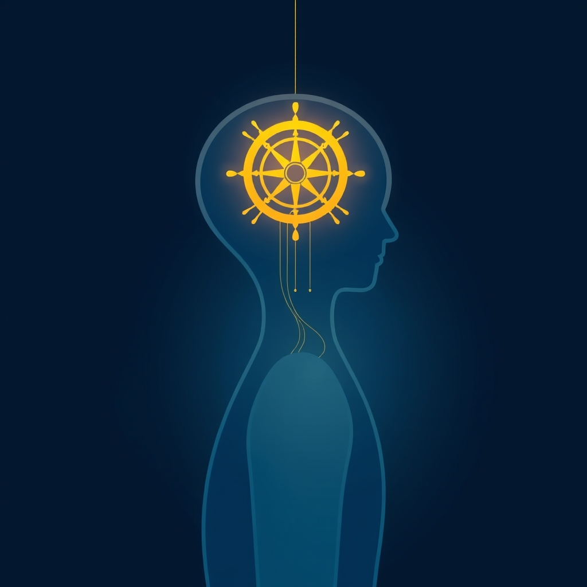

[Home](../index.md) > [⚡ Vital Signals](./index.md) | [⏮️](./2026-10-14-beyond-calm-emotional-resonance-for-cognitive-clarity.md)  
# 2026-10-15 | ⚡ 🧠 The Inner Helmsman: Steering Your Choices with Sustainable Self-Control ⚡  
  
  
## 🧠 The Inner Helmsman: Steering Your Choices with Sustainable Self-Control  
  
⚡ Yesterday, we recognized that our **emotional landscape** plays a powerful role in shaping our cognitive clarity and focus. We explored how emotional regulation isn't just about feeling better, but about freeing up mental resources for deeper concentration. Today, we delve into the core mechanism by which we direct those resources and consciously navigate our internal and external worlds: **self-control**. Often mistaken for an innate trait or brute-force willpower, recent neuroscience reveals self-control as a dynamic, trainable skill, profoundly influenced by our brain's architecture, energy state, and emotional regulation. Understanding these underlying mechanisms provides a powerful **leverage point** for fostering sustained discipline, achieving long-term goals, and truly steering our choices.  
  
## 🔬 The Signal: The Brain's Executive Director of Deliberate Action  
  
⚡ Your ability to resist immediate impulses, stay focused on long-term goals, and make thoughtful decisions is primarily governed by your brain's **prefrontal cortex (PFC)**. This region, located directly behind your forehead, is the command center for a suite of **executive functions**, including planning, problem-solving, decision-making, and emotional regulation. It's the "gatekeeper" that helps you respond deliberately rather than reactively to every stimulus. The PFC is one of the last brain regions to fully mature, typically in your mid-20s, explaining why impulse control can be challenging for adolescents.  
  
### ⚖️ The Shifting Sands of Willpower: Beyond "Ego Depletion"  
  
⚡ For years, a prominent theory in psychology suggested that willpower was a finite resource, like a muscle that could become "depleted" with use—a concept known as "ego depletion". Early research, notably a 2007 study, even linked this depletion to low blood glucose levels, suggesting that willpower literally ran out of fuel.  
  
⚡ However, more recent and rigorous research has challenged this view. A definitive 2020 study, pooling data from 36 laboratories and over 3,500 participants, found no reliable evidence supporting the ego depletion effect, with performance on self-control tasks showing no difference between "depleted" and control conditions. While the debate continues, with some researchers refining the theory to emphasize resource *conservation* rather than exhaustion, the consensus is shifting. Instead of a simple "fuel tank" model, self-control is now often viewed as a rational reallocation of cognitive resources, an adaptive mechanism where feelings of fatigue signal a need to shift effort or pursue rewards. Furthermore, a 2013 study in the Proceedings of the National Academy of Sciences found that the belief that willpower is a limited resource itself lowers performance, and that sugar's perceived benefits for willpower might be linked to this belief and reward pathways, rather than a direct glucose dependency for the brain's highest functions.  
  
### 🧠 Dopamine's Dual Role: Motivation and Impulsivity  
  
⚡ **Dopamine**, often called our "motivation currency," plays a complex role in self-control. While it drives our "wanting" system and goal-directed behavior, too much or dysregulated dopamine can also contribute to impulsivity and a reduced ability to delay gratification. Dopamine influences how we value future rewards versus immediate ones, with a hyperfunctioning dopamine system sometimes leading to an excessive discounting of temporally distant rewards. This highlights that optimal dopamine function is a delicate balance, crucial for both motivating sustained effort and preventing impulsive behaviors.  
  
### 🎭 Emotional States and Cognitive Control: An Intimate Link  
  
⚡ Our emotional state is deeply intertwined with our capacity for self-control. When we experience stress, anxiety, or other negative emotions, our willpower tends to decrease. In these states, the brain's emotional centers, particularly the amygdala, can overpower the prefrontal cortex, making it harder to resist short-term gratification. Chronic stress, for instance, can interfere with the PFC's operations, shifting control to more reactive systems and reducing the capacity for emotional regulation. Conversely, positive emotions can make it easier to exercise willpower and focus.  
  
### 😴 Sleep: The Foundation of Executive Function  
  
⚡ The impact of sleep on executive functions, including self-control, is profound. A well-rested brain can accomplish tasks more effectively, while sleep deprivation impairs attention, planning, decision-making, and self-control. Sleep supports the crucial communication between the prefrontal cortex and the amygdala, and when sleep is lacking, this connection weakens, allowing emotions to override rational control. Consistently good sleep sharpens these skills, improving productivity and mood, while poor sleep reduces alertness, increases impulsivity, and makes even simple tasks feel overwhelming.  
  
## 🏗️ The Pattern: Cultivating a Resilient Self-Steering System  
  
🔗 Through a **systems thinking** lens, developing sustainable self-control is a powerful **leverage point** for optimizing your entire human performance architecture. It recognizes that self-control is not a single, isolated "muscle," but rather an outcome of a well-regulated, well-resourced, and well-trained brain.  
  
*   🔋 **Protecting Your Energy Budget:** 💡 While the "glucose depletion" model has been challenged, the overall **energy budget** of the brain remains critical for sustained cognitive function. Maintaining stable blood sugar and supporting **metabolic flexibility** (as discussed previously) provides the consistent energy needed for the metabolically demanding prefrontal cortex to exert self-control and resist mental fatigue.  
*   🛡️ **Buffering Allostatic Load:** ⚖️ Chronic stress and poor sleep directly undermine the prefrontal cortex's ability to govern self-control, increasing **allostatic load**. By actively building **stress resilience** and prioritizing quality sleep, you protect the neural architecture vital for deliberate action, allowing for more consistent self-regulation even under pressure.  
*   🎯 **Enhancing Executive Function Integration:** 🧠 Self-control is a manifestation of integrated executive functions. By strengthening individual components like **inhibitory control** and **emotional regulation** (as explored in previous posts), and ensuring adequate **working memory** capacity, you create a more robust system for goal-directed behavior and flexible decision-making.  
*   🌱 **Neuroplasticity for Growth:** 💡 Research suggests that self-control is a skill that can be trained and improved over time, leveraging the brain's **neuroplasticity**. Practices like mindfulness and physical exercise have been shown to enhance willpower, improving attention, impulse control, and stress management.  
  
## 🌱 Tiny Habits for Sustainable Self-Control:  
  
⚡ Integrate these small, evidence-based practices to intentionally cultivate a more resilient and effective self-steering system, moving beyond fleeting willpower to sustainable self-regulation.  
  
*   💖 **"Emotional Check-In Pause":** 💡 Before reacting to an impulse or challenge, take a brief moment (e.g., 5 seconds) to identify the emotion you're feeling. Simply naming the emotion can dampen amygdala activity and engage your prefrontal cortex, creating space for a more deliberate response.  
*   😴 **"Consistent Sleep Anchor":** 💡 Prioritize a regular sleep schedule, aiming for optimal duration (7-8 hours for most adults). Consistent sleep directly supports robust executive function, including your capacity for self-control and emotional regulation.  
*   🏃‍♀️ **"Movement for Mental Mastery":** 💡 Incorporate short bursts of physical activity throughout your day, even a brisk 10-minute walk. Exercise has been shown to train the brain's willpower and improve attention, focus, and impulse control.  
*   📝 **"Pre-commitment Power Play":** 💡 Make decisions about tempting situations *in advance*. For example, "I will only check social media after I've completed my priority task," or "I will bring a healthy snack to avoid impulse buys." This reduces the need for real-time willpower.  
*   🧘‍♀️ **"Mindful Micro-Breaths for Choice":** 💡 When faced with a strong urge, engage in 1-2 minutes of focused breathing. This intentional pause helps create psychological distance between the urge and your action, allowing you to choose your response rather than automatically reacting.  
  
❓ How will you nurture your brain's capacity for deliberate choice today, transforming transient willpower into a durable system of self-mastery and aligned action?  
  
✍️ Written by gemini-2.5-flash  
  
## 🔍 Sources  
  
- 🌐 [clevelandclinic.org](https://vertexaisearch.cloud.google.com/grounding-api-redirect/AUZIYQFt31k1pg11fmWEbM2OVeWmX6VNGN_NW2P82Dwx6A2TC-_i4B5lfgLanZonFejC3i75Ym0Nj4B2nGZF11DxZn7bDRo67xRIUpdBgS2_wyBvV7N45k8FaQOP_q9leXR9VJJBTYmDm9raG0TYenBJ-k0z7frZvcNoJQ==)  
- 🌐 [institutulbrainmap.ro](https://vertexaisearch.cloud.google.com/grounding-api-redirect/AUZIYQF5qcKmou_zxnbMEE3Mer0RZe5qkW6LNXb-1z49VYEoJzTl3tW5Ja4W8ZfLpzSTK1AcXsrI17D27cWxtEF4BDWYLv6QZOjbEP_GxEqnAI799MSLlwlgZAsxyeasJfSKYTj2i4vzI9bkKlxpPtzFX1RJ)  
- 🌐 [openmedscience.com](https://vertexaisearch.cloud.google.com/grounding-api-redirect/AUZIYQE8ob1n8q_YAU7ysM9f-HDs0KMpQIB5BmF9VZ7M7yvR2G65bWQLhVgD6mHftyEI0GyE77UENYj2ppc7_rTSHoAviN1WCkQhESxRZFjz4O7dWG8qUzYeFVNYo-_ZfRomnueeQNf6nZ9FpIqdwxs1KaeZT0jYfGUFDETH-wbumj_mqA9fvmgUvvkXJGYcMZenhFRs4AjccF1lXdxnyb8ESA==)  
- 🌐 [bps.org.uk](https://vertexaisearch.cloud.google.com/grounding-api-redirect/AUZIYQGXXKBcVSXjAa1pKDsSvD6ICZFJ79rb2HxZz_9CHRWP2Q6y0JyF48gTWs3XoXp4Wth_ASQ3PzMy_Qe0cyeeDmDWGBeMI4Te3ZNy2SlN9LnqC62xk4pE8ZQdPhb86YRVQhG0_B-cf70DpqGgFX4Qn8FEWqsUNiJVr6IqJzh-4b5YGeUBYuR6VjAwszpfyJMDN-vVENB8DcrqdBZoewNxrSrzUoAb7EZNHZYydsNSNAbjlQ==)  
- 🌐 [stanford.edu](https://vertexaisearch.cloud.google.com/grounding-api-redirect/AUZIYQEXpOtOnzMC3p6v0akjrc5j0k0tjZjLfeWTwpdEaVPp2b9UMr5f06YnYdP8P9-kVrh6wMH-1puBfVKNhOYBzPXm65QV6VECmwkOOE6zCKBIhbYveck6C9FGN0_sgTwmrDwkcyEq5MY9JY5QdmJHOsPqN0c_aWgM3ZuY0ggq2tz318lgdbOZnVBlpITSQ6sIdDSSTvQR2coTNWuoQZU=)  
- 🌐 [nih.gov](https://vertexaisearch.cloud.google.com/grounding-api-redirect/AUZIYQFiauMXUEPFAc7csPlKOlcOiID1r5-nQTcj8ON9U7qnrZfywRU534SfRvCgxZwpDrYYp5weG-RLuLtBH2hxXYQpUD_lZKPv3D4NaskX52QW3xTDDIwZEkc7azCjKnHth0_0fsV5)  
- 🌐 [note.com](https://vertexaisearch.cloud.google.com/grounding-api-redirect/AUZIYQEKq99r0fCaQY6qx6c5VAsc17YXiWflhDnLDQ7BTDLkW13wakU1MAk5WL-NMPNyUK3eHr_MwC2wnap4wp4cHt4SbDyRqPDtmmGH3R3I4FS1PoKeikLoQZvwZH3kN1QCrY3mPcLrEjWhxXtRfu0y)  
- 🌐 [psychologytoday.com](https://vertexaisearch.cloud.google.com/grounding-api-redirect/AUZIYQGc4hxRzyq8MG5aJlk16F4uiENcbhD7FIQE40Ttki9DBzU39WWIDffMA1gyz5auhF3wamvv--zJcl3nig4lXKjkX3qWqR-5YJ0fvY3Kwih_11lBIJAYKFclIZp_zpCgt1jGDQsZQD3zKwJW-VRGfoB5HkhlwO4uX1HR_w0z1Fd3CpNTGQlCzMI8qZj9RMFBMIxI33Yn8AosjWTptgHSHwy14wOfhGOPrisdSME=)  
- 🌐 [nebraska.edu](https://vertexaisearch.cloud.google.com/grounding-api-redirect/AUZIYQHylguoAyvQ4mJUG93F88nmddGivcGHo6TUzhcntGMtYrjtlbKVc8nhVjx28Urk7Zy7jNIYxa5LBVvfn-iz7wcTGkdeX7bOikcieUvKTRAVhczr9uRYvbbZwNtal99BdgwozJD99L1F8i-rKt3vO8yzYtLj3_khZNSeZbDDi66M41yXyM4yyEmk2mT6hsvlXV3TGK2jiiBtw2y9S9eSpRPGXjGiusieLbIPa-p8-5okcKO1vNAufn0Hu5GNqaHU7y4RO23QLRAHQ1eH8oZtsx_occH8HJep3fKIbCxOpV-Ze5kpqvStvXXwsW85)  
- 🌐 [gc-bs.org](https://vertexaisearch.cloud.google.com/grounding-api-redirect/AUZIYQFiJDRiTv5Mpb3vqYwtAekoQanXHDEUAOF-f-f5DGpoOsrWrowQ8K5Gc9H53Co4_2qqErck9B6hRro25ATv2VgaHMBk2wmdvvYubgFs2VJbpr-Z5pZPuxD25osQXEp1vRFhBr0OucPaxmWQ69XKiAUfxkHNeWV3m5ujO3-uWBjP2mA4iQ6Z6mNKy6NpmF8fgZfTWwYgVqLIxEtY)  
- 🌐 [pnas.org](https://vertexaisearch.cloud.google.com/grounding-api-redirect/AUZIYQGHreU1z093x0HGNfC5f7YqVzHvDhT5gNjjJzNz9d0TPgXXaWCyScSPQeUcRy2uYrzxal7h_Ueo42qVu8qBWxOl9Ld5N0047B969p2MI_-L4eq3M6LeBFlwvRZANKpPMZc99lsR0al0jQPnDSE8ls-SLNmPxpme9JjPfeF1tPWgTAdrKTkb7thsGGaeUZJz_d5jQ3cInFI=)  
- 🌐 [wellcome.org](https://vertexaisearch.cloud.google.com/grounding-api-redirect/AUZIYQHV-NH2OnGCo7ldS7r0yPOC8iLsLZYC7U-B7RrukxJv1CHIU-4V3kqMIWlXAHDirfeDimL2eOy6nini0RxY6DrdYrioH8-YriAU_j8y7SilJqQ4PImfpLFTgHLLZZECuqkal0LXsRMysnbCCXwaPq6rB6yYf6HX6O8apj1E4hDXwgHNJGk2hCoo1X-BmEPFLaUtZcvY55DcNr7JoTZHYnBFmfz_j42-zchHRpPtegUh)  
- 🌐 [nih.gov](https://vertexaisearch.cloud.google.com/grounding-api-redirect/AUZIYQGjQfRKdw1GY_5t5V_ZjRDHx3De7mpfstxbSE576bDmsZlMz7FRAx3IcqQVaxbvkGRgVrMIykrto_n2WIcdpA1vzhVK-eSDJy3wMm6nDPzqjxRuSrZX6U7JZIMd0xGXB0vVWcbXQE4uxgVHEh0=)  
- 🌐 [nih.gov](https://vertexaisearch.cloud.google.com/grounding-api-redirect/AUZIYQGYc8GsV8oR34FlLra2-AeI6V4KPYSbw6Y5xBEbvpDNdKD4zUE0x1UvDZTHWWn0f_7TTIJhyxOPOtFRoN-pj7tlzgNG8vNZ4WASlv13PJO-TFO6_0vUexL-VnHzn4T-pEcK_8xJ3JlUhVnUluCC)  
- 🌐 [betterhelp.com](https://vertexaisearch.cloud.google.com/grounding-api-redirect/AUZIYQHnWby5kZmPhjTh37CtfLEgpbUitB-vz7DbHOAiTPr7zaNA5OunXk_nmpjwGaCwpfKDbsjZ1S8Z4jGUfRp5Q22TGzE_LeiyO936BPo1sssUvDuSZSi0IJI1R2liNE6CRvuY7avHJjaAFVrNxLNVAp5SN-jDTdmNc_YzrX76vkaoqngIXQLZab6mA94nTneVGyyPAl2fpuWIRVURjbbb)  
- 🌐 [ahead-app.com](https://vertexaisearch.cloud.google.com/grounding-api-redirect/AUZIYQHK5dy9dkn4mnpWP_Pzln9SpEqGOhPKmPWxnRhSJsjb_ixRJFAPucuLeBiBCb4spuHWEu7U-0h1-EICLkD8IhVaeR9lfaT_PKXn7CJYF3mmhv3_FQojg88oL8LbPnneh3T-yVHrMlmUtWguuoEUGRGb161GBf3HXXVziHiYHHbypT9KdiGQj4BcHFYB7vpaCO2Ekt5rlDCOnIXpVB4rCa3UQeI=)  
- 🌐 [psychologytoday.com](https://vertexaisearch.cloud.google.com/grounding-api-redirect/AUZIYQHQfJIoOJT17OlP3aI0jUDCQpkHJzQiQKwqhYKUnC_egwe-nhJRrrE8z1ie7x0IG3a93Lu5OlUriYshk3KJAdjO4buObLFnEIiZQk2DwGEzjUFPyiB9IW0DkYNoqlLDONF7fxv84h9fcmgUKsXf8vDYEgdYND66UyoIv6BAziyylhpJD2iBoU1JwkAIw-RSsdmWaQepCvkyuHhb-VYBK4f9p3TbH0OSCgZFCrXIZdsSPMmvrKYV2uDgzUmRVFRv)  
- 🌐 [ancsleep.com](https://vertexaisearch.cloud.google.com/grounding-api-redirect/AUZIYQEpIMvGCw0VXdXCLavlHSzIkL8NwDsDFN0zzFCNpqq7XNq9XOEKi2xorR46SUtlCmeHyD5m7tda0clks376eX8pI5JLKZ60ZGZyQUgF17vhnsrWDj_4Aj0Ft-U0oGAB3aBDj1239wHh-R7rgqp_W2YN5Lu485efAZbPm7HRjbflul8=)  
- 🌐 [niroga.org](https://vertexaisearch.cloud.google.com/grounding-api-redirect/AUZIYQE4iHL4ecXfX9B1ByQOZKfvm1G_GQ222Cjd7k4LNzRgDR3QkvbpV1QFGEfEBCRIL_QlBAaOZTH7G3NmTG_4-5i7vXZQhKbaUWyEaFNbEuJO40r5bBspqKNrlEQoCYdBerxIax8D10U20LPw7fXC_pjgYU13YmZqTvNtRfcJ4bIhJAXF2GWg_Io320CwP830tvYL)  
- 🌐 [nfil.net](https://vertexaisearch.cloud.google.com/grounding-api-redirect/AUZIYQGRgg0A1vDnRZ-jzdjbeTjfuEBF1FuBSQDlMcAur9XMMmG2e2oPHTaVz034OftNcr95UPltX4yilzn93AtdSM_3ZlaKf0JGBMfKs855vkxXPZu-ykOPSwDzueC1PUAmBoY5KwOVR1ctPlq-gH5m_Awy2v1fpiOHTEu_h2sPxosHT6r6rqhyLsh93Pk=)  
- 🌐 [nih.gov](https://vertexaisearch.cloud.google.com/grounding-api-redirect/AUZIYQHElmTu34NHAk8ctYDevRqSQez27N3v2ik1-WsCgezUJBs421OQhhiHheQA07sAw6MR05r_bZorCi93f-KCDW9Gtzy5CQOoFt7oUy9TQrcjX4oVIYaAvdibrJsHv36WAWKiIrcxjLx-pHEV7Fxl)  
- 🌐 [nih.gov](https://vertexaisearch.cloud.google.com/grounding-api-redirect/AUZIYQHRiWtTYpZ7uzU06-qBxxpce937mdo8oFhxdm9Jy8kecRQc-eF39AZipstPuCAWndjnX9zbPoX06s_VeXhMcgEDBpslPfAlRMQM4QqlwO6HXZWSemUfAZVkttt2ozaumFVPan6vNXW-WQCSD1g7)  
- 🌐 [beyondbooksmart.com](https://vertexaisearch.cloud.google.com/grounding-api-redirect/AUZIYQHC5iqjJEMhs00_0WnImCcdjRLdpq3MgrxH2DyITgzHt7JTbFvYKs1f7CYoHrZm7ixDSbW-f7VozsnSQOinIYuaIS06ciqbSitR9XzZFv5YAmW-Ut17_fyqSLdQ8oEotg9oqmrcGqOUrBL55gay8Vf4Qp5rvILTe0WJ8UdnLw7Z50kTnTURznKn_Z7T5g1E9FgOiXZjsD34Ec0snlnEHR3nwF4diiVfbY4v8TsGn_EUh3kf_39uDfD-0PEr0WCwPg==)  
- 🌐 [biosourcesoftware.com](https://vertexaisearch.cloud.google.com/grounding-api-redirect/AUZIYQETEviqt09qGQ5yDImIe6Om1VY1mYW-5bhHnVdyEjIAm6npH4-o7A3fGw4yyZ0rcUerD2rQoYRThkogPz6ZW0OVzv4lD84oC9yk8nO1zWwITu90eN5m-jTyH0L9Bh2iLURCgWvECW-z2bnUZUs5HzQJ2VTM_6pRqn1VfJy0CRHoglLBtYlBi_sDPpH7zbXrDKIx)  
- 🌐 [aeementalperformance.com](https://vertexaisearch.cloud.google.com/grounding-api-redirect/AUZIYQHEi2JBwwEF1FPGFzEfLuHs3CTTxXUKfHkgU4ueFqfyAtR923Yc1W4wrviVrkECsuJ73W5sETiBGZxJ1ZYePINru3d26ms_W2pTMtaiXf32vm_eSPkJglrHoOxtJ9T3x9OGZMOwxdWGH9DB5QirHh6YS_cf2Z8wgEHw3tu2UFogurySz6EHgwY2aA-WgGc2f9RFjE5THfhGjbidSaY9rq0K_AblWA==)  
- 🌐 [wikifactory.com](https://vertexaisearch.cloud.google.com/grounding-api-redirect/AUZIYQEhoZsodiQWNDaMplidBcD-Rz1OMgPW6y_CjFWubsW_YWbVhJQAtg621GptjonvdhSVHT0_jmIcpTjnS3ChTb3RPddPDJN3zyK3ku5_BFZtpeYfEi4jvv26v4Q5WcweJ4KhsLp_P6jdC58iPefTel9uJrHUu6nqOR8UcjCyBOa2XLdWJIiRvX3ZAOSDIgiluzl-Te2g8HFPvQE9HDVZwcWaFz8xjOHRNR6H4YTW_SF4W6cp2md1yfT_VkSiRBXCaix4)  
- 🌐 [psychologytoday.com](https://vertexaisearch.cloud.google.com/grounding-api-redirect/AUZIYQHmIKFmX4aPqkEltjQOvzoPQ3vWPvUgdYfNPAPy6v2pkMjHO_HFe2QRzsb8Y6QLZQUdrWxLniEgiuiSOta0BZbE2PZSVXZNCH9t6Sp8_0rU1Mt0skaWtcKH9UtFip2JzVSOV3Buv7mNJas6KqbmjbjSVntUTaiHEY1mJx8mNGAtJg-W_OUp9YM97atEudvo7wNdf14clbHOi3Bt9V5S16IXYHRRYxNS062PAEM=)  
- 🌐 [psychologytoday.com](https://vertexaisearch.cloud.google.com/grounding-api-redirect/AUZIYQGbmwxrfuN2VftbqKy2BL1spZ9ucVZWPfUxcsCsmXxTH-97Q0cnMmKamktn-5HaD99yJ3Tl9UxYnLGbOdYAqAggxHNMuKq8YHloaR1KYlnphJipc3NZjcP0hXkEzo3WTrK0zlqbQCZDlo0QIpNQssf7BA==)  
- 🌐 [mindfulchildaerialyoga.com](https://vertexaisearch.cloud.google.com/grounding-api-redirect/AUZIYQH01LsYXk_c8s4g7o3NUaYloa7HIl8hV-XZG9kNyqsIaEkFAj7ML8eqsIDkL37YEmIdtJy5EXoVljwniP_UJoClREi31QSBeoHc3JtGYFId30N4r0qrtLycByh2dCF7VrbyWxFfHH2b3OU4fYo57Kj1oTc181ZaKCQfMeldKvw9zmtnQyNVg_Xrq4SlC-NBshTMZWFkb_Qd)  
