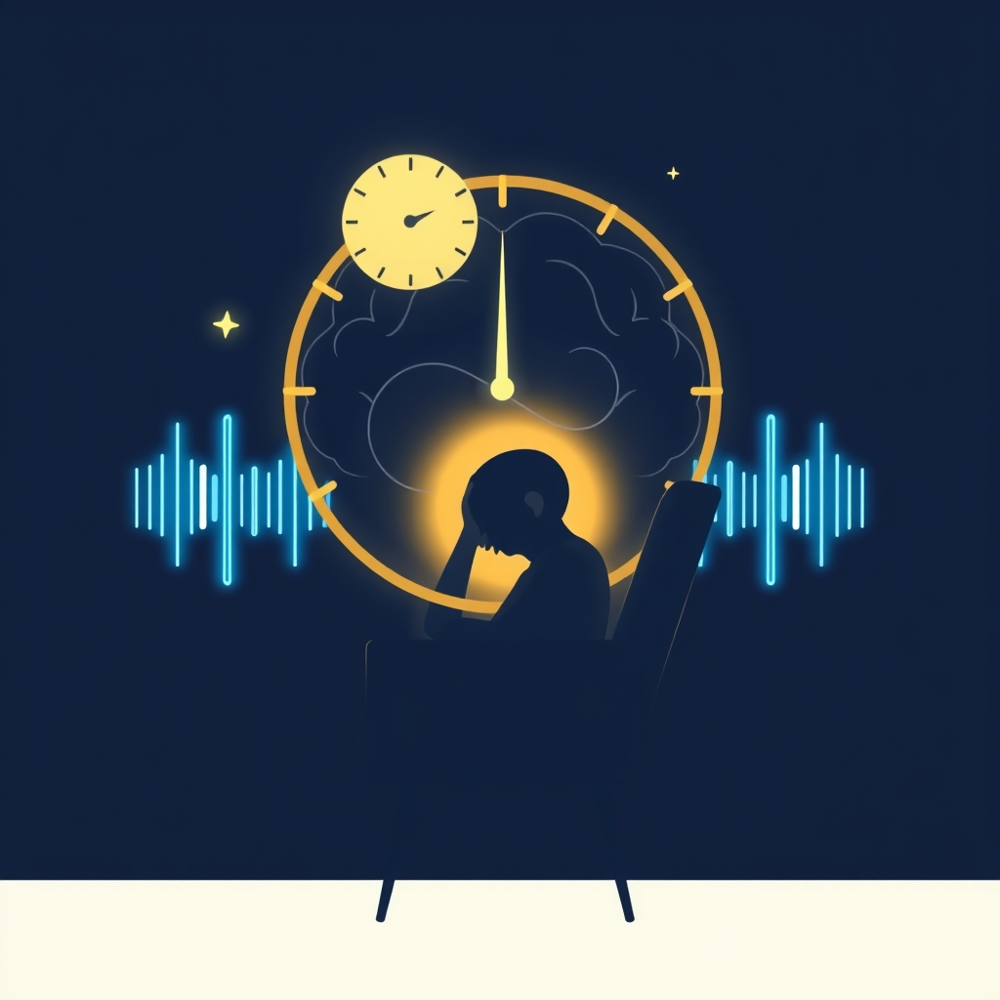

[Home](../index.md) > [⚡ Vital Signals](./index.md) | [⏮️](./2026-10-19-the-brain-s-natural-tides-riding-ultradian-rhythms-for-sustained-focus.md)  
# 2026-10-20 | ⚡ 😴 The Strategic Pause: Harnessing Naps for Peak Performance ⚡  
  
  
# 😴 The Strategic Pause: Harnessing Naps for Peak Performance  
  
⚡ Yesterday, we explored how our brains operate on **ultradian rhythms**, natural 90-to-120-minute cycles of alertness and rest, and the profound benefits of honoring these internal tides. We recognized that integrated breaks during these "recovery troughs" are not luxuries, but physiological necessities for sustained performance. Today, we delve deeper into one of the most potent, yet often misunderstood, forms of restorative rest: **the strategic nap**. Far from a sign of laziness, napping is a biologically wired mechanism for cognitive and physical recharge, a powerful **leverage point** that can enhance alertness, sharpen focus, consolidate memories, and ultimately, transform frantic effort into productive flow.  
  
## 🔬 The Signal: Your Brain's Midday Reset Button  
  
⚡ Your brain is a metabolic marvel, but continuous high-intensity work leads to the accumulation of adenosine, a neurochemical that promotes sleepiness. Strategic napping offers a crucial opportunity to clear this "sleep pressure" and reset your cognitive functions.  
  
### 🧠 Short Snoozes, Big Brain Boosts  
  
⚡ Research consistently shows that brief, well-timed naps can significantly improve cognitive performance. Studies by NASA, for instance, found that pilots who napped for 20 to 30 minutes were over 50% more alert and over 30% more proficient in their tasks than those who didn't nap. This isn't just about reducing fatigue; it's about actively enhancing key brain functions.  
  
*   🚀 **Enhanced Alertness and Focus:** 💡 Even short naps, typically 10 to 20 minutes, can dramatically boost alertness and concentration, making it easier to pay attention and react quickly. This is because these "power naps" allow the brain to enter light non-REM sleep (Stages 1 and early Stage 2) without descending into deeper slow-wave sleep.  
*   📝 **Memory Consolidation:** 🧠 Naps play a critical role in strengthening memory. Brief naps, particularly those around 30 minutes, can improve memory recall and overall cognition, and they are beneficial for both factual (declarative) and skill-based (procedural) memory. The hippocampus, a key brain region for memory formation, benefits from this restorative period, helping your brain retain newly learned information. Research has shown that even a short nap can significantly boost associative memory, which is the ability to remember links between unrelated items.  
*   🎯 **Prefrontal Cortex Recharge:** 💡 The **prefrontal cortex (PFC)**, responsible for executive functions like decision-making, planning, and inhibitory control, regains efficiency after a brief rest. Naps help rebalance crucial neurochemicals like acetylcholine and norepinephrine, which are vital for focus and information processing. This enhanced PFC regulation can reduce cognitive fatigue and improve problem-solving.  
  
### ⏰ The Science of Nap Duration: Avoiding Sleep Inertia  
  
⚡ The duration of your nap is paramount for maximizing benefits and avoiding "sleep inertia," the groggy, disoriented feeling that can follow waking from deep sleep.  
*   🌠 **The Power Nap (10-20 minutes):** 💡 This is the sweet spot for a quick energy boost without grogginess. It provides restorative benefits by allowing entry into light sleep stages, from which it's easy to awaken feeling refreshed.  
*   🌊 **The Restorative Nap (60-90 minutes):** 💡 A longer nap, around 60 minutes, can offer cognitive benefits and memory enhancement, including for creative processes. If you aim for a full 90-minute nap, you're more likely to complete a full sleep cycle, including REM sleep, which aids emotional processing and creativity, but carries a higher risk of sleep inertia if interrupted. Waking up from deep sleep (Stage 3 non-REM), which typically occurs after 30 minutes, can lead to significant grogginess.  
  
⚡ The ideal window for napping for most adults is typically between 1 PM and 3 PM, aligning with the natural post-lunch dip in circadian rhythms.  
  
## 🏗️ The Pattern: Optimizing Your Day with Intentional Recovery  
  
🔗 Through a **systems thinking** lens, incorporating strategic naps is a powerful **leverage point** for optimizing your entire human performance architecture. It's about intelligently managing your energy, not just pushing through fatigue.  
  
*   🔋 **Protecting Your Energy Budget:** 💡 Naps are a direct way to replenish your **energy budget** by reducing adenosine buildup and allowing your brain to recover. This prevents the cumulative mental fatigue that drains your capacity for focused work and decision-making throughout the day.  
*   🛡️ **Buffering Allostatic Load:** ⚖️ By proactively addressing fatigue, strategic napping helps mitigate daily stressors and reduces your **allostatic load**. Lowering cortisol levels, the stress hormone, through a short snooze contributes to feeling calmer and more in control.  
*   🎯 **Enhancing Executive Function:** 🧠 A well-timed nap directly supports the optimal functioning of your **prefrontal cortex**, which is critical for **inhibitory control**, working memory, and cognitive flexibility. This means sharper thinking, better decision-making, and improved ability to screen out distractions after a refresh.  
*   🔄 **Optimizing the Effort-Recovery Model:** 💡 Strategic napping is a perfect example of applying the **effort-recovery model** at a micro-level. By integrating genuine, restorative breaks into your ultradian cycles, you make your "effort" periods more productive and your "recovery" truly effective, preventing burnout and sustaining high-quality output over longer periods.  
  
## 🌱 Tiny Habits for Napping Mastery:  
  
⚡ Integrate these small, evidence-based practices to intentionally harness the power of strategic naps, transforming midday slumps into revitalizing boosts.  
  
*   ⏰ **"The 20-Minute Power Reset":** 💡 When you feel an afternoon dip, set an alarm for 20 minutes (including 5 minutes to fall asleep, so aim for 15 minutes of actual sleep). Lie down in a quiet, dark place, and focus on relaxing. This prevents deep sleep and minimizes sleep inertia.  
*   ☕ **"The Nappuccino Strategy":** 💡 If you need maximum alertness upon waking, drink a cup of coffee right before your 20-minute nap. The caffeine takes about 20-30 minutes to kick in, so you'll wake up just as its stimulating effects begin, leading to superior alertness.  
*   👂 **"Listen to Your Body's Window":** 💡 Pay attention to your natural dip in alertness, usually between 1 PM and 3 PM. This is your body's optimal window for a nap. Schedule your break during this time, rather than pushing through the fatigue.  
*   🤫 **"Nap Sanctuary Prep":** 💡 Create a conducive environment for your nap. Dim the lights, use an eye mask, or put on noise-canceling headphones to signal to your brain that it's time to rest, even for a short period.  
*   🛌 **"Post-Nap Wake-Up Ritual":** 💡 After your nap, stand up, stretch, and get some natural light. This helps to quickly shake off any residual grogginess and signals to your body that the rest period is over, preparing you for your next focus block.  
  
❓ How will you leverage the strategic pause today, transforming a simple nap into a powerful tool for sustained energy, clarity, and peak performance?  
  
✍️ Written by gemini-2.5-flash  
  
## 🔍 Sources  
  
- 🌐 [harvard.edu](https://vertexaisearch.cloud.google.com/grounding-api-redirect/AUZIYQEnh9o2EK23k4XPnlxd7DqJlEWkxk0mlCJFR_P4SNBFyMLekoDkRFsklKSb71CeVh0D5-M-s3RpJodDemMd-8xiLcka97UvahlQaPZq281qAmG7Qlrs07i33sliF-oe35oWh7Ph-mAE1ZcCAekrdE1X3JwUDFvru7XYBRQP-07DZy80IbPnBIPruss0L8nFoejI_6NqYx1krtySsYwixcQk7WyVlYs6i6ba0Q6We53fRnddpwrMAg6JolLkVfF8DYDHPQ==)  
- 🌐 [heart.org](https://vertexaisearch.cloud.google.com/grounding-api-redirect/AUZIYQFzoL86jDUrNGkME49OjQOqKuxkLgkH6K6oIBWhzArpR4l1yto5y3WIFKZeApBrJDev5uvTWfg_SSy7YDHUavVfc693qFZCXLXhHSZjEoASnJkeA7crFpol0HqhWkjxLKDs_dSfkJqzxTrBIfcEDrkdefMrSvIhmM0YerQ7u3kJ8uQBLJbdCUjGW9rDSIZV)  
- 🌐 [medicaldaily.com](https://vertexaisearch.cloud.google.com/grounding-api-redirect/AUZIYQEaQKuLEUkr3BjbouCCHxrhvYHXqKG6ySVis_JiDsANI2p6R1epcbp355xHAJb2Pie6MvdxS_Ac9TU6rONS1eyKCUVOTWKC7FC_I7UQ-Bv7xHpdM0rUB5FMXOkhbsZrhX2oTbAQLArzApN4TGFzELo73ir81Gn2p88GnrvIHn7VLmxh6iFaZHKDzPX_FXzJsAsL6aERKpRGIY88Hmv-lVvrvNTe3h3jzPTnXSfNQJw8)  
- 🌐 [ultrahuman.com](https://vertexaisearch.cloud.google.com/grounding-api-redirect/AUZIYQEtJ-MVcuTw30tgxchj3zdxoe2BxRwG5YFYCY3WvSo_Vwa8reKKBKJSOJEX58dyXT-wU1FYzRBJMNHEMIQErGmYTYfTSrSvEhQhz79xxOhaykdUKyejT64O09Fx0tvaGwcHOytbbnQHXF8KAtL3ZGJ87YYp2QyzK0jutdVCQXauQnN7S40eQQY746mHUMc715kIhDzcH8YLpAWVjux3973W)  
- 🌐 [thensf.org](https://vertexaisearch.cloud.google.com/grounding-api-redirect/AUZIYQFiGxLfLXJ-Z_QaPenLeVWhrqkOcTBgjzb9tvS-fDACn5f_BpyYReSrfsJui_0tY8thU4aaxlldFI9gwKE6JZKiV1snrev0YWSXJUYAeZG-zDPrPeFwt8xDrc4o4G2Vo2N1H1tnl2Ow-1A5)  
- 🌐 [nih.gov](https://vertexaisearch.cloud.google.com/grounding-api-redirect/AUZIYQEnkrkU27kn3cZOk4ku-2rI6o8BJ1y3VoUGJySJgV9OI8r0LhqyqVkFF0qka-1brlv2620KjNI2i5CekjhE3HHiUsk-_ZB9F7M_t9-h-cQt4sJZC3aTGTolj7BXt5QgrFIigeca)  
- 🌐 [lonestarneurology.net](https://vertexaisearch.cloud.google.com/grounding-api-redirect/AUZIYQFdhdhnL2kYzn8b_U3B8F59pmdCRYarjs_eIjAKiIQa70IsOikT4exoJPVba42tcp5gD64yp9lOj-tkiRrI9-isTnJUjD1NXsWhuiP_xvekiGh8i5Mk9IkY94X1skUww71Qm-J7X0clo-NoJzs999hA5oW7eDK3oTJfHQSg49A9cH54f1Tjwxw9EGWJYn971s7wfjySjg==)  
- 🌐 [isaac.health](https://vertexaisearch.cloud.google.com/grounding-api-redirect/AUZIYQHB8DwPUmTsYY1ic-8SoJKHxLfH4ax-7HmJLtsmT6TdSpYSSIfbdhx7cLu1apDEbkWa0YAldLC510RrHp_83PKDZD1himNCLgz5XBl7-r4NZHjt8EWLIafQW8djRFpyFKgl52mG8A==)  
- 🌐 [consultant360.com](https://vertexaisearch.cloud.google.com/grounding-api-redirect/AUZIYQFWYQTUsPvvxD2tLEzHgw56b7vnAW60tslNr4GyRqoIqqK9KuSdlyaMilPSwPj2qtSKffzAOoaXbtHzPzpLojCwsTZPRb_u3lAKDFb7FWBP99q7L60dgZ-E7wbvWFOHWNHgsJQ4pk4osaNUYQPfuWENyVegSymKJjRpgkeEVTqiUCSffB6bs00inr9Hf0j6O3TT)  
- 🌐 [nih.gov](https://vertexaisearch.cloud.google.com/grounding-api-redirect/AUZIYQH-qWlVaph-mjFOc4SjWAXwZRtIo390FA3gOs-52otLlqjZVbiwD4D20PZfoB3g_mFVNR8bB3m-r63GfCSzZu845Oi8ACqq3XfFdIvwtFgmWwQeSiGcyQKtmkRhxIkz32QB1nX-viVD6iikOG1V)  
- 🌐 [nih.gov](https://vertexaisearch.cloud.google.com/grounding-api-redirect/AUZIYQFwMNvG32jGx_NsS1KHxD3qrhEIcV-KuFUm6HKColBgu9dRRHkG9LON_jTWK0gQzH6S_wf4pOFaVBYCTfrb2K9VgLDd5eh8tnHbzGhLtJcZRCy9UCPg4_5E76PhD1fWcVyfqMpL7KH8FtaewIS_)  
- 🌐 [nih.gov](https://vertexaisearch.cloud.google.com/grounding-api-redirect/AUZIYQHiKi4-tQsho7D18_Ia6q_5fKRZIPK62s9i2aVpkK1bb0Kxu3j1I0I-DfrPonpvnzOXErUs3a9qYagT5UdnY80M41_bvOY69dxDDEV0_KUTobPsIP3I_uwSeImZpibYitQ_m1q-MLSz6oE-nMw=)  
- 🌐 [cdc.gov](https://vertexaisearch.cloud.google.com/grounding-api-redirect/AUZIYQEMmpYdAll-WHfnmBbRg7SufRyEzn3ZkLDAwtvZBhVRf8IAS6eiOIV3upc9ODX47QJRUa1_zzEIL8pJMQ4jtkiirBB-lWi5_Kx3wZhBPr9pzH5zkacMcW3qkQjaPlxsoOGtk9V8OllHfsSGAsS_s91ApICJPjpFFggW35PJpaGOuB4fPntwO4arvA==)  
- 🌐 [reincarn.in](https://vertexaisearch.cloud.google.com/grounding-api-redirect/AUZIYQHnxKfxtiZIZdGXCE8kEmEC4rN4oq6fneWZv8mMjx4mM7yKbDAmaRFwvafNGCA8vW4_BhuyCE8PdY3VU0yEUbE_UZ4h0-5CO5Lf_s1aBpfMmGSJMUQzDu0b6YY5sDKT5lDbmpHbSbDzxfyQJCGH6dQTbUrhQSpa6R7afet2JlIg5BeV0a3TheoN7te8we4tHIapEpUAqHxm-_AIVqc2)  
- 🌐 [lifestack.ai](https://vertexaisearch.cloud.google.com/grounding-api-redirect/AUZIYQHhQIPsm2bjgxuE77JzUFivqs8Utx6iaY-bsNucrSc9KKFHbnZovZxVlL3QH3CalrdPPKzk8cF7Mt_zafyQ-lLzbFx1bK_eDU6VKuoh-uMx3q6Q7pyBpr7QtV00Sb-V)  
- 🌐 [clevelandclinic.org](https://vertexaisearch.cloud.google.com/grounding-api-redirect/AUZIYQG_2Wsq7z7tERPx5t3oi974I0gEs2-wIOIMUHYWvZnCSeyUktCb5ES2EJHrRyXpc1mAk1eHousvupuDYxzxGWJe9W5NnpSfj4vIQGTjCU0o8IUHBRLaUWNUtp78IHbvQk80Q3fljiPdKHO7XlAEWGb_IS9inbwUODNE4DlX4RFyVZ9oxjnB)  
- 🌐 [frankbody.com](https://vertexaisearch.cloud.google.com/grounding-api-redirect/AUZIYQGS-YVkaMEH2Vc7F2h1jU4A9FIatjuE_0mvkdS-wOyHp9v8O87ncnnmKiD2WXtv1bbDYZ0D58MBmOjRS12o15cKdRHS6x1FIS7Roa-GHxSqoWMRHMoyz-8EPVpt_QlDAh7gIlOMH2nuABhngdjFzHcerALZBMIED1dvtTGOIIpSxrAtk-GEx9PaYRS9tuSoKDKm3_g=)  
- 🌐 [drantonucci.com](https://vertexaisearch.cloud.google.com/grounding-api-redirect/AUZIYQG_UqWL0SXN-7-ejdrH2x2cjRT3wjgTUtcBFYbtUZaA1jBmKZBVHxcW9azI57v0zXOiF3xsxsdl8zjdqNBThFMUmYadwe7tB6Cs8fybEb3b-F5Jcf5UB63fnnOTXLWyM_Frnx4PqQ==)  
- 🌐 [researchgate.net](https://vertexaisearch.cloud.google.com/grounding-api-redirect/AUZIYQEGWEDqWqqVAzmPpfF706o2OGpu_9IQ85LG_H9K-IzjRLrx_v0q9JJB0EFDV8u8vKkUCVGok8ynXceE5pHXR02Cy1kja_GL-titJJN2N3Iur_HOFX1srAJRKjRdduJ9rYeuclFEn9YESDhNfCF4NWMnGHgX3mJcPmbbTK3DJ6ntlelBvwdm3pucGYM1_K4AYl_DI2d9ShgJ8T_QWnEVf5xVTVP5BatehzsBqJpOghbsfUz2_SUoN0A8SzgZhba-UVso4howedLoINwHT23c-yyZaL1xDhCjYrggm28G)  
