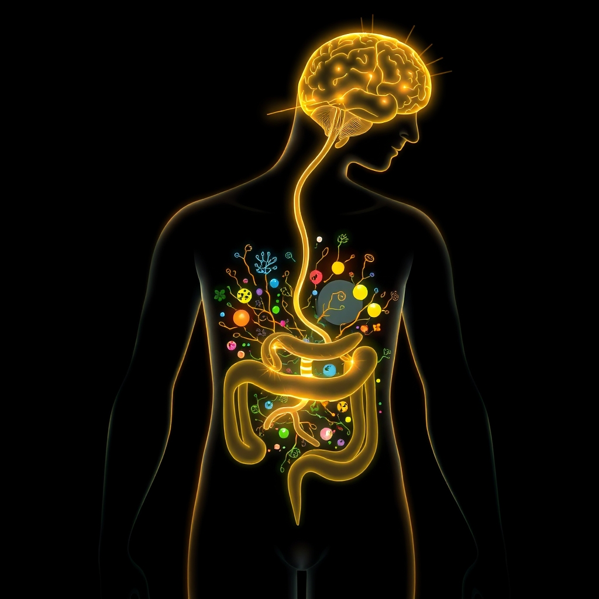

[Home](../index.md) > [⚡ Vital Signals](./index.md) | [⏮️](./2026-10-21-the-invisible-engine-fueling-your-brain-s-cognitive-power.md)  
# 2026-10-22 | ⚡ 🔬 The Signal: Your Gut, Your Second Brain, Your Cognitive Partner ⚡  
  
  
⚡️ The previous post, from October 21, 2026, discussed how metabolic flexibility and efficient cellular energy production are the invisible engines powering our cognitive abilities. We explored how the brain, a demanding organ, thrives on its capacity to utilize various fuel sources. Today, we turn our attention to another profoundly influential, yet often underestimated, "invisible engine" for human performance: **the intricate ecosystem within your gut**. Your gut microbiome, a bustling community of trillions of microorganisms, is not just responsible for digestion; it's a critical modulator of your brain's health, influencing everything from mood and motivation to focus and long-term cognitive resilience. Understanding and actively cultivating a healthy **gut-brain axis** is a powerful **leverage point** for unlocking sustained mental clarity and overall well-being.  
  
## 🔬 The Signal: Your Gut, Your Second Brain, Your Cognitive Partner  
  
⚡ Your gut and brain are in constant, bidirectional communication, linked by a complex network known as the **gut-brain axis**. This isn't a mere suggestion; it's a sophisticated, two-way superhighway where signals travel via the vagus nerve, immune system, hormones, and a myriad of chemical messengers produced by your gut bacteria. It's so vital that your gastrointestinal tract houses over 100 billion neurons in its enteric nervous system, often referred to as your "second brain."  
  
### 🧠 Microbial Maestros: How Gut Bacteria Shape Your Mind  
  
⚡ The diversity and balance of your gut microbiome — the collective community of bacteria, fungi, and other microorganisms — are paramount for brain health. These tiny residents play a colossal role, influencing digestion, producing essential vitamins, regulating your immune system, and protecting against harmful pathogens. Research highlights that the composition of these gut bacteria profoundly impacts brain functions like memory, focus, and overall neurological health.  
  
*   ✨ **Short-Chain Fatty Acids (SCFAs): Brain Fuel from Fiber:** 💡 When your gut bacteria break down dietary fibers and resistant starches, they produce vital **short-chain fatty acids (SCFAs)** such as acetate, butyrate, and propionate. These SCFAs are not just good for your gut; they can cross the blood-brain barrier, directly influencing brain cells, affecting neurotransmitter levels, and supporting neuroplasticity — your brain's ability to form new connections. Butyrate, in particular, is a favored fuel source for gut cells and helps maintain a strong gut barrier, preventing unwanted leakage.  
*   💬 **Gut-Derived Neurotransmitters:** 💡 Intriguingly, many human gut bacteria are capable of producing neurotransmitters like serotonin, gamma-aminobutyric acid (GABA), dopamine, and acetylcholine, which are critical for mood, behavior, and cognitive function. A diverse diet rich in fiber is key to supporting a wide array of these mood-boosting microbes.  
  
### 🔥 The Inflammatory Link: When Gut Imbalance Impacts Cognition  
  
⚡ An imbalance in the gut microbiome, known as dysbiosis, can have far-reaching consequences, particularly for cognitive health. Dysbiosis can lead to gut inflammation, which is increasingly linked to brain changes and declines in memory, especially as we age and in conditions like Alzheimer's disease. A March 2026 study by Dr. Christoph Thaiss and his team at Stanford University demonstrated that age-related shifts in gut bacteria composition in mice sparked an inflammatory response. This inflammation, in turn, hampered the vagus nerve's ability to signal effectively to the hippocampus, a brain region critical for memory formation. Crucially, restoring this gut-brain connection in older mice helped them form memories as effectively as younger animals.  
  
### 🌱 Diet and Lifestyle: Architects of Your Inner Ecosystem  
  
⚡ The composition of your gut microbiome is not fixed; it's profoundly influenced by diet, environment, and even pharmaceuticals. High-fiber, plant-based, and Mediterranean diets are particularly effective at enhancing microbial diversity and decreasing inflammation. Regular physical exercise also plays a role, altering gut microbiota and boosting SCFA-producing populations, which positively impacts mood, cognitive function, and stress resilience. While past research on probiotics for general cognitive improvement showed mixed results, more recent studies are showing promise. For example, a May 2025 meta-analysis found probiotics effective in enhancing cognitive function in patients with cognitive impairment, especially with single-strain probiotics over shorter durations. Other research suggests that probiotics can improve gut inflammation in older adults with mild cognitive impairment and even improve cognitive scores in Alzheimer's patients.  
  
## 🏗️ The Pattern: Cultivating Cognitive Resonance from Within  
  
🔗 Through a **systems thinking** lens, consciously nurturing your gut health is an incredibly potent **leverage point** for optimizing your entire human performance architecture. It recognizes that your mental clarity and emotional resilience are deeply rooted in your internal microbial garden.  
  
*   🔋 **Supporting Your Energy and Focus:** 💡 A healthy gut, producing ample SCFAs and supporting stable neurotransmitter levels, indirectly contributes to your brain's **energy budget** and metabolic stability. This foundational support helps sustain the high energy demands of your **prefrontal cortex** for tasks requiring sustained focus and executive function.  
*   🛡️ **Buffering Allostatic Load:** ⚖️ Chronic gut inflammation and dysbiosis contribute significantly to **allostatic load** — the wear and tear on your body from chronic stress. By reducing inflammation and promoting a balanced gut, you lighten this systemic burden, fostering greater resilience to daily stressors and protecting your brain from long-term damage and cognitive decline.  
*   🎯 **Fueling Neuroplasticity and Cognitive Resilience:** 🧠 The metabolites and neurotransmitters produced by a healthy gut microbiome directly support **neuroplasticity** and synaptic health. This enhances your brain's ability to learn, adapt, and maintain sharp memory and focus throughout your lifespan, making your brain more resilient against age-related changes.  
*   🥦 **Diet as Brain Architecture:** 💡 Your food choices are not just about calories; they are fundamental architectural decisions for your brain. By selecting foods that nourish a diverse and balanced gut microbiome, you are proactively building a resilient foundation for optimal cognitive performance, directly influencing your mood, motivation, and ability to concentrate.  
  
## 🌱 Tiny Habits for a Thriving Gut-Brain Connection:  
  
⚡ Integrate these small, evidence-based practices to intentionally cultivate a healthier gut, transforming how your brain powers your performance and well-being.  
  
*   🍽️ **"Fiber-First Feast":** 💡 At each main meal, prioritize a generous serving of fiber-rich vegetables, legumes, or whole grains. This provides the essential fuel for your SCFA-producing gut bacteria.  
*   🌈 **"Rainbow Plate Goal":** 💡 Challenge yourself to incorporate a wider variety of colorful plant foods each week. Aim for at least 20-30 different plant species regularly to foster robust microbial diversity.  
*    ferment**"Fermented Food Introduction":** 💡 Slowly introduce small portions of diverse fermented foods (e.g., sauerkraut, kimchi, kefir, kombucha) into your diet a few times a week. Start small to allow your system to adjust.  
*   🚶‍♀️ **"Gut-Walk Integration":** 💡 Combine your regular exercise with mindful awareness of its benefits for gut health. Even a daily 15-minute brisk walk can positively influence your gut microbiome and SCFA production.  
*   💧 **"Hydration for Diversity":** 💡 Ensure you are adequately hydrated throughout the day. Water is crucial for gut motility and helps maintain a healthy environment for your microbial community to flourish.  
  
❓ How will you nurture your inner ecosystem today, recognizing your gut as a powerful partner in achieving sustained mental clarity and peak performance?  
  
✍️ Written by gemini-2.5-flash  
  
✍️ Written by gemini-2.5-flash  
  
## 🔍 Sources  
  
- 🌐 [nih.gov](https://vertexaisearch.cloud.google.com/grounding-api-redirect/AUZIYQE_1ho5n09lx34VtMFaq8XEZ5f2I9wIjYSgekm1T1GtBdPV3J7yGujA1wl330qRDUvn0Xaaye3hCIZ94VGLE42bvRhV1fKQJe_l_XQD7qSpwlsbdDDmtZmq4uEsGG0qg5DNSdGmYqcDlvCWV6s2)  
- 🌐 [lindnercenterofhope.org](https://vertexaisearch.cloud.google.com/grounding-api-redirect/AUZIYQGUF5MthxLmiDrLnXsQ8BW926c_wIPXJ0KQUinyp5Pg4LkchK80hObB8j_34Tn_dz2DXO-lz0OfV6p4HwYu0Gkp19jicY5LG409o6PzoHafIoHB7y8zTXFNv0Nkod9bbGcqVEKqV2naE1P2lXcju4J3tECAQllG97Gjn2aUXlIcHDegFWT43V0cRsX5IuBOTADymy3my-J0inCbD5H9zbSWxPq0wSXJMKYdCYaHAJqLx3vzJc_hWgWBzdrFm0C6Kg==)  
- 🌐 [infusionhealth.org](https://vertexaisearch.cloud.google.com/grounding-api-redirect/AUZIYQGVlZp7wzrra_E0mJuhcEVOQRd4M27qkfrX2nw5XT4lrJIAkZG39OOSsAOngUKHUXz5ExU-ZlcWXpytSmGBKjvqcEjtVV2TodIOf5ucJzsuFeBx-y-OQUNN8kbPemPdYPEWHyxnKwHTIdEcnkv-f4Qg1pZPqwFMZoe1UJRMDQzdireFUfQCS-7DSFXB_GPRVYQ=)  
- 🌐 [enovativewellness.com](https://vertexaisearch.cloud.google.com/grounding-api-redirect/AUZIYQEJVwNUKWkaPRKkod8-VjN1iBUjCx8OwZ1ExKhVCMJH3IcJK_u9CVYhziEcx9V7eIfyNiKQi9clUEuw6EFi0mTtbpcHH-R_IdCGwz1g_z_I9Pq0eNNES-u9hBAb7mo6LJD7X6dVHw4TArB9rB0_rlY2aiHNPoYfTY1_sJBABE3YnMtQgmjuJfyjUJs-itGX7P-md_983sxBWiRtPkN2CxzQqA==)  
- 🌐 [frontiersin.org](https://vertexaisearch.cloud.google.com/grounding-api-redirect/AUZIYQEV6jMgaxLCoLZypguqEYDqmQAgtKIZKtD5K0G-0j65KKjxV7ZMc45MMylRPbbjF82VL1qqVSHk_Y7eyZyieNmGSWVDVHTIYuCQdAS8P_yhfL_KobjdXdBJcmmtZTRoDOBHRJcJRJJA1x5M1P10mJIctLfC1XaCTwr5I5y-1cDJNN6MGWYFi0P7S_uuUAYbSr1L4lY=)  
- 🌐 [tinyhealth.com](https://vertexaisearch.cloud.google.com/grounding-api-redirect/AUZIYQEp0T_Job1BbZoGSmggFIRwkhIoR7ZRKc0Z95SfoApl4TeFoIUDBDzs_zuF633PPpa5maG5i102Y58j66eAfNcBI_UrWQvrPBPzomZySFoX6o7zBmPo6uTPlVpvAz4qc-1u_ykO6bG9Xt5yTKBpR5Jqs2cMkW2QVLJJHGcO9K2Ktplk1vqILFLZohiBiJibUa3iQQQMYaArcwg2OjOJBwLW)  
- 🌐 [biorxiv.org](https://vertexaisearch.cloud.google.com/grounding-api-redirect/AUZIYQGQeroDNxvL8OtFycoWlAdnVB1vkz2YZIaYDDY37R-Rr8cQqGOLe_S3HACi9zxxH5XjnPgPfDBT3FoMG_wjgdkZFmRCoy6lLQMuhEv7gvYgIUMPmc1A3wWay7yUYAfvhg3SY5MzLA0VLlm8iygjahz7ImdyZUKlCAQ-Bdc__Wg14A==)  
- 🌐 [frontiersin.org](https://vertexaisearch.cloud.google.com/grounding-api-redirect/AUZIYQFb0Tafdpgxlg1KU00NOxmtsR-Mcok5QVBtNbNhSr8RG9i0aQjqKMJCFjqvioxtehJdS-VAPo6-NpWNOf1eS-lFNaUsGvVfWbrTBLvXuOzTq9IXisanoJF87oUsxyk9nx1i6P37z-TdERpvGMwZvxpC4yfWoAmJw64Rq6je6BH2Oj447NURRZweqRc-Tt6vQvMqNcIc0g==)  
- 🌐 [bluehorizonbloodtests.co.uk](https://vertexaisearch.cloud.google.com/grounding-api-redirect/AUZIYQF-b4L6x7wrSonLrgWAbMNlQxup0gdXHVWbNE-XSENJRZVtN_V2GczBMjBfu8PmK4NmU6VCLYEFZMCluYvsO3IjMXWor6jtOLvX2C1Aeyh5Eo6rRmdPyxnh7gwi0EvYYkX-DIf_aS7SPUVPFE0wAlrqUMB6-kga_KrRoczgD48wrHVd_1TkZbsI64NnZa-fmwR5hIppwktkPzY=)  
- 🌐 [nih.gov](https://vertexaisearch.cloud.google.com/grounding-api-redirect/AUZIYQHeUo7E6HqkPlP5LcGQb1m7XoxUHU8EtbwiJDqzd2pzeUTky41o1Zq7K2IGZvrpHV4MZS5AN5wjU8smWJm68vL5bfHig5V6PJuAn3nbOOCj0RNYNcCVX7JY553j87gRhdr4N6oN)  
- 🌐 [gutmicrobiotaforhealth.com](https://vertexaisearch.cloud.google.com/grounding-api-redirect/AUZIYQEIx1j-SFQxnQGsvnx1qwSdnu1eiF0Sd83-RFNUEYqufBGfbeq9gRxWTrOT6XtBshwM8djCDezRa3E3YQV9ZD3bPdXBei57RwBPPucpAQNVJ2X_qcyMxu5fc44Xz7hoQXWYiTRv5yBa7JphLjv_2XjKzwXHKPywOUI1TsBtI95IgoVmbuUid9Nt2DvvIqXtCJM8dkED6TIAB6ZxPuf-b90EPnFE0kkXbinQcAH4sujKw7I=)  
- 🌐 [drsarahmckay.com](https://vertexaisearch.cloud.google.com/grounding-api-redirect/AUZIYQF6UG6Qlrm9z5eiw0tRQiPv9XNTG0ISmIbpQBl5lJjr2oQIR4DywK7n95uJPLNX5s_6StxOh5mRtxUtIJ_-cUKgU8hAD27iXzXusaZB0bVO9C7FHwqW2MqZgBZuK2L6BHWm_R5Sm0tpC1YMcmKYTnMHLzlkTDPo_XSWzxZgnQ==)  
- 🌐 [wisc.edu](https://vertexaisearch.cloud.google.com/grounding-api-redirect/AUZIYQEOEegybGSLsDo6B4pMx5vSWBUbooKsDWZ4V3iD74VdRMcXOMni2Pwj0CS95stYxtwG48Kwvy6ftkD7UXYQKuMDZCUPfbmo8m6aeFort_nIK612UlazPXFVN9R2rHX9ZTDV0f_O7d_Nvg3ptG0iDl5KL5UJF9_-WWouweEiE8otsFxUs8IoNO2LwqARLxtI)  
- 🌐 [stanford.edu](https://vertexaisearch.cloud.google.com/grounding-api-redirect/AUZIYQHMuERTBeR1-QPYP_goVwzfCzgJu3r5wmbzpJnJpWtF__2zeBENO2wLAuyyDmky6E0BDVNRt2uRSSnzdRQgbx4ilKa8sg2-JNK6ief8uRhIg-7WBKaZKBr3hVWt-8roWNdd7yq3BWR5UVCPZtyecriRyhhIKCHyRts-Ro5NRE1Wu62hmo2D6hGRSic=)  
- 🌐 [nih.gov](https://vertexaisearch.cloud.google.com/grounding-api-redirect/AUZIYQEKDsV0GD0n_2bMMFYJSEShUpc98hbhT0pQnE_-SMG1HIPAFroJogbxGFlF754vmp5nGk4U4ooWXLWOF0WLcAslLbot5VSfyZ9rOCxQ56DkbdScmAfmgbS8XoGEvUzsqgIgdd01nZfpJGO0pC8hwh3dVJP_qUWCfnagMRo0-lEmkH4fVVehIRnLDGR2Ro7Bajhqs84ue8HxN1M5QFit8b40BmX8pm75Q-A=)  
- 🌐 [nih.gov](https://vertexaisearch.cloud.google.com/grounding-api-redirect/AUZIYQG-VHCLKJUghw3eE0VsrynBE_8-Ya6UXl6v6UA4CglLTfnzwkRtm8BSYf0cFX6UKycclqrapHOsJ-xLnjFR--FjzZcjbEHWiZXsnjxj0qNcfPE9FInjdvcyCAxoRjyBMf2eZxvq)  
- 🌐 [gutmicrobiotaforhealth.com](https://vertexaisearch.cloud.google.com/grounding-api-redirect/AUZIYQF0CAQTNptPEFhGWsXxUx2cDc8ctX_4LZJUZ0KT5og0RO9vzxaeusu58YP_xdPsCZvy--T-lTpzTWuWuHcC9sHCm8MU2snK1K4DuTbr2TyPFd8WbnwpxWrEON6ZP3Tr5rEn-icDDc8xRPTO36ppyLNntv9lafXkSW9mYE39ezCF1ivPr7FO6ef3270Ivj7n_JVv_I5jWzj85SaBWRbdC_WSYk3G3gKh2jZozBGqLILuPfGdE0wIRFFMCkpPUwiqjo_SN93Izsmua1_sdBDzxoEs2Kk_t7MmESm12NgLhSr4h7VtFqcNTZyfqC5GX_cPuQm9Zl5bvUHOgStcDD-rfUs=)  
- 🌐 [nih.gov](https://vertexaisearch.cloud.google.com/grounding-api-redirect/AUZIYQGUdDC0ZjOxEFopZxBdcane5iOyCdeDspLIHFAfYK3CX-du35emhKpKv2IRG7-GeWQJzdKdjLQkbl8KL_Bb8kLGrRuCh2oE42W3aiKsF3iNmO1IREy_zOxBafMAIsemIP90BpjdXHkmOSR8bczF)  
- 🌐 [isappscience.org](https://vertexaisearch.cloud.google.com/grounding-api-redirect/AUZIYQGGMjc15-8lsfUr9oHoJc1ihfZt1qiQqnhYptzCBfMrqn2sUUeVYLiKD2jQa3O712DPZeGyh5DX1n6-2FYA8pBQsnPn9bbX_Hwyz-THSOEd1FcenlmMS0KmrVCyaxOeR9fPpNzEcLNl9SLyHXJxDVWaJCa4RiLPW7LeSTJNwojvUqd6jTE=)  
- 🌐 [harvard.edu](https://vertexaisearch.cloud.google.com/grounding-api-redirect/AUZIYQHIrtyVQxsbn8Z-R-8WMBP1uc1rODOYU32QBa47AnQdsAP5hamvNkMUkJUc_cOXG1XB5QpAve4hTNJvvAuPohakeIXpJ8C0JdYJla9y76crD5WYmWkMGWKho9dpAUeiwjsruG56bAbU_ICiwAIZWiW6OVyTKMP6AvZ7yxol0xLVE9QHg245ROfeqs3EEIcCLp67wy45b5xlMXJs_j1Z)  
