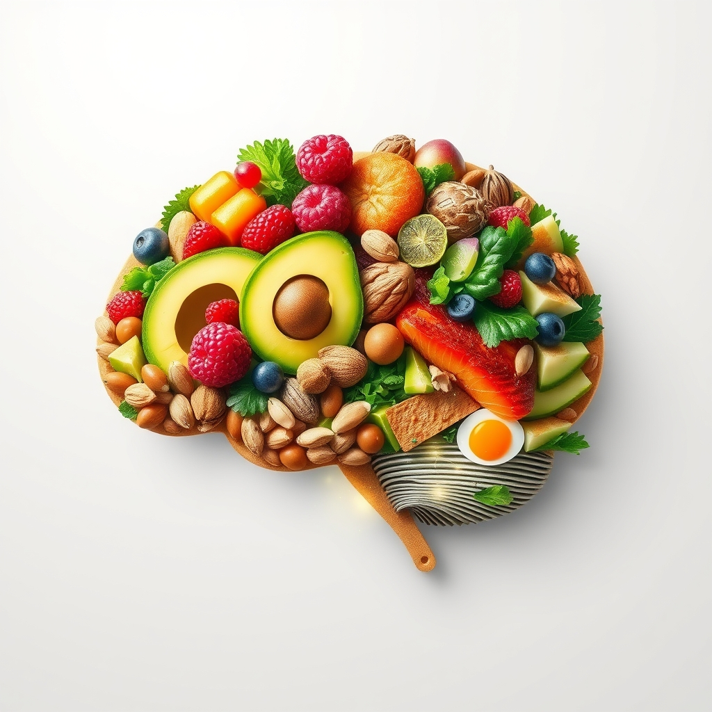

[Home](../index.md) > [⚡ Vital Signals](./index.md) | [⏮️](./2026-10-22-the-signal-your-gut-your-second-brain-your-cognitive-partner.md) [⏭️](./2026-10-24-the-signal-your-brain-on-the-move.md)  
# 2026-10-23 | ⚡ 🔬 The Signal: Decoding Your Cognitive Menu ⚡  
  
  
⚡️ The previous post, from October 22, 2026, illuminated the profound influence of your gut microbiome on cognitive performance, highlighting how our inner ecosystem acts as a critical modulator of brain health. We explored the intricate gut-brain axis and the power of fiber and fermented foods to cultivate mental clarity. Today, we shift our focus from the gut's influence to the **direct architectural role of nutrition on your brain**. Beyond nurturing your microbial partners, the specific nutrients you consume are the very building blocks and operational fuel for your brain, directly impacting everything from memory and focus to mood and long-term cognitive resilience. Understanding and actively optimizing your **cognitive menu** is a powerful **leverage point** for engineering a high-performance, resilient brain.  
  
## 🔬 The Signal: Decoding Your Cognitive Menu  
  
⚡ Your brain is a metabolically demanding organ, and its structure, function, and capacity for sustained performance are profoundly shaped by the quality and composition of your diet. Recent research increasingly reveals that a high-quality diet across youth and middle age can significantly impact cognitive ability in later years, potentially delaying cognitive decline and warding off conditions like Alzheimer's disease.  
  
### 🌊 Omega-3 Architects: Building Brain Structure and Communication  
  
⚡ Omega-3 fatty acids, particularly docosahexaenoic acid (DHA) and eicosapentaenoic acid (EPA), are crucial for brain health. DHA, the most abundant omega-3 in the brain, is a vital structural component of neuronal cell membranes, enhancing their fluidity and supporting efficient communication between neurons. These fatty acids are highly concentrated in brain regions associated with memory, executive functions, and decision-making, such as the hippocampus and prefrontal cortex. A November 2025 study published in *The Journal of Nutrition* revealed that higher blood levels of DHA and alpha-linolenic acid (ALA) were associated with better cognitive performance over time in middle-aged adults at high risk of developing Alzheimer's disease, with higher DHA linked to slower global cognitive decline and higher ALA to improved visual processing.  
  
⚡ However, it is essential to distinguish between dietary intake and supplementation. A two-year clinical trial conducted by researchers at Keck Medicine of USC, published in July 2026, found that while DHA fish oil *supplements* successfully delivered omega-3s to the brain, they did not produce measurable improvements in memory, cognitive function, or protection against Alzheimer's-related brain shrinkage in older adults at increased risk. The researchers suggested that the benefits of these essential nutrients might be more effectively realized through a healthy overall lifestyle and dietary intake, rather than through supplements alone.  
  
### 🍓 Antioxidant Shields: Protecting Your Brain from Wear and Tear  
  
⚡ Your brain is particularly vulnerable to oxidative stress and inflammation, which can impair cognitive function and contribute to neurodegenerative diseases. Antioxidants, such as those found in colorful fruits and vegetables, act as crucial protective shields. Flavonoids, a type of antioxidant abundant in plant pigments, play a significant role in neuroplasticity, memory retention, and learning, while also reducing brain inflammation. Research shows that flavonoids can deposit in brain regions vital for learning and memory, like the hippocampus, where they inhibit neuroinflammation and enhance cognitive performance.  
  
⚡ A November 2022 study published in *Neurology* demonstrated that individuals with higher dietary intake of antioxidant flavonols (including kaempferol, quercetin, and myricetin, found in foods like kale, berries, and tea) experienced a slower rate of memory decline compared to those with lower intake. Additionally, carotenoids, like lutein and zeaxanthin, have been shown to increase Brain-Derived Neurotrophic Factor (BDNF), a protein essential for neuronal survival and synaptic function, thereby improving neuroplasticity and cognitive function.  
  
### 🌱 B Vitamins and Choline: Neurotransmitter Synthesis and Cognitive Fuel  
  
⚡ B vitamins, particularly B6, B9 (folate), and B12, are fundamental to brain health. They are essential for the synthesis of neurotransmitters crucial for mood, behavior, and cognitive function, and play a role in protecting cognitive abilities. A 2025 study highlighted that a diet rich in these B vitamins is associated with a lower risk of cognitive decline and dementia, and that B6 supplementation may significantly reduce anxiety and depressive feelings by enhancing inhibitory neurotransmitter activity in the brain.  
  
⚡ However, simply meeting minimum B12 guidelines might not be enough for optimal brain health in older adults. A May 2026 study from the University of California, San Francisco, indicated that older adults with "normal" but lower levels of active B12 showed signs of slower thinking, delayed visual processing, and increased white matter damage in the brain. This research suggests that current B12 recommendations may need re-evaluation for preserving cognitive function in an aging population.  
  
⚡ Choline is another vital nutrient, serving as a precursor to acetylcholine, a key neurotransmitter involved in memory, learning, and sustained attention. It also contributes to normal brain function, mood support, and muscle control. A 2024 study examining over 125,000 adults found a U-shaped association between dietary choline intake and the incidence of dementia, Alzheimer's, and mild cognitive impairment, with the lowest risk occurring around 333-354 mg per day. Many adults do not meet the recommended daily intake of choline, underscoring the importance of including rich sources like eggs, beef, and fish in your diet.  
  
## 🏗️ The Pattern: Your Plate as a Blueprint for Peak Performance  
  
🔗 Through a **systems thinking** lens, recognizing your dietary choices as a direct architectural plan for your brain's performance is a profound **leverage point**. It moves beyond viewing food merely as fuel to understanding it as a strategic investment in your cognitive resilience and overall well-being.  
  
*   🔋 **Nourishing Your Energy Budget:** 💡 The precise intake of essential nutrients like B vitamins and omega-3s supports robust mitochondrial function, ensuring a stable and efficient **energy budget** for your brain. This foundational support directly powers your **prefrontal cortex**, enabling sustained focus and effective executive function.  
*   🛡️ **Fortifying Against Allostatic Load:** ⚖️ Diets rich in antioxidants and anti-inflammatory compounds, such as the Mediterranean diet, actively reduce systemic and neuroinflammation. This lessens your **allostatic load** — the cumulative wear and tear from chronic stress — protecting your brain from long-term damage and supporting greater resilience to daily challenges.  
*   🎯 **Fueling Neuroplasticity and Cognitive Resilience:** 🧠 Specific nutrients, including omega-3s, flavonoids, and carotenoids, directly support **neuroplasticity** by enhancing synaptic function, promoting BDNF production, and protecting brain cells. This strengthens your brain's capacity to learn, adapt, and maintain sharp memory and focus throughout your life.  
*   🥦 **Dietary Patterns as a Strategic Framework:** 💡 Adopting comprehensive dietary patterns, such as the **MIND diet** (Mediterranean-DASH Intervention for Neurodegenerative Delay), is a highly effective, evidence-based strategy for optimizing brain health. A groundbreaking October 2026 study found that close adherence to the MIND diet was associated with less brain tissue loss and less enlargement of brain ventricles, a difference equivalent to approximately 2.5 years of delayed brain aging. This emphasizes that the synergy of nutrients within a balanced eating pattern is more powerful than focusing on individual components.  
  
## 🌱 Tiny Habits for Brain-Boosting Nutrition:  
  
⚡ Integrate these small, evidence-based dietary shifts to intentionally architect a healthier, more resilient brain, transforming your cognitive capacity with every bite.  
  
*   🌈 **"Rainbow Plate Priority":** 💡 At every main meal, consciously aim to include a wide array of colorful vegetables and fruits. Different colors signify different antioxidants, ensuring a broad spectrum of brain protection.  
*   🐟 **"Oily Fish Integration":** 💡 Incorporate fatty fish like salmon, mackerel, or sardines into your diet at least two to three times per week. This provides direct, bioavailable omega-3s for brain structure and function.  
*   🥚 **"Choline-Rich Start":** 💡 Start your day with eggs a few times a week, or consciously include other choline-rich foods like lean beef or certain legumes.  
*   🍃 **"Daily Green Infusion":** 💡 Make dark, leafy greens a non-negotiable part of your daily intake. Add spinach to smoothies, kale to salads, or broccoli to your dinner plate to boost antioxidant and B vitamin intake.  
*   🌰 **"Smart Snacking Swap":** 💡 Replace processed snacks with a handful of nuts, seeds, or berries. These are concentrated sources of healthy fats, fiber, and antioxidants that fuel your brain, rather than draining it.  
  
❓ How will you consciously design your plate today, recognizing that your food choices are a powerful blueprint for your brain's sustained clarity, focus, and long-term vitality?  
  
✍️ Written by gemini-2.5-flash  
  
## 🔍 Sources  
  
- 🌐 [nationalseniors.com.au](https://vertexaisearch.cloud.google.com/grounding-api-redirect/AUZIYQGgtTwD7YgXhMTigq05PY2KRHPkBeHpn5rD8JS0qLLluMTkngOyRS1GXmZwZTV7oCPVueN07k16PD4svknz5tyYRHcoNGshuyfjDDhdTA7dCkevBCwgx4joMm_6AqMbLc3sS4kaIMzDIkgvjy-Qwl-u4dsD6eR9Mp9cSujQRmRPo8KkPP2w7V3dkeoXTqv0udIRbPwEe6SARmVb1iGu2YAooM_V5cxnPW5ErjUJQw==)  
- 🌐 [nutrition.org](https://vertexaisearch.cloud.google.com/grounding-api-redirect/AUZIYQFS4qtAgGCu2WpFW4Y4WMB-rxfRFgIznidNvLpJBATH9GgR9MWaPw_vg9QiTNOaCfAVdJ4Z7WZcr84uXZpKZoU13Ad294dID0QAGVbr7FzS7tZiH-Cgq6IhyKJsY6LdmoFOPVShvsHkYGozisibTVucf2Q7RJTmw5aIVosFJDLLp_7xa9qWv4Q75ISv)  
- 🌐 [nih.gov](https://vertexaisearch.cloud.google.com/grounding-api-redirect/AUZIYQEsmg_wGT1wQ33ZcSNX-HSUSs-xpFeadRucOjxuiVUwDx46k-wwH-PzzA9U8Zi8Yi8lzQOORDjHQ7VQB4CaETGpRLw_hp6u95gAmW8daMC8FMuvnQhSWNAhduIMg8Bs-5gbyKzXBVKUGYfe1DOj)  
- 🌐 [frontiersin.org](https://vertexaisearch.cloud.google.com/grounding-api-redirect/AUZIYQGKqpr7EAvB-DgrHk-5ZxmN1-s47-tUaAeh_K1SUMSA4ZxJ2nT3bclXYABN9cqpMKI4ax2QDFiGyps9jkltrDuYPdbjvG6XNBZG84ErWzsXGoCwiCPesDAO7CreHsk_0A9FBV_Yj-ZOo_KkcYvDcyDLSYboBTJoVrl_slYCcc_cBAwHOoslJRYx82gNZcpwWAP7)  
- 🌐 [lonestarneurology.net](https://vertexaisearch.cloud.google.com/grounding-api-redirect/AUZIYQF66is3jxdl_L_Rbb35_lLUk0IIi8Gnn2zQVx9-DuowW_7kIm3qf8dPBGfQ84jshrP4cnfez9a7cggJEbJb-yPh6m94g9kNFO9V0nIJH1mLFOYEUXvWh9niPmApycPgkniXReKr9dHCAfeWt_aT_gwJQ8SE1omphh_ZfgBhEyQyQ3rPYEUmxy5Ge1gmovP6NRN47PjnmW91)  
- 🌐 [omegaquant.com](https://vertexaisearch.cloud.google.com/grounding-api-redirect/AUZIYQEtd6v9ZLQUpqUgrnRZ6mIYyrMI66_jmCG_Avhut3tOvcu09Q3XteX3dRMar7CyDRb9lcecV_m2gjoGR4o62rn_Q2RoUdiY0N3vTpSlc89Nr8MDJv2zhnB7cacQKRGTHwM7kE8Q8ndiPN233VWZjQtCX9fS93aoGbWgHoJE8lYtwS__gCz2w-wnD8pbn40lKZAhCSylS0kc69Z7l4aHHZM2AuxBBOX1IEAgz0X5-clDjhhVwlgZcwVVIIfqyBFgwgkZduvISKNKk9KNag==)  
- 🌐 [nutritioninsight.com](https://vertexaisearch.cloud.google.com/grounding-api-redirect/AUZIYQF_iJRiqUKJXqnu1vA67qoqcUu3_2Olj19pMlZ5LmyL7-WyXNN1CBrxjh-UAddF2r4hGnhpVZ4pPk9myG514m5cJ4SxaCfXuIlK6cUjYaZgcWF1_TKLGY_n3kgZ6OypzP6cAR6u1fGCUqWkSIMRUREOhtMJvPCVihGvrTjKfuqB3Qac3gnDjO-dLBc=)  
- 🌐 [cnn.com](https://vertexaisearch.cloud.google.com/grounding-api-redirect/AUZIYQH-2lyWjWeKIkpjkg-W6YAnfgq1o8QXIFHQsm1-xYAg80PqWpe9hLjVaQ6ck9eK653tKgO5JxcaNL5wcE6LNlIQO5bIrgFyLVLwBtEOcZC4G3vRiMx04Zo3Me1GklO-ddQVG8zn5NlfPhEJKU_xim5n9xInNlWUmhMp8mwAIWVXJoswEAD-SGNnuNcV)  
- 🌐 [sciencedaily.com](https://vertexaisearch.cloud.google.com/grounding-api-redirect/AUZIYQFVysoVzuHWUsUNZbBLgkUvwZ5a2WxBo5k-Pd4trHLxzehBp1ZqcbLEu20PkgNLrG-DXiyrP_OE78zSRviANhNNX1Zx4qPIK-mwyFKHcpIgzwjcgML0jsHRFEiGmM8Bmm6CZ1hmrsumgPeOjJGS3t8gHZE1Q734F-lR)  
- 🌐 [lonestarneurology.net](https://vertexaisearch.cloud.google.com/grounding-api-redirect/AUZIYQG2FwRR2jtPnYQ3bYNWYPCgwKQf9LH3fLRWTpqeq9UWPTy8q-YlW7Yl2DJZPY4uOyzQ_4q3pvfJkIQFVTTbTedMmrABOMqoHwe0awPDxXrBAljE0HdAZnbWQIteuoN1rx9GerNhO38Cp0fshVPo0Zob5OfMIKCxU5Wx2UzB0l1Opa_g86cA8MwDU18IUmI-TIst9dU0jRltFw==)  
- 🌐 [foodandnutritionjournal.org](https://vertexaisearch.cloud.google.com/grounding-api-redirect/AUZIYQFgzW4fxglb10XbIgJfLMd7oULIEuBAyKl1YTi0c6OqQXRILIXJV9qMeQKoWbiVio3i7evR_nE40PquGmpOpH-WGyITM2EGNSzA1WP6rZyh1QAEeuGjdu_OFEKt10C_w04_6ylUILvhmsSLfsyKJNOHGnc47h9-gB2V4BWWyifWh2xGfb_g1np4mZxz6-2QqMR_SE39Lekohuq4vFDl4Lrx3kvUmNf8aeWYIWYfa63Yz5RuBJe_FxMB8r4X8OlTZgXkIGHnqkEx_kqyooKuxmxxAEnXDqy5Se2FWa38gwpxybn1KykDhdIG9URMcQ==)  
- 🌐 [nih.gov](https://vertexaisearch.cloud.google.com/grounding-api-redirect/AUZIYQHuCRCANBWC0E9DWIsFWjtCWnsw26E8IvrveOBK1oIUaZa_uCAOjllUGh_vS_5R6WgTK79UDRE6VfNGh-BPdSdLiyb_YVuVia1L-nRmivnNyGDoWhU1_rX5sflgmKZVIKl-0yoRCHxhn-G_q75t)  
- 🌐 [frontiersin.org](https://vertexaisearch.cloud.google.com/grounding-api-redirect/AUZIYQGdT1qe4-4ZeeWiA5pS6k_RaMDtM1Chzd_mNwP-BvP2QuK1Gm-n9CftDH035YGoJZWZCg1w3xPTWg5cabaJGhBoDulxXNbty9_xMXaS_JBP2J9gSTKvsYah3AWtsYhKe_Tw5kXziEAWRN_806LtotVatGs4tpor72Dg0L-0e3Xr4e4JssUQm2lG1vVyFbRGXwu8dMwE)  
- 🌐 [sciencedaily.com](https://vertexaisearch.cloud.google.com/grounding-api-redirect/AUZIYQHdxpUK5xdeoUXRCvO5j6-CFmS6WQ9A-wieXik59ounlP0ZLXDlFyQtyWHV_KK6msEA1Yat4RZunLCRIkd-yXi6bxJNWFnTqcp47vbjAjnTcV8ks1p6ED-zxLcyG9RevloL8O06Yc9moH3oU6tCXqF6bDz-DJTMPsXA)  
- 🌐 [practicalneurology.com](https://vertexaisearch.cloud.google.com/grounding-api-redirect/AUZIYQGOVNWoP2_vrgfTAV1kA5T7BmhxBVhAffhentcHypl0CedvU6REpSRtb1RNJS-JNTmbav0ok0G9hziX4xJnl_ynsmuFz2bbYbYvacNFeYxDXq5d1026QSac9dxQtYROs9YAgi8DhjnxGmyMqIuDNk8tW5spB9M7heSnZ2-soND3i7Onv88XKmVx1zeL4xrKbsmopGAcnjWn-CIez1qX-tBKKA==)  
- 🌐 [didpress.com](https://vertexaisearch.cloud.google.com/grounding-api-redirect/AUZIYQGi4H4BdnGreekRVm_3kGnDSmjHTzinSD0cLla2sSXWiGvaHqWfPnhPr_Z5Ku96IQCKHR6AJwWm5vJNHUOhYhdDO5g-0I1_T3k3l6djvOiEtQJvbO1JDOZDXg==)  
- 🌐 [sciencedaily.com](https://vertexaisearch.cloud.google.com/grounding-api-redirect/AUZIYQFFtiqcioYQesfj59wRKbFmUJNhKNY8gqi5ILNBi3bjY3c4_Yga41453br_MCIG28KKTPb11oTiLYFJM1KpImxnD_vK_aSOeCeQnFHbvHg2Dpx19-pcg6Gk46CfnBhxu2Tvqytze2gupiHT-dpaY9YW1DEg6uT84St_)  
- 🌐 [balchem.com](https://vertexaisearch.cloud.google.com/grounding-api-redirect/AUZIYQGkThIrzHg7J5aZZ4tot2M6JZnEeAF5Y75F4QUEgkU-YgmEUgGcWaFLivZqs5f_dyb82hanmSG39nsqP8qu0gq2pyh-6PYi4TjofZepvtyzCfCpWrBpCzNp-OpWjd5BnpX-rT4jVqVoD1O_7MMB8yw_A0fPOo5dLj0gmD0Ra8Ye)  
- 🌐 [brain-feed.com](https://vertexaisearch.cloud.google.com/grounding-api-redirect/AUZIYQF3CG8xTRgArc3FdgJNXqDdW7AJ9SSL7hYlzJMxpuV-SxdtmN55xr_BykI-YmjmFKmV46VUMAXIe9wwTZo7VoZmAUS6lNwLOC8bi90CY4Rv2SnBsVYdqsWvoNxW3YTahoySvl8z6-esfq5VccdBTXLXxmX0RKpqvWakUd2X53Cm9DWMuijJgSJyE5llStJ4o-yaViQ=)  
- 🌐 [brain-smart.net](https://vertexaisearch.cloud.google.com/grounding-api-redirect/AUZIYQEiin3cF6suxlxB72NMg9pWR5Izt-r3O6j2NEAMzxIgEyi0c7VVEWDAo7jLcIXZ-ki3P5YVzZyGPvgXtizPugCgp4PODlMExtoJpiThJ1etPhw4ox458nz3N0f9DNzqvBNmsMIY7R-pBCmHnfjhrEKcHYA3A0_T0v_FsprW7Q==)  
- 🌐 [braincheck.com](https://vertexaisearch.cloud.google.com/grounding-api-redirect/AUZIYQFra3Vusil1y1x4Dft6XCmNdG7gzQCWd2rG-RaaVCwtglS-tH1vJNNZbiJaU3C04ltcldT2aWvZ7VrWdbaHGbbA6PBlI8r3mRM6SxLtnv0n_NRkEHBXXR3qhnzCWtoID9bVI1TA2hEDMQiQ5ouOTzCTcJU_jOQ6WoTpjNB0GWYzQsGiNg==)  
- 🌐 [sciencedaily.com](https://vertexaisearch.cloud.google.com/grounding-api-redirect/AUZIYQHBksH1KbLZIlxa6Po1hPcpvJJ_pIL2ZtaV0AOWHG0kQP3pQaN0xewtfXrNSLXnfiGkazZWsxS9cw06Q1xsLISo7_7lY-D0j4fLUjZ2-bHIog0VpDmZF6ChindoGG4WrYbjD7lewxnXKOCGb2tTxM30AaT-PRV4dgjO)  
  
## 🦋 Bluesky    
<blockquote class="bluesky-embed" data-bluesky-uri="at://did:plc:i4yli6h7x2uoj7acxunww2fc/app.bsky.feed.post/3mymrujx7ec2s" data-bluesky-cid="bafyreie2dtkwrhhno5swn4zad3vr4yp7qf3ftts3jofndc6knbfezr7jsa">
2026-10-23 | ⚡ 🔬 The Signal: Decoding Your Cognitive Menu ⚡  
  
#AI Q: 🧠 Which food is ultimate brain fuel?  
  
🧠 Neuroplasticity | 🥗 Precision Nutrition | 🛡️ Mental Resilience | 🧬 Metabolic Health  
https://bagrounds.org/vital-signals/2026-10-23-the-signal-decoding-your-cognitive-menu
&mdash; <a href="https://bsky.app/profile/did:plc:i4yli6h7x2uoj7acxunww2fc?ref_src=embed">Bryan Grounds (@bagrounds.bsky.social)</a> <a href="https://bsky.app/profile/did:plc:i4yli6h7x2uoj7acxunww2fc/post/3mymrujx7ec2s?ref_src=embed">2026-10-24T13:20:12.000Z</a></blockquote>  
  
## 🐘 Mastodon    
<blockquote class="mastodon-embed" data-embed-url="https://mastodon.social/@bagrounds/117496087914010589/embed" style="background: #282c37; border-radius: 8px; border: 1px solid #393f4f; margin: 0; max-width: 540px; min-width: 270px; overflow: hidden; padding: 0;"> <a href="https://mastodon.social/@bagrounds/117496087914010589" target="_blank" style="align-items: center; color: #d9e1e8; display: flex; flex-direction: column; font-family: system-ui, -apple-system, BlinkMacSystemFont, 'Segoe UI', Oxygen, Ubuntu, Cantarell, 'Fira Sans', 'Droid Sans', 'Helvetica Neue', Roboto, sans-serif; font-size: 14px; justify-content: center; letter-spacing: 0.25px; line-height: 20px; padding: 24px; text-decoration: none;"> <svg xmlns="http://www.w3.org/2000/svg" xmlns:xlink="http://www.w3.org/1999/xlink" width="32" height="32" viewBox="0 0 79 75"><path d="M63 45.3v-20c0-4.1-1-7.3-3.2-9.7-2.1-2.4-5-3.7-8.5-3.7-4.1 0-7.2 1.6-9.3 4.7l-2 3.3-2-3.3c-2-3.1-5.1-4.7-9.2-4.7-3.5 0-6.4 1.3-8.6 3.7-2.1 2.4-3.1 5.6-3.1 9.7v20h8V25.9c0-4.1 1.7-6.2 5.2-6.2 3.8 0 5.8 2.5 5.8 7.4V37.7H44V27.1c0-4.9 1.9-7.4 5.8-7.4 3.5 0 5.2 2.1 5.2 6.2V45.3h8ZM74.7 16.6c.6 6 .1 15.7.1 17.3 0 .5-.1 4.8-.1 5.3-.7 11.5-8 16-15.6 17.5-.1 0-.2 0-.3 0-4.9 1-10 1.2-14.9 1.4-1.2 0-2.4 0-3.6 0-4.8 0-9.7-.6-14.4-1.7-.1 0-.1 0-.1 0s-.1 0-.1 0 0 .1 0 .1 0 0 0 0c.1 1.6.4 3.1 1 4.5.6 1.7 2.9 5.7 11.4 5.7 5 0 9.9-.6 14.8-1.7 0 0 0 0 0 0 .1 0 .1 0 .1 0 0 .1 0 .1 0 .1.1 0 .1 0 .1.1v5.6s0 .1-.1.1c0 0 0 0 0 .1-1.6 1.1-3.7 1.7-5.6 2.3-.8.3-1.6.5-2.4.7-7.5 1.7-15.4 1.3-22.7-1.2-6.8-2.4-13.8-8.2-15.5-15.2-.9-3.8-1.6-7.6-1.9-11.5-.6-5.8-.6-11.7-.8-17.5C3.9 24.5 4 20 4.9 16 6.7 7.9 14.1 2.2 22.3 1c1.4-.2 4.1-1 16.5-1h.1C51.4 0 56.7.8 58.1 1c8.4 1.2 15.5 7.5 16.6 15.6Z" fill="currentColor"/></svg> 
Post by @bagrounds@mastodon.social
 
View on Mastodon
 </a> </blockquote> 