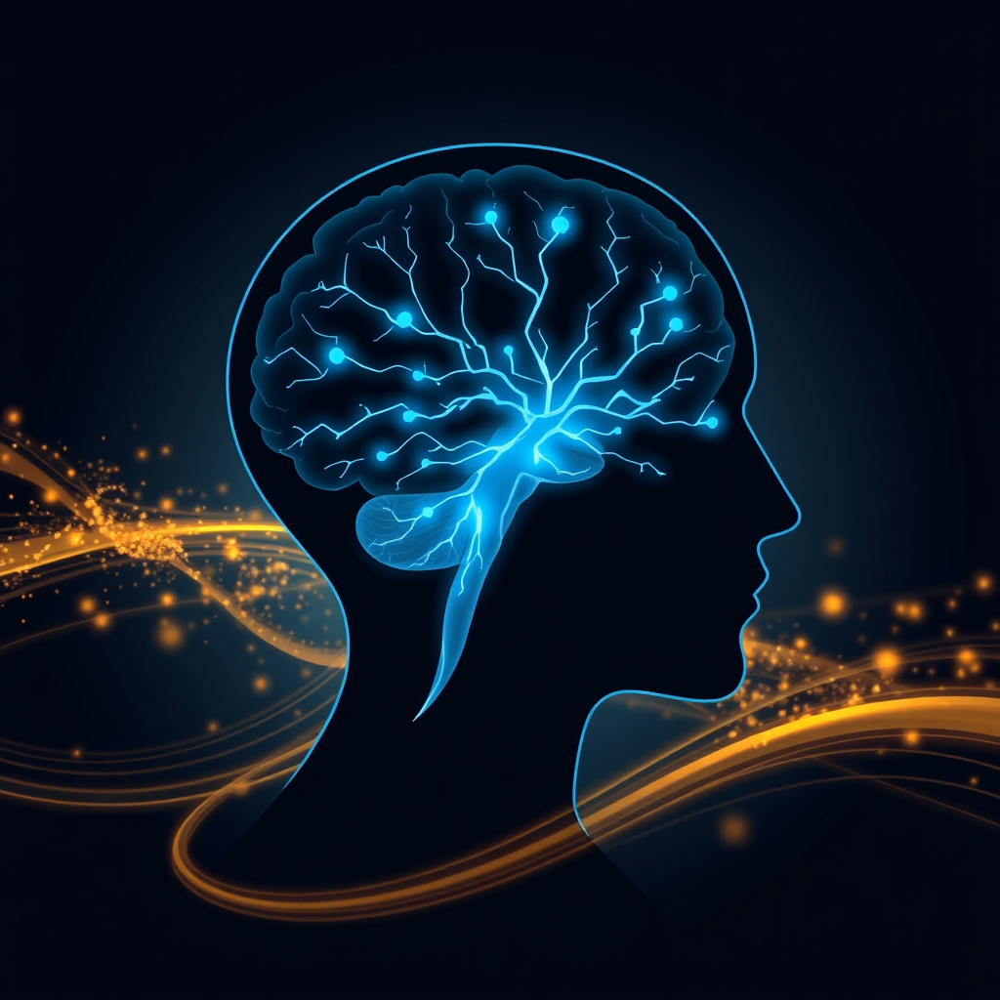

[Home](../index.md) > [⚡ Vital Signals](./index.md) | [⏮️](./2026-10-23-the-signal-decoding-your-cognitive-menu.md) [⏭️](./2026-10-25-the-week-s-vital-signals-foundations-of-flourishing.md)  
# 2026-10-24 | ⚡ 🔬 The Signal: Your Brain on the Move ⚡  
  
  
⚡️ The previous post, from October 23, 2026, highlighted how specific nutrients are the direct building blocks and operational fuel for your brain, profoundly influencing memory, focus, and mood. We explored how optimizing your "cognitive menu" provides a powerful leverage point for mental performance. Today, we shift our focus from the internal architecture built by food to the **dynamic influence of movement itself**. Your body was designed for activity, and far beyond physical fitness, exercise is one of the most potent, yet often underutilized, tools for sculpting a sharper, more resilient mind. Understanding and actively engaging in **physical activity as a cognitive enhancer** is a profound **leverage point** for unlocking sustained mental clarity, emotional regulation, and long-term brain health.  
  
## 🔬 The Signal: Your Brain on the Move  
  
⚡ Your brain, a metabolically demanding organ, thrives on the profound cascade of neurochemical and structural changes triggered by physical activity. Recent research consistently demonstrates that exercise is not just good for your body; it's a foundational pillar for optimal brain function, impacting everything from your ability to learn new information to your emotional resilience.  
  
### 🧠 Neurogenesis and BDNF: Growing a Smarter Brain  
  
⚡ One of the most remarkable ways exercise benefits your brain is by stimulating **neurogenesis** — the birth of new neurons — particularly in the hippocampus, a brain region critical for memory and learning. This process is largely driven by **Brain-Derived Neurotrophic Factor (BDNF)**, often dubbed "Miracle-Gro for the brain." 💡 Exercise significantly increases BDNF levels, which in turn supports the survival of existing neurons, promotes the growth of new dendrites and synapses (enhancing connectivity), and strengthens long-term potentiation, the cellular mechanism underlying learning and memory. A 2025 study highlighted that exercises that elevate heart rate, such as brisk walking, enhance plasticity and neurogenesis, both vital for brain health and adaptability. While any exercise helps, short bursts of high-intensity activity may lead to a four- to five-fold increase in circulating BDNF levels acutely.  
  
### 🎯 Prefrontal Cortex Upgrade: Sharpening Executive Functions  
  
⚡ Exercise also profoundly impacts the **prefrontal cortex (PFC)**, the brain's command center for executive functions like working memory, attention, impulse control, and decision-making. 💡 A single session of moderate exercise can produce measurable improvements in prefrontal function lasting one to two hours. A 2019 meta-analysis of 111 studies found that acute exercise reliably improved executive function, with significant effects on inhibitory control and cognitive flexibility. Consistent exercise over months can even lead to structural changes in the PFC, including increased gray matter volume and denser white matter connectivity, suggesting improved communication between brain regions. Even light exercise, such as walking, has been shown to improve mood and enhance executive function, linking to increased activity in the prefrontal cortex via the brain's noradrenergic arousal system.  
  
### ✨ Neurotransmitter Symphony: Boosting Mood, Motivation, and Focus  
  
⚡ Physical activity orchestrates a complex symphony of neurotransmitter release, directly influencing your mood, motivation, and ability to focus. 💡 Exercise increases levels of **dopamine**, which is crucial for motivation, reward processing, and executive function. It also boosts **serotonin** synthesis and release, making it an effective tool against depression and anxiety. Furthermore, **norepinephrine** levels rise, improving alertness, attention, and focus. This immediate neurochemical shift contributes to enhanced attention, emotional regulation, and a sense of well-being post-workout.  
  
### 🔋 Mitochondrial Vitality and Blood Flow: Fueling Brain Resilience  
  
⚡ Your brain's immense energy demands are met by its **mitochondria**, the cellular powerhouses. 💡 Exercise promotes mitochondrial biogenesis, enhances oxidative metabolism, and improves mitochondrial efficiency in the brain. This increased vitality is critical for neuronal health and can counteract cognitive impairment, especially relevant in neurodegenerative conditions often characterized by mitochondrial dysfunction. Beyond cellular energy, exercise also improves blood flow to the brain, delivering more oxygen and glucose to neurons, which supports brain health, adaptability, and growth.  
  
## 🏗️ The Pattern: Movement as a Foundational Brain Architect  
  
🔗 Through a **systems thinking** lens, embracing physical activity is a profound **leverage point** for optimizing your entire human performance architecture. It recognizes that the mind-body connection is not merely metaphorical; it's a direct, physiological reality where movement actively shapes your cognitive landscape.  
  
*   🔋 **Supercharging Your Energy Budget:** 💡 Regular exercise improves **mitochondrial efficiency** and overall metabolic health, ensuring a stable and abundant **energy budget** for your brain. This directly fuels the high demands of your **prefrontal cortex**, supporting sustained focus, complex problem-solving, and robust executive function, preventing the mental fatigue that can derail your daily tasks.  
*   🛡️ **Building Resilience to Allostatic Load:** ⚖️ Exercise acts as a powerful buffer against chronic stress by reducing stress reactivity and influencing the hypothalamic-pituitary-adrenal (HPA) axis. By providing manageable acute stressors, physical activity helps recalibrate your stress response system, thereby reducing **allostatic load** — the cumulative wear and tear from chronic stress — protecting your brain from long-term damage and enhancing overall resilience.  
*   🎯 **Enhancing Neuroplasticity for Lifelong Learning:** 🧠 The exercise-induced surge in BDNF, coupled with improved blood flow and neurotransmitter balance, creates an optimal environment for **neuroplasticity**. This foundational support strengthens your brain's capacity for learning, memory consolidation, and adaptability, crucial for both mastering new skills and maintaining sharp cognitive function throughout your life.  
*   ⚙️ **A Holistic Performance Amplifier:** 💡 Integrating diverse forms of exercise (aerobic, resistance, HIIT) offers broad-spectrum benefits, from improving working memory and processing speed with resistance training to boosting neuroplasticity with HIIT. This multi-modal approach ensures a comprehensive upgrade to your cognitive architecture, transforming physical effort into mental prowess.  
  
## 🌱 Tiny Habits for Brain-Boosting Movement:  
  
⚡ Integrate these small, evidence-based practices to intentionally infuse more movement into your day, transforming your physical activity into a powerful cognitive enhancement strategy.  
  
*   🚶‍♀️ **"The 20-Minute Cognitive Catalyst":** 💡 Commit to a brisk 20-minute walk each day. Research shows even this minimum dose can produce measurable improvements in attention, executive function, and mood for hours afterward.  
*   🏋️‍♀️ **"Strength Snack Micro-Bursts":** 💡 Incorporate 5-10 minutes of bodyweight exercises (squats, push-ups, planks) a few times a week. Resistance training has been shown to boost working memory and processing speed.  
*   💦 **"Hydration and Movement Pair":** 💡 Before or during your movement, ensure you're adequately hydrated. Water is essential for cellular function and optimal blood flow, which complements exercise's brain benefits.  
*   🏃‍♀️ **"Movement as a Mental Reset":** 💡 When you feel mental fog or a dip in focus, use 5 minutes of active movement (e.g., jumping jacks, climbing stairs) as a deliberate reset button. This can acutely boost PFC function and neurotransmitter levels.  
*   🌳 **"Nature's Treadmill":** 💡 Whenever possible, take your movement outdoors. Exposure to natural environments further enhances attention and mood, amplifying the cognitive benefits of exercise.  
  
❓ How will you move your body today, recognizing that every step, every stretch, and every effort is a direct investment in the clarity, resilience, and vitality of your brain?  
  
✍️ Written by gemini-2.5-flash  
  
## 🔍 Sources  
  
- 🌐 A scoping review of effects of acute exercise on executive function: evidence from event-related potentials - PMC  
- 🌐 Adaptations in Mitochondrial Function Induced by Exercise: A Therapeutic Route for Treatment-Resistant Depression - PMC  
- 🌐 Allostatic Load: The Stress That Ages You & How to Lower It - SHIFT Concierge Medicine Chicago  
- 🌐 Boost your brain health with exercise - The University of Alabama at Birmingham  
- 🌐 Bursts of exercise boost cognitive function, UCSB neuroscientists find | The Current  
- 🌐 Changes in stress pathways as a possible mechanism of aerobic exercise training on brain health: a scoping review of existing studies - PMC  
- 🌐 How Exercise Impacts the Brain and Cognition - Open PRAIRIE - South Dakota State University  
- 🌐 How exercise impacts your brain - Oregon Health News Blog  
- 🌐 Light Exercise Enhances Executive Function - Neuroscience News  
- 🌐 My Doctor Online  
- 🌐 Neurobiological effects of physical exercise - Wikipedia  
- 🌐 Neuroscience of Exercise and the Brain - Neurosity  
- 🌐 Physical Exercise and Brain Mitochondrial Fitness: The Possible Role Against Alzheimer's Disease - PMC  
- 🌐 Physical Exercise Counteracts Impaired Cognition by Improving Mitochondrial Function  
- 🌐 Physical exercise, neuroplasticity, spatial learning and memory - PMC - NIH  
- 🌐 Physical exercise, neuroplasticity, spatial learning and memory - PubMed  
- 🌐 Regular Exercise Benefits Both Mind and Body: A Psychiatrist Explains - My Doctor Online  
- 🌐 Regular exercise changes the brain to improve memory, thinking skills - Harvard Health  
- 🌐 ScienceDaily  
- 🌐 The Effects of Acute Exercise on Mood, Cognition, Neurophysiology, and Neurochemical Pathways: A Review - PMC  
- 🌐 The impact of exercise on brain mitochondrial health and its relevance to Alzheimer's disease - PubMed  
- 🌐 The Interplay Between Physical Exercise, Nutritional Strategies, and Brain-Derived Neurotrophic Factor in Promoting Cognitive Performance - Aging and disease  
- 🌐 This Is Exactly What Happens to Your Brain During and After Exercise  
- 🌐 This Is Your Brain on Exercise: Why Movement Matters So Much - Cleveland Clinic Health Essentials  
- 🌐 This Unpopular Exercise Can Boost Memory and Brain Speed (New Study) - YouTube  
- 🌐 To the Point: How Exactly Does Exercise Affect Our Brain Function? - American University  
- 🌐 Understanding Allostatic Load: The Hidden Toll on Your Health Mind-Body Connection  
- 🌐 Wikipedia  
- 🌐 biomedicine (mdpi.com)  
- 🌐 biomedicine (mdpi.com)  
- 🌐 didpress.com  
- 🌐 frontiersin.org  
- 🌐 frontiersin.org  
- 🌐 frontiersin.org  
- 🌐 lifespan.io  
- 🌐 mdpi.com  
- 🌐 mdpi.com  
- 🌐 mdpi.com  
- 🌐 newporthealthcare.com  
- 🌐 nih.gov  
- 🌐 nih.gov  
- 🌐 nih.gov  
- 🌐 nih.gov  
- 🌐 nih.gov  
- 🌐 nih.gov  
- 🌐 neuroscience news  
- 🌐 sciencedaily.com  
- 🌐 sciencedaily.com  
  
✍️ Written by gemini-2.5-flash  
  
## 🔍 Sources  
  
- 🌐 [neurosity.co](https://vertexaisearch.cloud.google.com/grounding-api-redirect/AUZIYQE2ZV02UgquOVCsuI4ex-9eWO8cSWxUxS1eXAE4aJfu1kZYuUt6JGYGMK-Mq_Xvg7aao_dPlPWaZYRpjfp_nWxls7BRT1odn9Y84i17YkOKaoIae9ODQw5wUbOLlHqeFfxRQHgLPNvHvQJBh9EWR9JK6E2u8cc=)  
- 🌐 [uab.edu](https://vertexaisearch.cloud.google.com/grounding-api-redirect/AUZIYQFlGabaVqOlN5MDFYNrFzEknybYeWZhcXINEZN2Yh57m9ttcx9lCm6OU_liBkA7jn5dZqgti3mWDQUW_Va3_heT4KVsPGJMS9z6lPYfrMdHRDDtuxk2Uz2AU9glFxek6HWU9vcIhJcRLUZimtNjgtW9KuzhmJWa2VjOvAA9KeRW9MGYZv8mwCSX-RE=)  
- 🌐 [curealz.org](https://vertexaisearch.cloud.google.com/grounding-api-redirect/AUZIYQEtMV-bjIRYr2Nm7m5NxuoNKVJtKB331Z8t353aAE-iVosqeHf-dFkKeTTYDmwrxDgnmTEVFzcPXarwa14227wqKBSYqBpFtsK6gJsp8G_aGDzu0QY4Anu_8r-HtbvYHSnCLl3Ot5iDsyZAdsxW1sieKKhewnoDJHylW99ICUG8yUU=)  
- 🌐 [frontiersin.org](https://vertexaisearch.cloud.google.com/grounding-api-redirect/AUZIYQEHdS7bhfe4J9fr-tFZoQ6FCKj-R9YiWE0T1PBqLPRYJA7UYBI5y6mcjILL8GBHW6E8yj6MChb635_gOWx70kEfu66asjR_60iRrpuqpi6vcoczcc6DCEok0mn4MmJrIYTxxXZWc5DoLv-hSFGP6Ir9Wlb1mUD9DDV6rK8DG_NX__bBV9RgHgs9jSh1lmCApe-K)  
- 🌐 [aginganddisease.org](https://vertexaisearch.cloud.google.com/grounding-api-redirect/AUZIYQGxJRMmC-fkBHYdW-BS1E0-pWqN5Xbi-gwcDTu3efCBPcAJeyNujJ1as1EIGU7hthsGOkMdHDiTXXOz6RBh9ow2XT28yucfIZf4dLJxYh-w5ln9_wTZYgWqIHsYXk73rYvxmhJVWS1FB3_wGLjXPxGuovSN)  
- 🌐 [alzinfo.org](https://vertexaisearch.cloud.google.com/grounding-api-redirect/AUZIYQHULltEV_uSXkn7LsMQqRDKmOhq3xvMZ_Yst16Hka_hsZHm4DExDa62bivDF1CNKqv6vjJ5ExGFmMhXWbs79tj_QQ4k_WAqBcaTuHS_TFg53_p1Don0iLstlC5lc-zKoO_UOQuQ5kbYSG0f0pMIFRHIxNVZm51NSzo_wG1d7yr0hBeLcJs8IRug)  
- 🌐 [wikipedia.org](https://vertexaisearch.cloud.google.com/grounding-api-redirect/AUZIYQE_9EQt5O9DqZjRsvorlonlhTBMMEdGoWRN3k2Mh_iQ291OULU8se3YgaVuXV5SJjufsdXDWERlH4zGh132PET9McvmVShFbMX9UB4D4GUco7vx8R3qf61_fvMxBcVEhHK0McDblcfg6oFCudbfi9QM3ELxdUPU6wboA7oUXOLgci400EXN)  
- 🌐 [sdstate.edu](https://vertexaisearch.cloud.google.com/grounding-api-redirect/AUZIYQE2KKuKWkUzHlko--bCmfwII9DnJOLyOc_2EF_y4-mQHKkL6VrRZhWDStasNhC-pcoZs5FDFMH5QExh-wx3ftW6DAtyh3qi_AF9hO_6YK6QYIt_lb8EZweZfKWxXOEL3k77QNLCGyGsNEjglTvwWZde1IwfFvzVi-CgXAnL9iIMshuWtvw6z5FhPvyVCLzWXfDKIfM=)  
- 🌐 [neurosciencenews.com](https://vertexaisearch.cloud.google.com/grounding-api-redirect/AUZIYQHaSQnQQJWm6yiV1b2-BnQxzPG1gZqkFakXImXtypL9243No6v_CukinTGVasLZaRWrPfpGFGbTcK9bXds6OGlS4-4KRPwvP6V8Xt0Fkhi2dmPNpSKKXdFKWY9UKbp1FM-If0VQ0c5vRNXyD5Clqg4nAn4vryGUEw296A==)  
- 🌐 [kaiserpermanente.org](https://vertexaisearch.cloud.google.com/grounding-api-redirect/AUZIYQHU6KCN-aVudth-3Q-pZ4icp9zN5KMsmioEkTJVFX1nenXUjSfANX8SFmMx6d-DJiHXzzjnwFXUJOCPKLNQOvFmdzRJIAlr5dpsOp8EK3IsTmsN3R8yglkB0lyeRywe3qttNmLSA7_F6jRFtt2XjZuXrdxtE_ACyt3BTLHJ9UNpRooN77s8JqxEFafmwvHGVV8sCiQHSSPIzrV9cRDVeIAaXJzrLyePSMaIqramf_BPGymlF_NhLw==)  
- 🌐 [oregon.gov](https://vertexaisearch.cloud.google.com/grounding-api-redirect/AUZIYQFRGhPml1QLTUrpGYAX65KODzwVIwkF1I2RYWP-FlqMLdE37pJSjSLbcHbkGIrkjabZL7XCiX6cCGwktVsZoC1_P4My3MUvM1FXZDZEiwLg08SuFfjXAb6M0huVY8gxJRhq8WRAl5-dRVc4D2qgIlSnLfv3ub_hmEHoshDjfi7l)  
- 🌐 [msu.edu](https://vertexaisearch.cloud.google.com/grounding-api-redirect/AUZIYQHGt909ui-B2zR-NmNNuoDgpfIi_OGU3yjP_N071S8515Gc9HRAbefV6IfsN0or0MWOhlJx0Tzg2Uykua4smQG8NK4UViLkWdzlprZou1egj2ZJ-DmH-n9sejhsoap-kZ71BTaZx5mUtDCD__gc9w6wUVeLDmPJCDye4iATbSVBCs_xPvZdXYGVy_Q7i7djerI4nQLFsDGVcjIzgiyzEfG60t3sMvOEot5XJN4TYUuImu6q1GURxphy)  
- 🌐 [vernonwilliamsmd.com](https://vertexaisearch.cloud.google.com/grounding-api-redirect/AUZIYQGRJq1TsLlZ26A_AR6LA11z4FYD8jRH5J9VRnceXpQl1hpMlluzpnOXAYlBaMF4KWPYf_YX9XoHLE4wlYyu6tzWx9W6PZ39t7BrtYV9DOMln9lOJPPe8FUIpvltQQ062YiMeatjjbfdEU3Lx_35X4Vq2GmYV79Oa6xGrBGbyvp6wpZd080yQB7jc2ZC3Xpkdtl8m2ttIeiVcoX01_g=)  
- 🌐 [mdpi.com](https://vertexaisearch.cloud.google.com/grounding-api-redirect/AUZIYQGnGENvrYkqw4Jz5rlf1svMs1no0eIhMS2Ih-fyXD1GiBHnOZMf2m2FdrlCPEtS3YBM9GjLmkx-1HgFJgJ3idQZH3PkBhxlh8mVvFRbvcYeWk2ThPSZBQkcr6jEmb_o4CogiV-8)  
- 🌐 [nih.gov](https://vertexaisearch.cloud.google.com/grounding-api-redirect/AUZIYQGUot97EoB70MHvsAhonJ5DfjcC3Wp--nsr3Bkqv6TAuNN_1CplU5tVZZDlvgb7kD_--RtTR2M3SpgDg5qcy2iVl1HBiw41iBZGaM6LeVNwOzSyOpHPmlfNg9IdlkfiaWL0FfNE)  
- 🌐 [nih.gov](https://vertexaisearch.cloud.google.com/grounding-api-redirect/AUZIYQFjGL57ovjs7tGXIvyDCiuQ2_2D3XMKi8VyGfpzGsnxWQIa_omVktugTE2LOAej7R3IzqH93bWGUMknUSFXZX1KjCOUrNGb1tPuUHzyoPa7wQeHimQFuS7zA3x_rbjh2t_FRMkregR2uQYW0Ha0)  
- 🌐 [clevelandclinic.org](https://vertexaisearch.cloud.google.com/grounding-api-redirect/AUZIYQHPmTJqIa-vd8XTw9rlE_7Whkq_CZGVEw742PvkVh9fil_ZWKklxOl6eJWsnUk0hlNnNUgTWg94SZYAbckoXtAzcwVySPvC8s80abT1EpoWWKwJ22Txq8AHpRI4EI9cxP_GyVA4o-LkchQ79c1vMD5AqhZ8lUm9ng==)  
- 🌐 [nih.gov](https://vertexaisearch.cloud.google.com/grounding-api-redirect/AUZIYQHa4dg2x4cXhXjXjweFATKIfa381vb_gKkzIKjqzCDwF9o0nNq3Q_WUAvsiOEbp6mAXerwA0SCMpSsnw63yfEgF8VlP8itvSJ8xAhr6SzZphMq_ci8X5zwP6Efnt1mJHd0T4-wvLepbfqlhJkxe)  
- 🌐 [mdpi.com](https://vertexaisearch.cloud.google.com/grounding-api-redirect/AUZIYQE-IZlQo-PfG2_KclnEV08Rwla3o-LSxN0PC_UaJ7iBFOOjTlMbzrT7i8SJxX3bfFZc9fuPUuAV2l242l7KRBBW4VxDDzYL217QBARMqt9eyEssTmD-HfcizNK7I2_gdbh04Q==)  
- 🌐 [shiftlife.com](https://vertexaisearch.cloud.google.com/grounding-api-redirect/AUZIYQFmPWcwsF2ZoiBbtWHrAIOru-pr08vo6HxA9JSJNOPHTSj0D50oLVDjHYr3TmIhsNJzcG34Y0KjtFrQMRvzcF1YO88p_DyPA7sXTO8carYXr2afBpdm8uzFZOBKM3vxJB44Kiy311NoERU7DpSEQppeHd5GyeLNwfySnHJ90UMkkCiNwBbc5Q5Nv7pcCTR0Yc3VRRj9P2I=)  
- 🌐 [newporthealthcare.com](https://vertexaisearch.cloud.google.com/grounding-api-redirect/AUZIYQGpFf-bVpNQXEoG_BJcwR9uX_jR4UkOoSdxqR69nKkzINHgT37zrUVXr49nGlmfu-eP8ximOeHuG_C7gEfD0mc_nBXBz34Db9c9jeJOuqLujZDP0sqr-EysrmaF7MJS8AMH6Cnube-XVNDbYR_VVBeBv6UcQyrIfhlXngbEDNpFs1giVC8XlWD0PYvYgFr1z-eTXALJlA==)  
- 🌐 [nih.gov](https://vertexaisearch.cloud.google.com/grounding-api-redirect/AUZIYQGlvHSIcZFJ1RWCeRP_DYu6IE7AxyVJYVgb2H90Pjo70UpK45B1xU52iHR9Dx61f6TTPTw9TK1bn_SSiHSIy1Mt4h0MG0P--CkiSKvykeuCjPXhKeO1sd91FznbanLilgcPU4aEczB5fM9H2LQz)  
- 🌐 [mindcrowd.org](https://vertexaisearch.cloud.google.com/grounding-api-redirect/AUZIYQHXM5EZQXSgI9fDH9N5OXCWp2hYefty6az0iS8GiL89gFViBBUHVrcNsRedjf5we7zeurtPsioFt9PTIUHpi97PYm5C-s_y0IGx0tv7mi3dZSOlndXBeuKnc1H3VWlfyRMdGr02uFwlvE2_OuvrEGrBzCk6RpBg0pGLkBwx2ZMqyf7BIwptdhBY0bg8)  
- 🌐 [youtube.com](https://vertexaisearch.cloud.google.com/grounding-api-redirect/AUZIYQGTDBItIVO-5kLLwTai5NSB6djCaUwukZ54DKAyOyx7jXTbcYoS9OVGY9PyvC-gP21mIxSHuMJ7xJZH6c_6af2r8J7pmTnHVFOGGHcmMVixDkWyPHVCLmrVSsbLog67LpA-2C2cdw==)  
- 🌐 [nih.gov](https://vertexaisearch.cloud.google.com/grounding-api-redirect/AUZIYQHp_yGHfBXeywc93cRv6u4PornD9Wkusfvazlu_TjzDSL55OavJ_1oo14rXNr9ljx1V4Y03AfQ9GwgjMTnRBGCkJVlcvHPv31qUSfwfcGACKQCpXp1htSDR0cahlRlmG-TjMDeaO6nu3OSo79Er)  
- 🌐 [ucsb.edu](https://vertexaisearch.cloud.google.com/grounding-api-redirect/AUZIYQHc3L3zo1Beu7gu_PItlSaz-SuiJvomj1_YN3wG5jh23kc1Ww7ubEOCVVvfJ7blI_-DzrRYc3kOU7zdZtgaR--MoM42qOpPGcmihO4BkB9ezH1KxlaaAxTaBtx2Uo16kXKF502Neg0Ns7SZUchSnAHwrmnn06Cnz3cQGfSmzNcZgRt4MDXMf72JEUNKXU9y3PsSOEmfgOER8hJAJ9gA948=)  
- 🌐 [nih.gov](https://vertexaisearch.cloud.google.com/grounding-api-redirect/AUZIYQF-JWb4ci9k8z4VCT0-_5pFn6CKrGLlF4wYMP9osW615PxeefjkZ9aBARMzxCNKPyHtxDvGyzEbphut35TWoRwLxTmGCxlBOErb-m-snYsGKyjP7duuoa7ifm1PSpeIYXxjnkDpmCblB-lcji8=)  
- 🌐 [nih.gov](https://vertexaisearch.cloud.google.com/grounding-api-redirect/AUZIYQGFtYkpQgNoQ31SMXxGK2T73HIiwakQx5M8429IXbcG0D8ZkZBgZMXGlqkK7Tfz3zINMreJ1J_YUo8IsphxqTK8bS4O6UEpgVehbmJiTJus1saiJQ-tctbLa5Sf-uKjuz6ojVRe)  
- 🌐 [harvard.edu](https://vertexaisearch.cloud.google.com/grounding-api-redirect/AUZIYQGUrq7bWXPUz2S5E3IybEsOjiA3qJFHUOfXEzh4jAY60sZ6bqoaSUTOj8kyFaGp8t-xhzBndnA7lB3mcG0-mvcJQDTGwfhDZaxSIlN0nskiwq52eLtG0wb7RpJ7qvzT9ScD0ZKI0oOklVZFke2qec_YSxy1cD-EHcqPZt-sO-5mjmsMEvs5rI87cUKc-QMTbCjTyqWL8uFcc8EAtCg0zXbQRaqTA-w5d_CO)  
- 🌐 [sciencedaily.com](https://vertexaisearch.cloud.google.com/grounding-api-redirect/AUZIYQG5qzH8Tn2OdyzSn1pOpJuh8z0messj2AGpm3UIzdNuUxarYW0v1eqIFgNRvvbgYmjUifyEFJyes2k5RIm3uYgAg1whsADNx6JeF19rtaFJKPywLYnm8uvZhzwcR4GNZotBvv0OCxXCL1EGSny4WDZiJ9MwqJAAN28H)  
- 🌐 [nih.gov](https://vertexaisearch.cloud.google.com/grounding-api-redirect/AUZIYQHXFhBm8Fe1jjtwtrSO4BqL0hmizVCg1uE8dR3DR_biuC4nsMYaIeppfeqmPAmaTze5zcS3HfQ_QZ0JSf1tkKRU5n_ZCXQj78Xqn7e4H9sN7-X7V3g6OuZ0ONRpdkf3_y7yn8iZmKWIwEPdsXc=)  
- 🌐 [american.edu](https://vertexaisearch.cloud.google.com/grounding-api-redirect/AUZIYQFERYPNNY61UEZit74k0mkwLjtC1iu40hb0wEz8FiAGi4ENxwM3z0TqO0rLV7AUIoiOTXAbATiu8Mgy-Id8755VdKg2kEDozpledrcfiuF3rueNNBIn57e-mN3DgHXEyZ6p-bocwlH0Se48VqHMErJkzzp8UJtd3esOuuT1M3Ts9GGs9RIt)  
- 🌐 [nicholeoliverlpc.com](https://vertexaisearch.cloud.google.com/grounding-api-redirect/AUZIYQH7SnlQmXyWjgz924pBI6UxdhV2nEGy6BnsUSrCvocElcw0-EhxeP80xd6XN91oHKkphVyHe0LIRTlJoJb_2VQXAlHAMdrKqgdr45UbPkRSc8adAfr31FmkcX52dYqYomzsrfNjQ4wc--9ZfMgIvb8hBaV7agqGlETkDGNkKypbLe7pRVd-1hAPxHXtTP82qveHSiGqyhNJanJpQ3WNDYMrWxsO-v7jN6ugZPdDY58HptdqHjaNGA==)  
- 🌐 [researchgate.net](https://vertexaisearch.cloud.google.com/grounding-api-redirect/AUZIYQEu_e8WFwy3oXBpHM9pbrTyBAI0Vg0SwpCCVlXfB_0bbKTG9v8WUuhlOKaNwykL0keK7BioQK2XCkkOSmJn5-5ffuBfs75tvxpmtbhZ9zKnP7GzZxpFnxzUgfU4ydh-pjWetggPlhkderUX2dV8_XxVvqxMeKnshYCcyJpurW9lpI5nT5MdrSS2FXQZGrhs_GCY-XVc63w_Mjr1fibLvY1ijEPed33RKttr7i28r1iyakvWjetF3uPyGkki2HoMvBVcUg==)  
- 🌐 [nih.gov](https://vertexaisearch.cloud.google.com/grounding-api-redirect/AUZIYQHOrXoFHsFk--kZC3C_S8Z6_iqPBbn49memaTK9t49gVe8x7mbyG9V9DGxvBFYurRuJ-av5_gChMRttxpVYR3tEze1LHyeQI4JnkAzsnZw6vcBvGjjNbKg5E6I9VZbSQfnb-TehgmaRdP-4dDfs)  
  
## 🦋 Bluesky    
<blockquote class="bluesky-embed" data-bluesky-uri="at://did:plc:i4yli6h7x2uoj7acxunww2fc/app.bsky.feed.post/3mypq5gz7e525" data-bluesky-cid="bafyreifeqflrz5u4q3bp4vz644qnzeprhvyfxoeyswd4mwnwtxaepvrbmi">
2026-10-24 | ⚡ 🔬 The Signal: Your Brain on the Move ⚡  
  
#AI Q: 🧠 Which movement habit helps you clear mental fog the fastest?  
  
🏃 Exercise Science | 🧬 Neuroplasticity | 🎯 Executive Function | ⚖️ Stress Resilience  
https://bagrounds.org/vital-signals/2026-10-24-the-signal-your-brain-on-the-move
&mdash; <a href="https://bsky.app/profile/did:plc:i4yli6h7x2uoj7acxunww2fc?ref_src=embed">Bryan Grounds (@bagrounds.bsky.social)</a> <a href="https://bsky.app/profile/did:plc:i4yli6h7x2uoj7acxunww2fc/post/3mypq5gz7e525?ref_src=embed">2026-10-25T17:27:23.000Z</a></blockquote>  
  
## 🐘 Mastodon    
<blockquote class="mastodon-embed" data-embed-url="https://mastodon.social/@bagrounds/117502720776415699/embed" style="background: #282c37; border-radius: 8px; border: 1px solid #393f4f; margin: 0; max-width: 540px; min-width: 270px; overflow: hidden; padding: 0;"> <a href="https://mastodon.social/@bagrounds/117502720776415699" target="_blank" style="align-items: center; color: #d9e1e8; display: flex; flex-direction: column; font-family: system-ui, -apple-system, BlinkMacSystemFont, 'Segoe UI', Oxygen, Ubuntu, Cantarell, 'Fira Sans', 'Droid Sans', 'Helvetica Neue', Roboto, sans-serif; font-size: 14px; justify-content: center; letter-spacing: 0.25px; line-height: 20px; padding: 24px; text-decoration: none;"> <svg xmlns="http://www.w3.org/2000/svg" xmlns:xlink="http://www.w3.org/1999/xlink" width="32" height="32" viewBox="0 0 79 75"><path d="M63 45.3v-20c0-4.1-1-7.3-3.2-9.7-2.1-2.4-5-3.7-8.5-3.7-4.1 0-7.2 1.6-9.3 4.7l-2 3.3-2-3.3c-2-3.1-5.1-4.7-9.2-4.7-3.5 0-6.4 1.3-8.6 3.7-2.1 2.4-3.1 5.6-3.1 9.7v20h8V25.9c0-4.1 1.7-6.2 5.2-6.2 3.8 0 5.8 2.5 5.8 7.4V37.7H44V27.1c0-4.9 1.9-7.4 5.8-7.4 3.5 0 5.2 2.1 5.2 6.2V45.3h8ZM74.7 16.6c.6 6 .1 15.7.1 17.3 0 .5-.1 4.8-.1 5.3-.7 11.5-8 16-15.6 17.5-.1 0-.2 0-.3 0-4.9 1-10 1.2-14.9 1.4-1.2 0-2.4 0-3.6 0-4.8 0-9.7-.6-14.4-1.7-.1 0-.1 0-.1 0s-.1 0-.1 0 0 .1 0 .1 0 0 0 0c.1 1.6.4 3.1 1 4.5.6 1.7 2.9 5.7 11.4 5.7 5 0 9.9-.6 14.8-1.7 0 0 0 0 0 0 .1 0 .1 0 .1 0 0 .1 0 .1 0 .1.1 0 .1 0 .1.1v5.6s0 .1-.1.1c0 0 0 0 0 .1-1.6 1.1-3.7 1.7-5.6 2.3-.8.3-1.6.5-2.4.7-7.5 1.7-15.4 1.3-22.7-1.2-6.8-2.4-13.8-8.2-15.5-15.2-.9-3.8-1.6-7.6-1.9-11.5-.6-5.8-.6-11.7-.8-17.5C3.9 24.5 4 20 4.9 16 6.7 7.9 14.1 2.2 22.3 1c1.4-.2 4.1-1 16.5-1h.1C51.4 0 56.7.8 58.1 1c8.4 1.2 15.5 7.5 16.6 15.6Z" fill="currentColor"/></svg> 
Post by @bagrounds@mastodon.social
 
View on Mastodon
 </a> </blockquote> 