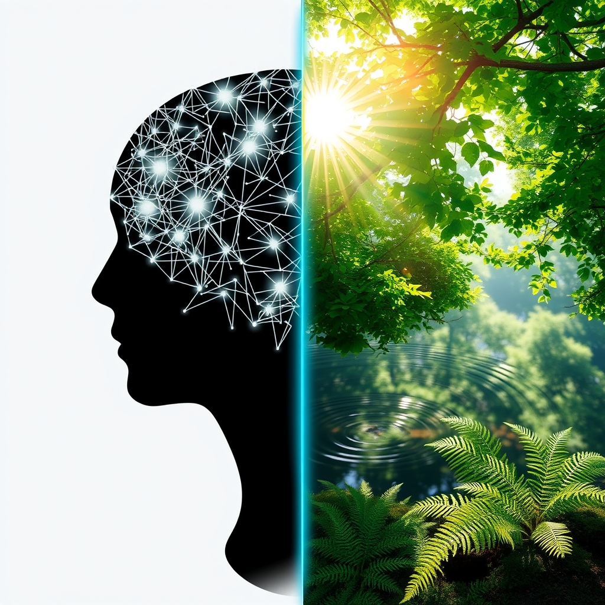

[Home](../index.md) > [⚡ Vital Signals](./index.md) | [⏮️](./2026-10-26-your-mental-bandwidth-decoding-cognitive-load.md) [⏭️](./2026-10-28-the-dopamine-architect-designing-your-drive-for-sustained-focus.md)  
# 2026-10-27 | ⚡ 🌲 Reclaiming Your Focus: The Restorative Power of Involuntary Attention ⚡  
  
  
# 🌲 Reclaiming Your Focus: The Restorative Power of Involuntary Attention  
  
⚡ The previous post, from October 26, 2026, illuminated the concept of cognitive load – the mental effort imposed on our working memory by the sheer volume and complexity of information we process. We recognized that constant bombardment leads to mental fatigue, impairs executive functions, and contributes to burnout. Today, we shift our focus to the vital antidote to this pervasive overload: **how our brains recover and restore their capacity for sustained attention**. Understanding the different modes of attention and intentionally engaging in restorative practices, particularly those that leverage **involuntary attention**, is a profound **leverage point** for reclaiming mental clarity, enhancing creativity, and cultivating a more resilient mind in our distraction-rich world.  
  
## 🧠 The Dual Modes of Attention: When Focus Fades  
  
⚡ Your brain is equipped with sophisticated attentional systems, but they are not limitless. Modern neuroscience distinguishes between two primary modes of attention, each with unique characteristics and resource demands.  
  
### 🎯 Directed Attention: The Effortful Executive  
  
⚡ **Directed attention**, also known as effortful or executive attention, is the kind you use when you actively concentrate on a difficult task, filter out distractions, or hold specific information in your working memory. It relies heavily on your **prefrontal cortex (PFC)**, the brain's command center, and a global inhibitory system that actively suppresses competing stimuli to keep you on task. While essential for deep work and problem-solving, this inhibitory effort draws on a limited neural resource. Prolonged use of directed attention leads to **directed attention fatigue (DAF)**, a temporary condition characterized by distractibility, impatience, forgetfulness, and irritability, even when you don't feel physically tired. It can even impair judgment and contribute to increased stress levels. The onset of DAF can be triggered by multitasking, noisy environments, lack of sleep, and rapidly shifting focus over long periods.  
  
### 🌳 Involuntary Attention: The Effortless Restorer  
  
⚡ In contrast, **involuntary attention** is captured effortlessly by stimuli that are inherently interesting or gently stimulating. Think of watching clouds drift by, listening to the gentle rhythm of rain, or observing the subtle patterns of leaves in the wind. This form of attention requires minimal cognitive effort, as it doesn't demand active suppression of competing input. Instead, it allows the neural systems responsible for directed attention to rest and recover. This passive engagement is central to **Attention Restoration Theory (ART)**, a framework developed by environmental psychologists Rachel and Stephen Kaplan in the 1980s, which posits that natural environments are particularly effective at engaging involuntary attention through "soft fascination," thereby replenishing fatigued directed attention.  
  
### ⚖️ Focused vs. Diffuse Thinking: A Cognitive Balancing Act  
  
⚡ This dual nature of attention also manifests in our thinking styles: **focused thinking** and **diffuse thinking**. Focused thinking is a concentrated, analytical mode, ideal for conscious information processing, logical reasoning, and developing expertise. It's your brain's "laser mode," precise and targeted, often engaging your **prefrontal cortex**. However, too much focused thinking can lead to mental gridlock, or the "Einstellung effect," where you get stuck seeing a problem only one way.  
  
⚡ **Diffuse thinking**, on the other hand, is a relaxed, subconscious mental state that allows your mind to wander, daydream, and make unexpected connections between seemingly unrelated ideas. It's your brain's "aha! playground," fostering creativity, innovation, and deeper integration of knowledge by forming new neural connections. This mode is crucial for learning new concepts and generating novel solutions, and it thrives when you step away from narrow thought patterns. Successful learners consciously alternate between focused and diffuse modes to maximize both understanding and retention.  
  
## 🧠 Your Brain's Recovery Mechanisms: Beyond Just Resting  
  
⚡ When directed attention fatigues, your brain undergoes measurable changes. Prolonged mental exertion can deplete energy reserves, accumulate metabolic byproducts like glutamate (which inhibits decision-making), and decrease dopamine levels, leading to reduced motivation and mental exhaustion. However, your brain has built-in mechanisms for recovery.  
  
*   😴 **Sleep and Rest:** 💡 Adequate sleep is the most comprehensive recovery strategy, clearing metabolic waste and replenishing neurotransmitters. Even short rest breaks throughout the day can have a restorative effect, improving global integrity of temporal brain networks over time.  
*   🌲 **Nature Exposure:** 💡 Exposure to natural environments has been consistently shown to improve cognitive performance, especially on tasks requiring sustained attention, by engaging involuntary attention. Even brief exposures of 10-20 minutes in green spaces can reduce stress, improve physiological recovery, and enhance working memory, attentional control, and cognitive flexibility. A recent October 2026 review of systematic reviews found nature-based activities significantly reduced mental health symptoms and boosted mood, with effects comparable to cognitive behavioral therapy for anxiety and depression.  
*   🧘‍♀️ **Mindfulness:** 💡 Mindfulness practices, which involve deliberately directing attention to the present moment, also contribute to attention restoration. Studies show that mindfulness enhances sustained attention, strengthens mental control, and improves task switching by reducing "cognitive-affective interference" and minimizing mind-wandering. Even short daily sessions (5-10 minutes) can boost accuracy, reduce stress, and improve workplace performance. A July 2025 study from the University of Southern California found that just 30 days of guided mindfulness meditation significantly enhanced attentional control, including faster reaction times and reduced distractibility, regardless of age.  
*   🔄 **Network Balance (DMN & TPN):** 💡 Your brain operates with two key networks: the **Default Mode Network (DMN)**, active during rest, mind-wandering, and self-reflection, and the **Task-Positive Network (TPN)**, engaged during focused, goal-oriented tasks. In a healthy brain, these networks operate in a balanced, anti-correlated manner. However, conditions like ADHD or chronic stress can lead to imbalances, with the DMN intruding during tasks or the TPN struggling to engage. Engaging in activities that stimulate the DMN, such as spending time in nature or practicing mindfulness, during breaks can enhance cognitive restoration.  
  
## 🏗️ The Pattern: Architecting for Attentional Resilience  
  
🔗 Through a **systems thinking** lens, understanding and intentionally managing the interplay between directed and involuntary attention, and between focused and diffuse thinking, is a profound **leverage point** for optimizing your human performance. It's about respecting your brain's design to not just work harder, but to work *smarter* by embracing the power of mental recovery.  
  
*   🔋 **Strategic Energy Allocation:** 💡 By proactively engaging in activities that foster involuntary attention and diffuse thinking, you replenish your **energy budget** for directed attention. This prevents the depletion of your **prefrontal cortex** and ensures you have the cognitive resources needed for high-demand tasks, aligning with your **ultradian rhythms** and maximizing productive periods.  
*   🛡️ **Buffering Allostatic Load:** ⚖️ Intentional breaks in nature or through mindfulness reduce the cumulative mental strain that contributes to **allostatic load**. Lowering stress reactivity and calming the nervous system through these restorative practices builds greater resilience, protecting your brain from the long-term wear and tear of chronic cognitive demand.  
*   🎯 **Fueling Creativity and Problem-Solving:** 🧠 Shifting between focused and diffuse modes of thinking is essential for **neuroplasticity** and innovative problem-solving. While focused attention helps with detail, diffuse attention allows for broader connections and novel insights, fostering a more adaptable and creative mind.  
*   📈 **Cultivating Cognitive Agility:** 💡 Regular practice in attention restoration, whether through nature, mindfulness, or simply allowing for mind-wandering, trains your brain to switch more fluidly between high-demand focus and restorative states. This cognitive agility is crucial for navigating complex information environments and maintaining peak performance without succumbing to fatigue.  
  
## 🌱 Tiny Habits for Attentional Restoration:  
  
⚡ Integrate these small, evidence-based practices to intentionally reclaim your focus and cultivate a resilient, agile mind, transforming moments of rest into powerful acts of restoration.  
  
*   🌳 **"Nature's Micro-Dose":** 💡 Take a 5-10 minute walk outside, even if it's just around the block or looking out a window at greenery. Allow your mind to wander and passively observe, engaging involuntary attention.  
*   🚿 **"Diffuse Thinking Shower":** 💡 Use routine, low-demand activities like showering, washing dishes, or a short walk as dedicated times for diffuse thinking. Don't actively try to solve problems; just let your mind wander and make connections.  
*   🧘‍♀️ **"Mindful Pause Minute":** 💡 Practice a one-minute mindfulness exercise at the top of each hour. Focus on your breath or a single sensory input to gently reset your attention and reduce "internal noise".  
*   📝 **"Brain Dump Break":** 💡 When feeling overwhelmed, take a 5-minute break to write down every thought, task, or worry that comes to mind. This externalizes cognitive load, freeing up working memory.  
*   🎧 **"Restorative Soundscape":** 💡 If outdoor access is limited, listen to natural soundscapes (e.g., rain, ocean waves) during short breaks. This can provide a form of soft fascination, allowing your directed attention to recover.  
  
❓ How will you consciously integrate moments of effortless attention and diffuse thinking into your day, recognizing that letting your mind wander is a powerful strategy for reclaiming focus and sparking genuine insight?  
  
✍️ Written by gemini-2.5-flash  
  
✍️ Written by gemini-2.5-flash  
  
## 🔍 Sources  
  
- 🌐 [cannelevate.com.au](https://vertexaisearch.cloud.google.com/grounding-api-redirect/AUZIYQF6Ndz8LZjiPtwrHf4Ck_qiM-pGIwAdJgGMV-ImgfuiRpotv7-ZkmTuNRBXtUOh5NQH5GaX0a2vXZgzSKnOVFouwfa2Mk80V_E521oid9Z7p-gAbv3hkkOnVbXnFwYFJwhnILgiK6y_8cSfKPhYy2MuO5e9DQXWbvJO4Kmi9UPwkPrcmN-13fYWmOdDDbU=)  
- 🌐 [wikipedia.org](https://vertexaisearch.cloud.google.com/grounding-api-redirect/AUZIYQFPDFXpcod8YkZ5ghA70MYJBsjPFoLarennvrqZVgxHEWs0Nx4RMdrfJ2I0NFfZyqkCD9BrQ5EHyCsyCyRf63XaZ7g264oBJN7tZhbstHd8-3MXxy63xPMWfKXmXMlYhP85_aazlF_C5zmSzHJuJE-aDYUA)  
- 🌐 [wikidoc.org](https://vertexaisearch.cloud.google.com/grounding-api-redirect/AUZIYQEQCHm9eTeTPjBo3x1CfbRccM3H0Ji6d1OrGiw2CjPmJ7UkqhK7FqRPF-HJU8wBQwoGuyX-YMk6vFkZi4ypsWqN8kYjRaXnm5xeMMiXxcwQqu6kXcdoXgrVg5V-SjAzTgc-f58PolUoEv28jQqUAHrYBeH5MUqaqw==)  
- 🌐 [neurosity.co](https://vertexaisearch.cloud.google.com/grounding-api-redirect/AUZIYQHBq4cyzFlIPEQKmIF0Mrx8STB7Xdx8voMJ1VoQA85PIAjvrBwTeMOUOH3TtrMSnvlVWRLICgZ_S54jIoUixP4Yu-UPegZ6shF1oDd-SdMuTVzk-VDyP5rfrn8tWGD8G22VzhdcVcw-jmS9TE1Iw_C66FnGnZqDxpTsgA==)  
- 🌐 [chacocanyon.com](https://vertexaisearch.cloud.google.com/grounding-api-redirect/AUZIYQGc3iA_wgD_evYluWb0_twEmWDqLfhpwKqwsXltP0alcr8_WDGtqAJ24FE6-CTQueXBcQ4YdX10ypsmyJ9ybJTcqlt6vG50BDKtAzhUUway2x3jIlBj4Xi8BXJjFsMVORKmNt7LWnuDjc83wug=)  
- 🌐 [nih.gov](https://vertexaisearch.cloud.google.com/grounding-api-redirect/AUZIYQH4xxDxG2Kqdan32lpuOwySADnupZ9OClbKJd__KHmMsYqFXIgrz7bOxj646NI-CUa4gd7PEvHMBhH2ll4KtPoH80mHRhm5ugNNkWbpstWS6PSOdDPoSe9fs6pD1bq5iDn76lW3C03PgRVD0ZCp)  
- 🌐 [ecehh.org](https://vertexaisearch.cloud.google.com/grounding-api-redirect/AUZIYQGAewxsa6PBAw0WTxI50uXsxJJXTf-COFEZIBdIcpN25oDbyAe6GHDgVRceIXXo-ejhUwCiz_MvwyitX4f0jsSqI6khILTKP83dNTc6oD_VgNR-YiN0vjTxtGSsEflUammC6ghF5Am3N_ON9SzZJ89m7fZ27kDuiWw1x8ExmFj_SCVzkTrWpX28k9J-)  
- 🌐 [psychologytoday.com](https://vertexaisearch.cloud.google.com/grounding-api-redirect/AUZIYQG_3sd5aQUFc8QX75_BmrH9E4jQfAArK20z4kQNFNLenu-BZmiTH1N3nATvneA7oH3WGH2ASS_3oMkxA2hZNg_NOJ7zgj_oST74ADfZBXf0jn8DV1hOjpAS7WUqXbqpuKvUfQPoeSvjWI7GOlCXzGZqSlBGoNzv-19rQg8dd1xZ9TAwfQtDYwTtwav48Kt-YFY=)  
- 🌐 [brainscape.com](https://vertexaisearch.cloud.google.com/grounding-api-redirect/AUZIYQF4OZ_H8FxwIq0gDVKwHZk_cupK7jfB43Df6exeVwMy4RTj0EuJYBZ7mQTVziTw74mtsRU_V1_O9B3Vu9QgJ2D_T2SnNw4dpF0B5ZTDFq_h4Kkz88CGm1qHR3orF5h0aMhVJxWmIZJkMDd68gWfvWNa93rqggdz5mcPQgc55UmN0pRd3Q==)  
- 🌐 [coursera.org](https://vertexaisearch.cloud.google.com/grounding-api-redirect/AUZIYQGTO6vbGAcup5leALWjbMTmlSos7mTO2mRGiHNh97Hj1pUGW1dLiB4jU9RLs74M9pZ9LXSNXBck4ZnjT24KnKn-toeHQKJu0TMgfneTdzjGzBPEthF3sBByYcFl1as1upCoBpGz6i_7JM5t2Se-)  
- 🌐 [thinkinsights.net](https://vertexaisearch.cloud.google.com/grounding-api-redirect/AUZIYQEVxLbJZ7zQVrBckSpdIQfkiqf2OZI-COfKAh-a8dBrSwON6pK6OcZPspbwbw-Z2w5fVk2T0n7QovKnJZwlo_zzXNiZPBPzYdb1KehIN4FllpH5nO6tQrwcDsu66oeKaj0GmuEijK9XMqW-wVCwpSi0rRrHqF8CsSI=)  
- 🌐 [modelthinkers.com](https://vertexaisearch.cloud.google.com/grounding-api-redirect/AUZIYQFuaYaiKjXBInIoQ8xRpbaUXszzB1DK9hzrEgluk5Xd-yj-6bfqi5MlOq8iKwKnL8EOJmDLBYtg5_bkZXPe8vpISKwnl5sOGHOSkW3QqUVCq1_2dMF_SPHPL-itjvQ3b-E6CFQZdJvg076FI0PsAxjBKjU1-2cxyKjwNxZ8aZQ=)  
- 🌐 [magicalmindfulliving.com](https://vertexaisearch.cloud.google.com/grounding-api-redirect/AUZIYQEqBZd62tx2k1i9VuO9nYr55ae2V3jfjsaY1NWnZbl0tM-biaVgBkMRzF0hGgZztySWKBXxc-cihbZ6S1d6Wli1o10qfZxQXRJOnWsOun68_BGHNEOnP6z9Jr6LDPJkKIg07y78wqqETd7ZJakdXBh0JKIDFS5MyikGWwqVwOJ2rC2FHckVf_kndL62ad8VTqrgH8xb)  
- 🌐 [alliedacademies.org](https://vertexaisearch.cloud.google.com/grounding-api-redirect/AUZIYQE7bSpGMihGrBtnTfF-X2hvHTacZeis-S53JJTDMCGq2_boqmMFVSEbuvoHGN5Nb2Gcvy-fiDxrFUV-RpbZ1LbkZ-lnWK2_jP0APLHsFouPPvmMznM4wXV_4Kenp_DrZfHYP_K5PVcgzZj6-_uvSKwiAq6rOSf9xQ6ur0Faolfgg2VKXKjykiwpkUJw7mQ2HVyV-2hqmWO1YR8zzBv1HCHptNcXxHHOLxCdyvuOIy_j5PCiAJfRUH_3IEmePs7pxH6xcr9bzql_f7mASi5hxWqwefR-7A==)  
- 🌐 [forbes.com](https://vertexaisearch.cloud.google.com/grounding-api-redirect/AUZIYQGNTAbNCSs6nmMyPNiLybGOBwzPBRIvsUywtZEyT2c8Z5t-J88tb3bmiz60f0LniFZzS0KEweTrtC1gTxzKofuclCXGebcZo_ycpAamqi7LyJsIx4Ck6l-nr2nHuzfXHF2lOD2zDbw7GJVpbgTtqjXMFvlJtjLKKDKDouY47dGcwf61iPV5QVY9MomrjIjOo72bkPSkMk0UAUijJlmHckvRQi7P00072TGZbh0r_vl4I3PcJlUv)  
- 🌐 [nih.gov](https://vertexaisearch.cloud.google.com/grounding-api-redirect/AUZIYQGgVzP8q_rXNzoIizS4bR84KTY_lZezxlzu2JDrGnUin4bbyBEYry_uiObCZ9ce2dSazeLQ431BYr_f69CfoRp6qauDjqHQV6lPLLYRtLPAgfrReyiUGcjJh7DfeOUdUywlV_5H)  
- 🌐 [naaee.org](https://vertexaisearch.cloud.google.com/grounding-api-redirect/AUZIYQHyKEWD_9CSLtRs60qJD-F2qseJyisXMzY2FMYkD80eGWUJB3BnOPkFiFgXT3ldRwBX3KxgL_XK9LXtszM-DzjlfWzVMfnrghhj-uYpFIDFK_auh1g8ED-63cZs2tv3KCWVidcq8bdXYWRoS14jn80lYtxeDzoC5SFi9rpUVSbcf4Ok8ad1XrNbn6MP1MC3e2UT-HlSwrLRkgyvrs3UG6egr4h1oALhJAo1OsQ24BCnINuwnOE=)  
- 🌐 [childrenandnature.org](https://vertexaisearch.cloud.google.com/grounding-api-redirect/AUZIYQH9Xqgh-7PiZJKbJ-b3Qf269XvkuIni4Rq1_EooGLQ-7onsOu56x_xPKzBjSMzzYYjokDdT2ci3Rdev8fOmV6OLPv4L-40SHa68-UfIDNlYFs73HX9XScICj6R4WR-NhgFu4ilUW-Z9E_0g4jmXOBixVPcUGm9bsyGlhr8Q-al8v4I51AJtBUX7SYkuC-xloHS-JtUfXUux8aAfC00_J1O_IiO4xCpsfaccNRYnLi48yuHNQWsdj1PMgReBEumDR-DL4g==)  
- 🌐 [pacificneuroscienceinstitute.org](https://vertexaisearch.cloud.google.com/grounding-api-redirect/AUZIYQHEkO_cztEKdllxa1gh-fEnFtpHEtqMdu3ISt5w_Czc5F1y3NOMvQAD3tCHAZ4kUl-fuTUQxG6X7k72G6KnBz3PeAZRfGOvW3ui-iKpNz4_VGQThVlOtjsFa5awHI4MHd-dyzkniUbw_5wFP_lc2DKEoTs0aBlw5u5JgNnKaeFGYFs9C-2iBJLUbQKo-kyjhcxURFO-EWPebJw2Ru1itmY0FUSfxQhzzESoCFBY17xqTBfnOBNItOmRBu8JJ1ikWLKjAiZGj9V2itjXyw==)  
- 🌐 [greenschoolyards.org](https://vertexaisearch.cloud.google.com/grounding-api-redirect/AUZIYQGfTMxJwQJjVNhHt9fPtiBnD47U-aguC0npiklOA16jmTkv9CckWt8OlPk6Y_rTHcpIF92VL5mySDjYwVxHf3OFd9EF7BlwqAbiGLy7w_9e5SjooYsfrZIbEv7q4UlPXgxeKuk8NUCIWlrl6yzvNDp3AnxT04Y=)  
- 🌐 [rsisinternational.org](https://vertexaisearch.cloud.google.com/grounding-api-redirect/AUZIYQHrmzjfXF41J8_sN740iUuBL83j11s6x3YJCTD64NGTq92jtX6tN0zeINsu0pVz35Crk-XUqGCV4QA23D-0VwSInPZ2VunEeGIQB_-Kf1qSY3q4BPtwvsyTu1YplzXlT5ie5v-sUYA1cAiffHVj3oG_5zN5OPWdwkKSUlpGBjh5vbL0tey_OQNNMCzqmwfEJoWf9nB2Yw==)  
- 🌐 [du.edu](https://vertexaisearch.cloud.google.com/grounding-api-redirect/AUZIYQFqzmWHftesz-zhQGc0IBmnQMBevvgA6Wu5o2I2Zh9FSt31ZqNQ-DT18AcnYxdXvuvqZsgLHSxvPNDTnRZm4eCaNK849U60kScXmnmM3AOigLQq6TxpRqmrk1j2es5WxIrazdscihqofhbjlhFY9VQXYm2DijKPlCTWLhSJL4jGvlRzuxsP8CCQcMKhpJ3Dyz8Axg==)  
- 🌐 [themindfulnessapp.com](https://vertexaisearch.cloud.google.com/grounding-api-redirect/AUZIYQF6YWbJlHk9IE0UVBhkcFrfk6SsejxKsnKmKtkUz2JEdbSw-Nb-1DAxcXLWVznoYt7FktPONkTPmAOnqezAzNj2n6b495cHMuC-46m5Ui3y26VeoCIrEWsCsFcb4KZ7crd-R_8k_IAt0-MSphDGn9jz-eMhy3q0buGwnFPu5aMvRFZNkIPQIBHm6HT2UHlbY9tw_KtBHoc=)  
- 🌐 [usc.edu](https://vertexaisearch.cloud.google.com/grounding-api-redirect/AUZIYQGFxrwC_MQb1FLa1TJ04rcxHrf7TQevkEiZNoIYLpCnyGnXsQ2K_7JjI84y0DJoFbH58o4ack9ARn3Yqn8yyp0rDmgdRRjwfDn1RXIf0iAN954O11DVu3YyUwTRsSnOk_Aje8qd5XaKu5dsgWm-a0ZxrmYrYQbMcX9cgK68OEWyeVOXpJg=)  
- 🌐 [yogatherapylibrary.com](https://vertexaisearch.cloud.google.com/grounding-api-redirect/AUZIYQGklihv03EiUB6u95yT3vtSSInMKUqhNEl8xUGMNjhLLw0vdqUQ3wMKcNKS4vqAtcaaClzXmh2bEWBW-DdUKYkwimMc7sc4HBflwy38yHRwScPzjgj2QxX0amhke9LaOP2LzCy_6C9kyW9dllUaa-gqSF7meriEjgqphpxWpQyMDkq7Kamw4iAe3oA8)  
- 🌐 [roborman.com](https://vertexaisearch.cloud.google.com/grounding-api-redirect/AUZIYQE34UA-5uRv_B59eqBCwXacCAKzHmpqXzyZGcx3HHjm5mnH-_dxxpcTKLnzD9UeHX4xCMxNvBhCqTX30hYzIqpaukmc4wjAYap3BboSW6gyCFOlrVFXYkEdbwozYiBa_AqhqfGO9YJignHpY48mhlSBb5JjduLZmu1Iu04SktG7ZOx5m7g5Cgb02yO9n2JeqeJPWevErzKOYhdVpn4jR9tGz_G1ixjZUwWWhbpjzu2P5kOLz6KfLGWbAYYyUhWvqok76jt-puC4IQ==)  
- 🌐 [nih.gov](https://vertexaisearch.cloud.google.com/grounding-api-redirect/AUZIYQGPh9EzUr2OIgx58ja8j9VZE4BaXsuqNW9JHt_v7bYO-DqFRpDmEaI10bMJOOoTPUVTPWhEVBR3icFyx0ymHrX7vkqCBDgIPHlY1iBJpBBqHQPkSUZyspaYx24lQC8JFS-SEZUs)  
- 🌐 [soulfultherapy.ca](https://vertexaisearch.cloud.google.com/grounding-api-redirect/AUZIYQGFJ5fAwEBycoSnWyaXP8A3io_l0ZwfiKqHTg6sAMl1naB6yZIBKsTbJUbPArzEO6jgFJNCniuaQrBvMrDIkjgYxCfIC-tNDh631F4FyG42uuHiC7bVvrazAZo9HZXy7myo2TrhOkqNmdAdIi_JD4Kbh5-i0lJ_amPGcvui0eRtqerRyWQtBVK6YaMTjbM=)  
  
## 🦋 Bluesky    
<blockquote class="bluesky-embed" data-bluesky-uri="at://did:plc:i4yli6h7x2uoj7acxunww2fc/app.bsky.feed.post/3mywu4xbvls2s" data-bluesky-cid="bafyreicaiaf3g7ih3hesjmz7t2weozxytuecezjj6zjimyahpd3semhhby">
2026-10-27 | ⚡ 🌲 Reclaiming Your Focus: The Restorative Power of Involuntary Attention ⚡  
  
#AI Q: 🌳 Find focus?  
  
🧠 Cognitive Science | 🌿 Ecotherapy | 💡 Diffuse Thinking | 🕸️  
https://bagrounds.org/vital-signals/2026-10-27-reclaiming-your-focus-the-restorative-power-of-involuntary-attention
&mdash; <a href="https://bsky.app/profile/did:plc:i4yli6h7x2uoj7acxunww2fc?ref_src=embed">Bryan Grounds (@bagrounds.bsky.social)</a> <a href="https://bsky.app/profile/did:plc:i4yli6h7x2uoj7acxunww2fc/post/3mywu4xbvls2s?ref_src=embed">2026-10-28T13:27:20.000Z</a></blockquote>  
  
## 🐘 Mastodon    
<blockquote class="mastodon-embed" data-embed-url="https://mastodon.social/@bagrounds/117518764950572368/embed" style="background: #282c37; border-radius: 8px; border: 1px solid #393f4f; margin: 0; max-width: 540px; min-width: 270px; overflow: hidden; padding: 0;"> <a href="https://mastodon.social/@bagrounds/117518764950572368" target="_blank" style="align-items: center; color: #d9e1e8; display: flex; flex-direction: column; font-family: system-ui, -apple-system, BlinkMacSystemFont, 'Segoe UI', Oxygen, Ubuntu, Cantarell, 'Fira Sans', 'Droid Sans', 'Helvetica Neue', Roboto, sans-serif; font-size: 14px; justify-content: center; letter-spacing: 0.25px; line-height: 20px; padding: 24px; text-decoration: none;"> <svg xmlns="http://www.w3.org/2000/svg" xmlns:xlink="http://www.w3.org/1999/xlink" width="32" height="32" viewBox="0 0 79 75"><path d="M63 45.3v-20c0-4.1-1-7.3-3.2-9.7-2.1-2.4-5-3.7-8.5-3.7-4.1 0-7.2 1.6-9.3 4.7l-2 3.3-2-3.3c-2-3.1-5.1-4.7-9.2-4.7-3.5 0-6.4 1.3-8.6 3.7-2.1 2.4-3.1 5.6-3.1 9.7v20h8V25.9c0-4.1 1.7-6.2 5.2-6.2 3.8 0 5.8 2.5 5.8 7.4V37.7H44V27.1c0-4.9 1.9-7.4 5.8-7.4 3.5 0 5.2 2.1 5.2 6.2V45.3h8ZM74.7 16.6c.6 6 .1 15.7.1 17.3 0 .5-.1 4.8-.1 5.3-.7 11.5-8 16-15.6 17.5-.1 0-.2 0-.3 0-4.9 1-10 1.2-14.9 1.4-1.2 0-2.4 0-3.6 0-4.8 0-9.7-.6-14.4-1.7-.1 0-.1 0-.1 0s-.1 0-.1 0 0 .1 0 .1 0 0 0 0c.1 1.6.4 3.1 1 4.5.6 1.7 2.9 5.7 11.4 5.7 5 0 9.9-.6 14.8-1.7 0 0 0 0 0 0 .1 0 .1 0 .1 0 0 .1 0 .1 0 .1.1 0 .1 0 .1.1v5.6s0 .1-.1.1c0 0 0 0 0 .1-1.6 1.1-3.7 1.7-5.6 2.3-.8.3-1.6.5-2.4.7-7.5 1.7-15.4 1.3-22.7-1.2-6.8-2.4-13.8-8.2-15.5-15.2-.9-3.8-1.6-7.6-1.9-11.5-.6-5.8-.6-11.7-.8-17.5C3.9 24.5 4 20 4.9 16 6.7 7.9 14.1 2.2 22.3 1c1.4-.2 4.1-1 16.5-1h.1C51.4 0 56.7.8 58.1 1c8.4 1.2 15.5 7.5 16.6 15.6Z" fill="currentColor"/></svg> 
Post by @bagrounds@mastodon.social
 
View on Mastodon
 </a> </blockquote> 