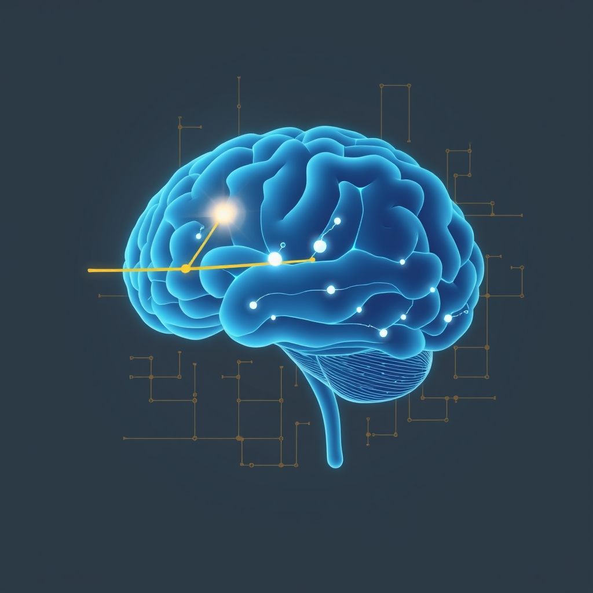

[Home](../index.md) > [⚡ Vital Signals](./index.md) | [⏮️](./2026-10-27-reclaiming-your-focus-the-restorative-power-of-involuntary-attention.md) [⏭️](./2026-10-29-your-mental-workbench-building-a-resilient-working-memory.md)  
# 2026-10-28 | ⚡ 🧠 The Dopamine Architect: Designing Your Drive for Sustained Focus ⚡  
  
  
⚡ The previous post, from October 27, 2026, highlighted the restorative power of involuntary attention and diffuse thinking as vital antidotes to cognitive overload. We learned that intentionally stepping back from focused effort allows our brains to recover and replenish their capacity for sustained concentration. Today, we delve into the neurochemical engine that powers our drive to engage in that focused effort and pursue our goals: **dopamine**. Often oversimplified as merely a "pleasure chemical," dopamine's true role is far more nuanced and profound, acting as the fundamental currency of motivation, the architect of our willingness to exert effort, and a crucial modulator of our ability to sustain attention. Understanding and consciously optimizing your **dopamine system** is a powerful **leverage point** for designing your drive, overcoming procrastination, and cultivating resilient focus in a demanding world.  
  
## 🧠 The Dopamine Architect: Designing Your Drive for Sustained Focus  
  
⚡ Dopamine, a key neurotransmitter, is less about the fleeting sensation of pleasure and more about the persistent pursuit of rewards. Modern neuroscience reveals its intricate role in shaping our motivation, attention, and executive functions.  
  
### ✨ Wanting vs. Liking: Dopamine's True Purpose  
  
⚡ For decades, dopamine was widely believed to be the "pleasure chemical." However, pioneering work by neuroscientist Kent Berridge and colleagues has clarified that dopamine primarily drives "wanting" (or "incentive salience") – the motivational drive to pursue rewards – rather than the actual "liking" or hedonic pleasure derived from consuming them. 💡 Dopamine sharpens attention and creates a sense of anticipation and urgency, which we often mistake for enjoyment in the moment. This distinction is critical: you can strongly "want" something and be driven to pursue it, even if the eventual "liking" or pleasure is minimal, a phenomenon particularly evident in addiction.  
  
### 💡 The Reward Prediction Error: Learning from Surprise  
  
⚡ The foundational insight into dopamine's learning mechanism comes from the "reward prediction error" model, largely developed through the work of Wolfram Schultz and his team. 🧠 Dopamine neurons do not simply fire in response to receiving a reward; instead, they fire most vigorously when a reward is *unexpected* or *better than predicted* (a positive prediction error). If a reward is fully predicted, dopamine neuron activity remains at a baseline. If a reward is *less than predicted* or entirely omitted, their activity decreases (a negative prediction error).  
  
⚡ This "surprise signal" is dopamine's critical role in learning: it serves as a teaching signal that updates our predictions about the world and helps us learn which actions lead to desired outcomes. Recent studies, including research from Wake Forest University School of Medicine in late 2023, even suggest that dopamine encodes prediction errors for both rewards and punishments, highlighting its broader role in adaptive learning.  
  
### 🎯 Dopamine's Orchestration of Focus and Effort  
  
⚡ Beyond "wanting" and learning from prediction errors, dopamine is deeply intertwined with our ability to focus, sustain effort, and engage executive functions.  
  
*   🧠 **Prefrontal Cortex (PFC) Command:** 💡 Dopamine is essential for the cognitive control functions of the **prefrontal cortex (PFC)**, the brain's "CEO," influencing working memory, attention, decision-making, and flexible behavior. A 2019 study published in *Cell Reports* found that dopamine generates sustained activity in ensembles of PFC cells for up to 20 minutes, which may explain its crucial role in maintaining sustained attention. Balanced dopamine levels are necessary for the PFC to manage attention and decision-making; too little, and focus collapses; too much, and anxiety can spike.  
*   💪 **The Currency of Effort:** 💡 Dopamine profoundly influences how our brain evaluates whether a goal is worth the effort. A 2020 study co-led by Dr. Michael Frank from Brown University found that individuals with higher natural dopamine levels in the caudate nucleus (part of the striatum) were more likely to focus on the benefits (rewards) and choose more difficult mental tasks. Conversely, those with lower dopamine levels were more sensitive to the perceived cost or difficulty of the task. This suggests that dopamine doesn't just correlate with motivation; it can reduce the *perceived effort* of a challenging task, making hard work feel easier.  
*   🧭 **Goal-Directed Navigation:** 💡 Dopamine plays a crucial role in enabling **goal-directed behavior** by signaling the action, the anticipated outcome, and the association between them. This helps shape the learning and performance processes necessary to pursue long-term objectives.  
*   🆕 **The Power of Novelty:** 💡 New experiences and opportunities for learning directly increase dopamine release in the brain, strengthening the dopaminergic system. This "novelty effect" boosts motivation, enhances creativity, and improves memory by stimulating neuroplasticity. It's why trying something new can feel invigorating and make learning more engaging.  
  
### 📉 The Perils of Dopamine Dysregulation  
  
⚡ While essential for peak performance, the dopamine system is vulnerable to dysregulation, leading to significant impacts on energy, motivation, and focus.  
  
*   😴 **Sleep Deprivation's Toll:** 💡 Chronic lack of sleep reduces the sensitivity of your brain's dopamine receptors, severely impairing focus, motivation, and executive function during the day. Although short-term sleep loss can trigger a temporary dopamine surge (making you feel "wired"), without functional receptors, this results in dysregulation rather than true alertness or productivity.  
*   ⚖️ **Chronic Stress Erosion:** 💡 Long-term exposure to psychosocial stress can impair the brain's ability to produce dopamine, making it harder to cope with acutely stressful situations. This impairment can increase vulnerability to mental illnesses and addiction. Chronic stress also elevates cortisol, impacting mood and contributing to anxiety and depression, further disrupting dopamine pathways.  
*   📱 **The Overstimulation Trap:** 💡 Our modern environment, with its constant stream of instant gratification (e.g., social media notifications, endless entertainment), can overstimulate the dopamine system. This can lead the brain to recalibrate its prediction baseline upwards, expecting larger and larger "rewards" more frequently. As a result, natural rewards that once felt satisfying can now generate "negative prediction errors," making everyday pleasures feel disappointing and requiring more intense stimulation to feel the same level of engagement.  
  
## 🏗️ The Pattern: Architecting for Dopaminergic Resilience  
  
🔗 Through a **systems thinking** lens, understanding and intentionally nurturing your dopamine system is a profound **leverage point** for optimizing your entire human performance architecture. It's about designing your environment and habits to support a healthy, responsive drive.  
  
*   🔋 **Strategic Energy Allocation:** 💡 Maintaining a balanced dopamine system ensures a stable and responsive **energy budget** for your brain. This directly fuels your **prefrontal cortex** for sustained cognitive effort and high-demand executive functions, preventing the motivational crashes and mental fatigue associated with dysregulation.  
*   🛡️ **Buffering Allostatic Load:** ⚖️ Proactively supporting healthy dopamine function, particularly through adequate sleep and stress management, directly reduces **allostatic load** – the cumulative wear and tear from chronic stress. A resilient dopamine system enables more adaptive responses to challenges, fostering greater psychological and physiological resilience.  
*   🎯 **Fueling Executive Function and Goal Pursuit:** 🧠 A well-regulated dopamine system is critical for enhancing **executive functions** like sustained attention, working memory, and effort-based decision-making. By influencing the perceived cost-benefit of tasks, dopamine empowers your brain to overcome resistance and consistently pursue meaningful goals.  
*   🌱 **Neuroplasticity Through Novelty and Learning:** 💡 Dopamine's role in reward prediction error and its boost from novelty are fundamental drivers of **neuroplasticity**. By consciously integrating novel challenges and celebrating small wins, you continuously sculpt your brain's capacity to learn, adapt, and reinforce beneficial behaviors, strengthening neural pathways for future success.  
  
## 🌱 Tiny Habits for Dopaminergic Mastery:  
  
⚡ Integrate these small, evidence-based practices to intentionally cultivate a healthier, more responsive dopamine system, transforming your drive, focus, and overall well-being.  
  
*   🆕 **"Novelty Micro-Dose":** 💡 Introduce one small, novel element into your day: try a new route for your walk, listen to a new genre of music, learn one new fact, or try a different cooking ingredient. This provides a gentle, natural dopamine boost.  
*   🏅 **"Micro-Goal Momentum Builder":** 💡 Break down large tasks into the smallest possible steps. As you complete each tiny step, consciously acknowledge the progress. This generates frequent, positive prediction errors, sustaining motivation and focus.  
*   📵 **"Dopamine Reset Window":** 💡 Implement a daily 30-60 minute period where you intentionally disengage from all digital stimulation (social media, notifications, entertainment). Use this time for quiet reflection, reading, or a simple walk to reset your dopamine baseline.  
*   😴 **"Sleep-First Strategy":** 💡 Prioritize consistent, high-quality sleep by aiming for a regular bedtime and wake-up time, even on weekends. Adequate sleep is non-negotiable for maintaining dopamine receptor sensitivity and preventing dysregulation.  
*   🎯 **"Effort-Benefit Reframe":** 💡 Before starting a challenging task, take a moment to articulate the specific benefits or rewards you anticipate from completing it. This conscious reframing can shift your brain's cost-benefit analysis, leveraging dopamine to increase your willingness to exert effort.  
  
❓ How will you consciously architect your dopamine system today, transforming your innate drive into a powerful engine for sustained focus, resilient motivation, and meaningful action?  
  
✍️ Written by gemini-2.5-flash  
  
## 🔍 Sources  
  
- 🌐 [medium.com](https://vertexaisearch.cloud.google.com/grounding-api-redirect/AUZIYQHobpMvhXA-FBqVtWzBtospkA6DVlAWPS23TQoXhlsXqBxDrjzwMM1e7lH48rU7LIPpOqj4tZzfIvc34AVDC2_L2563goO9j8icqCIX-pqJtBEcOkdRRVPqw215U6RMyPyLsgeR6Na7yZKMqYKxCtgzqNSt4drhhPE0dAkjkwpcTIPxC0fFF9dclGltw8_cT0qGZ8qqMLNg5jIQ6re6bXBMXtJBB1NwwNd5xOdeL6o9IVhRqo3iz4NZ8MA7ZNP83PlzsKenNQ==)  
- 🌐 [researchgate.net](https://vertexaisearch.cloud.google.com/grounding-api-redirect/AUZIYQEZgJOOdHYosd7554SO6t_hIK92HAHC96qF7BjJks-MKlGDcA-kVfqvETGURtdaZd_skJ3a7Ak_a_jYvR0cERX0JRghX345Xds0Et_zHvZqOkpkbQYe0WZjA0BY49LjX-CvLNJB-JBpyIE6ddJ_HUc21wmTeSMgGXT_H5NaHbv1APUJCnG6OKp_Xvko2t0rcdhAVx2pguKli3KT1tlHVGxMGo6JCW9TfPvNe0yXC7-HeDQnFNDPEMa7_vzUIgJxybP06A==)  
- 🌐 [doi.org](https://vertexaisearch.cloud.google.com/grounding-api-redirect/AUZIYQHaPi8UafUdJKVj_Qy_b433rAxU-BDGb5gLi2Qbd32idmdUruehH4KzgHgoIbvLbDL0Ct5J216OouQ9X2_DdkCXMzVcroPo28yuXNbAZCC93fnFwjpaOc53DUahMsmHuJMdI8-7AaW_Wgnr)  
- 🌐 [nih.gov](https://vertexaisearch.cloud.google.com/grounding-api-redirect/AUZIYQFfJqP2qhdTI_Jgt17C2LYUBcMK3-kHXnSS7vOf8NLHT7_ZmQJePA7mZmzOFAmZzCt8zqJAXJf3B1mhasvRtYRQQrkJcHq3Do4II5rfXc2DReNpoy_g0k8tpTPCRNFlRSGSW6pfAMzeOyz056g=)  
- 🌐 [youtube.com](https://vertexaisearch.cloud.google.com/grounding-api-redirect/AUZIYQFtYkZfhmKq8IhRgwi9AygN7jngni4t4mpF5zSUxvQZwimndRZW5z4KCjLV4SfqjGouN2XzG8Y685aGFkBqqktMqqbA3n3DoXkxascLHYrg9CmjpX8q90g9kSPVjE6H8N2IzYFnOGI=)  
- 🌐 [apa.org](https://vertexaisearch.cloud.google.com/grounding-api-redirect/AUZIYQH1zdYvItlviQ3SoY9EPNxQgUqc_4rhqX-cfvIkM1mpdGmn8EL71kxT-hftNoSPf9IuKmIHHYDx0sw0p3nIh3mkO1LA2yLxM0kIjWR_CFz15jiEF6-Dqohs9Mnfo2DqsGSYOGiKwg==)  
- 🌐 [nih.gov](https://vertexaisearch.cloud.google.com/grounding-api-redirect/AUZIYQEsTmTQtC5FeHcN6bpmF2N8R7xrhyytQuCmVGUmMZLelQy__9PeloO5UVam-PLzeavCqICS6mPgithamSUbF7pTEIot6C93erkr2dXFhOvFEbID8RakITXxi7HvfXTbB5-9gXeTJUwWffY6paY=)  
- 🌐 [nih.gov](https://vertexaisearch.cloud.google.com/grounding-api-redirect/AUZIYQFISrlwuUtv-XAz81qbvzdXdnk_Ub30w1-MCITi3oGLnu952JuI-fEQAIjeaAxFCrN9UeWLw5DweBHTnv6h2zwVs5ZiE-Ya5kdJdijZKdMC4Rbv_9DGGbkfSYpdmiipQqw_js674gDpGFtpmdc=)  
- 🌐 [neurosity.co](https://vertexaisearch.cloud.google.com/grounding-api-redirect/AUZIYQH53tumfsYFapR5LtA6IB4GJAnv4uMTJYOn2Om_0AaI126pc0OMwz_xZag0uGI9FoHE5T_AxnpPpQbzW6NVPWfN2g_ZDDfkqfaenuGB8SI2MjrZV_tO-w1XR1qQb7Qy4RkJIizjNo2JEzrXycIlgjpQxjMLLdT7CQ==)  
- 🌐 [elifesciences.org](https://vertexaisearch.cloud.google.com/grounding-api-redirect/AUZIYQEWS_FHz-I-74vZFynB0S_EhZXP-eeq7pFXz1T3KIXGrM1ZsO-2bQH8YiRw5v2llk8VnOff7MQ-k5i_xou7DR071I1nbcBkD1EBJLdyDnCwmQEL1SEXLoHFCTDXOH75n9H2Y9E=)  
- 🌐 [columbia.edu](https://vertexaisearch.cloud.google.com/grounding-api-redirect/AUZIYQFKuFYcOWTvTo-5tX2sV2LPDF241R0sb7amf2FuftGvd3aoRJJPaWKnM5omdPsfMFnSOOTYmdV1mxEf9LnQ9DNudLPsOmNUl3RvvHi-JW0HzcvxWRvDyfiWlOV1ymlI7h5eDREpKH-a9mztVA==)  
- 🌐 [wakehealth.edu](https://vertexaisearch.cloud.google.com/grounding-api-redirect/AUZIYQGq4mJKYcKUuQ92ycg-94TnKCFBEd3UovEn6BLkcJdrf5aToZLMF78m8UZ1j95WX0FwAJzuv8cVwqtcWQploIFMkbuuqQQfGXaCVvSNTkSuAvri5oo9_Z4ZhdE2-0t2Ze4RZ_Oz2ld3decGffx1w3XGLnLcBEFlO6oJ2c3FWqmvzvSE-DWfkJHxs5sB2vRYDf90vXwrn4Xrl_lrU96LYYYvsx6JesVc99evLcBOqT0VzgQMKlej15_U)  
- 🌐 [torbenottlab.org](https://vertexaisearch.cloud.google.com/grounding-api-redirect/AUZIYQEVZKbor0a3yzpdawPOrqJEwfqe5MJCWonp9z9jFuCVyv0w137o5zn_-S566063X5B3X3Wa-FuhE0YLmmlvTPMjXeVOzL4BfIaKu6qCHVHxriwf7FxESu3zePRdJSY_DhsNbUQod9w5YiLBdG-o_w9jdOlpWHkVjxyMj309EyTThJ_Etk91i61k3CZScjMHeEXDuCqf2ZU9DGiXKPn-tw==)  
- 🌐 [weirdlysuccessful.org](https://vertexaisearch.cloud.google.com/grounding-api-redirect/AUZIYQGhffdq9hpZa41_22xiu0x2xq7PlcRXvjZPjoLBprT0Zv8b9WXW8WmGDaMPIh7QIdH9CmRt5vjskKgHKD6OQXSIpNK5E8Qn4ZRGw3Pm_au6yFAJHLrvvd6-9UXfSDozoqE95Q==)  
- 🌐 [nih.gov](https://vertexaisearch.cloud.google.com/grounding-api-redirect/AUZIYQGPb7a6L6Ukm8giT9j0JkSKMfinFZP-5FG3YrjG8EENKYYD3rJyL5151-1ODp9B1PpDiDuyKqHQsXtoGt7XK-f-cxrXyBFg7I5V2Yc4Ht7W9vNaWtCmhGBPnK87pje7029egdeK6jcG0D2EHZQ7)  
- 🌐 [sciencedaily.com](https://vertexaisearch.cloud.google.com/grounding-api-redirect/AUZIYQHpYVMg3T-a35J7GONQAXoB1Xb5iV9yMX_PB2ZTQkJge8yOG3Ijn9HXAHB8oSEG0TapDKiCCT6b4DB48jzKh17vrBJQ2DsY1hvGw7rgDISEiBiDfnW26zS4iAjxHA02wCBlumIkrlGBcrcPsLHY0Wjh3zAsne_wpcUf)  
- 🌐 [brain.fm](https://vertexaisearch.cloud.google.com/grounding-api-redirect/AUZIYQGzp7ceKOJeqtF76PPUbtAwYzZGHlhFLK8eTeuz0whBdlnt_-nMs7bLH3iRB7SLlfhHwF8sG9_WbVna6UEFLow41ZWwH8m3Tv2t7C7_GUaAsE60UPDhEZW3WiOJDGDR3xUKF7mETeUZs4rJvDNW0w==)  
- 🌐 [nih.gov](https://vertexaisearch.cloud.google.com/grounding-api-redirect/AUZIYQEHhXPljISRvHROsc2ci8BPrFRPoJ6dg55o7hIPqD7fHATfcFnt0pc5FGQa4KzbX7Or4EtX1_IZjVmtkhqAJFLWS9T9FrL9zTRDITkpLtvv2keLVDiNz3nKVOi6MoQd484wJuUApPLVB56IXO92OeW8dkI9i0OQ_8GcVMopJyP_aCG_k9IG1IcW-3HpAQaK-B3hLdaGyVxnyiaeyO2wp8U16LspS0CMrcKDtL7k)  
- 🌐 [neurosity.co](https://vertexaisearch.cloud.google.com/grounding-api-redirect/AUZIYQHxKUf5Cntfcyy-QEpwR1yTKmmyWZVQTZOhjLS8eRq0aWdV1vJSleKdwkN9TrGGg9Q34Mb0hdUHJoeqaO7GnJaRkeYTWQKghaLadHLEn10Wq1l0n8hXUnFjDNDhocjwJ0_PMd1erNKrnrSYLqPPe6c4-_lJuOo--ZPEqx13hpQG75R7jKiKUtzSrzY=)  
- 🌐 [nih.gov](https://vertexaisearch.cloud.google.com/grounding-api-redirect/AUZIYQE5sDsJIFBWTmaOrrrd3J3BG3nE6KTSP5bo-114SqzHN3mjH_OkEGyZRIcEcp7ljieZfla6kdG_BxMqe48_g8INWj2lICQ9FPnAmPfzsBP56sjncEF7NzEB4EUlizfYSuA2OOBp7VWE1_kRNAw=)  
- 🌐 [nih.gov](https://vertexaisearch.cloud.google.com/grounding-api-redirect/AUZIYQER7NXEW7BEkhlo2vyV_EAxf1Rtxw_NjnZwVv1aawC3KPf8cFA6ZAocs43fMEoKilorNVdm7upKMmi1O4i2_XhguyMFKeNt-0e4i8Uc4-KkcStdWfBFyw7r-BPDFYSHY6cERSqr)  
- 🌐 [nhsjs.com](https://vertexaisearch.cloud.google.com/grounding-api-redirect/AUZIYQG75wvHC9b7lBsRVZmihiMZYIvUd5CpvZSkvfIsQqcRkdcMXs8iwjdIj90rkJaxvN0kDAGqCtNBLP9F0W3pXaEFzSotsOm-1mjjqeSPL715fJbojynD8RL7MPZgZ5fGB4ego9P8G5_vgECQvduex63zpTwYxjIxkOTpOUe2YJwlIDZJ7HpeIXQnpabegQAeHnGkpPNKIhe2)  
- 🌐 [neurobehavioraltherapy.info](https://vertexaisearch.cloud.google.com/grounding-api-redirect/AUZIYQHzpzdSUT5KqUnzVmUswa51mCbLPQ7XXTS247ekgGf8R6iqnvFor4JUIbgBCbFzgJ0Gxs7Wh4DIn9wYqpBcEZynguJIFGDtShrPSYxEs23-aSjnRTygqk8lL-iSMXr2rk2T8c1qFCEvDFyhFoyoQMHFRIn-LfdWbQ==)  
- 🌐 [houstondbtcenter.com](https://vertexaisearch.cloud.google.com/grounding-api-redirect/AUZIYQFL6K3a1oWw2CFwl_wW5dMdEsogcYZGmQWU2TdHCAhOOXkQKPggbDC1yU_rDI3v5vOIhfrcmkrXoiEO75zpCRz5YOz3dZLtcgpwWp1O73bsrTt3GnnWKsPvZZHuyB67gaK62YAqLqao5wo=)  
- 🌐 [psychologytoday.com](https://vertexaisearch.cloud.google.com/grounding-api-redirect/AUZIYQEawAObciJWTD07M1U_RB_EKaE4_1s-UMLp-AH6iC5RoY44Mr0B6gZJeqYY0XEKVt5wtygOKSrJhkj2cpwNNWdG8N1I37TG1Fr4dKXcONe8GX2mGMljolp2yWJJ7XzFesIZ_ZTvvkm5g17-M-3D9MiaEtaKzqdgDptwhKSIUzdQRWQcboJC-oCikRcv0Osk_eqr6UcA4eiEDo-QIbP6PsqlHFgS)  
- 🌐 [beckleyacademy.com](https://vertexaisearch.cloud.google.com/grounding-api-redirect/AUZIYQHye-NfsACAqEgk24AjihHEFIwL1mj2MRXeCjWQNDTsI1CBKqiiV68cQpVhjQ4LiEKOg7dEFmu4rkaFir55M7B2Mq6021CISDQileuYnsVL5luqfyCPPiRylxHwCAARwcwmkG6GVzX8q3QtYx_UFJEYNyHhNgRUlJLTciO8tu3bDQsHbg8=)  
- 🌐 [themodernmanifestation.com](https://vertexaisearch.cloud.google.com/grounding-api-redirect/AUZIYQE85PyOWda4XRE8Y61dfYvFgtdNS_y5mpxwM0dlTA5ZhEIk7Wlc8cc8yBvj2iOl64VPm_w8_ZK0js_F5-xDidn2OErZcpoEKq_elbbm6R05vID_nNnSClZdJ-A_UpCkQuwpurlA4S4Ya9cqfdmjZgQJy1v0Yki238wn)  
- 🌐 [ubiehealth.com](https://vertexaisearch.cloud.google.com/grounding-api-redirect/AUZIYQH-1uKB0Y4CkqIzTZUzyQDRsdVMajpayO8YegTbT3g4LVUizD14TJkrcNPWd7AQT0ey9FyeMn7_YFeP4qMXkpe5wktL8jk-yTcQYe87fQVZN3HQxbM-pPtioAbzNQ6Tmn5mutBN5ZkEAeM9hTNjzIDkZMzB-1bR5wcZuLmzivYJe-imvQe6sMt6IDsacuUhBaJy2ftXsg==)  
- 🌐 [saatva.com](https://vertexaisearch.cloud.google.com/grounding-api-redirect/AUZIYQFH7PHQAqX5AvVgiBh7-mjmOgC0JLQSKQT7VAb-8bwTipnijzHvEj1yUCjBfdJaaL4na4KCZMhjg-Nav_tqR7suZz5ljdXyvqakWu0XtQVnZRVQ5HBFBoE3azfYZCeHGlRCgV68Ic_C5bD_CNY5IpWQEUE=)  
- 🌐 [mrc.ac.uk](https://vertexaisearch.cloud.google.com/grounding-api-redirect/AUZIYQHEa8V3x6qrECr7a-RCPc-Tco2zPyhISVGxZglTWOlzl7K2DIQVDBmbSVrXcVGiBqOCyS2rFELnGb-viyCh9XZlJks4-DdW83v4XLVejg3fmxShiWIpEemi7If7jPADCsUdMHHau3u8iFtWpvlwv0WvcOHPy3-9s93yrL_s)  
- 🌐 [integratedneurologyservices.com](https://vertexaisearch.cloud.google.com/grounding-api-redirect/AUZIYQGJfsOG5S4Vqhx_JV-Qk7y5AkQv0typKG9eaIz_O0U-C4fav5fiGJUYysEP6avuSjF_3DcawXQrDXQxVyfmZ5__S9pawJ2EF43-u_Qfqnw6h_lRowiB9UEwBHyBOnNAKDds5VPXmsB4nrJYt4j3vg9VnSb1d7aQYafvjf3jIg==)  
  
## 🦋 Bluesky    
<blockquote class="bluesky-embed" data-bluesky-uri="at://did:plc:i4yli6h7x2uoj7acxunww2fc/app.bsky.feed.post/3myzenp27si22" data-bluesky-cid="bafyreiclswfhc3dhxqph62siyvhlcylohng5bse7mfhpbpw3pap474qugu">
2026-10-28 | ⚡ 🧠 The Dopamine Architect: Designing Your Drive for Sustained Focus ⚡  
  
#AI Q: 🧠 How do you focus?  
  
🔬 Cognitive Science | 📈 Reward Prediction | 🏗️ Systems Thinking  
https://bagrounds.org/vital-signals/2026-10-28-the-dopamine-architect-designing-your-drive-for-sustained-focus
&mdash; <a href="https://bsky.app/profile/did:plc:i4yli6h7x2uoj7acxunww2fc?ref_src=embed">Bryan Grounds (@bagrounds.bsky.social)</a> <a href="https://bsky.app/profile/did:plc:i4yli6h7x2uoj7acxunww2fc/post/3myzenp27si22?ref_src=embed">2026-10-29T13:28:21.000Z</a></blockquote>  
  
## 🐘 Mastodon    
<blockquote class="mastodon-embed" data-embed-url="https://mastodon.social/@bagrounds/117524427040284546/embed" style="background: #282c37; border-radius: 8px; border: 1px solid #393f4f; margin: 0; max-width: 540px; min-width: 270px; overflow: hidden; padding: 0;"> <a href="https://mastodon.social/@bagrounds/117524427040284546" target="_blank" style="align-items: center; color: #d9e1e8; display: flex; flex-direction: column; font-family: system-ui, -apple-system, BlinkMacSystemFont, 'Segoe UI', Oxygen, Ubuntu, Cantarell, 'Fira Sans', 'Droid Sans', 'Helvetica Neue', Roboto, sans-serif; font-size: 14px; justify-content: center; letter-spacing: 0.25px; line-height: 20px; padding: 24px; text-decoration: none;"> <svg xmlns="http://www.w3.org/2000/svg" xmlns:xlink="http://www.w3.org/1999/xlink" width="32" height="32" viewBox="0 0 79 75"><path d="M63 45.3v-20c0-4.1-1-7.3-3.2-9.7-2.1-2.4-5-3.7-8.5-3.7-4.1 0-7.2 1.6-9.3 4.7l-2 3.3-2-3.3c-2-3.1-5.1-4.7-9.2-4.7-3.5 0-6.4 1.3-8.6 3.7-2.1 2.4-3.1 5.6-3.1 9.7v20h8V25.9c0-4.1 1.7-6.2 5.2-6.2 3.8 0 5.8 2.5 5.8 7.4V37.7H44V27.1c0-4.9 1.9-7.4 5.8-7.4 3.5 0 5.2 2.1 5.2 6.2V45.3h8ZM74.7 16.6c.6 6 .1 15.7.1 17.3 0 .5-.1 4.8-.1 5.3-.7 11.5-8 16-15.6 17.5-.1 0-.2 0-.3 0-4.9 1-10 1.2-14.9 1.4-1.2 0-2.4 0-3.6 0-4.8 0-9.7-.6-14.4-1.7-.1 0-.1 0-.1 0s-.1 0-.1 0 0 .1 0 .1 0 0 0 0c.1 1.6.4 3.1 1 4.5.6 1.7 2.9 5.7 11.4 5.7 5 0 9.9-.6 14.8-1.7 0 0 0 0 0 0 .1 0 .1 0 .1 0 0 .1 0 .1 0 .1.1 0 .1 0 .1.1v5.6s0 .1-.1.1c0 0 0 0 0 .1-1.6 1.1-3.7 1.7-5.6 2.3-.8.3-1.6.5-2.4.7-7.5 1.7-15.4 1.3-22.7-1.2-6.8-2.4-13.8-8.2-15.5-15.2-.9-3.8-1.6-7.6-1.9-11.5-.6-5.8-.6-11.7-.8-17.5C3.9 24.5 4 20 4.9 16 6.7 7.9 14.1 2.2 22.3 1c1.4-.2 4.1-1 16.5-1h.1C51.4 0 56.7.8 58.1 1c8.4 1.2 15.5 7.5 16.6 15.6Z" fill="currentColor"/></svg> 
Post by @bagrounds@mastodon.social
 
View on Mastodon
 </a> </blockquote> 