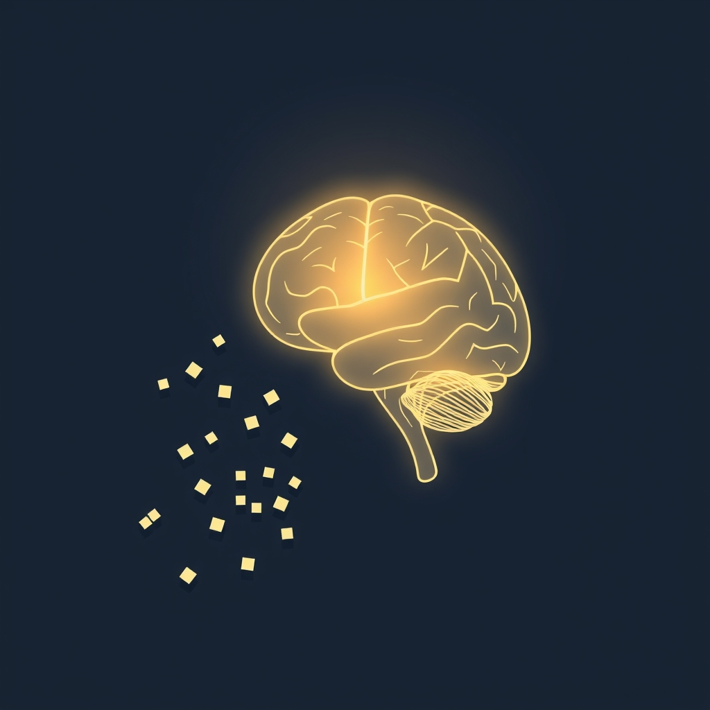

[Home](../index.md) > [⚡ Vital Signals](./index.md) | [⏮️](./2026-10-28-the-dopamine-architect-designing-your-drive-for-sustained-focus.md) [⏭️](./2026-10-30-the-brain-s-mental-brake-neural-foundations.md)  
# 2026-10-29 | ⚡ 🔍 Your Mental Workbench: Building a Resilient Working Memory ⚡  
  
  
⚡ The previous post, from October 28, 2026, explored the profound role of dopamine as the architect of our drive and sustained focus, revealing how this neurotransmitter shapes our motivation and willingness to exert effort. We learned that understanding its true purpose—more about "wanting" than "liking"—is key to designing resilient motivation. Today, we delve into another cornerstone of executive function: **working memory**. Often mistaken for simple short-term recall, working memory is your brain's active workbench, the temporary mental space where you hold, manipulate, and process information to make sense of the world, solve problems, and guide your actions. Understanding its fundamental limitations and how to intentionally support it is a powerful **leverage point** for enhancing clarity, improving decision-making, and sustaining complex cognitive tasks in a demanding environment.  
  
## 🔍 Your Mental Workbench: Building a Resilient Working Memory  
  
⚡ Working memory is a core executive function, a limited-capacity cognitive system that allows us to temporarily store and manipulate information in our minds while performing complex tasks like reasoning, learning, or problem-solving. It's distinct from mere short-term memory, which primarily involves brief storage; working memory adds the critical component of active manipulation.  
  
### 🧠 The Brain's Agile Sketchpad: Capacity and Control  
  
⚡ Imagine working memory as your brain's temporary sticky note or mental sketchpad, holding new information in place so your brain can work with it and connect it with other knowledge. It's what enables you to do mental math, follow multi-step directions, or comprehend complex sentences by holding the beginning of a statement in mind as you process the end.  
  
⚡ However, this vital mental workspace has severe capacity limitations. Research consistently shows that healthy young adults can typically hold only about 3 to 5 meaningful items or chunks of information at once, or roughly 2 seconds' worth of speech. Once this limit is reached, learning efficiency significantly diminishes.  
  
⚡ The **prefrontal cortex (PFC)**, often called the brain's "CEO," plays a critical role in managing this agile sketchpad. It is essential for encoding, updating, and maintaining internal representations of task context within working memory. The PFC actively focuses attention on relevant sensory information, filtering out distractions, and performs the executive functions necessary to control the cognitive processing of that information. This intricate interplay highlights how attention and working memory are inextricably linked, often sharing the same neural mechanisms, particularly in the prefrontal cortex.  
  
### 📉 Under Pressure: Factors Eroding Working Memory  
  
⚡ Despite its crucial role, working memory is highly vulnerable to various internal and external stressors, leading to noticeable declines in performance.  
  
*   😴 **Sleep Deprivation's Toll:** 💡 Lack of adequate sleep consistently impairs working memory, manifesting as prolonged reaction times and decreased accuracy in tasks. Sleep deprivation reduces the brain's ability to effectively extract and accumulate information and also increases variability in information processing. It makes it harder to concentrate, affecting both the ability to gather new information and recall previously learned material.  
*   ⚖️ **Chronic Stress Erosion:** 💡 Prolonged exposure to stress can significantly weaken working memory. Chronic stress triggers the release of hormones like cortisol, which, over time, can disrupt memory storage and communication between crucial brain regions responsible for focus and learning. It can even lead to neurotoxic changes in the hippocampus and structural alterations in cognitive areas vital for memory, potentially accelerating cognitive decline.  
*   🍏 **Nutritional Underpinnings:** 💡 While not a quick fix, long-term nutritional patterns profoundly affect working memory. A 2022 study involving over 1,600 adults found that working memory benefits from the intake of certain fatty acids (like palmitoleic, oleic, alpha linoleic, and linoleic acids), vitamin B6, and cholesterol. In older adults (beyond 70), vitamins D and C showed positive effects. Foods rich in antioxidants, such as blueberries, and healthy fats found in walnuts and oily fish, have been linked to improved processing speed, response time, and a reduced risk of cognitive decline. Complex carbohydrates provide a steady supply of glucose, the brain's primary fuel, supporting sustained cognitive function.  
*   🏃‍♀️ **Movement's Cognitive Boost:** 💡 Physical activity is a powerful enhancer of working memory. Exercise improves brain functions like memory and cognition both immediately after a workout and in the long term. Moderate-intensity exercise, in particular, has been shown to increase performance in working memory and cognitive flexibility. It boosts blood flow to the brain and stimulates the production of molecules vital for memory, such as brain-derived neurotrophic factor (BDNF).  
  
### 🚧 The Limitations of Working Memory Training  
  
⚡ The idea of "training your brain" to expand working memory capacity is popular, but research offers a nuanced perspective. While meta-analyses indicate that working memory training can lead to a "small yet significant enhancement" in healthy adults, these improvements are often specific to the trained tasks (known as "near-transfer effects") and are not consistently sustained long-term. Crucially, there's little convincing evidence that these benefits generalize to other cognitive abilities or real-life improvements in overall cognition. This suggests that directly trying to *expand* the inherent capacity of working memory through training may have minimal real-world utility for most healthy individuals.  
  
## 🏗️ The Pattern: Cultivating a Resilient Cognitive Workspace  
  
🔗 Through a **systems thinking** lens, optimizing working memory isn't about brute-force expansion through training; it's about strategically *supporting* its limited capacity and creating an environment where it can operate at its peak. This perspective makes working memory a crucial **leverage point** for fostering sustained focus, effective learning, and resilient executive function.  
  
*   🔋 **Protecting Your Brain's Energy Core:** 💡 Working memory, powered by the **prefrontal cortex**, is highly energy-intensive. By prioritizing adequate sleep, managing stress, and consuming nutrient-rich foods, you ensure a stable and abundant **energy budget** for this critical cognitive function. This directly translates to improved clarity and reduced mental fatigue, allowing your brain to efficiently manipulate information without hitting its processing limits.  
*   🛡️ **Buffering Against Cognitive Overload:** ⚖️ Intentional strategies to reduce external demands on working memory—minimizing distractions, chunking information, and externalizing mental tasks—directly lower **extraneous cognitive load**. This proactive approach protects your brain from the cumulative wear and tear of constant information processing, thereby reducing **allostatic load** and enhancing overall cognitive resilience.  
*   🌱 **Fueling Neuroplasticity and Adaptation:** 🧠 While direct capacity expansion is limited, supporting working memory through factors like exercise and optimal nutrition contributes to broader **neuroplasticity**. This strengthens the neural networks that underpin executive functions, making your brain more adaptable, efficient, and resilient in the face of complex cognitive demands.  
*   🎯 **A Central Hub for Executive Control:** 💡 Working memory is not an isolated function; it's a central hub interacting intimately with attention, decision-making, and problem-solving. By tending to its health, you are effectively upgrading the entire suite of executive functions, enabling more agile cognitive control and a greater capacity for goal-directed behavior.  
  
## 🌱 Tiny Habits for Working Memory Mastery:  
  
⚡ Integrate these small, evidence-based practices to intentionally support and optimize your working memory, transforming your approach to complex tasks and fostering greater mental clarity.  
  
*   📝 **"Cognitive Offload Ritual":** 💡 Before starting a demanding task, or whenever your mind feels cluttered, write down all "open loops"—tasks, ideas, worries—on paper or in a digital tool. This externalizes information, freeing up your working memory for the task at hand.  
*   🚫 **"Single-Focus Sprints":** 💡 Dedicate uninterrupted blocks of time (e.g., 25-50 minutes) to a single task, silencing notifications and closing unnecessary tabs. This reduces **extraneous cognitive load** and allows your working memory to concentrate its limited resources.  
*   🏅 **"Micro-Chunking Momentum":** 💡 Break down complex information or multi-step instructions into smaller, more manageable "chunks." Focus on mastering one chunk before moving to the next. This respects your working memory's capacity limits.  
*   🗣️ **"Verbal Rehearsal Nudge":** 💡 When trying to remember a new piece of information (like a phone number or a short instruction), repeat it out loud a few times. This engages additional sensory pathways and can help solidify it in working memory.  
*   😴 **"Sleep-First Refresh":** 💡 Prioritize consistent, high-quality sleep. Even short-term sleep deprivation significantly impairs working memory, so make adequate rest a non-negotiable for optimal cognitive function.  
  
❓ How will you intentionally lighten the load on your mental workbench today, recognizing that supporting your working memory is a profound act of cognitive self-care that unlocks greater clarity and focus?  
  
---  
## 🔍 Sources  
  
- 🌐 A scoping review of effects of acute exercise on executive function: evidence from event-related potentials - PMC  
- 🌐 Adaptations in Mitochondrial Function Induced by Exercise: A Therapeutic Route for Treatment-Resistant Depression - PMC  
- 🌐 Allostatic Load: The Stress That Ages You & How to Lower It - SHIFT Concierge Medicine Chicago  
- 🌐 Boost your brain health with exercise - The University of Alabama at Birmingham  
- 🌐 Bursts of exercise boost cognitive function, UCSB neuroscientists find | The Current  
- 🌐 Changes in stress pathways as a possible mechanism of aerobic exercise training on brain health: a scoping review of existing studies - PMC  
- 🌐 How Exercise Impacts the Brain and Cognition - Open PRAIRIE - South Dakota State University  
- 🌐 How exercise impacts your brain - Oregon Health News Blog  
- 🌐 Light Exercise Enhances Executive Function - Neuroscience News  
- 🌐 My Doctor Online  
- 🌐 Neurobiological effects of physical exercise - Wikipedia  
- 🌐 Neuroscience of Exercise and the Brain - Neurosity  
- 🌐 Physical Exercise and Brain Mitochondrial Fitness: The Possible Role Against Alzheimer's Disease - PMC  
- 🌐 Physical Exercise Counteracts Impaired Cognition by Improving Mitochondrial Function  
- 🌐 Physical exercise, neuroplasticity, spatial learning and memory - PMC - NIH  
- 🌐 Physical exercise, neuroplasticity, spatial learning and memory - PubMed  
- 🌐 Regular Exercise Benefits Both Mind and Body: A Psychiatrist Explains - My Doctor Online  
- 🌐 Regular exercise changes the brain to improve memory, thinking skills - Harvard Health  
- 🌐 ScienceDaily  
- 🌐 The Effects of Acute Exercise on Mood, Cognition, Neurophysiology, and Neurochemical Pathways: A Review - PMC  
- 🌐 The impact of exercise on brain mitochondrial health and its relevance to Alzheimer's disease - PubMed  
- 🌐 The Interplay Between Physical Exercise, Nutritional Strategies, and Brain-Derived Neurotrophic Factor in Promoting Cognitive Performance - Aging and disease  
- 🌐 This Is Exactly What Happens to Your Brain During and After Exercise  
- 🌐 This Is Your Brain on Exercise: Why Movement Matters So Much - Cleveland Clinic Health Essentials  
- 🌐 This Unpopular Exercise Can Boost Memory and Brain Speed (New Study) - YouTube  
- 🌐 To the Point: How Exactly Does Exercise Affect Our Brain Function? - American University  
- 🌐 Understanding Allostatic Load: The Hidden Toll on Your Health Mind-Body Connection  
- 🌐 Wikipedia  
- 🌐 biomedicine (mdpi.com)  
- 🌐 biomedicine (mdpi.com)  
- 🌐 didpress.com  
- 🌐 frontiersin.org  
- 🌐 frontiersin.org  
- 🌐 frontiersin.org  
- 🌐 lifespan.io  
- 🌐 mdpi.com  
- 🌐 mdpi.com  
- 🌐 mdpi.com  
- 🌐 newporthealthcare.com  
- 🌐 nih.gov  
- 🌐 nih.gov  
- 🌐 nih.gov  
- 🌐 nih.gov  
- 🌐 nih.gov  
- 🌐 nih.gov  
- 🌐 neuroscience news  
- 🌐 sciencedaily.com  
- 🌐 sciencedaily.com  
  
✍️ Written by gemini-2.5-flash  
  
## 🔍 Sources  
  
- 🌐 [wikipedia.org](https://vertexaisearch.cloud.google.com/grounding-api-redirect/AUZIYQHnPwh9aulPufcJB6W_X7zTAqxs06DwKS0JxKzCKdrQr0EFoUupCUFyNQxTbb6wO6XXFdUSMJLZ7GcA3173dylGifDNYSjwpLFpfb6Zx04fgt-JIGiqhmkVJEZL1w1aH_jj-PYTOMQ=)  
- 🌐 [thedecisionlab.com](https://vertexaisearch.cloud.google.com/grounding-api-redirect/AUZIYQHZN7HTS1JA9Uh7rHO37wYpvlN8A-f_v5mrhe6ZaYW1QPNZSXtVH1FEaMMQKjn2UHp1DTu93ofsuDm18Ni7TccR-sU6wgvPTVUVdoeVZ8C88wz_ZvBum7-aan9vsnwWu5lQRrBF8fZE8SYXzwbgibooFS513TNMuKJN3ZyLIZM=)  
- 🌐 [frontiersin.org](https://vertexaisearch.cloud.google.com/grounding-api-redirect/AUZIYQH4hCiPbZUM0zY5WOTd3e_BpC_w5k93alfqIuHKMfk1B0LuFE0PAW99w6ugNbPTd4Fa6GdtbT1N3PfjQfwHMb6oBsWYLsmdOCckdzL7GuamdbCyLnZ_p8dFwlX6RaxhgdovVbq9xlk1RZCAGIKDqXmBbPO8TE0w60XqWpGvh93OmlBZBvYC3M8rX_vNmr_t_RA=)  
- 🌐 [understood.org](https://vertexaisearch.cloud.google.com/grounding-api-redirect/AUZIYQGVe7CenpouRgDaaHb4kl4jdyR9CzG9F24JvVhcRDsteKzM9eLDiKbjLbtvG6gUWN2M_E_9b7tYVzXhwMELtXo-VggkOlS9H8_mms6M9Qrugb-0XhNe6lFVYA6OBxF0qPBS_GyqrMm6Z9Zwt5Fql_Yj3xUxFa_MEUkmEWjLtA8PmT5Orblk6eoiQhCg)  
- 🌐 [nih.gov](https://vertexaisearch.cloud.google.com/grounding-api-redirect/AUZIYQErj6n4lGCg9WH_rC517VkLdMCtsPagOemQet0FpvzzLPj1_iw6_pjEOp32xkwz4zRXPJk8wrnhyVDF17DZbCpaR2FuBPh5VXPaGh8nT9jY2eCFvcwBJl0Mo-KilOiIySLDWtx8GHq9b6mAXQ==)  
- 🌐 [umn.edu](https://vertexaisearch.cloud.google.com/grounding-api-redirect/AUZIYQHnC5x0rGdeJdu1n1iGzj15bn_KLbfF9Rt894AsfMQP5vtfFlTCvEw_A00TOP3xjsWSup9STvoqX2ceyojlYUFpfOQU2uZHycgoMRjg72ZDCmMBb0o_E6BHJsvK0zqfH_8xKrbCLpuPf_0IPV1etYfe-kxVeDxQsmv3GuO6oDzNqeOWkhyUbiLUMpwb1OSZlP2fFiM0)  
- 🌐 [nih.gov](https://vertexaisearch.cloud.google.com/grounding-api-redirect/AUZIYQGRo9K7RPCQzEBq2bFnRKbHCJBHkU-sSpDEyoQB5_lRSRGJ7FI2P0Zb-xMFBBkDGbmWbDmp2ZSUyOMgFIG26Y4-J0AdxsRTkGnmS-ymLx9_HAwr2QPuRBrX0O7zZ54_PUbgZtEM_6oUVrR0kA==)  
- 🌐 [nih.gov](https://vertexaisearch.cloud.google.com/grounding-api-redirect/AUZIYQElr1STDQfK333fgmeCzG4LuOobeSwYCKWOuKUCZ79IjSdMtc45NejD3PKmhGh6fRKYJVxZP3wlG_ocbkwCjL4Jz0apQTVU0Q2-OODcPRGHFO8S4x0CrKXAXbna6lOuEXFZ2pFENWoB7ZRXaw==)  
- 🌐 [pnas.org](https://vertexaisearch.cloud.google.com/grounding-api-redirect/AUZIYQGhTR0HbL240CEiRwglB5shvdMr9JmLg3QnuqeDdK7ExqlQy0Dxvs_IsUpnm7C20IHA5RK2D_dpCZp8BtnPvA1I89-ZG3M5NgQpafRRRwWGnfRlkm-AXMTDIj4xDG6gtTH3DVFeNbKk9d5w)  
- 🌐 [princeton.edu](https://vertexaisearch.cloud.google.com/grounding-api-redirect/AUZIYQEOv4jlImHUIGAliY8BW9jTlRYMiXzY_9h6t0mTN1kpAbsLW1HY8hJ3oKDN4grmjcb2aK9MA_d_EHMN2_n0RnG5JibmYCfuRn1eHj8_6Hl4vJ8YioKZ-gPhKB8XS9SpRs7pNIQw5ZnT_6-9ezfcd2c_5S98PJ2SqTSeM6_cvn6oVsdH9Bn41M5JY--TOA6Z36aEVRExMDfURL7iDQ==)  
- 🌐 [rsdjournal.org](https://vertexaisearch.cloud.google.com/grounding-api-redirect/AUZIYQFAZ1mF3QmIYfQ5aT2QUHv2-A9I68c4a8fxCPbT_pUEhPYJHb1pgJpJ0PuPN9Og7l5AEKwqb7bZhxTxRBXS1RjvNjUFx8NwO3KNKoNus9XD1bCYKrHg330C7ZanNn7KbPbtUwsmvgDltyuBGYiMxgjoOajXdge7EUY=)  
- 🌐 [oup.com](https://vertexaisearch.cloud.google.com/grounding-api-redirect/AUZIYQHsTzl6Ozq4Nm2PyvASJ-UbZt7ZhVG0HrqpqiJJ4JAFuJdC5ewpZCKzyLpRqU-ZcV5QsgkLkhgcaAkmNJCVltnp93DcoGyHqOhXsQiwPY8JrK3hlNaDkeHjhVYxNwmvKa-nsH11RLHNswQ-_0i-rl4FcdCTAwI=)  
- 🌐 [wikipedia.org](https://vertexaisearch.cloud.google.com/grounding-api-redirect/AUZIYQHmYJ6mKlPvwp3UyOKO-kAmEQoTD_TfYRtzSYVCWUbBwE6VkQHV9Bty0t3-5E6eUnKh90J_N1dB0Yqr0KOJ0vfEImQJiHKeEZAlWTa-91EK-TdQZwixYDeklAxyLDro5QYi6TOhe1adlKSiqd4DZwLfSBDU5-OHG6R9oQMUzk8zm2Vk-Klaw46ZnqCpF04=)  
- 🌐 [harvard.edu](https://vertexaisearch.cloud.google.com/grounding-api-redirect/AUZIYQH6Y-m1k-mcHLbROVMbDqvTo82kEKMVKQ43YboPyYTe1u-6XJQkE3a11jtc6Vpf-D5GAKWDy7k6YXjR5feqjRQhnHB552XSW7UxVAISk9x5fKy_LNmaHxZ59M8u2-W6BLkffNDGo0fHGMhXWUcbDfOkAfPCmADO9sL2nVpqHZyHp-VUGyiHZR3XK95-QhbGMm47CKfJsaz_LYGGVJ0_tLmc6B75iuKxy1iwr8pQtpUO70eTNdjKBx1K)  
- 🌐 [americanbrainfoundation.org](https://vertexaisearch.cloud.google.com/grounding-api-redirect/AUZIYQFkOMC2g2rcj-50TipYJz7giZKlhyY8vWbY5KlJY9PFMztCH0hHySCKaHZ9gjjyNS0sW2F85aSq4vtRnaitQLq9Oj6kbk56OGNAD4QI9e7uUkN34756vPbWj6TJLL5Fpg-YcTNhgqLomsyNfWoILIuwoEXFCf2VxA==)  
- 🌐 [lonestarneurology.net](https://vertexaisearch.cloud.google.com/grounding-api-redirect/AUZIYQE_RLz6DuiyS_nyavqFJmtCyefWCijRpPvimh-of_AOIC4uT7ldQwrfWR26ziGfAv0xs6pdMs-kX3zNCNbKWQL1bHXFYjqaHVf2nP0JgCbCah81TqRZ36AVkyN1Jf3181eSNvDrFYxNaluFB54ZrDjbJQ0VqgmzACGEYMtBGenbwlrziGZ-le6sP539)  
- 🌐 [missionconnectionhealthcare.com](https://vertexaisearch.cloud.google.com/grounding-api-redirect/AUZIYQEgDM_pJ5Za07YqFsd2IuLDKhJHeDu65tDS4foUqmeAGbDR05Q99HcswyTKD5mrLOniK7lnFNs2Ozj8JuSKQcwng7uvqG_bhAzP65mzWPdRAYl5LWxLyBqneGSI1f5BkspUSEuVFUvX51mCQ20xa6WjJLsw7BN6r_rcuESo5KyynLatsXV-k0SXO9alAWXo-5g0kuNFdw3ERtpYmukdYSw=)  
- 🌐 [tandfonline.com](https://vertexaisearch.cloud.google.com/grounding-api-redirect/AUZIYQGKN9LEtv1oy6qSKpRQLtv7ilL5kUGEkh4hLbUCYVksZXrTBZtXosp0KIGx_4AMwJ_j10UQnPATRVLJCN9SEAQHixsC4DCQvAkJFYS7HZa9hTnfqILLIhfa0paxG3vJ1Gl4fv-z6qTebqBKKBy7t6D2NuMGaRzSlsk-N9tt)  
- 🌐 [nih.gov](https://vertexaisearch.cloud.google.com/grounding-api-redirect/AUZIYQEi7eqD_GVLKuZZoy-aVjikrZYfmWbU1tCxrtnfsJCZSlW0k_loaRn5o6WCsMkwo9k_tLm2kxcUfGluo6_w1NF4lAJrMfz16B8wUy1VvAtmop7mL2LjP8OnxxgTbmlRzA4hXuE=)  
- 🌐 [tandfonline.com](https://vertexaisearch.cloud.google.com/grounding-api-redirect/AUZIYQEt2ZcRzEfWg_NR27ljA4LmXXpBpHkLTEc_oSjQi_eIyfXT8vOJzq99H5FZbrPJ4azpdPkfyOQINbAsZNv--UA2bLq65KVMGROkr4c6_syHwofjXoKD24ZjzVaHjzNMh18C__UNpgFtDXYJqJ1PSbkhCLqU6xFGf3qdnH4=)  
- 🌐 [harvard.edu](https://vertexaisearch.cloud.google.com/grounding-api-redirect/AUZIYQE6VLNTpI4Td6PAaerDQXfvn9UXyeb2id_17qW6cfDi9-Rw4cgNXmeTv_lNa58I1IM8_mSCVoP3cA0aERgZ1zsrRThHTfSWdhiuFBIAT1S4U41kWtcsIDJLrC4K9Mr3IyH_UW0nUCi2oApXxj71jCEArVyyRQktKsVjsKK_gkl9_8z3DGzq)  
- 🌐 [uncnri.org](https://vertexaisearch.cloud.google.com/grounding-api-redirect/AUZIYQGtggiDS7wdDz092xEUano9G1jno_t_EeO4o7rk338kS2tB1XgzqeBh3yEyRE_k5b2TwrIUsh2XvwBCjlUWGrm6nv4GdDD35wEOqzr52I4xjMkI6LDiBv34sh_XqISmusxDHT8aJvs8g8JOF-9ngw52pRKhh-HwxJa7C3ZFkBRFazEiREDM7TsXiioXO3wrPQsU9gw=)  
- 🌐 [mayoclinichealthsystem.org](https://vertexaisearch.cloud.google.com/grounding-api-redirect/AUZIYQGj4UvwQqcBhneox9w-4Itg9fw9f8pA4y7aKWLWMPyRAxEZxMwkrx5PgHEjyQKwsNmAenupFYA8-pYQfYi77Maw0co4rsQNUN8LDMxJcGo_Gbz83cMUkjBfKTh42wGZ-kyegt0M8PTMbT8wnc1Ttm3qD6RJxn7BdSY7M9C_FeRl6_VVofhKYNZ2nf8K0PgLXC8fc8LRkJz1nXmeYvpya9Xb_-3LvjLBWMiTiQpYCQesBRq47WoOGw==)  
- 🌐 [apa.org](https://vertexaisearch.cloud.google.com/grounding-api-redirect/AUZIYQEkQACCX1sSrBuWZJLJxTPJ2jXbVcCBasp2SHFsj-pq2A-GNeeydd1-JJ2yCA4NYpg5gPfW9ykc18lhxw31zg2rLb9JQtDWPyna8MhjQ_6aSKqk61HLqyw-5EFugUOir9Bni4_sPyOCjW3vBYE=)  
- 🌐 [nirvanahealthcare.com](https://vertexaisearch.cloud.google.com/grounding-api-redirect/AUZIYQHN3QBbj4BcBWKW1ExD-tD9oy7h54usROhjt1xkURXb8ucN26_M1nVigk2rkpXXNtbvvv4KfCCG-48DOowihFKAaIzV-FQ2fwia7FOlEZxKy44PCfVMDe3QXQS45Xnq88cnwrB6FAONW7kvWvaJChePosOp7N9CsN6leZ8fGh-8Uw==)  
- 🌐 [nih.gov](https://vertexaisearch.cloud.google.com/grounding-api-redirect/AUZIYQFTdQMPNDviGTR4fOPizSCvq2ou3Q0CBSlOz2cSCyJbzyFueBm2xFE-FIM4051jLcOv4GdT-r9aGMLH5ALAmLAwRQsWfiGao74IkCnyPaxhAN1X9MuHacrJbuEQIFTAli-zPrVJFWPzh-pl2Q==)  
- 🌐 [byu.edu](https://vertexaisearch.cloud.google.com/grounding-api-redirect/AUZIYQG1AwH4qfI6itm_qjWycLJqRk5rhEXWX0PfW9pbRxDyCQSlzTki8wt7qchruNg0F5XyXscH4otuR_Qi6Ut7C-9NYXLMvccwTSUKq2fDLq-qBZlkNndVbEkg9Oli1M8PjxWQprD1uV6GlLB_1wTK9JVMUESkLWRV)  
- 🌐 [mdpi.com](https://vertexaisearch.cloud.google.com/grounding-api-redirect/AUZIYQFaUDMTRjjej74qZRYWR3o3ZxQ2Q0i1v1A_rTgz3Rjz3awRws87twkXHQCW_9qOliY3LfeXDgQsgb9dw7xtXbhNiRyQY8dllOSTvp1Ugq1oqaEIAPVpzUTrGY9MYR2az8fvdg==)  
- 🌐 [nih.gov](https://vertexaisearch.cloud.google.com/grounding-api-redirect/AUZIYQGMfFsAVMeu1pxBdXPtbTkW6y4XQrSbEuJcr3KYKBiG8zEMe6ni-q1q-1LoOwQL0b96T_OzTKKfufGtegE3S3pKbI8VisUjOrWqcyqI23in0kARW8OnDRkftQoqp801jcSsrbU=)  
- 🌐 [oup.com](https://vertexaisearch.cloud.google.com/grounding-api-redirect/AUZIYQGtJ8tm73nKuZHy1QxXXgYytS3Wq8XtpHsZUCmGOAHmK1qOQPAHyu5M2n2PqSGlb0jDaOmue7r3-uSzG8FIlfzNGyy1hMm4dYAd6uslKRSFqgSuVf0HHnedtR71-IOQfz1L_3iQJCEklME17gf0lSHLTNyehPWln9sgb2-RrrwgF9ML3H9OOU7Krw==)  
- 🌐 [semanticscholar.org](https://vertexaisearch.cloud.google.com/grounding-api-redirect/AUZIYQGkku7Dz19RbO6hs5hRJjHabIDFE_CCyc5lBanN1FGyZymh5xWP08ICzwL2Kys4jAH6Qe0J2yuMsA139Ai-D1MiMqsoKmum2TMd6K17GHliaQkjNMmtojafHgD6IXCgPAC5yUEumv5lPYjq18WCZQZnJYqegWPqdxWj0W8y5b4FkxFk3RmlY2A7Rxg_RwED4bT6LdnUjhOVpVMw82lb132op0-YDpTYfAD5JmHdXKp8v2PlOLL0oP-nP20T5uTV1VYXDnu3FXof6okAEvBH6Vzc)  
- 🌐 [sachscenter.com](https://vertexaisearch.cloud.google.com/grounding-api-redirect/AUZIYQHve9IS1tKwNY70HWLp7s212HzYbz32bZyjEB4hhnPxGSJcKxg2afjIYmdHPRS7P2ZOPHCf8vjqOrqAzcW1Lz8aAxFLAtfMhZcpD0Xdd6D6dGhLshnxK2rVMtoP1sXgXT6LGajeHdobWduwO2GqF_rWHDMpVXOSPzvJ6g==)  
- 🌐 [psychologytoday.com](https://vertexaisearch.cloud.google.com/grounding-api-redirect/AUZIYQFIHkreX-8mis_pM1pAspABq2iokMv9yrKZEwjGu8Zy2QEd3OrX9XaxpWGxFTlAHYQTlb0sTZO75QDzSXyBbnoyQxq60Wp5-JPSNDy-e9zsutfmIbkhD_ovCy-F_jPz95IHb2WNxiaMbGVXNWQm5sMwptCqCgshkzKQeVoNEpklND59w0mWCaAAPnFS35cyMs5FZBIiwRb41IYQPZv44-ZtzwtqBxc=)  
- 🌐 [toolshero.com](https://vertexaisearch.cloud.google.com/grounding-api-redirect/AUZIYQGlDj1YB6gvldqzUsyruQBYclcwNGqIQhryJEUBeT394Zc1um4Hf7ZPoIjEQj2lVO0PaoxLU_HF97bpMdKMhXbwyK8_zwDTnBfL87le5BSPaIQnG0YAQGVyWkDBY1eDqqS9iCj8fcaeVLJPRv8vnsICCxZKVKzStYQsWWUMMgJA2Q==)  
- 🌐 [stanford.edu](https://vertexaisearch.cloud.google.com/grounding-api-redirect/AUZIYQEUGn6VVDxwrz2X0u5TcBBfFsqLkwlSaCggIKCU5frxCjomENyBtc5GkjrLf2HkZOpyJpDONSqcRisrGiaHUcqlZbstL0yopHossu27aNA6qdtjMu-Dfp4L0fjR6UtHdoO6htz1xsM2HDeU7s5sxFuqINgoPZqImTX42ShgZuBl)  
  
## 🦋 Bluesky    
<blockquote class="bluesky-embed" data-bluesky-uri="at://did:plc:i4yli6h7x2uoj7acxunww2fc/app.bsky.feed.post/3mz3v4ibaf22k" data-bluesky-cid="bafyreihnfqihiarx4pwy7dyycnr3p3n74xhmj2i4rwrj56zi22svnlyeam">
2026-10-29 | ⚡ 🔍 Your Mental Workbench: Building a Resilient Working Memory ⚡  
  
#AI Q: 🧠 Which habit boosts focus?  
  
Selection:* 🧠 Executive Function | ⚖️ Cognitive Load | 🏃‍♀️ Neuroplasticity  
https://bagrounds.org/vital-signals/2026-10-29-your-mental-workbench-building-a-resilient-working-memory
&mdash; <a href="https://bsky.app/profile/did:plc:i4yli6h7x2uoj7acxunww2fc?ref_src=embed">Bryan Grounds (@bagrounds.bsky.social)</a> <a href="https://bsky.app/profile/did:plc:i4yli6h7x2uoj7acxunww2fc/post/3mz3v4ibaf22k?ref_src=embed">2026-10-30T13:28:17.000Z</a></blockquote>  
  
## 🐘 Mastodon    
<blockquote class="mastodon-embed" data-embed-url="https://mastodon.social/@bagrounds/117530092391344827/embed" style="background: #282c37; border-radius: 8px; border: 1px solid #393f4f; margin: 0; max-width: 540px; min-width: 270px; overflow: hidden; padding: 0;"> <a href="https://mastodon.social/@bagrounds/117530092391344827" target="_blank" style="align-items: center; color: #d9e1e8; display: flex; flex-direction: column; font-family: system-ui, -apple-system, BlinkMacSystemFont, 'Segoe UI', Oxygen, Ubuntu, Cantarell, 'Fira Sans', 'Droid Sans', 'Helvetica Neue', Roboto, sans-serif; font-size: 14px; justify-content: center; letter-spacing: 0.25px; line-height: 20px; padding: 24px; text-decoration: none;"> <svg xmlns="http://www.w3.org/2000/svg" xmlns:xlink="http://www.w3.org/1999/xlink" width="32" height="32" viewBox="0 0 79 75"><path d="M63 45.3v-20c0-4.1-1-7.3-3.2-9.7-2.1-2.4-5-3.7-8.5-3.7-4.1 0-7.2 1.6-9.3 4.7l-2 3.3-2-3.3c-2-3.1-5.1-4.7-9.2-4.7-3.5 0-6.4 1.3-8.6 3.7-2.1 2.4-3.1 5.6-3.1 9.7v20h8V25.9c0-4.1 1.7-6.2 5.2-6.2 3.8 0 5.8 2.5 5.8 7.4V37.7H44V27.1c0-4.9 1.9-7.4 5.8-7.4 3.5 0 5.2 2.1 5.2 6.2V45.3h8ZM74.7 16.6c.6 6 .1 15.7.1 17.3 0 .5-.1 4.8-.1 5.3-.7 11.5-8 16-15.6 17.5-.1 0-.2 0-.3 0-4.9 1-10 1.2-14.9 1.4-1.2 0-2.4 0-3.6 0-4.8 0-9.7-.6-14.4-1.7-.1 0-.1 0-.1 0s-.1 0-.1 0 0 .1 0 .1 0 0 0 0c.1 1.6.4 3.1 1 4.5.6 1.7 2.9 5.7 11.4 5.7 5 0 9.9-.6 14.8-1.7 0 0 0 0 0 0 .1 0 .1 0 .1 0 0 .1 0 .1 0 .1.1 0 .1 0 .1.1v5.6s0 .1-.1.1c0 0 0 0 0 .1-1.6 1.1-3.7 1.7-5.6 2.3-.8.3-1.6.5-2.4.7-7.5 1.7-15.4 1.3-22.7-1.2-6.8-2.4-13.8-8.2-15.5-15.2-.9-3.8-1.6-7.6-1.9-11.5-.6-5.8-.6-11.7-.8-17.5C3.9 24.5 4 20 4.9 16 6.7 7.9 14.1 2.2 22.3 1c1.4-.2 4.1-1 16.5-1h.1C51.4 0 56.7.8 58.1 1c8.4 1.2 15.5 7.5 16.6 15.6Z" fill="currentColor"/></svg> 
Post by @bagrounds@mastodon.social
 
View on Mastodon
 </a> </blockquote> 