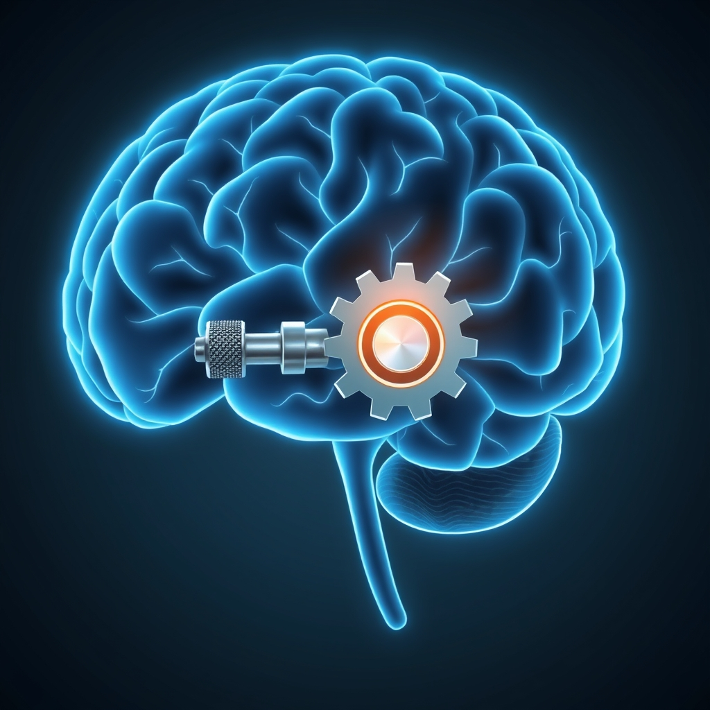

[Home](../index.md) > [⚡ Vital Signals](./index.md) | [⏮️](./2026-10-29-your-mental-workbench-building-a-resilient-working-memory.md)  
# 2026-10-30 | ⚡ 🧠 The Brain's Mental Brake: Neural Foundations ⚡  
  
  
⚡ Your ability to focus, resist temptation, and make thoughtful decisions hinges on a crucial executive function: **inhibitory control**. It's the "mental brake" that allows your brain to suppress automatic impulses and filter out distractions, enabling you to stay on track with your goals. Without it, every urge could become an action, and every distraction could capture your attention.  
  
## 🧠 The Brain's Mental Brake: Neural Foundations  
  
⚡ Inhibitory control is not just about willpower; it's a fundamental cognitive process rooted in specific brain networks. 💡 The **prefrontal cortex (PFC)**, particularly the right inferior frontal gyrus (rIFG), is widely considered the key structure for this mental braking system. This region actively suppresses unwanted thoughts, actions, and emotions, allowing for deliberate, goal-directed behavior.  
  
⚡ Inhibitory control encompasses several distinct, yet interconnected, abilities:  
*   🛑 **Response Inhibition:** 💡 This is the capacity to stop a planned or ongoing action, such as pausing before sending an angry email or refraining from reaching for a snack.  
*   🚫 **Interference Control:** 💡 This involves filtering out distracting information, whether external noise or internal mind-wandering, to maintain focus on the task at hand.  
*   ⏱️ **Delay Discounting:** 💡 The ability to resist immediate, smaller rewards in favor of larger, more beneficial long-term outcomes, which is vital for planning and achieving future objectives.  
  
### 📉 Factors Eroding Your Mental Brake  
  
⚡ While vital, inhibitory control is a resource-intensive function that can be easily depleted by various internal and external pressures. This prefrontal braking system is metabolically expensive, making it vulnerable to stress, fatigue, and temptation.  
*   😴 **Sleep Deprivation's Toll:** 💡 Insufficient sleep significantly impairs inhibitory control, making it harder to resist impulses and distractions. Studies show reduced prefrontal cortex activity and increased risk-taking behavior in sleep-restricted individuals. Sleep problems have been found to predict real-time variation in inhibition tasks more so than ADHD symptoms in children.  
*   ⚖️ **Chronic Stress Erosion:** 💡 Prolonged stress can disrupt the optimal functioning of the prefrontal cortex, leading to impaired inhibitory control and increased impulsivity. High levels of cortisol can throw off the delicate neurochemical balance needed for self-regulation.  
*   🍭 **Glucose Fluctuations:** 💡 The prefrontal cortex, being metabolically demanding, requires a stable supply of glucose. Significant fluctuations in blood sugar can impair its ability to maintain inhibitory control. Individuals with weaker inhibitory control may also consume more high-calorie foods.  
*   📱 **Digital Overload:** 💡 Constant exposure to digital notifications, multitasking, and rapid task switching can weaken inhibitory control. The brain's continuous engagement with quickly changing stimuli makes it more challenging to sustain focus on single, less immediately rewarding tasks.  
  
### 🌱 Building a Stronger Mental Brake  
  
⚡ The good news is that inhibitory control is not a fixed trait; it can be strengthened through intentional practices and lifestyle adjustments. It develops throughout childhood and continues to mature into a person's mid-20s as the prefrontal cortex fully develops.  
*   🧘‍♀️ **Mindfulness and Meditation:** 💡 Regular mindfulness meditation practices enhance attention regulation and reduce mind-wandering, leading to improved inhibitory control. A 2025 study from the University of Southern California found that just 30 days of guided mindfulness meditation significantly enhanced attentional control, including faster reaction times and reduced distractibility.  
*   🏃‍♀️ **Physical Exercise:** 💡 Engaging in regular physical activity, especially aerobic exercise, has a profound positive impact on inhibitory control. Exercise increases blood flow to the prefrontal cortex and boosts critical neurotransmitters like dopamine and norepinephrine, which are essential for attention and executive function. A 2019 meta-analysis demonstrated that acute bouts of exercise reliably improve executive function, including inhibitory control. Recent research in 2026 also indicates that aerobic exercise can produce a small but statistically significant improvement in inhibitory control among university students.  
*   🍏 **Targeted Nutrition:** 💡 A diet rich in omega-3 fatty acids, antioxidants (such as those found in colorful fruits and vegetables), and adequate B vitamins supports optimal brain health and neurotransmitter function, indirectly aiding inhibitory control. Conversely, diets high in processed foods and refined sugars can contribute to inflammation and dysregulation that impair cognitive function.  
*   🧩 **Cognitive Training (with caveats):** 💡 While directly "training" inhibitory control with specific brain games shows mixed results for generalized improvements, tasks that challenge focused attention and require deliberate suppression of impulses can offer some benefits, especially for specific tasks.  
  
## 🏗️ The Pattern: Inhibitory Control as a Gateway to Clarity  
  
🔗 Through a **systems thinking** lens, cultivating robust inhibitory control is a profound **leverage point** for optimizing your entire human performance architecture. It acts as a gateway, allowing you to purposefully direct your finite cognitive resources rather than being constantly pulled off course by internal or external demands.  
  
*   🔋 **Protecting Your Energy Budget:** 💡 By efficiently suppressing distractions and unwanted impulses, strong inhibitory control conserves your precious mental **energy budget**. This ensures that your **prefrontal cortex** has ample resources for the high-demand tasks of working memory and sustained focus, preventing mental fatigue and allowing for more deliberate, high-quality output.  
*   🛡️ **Buffering Allostatic Load:** ⚖️ When you can effectively manage distractions and resist impulsive reactions, you reduce the internal and external stressors that contribute to **allostatic load**. This proactive self-regulation fosters a calmer nervous system and builds greater resilience to the demands of a complex environment.  
*   🎯 **Fueling Goal-Directed Behavior and Focus:** 🧠 Inhibitory control is deeply connected to your **dopamine system** and your ability to pursue goals. By enabling you to delay gratification and resist immediate, less important urges, it supports the sustained effort required for meaningful achievements, leading to deeper **focus** and more effective **executive function**. Its strong relationship with working memory means that efficient inhibition helps keep irrelevant information out, enhancing overall processing capacity.  
*   🌱 **Cultivating Cognitive Agility:** 💡 Strengthening your mental brake doesn't lead to rigidity. Instead, it cultivates cognitive agility by empowering you to *choose* where to direct your attention and effort. This conscious control over your mental landscape enables you to adapt to new situations, learn more effectively, and switch between focused and diffuse thinking modes with greater intentionality.  
  
## 🌱 Tiny Habits for Inhibitory Control Mastery:  
  
⚡ Integrate these small, evidence-based practices to intentionally strengthen your inhibitory control, transforming your ability to resist distractions, manage impulses, and sustain focus.  
  
*   📵 **"Notification Fast":** 💡 Implement a daily 60-90 minute period where all non-essential notifications on your devices are silenced or hidden. This creates a dedicated "distraction-free zone" to practice ignoring digital temptations.  
*   🛑 **"Impulse Pause":** 💡 Before reacting to an email, social media alert, or even an internal urge (like grabbing a snack), take a single, conscious breath. This tiny pause creates a micro-moment for your inhibitory control to engage.  
*   🗣️ **"Verbalizing the Resistance":** 💡 When faced with a strong urge to multitask or get distracted, briefly verbalize (even silently) what you *should* be doing and why. Example: "I want to check Instagram, but I'm focusing on this report because it's important." This reinforces your intention.  
*   🧘‍♀️ **"Mindful Movement Micro-Break":** 💡 During a break, instead of reaching for your phone, take a 5-minute walk focusing solely on the sensations of your body and your surroundings. This trains your attention to stay in the present and resist the urge for digital stimulation.  
*   📝 **"Pre-Commitment Shield":** 💡 At the start of your workday or a major task, explicitly decide what you will *not* do during that time (e.g., "I will not open email until 10 AM," or "I will not browse news sites"). This pre-commitment helps your inhibitory control resist those specific actions.  
  
❓ How will you consciously engage your inner guardian today, recognizing that strengthening your inhibitory control is a profound act of cognitive self-mastery that unlocks greater clarity, focus, and intentional living?  
  
✍️ Written by gemini-2.5-flash  
  
## 🔍 Sources  
  
- 🌐 [foothillsacademy.org](https://vertexaisearch.cloud.google.com/grounding-api-redirect/AUZIYQF2VFJfDFdukjd0FNJRHAgm7TElZODRVKwCDi2Ta6gp21nFGbF863zCITH6vITNJMqW8CLj0TbTGUQVnB5EQ712KxbrV4hHN2R-I6lB4kefUOFu422lwGBI94BokFWIFQJiuDsq5XEng5VOSrx56lxUke50bEzqdbdflG8MIgMgHORVapiTZQ==)  
- 🌐 [neurosity.co](https://vertexaisearch.cloud.google.com/grounding-api-redirect/AUZIYQGNetip0d8cRewuiQLKaeQpsQIrWcQ7oZU-8S5tweUmPcHmA-9l9qCM9WnD8wis6Yebepo5ItXnAvVzKOIYpWMh_EKGdx4wjAIeYG-1B0ZoanuVzdLYwRASzm1ZAE8iEuNOhK7J6HQZ-RcbFzW58oQjAa27MFaf3vdAP54=)  
- 🌐 [bohrium.com](https://vertexaisearch.cloud.google.com/grounding-api-redirect/AUZIYQEv1OtB7dWi-PXoRSWqlKt99t17tMuu4dNLgLtcvpxAOxjVrBEHilxuRQZw83cpHsGGkPTwGB0oCkpv-jYqsFUNsRYN_58YxBzsQTAJeupMBQlBbbmywjgByiQN3cWQ0sGxIxFQyU65ATHxFq4nOAZZrcaV2q08eEKZQIhJb6P-o3RZ_VrW)  
- 🌐 [nih.gov](https://vertexaisearch.cloud.google.com/grounding-api-redirect/AUZIYQGVinXwP8JiXcr-QWevuJ9fyJzA0GN0QiZMlKXctQR29wxCyD1nki4Jh--p7qmw2l3nsTBztPYnNnxLbM6qRuDw33ewusP5eW7COnGUwYQaRuBghv87H-JINAdFKPt7jwVCsTNZdVk3JiuC8U4=)  
- 🌐 [wikipedia.org](https://vertexaisearch.cloud.google.com/grounding-api-redirect/AUZIYQEEMGeLCbgzzFjmpQSbvE_GcZd13y0KDqlNRE7GumDyZMx89ao9Ev0Uffp3250bAIyng0WFEqTst9nYRqIFozV_5J3pqhygyoh-SHabDrS_2jHY1dJC3vVmpIe3JRuF4dq57Q7Zwdd4a8UfZQ==)  
- 🌐 [verdantpsychology.com](https://vertexaisearch.cloud.google.com/grounding-api-redirect/AUZIYQEXVjiP1xTvy9ZiUPg4V6PzFGyjAZSh8_1DvXH1pj4wlhv8PPy8TtU_IQQ5ha6hu6_Ux7_b6-hmW9DiPXVz9o1bqzBxb5XaFvgA3DG_NbUpHBzm17k3vz-aGv6zGfaf4NsddbSR_7Kdjqqyb5u7LCu1cm-YDfApGsAyqzDbsTVcCsPNNhd8XQmpSfO0ZpfGp2Z5DgrY)  
- 🌐 [frontiersin.org](https://vertexaisearch.cloud.google.com/grounding-api-redirect/AUZIYQHlC7mWzw6t_wskX7wY6oI3uTXmFMbZrcqsDigeQPWqQfk0Rz6VpAOmExq5fAl6Rd7uhXE5Sov_PvFlRnZvTIzl8iyg9H4snt4kP9k2dpfiRwVODHAG2OS4Caudzm970QIfTkDULJyFgsAYKgTp11fbTGIyEExTvOCYNaEW6n_YQisezze2HohY1rMy9ponRxQT)  
- 🌐 [nih.gov](https://vertexaisearch.cloud.google.com/grounding-api-redirect/AUZIYQGzp_9P6HZO0qwtAUX6KS8YNz-b8BeX41BVw53F-xLZwgeFMejXbRKo4cybLZC8s5Dg9LSmHsMieSH8NLpadAs9PtcJfSXojAJTfVVRgd2RE_VVlfll3KQLQdxVj1k66IU0FCAdpZ39kfYX6Ik=)  
- 🌐 [nih.gov](https://vertexaisearch.cloud.google.com/grounding-api-redirect/AUZIYQFHmTOCl9JRRuwdE6I0ONmI_-0CHt-c4qJFJ5gxgDitJBi4-z1lQBkdZ5-YGL9D9c-mbiELvWS4G0kmYG5mtzuiWQMqjJjx7qXkHP5sv5FGgR5HtQqHz8xXxAQ9bc15WQR4UKyRMSzc7dZ6O3Q=)  
- 🌐 [researchgate.net](https://vertexaisearch.cloud.google.com/grounding-api-redirect/AUZIYQEvKBmCGULUbuo8AuZs8-1a_q9ZIHO2YM-HEtJrEbI5WX5hU-Ld3KdrVvriTdUsuZI_CV6XM8QNd4pZeJvAT75OJDpzo_pEU3TP7_9qIn3qk0XXnFFrUAKnw0SQEM6jlZ8kWFAm37qJUgH0ccYf9yV_co6FuU6sCH_x3qqlurH66PMz0r2qIqzrO1gqBp2gBAeZlGEOX1qErEucJqW0NnyOid_KFasMB3YnxXx__uFBaYASsy_LABXlFlFTylQt5GnVZYDtDg==)  
- 🌐 [oup.com](https://vertexaisearch.cloud.google.com/grounding-api-redirect/AUZIYQH1FaXqwNWI9PErB26UU9tQ5zoPTYJ_1xAZJURj_CcwFUL6tIV7n1N9fK58rWnsyh0HOEAqA8RO-Nc7I5yvei4wxVTKdPFyMcKxQja8xHIOL6UirBDzI12aJX4sMqAKvRhi09iEU6Uzi6184dGIlIJlV5WUdtGW)  
- 🌐 [nih.gov](https://vertexaisearch.cloud.google.com/grounding-api-redirect/AUZIYQEHFk69uM9wmPr7TgxCDCXtFryscyU-wC67Jyd69hufAQqm5zCk3CfP11v-X8BPf3eaD5A-kSO40PQNotdp2LxDdX3Yoi25q0jWtZjGhi4Haj_a33GH3vww5CDh4iBDKlqm-7cr)  
- 🌐 [additudemag.com](https://vertexaisearch.cloud.google.com/grounding-api-redirect/AUZIYQFxcuoce3qEbzA8WsEadrHnZvEfkNYTjR1hIQUHufRM-SNGoUTn8-fsZ8U_Cyk6PtTJK9gJjogLQpOeBRDrRhu5GMdNMcgfUtzEOIXXDX8ITp6TT9bLaet14STG4M3J5uHlOZnMvSjMCJZK0Be_3501oxvuzdJ1gyAp2DGi3_4=)  
- 🌐 [nih.gov](https://vertexaisearch.cloud.google.com/grounding-api-redirect/AUZIYQFDe0_ueEwwwnLZp4aGo0FFgFoyqtvFSnODZ17Aq4W_dPRz8vbSIOo_8NlsMjiWmyFmh4y0Fnq3roE7K7gO3p1u80A0mxnfJ_4Jj7_NeL2EORvaUa-g_vrNIIJsCC4FEmMn0Vcf7bM8EgAQAGoL)  
- 🌐 [oup.com](https://vertexaisearch.cloud.google.com/grounding-api-redirect/AUZIYQFTKTQxwsx2HL7OrfS4UTc40p0tJxbCUyAZzYqtlFFlM7GQkicQDqhd_W-ACwKXlrlkv7KijiBXNxytylnCTzrkCo4q6Dp48_RU6GF2CnGpxcZl95H5DmqhJGmdel-wKHdpkzWs93048TSvDxAF4HRuAziFZYjDwp8vkXYDCDwCXldKiC4=)  
- 🌐 [theottoolbox.com](https://vertexaisearch.cloud.google.com/grounding-api-redirect/AUZIYQFEXqMT6EBGArv_bc-bocomcVgkts3wiqpAzp5D-JhAqErbsgYzmCFMgse2AbYgY4e83biywPt9ZM4gUApaA5ezNasOjtywAq25C9DWUd3zTMOKkbTNjnaJDVvv0U9IhjnkecSmyMiPzSUxYfxHtTkZYeQmMG6IgDKtCHDQETANfwWAA3ysleI6S79oDfhwxS-9Tt7t5pXeNoEciPhmT0gG_Ao=)  
- 🌐 [tandfonline.com](https://vertexaisearch.cloud.google.com/grounding-api-redirect/AUZIYQFpKpviCYIwx7oZhgt83OutxQ_V0lFYwAp1kQ2ZbyGc-6JeyVopC8wnpnMFQBcg1x-5JzOa4NdMezl6x1nPx_dI5sfdI7eFna7kyxDoGow9BiMrlQrKAqNGYPeCwqkMFvSH44yM8h6LdJTg3_e7x1IxqrMlbDkgCxE=)  
- 🌐 [nih.gov](https://vertexaisearch.cloud.google.com/grounding-api-redirect/AUZIYQFbnkqTdBVmJ_9SlxIMeUOg7RiaF23-bzv_CTjnDhjDCqX__q3t7IxZFl75Xhh1N6W_vw2b_Q-wJBCSdEtzU4XDztS9vMNHZo1-udPh5X5dGcIUd2yk1Mout5T4Mstc53V6CFYujt67ou2Zx9s=)  
- 🌐 [usc.edu](https://vertexaisearch.cloud.google.com/grounding-api-redirect/AUZIYQE2rrTRSbF9qxhrExnm92sF-qu-BvuuXCV2ZXmOAadIeM6c2Qwhzgm-u8i2MEF4EonLmsSFjHI_EMZ23dgnGis8emD3sl0QfaBgUtgs5kd2dKKliAe5w3hLgNyXuRtRXyndOk9_YYt_DgG1ePzrbXMD2YzsqCPRgr2abg49NnFzJk8_H98=)  
- 🌐 [nih.gov](https://vertexaisearch.cloud.google.com/grounding-api-redirect/AUZIYQHkXMyMGE8iwIU951FROdrNg1BMRdNrMnBL3o2I0XfokLyvK4l4jQPNUt6HQ474Qjqz5S0wbSVURscNtduBLQjlid4KXbejh8ngCi4PTa8I_2-rW9z0NGPrNuq80MI-7oPSynk6)  
- 🌐 [bagrounds.org](https://vertexaisearch.cloud.google.com/grounding-api-redirect/AUZIYQGOeD8HFC8S0twjHi0HtljhR64AoC1YGZi2psiCmk8Ouvub4p7C3stcj0yuIQfMujYg-bCKJL8cYqcQydoLWvhS9mFKUlSEs5Rl0Y1LRHCTYWH187OQqcR4NNtyEhEGeIYaSG2j6PXAG_P3l2nWjXCtMqtQizDAWSMGnZIpxazNunVzyCl1AjTf0BTYlZGTBUcUVcFhpM58tJXT2cXAqQoG-aHvTw==)  
- 🌐 [adhdevidence.org](https://vertexaisearch.cloud.google.com/grounding-api-redirect/AUZIYQFTSmHHrRrYp-VwmoMK8MaTUNFGzLYeRmu_TypFPg0vmuiOtdTSwYibecPPA3pMOWP7po1jiWP3aZziXrFURtm7RGIp79Oiob3nQvRG-VBzfEXH-JkXq9EituKAIcEUMI4Vj5pV7XC6hqfqMCzpIxlxWd1NZyNb01NZhrKGJIMsUSKNljNI7v6DKYGmLdJ12jf66GfohG0GAMjShO3m13SUspGLQoXOGrtytMI8MVCVHv5NcYmKhOs=)  
- 🌐 [ideafit.com](https://vertexaisearch.cloud.google.com/grounding-api-redirect/AUZIYQFcAo1qny-hww8WCFeiVBu_MloaemAsm-Yo8ba1OrFTaUOR-Y4PkNRezJro6RY-J4Qz5SAy-rn4P6Q0crJGKMTlM-Fv9v1e27pcPfpuhJDQaKDMONFxquG5IC3ia0YYV4YeCsNF0A1ZdgCxHeDCTqydJIjqfio52xQy9A==)  
- 🌐 [levelupfitnessandtraining.com](https://vertexaisearch.cloud.google.com/grounding-api-redirect/AUZIYQHlXDwVpSOSLKADcFoORsL8dSVk_EC2i-8pXd6M4x9GSPkwqn7n_S8Sxdvc7wMr4-ZEkyTSnyH5EvneW86pOSEMc6thMoWFivLYoJxjFUkNMopsnbfh49J0MbQQfaHD1r-axKSvcP1ho7nQzWm6Bf4AwQnMj5XHI9sZ2K1q4PN4cuiH5W8-7BK_sA==)  
- 🌐 [frontiersin.org](https://vertexaisearch.cloud.google.com/grounding-api-redirect/AUZIYQG96ZrOujZhD9xy2EDeVOmC7PfjRSos2KE-YBnJ-3SK4g_azJgGMkR0pWLx6-Gjpsjso9o8Pt5kNoK4FLdtTK5vJO1MEHqjYrL9mB5jaVODnSD6EXRP40617jhs5S-Alki134TxSDhRM1UYX_yA0069wKkagfxURYxq3Q==)  
- 🌐 [frontiersin.org](https://vertexaisearch.cloud.google.com/grounding-api-redirect/AUZIYQGpWv9HNtpq04FNGTc_J-aMVtK-zepFC_1yebDeja33GEStrKfeyRxQUp3B7zh6b3317HbP1lcdqlO0QHX0gYZGHlNQomvvWYBKwf-Cdi0c0rNNyLmmVhN89ybe77WJUDLaOCVW6tu640ptvbQ97AFWOPfW-4ZKJAYlCNmgMyFmmvh3p4rA3VqnKo1HF-NDGy1CkQ==)  
- 🌐 [frontiersin.org](https://vertexaisearch.cloud.google.com/grounding-api-redirect/AUZIYQEqUmHudiAPvC5FPaUOfKb6AzCUYhW-qMfQRRyfWpJ7g1j1FN2xVXHjGiWDqfJqg4duGdp9x2UBY2T2uTH6ps6FK8_O0OEE_XYkPu2t8hFdse50XOeTvK5WOOIQ68FfxFqsxRRbiHwByqh--L9uPS192ltyysinwV3PlAHnclP65hR2BctU5IU4NfEYBaeCgwZQ)  
- 🌐 [nih.gov](https://vertexaisearch.cloud.google.com/grounding-api-redirect/AUZIYQHnRnXq0EnZicB8FndsZdBnPgO7ptZT13p-O9XaJ3FG-rFHNdwVnmNXbRHNMO9QBkLk_XVlHqAV5LDkmuBScFpzDgs7JggXSWHcBCNzrCaZT4AHn80qf3oXNYwFo4YM18xqQWP6jYpciKVKOcI=)  
- 🌐 [nih.gov](https://vertexaisearch.cloud.google.com/grounding-api-redirect/AUZIYQE1aovMgbQUAVU2-glOIygHLTgDMdvBXPFbYGZfkVhSzH3dZnnb7PM2yFNkUWpmPiI33if-nysgyS1ppp147I-V5AdXg7llTyir0KyiY_3Z8hPCEcSQvlnt7L7emfezafxVck7MphvZ7nR3qL1r)  
- 🌐 [atlantis-press.com](https://vertexaisearch.cloud.google.com/grounding-api-redirect/AUZIYQEGOP4dD8d87sWJ1Zp-x3U5FZyznB18pmRtW5nm-zHeVSGXEZTimyGjnHa5nonmePNGZF84RbhQVZ8oMYhTCG7DOgDcNbAdIklWW71OlFb-dqJKS8hMyDJsHkpLR2hz7V3MLKsk30cHMSuSNCX8f66hiVZWNhjvW3Nb)  
- 🌐 [nih.gov](https://vertexaisearch.cloud.google.com/grounding-api-redirect/AUZIYQG5ZfPfDYVFlOZpL_Fhjvm4Btp4aRTjJMhpTvz2G-rgmeCsXvrPkSw9eEzed0lYF43am-jzXexONyHZxUQQ3-A2odOnLHzfqiu92brkvOf5Igunkrr3aHH5ZGEuZ5QTpTkWp0_uho2J6ilBd3k=)  
- 🌐 [plos.org](https://vertexaisearch.cloud.google.com/grounding-api-redirect/AUZIYQFMqwq3wVk3nUA7OhaPYEk9zxDmrhXqmPOLMKJD1fYNghDEYE3bNFhwfz_bkJTU8chZYGp3NMx5NTSWHApS0SFH-M_1yyb5PBcsARjuknWsf8-l50wKaqbp_AP2_73yIjsbrPDtnAph6KL81U4HVkVzdQjpMG3HpU2nzjRE4Skk_zI-jGw=)  
- 🌐 [frontiersin.org](https://vertexaisearch.cloud.google.com/grounding-api-redirect/AUZIYQFN98TkH7LxdxoIBFSgBT7ctyF1JnZcLB3e65RL5PML4HKfVc_vCbv7LWXeH4d9CrGJYsAOYBO4lvqW2LmFNYm8fDL-IM0ueST8unqgrwTlYAe-abfp1IMmEB6PfmjbZguqTVBd2urGqwM-95RNaDCbriJLhY6JCme6exSF47CZcUKUCKFQxpXjKsohAMnoufRvAukFOw2Kcfc=)  
