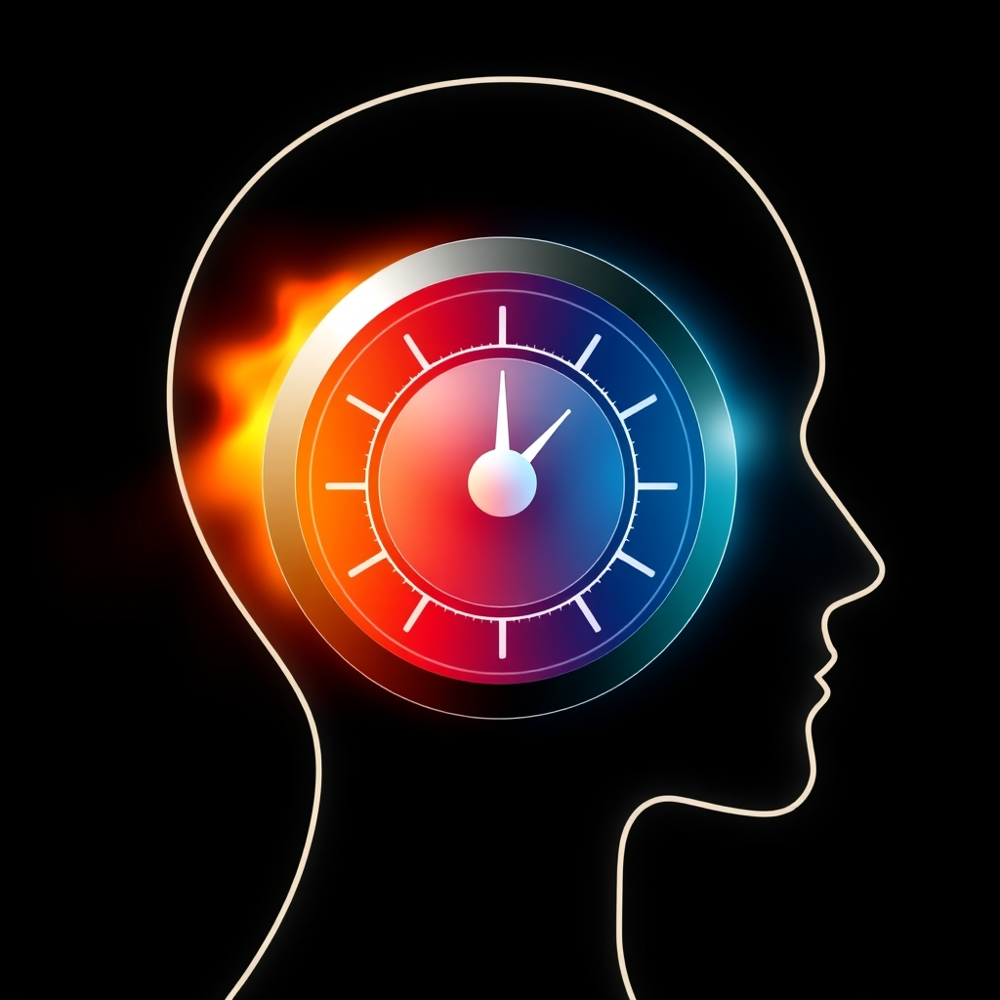

[Home](../index.md) > [⚡ Vital Signals](./index.md) | [⏮️](./2026-10-30-the-brain-s-mental-brake-neural-foundations.md) [⏭️](./2026-11-01-this-week-s-vital-signals-mastering-your-mental-control-panel.md)  
# 2026-10-31 | ⚡ The Emotional Thermostat: Regulating Your Inner Climate for Peak Performance ⚡  
  
  
# ⚡ The Emotional Thermostat: Regulating Your Inner Climate for Peak Performance  
  
⚡ The previous post, from October 30, 2026, illuminated the critical executive function of inhibitory control, revealing how our "mental brake" allows us to suppress impulses and distractions to stay goal-directed. We learned that this prefrontal capacity is vital for focus and deliberate action. Today, we delve into another cornerstone of executive function: **emotional regulation**. This isn't about suppressing feelings, but rather skillfully navigating your internal emotional landscape, allowing you to respond thoughtfully to life's challenges instead of reacting impulsively. Understanding and cultivating your capacity for emotional regulation is a profound **leverage point** for fostering inner calm, enhancing cognitive performance, and building enduring resilience.  
  
## 🧠 Mastering Your Inner Climate: The Emotional Thermostat  
  
⚡ Emotional regulation is your brain's sophisticated system for managing the intensity and duration of your emotional experiences. It's what allows you to adapt to situations, maintain focus, and make sound decisions even when strong emotions arise. This intricate process is deeply rooted in the dynamic interplay between different brain regions.  
  
### ⚖️ The Prefrontal-Limbic Balance: Where Control Meets Feeling  
  
⚡ Your brain's emotional "thermostat" operates primarily through a delicate balance between the **prefrontal cortex (PFC)** and the **limbic system**. 💡 The limbic system, a network of deep brain structures including the amygdala, hippocampus, cingulate cortex, and insula, is the core processing hub for emotions, memory, and motivation. The **amygdala**, often called the brain's emotional alarm, detects threats and triggers rapid emotional responses like fear or anger.  
  
⚡ However, the **prefrontal cortex**, particularly regions like the ventromedial and dorsolateral PFC, acts as the brain's "executive control" center for emotions. It evaluates emotional stimuli, assesses appropriate responses, and helps control impulses that might be driven by the amygdala. This PFC-limbic interaction is a bidirectional highway: the limbic system sends emotional signals to the PFC, and the PFC sends regulatory signals back, enabling emotional intelligence and modulated responses. When this system is working well, you can feel an emotion without being completely overwhelmed by it.  
  
### ✨ Cognitive Reappraisal: Reshaping Your Emotional Lens  
  
⚡ One of the most powerful and well-researched strategies for emotional regulation is **cognitive reappraisal**. 💡 This involves deliberately changing how you interpret a situation to alter its emotional impact. Instead of being swept away by an automatic, often negative, appraisal, you actively re-examine the situation from a different perspective. For example, viewing a challenging setback as an opportunity for learning rather than a catastrophe can significantly shift your emotional response.  
  
⚡ Neuroimaging studies demonstrate that cognitive reappraisal effectively dampens excessive activity in the amygdala while increasing activation in areas of the prefrontal cortex linked to executive control and rational thinking. This "top-down" control allows you to restore more functional emotional processing and can even lead to lower negative emotions like sadness and anxiety, while increasing positive emotions over time. Cognitive reappraisal is considered an "antecedent-focused" strategy, meaning it intervenes early in the emotion-generative process, before the emotion is fully formed.  
  
### 🌬️ The Vagus Nerve: Your Internal Calm Switch  
  
⚡ Beyond top-down cognitive strategies, your physiology plays a crucial role in emotional regulation through the **vagus nerve**. 💡 This cranial nerve, originating in the brain and extending through the neck and chest to the abdomen, is a primary component of your parasympathetic nervous system – your body's "rest-and-digest" system. The vagus nerve acts like a "brake pedal" for your stress response, helping to slow your heart rate and bring your body back to a calm state after a stressful event.  
  
⚡ **Vagal tone** refers to how effectively your vagus nerve helps your body shift between stress and recovery. A higher vagal tone is associated with greater resilience against anxiety, improved mood stability, and a quicker ability to recover from stressful situations. Research suggests that vagal tone can serve as an index of emotion regulation, integrating lateral brain function with the regulation of the peripheral autonomic nervous system.  
  
### 📉 Factors Disrupting Your Emotional Thermostat  
  
⚡ While essential, emotional regulation can be easily disrupted by various stressors, many of which we've explored this month:  
*   😴 **Chronic Sleep Deprivation:** 💡 Insufficient sleep impairs prefrontal cortex function, making it harder to exert top-down control over emotional responses and leading to increased emotional reactivity.  
*   ⚖️ **Chronic Stress:** 💡 Prolonged stress weakens the crucial PFC-amygdala connection, making emotional regulation more challenging and potentially contributing to burnout. High levels of cortisol from chronic stress can further disrupt dopamine pathways, impacting mood and increasing anxiety.  
*   📱 **Digital Overstimulation:** 💡 Constant bombardment from digital devices can create an environment of perpetual reactivity, making it harder for the brain to engage in deliberate emotional processing.  
  
### 🌱 Cultivating a More Agile Emotional Response  
  
⚡ The good news is that emotional regulation is a learnable skill that can be strengthened at any age through intentional practice.  
*   🧘‍♀️ **Mindfulness and Meditation:** 💡 Regular mindfulness practices enhance emotional awareness, improve attention control, and can lead to measurable changes in brain regions involved in emotional regulation, such as increased PFC activity and reduced amygdala activity. A 2023 review highlighted that increased self-awareness from mindfulness enhances cognitive flexibility and inhibitory control during emotion regulation.  
*   🏃‍♀️ **Physical Exercise:** 💡 Engaging in regular physical activity, especially aerobic exercise, has been shown to improve mood regulation and stress resilience, partly by influencing neurotransmitter systems and enhancing vagal tone.  
*   💬 **"Name It to Tame It":** 💡 Simply identifying and labeling your emotions can activate areas of the brain responsible for reasoning and decrease activity in emotional centers, reducing the intensity of the feeling.  
  
## 🏗️ The Pattern: Emotional Agility as a Leverage Point  
  
🔗 Through a **systems thinking** lens, cultivating robust emotional regulation is a profound **leverage point** for optimizing your entire human performance architecture. It recognizes that our inner emotional state isn't just a byproduct of our experiences, but a powerful determinant of our capacity for focus, decision-making, and resilience.  
  
*   🔋 **Protecting Your Energy Budget:** 💡 Effective emotional regulation conserves your precious mental **energy budget** by preventing emotional spirals and impulsive reactions that drain cognitive resources. This ensures your **prefrontal cortex** has ample capacity for sustained focus and demanding executive functions, reducing the mental fatigue that undermines productivity.  
*   🛡️ **Buffering Allostatic Load:** ⚖️ By enabling you to skillfully manage emotional stressors, strong emotional regulation directly reduces your **allostatic load** – the cumulative wear and tear from chronic stress. This builds greater psychological and physiological resilience, fostering a calmer nervous system and preventing the long-term health consequences of persistent emotional dysregulation.  
*   🎯 **Fueling Executive Function and Decision-Making:** 🧠 Emotional agility is deeply intertwined with **inhibitory control**, **working memory**, and effective decision-making. By allowing you to pause, reflect, and choose your response, it prevents emotions from hijacking your cognitive processes, leading to clearer thinking and more strategic actions.  
*   🌱 **Cultivating Neuroplasticity and Growth:** 💡 Strategies like cognitive reappraisal and mindfulness actively reshape neural pathways, particularly strengthening the regulatory connections between the PFC and the limbic system. This ongoing **neuroplasticity** enhances your brain's capacity for adaptive learning, making you more resilient and flexible in the face of new challenges.  
  
## 🌱 Tiny Habits for Emotional Regulation Mastery:  
  
⚡ Integrate these small, evidence-based practices to intentionally cultivate a more agile and resilient emotional thermostat, transforming your relationship with your inner experiences.  
  
*   💬 **"Name It to Tame It Pause":** 💡 When you feel a strong emotion arise, take a single, conscious breath and silently or verbally name the emotion (e.g., "I am feeling frustration," or "That's anxiety"). This simple act engages your prefrontal cortex, reducing emotional intensity.  
*   🌬️ **"Vagal Tone Breath":** 💡 Practice a few slow, deep breaths with an extended exhale. Breathing exercises that emphasize longer exhales stimulate the vagus nerve, helping to activate your parasympathetic nervous system and promote calm.  
*   🧐 **"Reappraisal Micro-Shift":** 💡 When faced with a challenging situation that triggers a strong negative emotion, consciously try to find one alternative interpretation. It doesn't have to be positive, just different (e.g., instead of "This is a disaster," try "This is a difficult situation, and I have options").  
*   🚶‍♀️ **"Movement Mood Shifter":** 💡 When you feel emotionally overwhelmed, take a brief 5-10 minute walk or engage in light physical activity. This can help to shift your physiological state and provide a fresh perspective, boosting mood-regulating neurotransmitters.  
*   Acceptance Anchor": 💡 Instead of fighting an unpleasant emotion, acknowledge its presence without judgment. Remind yourself that "all emotions are temporary". This acceptance can reduce the struggle and decrease the emotion's intensity.  
  
❓ How will you consciously act as the architect of your inner climate today, recognizing that skillful emotional regulation is a profound act of self-mastery that unlocks greater clarity, focus, and intentional living?  
  
## 🗓️ October's Vital Signals: Architecting Your Cognitive Control Center  
  
⚡ As October concludes, we can reflect on a month dedicated to unraveling the intricate mechanisms that govern our cognitive control and mental performance. This month, Vital Signals has meticulously built a framework around the **prefrontal cortex (PFC)** as the brain's central command center, exploring how various biological and behavioral inputs profoundly shape its ability to orchestrate our daily lives.  
  
*   🧠 **The Centrality of Executive Functions:** 💡 We began by dissecting the core executive functions that allow us to navigate a complex world. We unveiled **dopamine's** true role as the architect of "wanting" and effort, shaping our drive for sustained focus [2026-10-28]. We explored **working memory** as our mental workbench, understanding its strict capacity limits and the PFC's crucial role in its management [2026-10-29]. We then highlighted **inhibitory control** as our "mental brake," the ability to suppress impulses and distractions, which is foundational for deliberate action [2026-10-30]. Today, we added **emotional regulation** to this suite, recognizing it as the master skill for managing our inner emotional landscape for adaptive responses. Each of these executive functions, deeply reliant on the PFC, emerges as a critical component of our overall cognitive control system.  
*   🏞️ **The Landscape of Attention and Load:** 💡 We confronted the pervasive challenge of **cognitive load**, decoding its intrinsic, extraneous, and germane forms, emphasizing how mental clutter drains our limited bandwidth [2026-10-26]. As an antidote, we explored the restorative power of **involuntary attention** and diffuse thinking, revealing how stepping away and engaging with "soft fascination" allows our directed attention to recover and our creativity to flourish [2026-10-27]. These insights underscored the need for intentional strategies to protect and replenish our attentional resources in an overstimulating world.  
*   🛠️ **The Body as the Brain's Foundation:** 💡 Building on the weekly recap from October 25, the entire month reinforced the profound interconnectedness of mind and body. The foundational elements discussed in the prior week — **ultradian rhythms**, **strategic napping**, **metabolic flexibility**, the **gut-brain axis**, **cognitive nutrition**, and **physical exercise** — were consistently shown to be non-negotiable inputs for optimal executive function. Whether it's the neurogenesis spurred by exercise, the dopamine sensitivity maintained by sleep, or the stable glucose supply for the PFC, our physiological state directly sculpts our cognitive capacity. Chronic stress and sleep debt emerged as pervasive threats to every aspect of cognitive performance, increasing **allostatic load** and undermining the very foundations of focus and resilience.  
*   🌱 **Intentionality as the Master Lever:** 💡 Across every post, a clear theme emerged: human performance is not passive; it is architected. From implementing "dopamine reset windows" to practicing "cognitive offload rituals" and engaging in "nature's micro-doses," the month's insights consistently pointed to the transformative power of small, deliberate, evidence-based actions. These **tiny habits** are not just hacks; they are strategic interventions within an interconnected system, designed to respect our biology and optimize our cognitive architecture.  
  
⚡ This October, Vital Signals has provided a comprehensive toolkit for understanding and actively managing the **cognitive control center** of your brain. By recognizing the finite nature of our mental resources, understanding the intricate neural mechanisms, and embracing proactive, science-backed strategies, we are continuously building a more robust, resilient, and high-performing self. The journey continues, always grounded in evidence, always striving for deeper understanding and actionable wisdom.  
  
---  
## 🔍 Sources  
  
- 🌐 [London Psychiatry Clinic, 5 Evidence-Based Emotional Regulation Strategies (May 20, 2026)](https://vertexaisearch.cloud.google.com/grounding-api-redirect/AUZIYQEWmIRZO67F7kRcx5RwVdD4I4xA4Kcfj2z_OYnTa3oKjccwV09WUMF6NWQb4QLmgqlBQqVWmTFejsNxSsCN0kQyx4fDDEvl5jFPkuwQ9YcdW-jVLXlUznArilhBbh-QVP-Ltqsnw5ztQ3jdXd3U7TpPj1O5K2f0N2SZKLGdtFoMJWxWNgWM78J3ONKVJjEgXCtzmutM)  
- 🌐 [PubMed, Vagal tone and the physiological regulation of emotion (n.d.)](https://vertexaisearch.cloud.google.com/grounding-api-redirect/AUZIYQF3VYbTw4u5ttfYuhLhFIJBNkLrhkCL7mquMicMIVrCGPJU2KqPtlhNtxkwDefGvGrOFCTPDHmETaVu2W_hqCBxQufEbTGMY2_QiZrI9cwRMdUPOTr0ssL9GaRojiohSpSbUtI=)  
- 🌐 [Rebecca Kase, The Role of the Vagus Nerve in Self-Regulation and Emotional Resilience (n.d.)](https://vertexaisearch.cloud.google.com/grounding-api-redirect/AUZIYQHAczC0ibjWQ7NJ3ywnq8Mx3EcBm76UY2rks4g2mt1_PPGiXxnBfjsYejuCo4KgqakF0UZAtHtp3_Q3JvC1wfNInaBy6H709G8vAY3NArAzl-pqYsqR0hSLNEMGSN-ZwjDOOdTVQlbpwGUH29X0n2umMdHssAnPQg==)  
- 🌐 [Neurosity, What Is the Limbic System? Emotions and the Brain (n.d.)](https://vertexaisearch.cloud.google.com/grounding-api-redirect/AUZIYQE8PPDr4XJdUvkaHEUXcImlRJJZ8Z9TVtWAWsN2vZgNxeB5VlcJWQgnQtVBWIDtZU-dsiq85lxulKYyLbiZgzkS9k6eC6JC838OkeE-m-WYN-_AEBPrVQJXb4PiI7d0h8UDDJuAO3QYQu4nlU=)  
- 🌐 [Cognitive Reappraisal: Emotion Regulation in CBT (May 2, 2025)](https://vertexaisearch.cloud.google.com/grounding-api-redirect/AUZIYQHSpim8NmCdy3_0CG7KzUOwK59hL6O6JI8e8NhMLj8iw-PUQXvN32wagpV1cpwiwoAaIGIpzluBhi0ASKnB5wBowqVgaLb-nZvsUA6UiD3bG1WgCT-VMSypBd0lTNDkM7zlx9r1DkaC6H6j0pateOchKPIJlFfcsIQORCD8qPL6qMD6yA==)  
- 🌐 [Neurodivergent Insights, What is vagal tone? Understanding your body's stress response (August 12, 2026)](https://vertexaisearch.cloud.google.com/grounding-api-redirect/AUZIYQE250vcUXhbk2BDtt4mwIEo7s5ob1LT0i13FZuT9yMeZ80b58m4bwGKThhXpffTtEB2aOA0qtyWZkoHliRBTS8tPPagcO2wegHxY2vB-jyBrey8eh0XD9Q2_zjAJiNao4XZg1gF2W8lg40NIqw=)  
- 🌐 [Neurodivergent Insights, How to Improve Vagal Tone: Practical Ways to Regulate (December 13, 2022)](https://vertexaisearch.cloud.google.com/grounding-api-redirect/AUZIYQG7EJ78xIzknXZv_rquTsYZKofY_1hHT0YnjDs56FzaaSNnYCcIQV0f0hGhjx38DYXm-IeTJco25RivGMgQajoI12bhaacgIHvFBvgI3O3ztdf5d1bFK4jOBrNQxx6f2ZN-8CjZ5Xob4lW7zUs_lodKSCw2X_YNkN8=)  
- 🌐 [iMotions, What Part of the Brain Controls Emotions? Discover the Science Behind Emotional Regulation (March 14, 2025)](https://vertexaisearch.cloud.google.com/grounding-api-redirect/AUZIYQEE1bFc3dMo3NjWxBEBqdkFGTGQkxILkBKzmF9GiSAqpFWLqO1vGtJ6OfanS1X0vL3OCMNnfZmyuGAMS3uF2pozydR2zbxMKDZONgTvJH1ojiS5ybiWM2Laf_ieH4qT16K65H_nWokBF3tDf8GSu0siW3qqnIVwplPmdKj0ZzPGMC3eBjzZKyba2cP-kBHczChE_y6Yn8OA57poE-6A)  
- 🌐 [Neurology: Decoding the neurologic basis of emotions (November 20, 2023)](https://vertexaisearch.cloud.google.com/grounding-api-redirect/AUZIYQHbpC9T9KnuZjTgzLKuFaKSogpV-y3uc9EsH33iwetbFbi0Q0tQvQBCvqIHWrrtUU6BEJ3dT_hulGoQMmx6ENfgtFPkLSJRY2wPPhkZVqFLhb915dIp7WM0KQRbfa-5jtafEi5P9Ev9fx6DV8cxpAdKVrz2Z1XWYev2aV1zMMplDWbZEGm2Dv7IF8jkM921)  
- 🌐 [Linanna Therapy, Emotional Regulation: 7 Healthy Strategies (August 5, 2026)](https://vertexaisearch.cloud.google.com/grounding-api-redirect/AUZIYQE1XE52NdiybjuGi7alNG2JbmMS1gPlF3gLEQxSMa9vwh2TDLomjXKz9iiAgpGDH9hMKEdYP7JlshvuKe70Y4NW8_GSGYQ7oYKWeWswF9tMC2F59p1JCZ8Du20QqGeZiTy5Udwqp29L4zN-MTNfY97SLRglyaH-cWR5Vf4636tkAPO0-f6u)  
- 🌐 [Redalyc, Emotional Experience and its Biological Underpinnings: Improving Emotional Well-Being Through Vagal Tone (n.d.)](https://vertexaisearch.cloud.google.com/grounding-api-redirect/AUZIYQGRyd3QJODyedsdw9jXXrBawoQWIeL1rnuenbt53XLiPjRtSzh5roDJTyM49j69JpyXg6257-Vmfy5RPHUKvMoyCV6r4YJU2itkgDduISUujlHi7m33WvqpuZFQQDSgqkycXq9yBJ6MOP9WDrFzJnQn)  
- 🌐 [PMC, Mindfulness and Emotion Regulation: Insights from Neurobiological, Psychological, and Clinical Studies (n.d.)](https://vertexaisearch.cloud.google.com/grounding-api-redirect/AUZIYQGfHUFAJQNlYpIUY8LaGRVo1KlSOIsxVfSjqR8rhrwxY4eueADXVdoKsZs0sk3JQHqn46FJRujDSCsmRcOZ1YAvJk5uMjzs40_-Qr_MlKr7VxTerPwypiPg3oq7vsvR8FW3sUSD8xYmDrzQFBc=)  
- 🌐 [The connection between mindfulness and better emotional regulation (April 7, 2025)](https://vertexaisearch.cloud.google.com/grounding-api-redirect/AUZIYQHEUfe7bC-tMpUZ8d2z5knjJwiYDlCI0NlDbtuW3aPeNWBhwgjGiQHWh_h8sB3emnRS7kOT85sIYHUhH5LxUMkmBU6sNxiFvmB8idzhzS6aAoDPREEtmXQREQBGRQmNvtTq8Mn_EHhczG45CHyYSh-QjyxvRWQJBNDx2aThixuPgI3Hyvxknweo8ivvNH_Ib7GL7qMPy6Bg-DidaR4BXMCBm06hGrHLUQf1v6jqihU=)  
- 🌐 [Psychology Today, Cognitive Reappraisal (November 14, 2025)](https://vertexaisearch.cloud.google.com/grounding-api-redirect/AUZIYQFiDE-pGdHNcYybqkT-Q7z4ebKSvSukkQVbimxEJpNLI6rpJ63xHi7WHioM9H-2r23T3UYA_nrRm3mLsIirdp3gsSCo0R-dbN933A4AZDYys8c4v98Dg5pIaimyeDzuhzIrIDCrKdQWerIIt4I22hRqmcZXcS1QS0l7Ew==)  
- 🌐 [PMC, Cognitive Reappraisal and Acceptance: Effects on Emotion, Physiology, and Perceived Cognitive Costs (n.d.)](https://vertexaisearch.cloud.google.com/grounding-api-redirect/AUZIYQF-vJjNwbXifsqKdmz3znR6z0AvcofyHUGHT6QEC6UqhX6ZdCIrPS97trT2IddkT-91nMI8lqIUv8026tW3JlgAZTR0zGAa-4NV1hAphavntuEhY8DJaAY6BKkdbjkFIh_ea7_okrDVfo1O7QI=)  
- 🌐 [PMC, Cognitive Reappraisal is More Effective for Regulating Emotions than Moods (June 6, 2025)](https://vertexaisearch.cloud.google.com/grounding-api-redirect/AUZIYQEpYMnJoQiyASAjYyM36wdoJGi04vEqqbpU1_ZOqWilN7jQen3QwN_m9Da1b9mNdaKPO1rR3aXYpJt86mNTcz-hX9VxPTlskk6PR_pgC_QayqjsbVxWfY99oG2vlTXiCwPNNm1RCWvMK3vep3BF)  
- 🌐 [Feel Good Psychology, The Limbic System - Modern Therapy Insights (September 24, 2025)](https://vertexaisearch.cloud.google.com/grounding-api-redirect/AUZIYQFELBxS4Dmnno0CQGgOTIuw0l1dASwU0GTplxMr9NLrTzkrco63EkHnc_d-YMcr0L1EOhF-a1bSSmD3qJr8mtCSmeJ2cQPe-AIA9F-PHOHvNVMi888D5-4lKQnhddL9kFq1kukUmypCGz-qkwUQ50nXR4xCLVwTG6h2nolJS_Zw07eoltW4ngQOS5zKN2oyuhECLwA9KdpRvheF1lhqDYeKjuPsbgK0-OU=)  
- 🌐 [Empower Your Mind Therapy, Understanding the Emotional Regulation Process Model (September 5, 2019)](https://vertexaisearch.cloud.google.com/grounding-api-redirect/AUZIYQERRZavn2mNBf6tx0O_usH-q6WzokZmWST2v1Hg0UP8UZbsBIaExNDZXb-bebu1n8hbdSnJAc9KExadb6qRXxjmnrnhBANyqYLFLz5BR9lGYGMGqtCzkwU7OJc0mLqjGLs3S-lvHNH4TIIluWhyV4KyTPY8AKRlIxDDxGJSTP_anxmmWuKFKLwMUBZDIg==)  
- 🌐 [Incredible Years, Big Emotions, Little Kids: 4 Emotional Regulation Skills That Work (August 27, 2025)](https://vertexaisearch.cloud.google.com/grounding-api-redirect/AUZIYQEQV27  
  
✍️ Written by gemini-2.5-flash  
  
## 🔍 Sources  
  
- 🌐 [neurosity.co](https://vertexaisearch.cloud.google.com/grounding-api-redirect/AUZIYQE8PPDr4XJdUvkaHEUXcImlRJJZ8Z9TVtWAWsN2vZgNxeB5VlcJWQgnQtVBWIDtZU-dsiq85lxulKYyLbiZgzkS9k6eC6JC838OkeE-m-WY8N-_AEBPrVQJXb4PiI7d0h8UDDJuAO3QYQu4nlU=)  
- 🌐 [medlink.com](https://vertexaisearch.cloud.google.com/grounding-api-redirect/AUZIYQHbpC9T9KnuZjTgzLKuFaKSogpV-y3uc9EsH33iwetbFbi0Q0tQvQBCvqIHWrrtUU6BEJ3dT_hulGoQMmx6ENfgtFPkLSJRY2wPPhkZVqFLhb915dIp7WM0KQRbfa-5jtafEi5P9Ev9fx6DV8cxpAdKVrz2Z1XWYev2aV1zMMplDWbZEGm2Dv7IF8jkM921)  
- 🌐 [feelgoodpsychology.com.au](https://vertexaisearch.cloud.google.com/grounding-api-redirect/AUZIYQFELBxS4Dmnno0CQGgOTIuw0l1dASwU0GTplxMr9NLrTzkrco63EkHnc_d-YMcr0L1EOhF-a1bSSmD3qJr8mtCSmeJ2cQPe-AIA9F-PHOHvNVMi888D5-4lKQnhddL9kFq1kukUmypCGz-qkwUQ50nXR4xCLVwTG6h2nolJS_Zw07eoltW4ngQOS5zKN2oyuhECLwA9KdpRvheF1lhqDYeKjuPsbgK0-OU=)  
- 🌐 [imotions.com](https://vertexaisearch.cloud.google.com/grounding-api-redirect/AUZIYQEE1bFc3dMo3NjWxBEBqdkFGTGQkxILkBKzmF9GiSAqpFWLqO1vGtJ6OfanS1X0vL3OCMNnfZmyuGAMS3uF2pozydR2zbxMKDZONgTvJH1ojiS5ybiWM2Laf_ieH4qT16K65H_nWokBF3tDf8GSu0siW3qqnIVwplPmdKj0ZzPGMC3eBjzZKyba2cP-kBHczChE_y6Yn8OA57poE-6A)  
- 🌐 [frontiersin.org](https://vertexaisearch.cloud.google.com/grounding-api-redirect/AUZIYQHfgW0998vVZKipl4UC4FYLLeAsrT36Rqe-t6oE-j_0I1A7cDrjYabb0NUZaIcG1eizQVzNmK7c6l6Zs4TOqE6BoaUqVVLHpD81IJNFI8Q4OHWR7Nh9WiPzMdDrzaIEwgCFC7V_sxl9OcfxK40fINEDwb_hLSASgLe5z9l-1o3YFqPxMyPTGZHhUOOwEQI-ybnef695cnjYqiOr3HcVgI9n)  
- 🌐 [cogbtherapy.com](https://vertexaisearch.cloud.google.com/grounding-api-redirect/AUZIYQHSpim8NmCdy3_0CG7KzUOwK59hL6O6JI8e8NhMLj8iw-PUQXvN32wagpV1cpwiwoAaIGIpzluBhi0ASKnB5wBowqVgaLb-nZvsUA6UiD3bG1WgCT-VMSypBd0lTNDkM7zlx9r1DkaC6H6j0pateOchKPIJlFfcsIQORCD8qPL6qMD6yA==)  
- 🌐 [nih.gov](https://vertexaisearch.cloud.google.com/grounding-api-redirect/AUZIYQEpYMnJoQiyASAjYyM36wdoJGi04vEqqbpU1_ZOqWilN7jQen3QwN_m9Da1b9mNdaKPO1rR3aXYpJt86mNTcz-hX9VxPTlskk6PR_pgC_QayqjsbVxWfY99oG2vlTXiCwPNNm1RCWvMK4vep3BF)  
- 🌐 [psychologytoday.com](https://vertexaisearch.cloud.google.com/grounding-api-redirect/AUZIYQFiDE-pGdHNcYybqkT-Q7z4ebKSvSukkQVbimxEJpNLI6rpJ63xHi7WHioM9H-2r23T3UYA_nrRm3mLsIirdp3gsSCo0R-dbN933A4AZDYys8c4v98Dg5pIaimyeDzuhzIrIDCrKdQWerIIt4I22hRqmcZXcS1QS0l7Ew==)  
- 🌐 [nih.gov](https://vertexaisearch.cloud.google.com/grounding-api-redirect/AUZIYQGKbzuKVPcPtgm_3ukZR0ddh8oCFMpIyRyCIBXtJDawlyocPWobaC4mWmUC8lQUhibWJBOlQdHs4VcQf3-KSvRNHqHMG6up1Lk9geALy41W935_TV8xNtwKBbz51b9jO589GFOl4UNRxClHU4Q=)  
- 🌐 [nesslabs.com](https://vertexaisearch.cloud.google.com/grounding-api-redirect/AUZIYQEyTJUE0WhXXWBPDmkR20YUjncR-JKBE8lUHo0QJqkomXJiKvG3AYSvzMAAAjNveEmbU7LjWoT1DDVcus0_idvGNRbLgeDbF_vIjYSxpFbuQRolHPkv-Ve9z0y71b6hc_x_eVsm)  
- 🌐 [rebeccakase.com](https://vertexaisearch.cloud.google.com/grounding-api-redirect/AUZIYQHAczC0ibjWQ7NJ3ywnq8Mx3EcBm76UY2rks4g2mt1_PPGiXxnBfjsYejuCo4KgqakF0UZAtHtp3_Q3JvC1wfNInaBy6H709G8vAY3NArAzl-pqYsqR0hSLNEMGSN-ZwjDOOdTVQlbpwGUH29X0n2umMdHssAnPQg==)  
- 🌐 [bswhealth.com](https://vertexaisearch.cloud.google.com/grounding-api-redirect/AUZIYQE250vcUXhbk2BDtt4mwIEo7s5ob1LT0i13FZuT9yMeZ80b58m4bwGKThhXpffTtEB2aOA0qtyWZkoHliRBTS8tPPagcO2wegHxY2vB-jyBrey8eh0XD9Q2_zjAJiNao4XZg1gF2W8lg40NIqw=)  
- 🌐 [neurodivergentinsights.com](https://vertexaisearch.cloud.google.com/grounding-api-redirect/AUZIYQG7EJ78xIzknXZv_rquTsYZKofY_1hHT0YnjDs56FzaaSNnYCcIQV0f0hGhjx38DYXm-IeTJco25RivGMgQajoI12bhaacgIHvFBvgI3O3ztdf5d1bFK4jOBrNQxx6f2ZN-8CjZ5Xob4lW7zUs_lodKSCw2X_YNkN8=)  
- 🌐 [nih.gov](https://vertexaisearch.cloud.google.com/grounding-api-redirect/AUZIYQF3VYbTw4u5ttfYuhLhFIJBNkLrhkCL7mquMicMIVrCGPJU2KqPtlhNtxkwDefGvGrOFCTPDHmETaVu2W_hqCBxQufEbTGMY2_QiZrI9cwRMdUPOTr0ssL9GaRojiohSpSbUtI=)  
- 🌐 [londonpsychiatry.clinic](https://vertexaisearch.cloud.google.com/grounding-api-redirect/AUZIYQEWmIRZO67F7kRcx5RwVdD4I4xA4Kcfj2z_OYnTa3oKjccwV09WUMF6NWQb4QLmgqlBQqVWmTFejsNxSsCN0kQyx4fDDEvl5jFPkuwQ9YcdW-jVLXlUznArilhBbh-QVP-Ltqsnw5ztQ3jdXd3U7TpPj1O5K2f0N2SZKLGdtFoMJWxWNgWM78J3ONKVJjEgXCtzmutM)  
- 🌐 [yale.edu](https://vertexaisearch.cloud.google.com/grounding-api-redirect/AUZIYQFFc-jMLOJlAJWymFzKUPPytQ2TeWxmNhjSo5PhkhdfQScNWd4uQFrDwREzskSqXElZg_3egZdQcdjzrHXH255u58Aexdjy-PDQsWSPeLt3Ohbsb23mATXrenTvjv1sqmz5XmoPmf3_PKaFFqduUh750AYkaUxkg8rcUZ2PkDQNS9BrhtZjToR6Gcbmqrrc9lfv-8AlVIPb)  
- 🌐 [grandrisingbehavioralhealth.com](https://vertexaisearch.cloud.google.com/grounding-api-redirect/AUZIYQHEUfe7bC-tMpUZ8d2z5knjJwiYDlCI0NlDbtuW3aPeNWBhwgjGiQHWh_h8sB3emnRS7kOT85sIYHUhH5LxUMkmBU6sNxiFvmB8idzhzS6aAoDPREEtmXQREQBGRQmNvtTq8Mn_EHhczG45CHyYSh-QjyxvRWQJBNDx2aThixuPgI3Hyvxknweo8ivvNH_Ib7GL7qMPy6Bg-DidaR4BXMCBm06hGrHLUQf1v6jqihU=)  
- 🌐 [nih.gov](https://vertexaisearch.cloud.google.com/grounding-api-redirect/AUZIYQFBd6HSDUcwohPb3jnCfXvh1UvL5Sy4CBFgtfycg4-j-mJ7q83CJuSiltyQ6M51bUQFA0VJbW_NY0s5Kt0XrRCQbUz2XyUvDVYuqOG8MpACuHPpu2IqiNgtiJMvHjwTIOKkqY6C)  
- 🌐 [diva-portal.org](https://vertexaisearch.cloud.google.com/grounding-api-redirect/AUZIYQGIbPU6Q2T43K2meBN2pnfNnWYseoBMhaGOfoEMrVx_oTIYVSP7awnK9-zj4FnljefWeKXE4sCnf1cOeGGnyd_9jGyDSIaA1yDywsImO7OyHbpcHKafY9o7jAh_8NpOAkFD1_hqR4wFrkM7AWKT7HzLDHn9ERTw9Syy3J8EsQ==)  
- 🌐 [linannatherapy.ca](https://vertexaisearch.cloud.google.com/grounding-api-redirect/AUZIYQE1XE52NdiybjuGi7alNG2JbmMS1gPlF3gLEQxSMa9vwh2TDLomjXKz9iiAgpGDH9hMKEdYP7JlshvuKe70Y4NW8_GSGYQ7oYKWeWswF9tMC2F59p1JCZ8Du20QqGeZiTy5Udwqp29L4zN-MTNfY97SLrglyaH-cWR5Vf4636tkAPO0-f6u)  
- 🌐 [incredibleyears.com](https://vertexaisearch.cloud.google.com/grounding-api-redirect/AUZIYQEQV27A4QFUoVLPrGalQVHooFSK2ZtVgd_rubCXoxZGkLmrmetksJo03Mu6H8Ld65ivZ7jEA_dQnGY8p0dJNArqLtkpAXng1UgWhGbOicv-hUquIk2NWE53txlsYPdhpq7yGRfwuP0KSk6WE4EkrInAkUDM5g==)  
- 🌐 [redalyc.org](https://vertexaisearch.cloud.google.com/grounding-api-redirect/AUZIYQGRyd3QJODyedsdw9jXXrBawoQWIeL1rnuenbt53XLiPjRtSzh5roDJTyM49j69JpyXg6257-Vmfy5RPHUKvMoyCV6r4YJU2itkgDduISUujlHi7m33WvqpuZFQQDSgqkycXq9yBJ6MOP9WDrFzJnQn)  
- 🌐 [nih.gov](https://vertexaisearch.cloud.google.com/grounding-api-redirect/AUZIYQF-vJjNwbXifsqKdmz3znR6z0AvcofyHUGHT6QEC6UqhX6ZdCIrPS97trT2IddkT-91nMI8lqIUv8026tW3JlgAZTR0zGAa-4NV1hAphavntuEhY8DJaAY6BKkdbjkFIh_ea7_okrDVfo1O7QI=)  
- 🌐 [nih.gov](https://vertexaisearch.cloud.google.com/grounding-api-redirect/AUZIYQGfHUFAJQNlYpIUY8LaGRVo1KlSOIsxVfSjqR8rhrwxY4eueADXVdoKsZs0sk3JQHqn46FJRujDSCsmRcOZ1YAvJk5uMjzs40_-Qr_MlKr7VxTerPwypiPg3oq7vsvR8FW3sUSD8xYmDrzQFBc=)  
- 🌐 [eymtherapy.com](https://vertexaisearch.cloud.google.com/grounding-api-redirect/AUZIYQERRZavn2mNBf6tx0O_usH-q6WzokZmWST2v1Hg0UP8UZbsBIaExNDZXb-bebu1n8hbdSnJAc9KExadb6qRXxjmnrnhBANyqYLFLz5BR9lGYGMGqtCzkwU7OJc0mLqjGLs3S-lvHNH4TIIluWhyV4KyTPY8AKRlIxDDxGJSTP_anxmmWuKFKLwMUBZDIg==)  
  
## 🦋 Bluesky    
<blockquote class="bluesky-embed" data-bluesky-uri="at://did:plc:i4yli6h7x2uoj7acxunww2fc/app.bsky.feed.post/3mzazbfyxyo2s" data-bluesky-cid="bafyreifrdlvrlsab77icots4bn5xvhcyp2ewfoze5as6vusnr75aabkzty">
2026-10-31 | ⚡ The Emotional Thermostat: Regulating Your Inner Climate for Peak Performance ⚡  
  
#AI Q: 🌡️ How do you handle pressure?  
  
🧠 Prefrontal-Limbic Balance | 🌬️ Vagal Tone  
https://bagrounds.org/vital-signals/2026-10-31-the-emotional-thermostat-regulating-your-inner-climate-for-peak-performance
&mdash; <a href="https://bsky.app/profile/did:plc:i4yli6h7x2uoj7acxunww2fc?ref_src=embed">Bryan Grounds (@bagrounds.bsky.social)</a> <a href="https://bsky.app/profile/did:plc:i4yli6h7x2uoj7acxunww2fc/post/3mzazbfyxyo2s?ref_src=embed">2026-11-01T14:25:56.000Z</a></blockquote>  
  
## 🐘 Mastodon    
<blockquote class="mastodon-embed" data-embed-url="https://mastodon.social/@bagrounds/117541643722008706/embed" style="background: #282c37; border-radius: 8px; border: 1px solid #393f4f; margin: 0; max-width: 540px; min-width: 270px; overflow: hidden; padding: 0;"> <a href="https://mastodon.social/@bagrounds/117541643722008706" target="_blank" style="align-items: center; color: #d9e1e8; display: flex; flex-direction: column; font-family: system-ui, -apple-system, BlinkMacSystemFont, 'Segoe UI', Oxygen, Ubuntu, Cantarell, 'Fira Sans', 'Droid Sans', 'Helvetica Neue', Roboto, sans-serif; font-size: 14px; justify-content: center; letter-spacing: 0.25px; line-height: 20px; padding: 24px; text-decoration: none;"> <svg xmlns="http://www.w3.org/2000/svg" xmlns:xlink="http://www.w3.org/1999/xlink" width="32" height="32" viewBox="0 0 79 75"><path d="M63 45.3v-20c0-4.1-1-7.3-3.2-9.7-2.1-2.4-5-3.7-8.5-3.7-4.1 0-7.2 1.6-9.3 4.7l-2 3.3-2-3.3c-2-3.1-5.1-4.7-9.2-4.7-3.5 0-6.4 1.3-8.6 3.7-2.1 2.4-3.1 5.6-3.1 9.7v20h8V25.9c0-4.1 1.7-6.2 5.2-6.2 3.8 0 5.8 2.5 5.8 7.4V37.7H44V27.1c0-4.9 1.9-7.4 5.8-7.4 3.5 0 5.2 2.1 5.2 6.2V45.3h8ZM74.7 16.6c.6 6 .1 15.7.1 17.3 0 .5-.1 4.8-.1 5.3-.7 11.5-8 16-15.6 17.5-.1 0-.2 0-.3 0-4.9 1-10 1.2-14.9 1.4-1.2 0-2.4 0-3.6 0-4.8 0-9.7-.6-14.4-1.7-.1 0-.1 0-.1 0s-.1 0-.1 0 0 .1 0 .1 0 0 0 0c.1 1.6.4 3.1 1 4.5.6 1.7 2.9 5.7 11.4 5.7 5 0 9.9-.6 14.8-1.7 0 0 0 0 0 0 .1 0 .1 0 .1 0 0 .1 0 .1 0 .1.1 0 .1 0 .1.1v5.6s0 .1-.1.1c0 0 0 0 0 .1-1.6 1.1-3.7 1.7-5.6 2.3-.8.3-1.6.5-2.4.7-7.5 1.7-15.4 1.3-22.7-1.2-6.8-2.4-13.8-8.2-15.5-15.2-.9-3.8-1.6-7.6-1.9-11.5-.6-5.8-.6-11.7-.8-17.5C3.9 24.5 4 20 4.9 16 6.7 7.9 14.1 2.2 22.3 1c1.4-.2 4.1-1 16.5-1h.1C51.4 0 56.7.8 58.1 1c8.4 1.2 15.5 7.5 16.6 15.6Z" fill="currentColor"/></svg> 
Post by @bagrounds@mastodon.social
 
View on Mastodon
 </a> </blockquote> 