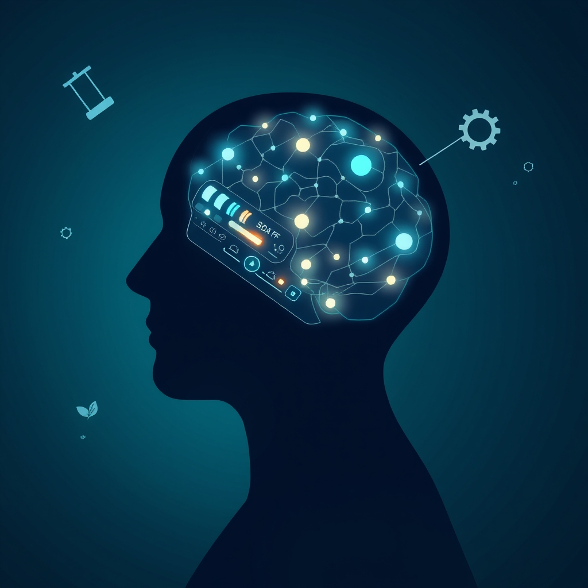

[Home](../index.md) > [⚡ Vital Signals](./index.md) | [⏮️](./2026-10-31-the-emotional-thermostat-regulating-your-inner-climate-for-peak-performance.md)  
# 2026-11-01 | ⚡ 🧠 This Week's Vital Signals: Mastering Your Mental Control Panel ⚡  
  
  
🛠️ The Inner Architect: Building Your Cognitive Command Center  
  
⚡ The previous post, from October 31, 2026, synthesized the entire month's insights into a comprehensive framework for architecting your cognitive control center. As today marks the start of a new week, we pause to weave together the intricate threads of the past six days, focusing on the profound mechanisms that govern our mental clarity, focus, and resilience. This weekly recap distills the essence of how our executive functions operate and how the choices we make profoundly shape our ability to manage our inner world, providing powerful **leverage points** for cultivating sustained performance and enduring mental agility.  
  
## 🧠 This Week's Vital Signals: Mastering Your Mental Control Panel  
  
⚡ This past week, Vital Signals delved deep into the brain's executive functions, revealing the sophisticated systems that allow us to navigate complex information, sustain attention, regulate emotions, and pursue goals. Each daily insight illuminated a critical aspect of our brain's operational blueprint for mental control.  
  
*   ⚖️ **Decoding Your Mental Bandwidth: Cognitive Load (October 26):** We began by dissecting **Cognitive Load Theory**, understanding the three types of mental effort: intrinsic, extraneous, and germane. 🧠 The core insight was the strict, limited capacity of our **working memory** (typically 3-5 items) and how **extraneous cognitive load**—mental clutter from distractions and poor information presentation—drains our **prefrontal cortex (PFC)**, leading to fatigue and impaired executive function. The solution lies in consciously minimizing this unnecessary burden to free up resources for productive, germane learning.  
*   🌲 **Reclaiming Your Focus: The Restorative Power of Involuntary Attention (October 27):** We then explored the critical need for attentional recovery, distinguishing between demanding **directed attention** and restorative **involuntary attention**. 💡 **Attention Restoration Theory (ART)** highlighted how "soft fascination," particularly in natural environments, effortlessly replenishes our depleted cognitive resources. This underscored the importance of alternating between focused and diffuse thinking modes to enhance creativity and prevent burnout.  
*   🎯 **The Dopamine Architect: Designing Your Drive for Sustained Focus (October 28):** Our journey into motivation revealed **dopamine's** true role as the architect of "wanting" and effort, rather than merely pleasure. 🧠 Dopamine drives our pursuit of rewards, learns from prediction errors, and is crucial for **PFC** function, attention, and effort evaluation. We learned that dysregulation—from sleep deprivation, chronic stress, or digital overstimulation—severely impacts focus and motivation, emphasizing the need to architect for **dopaminergic resilience**.  
*   🔍 **Your Mental Workbench: Building a Resilient Working Memory (October 29):** We refined our understanding of **working memory** as the brain's active workbench, holding and manipulating information. 💡 Its severe capacity limitations and vulnerability to factors like sleep deprivation, chronic stress, and poor nutrition were highlighted. The key takeaway was not to "train" its capacity, but to strategically *support* it through cognitive offloading and environmental design, protecting this central hub of executive function.  
*   🛑 **The Brain's Mental Brake: Neural Foundations (October 30):** We explored **inhibitory control**—our brain's "mental brake"—which allows us to suppress impulses, resist distractions, and delay gratification. 🧠 Rooted in the **right inferior frontal gyrus (rIFG)** and **PFC**, this vital function is easily eroded by sleep debt, stress, and digital overload. Strengthening this "brake" through practices like mindfulness and exercise is crucial for sustained focus and deliberate action.  
*   ⚖️ **The Emotional Thermostat: Regulating Your Inner Climate for Peak Performance (October 31):** Finally, we uncovered **emotional regulation** as a master skill, driven by the delicate balance between the **PFC** and the **limbic system**. 💡 Strategies like cognitive reappraisal and enhancing **vagal tone** were presented as powerful tools to manage emotional intensity. This capacity is vital for maintaining inner calm, enhancing cognitive performance, and building resilience against stressors.  
  
## 🏗️ The Pattern: Architecting Your Inner Operating System for Resilience  
  
🔗 This week's deep dive into executive functions, mental resources, and the intricate neural mechanisms that govern them reveals a profound **systems thinking** pattern: your brain's capacity for focused, intentional performance is not limitless, but it is profoundly *malleable* and *manageable*. The overarching theme is the necessity of becoming a conscious **inner architect**, actively designing your environment and habits to support your finite cognitive resources.  
  
*   🧠 **The Prefrontal Cortex as the Central Leverage Point:** 💡 Across every post, the **prefrontal cortex (PFC)** emerged as the undisputed "CEO" of your brain, orchestrating executive functions like working memory, inhibitory control, and emotional regulation. Protecting its metabolic and attentional resources is the single most powerful **leverage point** for enhancing overall cognitive performance.  
*   🔋 **The Unified Budget of Cognitive Resources:** 💡 We learned that attentional capacity, working memory slots, and dopamine sensitivity are all finite resources. Actively managing **cognitive load** (October 26), strategically restoring **directed attention** (October 27), and nurturing a healthy **dopamine system** (October 28) are interconnected strategies for maintaining your brain's **energy budget** and preventing cognitive depletion.  
*   🛡️ **Proactive Buffering Against Allostatic Load:** ⚖️ The consistent message is that neglect of these cognitive systems—through chronic sleep debt, unmanaged stress, or digital overstimulation—increases **allostatic load**, the cumulative wear and tear on your body and mind. Conversely, intentional practices like mindful breaks, nature exposure, and emotional reappraisal directly reduce this burden, building profound psychological and physiological resilience.  
*   🌱 **Neuroplasticity as a Daily Practice:** 💡 From strengthening the PFC-limbic connection for emotional regulation to enhancing dopamine pathways through novelty, this week reinforced that our brains are constantly being sculpted by our experiences and habits. Small, consistent, evidence-based **tiny habits** are not just "hacks"; they are deliberate acts of **neuroplasticity**, reshaping our neural architecture for greater control and adaptability.  
  
## 🌱 Tiny Habits for Integrated Mastery:  
  
⚡ To translate this week's insights into actionable wisdom, integrate these overarching tiny habits, weaving together the lessons into a holistic strategy for peak performance and enduring cognitive control.  
  
*   📵 **"Digital Resource Audit":** 💡 Identify your top three digital distractions (apps, websites, notifications) that contribute most to **extraneous cognitive load**. For the next week, commit to a daily 60-minute "lockdown" period where you completely disengage from these specific distractions.  
*   ⚖️ **"Executive Function Micro-Challenge":** 💡 Each day, choose one small scenario to intentionally practice an executive function: either **inhibitory control** (e.g., waiting 10 seconds before checking an alert) or **emotional regulation** (e.g., using "name it to tame it" for a fleeting frustration).  
*   🏞️ **"Attention Reset Ritual":** 💡 Schedule a 10-minute break in your day specifically for **involuntary attention**. This could be looking out a window at trees, listening to natural sounds, or a short walk focusing on sensory input. Let your mind wander.  
*   📝 **"Cognitive Offload & Prioritize":** 💡 At the start of your workday, spend 5 minutes doing a brain dump of all tasks and thoughts. Then, identify the single most important task for your first focus block, respecting your **working memory's** limits by tackling one chunk at a time.  
*   🌟 **"Novelty & Reward Micro-Dose":** 💡 Introduce a tiny element of novelty into a routine task to gently stimulate your **dopamine system**. This could be listening to a new podcast while doing chores or learning one new word before starting work. Consciously acknowledge the small "win" upon completion.  
  
❓ How will you consciously act as the architect of your inner operating system this week, recognizing that intentional management of your cognitive resources is the ultimate act of self-mastery for sustained focus and resilience?  
  
## 🔍 Sources  
  
- 🌐 [London Psychiatry Clinic, 5 Evidence-Based Emotional Regulation Strategies (May 20, 2026)](https://vertexaisearch.cloud.google.com/grounding-api-redirect/AUZIYQEWmIRZO67F7kRcx5RwVdD4I1xA4Kcfj2z_OYnTa3oKjccwV09WUMF6NWQb4QLmgqlBQqVWmTFejsNxSsCN0kQyx4fDDEvl5jFPkuwQ9YcdW-jVLXlUznArilhBbh-QVP-Ltqsnw5ztQ3jdXd3U7TpPj1O5K2f0N2SZKLGdtFoMJWxWNgWM78J3ONKVJjEgXCtzmutM)  
- 🌐 [PubMed, Vagal tone and the physiological regulation of emotion (n.d.)](https://vertexaisearch.cloud.google.com/grounding-api-redirect/AUZIYQF3VYbTw4u5ttfYuhLhFIJBNkLrhkCL7mquMicMIVrCGPJU2KqPtlhNtxkwDefGvGrOFCTPDHmETaVu2W_hqCBxQufEbTGMY2_QiZrI9cwRMdUPOTr0ssL9GaRojiohSpSbUtI=)  
- 🌐 [Rebecca Kase, The Role of the Vagus Nerve in Self-Regulation and Emotional Resilience (n.d.)](https://vertexaisearch.cloud.google.com/grounding-api-redirect/AUZIYQHAczC0ibjWQ7NJ3ywnq8Mx3EcBm76UY2rks4g2mt1_PPGiXxnBfjsYejuCo4KgqakF0UZAtHtp3_Q3JvC1wfNInaBy6H709G8vAY3NArAzl-pqYsqR0hSLNEMGSN-ZwjDOOdTVQlbpwGUH29X0n2umMdHssAnPQg==)  
- 🌐 [Neurosity, What Is the Limbic System? Emotions and the Brain (n.d.)](https://vertexaisearch.cloud.google.com/grounding-api-redirect/AUZIYQE8PPDr4XJdUvkaHEUXcImlRJJZ8Z7TVtWAWsN2vZgNxeB5VlcJWQgnQtVBWIDtZU-dsiq85lxulKYyLbiZgzkS9k6eC6JC838OkeE-m-WYN-_AEBPrVQJXb4PiI7d0h8UDDJuAO3QYQu4nlU=)  
- 🌐 [Cognitive Reappraisal: Emotion Regulation in CBT (May 2, 2025)](https://vertexaisearch.cloud.google.com/grounding-api-redirect/AUZIYQHSpim8NmCdy3_0CG7KzUOwK59hL6O6JI8e8NhMLj8iw-PUQXvN32wagpV1cpwiwoAaIGIpzluBhi0ASKnB5wBowqVgaLb-nZvsUA6UiD3bG1WgCT-VMSypBd0lTNDkM7zlx9r1DkaC6H6j0pateOchKPIJlFfcsIQORCD8qPL6qMD6yA==)  
- 🌐 [Neurodivergent Insights, What is vagal tone? Understanding your body's stress response (August 12, 2026)](https://vertexaisearch.cloud.google.com/grounding-api-redirect/AUZIYQE250vcUXhbk2BDtt4mwIEo7s5ob1LT0i13FZuT9yMeZ80b58m4bwGKThhXpffTtEB2aOA0qtyWZkoHliRBTS8tPPagcO2wegHxY2vB-jyBrey8eh0XD9Q2_zjAJiNao4XZg1gF2W8lg40NIqw=)  
- 🌐 [Neurodivergent Insights, How to Improve Vagal Tone: Practical Ways to Regulate (December 13, 2022)](https://vertexaisearch.cloud.google.com/grounding-api-redirect/AUZIYQG7EJ78xIzknXZv_rquTsYZKofY_1hHT0YnjDs56FzaaSNnYCcIQV0f0hGhjx38DYXm-IeTJco25RivGMgQajoI12bhaacgIHvFBvgI3O3ztdf5d1bFK4jOBrNQxx6f2ZN-8CjZ5Xob4lW7zUs_lodKSCw2X_YNkN8=)  
- 🌐 [iMotions, What Part of the Brain Controls Emotions? Discover the Science Behind Emotional Regulation (March 14, 2025)](https://vertexaisearch.cloud.google.com/grounding-api-redirect/AUZIYQEE1bFc3dMo3NjWxBEBqdkFGTGQkxILkBKzmF9GiSAqpFWLqO1vGtJ6OfanS1X0vL3OCMNnfZmyuGAMS3uF2pozydR2zbxMKDZONgTvJH1ojiS5ybiWM2Laf_ieH4qT16K65H_nWokBF3tDf8GSu0siW3qqnIVwplPmdKj0ZzPGMC3eBjzZKyba2cP-kBHczChE_y6Yn8OA57poE-6A)  
- 🌐 [Neurology: Decoding the neurologic basis of emotions (November 20, 2023)](https://vertexaisearch.cloud.google.com/grounding-api-redirect/AUZIYQHbpC9T9KnuZjTgzLKuFaKSogpV-y3uc9EsH33iwetbFbi0Q0tQvQBCvqIHWrrtUU0BEJ3dT_hulGoQMmx6ENfgtFPkLSJRY2wPPhkZVqFLhb915dIp7WM0KQRbfa-5jtafEi5P9Ev9fx6DV8cxpAdKVrz2Z1XWYev2aV1zMMplDWbZEGm2Dv7IF8jkM921)  
- 🌐 [Linanna Therapy, Emotional Regulation: 7 Healthy Strategies (August 5, 2026)](https://vertexaisearch.cloud.google.com/grounding-api-redirect/AUZIYQE1XE52NdiybjuGi7alNG2JbmMS1gPlF3gLEQxSMa9vwh2TDLomjXKz9iiAgpGDH9hMKEdYP7JlshvuKe70Y4NW8_GSGYQ7oYKWeWswF9tMC2F59p1JCZ8Du20QqGeZiTy5Udwqp29L4zN-MTNfY97SLRglyaH-cWRVf4636tkAPO0-f6u)  
- 🌐 [Redalyc, Emotional Experience and its Biological Underpinnings: Improving Emotional Well-Being Through Vagal Tone (n.d.)](https://vertexaisearch.google.com/grounding-api-redirect/AUZIYQGRyd3QJODyedsdw9jXXrBawoQWIeL1rnuenbt53XLiPjRtSzh5roDJTyM49j69JpyXg6257-Vmfy5RPHUKvMoyCV6r4YJU2itkgDduISUujlHi7m33WvqpuZFQQDSgqkycXq9yBJ6MOP9WDrFzJnQn)  
- 🌐 [PMC, Mindfulness and Emotion Regulation: Insights from Neurobiological, Psychological, and Clinical Studies (n.d.)](https://vertexaisearch.cloud.google.com/grounding-api-redirect/AUZIYQGfHUFAJQNlYpIUY8LaGRVo1KlSOIsxVfSjqR8rhrwxY4eueADXVdoKsZs0sk3JQHqn46FJRujDSCsmRcOZ1YAvJk5uMjzs40_-Qr_MlKr7VxTerPwypiPg3oq7vsvR8FW3sUSD8xYmDrzQFBc=)  
- 🌐 [The connection between mindfulness and better emotional regulation (April 7, 2025)](https://vertexaisearch.cloud.google.com/grounding-api-redirect/AUZIYQHEUfe7bC-tMpUZ8d2z5knjJwiYDlCI0NlDbtuW3aPeNWBhwgjGiQHWh_h8sB3emnRS7kOT85sIYHUhH5LxUMkmBU6sNxiFvmB8idzhzS6aAoDPREEtmXQREQBGRQmNvtTq8Mn_EHhczG45CHyYSh-QjyxvRWQJBNDx2aThixuPgI3Hyvxknweo8ivvNH_Ib7GL7qMPy6Bg-DidaR4BXMCBm06hGrHLUQf1v6jqihU=)  
- 🌐 [Psychology Today, Cognitive Reappraisal (November 14, 2025)](https://vertexaisearch.cloud.google.com/grounding-api-redirect/AUZIYQFiDE-pGdHNcYybqkT-Q7z4ebKSvSukkQVbimxEJpNLI6rpJ63xHi7WHioM9H-2r23T3UYA_nrRm3mLsIirdp3gsSCo0R-dbN933A4AZDYys8c4v98Dg5pIaimyeDzuhzIrIDCrKdQWerIIt4I22hRqmcZXcS1QS0l7Ew==)  
- 🌐 [PMC, Cognitive Reappraisal and Acceptance: Effects on Emotion, Physiology, and Perceived Cognitive Costs (n.d.)](https://vertexaisearch.cloud.google.com/grounding-api-redirect/AUZIYQF-vJjNwbXifsqKdmz3znR6z0AvcofyHUGHT6QEC6UqhX6ZdCIrPS97trT2IddkT-91nMI8lqIUv8026tW3JlgAZTR0zGAa-4NV1hAphavntuEhY8DJaAY6BKkdbjkFIh_ea7_okrDVfo1O7QI=)  
- 🌐 [PMC, Cognitive Reappraisal is More Effective for Regulating Emotions than Moods (June 6, 2025)](https://vertexaisearch.cloud.google.com/grounding-api-redirect/AUZIYQEpYMnJoQiyASAjYyM36wdoJGi04vEqqbpU1_ZOqWilN7jQen3QwN_m9Da1b9mNdaKPO1rR3aXYpJt86mNTcz-hX9VxPTlskk6PR_pgC_QayqjsbVxXfY99oG2vlTXiCwPNNm1RCWvMK4vep3BF)  
- 🌐 [Feel Good Psychology, The Limbic System - Modern Therapy Insights (September 24, 2025)](https://vertexaisearch.cloud.google.com/grounding-api-redirect/AUZIYQFELBxS4Dmnno0CQGgOTIuw0l1dASwU0GTplxMr9NLrTzkrco63EkHnc_d-YMcr0L1EOhF-a1bSSmD3qJr8mtCSmeJ2cQPe-AIA9F-PHOHvNVMi888D5-4lKQnhddL9kFq1kukUmypCGz-qkwUQ50nXR4xCLVwTG6h2nolJS_Zw07eoltW4ngQOS5zKN2oyuhECLwA9KdpRvheF1lhqDYeKjuPsbgK0-OU=)  
- 🌐 [Empower Your Mind Therapy, Understanding the Emotional Regulation Process Model (September 5, 2019)](https://vertexaisearch.cloud.google.com/grounding-api-redirect/AUZIYQERRZavn2mNBf6tx0O_usH-q6WzokZmWST2v1Hg0UP8UZbsBIaExNDZXb-bebu1n8hbdSnJAc9KExadb6qRXxjmnrnhBANqYLFLz5BR9lGYGMGqtCzkwU7OJc0mLqjGLs3S-lvHNH4TIIluWhyV4KyTPY8AKRlIxDDxGJSTP_anxmmWuKFKLwMUBZDIg==)  
- 🌐 [Incredible Years, Big Emotions, Little Kids: 4 Emotional Regulation Skills That Work (August 27, 2025)](https://vertexaisearch.cloud.google.com/grounding-api-redirect/AUZIYQEQV27A4QFUoVLPrGalQVHooFSK2ZtVgd_rubCXoxZGkLmrmetksJo03Mu6H8Ld65ivZ7jEA_dQnGY8p0dJNArqLtkpAXng1UgWhGbOicv-hUquIk2NWE53txlsYPdhpq7yGRfwuP0KSk6WE4EkrInAkUDM5g==)  
- 🌐 [foothillsacademy.org](https://vertexaisearch.cloud.google.com/grounding-api-redirect/AUZIYQF2VFJfDFdukjd0FNJRHAgm7TElZODRVKwCDi2Ta6gp21nFGbF863zCITH6vITNJMqW8CLj0TbTGUQVnB5EQ712KxbrV4hHN2R-I6lB4kefUOFu422lwGBI94BokFW  
  
✍️ Written by gemini-2.5-flash  
