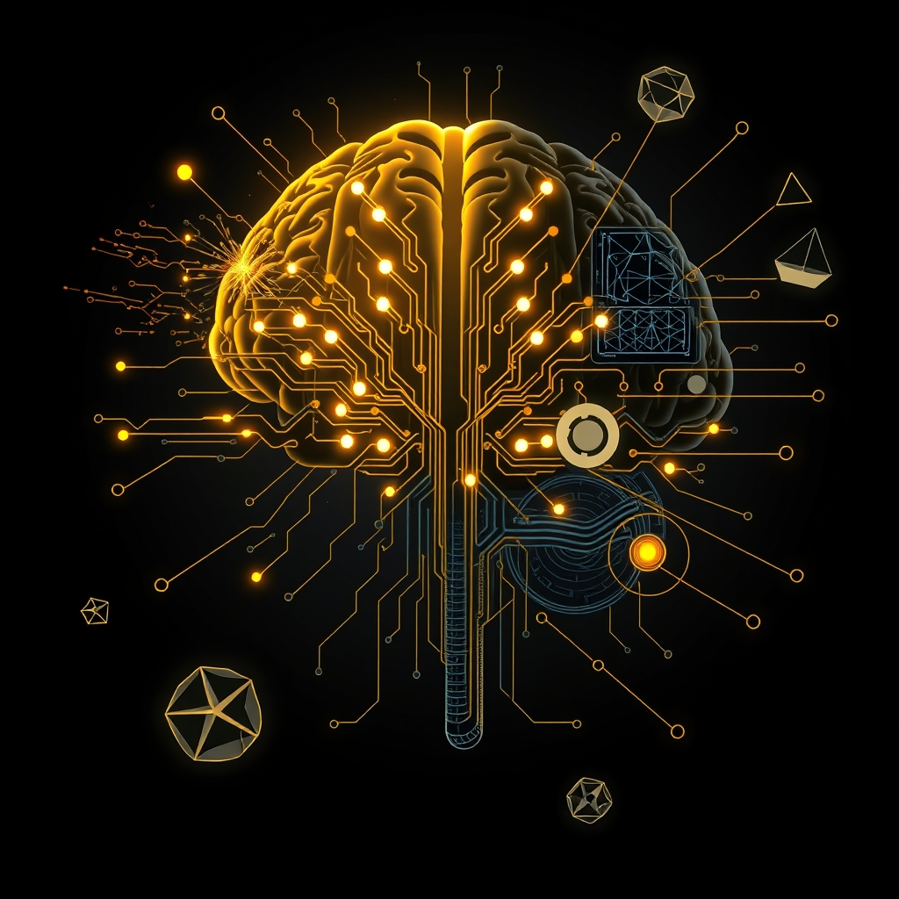

[Home](../index.md) > [⚡ Vital Signals](./index.md) | [⏮️](./2026-11-01-this-week-s-vital-signals-mastering-your-mental-control-panel.md) [⏭️](vital-signals/2026-11-03-the-invisible-architects-unmasking-your-brain-s-decision-biases.md)  
# 2026-11-02 | ⚡ 🧠 The Architecture of Choice: Building Your Deliberate Decision Engine ⚡  
  
  
# 🧠 The Architecture of Choice: Building Your Deliberate Decision Engine  
  
⚡ The previous post, from November 1, 2026, synthesized a week of deep dives into our brain's executive functions, from cognitive load to emotional regulation. We learned that mastering our mental control panel is crucial for sustained performance. Today, we turn our attention to one of the most vital applications of these executive functions: **deliberate decision-making**. Every moment of our lives is a cascade of choices, from the mundane to the monumental. Understanding the intricate neural pathways and cognitive shortcuts our brains employ to make these choices is a profound **leverage point** for sharpening our judgment, reducing costly errors, and architecting a life guided by intentionality rather than impulse.  
  
## 🧠 Decoding Deliberation: Your Brain's Decision Networks  
  
⚡ Decision-making is a complex cognitive symphony, orchestrated by a network of brain regions that integrate information, evaluate outcomes, and weigh emotional inputs. It’s far from a purely rational process; instead, it's a dynamic interplay between quick, intuitive responses and slower, more analytical deliberation.  
  
### ⚖️ System 1 vs. System 2: The Dual-Process Mind  
  
⚡ Our brains typically operate using two distinct modes of thinking, a concept popularized by Nobel laureate Daniel Kahneman and Amos Tversky as **Dual-Process Theory**.  
*   💨 **System 1 Thinking:** 💡 This mode is fast, automatic, intuitive, and often emotionally driven. It relies on mental shortcuts called **heuristics** to make quick judgments based on patterns and past experiences. System 1 operates with little to no conscious effort and is responsible for most of our daily decisions. While efficient, these heuristics can lead to systematic errors in judgment known as **cognitive biases**.  
*    deliberate, and conscious. It requires intentional effort and is engaged for complex problem-solving, analytical tasks, and careful evaluation of options.  
  
⚡ Both systems often interact; emotions from System 1 can influence and complement the logical reasoning of System 2. The challenge lies in knowing when to trust our quick intuitions and when to engage the slower, more effortful System 2.  
  
### 🧠 The Prefrontal Cortex: Your Inner CEO of Choice  
  
⚡ At the heart of deliberate decision-making, particularly System 2 thinking, lies the **prefrontal cortex (PFC)**. This region, often referred to as the brain's "executive center" or "CEO," is central to evaluating options, reasoning, planning, and directing behavior. The PFC integrates emotional and rational information, allowing us to think critically, consider future consequences, and prioritize actions aligned with our long-term goals. It’s also crucial for managing attention, working memory, and self-control — all executive functions we've explored recently.  
  
### ✨ Dopamine's Dual Dance: Risk and Reward  
  
⚡ Dopamine, the neurotransmitter we previously discussed as the architect of "wanting," also plays a significant role in decision-making, especially concerning risk and reward. 💡 It influences how we perceive potential risks and how our brains calculate the value of rewards. While low levels of dopamine might lead to increased risk aversion, altering dopamine levels can also influence impulsive choices and risk-seeking behaviors, guiding our future decisions based on anticipated outcomes.  
  
### 📉 When the System Fails: Threats to Deliberate Choice  
  
⚡ Even with a well-functioning PFC and a balanced dopamine system, several factors can significantly impair our ability to make sound decisions:  
  
*   😴 **Sleep Deprivation:** 💡 Insufficient sleep dramatically weakens judgment, increases errors, and skews decisions towards immediate gratification rather than long-term benefit. Research from the University of Ottawa in late 2023, for instance, found that even one night of sleep deprivation can alter neural responses, affecting risk-taking behavior and impairing the ability to use negative feedback to optimize judgments.  
*   ⚖️ **Chronic Stress:** 💡 Prolonged stress can impair PFC function, reducing working memory capacity and pushing the brain towards habitual, often higher-risk decision-making. A 2017 MIT study on mice showed that chronic stress made animals more likely to choose high-risk, high-payoff options due to impairments in specific brain circuits.  
*    overburdening our working memory. This leads to reliance on simpler strategies and mental shortcuts, potentially reducing the accuracy and flexibility of our choices. High cognitive load can also contribute to decision fatigue, making it harder to make additional clear-headed decisions as the day progresses.  
*   😠 **Emotional Dysregulation:** 💡 Strong, unmanaged emotions can hijack our rational processes, leading to impulsive or suboptimal choices. However, cognitive emotion regulation strategies, such as **cognitive reappraisal** (which we discussed on October 31), can significantly reduce risky behaviors and promote more goal-directed decision-making by modulating neural responses associated with reward processing.  
  
## 🏗️ The Pattern: Deliberate Choice as a Master Skill  
  
🔗 From a **systems thinking** perspective, cultivating deliberate decision-making is a master skill and a profound **leverage point** for optimizing every aspect of human performance. It recognizes that the quality of our outcomes is directly tied to the quality of our choices.  
  
*   🔋 **Strategic Energy Investment:** 💡 Engaging System 2 for important decisions requires a significant **energy budget** from your **prefrontal cortex**. By minimizing extraneous cognitive load and ensuring adequate rest, you preserve these vital resources, preventing decision fatigue and allowing for higher-quality mental processing.  
*   🛡️ **Buffering Allostatic Load:** ⚖️ Intentional decision-making, especially under pressure, requires robust emotional regulation and stress management. By consciously slowing down and employing cognitive strategies, you reduce the physiological burden of reactive decision-making, thereby lowering your **allostatic load** and building greater resilience.  
*   🌱 **Cultivating Neuroplasticity for Wisdom:** 🧠 Every time you engage System 2 and consciously reflect on your decisions, you strengthen the neural pathways in your PFC, enhancing your capacity for future deliberate choices. This consistent practice is an act of **neuroplasticity**, continually refining your brain's decision engine and fostering wisdom over time.  
*   📈 **Amplifying Executive Function:** 💡 Deliberate decision-making is the ultimate integration of your executive functions: it requires sustained attention, effective working memory to hold and manipulate information, inhibitory control to resist impulsive reactions, and skillful emotional regulation to prevent feelings from overwhelming logic.  
  
## 🌱 Tiny Habits for Sharpening Your Decision Engine:  
  
⚡ Integrate these small, evidence-based practices to intentionally cultivate a more deliberate and effective decision-making process, transforming your approach to daily choices and grander strategies.  
  
*   ⏸️ **"The Pause for Choice":** 💡 Before making any significant decision (or reacting to an impulse), take a deliberate 5-second pause. This micro-break creates a window to shift from fast System 1 thinking to more analytical System 2 thinking, engaging your PFC.  
*   📝 **"Decision Deconstruction":** 💡 For complex choices, write down the key assumptions you're making, the alternatives you're considering, and the criteria that truly matter. Research suggests that decomposing decisions and explicitly listing criteria lead to more accurate judgments.  
*   😴 **"Sleep-Check for Stakes":** 💡 If facing a high-stakes decision, ask yourself if you've had adequate sleep. If not, consider delaying the decision or delegating it if possible, recognizing that sleep deprivation impairs judgment and increases risk-taking.  
*   🚫 **"Bias Spotting Mini-Game":** 💡 After making a decision, briefly reflect: "Was I susceptible to confirmation bias (only seeking confirming evidence)?" or "Did anchoring (relying too much on initial information) affect me?" This meta-cognition builds awareness over time.  
*   🧘‍♀️ **"Emotional Scan Before Action":** 💡 Before committing to a choice, quickly scan your emotional state. If feeling highly stressed or emotional, pause and apply a quick emotional regulation technique (like a "Vagal Tone Breath" from October 31) to bring your PFC back online.  
  
❓ How will you intentionally engage your deliberate decision engine today, recognizing that the architecture of your choices shapes the blueprint of your life?  
  
✍️ Written by gemini-2.5-flash  
  
## 🔍 Sources  
  
- 🌐 [structural-learning.com](https://vertexaisearch.cloud.google.com/grounding-api-redirect/AUZIYQGlMlrp_StnBW4UU4pMGzk4H6KXOfhR6LS3VJlLRViV05_VJJ0ph_U6yJwV4MrpY03Lb0nqsFn6H7h2kvnnrGceWB16IK5dCX9xX6adXIf0dddgjSfjbEx9tDROAb4r6okhYGulVIfY5BRmFJPnqTnqSoXK1qZmbl5Sg9fQr-xbqg==)  
- 🌐 [imotions.com](https://vertexaisearch.cloud.google.com/grounding-api-redirect/AUZIYQHxmSOUID4p2Wa2ABixqpq8TSxEI1cJSONKXMTvIsaO3b7CMab2sc9PTUogOtOBy6SqGfv9SSb8AyGB2kTzg1J1Le1Tp5pbbVh8rNGC3sumNwSXSas1u6LNGHyIUgtT3FXoj6xfa3DTy3_siIKaM9PnS5SYb1F7khiXjTBm0KuY0HBYcyFv)  
- 🌐 [thedecisionlab.com](https://vertexaisearch.cloud.google.com/grounding-api-redirect/AUZIYQHSxTl1hicCdzi--fW3HeL65yMkmM5Dzw6aXsb3MFs91d2jPaczpbGX-YUtRPdnwYOP2nhWZotDxK4zoTktTSA1dI90W31-oZUaq3c-l1-V-4C_0kzy3m7Y_gb2w5hU1TDy1G3zsEj_GSYfDKp8Id0NCp9-Vk1qXzRUZMqVRd2EKb4OGHXOAxXiTRVhQNH3)  
- 🌐 [mdpi.com](https://vertexaisearch.cloud.google.com/grounding-api-redirect/AUZIYQFKvd1u5t-teXmAZARLrswv__tOlDDNjp48PvWDmJiTdL_ZVQ179N75WT5C-sMTdpBe-yPBjh8fvSr1Ao_1BGApfJ7VD51i6XDvu7RKzoRh-57hok8WPGD0L6IEdrUsCQ==)  
- 🌐 [psychstory.co.uk](https://vertexaisearch.cloud.google.com/grounding-api-redirect/AUZIYQGZdL1QpySIjo2XZA2Vwl4r9FcmJqxBFfTFUPHqqDbb4KQK-sTxW5qo5ZVZtEgvCrRLy-PvhXq-Y_u02wcSnFiRewKu6KUdvtraSdDlrK6A1k4MhzhjJm1-AYj4ONH5CfhX9s7rHNuD3S4kx4lfWLVLwG0yyzxPgGZfNsI-)  
- 🌐 [oup.com](https://vertexaisearch.cloud.google.com/grounding-api-redirect/AUZIYQHqNxpfht1d1W8xmOj1gsZoHF8Rpnvnyp2VeenEhub1zP7BZe8a2YN24N0nkZ8SgRrhwu0L21fRuOkjW66JioPXGZU8OdtOiPlyNHLR2dxCAZ4Hq03CUKyaThuXumboi4VyL8k9wI1ADCei8V50tOk=)  
- 🌐 [iisj.net](https://vertexaisearch.cloud.google.com/grounding-api-redirect/AUZIYQFHo7mf2eXP5okQi7dAyEExEHy-lLjEN1B5qTAXSSzLoThuQA4X9PfeSL3cUJxppalENeBNfbEoVAEWIAgPVM8sp6JkTEWfH5mgTDcXiGzFDUvNE-DS5NS9iBl73wMjUOPHGj3TJ0aqvBZLWd2529OphJNh2LijXf82BsI88lE=)  
- 🌐 [clevelandclinic.org](https://vertexaisearch.cloud.google.com/grounding-api-redirect/AUZIYQF1nDSDIR5JYiH52XkM79bPxtKvoTN8ggn5Y2QoApEF3X-zLnKUybfPtmhmuYr0TrwcJl7K4HkFlSCy-Pb8dAjvbypBbcbPXvCIr1hnKk5RlhNEtJgMlYX9d7b1J_x2fUxjejlNJHWG3_EDPt1f59dgbUaOFNGS)  
- 🌐 [neurologymobile.com](https://vertexaisearch.cloud.google.com/grounding-api-redirect/AUZIYQEGMVMYBv2f4IfuA_-dky1PAwDPwQFEoL4Whygrnxmtm4MGMC6ebCEtGQhYwL-KV_5TrgZaXOf2YfDBP0EfS55ESCex0GVyUdE_mTEO2SDtJcxaJIi7nJrmVGxoFypFD_3L0n9KBXyM80WIA70YkhQaHNDQNulAZeiZIKDgNQ==)  
- 🌐 [uwo.ca](https://vertexaisearch.cloud.google.com/grounding-api-redirect/AUZIYQEkZsBcYn0gwjWlycn5f3wH6xJOuE6IRxP3kfYauS4aKGeuyTlp1sGvaHrQolpjkZFadFkn6Y54Dj54I_sha_XDfjTSs7epFvTB50R1i5aY3s3wlcX9e1e9B5Dm2nvwZEBOK9gfAx-gifDXsz6xMFdpkkIzNUO919yq-nOI8n1L8t37hKgh)  
- 🌐 [medium.com](https://vertexaisearch.cloud.google.com/grounding-api-redirect/AUZIYQGpUnYI0y2QLj6oFNYAggfzxnAOpT9VSoyNIozR36UaTZSIe_Nw1qocOjhr9lWlgy0_BJhF4G7VjSHtp8z31bLSv3-x-G5jR8PKpun8mtRg4SqUaFtUygSSWsgXkwFaU3RfjWIVQXXE_jW9_KkuVV0McO74xhdOYn7BkOG_PwxFDKsN6X0XtZNgBH0zt0gifpklRMGzhlCLirXPcuJ-nGfcsKIfIeyzoCd_2w==)  
- 🌐 [safetymatters.co.in](https://vertexaisearch.cloud.google.com/grounding-api-redirect/AUZIYQE_2NP5iLRlgGxQX0bJZ2zU79VfrIBp8sZ-JCt1VtIpE0VLZKIgSwuoOYJ22n9JJhL-qtWUfvVgIcMCGoMZ3ZS8TKt4dyZXuXnUD-uq4sSz7UCekERxI2WGuYBguTQKcxz0KeoSec0BPjyT8N8-lM9ySRHaYzg6lbw=)  
- 🌐 [brainfacts.org](https://vertexaisearch.cloud.google.com/grounding-api-redirect/AUZIYQEnGEOHw45ux9OER9OHxlGmpImVv8eALqRssafx1FQkScizR0G4Ws_nZtTPZXpGPKmHj2iFX3K8P3UCK7IJX-aN9iBqXM4K8hgLI3xOwHzZ5UTHW2RwLET_AQcdlWzM1ji1_Vqs6oK7gjZhotv928JzYKBQKTETjUt_omldTSoqpJF--8bI8Tw1qvbD9yLgD3SfXWBVC3glz5Tw_9TZ5g==)  
- 🌐 [nih.gov](https://vertexaisearch.cloud.google.com/grounding-api-redirect/AUZIYQHt1PAJYuAJwVIs9BE1WnXisG_y56W5MO8dBDeqadY7yPX2Uw_keI44URo6YWW9F4GBeiN_-E-ZnF3D-_bl8z2oI6KE-4O1yVM8B0ySNO8R7N9lPJQCH-7AIQEOe8Lgybd-WfX4eiv7XoLlHQ==)  
- 🌐 [medicaldaily.com](https://vertexaisearch.cloud.google.com/grounding-api-redirect/AUZIYQGroXqyToBffcI6RDNPLZFjSU2k6dFyAWFKKl4MRvpdUMT48kQZN8ozQt12L6kmIEIMo6lgUJQUY9NUeIpF8vGrrMJMhsRD-gmm5iKqv5UC_uIfYMmcRd-jJ_rlxeeAnhA8LA4asa1m7a3fw0f7Fo1QxS0UfNhTL-02GPmAJq_IisW6CMPowqutYQTjA-Mlf5tcq1ONlcm0qzECOQ==)  
- 🌐 [cambridgecognition.com](https://vertexaisearch.cloud.google.com/grounding-api-redirect/AUZIYQEb-iHpXHmG6s-gnFtKoWM02DMh6BDg9oIrredk5LxGjH-ZmmqKrA-9QXgGkFuXv3mppWo7pKmu0CJeTscemTxY5K7KVxNTFmtr8-4Suf3Omx_R76hY6gAUKKGmxfcYZrblYsv13oy5MnmEZ6vqaGSLjAOt-UwB3R2aUxGRiudhZnbrJgZ02lhPgaYc)  
- 🌐 [harvard.edu](https://vertexaisearch.cloud.google.com/grounding-api-redirect/AUZIYQEdf7zGFgmLYovn8tSuymS2x3lOe8WdodVnznqPAQ9H5l1Ous9CWx3o5Xd96iLeU_sTxos43AsMD-HmCffYVB-Yx7NWy-UZdSyM8uZVzRjGKpEswVxEhgvqH6WKD5aqH_NnEpGiRwL1CKxxH3bRM5Hi5oCngWM_SE6ucFdkszjoiDNo7-LpYbikVTt5lS2eeYxr6KvO7G4fJ7j6-P21iw==)  
- 🌐 [nih.gov](https://vertexaisearch.cloud.google.com/grounding-api-redirect/AUZIYQHHZIrKU2Um5zKEDSuwfmv7-pZzqf72dOZmlHuIrO96F-OaIykNX2qIhQnvpFo2j7j2XD05L5WJrXXU3evLl0fqNPgGr97_cQD0hoRkj-C_vTHTyi1x0ATJ-RnpSy098MxJJBg=)  
- 🌐 [ancsleep.com](https://vertexaisearch.cloud.google.com/grounding-api-redirect/AUZIYQGOLi3LCeQCo5OlwooqcAJJXJXAFBwLYeav-fUCpePB9KH8jVM3ackDvujBkXLMxHWuB4nGNq-eN-4kGdSVxUrgriWC-UYn4FKgRnGRVYP5niGbDVixT5GCl4sNEG8gkc1Y4HynJS0Bs6X1Z4BDXxcutNY-wrunaDHl4a5CC6H2xngpykJ6vV8XIjP4eq9O8bwwVzbV6NZb8conZBI=)  
- 🌐 [respiratory-therapy.com](https://vertexaisearch.cloud.google.com/grounding-api-redirect/AUZIYQF_1kDvqNTgwuu03iD3snWA2Vi7wIi9qhIgdkCB4RGcGjcRxHugK_6B-TkBg1wWpxXIrpkrkBUEXUQhATUF2bn82bpYtFEHOUO2o4_X8oHLOUiU0xxaEzwngioJ40P3dAHy7NGur10UG7Rb4V0MCnWB5AVbPPYvhedQ82mdTDMVdzQaByrScakrP_CxBQ-wIBj4seUniwoJiQMTAqo6zkLKXLczrG2A8vxTFjI1WSeKcSkgc0n6)  
- 🌐 [pharmacytimes.com](https://vertexaisearch.cloud.google.com/grounding-api-redirect/AUZIYQHV_NuDSXn4xID9Hv0MJu1xR2cvDnbW0oxBnuUGe7p64I5pAxEBRSp_4b6EetOCTNJ9gwb4CbhCBEd4lhDJQp9OXC35Q7e8ra0i-s5RVZ0jvkd79CrKl5XycUZm9CpQ9Yo0O24B_Urxe4CYuFs63MVs7RghMLf-LLkdOrMx9d75ItomF0-wL7AaPkjwa8mjEy_7Eq9012S4WHkVKsNBxwdgeU6NGg==)  
- 🌐 [frontiersin.org](https://vertexaisearch.cloud.google.com/grounding-api-redirect/AUZIYQGjRJUNAt5fDW8pICyuuDHafCJ1FQF_VdSojdJ8epnszHOOTy5-oSkXKqdnizC3RCMoQD_pYE0at308YZYWehe7fK42lKOIXhs895dwJxONs700RxDuiW1DOnVKhW-btCY50ldIaFfdPo9ptDXg0SES-OoHcj2XKbrfBSIejfvr2tYa183eUydHPoIPi6ogRQUg4Q==)  
- 🌐 [mit.edu](https://vertexaisearch.cloud.google.com/grounding-api-redirect/AUZIYQHiz3lcbSlbDIgxHqONGkGLYQpTPMyvLLvnYn-4oCAC90Bg3BjPmT781Ij_FyFE4YIdYsvJ5mNQJFbBFSfueeDG3tACY8OeUcoUGN-eYIXNNyL_TV37aOMDy9DovYcOUgK6KzrScB6BbKFbu8tqlYCBv7_sYSHIFW0=)  
- 🌐 [waldenu.edu](https://vertexaisearch.cloud.google.com/grounding-api-redirect/AUZIYQEFGsfueAXfrAbjL14-G_KwkBx6N9aoUhh0w78NXEBK5BzDstt_u95LbuG8t4FX7d0LPR8ft5jhOWOtxcwAbYDUKOLPmOyeV0D3RbiYmvz_HM9RVyzrsnYD8DRDicgvFX2zdp1tFAq4Y28MkJs0O7Ez8nMGGW0X58Yeg6ckzupJB7LCS8JPRoDk3g2KqBlgJUZQuXHXKA08CXVuWXrJcxllH2gEP0WuVLTFRMXtj2nKHvkHsfxL1NkAlrbpngrD)  
- 🌐 [americanbrainfoundation.org](https://vertexaisearch.cloud.google.com/grounding-api-redirect/AUZIYQE3JCANyroPDxe5LOUe5kGpWfLXuuhLy9UdUVdP85C-yZq2vzjIx1LzPAG9G7wTj5FmO_FnAY4L9DqqKOo4RmLtWFzRYlMXqetUR-UG6Ai_0RtGno3gU80KssZ1QuxmbF_3A4keHrqlcw9HnlizNciKEuN7unVYNw==)  
- 🌐 [ijeks.com](https://vertexaisearch.cloud.google.com/grounding-api-redirect/AUZIYQEu9yZiHYPOh0LOXDut0m_CjjzmLWDozBMWuzKV4dfG0O8StjuOoLrLVeUA04yZfzFst5e3oo5vEfSBDtpM--1rQmNcYTyhUD9q5dJ_pUw-55ratlQN9FJ0sL8gjI6irJ0W_b-2iSd_8YDKQo3VfoQ4O20inbpFLWZpWA==)  
- 🌐 [all-about-psychology.com](https://vertexaisearch.cloud.google.com/grounding-api-redirect/AUZIYQFB5pgFN4F5C2H1cckmthsgA0YVXgPPTwjn2yF_BxdK10HD4Jj-SCEmzU-AiUhAjaRAtojxJHIlBYSuuqBUzNljox0VojZ6UxR2T_el08RGu_8wqE4rkZBfqITM9r9HtJYZMYJBGymBEvEXpd4JKDrCfYXIvR9D-hFq4d5Qs_uleOXyh9-eftHZfQ==)  
- 🌐 [jenniferlerner.com](https://vertexaisearch.cloud.google.com/grounding-api-redirect/AUZIYQHu_qy8cnl4sy_VHzvWrH9CJG60Fq5YxAvYEbeMxQmvN5-B5boQwr8E6x0N_m4VvyeLuOeoDFVMcj8H7vUsq4rIWUJQr6vTToO87JKkfYOChu7eld8vUTKaeUKWqbo1sxJ7u89n2zBzk0PbZ9Sqzk32BMBHqolI-W-RUGCUsvVBiJ4bTsKVhTZY_NR2wuUwRbmQ)  
- 🌐 [harvard.edu](https://vertexaisearch.cloud.google.com/grounding-api-redirect/AUZIYQH_RurrEEfR73siDlc0AaDFtUeIu9hQafpGU6fTGx2GFx7e6tVGdfACyw_Mw7KCzcWwhCh8vdvYz9VDsbbdk3nwFB71SjfdZAc64PTxUoOj0AOOd6wSpwBB9vyPnPZ5Q0uMBfLzD-XJO4jh9Q7ah9V6yQKl--_GnJ1Dp1MIOEA=)  
- 🌐 [nih.gov](https://vertexaisearch.cloud.google.com/grounding-api-redirect/AUZIYQGa_QltCgi6kUJYjUrDv8IOYqb7zYto5RewJgplURMQp2yrI5xg_KfyENnIvg8RHK8sYhhwXRBF2Fu9AF_-dr8xDhBAbElzUuQg7eKQcDYWGrH-LstIA_22ljtVf3CUPCZIeZ_oPxjyHI-Vmg==)  
- 🌐 [semanticscholar.org](https://vertexaisearch.cloud.google.com/grounding-api-redirect/AUZIYQHLZ2t4UOVvTRL_cBrT8ZNBqh3ii6HlBHS63Re-PEkCF8wR9NZysIOW0nxRnud5De7hmvke7oH4CroZMblMQT7-a7LSsd0HN5UvipG47MBjolU4Mcrpz-WogFiNqxbii-Ho9gISTiSgasLOi5TB0Hk2_CwqYv85Sk3CzkmmGF7vzCp_U95KsjaILVcVWWTqPQ3pZv326Slkk1XntrbtN733yq00YADL0NHQfzOIYVuO6EdsS8buCbG7RM3RPUwaENLTxk1npRG1O4pxdOTho6Y=)  
- 🌐 [researchgate.net](https://vertexaisearch.cloud.google.com/grounding-api-redirect/AUZIYQHD1ryH-OsOuBD_g301o3bq4jnLAPGBCmSvZDWHJsMuMOaf9r2kdQ-GRvaVoETQ5ivfd5s-mEi7PXR_Llo28WI1Nx1JWz9JAuBmLjp9T1gCC851UIq-EfGfTNq9yDUoV-0Hi2U2L8jMaFc5wRa4WTftbU03LtNgzOoRF4vlzUH70CtQZ2QLY2byYHgBj48kuekMpBN5bnZI7gkupT8eWOpWa-aaEe5BKTLKlHRVydDM-iHY1sRztOPnRyIm7KVhFKiXxjkzekr-5XaCbQ-WU7kpPCXB2qbNSVfC1FF88SMlxtrSmeJe)  
- 🌐 [nih.gov](https://vertexaisearch.cloud.google.com/grounding-api-redirect/AUZIYQHAzvhf-vwRpuhiIyR3b3ykg98Yx39tmkWzsasL2CCeJa8vsi2Lnk8iy3QSabM79isQLVPA7PZG92ghk5LtynIZnsqSwlwk6xIxuOf0nZ9lp_jiDq0gVIMRuQyvQHDJbev1jZX13m-s90XHL6M=)  
- 🌐 [drcognitivehealth.com](https://vertexaisearch.cloud.google.com/grounding-api-redirect/AUZIYQHuwhLppgswDqpXGsfnkKWEf9GacP_GyPvACdxKbPy2zvj4RIze3TqAS4meOHuV9ii8fQlqpqnSNC2aJKAyeGOPj3QU8isv4w1O3s__FHdYH815tHz9nY-z0jGeXReSV9R7QoqCYV_UNQQxss_oPmm0TLdotG928VRh6hbozl5WJYrY3OsEnNP6_cJT1euYRYXh_cn_OiHBvA==)  
- 🌐 [filipegracio.com](https://vertexaisearch.cloud.google.com/grounding-api-redirect/AUZIYQFepXY7do8etGsV7Vefnj4RkVi7EuMwrgr-Mfp_8HVmnYyyLqDCkShqsn59XG5XX48ErDq5jAOcItP--MplnCdKwsYUaqWfgKGnM2qZpyH_N3thxktFoLKPnbWD-HRlYKlahZTmVsE8STYsNa2f0CknUrcqDmzFZJImk2s8vBfqYje1IfbPcuClX3sOw-8pUQ3A7t0HMagPg79aUjM=)  
- 🌐 [ug.edu.gh](https://vertexaisearch.cloud.google.com/grounding-api-redirect/AUZIYQHpIm5kSAGa8wXSSMIaYWa8YDhPMDVfuwt510GkbUdtgj6IdM6B8MBLg4SBwH30xd312K0ftX3TDLEtfnS63Zgv_6koR9_Y_AFCs-gmLV4L0KtkTzgxPsHuWEcDBDlfP_lnUmnfoUDd4CtVnpV8XrPm8P4pPWTtmngIDiexsIM=)  
- 🌐 [m1psychology.com](https://vertexaisearch.cloud.google.com/grounding-api-redirect/AUZIYQGofoWEkFQ9a0mQNlWlEP0yUYamWiaWEAQLmVP5WQ3UXB66C3sDiWRs0eR2Cw6o5zQ2XoaS2HuxgZx-l26cwDj2G0UuMQs2wmwXGJbD2b3v6W36A1FPZ2LKLKmBgBYer9NZXNyFLVByCwwHL8wy7D3wCC6LF-P2YNkmP-W-b99Z)  
