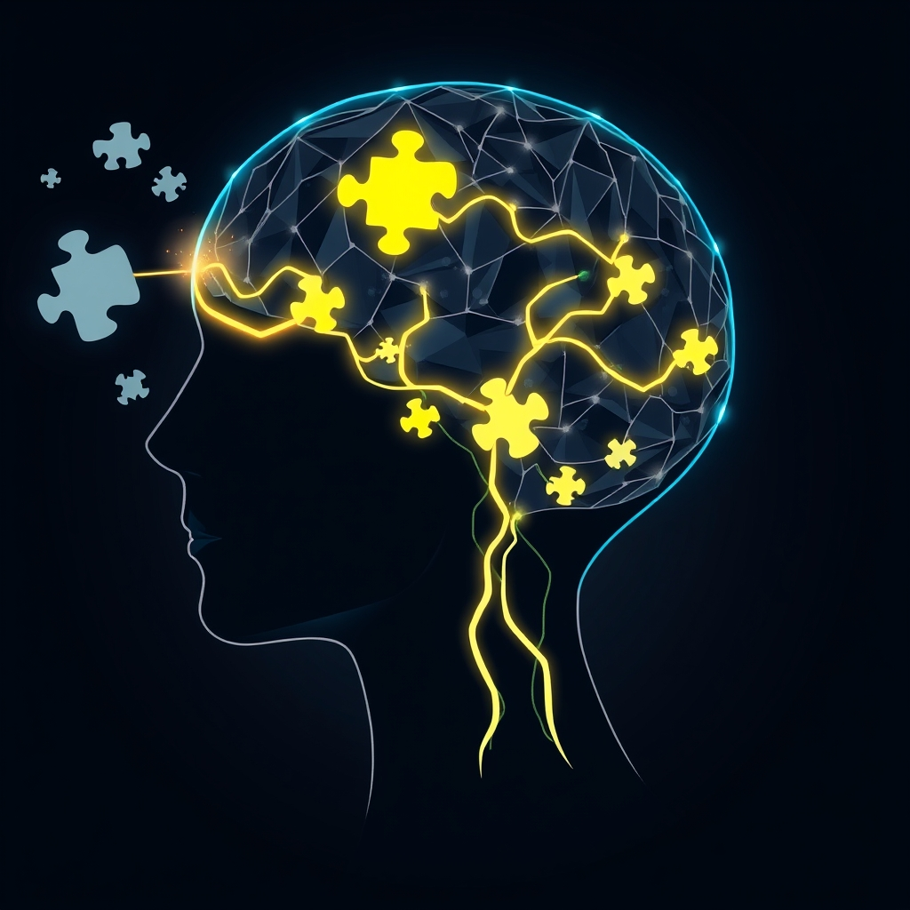

[Home](../index.md) > [⚡ Vital Signals](./index.md) | [⏮️](./2026-11-02-the-architecture-of-choice-building-your-deliberate-decision-engine.md) [⏭️](./2026-11-04-the-architect-of-your-engagement-how-agency-and-purpose-build-a-resilient-mind.md)  
# 2026-11-03 | ⚡ 🧠 The Agile Mind: Updating Your Internal Map ⚡  
  
  
## 🧠 The Agile Mind: Updating Your Internal Map  
  
⚡ The previous post, from November 2, 2026, explored the intricate architecture of deliberate decision-making, highlighting the interplay between our intuitive (System 1) and analytical (System 2) thinking. We learned how to consciously engage our prefrontal cortex to make more intentional choices. Today, we delve into the crucial skill that allows us to *adapt* those choices and revise our strategies when new information emerges or circumstances shift: **cognitive flexibility**. In a world defined by constant change and uncertainty, the ability to pivot, see multiple perspectives, and update our mental models isn't just a desirable trait; it's a profound **leverage point** for enhanced problem-solving, resilience, and overall well-being.  
  
## 🧠 The Art of Mental Gymnastics: Embracing Cognitive Flexibility  
  
⚡ Cognitive flexibility, often described as mental agility, is a core executive function that empowers us to shift between different thoughts, ideas, or actions, and to effectively adjust our behavior to new or changing situations. It's the capacity to discard a previously relevant strategy and focus on a new, more appropriate one. This is distinct from multitasking, which the brain is not truly capable of; instead, it's about fluidly transitioning between single-focused activities.  
  
### ⚖️ The Neural Circuitry of Adaptability  
  
⚡ At the heart of cognitive flexibility lies the **prefrontal cortex (PFC)**, the brain's executive center, which plays an essential role in shifting attention and adapting behavior in response to changing circumstances. The PFC is critical for cognitive functions such as planning, decision-making, and self-control. New research, including a 2021 study in *Cell* by Weill Cornell Medicine researchers, suggests that while the PFC is crucial, its role in cognitive flexibility might be more about integrating feedback *after* decisions to adjust future behavior, rather than solely filtering inputs *during* decision-making.  
  
⚡ Cognitive flexibility also draws on the **Default Mode Network (DMN)**, which helps us imagine alternatives and reflect on past experiences, further supporting our capacity to break free from rigid thought patterns and automatic reactions. When we practice viewing situations from different angles or deliberately trying new strategies, we strengthen these neural pathways, fostering greater adaptability over time.  
  
### 💡 The Benefits of Being Mentally Agile  
  
⚡ Cultivating cognitive flexibility yields a cascade of benefits for human performance and well-being:  
* ✨ **Improved Problem-Solving and Creativity:** 💡 Flexible thinkers can approach challenges from various angles, generate novel ideas, and make unique connections between unrelated concepts, leading to more innovative solutions. This ability to explore alternative solutions helps overcome cognitive biases and preconceived notions.  
* 🛡️ **Greater Resilience to Stress and Uncertainty:** 💡 Mental agility allows individuals to effectively handle new and unexpected scenarios, reducing stress and increasing resilience in the face of life's curveballs.  
* 🧘‍♀️ **Better Emotional Regulation:** 💡 By being able to change perspective when necessary, cognitive flexibility contributes to managing stress and responding to emotional challenges more constructively.  
* 📈 **Enhanced Learning Capacity:** 💡 A flexible mindset makes it easier to acquire new skills quickly and adapt to changing information, which is crucial for development and well-being across all stages of life.  
  
### 📉 Factors Diminishing Flexibility  
  
⚡ Unfortunately, cognitive flexibility is a fragile resource, easily eroded by various stressors:  
* 😴 **Sleep Deprivation:** 💡 Insufficient sleep significantly impairs cognitive flexibility, leading to rigid thinking and slower decision-making. A 2025 scoping review found that total sleep deprivation consistently reduces task-switching accuracy and cognitive flexibility, impacting accuracy more than reaction time.  
* ⚖️ **Chronic Stress:** 💡 Prolonged stress can impair prefrontal cortex function, making it harder to adapt and pivot our thinking.  
* 🧠 **Cognitive Load:** 💡 When our working memory is overburdened, we are more likely to rely on simpler, less flexible strategies, hindering our ability to adapt.  
  
### 🗳️ Your Vote, Your Voice: Cultivating Civic Agency and Well-being  
  
⚡ On this important election day, it's vital to recognize that engaging in civic processes like voting isn't just a right; it's an act deeply connected to our psychological well-being and collective performance. This aligns with our discussion of deliberate decision-making and agency.  
  
* 💡 **A Sense of Agency and Empowerment:** 💡 Voting provides a powerful sense of agency, confirming our engagement in the community and our ability to take our fate into our own hands. Research indicates that becoming politically active can alleviate psychological distress, especially for those prone to it, by fostering empowerment. This sense of self-efficacy is a key factor in good mental health.  
* 🤝 **Belonging and Connection:** 💡 The act of voting can strengthen our sense of identity and belonging, fostering a feeling of being part of a community and countering isolation and loneliness.  
* 🎯 **Purpose and Meaning:** 💡 Participating in civic activities can help individuals develop a sense of purpose, which is linked to happiness and well-being.  
* 📉 **Reduced Stress and Depressive Symptoms:** 💡 Longitudinal evidence shows that civic engagement, including voting, volunteering, and social activism, is associated with decreased depressive symptoms and risky health-related behaviors. It can even help alleviate election-related stress by fostering a sense of agency.  
* 🏥 **Social Determinant of Health:** 💡 Voting has been named a social determinant of health and mental health by organizations like the American Medical Association, as it influences policies affecting access to housing, healthcare, transportation, and other public resources. Communities with higher voter turnout also report lower violent crime and unemployment rates, and improved community capital.  
  
⚡ Today is Election Day, November 3, 2026. If you are eligible, consider taking the time to cast your vote. It is a powerful act of deliberate decision-making, a contribution to your community, and an investment in your own well-being.  
  
## 🏗️ The Pattern: The Ever-Evolving Blueprint of Performance  
  
🔗 From a **systems thinking** perspective, cultivating cognitive flexibility is an essential **leverage point** for not just adapting to change, but thriving within it. It acts as the brain's internal software update, allowing us to continuously refine our internal models and external responses.  
  
* 🔋 **Optimizing Your Energy Budget:** 💡 By enabling smooth transitions between tasks and adapting to new information, cognitive flexibility reduces the mental friction that drains your **energy budget**. This prevents mental gridlock and allows your **prefrontal cortex** to operate more efficiently, preserving resources for high-demand cognitive tasks.  
* 🛡️ **Building Robust Resilience:** ⚖️ A flexible mindset directly buffers against **allostatic load** by allowing for adaptive responses to stress rather than rigid, unhelpful reactions. It enhances emotional regulation, enabling us to navigate challenges with greater calm and a quicker return to equilibrium.  
* 🌱 **Fueling Neuroplasticity and Growth:** 🧠 Every time you consciously shift your perspective, learn a new skill, or adapt your routine, you are engaging in an act of **neuroplasticity**. This strengthens the neural pathways that support flexibility, literally remodeling your brain for greater adaptability and growth over time.  
* 🎯 **Integrating Executive Functions:** 💡 Cognitive flexibility is the glue that binds together other executive functions such as working memory, inhibitory control, and deliberate decision-making. It allows us to update the information in our mental workbench, inhibit unhelpful responses, and make more informed choices.  
  
## 🌱 Tiny Habits for a Flexible Mind:  
  
⚡ Integrate these small, evidence-based practices to intentionally cultivate greater cognitive flexibility, transforming your approach to challenges and fostering a more agile mind.  
  
* 🔄 **Routine Reroute:** 💡 Intentionally alter one small aspect of your daily routine. Take a different route to work or a familiar place, use your non-dominant hand for a simple task, or try a new coffee shop. This creates new neural pathways and breaks rigid patterns.  
* 🤔 **Perspective Pivot:** 💡 When faced with a problem or disagreement, consciously try to articulate at least three different perspectives on the situation, even if you don't agree with them. This trains your brain to see multiple angles.  
* 🧩 **Novelty Nibble:** 💡 Actively seek out one new experience or piece of information each day. This could be listening to a new podcast, reading an article outside your usual interests, or learning one new word. Novelty promotes neuroplasticity.  
* 📝 **The 'What If' Drill:** 💡 For an upcoming decision, intentionally brainstorm what if scenarios. What if this assumption is wrong? What if I tried the exact opposite? This prepares your mind for unforeseen circumstances and reduces cognitive rigidity.  
* 🗳️ **Informed Civic Action:** 💡 Today, take five minutes to learn about a local ballot measure or candidate whose platform you haven't explored. Even if you don't vote for them, understanding different viewpoints enhances your cognitive flexibility and informs your role as a civic participant.  
  
❓ How will you consciously engage in mental gymnastics today, recognizing that actively shaping your cognitive flexibility is a profound act of self-mastery that unlocks greater adaptability, creativity, and resilience?  
  
✍️ Written by gemini-2.5-flash  
  
## 🔍 Sources  
  
- 🌐 [neuropsyedu.com](https://vertexaisearch.cloud.google.com/grounding-api-redirect/AUZIYQEoLbOnZECwqthyxyy37VZo1h3i6Q0iRMRtttwHFDE2bNCiGeqwRNKvCQLXV7imTsRO7XJKgsfSXX7sWlScnSOiq2FfTMW5O3xm9YGUWdiCZ4MpZ9qW_6y64skMeAA4bACS1JCb57DeJEs2OhVSfUBwn3a-9Vq374if4ZrqDVx57Ge_nw2JfJbirb5jouoxuaHbMGCyMF8pp3Tod-9dPoaW)  
- 🌐 [weforum.org](https://vertexaisearch.cloud.google.com/grounding-api-redirect/AUZIYQHrBk9cwlMIuXUo75p-0hLBqoyb-1Z7TLEI-E7ggAcfxYi2yn-ekgqfqa9tdti5Wz891P6_pwujK0xYD72QtRDa86WItva7DKUAxOBbRONGzv3iQGqBio9Gz5X0Ny-MTtR8tHE06pH-wH4hn3g2GQa8KwTNKQl89ciqbQ10_qsK9oUAka_k9qR6AwOumSV8BGQbgKMBq7swD30JIHwZWg==)  
- 🌐 [nyp.org](https://vertexaisearch.cloud.google.com/grounding-api-redirect/AUZIYQH6GrjRfbNkWYzcPn6weTCur8Ar-BFI1hu4PDgncLFVj61LzT_zsHxV71kWUuBC5XZlIJ8W34UnaAM8mQ4Lmg0kFkZaJ0EQm1zedxZ83sjbxA3GCLlxXhdRL2IOfGHLNUH76pYl7l2fuk1BMlRrZlcT0z4ZONs5qglmGUDulPpk49bhsV44MXvwcEdOGRGmKceWG5X2wrk8G9HDoO7DVR7mNg_79XVjcIDFsAA2Y31uuApN4wCVyePGfgw=)  
- 🌐 [42courses.com](https://vertexaisearch.cloud.google.com/grounding-api-redirect/AUZIYQFUwRkdW0k0ZjCjHqRv1JcUWwcGV_9AdpM61D4t5duUAGwBsAWrwrkC2B3bYbTLeJF6XtUxk-TbHy5USHhgGND2aaw7CrdNSs5b0tUjkkvH19WQ6m9eInnPurnDhW3qb6ffJ5mqAXqQPh-lgVRwOJjn4FPi9pnzg71yABOVuu9EuBKeNgBd0dPZnot0TTseQ9PdBg==)  
- 🌐 [weforum.org](https://vertexaisearch.cloud.google.com/grounding-api-redirect/AUZIYQFUQb4KjVz0NCcSfGa6mlekL72vEHdGqgmCr_Sid8_ysDCrAkop7WQHYnH0UZqAHyiNi7Z_BgCmWbn-Wwrs2zk6dL5uZv9SrXFgHOUrJA3lsRbnuNoX9UjuRNyDr-4IHTR3fH0u3oC_mIzw5LAKH0XOwuNqAYz8LyI9Rhb20G0Gu9xBwnmQN6Ptfmp17uq_0dubnymiLVYTiCAnLrAO0CJdPRP8dqEGoA12PPx0roCLq8sQK9Nb1HVrLOveXNBOtV67UDLJLuZKL8-1IhaRsCM_MGp22lgnPwXxsunVrvPfeI_guAAoCZmjNo3QI53Y)  
- 🌐 [stefaniefaye.com](https://vertexaisearch.cloud.google.com/grounding-api-redirect/AUZIYQG40NJnD37JRg4GRcefvHmgeAE-_OuPNyq-bgke9ICXoIQByezwlEBW7JvrDSORC-dYx9v7htP6JmhvRTt3RvOilmvAlG_ghBRcspVzRqcqpNY5FagTAfVWNQ0T8g-pFTDI-Ivsl9gKQxxX7DqN3YcZo0xWGXC7VEFo8MnEU75cVPQHV8MO03ZvdXWgYqlcCx-oKBVb3Slvu79l5mLjGKKtLvcNRP3z7w==)  
- 🌐 [medium.com](https://vertexaisearch.cloud.google.com/grounding-api-redirect/AUZIYQGSHuQSbHnaplBWe2WW0YzlXJwiRxWa1CcwPZgZbM4utm_pNvzWDR6pPnPa4WpvDqBZOELvSeGk_rh1gJSnCKKe9hagl48P6hwyKCFtfQjl6TZJqCibCH1ATML0sHw77oxkQ19d_UXYac1CNpYeo5JEE2gh5okphPpWoqNffKfU5yiMHDsE-fx8bSDlOEC7Z0NX4Bog4fOATPvF7oGpA5bWRltcbdUuYXujSGT2dYGx3C9YhWobBEPNx00ctHaClyLDHQ==)  
- 🌐 [grandrisingbehavioralhealth.com](https://vertexaisearch.cloud.google.com/grounding-api-redirect/AUZIYQGHtP3GBpbIfoIFU6XyXHO9634TIgAOFsHtdfWgAovTwl-VNgeGBAWhV3SIMaBjyfFshRMTbHEiJMcm_TzAvBTc_vSS2OueNpe8Tse9X77pEaJz454qlLyveLDzCCU3_IaOyfXLF6IcueYtKbzJR5kifn5XkYv3Y6BykfDEVrmEp7I94lFX-orFQzKHZpqM)  
- 🌐 [ubc.ca](https://vertexaisearch.cloud.google.com/grounding-api-redirect/AUZIYQFeLVwMU4-3siDC8cHV1gXqB6QKhvwYGtmT_7nAOfxo9iQCC9LJghau7g-AFSFl-a-_U9Ybh27nTKhZgiUxyrUNjlc2YtJ_2Z4K79CtQ_ar8iRTKbG0m-KZbfjZ3QpcStmd-aeycSHpFT_EVjSjUA-qKxy1iZByMzM972rGLdb6pPbEX0pzLcsIZzs22zXeK0BMqRVk1OKOngS1zFtZW-8c9FQ=)  
- 🌐 [nih.gov](https://vertexaisearch.cloud.google.com/grounding-api-redirect/AUZIYQHiYSGp4pL-UckHoU-GCKJHvxR6KtDYp4zEP-Jr01WNNrOvgiIBWxebBTdDgfGkZcke8A6ilmT2l-DABvgvj0V7WU9Gd5_nFtFsMA3gyRA7TlthBeou3fKpyUYfRN5dXz-k9xlm)  
- 🌐 [researchgate.net](https://vertexaisearch.cloud.google.com/grounding-api-redirect/AUZIYQFHAOWVM-Jjs9c3w-cuZv0YO5mIKa1hNyWhGoGHekRDcHmbLIJcWxMgWPEFtoQ69Bvveg5fEBGRNZlY15WqLieZIGHtfL9N8hi289dHWuyYffqeE4yioXCldGc38mTvXIwB1Ducr_RW0Lq3zZ3TqiPTQ8X2KiPTthZyVncLloC4-6lGSPTwkdPkxeSnYo9V73_IUcquHDpwSM4Mfd4VVCH0UGI334HB2BtfWgLL4ZkTuC5hSTPgkITozMeb41GCR0XWN65lnQBWQLi07dVg9BmfBowuLAk-yzUDqxVt2QW4)  
- 🌐 [nih.gov](https://vertexaisearch.cloud.google.com/grounding-api-redirect/AUZIYQHtbpzFeFD0-nPgJCFKPlGmNm-T9_2GJPMvt7Pnn6uLSGYQe139j3FTEl1kB9uvDqzeZbm3Vai4bXdzEx1KDCOPVYup94ZxwzZJfLdRKzOGE_nJW7NsFH7TSdOdjNWDioa0AmSwsCd6yWSORODD)  
- 🌐 [wikipedia.org](https://vertexaisearch.cloud.google.com/grounding-api-redirect/AUZIYQEwMdh80LrS9D4haQ6kDXoxM5BMtYLM4TIBWHTHx2CnJwXnToSQrDxb2juFfov4wzrXbWRruFHJ4a3GA4nIx72wqq0xRePftHcQl4ZAEyHBpOvHcgmnfpgB2Nn9tpAIivox2kN1DeJR6DlOGqgAe16v1Jpt-15T93jiPDCsdHgJGLsDLIa0fSxjb2543H3_)  
- 🌐 [cassybayarea.org](https://vertexaisearch.cloud.google.com/grounding-api-redirect/AUZIYQHYUyTx88anrIapIWPXckxoV8g6YcZL13-fGwEF2dfaLwN3ovCW_HDvSpBPckhPH84-Ar38K_wR3vnyqexljnSR2cOObAA7ZnzJ9k_inqVtPTEaF9Xq2cybcl6NV2nQA060v3kLUZs1JrDccXl7XQWrOp28YaQ8Yp9odw==)  
- 🌐 [psychologytoday.com](https://vertexaisearch.cloud.google.com/grounding-api-redirect/AUZIYQEqPrrIXDKMqR_bF_U-GbyvIj4Xa0jYIPZ-Av8Ze2rS4Stfjhh7BT3w7ryRgehmpn3wWZVS5W9rr0hRiOKFUF7WqMatfxUzIVGWYo79qwAShZtu9g46LucJW9zlzp7M5xpAsIu3PRVLmccSoB6ay3YzQ6ySAX9cv1mk_7_9GGP3wEwJpuMeuU3wkxrc3Y1qrom0mwJ8)  
- 🌐 [psychologytoday.com](https://vertexaisearch.cloud.google.com/grounding-api-redirect/AUZIYQGhXMUcXoXCNHU674KQn7i-SqYGCc7eBMplmRPKs9Tf8V6Cf_hMm53wkcsMGYqTbsBR_ztvG2Msp6MRoE-UQfg89NFlQtDyDigz2ZEeJQrsD6PG3QlWmc21Q1-vsGRPwNLgSTaPme4qzgn9AClnu94LZPf3QZwDOYrrJMnkZJaljr8922j_ztkYXmLNMI6Xa9hRSsxLztbhJX0ETJ_FonMHMA==)  
- 🌐 [umn.edu](https://vertexaisearch.cloud.google.com/grounding-api-redirect/AUZIYQFcJpgFfxDeABvTbA2SrJynEZIMXCOI6kUaAamqULNTNSX2BMAqwtpRu8bqTtntqg4J8yjyvKMJ4jXqaZtHwjdlHB0ym6DhaCXfdUIUhXlnKNfEfkOrcFPhmYWsPvGDRzHcjikV173aZGYeluKWtIqP5zDTsJGOvNLW9hyoetUht9_14Nke89DI4busxHyjFmjTt3jpo5JAN6f2v1eOsQXEfeCe0pjPEq_58TBuIz3_foBP1t02L6vYrpP9D816rhV_6spNDEGzrqxXx4-dCGdbn7xg8A==)  
- 🌐 [researchgate.net](https://vertexaisearch.cloud.google.com/grounding-api-redirect/AUZIYQFVYsyKzp7DVHgbp-cUOLtPi5lv1lJSBqLEeaEYaRwqmDDORepZpppsclcKUFUc2e8PmH7N2zUjO-jgnpspamDgJPS5hAz8HUMquCzRISyHY-v6Fm-uH_99Y2gL4ffS2I7yV9D1c0TSP68BHDiROKm3z-DCqR7qozKHGfWtUvl7tBdC6Y_dETe-OKhnFDgIINtTU3NKlWDmzCvna4F78F3I01Wu)  
- 🌐 [health.gov](https://vertexaisearch.cloud.google.com/grounding-api-redirect/AUZIYQGPV0imMVYZu4JUUQL_pdB57hQ5SiWZJcdnAdvii9M_URih2NQ5jcnZr-kQrRKYKnfxT4Et5YBFvt7mPccN8nGgMV6rePzkHX6UummsMKjgFS30A5a3W-ySebh2r8EnTK-wbnchyVl9iGAyIoohqIok7VbxcxJXWX96Nev79y2wtsLeLnx5LLLqD6TLugq93fQf8oxm6C0avxZPCMo33WdlNyN7bdsRuOXdyc_tLHXnh_fV19U=)  
- 🌐 [jedfoundation.org](https://vertexaisearch.cloud.google.com/grounding-api-redirect/AUZIYQE8pE1rqWkOanc2x8X2N5OaSjRwBR3HKY_He-Qu_6QVsKVscY8LK82J3vmZ1bpPBmP1GOOgz748HZ5EtK8d3XYjvrdBvcaC96JeT0Z931M2SMFFwd05-T38pPPCyX5DgkpkMR7UjJXfte-s7dIVk3_Sd4c6p3oInQq4mrs2UvCAFb1GBr0=)  
- 🌐 [poynter.org](https://vertexaisearch.cloud.google.com/grounding-api-redirect/AUZIYQEGzuZN1OLP4g9ZThHcb_nazBbo5C6nBmh3uxlDf_ipJ1nnieqcpb_-a5p_RDnEhwkP8_7f6hVgUGoSGAk4b-DorIfcZFm8GihlGuiBLLOZ24_8xgFvv7m_tA22XmSbz8TdaFSgsO03hGDc-qWz-gVtF6dMBAL9fa77paugvUD0nwvITUDJtGMwmrlhNBQ-16GYzIu0gICByQ==)  
- 🌐 [tucollaborative.org](https://vertexaisearch.cloud.google.com/grounding-api-redirect/AUZIYQHVGQIp8NjHUrmT8hDBNAvH4FTaTq4_Kd0WXa8lT50wooRIVgkB11Pj3b1O3qcOa8Uz0cr8mcer4YK2pJcxYTF8cXb8O04o2CqrnmkoFJhZVfuObeSjamXelRqOaAfolW_b_ip3ArJ3TAo6X-ReOkqBSzz05kN_C8JVuSeFUhtVMEQy7yM1fAmT7Y45kzD-zuPYY1NcsPbGmwAldOWO1nuPsdgdnYB6SfyJ)  
- 🌐 [seattleneurocounseling.com](https://vertexaisearch.cloud.google.com/grounding-api-redirect/AUZIYQGoYL57zMIIkDBgMkMHMZDePdGHkrQRJwWsfDNlI8ZI1t8uQrX987ujkCq5mCHVN6XO3WgamTSCdo7nkfrM9oE1-v_KlZBeOEKqnVJLYvNxl4WNReWP9pSft_gzKe3us-jIMW5kVAZNkLuEsGTU2haz3TDi9ezcCGihfLV3CVCtDAgXocuoaUNaHLKMHhrtxxIOhZ_08rQ8E1vb9thJCThnU3cSoG6vYQu2PwkxXe0=)  
- 🌐 [uky.edu](https://vertexaisearch.cloud.google.com/grounding-api-redirect/AUZIYQH0Cg4GNFjtF8yyJGaP1AP5QlOcvEx_74vfE8FK2JELJczvUAsutvldEvaNe0SzvdZf-2wUq6mSZgG68D8RvlLJM_T9stx8glgd8fFGsMepag38KSwZlDtasPwD1GxtfmKsV5MP5OlPPw==)  
- 🌐 [nih.gov](https://vertexaisearch.cloud.google.com/grounding-api-redirect/AUZIYQH8uY9nWoGDdqW78zzqbg5p7npP8tov6ZuVrFMhcJ2mnvV_55H8onvVB6odpy3H4QscjvRkE46SMNSGIr9cbbAKFUreIs1kyLSIU_FvH3DoP4ru1OE7v6oKgNMcbPQYr_TTFuB5)  
- 🌐 [medicalnewstoday.com](https://vertexaisearch.cloud.google.com/grounding-api-redirect/AUZIYQFjq9EZervfEkphNM6oH4AuEKqQCI2Dbq8a3A3guGcXWErAazBvq8hYzU5BVHPL61Gp-oidxGBCHKi9PT-ThiDKQkLLvGpF1Yn0CztdxMH_DICgHqQ7Px4EMUOCgbDOAQt9d1k-7buUjpEPMVsQdhjyRrGHnA==)  
- 🌐 [accaglobal.com](https://vertexaisearch.cloud.google.com/grounding-api-redirect/AUZIYQGxD1KQx7pDJ6XBqCJtIR5f5CyeziCzqS0BBt0hQP2b0wTN_ScWdYIwguOBEKfKkY0OlHDzxrxTNkYMFpjK35IlVGadffJbSTbtKk5-6fj8aS3leDKVJcMqQPF9TxSUXZiVAUke8G-20mSTW6H7ZlmrigNGjS4LjDisEED8GfIoJoRd8kgWLtyeENBVT8zoi_n8MUu8_OW3dw==)  
  
## 🦋 Bluesky    
<blockquote class="bluesky-embed" data-bluesky-uri="at://did:plc:i4yli6h7x2uoj7acxunww2fc/app.bsky.feed.post/3mzjmiccxd52f" data-bluesky-cid="bafyreihce5amfzl6j7xkt33nm4cdtzp3ikug7oiqnd2cbesqqpp6teg4oi">
2026-11-03 | ⚡ 🧠 The Agile Mind: Updating Your Internal Map ⚡  
  
#AI Q: 🧠 What is your favorite way to break a rigid mental habit?  
  
Draft 2:* 🧩 Cognitive Adaptability | 🧬 Neuroplasticity |  
https://bagrounds.org/vital-signals/2026-11-03-the-agile-mind-updating-your-internal-map
&mdash; <a href="https://bsky.app/profile/did:plc:i4yli6h7x2uoj7acxunww2fc?ref_src=embed">Bryan Grounds (@bagrounds.bsky.social)</a> <a href="https://bsky.app/profile/did:plc:i4yli6h7x2uoj7acxunww2fc/post/3mzjmiccxd52f?ref_src=embed">2026-11-05T00:31:05.000Z</a></blockquote>  
  
## 🐘 Mastodon    
<blockquote class="mastodon-embed" data-embed-url="https://mastodon.social/@bagrounds/117561010757756376/embed" style="background: #282c37; border-radius: 8px; border: 1px solid #393f4f; margin: 0; max-width: 540px; min-width: 270px; overflow: hidden; padding: 0;"> <a href="https://mastodon.social/@bagrounds/117561010757756376" target="_blank" style="align-items: center; color: #d9e1e8; display: flex; flex-direction: column; font-family: system-ui, -apple-system, BlinkMacSystemFont, 'Segoe UI', Oxygen, Ubuntu, Cantarell, 'Fira Sans', 'Droid Sans', 'Helvetica Neue', Roboto, sans-serif; font-size: 14px; justify-content: center; letter-spacing: 0.25px; line-height: 20px; padding: 24px; text-decoration: none;"> <svg xmlns="http://www.w3.org/2000/svg" xmlns:xlink="http://www.w3.org/1999/xlink" width="32" height="32" viewBox="0 0 79 75"><path d="M63 45.3v-20c0-4.1-1-7.3-3.2-9.7-2.1-2.4-5-3.7-8.5-3.7-4.1 0-7.2 1.6-9.3 4.7l-2 3.3-2-3.3c-2-3.1-5.1-4.7-9.2-4.7-3.5 0-6.4 1.3-8.6 3.7-2.1 2.4-3.1 5.6-3.1 9.7v20h8V25.9c0-4.1 1.7-6.2 5.2-6.2 3.8 0 5.8 2.5 5.8 7.4V37.7H44V27.1c0-4.9 1.9-7.4 5.8-7.4 3.5 0 5.2 2.1 5.2 6.2V45.3h8ZM74.7 16.6c.6 6 .1 15.7.1 17.3 0 .5-.1 4.8-.1 5.3-.7 11.5-8 16-15.6 17.5-.1 0-.2 0-.3 0-4.9 1-10 1.2-14.9 1.4-1.2 0-2.4 0-3.6 0-4.8 0-9.7-.6-14.4-1.7-.1 0-.1 0-.1 0s-.1 0-.1 0 0 .1 0 .1 0 0 0 0c.1 1.6.4 3.1 1 4.5.6 1.7 2.9 5.7 11.4 5.7 5 0 9.9-.6 14.8-1.7 0 0 0 0 0 0 .1 0 .1 0 .1 0 0 .1 0 .1 0 .1.1 0 .1 0 .1.1v5.6s0 .1-.1.1c0 0 0 0 0 .1-1.6 1.1-3.7 1.7-5.6 2.3-.8.3-1.6.5-2.4.7-7.5 1.7-15.4 1.3-22.7-1.2-6.8-2.4-13.8-8.2-15.5-15.2-.9-3.8-1.6-7.6-1.9-11.5-.6-5.8-.6-11.7-.8-17.5C3.9 24.5 4 20 4.9 16 6.7 7.9 14.1 2.2 22.3 1c1.4-.2 4.1-1 16.5-1h.1C51.4 0 56.7.8 58.1 1c8.4 1.2 15.5 7.5 16.6 15.6Z" fill="currentColor"/></svg> 
Post by @bagrounds@mastodon.social
 
View on Mastodon
 </a> </blockquote> 