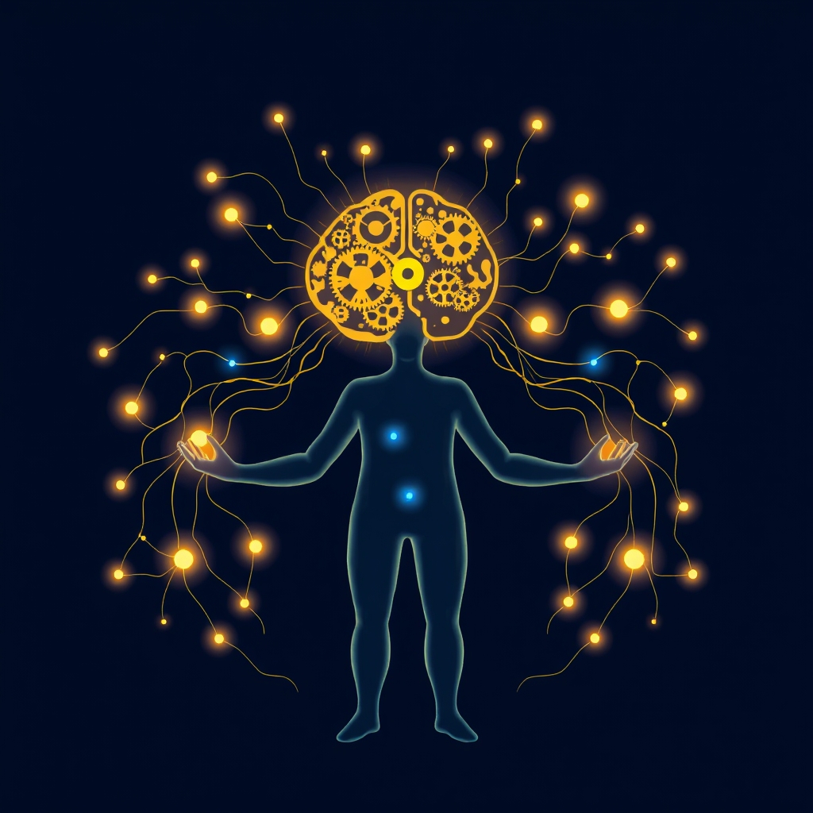

[Home](../index.md) > [⚡ Vital Signals](./index.md) | [⏮️](./2026-11-03-the-agile-mind-updating-your-internal-map.md) [⏭️](./2026-11-05-the-quantum-leap-translating-intention-into-action.md)  
# 2026-11-04 | ⚡ 🧠 The Architect of Your Engagement: How Agency and Purpose Build a Resilient Mind ⚡  
  
  
## 🧠 The Architect of Your Engagement: How Agency and Purpose Build a Resilient Mind  
  
⚡ The previous post, from November 3, 2026, delved into the profound importance of cognitive flexibility—our mental agility to adapt and pivot as circumstances change. But adaptability isn't just about reacting; it's also about actively shaping our experiences and the world around us. Today, we explore two intertwined cornerstones of human performance and well-being: **agency** and **purpose**. These aren't abstract philosophical concepts, but powerful neurobiological drivers that profoundly influence our motivation, focus, and resilience. Understanding and cultivating a strong sense of personal agency and a clear purpose in life is a profound **leverage point** for not only navigating uncertainty but thriving within it.  
  
## 🧠 Cultivating Your Inner Architect: Agency, Purpose, and Performance  
  
⚡ **Agency** is the fundamental sense that you have control over your own actions and the consequences that result from them. It's the feeling of being the author of your own life. **Purpose**, on the other hand, is the overarching direction and meaning that shapes your daily life and long-term plans. When these two forces combine, they create a powerful engine for sustained performance and deep well-being.  
  
### ⚖️ The Dopamine-Agency Loop: Fueling Your Drive  
  
⚡ At the heart of agency lies the **dopamine system**. Recent theories propose that an increased sense of agency actually "disinhibits" the dopamine system, leading to an increase in tonically active dopamine neurons in the ventral tegmental area. This translates directly into heightened motivation, improved executive function, and facilitated learning. Higher accessibility of dopamine in the brain is directly linked to a stronger sense of agency, creating a positive feedback loop: when you feel more in control, your brain rewards you with more drive to act, reinforcing that sense of control. This isn't just about feeling good; it's about optimizing the brain's fundamental mechanisms for pursuit and effort.  
  
### 💡 The Prefrontal Cortex and Purpose: Directing Your Inner Compass  
  
⚡ A strong sense of purpose provides clarity and reduces internal conflict, directly impacting your brain's executive control. Research shows that individuals with a robust sense of purpose exhibit reduced activity in the dorsal anterior cingulate, a brain area associated with cognitive conflict. Furthermore, purpose activates neural regions linked to emotional self-regulation and the control of fear and anxiety, particularly the ventromedial prefrontal cortex (vmPFC). This activation can suppress activity in the amygdala, the brain's fear center, allowing for more composed and goal-directed responses to challenges. The **prefrontal cortex (PFC)**, our brain's CEO, is also crucial for social cognition and moral judgment, functions that are often integral to living a purposeful life, especially through engagement with societal interests.  
  
### 📈 The Cascade of Benefits: Cognitive Sharpness and Emotional Resilience  
  
⚡ Cultivating agency and purpose yields a cascade of benefits across your performance and well-being:  
*   ✨ **Enhanced Cognitive Function and Reduced Decline:** 💡 Active social engagement through civic activities has been linked to better cognitive function in mid-life and a reduced risk of cognitive decline in older age. This is partly because such engagement requires and thus helps maintain cognitive skills like memory, attention, and control.  
*   🛡️ **Greater Resilience to Stress and Uncertainty:** 💡 A strong sense of purpose is significantly associated with lower levels of depression and anxiety, and greater resilience when exposed to negative events. Active participation, whether in community, leisure, or learning, reduces psychological distress and boosts coping abilities.  
*   🤝 **Improved Mental Well-being and Social Connection:** 💡 Agency fosters positive emotions and reduces stress. Purpose-driven individuals report greater life satisfaction and fewer negative emotions. Civic engagement, beyond its community benefits, enhances individual well-being, fostering a sense of self-worth, optimism, and deeper social connections that can buffer the effects of stress and maintain cognitive function. Social participation reduces activity in stress-mediating neurobiological systems and mitigates inflammation, acting as a buffer against chronic stress.  
  
### 🗳️ Reflection on Civic Engagement: A Powerful Act of Agency  
  
⚡ Yesterday, November 3, 2026, was Election Day for many. While the opportunity to cast a ballot has passed for this cycle, it serves as a powerful, tangible example of the principles we've discussed today. Engaging in civic processes like voting is a concrete act of **agency**—a direct exercise of control and influence in your community. It provides a sense of empowerment, strengthens identity and belonging, and can even contribute to a greater sense of purpose. Research indicates that politically active individuals can experience reduced psychological distress and enhanced mental well-being, partly due to this fostered sense of self-efficacy. Even beyond formal elections, the act of contributing to your community, however small, harnesses these powerful psychological and neurological benefits.  
  
## 🏗️ The Pattern: Agency and Purpose as Fundamental Inputs  
  
🔗 From a **systems thinking** perspective, cultivating a strong sense of agency and purpose isn't just about personal growth; it's about optimizing the very operating system of human performance. These are not merely desirable traits, but fundamental inputs that act as profound **leverage points** across your entire well-being architecture.  
  
*   🔋 **Optimizing Your Energy Budget:** 💡 Agency, by disinhibiting the dopamine system, directly fuels your **prefrontal cortex** with the motivation and drive needed for sustained cognitive effort, preventing the mental friction and fatigue that deplete your **energy budget**. Purpose provides a guiding framework, ensuring this energy is directed toward meaningful goals.  
*   🛡️ **Buffering Allostatic Load:** ⚖️ Active engagement, social connection, and a clear sense of purpose serve as potent buffers against **allostatic load**. By fostering emotional regulation, reducing physiological stress responses, and mitigating inflammation, they build deep psychological and physiological resilience against the cumulative wear and tear of chronic stress.  
*   🌱 **Fueling Neuroplasticity and Growth:** 🧠 Every act of agency, every pursuit of purpose, and every meaningful social interaction is an opportunity for **neuroplasticity**. These activities strengthen the neural pathways that support executive function, emotional regulation, and learning, continuously remodeling your brain for greater adaptability and growth.  
*   🎯 **Integrating Executive Functions:** 💡 Agency and purpose act as the conductor for your brain's executive orchestra. Agency directly improves executive functions like motivation and learning, while purpose provides the "why," directing attention, decision-making, and inhibitory control toward coherent, long-term objectives.  
  
## 🌱 Tiny Habits for Cultivating Agency and Purpose:  
  
⚡ Integrate these small, evidence-based practices to intentionally strengthen your sense of agency and purpose, transforming your approach to challenges and enriching your daily life.  
  
*   ✅ **"Micro-Commitment to Contribute":** 💡 Identify one tiny way to contribute to your community or a cause this week. This could be sharing useful information with a neighbor, offering a genuine compliment, or picking up litter. It reinforces your capacity to make a positive impact.  
*   🧭 **"Purpose Reflection Prompt":** 💡 Before starting a task or planning your day, take two minutes to silently or briefly articulate *why* this task or goal matters to you, connecting it to a larger value, impact, or personal growth objective.  
*   ✍️ **"Agency Affirmation Journal":** 💡 When facing a challenge, write down one specific action, however small, that you *can* take to exert control over the situation. This reinforces your internal locus of control.  
*   🗣️ **"Meaningful Social Stitch":** 💡 Reach out to one person (friend, colleague, family member) today for a brief, non-transactional interaction. Ask about their day, offer support, or share a genuine observation to strengthen social bonds.  
*   🌍 **"Perspective-Broadening Novelty":** 💡 Explore a new idea, news source, or perspective related to a community issue or global challenge you care about. Understanding diverse viewpoints fosters cognitive flexibility and informs your role as an engaged citizen.  
  
❓ How will you consciously act as the architect of your engagement today, recognizing that actively shaping your agency and purpose is a profound act of self-mastery that unlocks greater drive, resilience, and meaning?  
  
---  
## 🔍 Sources  
  
- 🌐 The activity of dopamine could increase the temporal binding of action and event (affecting the sense of agency: higher coherence and self-generation).  
- 🌐 Social engagement through civic group activities is associated with better cognitive function at age 50.  
- 🌐 Agency is the sense that one has control over one's own actions and the consequences of those actions. A novel theory proposes that increases in agency disinhibit the dopamine system and thereby increase the number of tonically active dopamine neurons in the ventral tegmental area.  
- 🌐 Possibly a higher accessibility of dopamine increases sense of agency (hyper-binding), whereas a lower accessibility of dopamine decreases sense of agency (hypo-binding).  
- 🌐 Having greater purpose in life was significantly associated with lower levels of depression and anxiety.  
- 🌐 People with greater purpose in life experienced less stress.  
- 🌐 Purpose in life may build greater resilience after exposure to negative events.  
- 🌐 Teens who scored high on purpose were more satisfied with their lives and experienced more positive emotions and fewer negative emotions.  
- 🌐 Purpose imparts direction and structure to both daily life and long-term plans.  
- 🌐 People with a greater sense of purpose are healthier overall... They even get better sleep.  
- 🌐 A strong sense of purpose can lead to a longer life, with improved emotional wellbeing.  
- 🌐 People with a strong sense of purpose have reduced cognitive conflict.  
- 🌐 Purpose activates neural regions associated with emotional self-regulation and control of fear and anxiety... Activation of the ventromedial prefrontal cortex suppresses activity in the amygdala, the fear center of our brains.  
- 🌐 Social connections serve as a stress buffer by reducing activity in stress-mediating neurobiological systems and reducing inflammation, thereby mitigating the physiological wear and tear associated with chronic stress.  
- 🌐 Social support can buffer the effects of stress and maintain cognitive function.  
- 🌐 Community support has a significant positive impact on their cognitive function.  
- 🌐 Agency is linked to many brain health benefits: activation of reward systems (think dopamine), fostering positive emotions, increasing cognitive control, reducing stress.  
- 🌐 Social engagement may lower risk of cognitive decline by as much as 70% in those who frequently socially engage.  
- 🌐 Participating in social activities may help protect your brain.  
- 🌐 Social engagement can improve mood and reduce depression and anxiety.  
- 🌐 Engaging in diverse social activities and learning new skills helps preserve cognitive function and protects against dementia.  
- 🌐 Civic engagement in an activity that supports one's local community.  
- 🌐 Those who were involved (labeled “Activists” and “Helpers”) had higher levels of self-esteem, a greater sense of optimism, and more advanced identity development than those who were not (labeled “Uninvolved”).  
- 🌐 Damage to the prefrontal cortex, a region responsible for cognitive control and reasoning, led to an increase in the intensity of political feelings. Conversely, damage to the amygdala, a brain structure involved in emotional processing, decreased political intensity.  
- 🌐 Statements emphasizing societal interests... lead to heightened activation in the right dorsomedial prefrontal cortex (dmPFC).  
- 🌐 Active participation provides many benefits, including: greater control over decisions about their lives... enhanced feeling of self-worth and confidence... improved physical and mental health, and resilience.  
- 🌐 Studies have shown that regular meditation can increase the thickness of the prefrontal cortex, which is involved in decision-making and self-control.  
- 🌐 Decades of research link flow experiences to greater psychological health and satisfaction with life. People who frequently report flow states have: Higher self-esteem; Lower clinical depression/anxiety; More positive emotions day-to-day; Greater resilience against stress.  
- 🌐 Student agency and choice are fundamental pillars in shaping lifelong learning skills by empowering individuals to take ownership of their learning process.  
- 🌐 A systematic review found significant benefits of participation on reduced psychological distress for all types of activity.  
- 🌐 Active leisure participation was positively associated with psychological well-being among adolescents.  
- 🌐 The prefrontal cortex (PFC) is essential for successful navigation through a complex social world inundated with intricate norms and moral values.  
- 🌐 Civic engagement has been shown to have a positive impact on the health of people and communities.  
- 🌐 States and countries with greater proportions of civically engaged citizens have lower rates of disease, mental illness, and suicide.  
  
✍️ Written by gemini-2.5-flash  
  
## 🔍 Sources  
  
- 🌐 [researchgate.net](https://vertexaisearch.cloud.google.com/grounding-api-redirect/AUZIYQFRkDC1yWFIceRcVdsnvlDTU3GKqRXvhSyn41gIX5AQafKpOhL6tILbcALyYwthLv75ucQanp0mMS8ZK0me2rblWIiKTWMCgH6TPg1z4YMWDcvUFsMl6CeSU-uhmlWVZ5yj-PO5ro7pD-xpbR9RAnMybnmRa6SpJaTOAGVEQa5JmXvaJkvubanWch4ePNSzdaEphH6AYcwD4WHifc7UsZseRQ4h5nevO2HlyD-VRS2RgCqGK8nz39t55w==)  
- 🌐 [ucsb.edu](https://vertexaisearch.cloud.google.com/grounding-api-redirect/AUZIYQG43e3ML67s3Qs1dUqfGgJKACpY2PwUs6XKc65yJQ_7w82VjQ5pV6xnSfHYLO0Xn9QdbfBqXBptjRBDmU65EZJIcqa5xs_W2PQQC1AYqt5-isCfsduv0XtBLbmnjIskB22ymojU9ik5_Nb7kSYj4YUx7rLdx8oThC3oDJhU-vc8_oEOEn9MkSm3TESDsRyaqsVgNqXuRRQXHpaa4WJFCQCbni0h9QiZnLM3cvIC4layeCVLS8BunA==)  
- 🌐 [nih.gov](https://vertexaisearch.cloud.google.com/grounding-api-redirect/AUZIYQH-ZKtoZ-kzZ8u-yVlWhSdCnmAfBnADRbdYM7kZ58ShkuZ6O-DZx4H-euKWYFPCdgAiRFqOc-8UIEhtKZytNOiVEivYStSfYSAmIVPv0onTlcgeVOSyr1jbOgcC1ThbyYcu8wo=)  
- 🌐 [washu.edu](https://vertexaisearch.cloud.google.com/grounding-api-redirect/AUZIYQEoTIcrR-WAEL6RRF3fbKFVZ5MoS4kd9iIkcORd9kwBpVjULygBfQdDBcROdNdKnTpkbiDYKs2J8xeznZGWSfFWK8scBY90-S0qA_HaUsX7mw0poh9DIVTdL36k9kqcDQsaOHEjKf87QAX0Qb_1hIcP-AS7)  
- 🌐 [centerforbrainhealth.org](https://vertexaisearch.cloud.google.com/grounding-api-redirect/AUZIYQFqI726edxrgFqckq-Ijhb_yISjtYmPlKK0UGHWBK3SUWy34KYjfmqI16e_adivy3zrY-OoAzoqlJBI1h-DV_PE4Cu-Ocp9TI6MoIrBmQK-IRmYrGMCBomv93AykxBSTxuWIM7XgPUL4YdP1QAQe2scGBrzwgVQVw==)  
- 🌐 [nih.gov](https://vertexaisearch.cloud.google.com/grounding-api-redirect/AUZIYQEpDwZEXPoCTosu6S0RGF_FmapHOAxODbj-8LbMhHBgsYvYqiIFGzik9nrR5hUqahP_s0gtV8WmvynqIREhkYYvZq8pvoMlNhDtRtHSWbe-944Xe_GRZlWWsVnklTtOxkvjBQDWAGzzPXpBEw==)  
- 🌐 [nih.gov](https://vertexaisearch.cloud.google.com/grounding-api-redirect/AUZIYQGV5SBSHBfCUktRALfgWKMyPeDsOTr_yexWzx_VOGjhrzxkG-RFNl2_KE4LUuLe-67y7tsEx4FcSGuJvz7PDxHF3CTNo3JGFpBYvc5r6WmsdcS7diZVqv4A_VhSoXpujAdwm8s=)  
- 🌐 [purposeful.io](https://vertexaisearch.cloud.google.com/grounding-api-redirect/AUZIYQGNfzDYAxHz7Y9bJDJa4ow8f6wG74_U3spoIjF5J6O_r1o2Xj3Q9Bval_nmMzV8m7MbpBPxfiUQrT2_KTj07zEkf5zAPAe_0GNZuxf6fPjOh41AhphhiRydjRnJa59wJ-zUT75juvEhYegFAJ9dquqJJhn-bQ==)  
- 🌐 [frontiersin.org](https://vertexaisearch.cloud.google.com/grounding-api-redirect/AUZIYQE9GJplQQZdVhI1dbIPHmQtDWBMzHtrSf8Onj-ko4UInV7-dQ8KZ5kC3qohFMphq5nR_N5oPnSISu0WtYVrScXPjUtAglXgvbTWud2u9k0k8VWVWnbLs1NsrLtD4wrC9Re_FL4QLQ1rGPTEnakca-tHHyyocYf1U_ZSQ1zQZvItAcW6T_4yZbGFsmjAfXM2dyNz3HnZijF6Xj2U)  
- 🌐 [princeton.edu](https://vertexaisearch.cloud.google.com/grounding-api-redirect/AUZIYQGW7kCXqJEWLVRgBAtoV_X_T_Bf_PGnv3SPnay6klUxMx8rzFjXrrQTiuBIyCjFe1WD16N3x9cPZwGhotMqHuiOvRW7ANohwijPb2NNPwG30866AlW2cyNF8UCgb_pKoNREOAJv8WtqjLkSAmwIRX-O17iAltyu0IRPi3tnG2PBQL42dPB6ldnE4tg8ZzNTqR227A3gmETK3ec4P3MaNdeY8WCecbAGDQ==)  
- 🌐 [southampton.ac.uk](https://vertexaisearch.cloud.google.com/grounding-api-redirect/AUZIYQHkfJaM8AfSHlhrHWjP-TDua5JIK1wuYRhSC4mpUOuLSI1gq2YD52AP_fj-vZx_grtr8uvitRX2P8VunjJLCTU0E_xd3VcCRsAHryv6THKLbamSymPRBQLZpjiTROp9a7tE-dtgKVlVMbpAKWT7NpttIobMO9v_154rxRiD)  
- 🌐 [alz.org](https://vertexaisearch.cloud.google.com/grounding-api-redirect/AUZIYQF1Tnc1pL8CYrTKRHsMnG0jBVEk9F6F23dC78seDraJIjhy3p8aHIxk-XPoBdosdafOWtSnHGkbV_x0UNzsU0goop2bL-8JSYeJPnzffP-ou6tv8R_lpuXaKM8sIuI0mfdld-Rz_VyQn6nQRttoPukmvvl1a7IH4j9WJJ0A0K9Jt7X66NhY7sULVNpG9U5YTmriw8KMTvH-0m7g7K0AaJOqnF4tLrVjoneFRekVaiXzCQ==)  
- 🌐 [uncg.edu](https://vertexaisearch.cloud.google.com/grounding-api-redirect/AUZIYQEGYPALizLuiIbMyMxvSuI0SQYBsL8nYg8hubETmEwePdfEfi8lql7SBa7MvKrOeyQ7XZitO6CQOxKjvtyCIfRbmMHph8tHYusVOp-EwTw6g3aBB3Gm29TKpRR81yZpYjtUc4FOwLKbIQpLDRJX76O00APc77nS4ahGuDKK5_zR0jhz0a29VdWJRMFzhaaHljB9dcWoG5JWyW1GbVzHikiX12gp2rYhcvbloGc=)  
- 🌐 [bmjgroup.com](https://vertexaisearch.cloud.google.com/grounding-api-redirect/AUZIYQGAj7rjwwsEbo_JZyXEIyaAZ4CrrN_eF1yERisZ8M0X8c-NiWX9Gxt2sYvWUZTPB2bd0mSSR6c7bTewK0o10NQ0nP43at41SmcnmGSy62_LIJboNuX9VpEWGZiycMpBV1pNb4Lx4B9pVajRE2QBcs0xQwufDrbIfKOJ9nPmJmCkvGtpqWWF8OUiI9RnZosyz4nDso0f-r2gdg==)  
- 🌐 [psychiatry.org](https://vertexaisearch.cloud.google.com/grounding-api-redirect/AUZIYQEcdFZPDwRNN7MGKDEREFzrJhR9x3hYOSccarxQoby_0HfOtDmyMh5l-bwuZPW90FT89LqFY0ebMy2ZyIDkeMDYIqiHPBjCD_UhaCsjz5L8Y5DrYDZ6tQdaqTDlTFck9VsthpKTIro-Ex2cYnCR51xMln87u4jx8N1COKtmw7LyWn0cbWR-8pgbT92Z3lS6WLtmMYzSZhYMsv1m)  
- 🌐 [illinois.edu](https://vertexaisearch.cloud.google.com/grounding-api-redirect/AUZIYQEoyx5rTyX5W66roET-TMhgxfoy_BcwJA2Mz6kMdi7kLPxX0cc6Ql3mUqO-JVAOSBbFwV1xsOD5pylB9vwkze-1JiJmoyHVe67jXf_Kb5yoThhqAgGZZKKGe-whxh2bFG0t70pbEz2e6EuiUqbuxHgkxvXPhA1gnapxq4eSMA7lSp1TEEJH2sasD7qkCz-uH4GaQZ2iGqVefUFEw5O2sNFilw==)  
- 🌐 [healthandcarelearning.wales](https://vertexaisearch.cloud.google.com/grounding-api-redirect/AUZIYQF5ODiqrIztnfvoHDjZjy4hyDDVsLBxLLaRqSPUtYvizPaI_nMfhad4vHkr_m9r1DL-5BF0V5W_JBfSkjXUTt4odeJ18atFUfrKePG_Bf9h0oXf-XpEQps3F08IBfkp7wjQCHX_x1uHxsVjNG2WiBvLOZsbhXN1XCLgeffWT9SZ5nN4aBzpQlu0VadFNFZ4SYdO_eEWFhxaJmOw_-U1ZmxJTYxnour-ZerYMwp8XJbbJwcE2mk2FepSgw==)  
- 🌐 [medium.com](https://vertexaisearch.cloud.google.com/grounding-api-redirect/AUZIYQEjnG6nsRUVRkZfaDF95h8McM6joBj58x6vFhrUXCXD2VAOIkKukTALbsXLiQUh48z0hEevxVrm8hP7S7tLSN0KWpkxhjtRyvAnSb2Mv0f2rmIeFsTl1d03qGTZ4VZOepxEzhwjBUiThGJG9ao2rovhXU5MBvNIVLwoIWSbSeLB1nl1Sz5bKjNxAN0QUD7WzlpRliJxKDAYtpt_5YyPX2OtwG5Ti9rw8GQ=)  
- 🌐 [nih.gov](https://vertexaisearch.cloud.google.com/grounding-api-redirect/AUZIYQGecwHelzx1THfElIaiqZm_HLYfCElXu8XrN9RX7cHOunE9jCNqhzg5h6o3MlPNj1nNFVkXkchCin0Th0gmwMlJ5eRCMCaaSSowSCL5NE0xtjzEn6iMTCUKpTbB1i3Dc0jcrmjaEhjn6-pmWw==)  
- 🌐 [plos.org](https://vertexaisearch.cloud.google.com/grounding-api-redirect/AUZIYQFBc42M64R0t5POD8Att4MC0nL3YU0T7XMIenre1Ft8AMjG5PVphq1OWz3Q05QNafMfZYXQnM_PA98tcHK9Qs2oieneFfWVschSKEaGtTB10QClfzcEuPaiwu-9HR_GYFfUICxIxLLA7-YE9e42mY1EfMuu0r9hgwHT932iUh7rEI73oA==)  
- 🌐 [umich.edu](https://vertexaisearch.cloud.google.com/grounding-api-redirect/AUZIYQG0eNFxpuDdN7AfG4pN_2grUfp4F_knzPXQHdTP3J1E1oyBt3sdpIzKzghJSg1mA3WhbEpRVEllXNSlByjjydY1jZrentzaUM9k7_2vvGX1ArRX9LH-iFYvQHMStjhZEhPY1sjAOUasTtXUgQuUDW2tehNOYcpyvFojNbvU)  
- 🌐 [psychologytoday.com](https://vertexaisearch.cloud.google.com/grounding-api-redirect/AUZIYQGeZkuRN_56YhUG19dP1Z3FczDZGcW5QBJErtE_WEPEkAKDH-WqN3C9tIYxVodfZnfrQILVW6zKZ4cTUVj6z-DGtTumSnOUSkLe926gFifUefsW3p-v6OrcZUohnExjJsXV8PCOkebSKeaJP4zURuRxpiPMr9LfueCldRk58sQFYR1_YgZDs_9gJS7UZ6lZxFBjI4f_y2zYUd2N)  
- 🌐 [granicus.com](https://vertexaisearch.cloud.google.com/grounding-api-redirect/AUZIYQELB4YT6Ltrvtbm4qg7_DLGYLEJHsNfnlxchs_o1-RSvF-cIM8EOv900oAEAyRfvHpP0srRGLHT5XmJf7dJi22a0safNDPUfJffG9-FpaVKybJ4i0qRLZd3LaiQSbm4eoPN38R-CkYkLozfH4loopdK8hAZtZ9GYNJa-Inb7yF2sCRTl1UfekM=)  
- 🌐 [mdpi.com](https://vertexaisearch.cloud.google.com/grounding-api-redirect/AUZIYQEcOnzO5hIRSCmadrUIpzaOwsxFFKMBUb9QowITYsbfKdHNDaYMUYo6CYGQrTySbSRB2m9RD7g-x5MnuwB6OLnoOiHEyfodzvq6b5xfdLK18z0AAYiSWpCA7uoBljV3tFXy)  
- 🌐 [wisc.edu](https://vertexaisearch.cloud.google.com/grounding-api-redirect/AUZIYQHMgeiFmA65CivLPOaYW97wj2Z9I_MdbLkM9PnIQfwWdi4MmaIWXZz1Jto_RefwfsmRsdLugeP7aOKMn0YTTkuT5vI04s6PiCT7AtjY9Ca_iS39RjHhO4e5eJEJeAw_DKZwQrmDvmOGebIxedFtED3wa1WR6A==)  
- 🌐 [pvrticka.com](https://vertexaisearch.cloud.google.com/grounding-api-redirect/AUZIYQF4GVJ320EMWS70M4Bc7DWBCbMTGR93Ee9edHfvKE0TIU2B7ZI3rMj37c3j6A4UgGpwVKbdgxuNCabLYx_KRNJTLRoJNB_8zjrAvQ_a9vN-k2levXjgdvkQhgUL8emT48akoLKln6GcU7WsdCI78BJKTzKUn4ZXkA==)  
- 🌐 [researchgate.net](https://vertexaisearch.cloud.google.com/grounding-api-redirect/AUZIYQEi75Mthgc_QhhbF3B0a2ML1sYnF-0IEMv2t4mWFJPrpWyFkmXb36qtJhDsQDhUANUzrt73lbGMI0JWTlNIZwSCkOkwawj47WrakXr0WmtOQmsClP3jOZAQUm7Dd5hI-w9jhkQbFjkSzKu4v_6N9SEl22G9VSUYtJXLS2JqOlhfHERP0JUOPKcO6vdudm2cqNsiKD1K6OaLkPNWu3zZHkcuDluK3gIEKwV8tRxmogOh5qXV)  
- 🌐 [nih.gov](https://vertexaisearch.cloud.google.com/grounding-api-redirect/AUZIYQHP_ghbJ3XtNGU2q1pTVkSjMUvY1D3bJrfIQ1pgfu3ZTroY_ATeQCqdT8hNQwpZJpB4v33pW8OftswEVDJjqOkfgqX5Df1Ryp7Z3MkO9r4l9M_aAMb0hFglbldC9k14h8054noR4G19d4-twyE=)  
- 🌐 [aamchealthjustice.org](https://vertexaisearch.cloud.google.com/grounding-api-redirect/AUZIYQFbwZ9D8FMXOIM7zPJSGyRSSee440s4zY_n8TYPLYzR1_CLOETdQy7MPWyZAXVlqqEO4bNj3QehImlZbNngr5bqacMyxup55-YJmrG9jiZgGqeGD_7NH8mBijTIdaVVpLdDxqnikFDS7AyxK1nmIw50hfy4tybPtMiN)  
- 🌐 [anthonymangiacotti.com](https://vertexaisearch.cloud.google.com/grounding-api-redirect/AUZIYQEfezjmL61JSEyZeT8sHEn8x5IJNAdCLcus4AEcepccoh2yApYj0yH0fRepv1eOX8VFmwJ5-sP8ma1GouUOAL_8-Jna3XCC4IRixyzEI08EZWtC_L3cKp8uKlyz-uZftYq2u_m96AZ1hrjiejV6oSBtC0yJ9poDtEfPfPEHrHRavfSaamOQuOnl3qPmCL5VCNEx5ZabTt3-UE4Px2p4Kw==)  
- 🌐 [umich.edu](https://vertexaisearch.cloud.google.com/grounding-api-redirect/AUZIYQF5jFR5--1H5e3XUdNnp_mZKAZU5sVZfQ8Y9f3yS8EoUGDTnNJFRto3mOrVzamXWo-ElcnCFWL2JmKATJH3lKYgbRz-cNuul8SZQBoNlcbI0JfZF0XcE2Kwca22DBMQjay_dKdMcpl8oSTBSzQXoBOR7i1_Jy7dpS0dH2eiNG14owOm2DNOLVYDNBmHOaGx242ZTtVogZwbOBu6n0bZsA7huTF7aoJqXA==)  
- 🌐 [frontiersin.org](https://vertexaisearch.cloud.google.com/grounding-api-redirect/AUZIYQH-qQeOTzWNooYUVaXZLNw7Gu0wCR9kX9RaAvNqHnWZSUunNL7iLUcePrYwfb84TNRH3N_J-t8qFRg68psHLOFkWsDDIUMXOt_pWuQkmsGZmtUSfFmRa0fq8kQh5UiwyXp-Zxq_NOGt-SldSEFfpGsfrFHBOJdt3BliymDdHoHnAV6G0-u1yE-wmnz4-0nK5-Lj)  
- 🌐 [neurosciencenews.com](https://vertexaisearch.cloud.google.com/grounding-api-redirect/AUZIYQGPD7NP64XVSlDTC4bSJn03vsht62yc7jpbA72JPQRfFHWDSOQVJMpXBzEVMJ2pc6sxRk2Id-gx0zpADcqYcVyf11UkBQILMXMxrU44VsiDcVAsE-qswhJI6ywlVa_SCWaNvCXZio9oi3TbEFJxhWrSIb7BdQ5FPeXT)  
- 🌐 [northwestern.edu](https://vertexaisearch.cloud.google.com/grounding-api-redirect/AUZIYQHnTBV2N4w6B356zCH127y08mYUWSqSqbGH9lE1H6JvzBKDL5QEmMdOL7fNSaPHBsiqyHGTVdNN6SZ3fPXa0FhHFdyLkv2QC-8WELWui9mCkqhJ5OZopIgmdST54Lji3TaCjj4PTsHTZxnK-8kRF8gi5LlSFgZSfO2mFlr3heDKFzm7nyk88MdmjAQOFDS-JwMEkcUAGLEMokhZRVWeg5t5jjdZlfyqxw==)  
- 🌐 [rti.org](https://vertexaisearch.cloud.google.com/grounding-api-redirect/AUZIYQEyEbxv7fC8OgMpoMB9WzJ03_sH2EUiFLmG_54nQOSAAPsSJl_Iu827SJAjH90Mv6lpLUbRsUmJKXOYw44UA-PTaBGDdhEDzYsR_AE_n_0EOBLvPu2EiD0cyJAAAPRTvDRwstHvpp6iZfoKbcvoo4HU74JaZgo9tgbbEgZafg==)  
  
## 🦋 Bluesky    
<blockquote class="bluesky-embed" data-bluesky-uri="at://did:plc:i4yli6h7x2uoj7acxunww2fc/app.bsky.feed.post/3mzl2qoc4m22t" data-bluesky-cid="bafyreih2euoof7jg7e3cteuloskqlokb63frnm7mo4f6oqondcwo5a3zie">
2026-11-04 | ⚡ 🧠 The Architect of Your Engagement: How Agency and Purpose Build a Resilient Mind ⚡  
  
#AI Q: 🎯 What is purpose?  
  
🧬 Neurobiology | 🧪 Dopamine Loops  
https://bagrounds.org/vital-signals/2026-11-04-the-architect-of-your-engagement-how-agency-and-purpose-build-a-resilient-mind
&mdash; <a href="https://bsky.app/profile/did:plc:i4yli6h7x2uoj7acxunww2fc?ref_src=embed">Bryan Grounds (@bagrounds.bsky.social)</a> <a href="https://bsky.app/profile/did:plc:i4yli6h7x2uoj7acxunww2fc/post/3mzl2qoc4m22t?ref_src=embed">2026-11-05T14:18:59.000Z</a></blockquote>  
  
## 🐘 Mastodon    
<blockquote class="mastodon-embed" data-embed-url="https://mastodon.social/@bagrounds/117564266197924010/embed" style="background: #282c37; border-radius: 8px; border: 1px solid #393f4f; margin: 0; max-width: 540px; min-width: 270px; overflow: hidden; padding: 0;"> <a href="https://mastodon.social/@bagrounds/117564266197924010" target="_blank" style="align-items: center; color: #d9e1e8; display: flex; flex-direction: column; font-family: system-ui, -apple-system, BlinkMacSystemFont, 'Segoe UI', Oxygen, Ubuntu, Cantarell, 'Fira Sans', 'Droid Sans', 'Helvetica Neue', Roboto, sans-serif; font-size: 14px; justify-content: center; letter-spacing: 0.25px; line-height: 20px; padding: 24px; text-decoration: none;"> <svg xmlns="http://www.w3.org/2000/svg" xmlns:xlink="http://www.w3.org/1999/xlink" width="32" height="32" viewBox="0 0 79 75"><path d="M63 45.3v-20c0-4.1-1-7.3-3.2-9.7-2.1-2.4-5-3.7-8.5-3.7-4.1 0-7.2 1.6-9.3 4.7l-2 3.3-2-3.3c-2-3.1-5.1-4.7-9.2-4.7-3.5 0-6.4 1.3-8.6 3.7-2.1 2.4-3.1 5.6-3.1 9.7v20h8V25.9c0-4.1 1.7-6.2 5.2-6.2 3.8 0 5.8 2.5 5.8 7.4V37.7H44V27.1c0-4.9 1.9-7.4 5.8-7.4 3.5 0 5.2 2.1 5.2 6.2V45.3h8ZM74.7 16.6c.6 6 .1 15.7.1 17.3 0 .5-.1 4.8-.1 5.3-.7 11.5-8 16-15.6 17.5-.1 0-.2 0-.3 0-4.9 1-10 1.2-14.9 1.4-1.2 0-2.4 0-3.6 0-4.8 0-9.7-.6-14.4-1.7-.1 0-.1 0-.1 0s-.1 0-.1 0 0 .1 0 .1 0 0 0 0c.1 1.6.4 3.1 1 4.5.6 1.7 2.9 5.7 11.4 5.7 5 0 9.9-.6 14.8-1.7 0 0 0 0 0 0 .1 0 .1 0 .1 0 0 .1 0 .1 0 .1.1 0 .1 0 .1.1v5.6s0 .1-.1.1c0 0 0 0 0 .1-1.6 1.1-3.7 1.7-5.6 2.3-.8.3-1.6.5-2.4.7-7.5 1.7-15.4 1.3-22.7-1.2-6.8-2.4-13.8-8.2-15.5-15.2-.9-3.8-1.6-7.6-1.9-11.5-.6-5.8-.6-11.7-.8-17.5C3.9 24.5 4 20 4.9 16 6.7 7.9 14.1 2.2 22.3 1c1.4-.2 4.1-1 16.5-1h.1C51.4 0 56.7.8 58.1 1c8.4 1.2 15.5 7.5 16.6 15.6Z" fill="currentColor"/></svg> 
Post by @bagrounds@mastodon.social
 
View on Mastodon
 </a> </blockquote> 