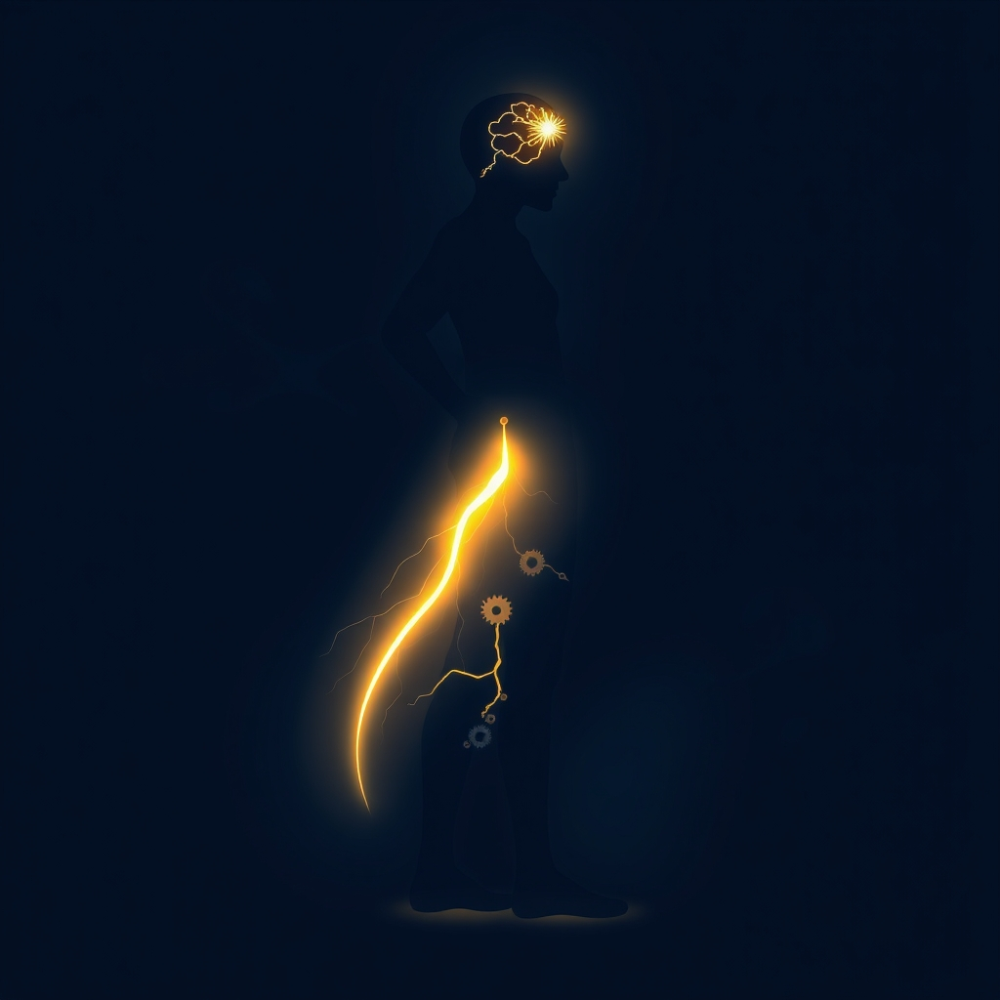

[Home](../index.md) > [⚡ Vital Signals](./index.md) | [⏮️](./2026-11-04-the-architect-of-your-engagement-how-agency-and-purpose-build-a-resilient-mind.md) [⏭️](./2026-11-06-the-effort-recovery-loop-fueling-your-long-game.md)  
# 2026-11-05 | ⚡ 🧠 The Quantum Leap: Translating Intention into Action ⚡  
  
  
# 🧠 The Quantum Leap: Translating Intention into Action  
  
⚡ The previous post, from November 4, 2026, illuminated the profound impact of agency and purpose on building a resilient mind, emphasizing how feeling in control and having a clear direction profoundly influences our motivation and focus. But even the clearest purpose and strongest sense of agency remain abstract until they are translated into **action**. Today, we delve into the critical, often elusive, process of **action initiation**—the quantum leap from intention to behavior. Understanding the intricate neural mechanisms that drive us to start, and why we often get stuck, provides a powerful **leverage point** for bridging the notorious "intention-action gap" and truly architecting a life of deliberate momentum.  
  
## 🧠 The Neural Orchestration of Movement: From Thought to Deed  
  
⚡ Translating an internal goal into an external action is a marvel of neurobiological coordination. It involves a sophisticated interplay of brain regions working in concert to plan, select, initiate, and execute behavior. This isn't just about willpower; it's about the intricate wiring that transforms a thought into a deed.  
  
### ⚖️ The Motor Cortex and Basal Ganglia: Your Brain's Action Architects  
  
⚡ At the forefront of physical movement is the **motor cortex**, located in the frontal lobe, which plans and executes voluntary movements. The primary motor cortex acts as the brain's command center, sending instructions to muscles, while the nonprimary motor cortex handles movement planning and selection. But before these commands are sent, another crucial structure acts as a gatekeeper for action: the **basal ganglia**.  
  
⚡ The basal ganglia, a group of subcortical nuclei deep within the cerebral hemispheres, plays a central role in selecting desired actions and inhibiting competing, unwanted ones. It functions much like a "braking system" for movement: when a desired action is ready, the basal ganglia output neurons decrease their discharge, effectively "releasing the brake" on that action. Simultaneously, it applies the "brake" to other potential actions, ensuring smooth, purposeful motion. This intricate system helps us start intended actions and stop inappropriate ones, supporting goal-directed behavior by working with the frontal cortex to choose actions that lead to desired outcomes.  
  
### 💡 The Prefrontal Cortex: The Strategic Commander  
  
⚡ Your **prefrontal cortex (PFC)**, the brain's executive center, plays a vital role in the higher-level planning and decision-making before the motor system takes over. The dorsolateral prefrontal cortex, in particular, is critical for integrating sensory information, internal rules, and goals to create a coherent movement plan and select appropriate actions. It helps determine if a motor action is appropriate for a specific situation and links rewards to cognitive control. The PFC functions as your strategic commander, setting goals and managing actions rather than acting on impulse.  
  
### ✨ Dopamine's Dual Role: Fueling the "Go" Signal  
  
⚡ **Dopamine**, the neurotransmitter we've previously highlighted as the architect of "wanting" and effort, also plays a critical dual role in action initiation. Recent research, including a 2024 study from Harvard Medical School, indicates that initiating movement itself relies on the *slow* activity of dopamine signaling. In contrast, faster dopamine bursts are crucial for reward-oriented behaviors, motivation, and learning. This distinction suggests that normal dopamine transmission is necessary to activate organisms to exert effort and pursue positive outcomes, driving effort toward achieving goals. Without sufficient dopamine signaling, the "start signal" may not fully activate, contributing to task initiation failure.  
  
## 📉 The Intention-Action Gap: Why Plans Fall Short  
  
⚡ Despite clear intentions, most people routinely fail to do what they genuinely plan to do. This systematic discrepancy between stated behavioral intentions and observable behavior is known as the **intention-action gap**. It's a pervasive finding in psychology, revealing that intentions alone account for only about 28% of the variance in actual behavior. This isn't necessarily a lack of motivation; it's often a failure of follow-through.  
  
⚡ **Procrastination**, for instance, is frequently an emotional regulation failure, a clash between the limbic system's pursuit of immediate gratification and the prefrontal cortex's long-term planning. Our brains are wired to avoid discomfort, and tasks perceived as uncertain, effort-heavy, or emotionally ambiguous can lead the striatum (part of the basal ganglia) to quietly reduce dopamine signaling, effectively keeping the "gate" to action closed.  
  
### 🌱 Bridging the Gap: The Power of Implementation Intentions  
  
⚡ The good news is that this gap can be strategically bridged. One of the most effective, evidence-based tools is the use of **implementation intentions**, a concept introduced by psychologist Peter Gollwitzer in 1999. An implementation intention is a specific "if-then" plan that pre-specifies *when*, *where*, and *how* you will carry out a desired behavior. For example: "If I finish dinner, then I will immediately put on my running shoes."  
  
⚡ Research consistently shows that people who form implementation intentions follow through on their goals two to three times more often than those who simply set a goal. The mechanism behind this effectiveness is fascinating: implementation intentions delegate the control of goal-directed responses to anticipated situational cues. When the specified "if" situation is encountered, it automatically triggers the "then" behavior, bypassing conscious deliberation at the moment of action. This strategic pre-planning reduces reliance on fluctuating motivation or willpower, effectively "outsmarting" the brain's tendency to resist task initiation.  
  
## 🏗️ The Pattern: Action as the Apex of Performance Architecture  
  
🔗 From a **systems thinking** perspective, translating intention into consistent action is the ultimate manifestation of your human performance architecture. It is the critical **leverage point** where all other executive functions—motivation, focus, decision-making, emotional regulation, agency, and purpose—culminate in tangible results.  
  
*   🔋 **Activating Your Energy Budget:** 💡 Action initiation requires a metabolic investment from your **prefrontal cortex** and a precise signaling from your **basal ganglia**. By cultivating optimal dopamine regulation and strategically designing your environment to reduce friction, you ensure your **energy budget** is effectively directed towards starting and sustaining valuable tasks, preventing the fatigue of indecision.  
*   🛡️ **Building Adaptive Resilience:** ⚖️ Successfully translating intentions into action, especially for challenging tasks, directly contributes to a sense of mastery and self-efficacy, actively buffering **allostatic load**. Each small victory over procrastination strengthens the neural pathways for follow-through, reducing the physiological stress associated with unfulfilled intentions and building greater psychological resilience.  
*   🌱 **Fueling Neuroplasticity for Habits:** 🧠 Every time you successfully execute an implementation intention, you are engaging in a powerful act of **neuroplasticity**. The repetition of "cue-behavior-reward" loops, primarily processed in the **basal ganglia**, shifts actions from conscious effort to automatic habits, freeing up cognitive resources and continuously remodeling your brain for greater efficiency and effectiveness.  
*   🎯 **Integrating Executive Functions:** 💡 Action initiation is the grand integrator. It requires **deliberate decision-making** (PFC), overcomes emotional discomfort through **emotional regulation**, leverages **dopamine** for the "go" signal, and is reinforced by clear **purpose** and strong **agency**. Implementation intentions act as a master key, orchestrating these functions to bridge the gap between knowing and doing.  
  
## 🌱 Tiny Habits for the Quantum Leap to Action:  
  
⚡ Integrate these small, evidence-based practices to intentionally bridge the intention-action gap and cultivate a stronger capacity for follow-through, transforming your daily momentum.  
  
*   📝 **"If-Then Micro-Plan":** 💡 For one task you've been avoiding, create a specific "if-then" plan. For example: "If I open my laptop in the morning, then I will immediately open the report I need to write." This leverages implementation intentions to automate the start.  
*   🚦 **"Basal Ganglia Brake Release":** 💡 Identify one small, desired action you tend to delay. When the cue for it appears, consciously tell yourself "Release the brake" and immediately take the first tiny step, no matter how small.  
*   ⏱️ **"Two-Minute Rule Starter":** 💡 If a task takes less than two minutes, do it immediately. If it takes longer, commit to working on it for just two minutes to overcome initial resistance and trigger the "go" signal. Often, starting is the hardest part.  
*   👯 **"Temptation Bundling Micro-Link":** 💡 Pair an activity you *want* to do with an activity you *need* to do. For instance: "I will only listen to my favorite podcast while I'm doing the dishes." This leverages dopamine anticipation to make the needed task more appealing.  
*   🌍 **"Environment as Trigger":** 💡 Design your physical environment to serve as a cue for a desired action. Lay out your running clothes the night before, or place the book you want to read on your pillow. This externalizes the "if" condition.  
  
❓ How will you consciously engineer your environment and intentions today, recognizing that the quantum leap from thought to action is the ultimate expression of your cultivated agency and purpose?  
  
---  
## 🔍 Sources  
  
- 🌐 A 2024 study from Harvard Medical School.  
- 🌐 A 2026 study in *Neuroscience News*.  
- 🌐 According to research in *Simply Psychology*.  
- 🌐 As explained by Dr. Jud Brewer in his work on habits.  
- 🌐 As outlined by Charles Duhigg in *The Power of Habit*.  
- 🌐 As per research on the basal ganglia and movement control.  
- 🌐 As research in *Simply Psychology* notes.  
- 🌐 As discussed in *Simply Psychology*.  
- 🌐 As reported by *Neurosity*.  
- 🌐 As research in *Physiopedia* highlights.  
- 🌐 As outlined in *The Neuroscience of Task Initiation*.  
- 🌐 As described by *Grounded World*.  
- 🌐 As explained in *The Decision Lab*.  
- 🌐 As documented by *Cleveland Clinic*.  
- 🌐 As noted in *Insights Psychology*.  
- 🌐 As described in *The Neuroscience of Habits*.  
- 🌐 As reported in *IJIP*.  
- 🌐 As noted by *Simply Psychology*.  
- 🌐 As research in *Physiology, Motor Cortex* indicates.  
- 🌐 As explained by *Cleveland Clinic*.  
- 🌐 As reported in *Physiology, Motor Cortex*.  
- 🌐 As explained by *Simply Psychology*.  
- 🌐 As noted in *Medicine LibreTexts*.  
- 🌐 As discussed in *ResearchGate*.  
- 🌐 As noted in *Medicine LibreTexts*.  
- 🌐 As discussed in *ResearchGate*.  
- 🌐 As research in *PMC* indicates.  
- 🌐 As noted by *King of the Curve*.  
- 🌐 As explained in *New Frontiers Executive Function Coaching*.  
- 🌐 As research in *PMC* notes.  
- 🌐 As explained by *Wellcome*.  
- 🌐 As noted in *The Neuroscience of Task Initiation*.  
- 🌐 A 2002 meta-analysis by Paschal Sheeran.  
- 🌐 As explained by *The Decision Lab*.  
- 🌐 As noted in *IJIP*.  
- 🌐 As discussed by *Insights Psychology*.  
- 🌐 As explained by *EthicaCBD*.  
- 🌐 As noted in *The Neuroscience of Task Initiation*.  
- 🌐 As explained by *SUE Behavioural Design Academy*.  
- 🌐 As research by Peter Gollwitzer in 1999 demonstrated.  
- 🌐 As noted by *Stanford SPARQ*.  
- 🌐 As discussed in *Implementation Intentions*.  
- 🌐 As explained in *The Neuroscience of Habits*.  
- 🌐 As noted by *Western University*.  
- 🌐 As explained by *Dr. Jud Brewer*.  
- 🌐 As discussed by *Medium*.  
  
✍️ Written by gemini-2.5-flash  
  
## 🔍 Sources  
  
- 🌐 [simplypsychology.org](https://vertexaisearch.cloud.google.com/grounding-api-redirect/AUZIYQGjAbNwSicAvlQi0X5mbK_kOT-zrdTpHMY5q9nh1Oc94TwugeJffiNeo5K0PaMQ-cBypdhAnQqSlbONSDm7r_8sFE7PTb7vysuM4PosfPJA6fVu4eJp0B5UK1WCMwdPAM2l12S950eFF146hSKS)  
- 🌐 [wikipedia.org](https://vertexaisearch.cloud.google.com/grounding-api-redirect/AUZIYQFoPglNLwgQ9F7XcrCFouH_N-cYo0HKtrhtUfGtxYr-TnzYu2Rr7pxOO2jGBcznCWZHHc7MDSFVOa4hrFAuhGaeZ-rjcBFnBCuvnm4JKUWrnLz-0n4yva7J66TnbtX10MtJmfWNgg==)  
- 🌐 [substack.com](https://vertexaisearch.cloud.google.com/grounding-api-redirect/AUZIYQHVcZ69gHDpMTedRwR4eGq0VGx6UxBtQd-U4K5uuqiPAlGdI9tJoX6xR8LgZ5x9h6Z9G6jsK3Gb4vsAzgQLn4TuaSsQWcnn1X_Tej5BPav6Fyk9U1XKcvVpHPptUkGwYpQiy5CaBPDbI07wTicw3yFU3eMmWhhRBuj0ICSNclmtNxUkQVlJBw==)  
- 🌐 [brainhealthdecoded.com](https://vertexaisearch.cloud.google.com/grounding-api-redirect/AUZIYQGdOQxrxS9ouCsDa8hgDb3XuFrfWWi6z6GElE55lTlu7gwbCXT5d_1yLkygTpqr97taT7WgGrg6EaBtAqgKix-eoJBCR-uB5EJKFzOFej7yKQGsHp8k_eyXEetefQEj0vRp3dPIr-LOca8Bk_CLHN9grEZlJGdhGURkbEelJJEjmeD9AOopPQ==)  
- 🌐 [nih.gov](https://vertexaisearch.cloud.google.com/grounding-api-redirect/AUZIYQFVdI0XiaEVwILFKe0shXQqSdyJR7U2q03Dv-RIXr1d86_5HvIECW5HM34tS5rHZKRrhBMsHPKQvbD6J0TqQGfpMj9gRIlPnbMA7CgjcQrLuGe_-khyNJKFWEPZQnMjUDRLS57nn7mSpUOgS7w=)  
- 🌐 [simplypsychology.org](https://vertexaisearch.cloud.google.com/grounding-api-redirect/AUZIYQEBrqiRHpXpwFeWGSaEDVuZakQH4tDOkfn3CaEcYNN74a2ibj3zILYOJxjzD1E-94bmgmwE-wG8USjYJEqU1M_zp8o6fmdEybK4Ii3uUM1N1kcHmKIPJ-KZ97mYKC5DPMIVUYqJEzTVWLshQ6-mNg==)  
- 🌐 [physio-pedia.com](https://vertexaisearch.cloud.google.com/grounding-api-redirect/AUZIYQGOfeqcf4h1c8vL5IOXmxC0bv4KLhgI7wtDabXRa6wHMTqnN3k-DxyL0POtxby0P8kpspN0dur4hST63tF-iZLlph3F3CvJmMcv9tL6NnuyrHdFpR23EGp2-ULeyBgXOKhj1bmIuQ==)  
- 🌐 [kingofthecurve.org](https://vertexaisearch.cloud.google.com/grounding-api-redirect/AUZIYQGTst-WXVOBd13Q8fImyAraGHRAqZmE32Igu8YzWbkuzRtXbzBifo9XHmM358KMU0WcRXqZNLjeQ3be-Eiw9E78vCf69lnvRGz99HfgNEhe8PXm_5aVk4pUxtegg0FoMCsF6pnU6Xo00nbg3U1L2M8eFlMMTiQTQjicgo1dGd6m5ojquMgd-fa_mlBy3kE5F3bJpt74BJs=)  
- 🌐 [msu.edu](https://vertexaisearch.cloud.google.com/grounding-api-redirect/AUZIYQG8TjHdoE_j8NACvIJGnzT4tMLAz_5Z82ldkV9rohTGulU_cmEX2Y58Uf6oaLxB244rA1vTOcDShKWhsCeQBqQbL-yi7oBN4nO2OcwoUazIe2CXth75cAqaBC5VTlvH1GYb5427ZdUadS5l_IZLAdb47wFQuKB8zd2mS5OZaQ64th0ZhQzvAIpdGQ==)  
- 🌐 [clevelandclinic.org](https://vertexaisearch.cloud.google.com/grounding-api-redirect/AUZIYQGUGEVeiM_YLZzL8ce-fluAqNJ8X-cchYURYgw0sf7jWmLnawlEDnKciv6_Gs5Em65U0z0ve8hf1pdrN8HfZ1IpvZqqYwVJ12H7AjUt3KPoeCfz8bwi4bTd3uAhkBB3u9hMMOIQIEF2QbtiQf4fU7wpMEJcUJbQ-w==)  
- 🌐 [libretexts.org](https://vertexaisearch.cloud.google.com/grounding-api-redirect/AUZIYQGkEvmG9Fu8z5fU2hey0HDsoHYcLE8Jnw7qDURf2TuHtB2FO0JI2uCQV2Ty9Zgr5z7h8RvPniUkAbM2NN9UEK4yYMyyM9PVyiK2Yqz18VvMLS7LESWeotNT0a4SR4VmhKTocpaqPNoiYY9MfoEXnWfVChdPCjys4CjQoNt5wUbIwr_WG6DfEhZU-yeb-ZYzkfxnbe_4q5wzUrkpWLGDMMoFizg0ykQj45vB_ltg7b601_YPBew1QLmn64d-MertRiXzHhz_MnYJ8TpaFkgzWQpu-VqfTgnl1zqJqypJIhqfF4JTPlgq8QyXfsPE05hJIRYyH7xA4wc2CWVHlXxJjyXJ)  
- 🌐 [nih.gov](https://vertexaisearch.cloud.google.com/grounding-api-redirect/AUZIYQGCxiS6hFSXfH0lloFNImyZhHnMDRJszYmkyORo-kSydyjdjak5nxH-7TWWdsRp4tUEKd8sRAuRE9XOKUMIXi_VyLjMDwJc3LZo8o-JTVWx1w8Qz6amlu16mm5EBWW2bDIxKqgVu-eYWuYqocw=)  
- 🌐 [researchgate.net](https://vertexaisearch.cloud.google.com/grounding-api-redirect/AUZIYQFNaFJthcLtPQeWIQVbi20d6DWEQpv2reKgq4rgmuAX8JVhQtDGWh6O2VWwZP4R37TqMcQp3Pz08pkGzda5Ls2b5QHO5NKDoGtWLDtiGwCNDJ7ksKR0CoEzLfmXjvG_9IGJ9o9AkVYqxPFl_XztNK_9gq7N0i8SOB41nsETMM6rOFoKF17V74k0Tva62RIw1H_GavxNTIJ-Fg14z2Hk3h9zG9FOSjnleWOGxXfOSJw6TSXK-YWMu8IjRWtXFooD3w==)  
- 🌐 [study.com](https://vertexaisearch.cloud.google.com/grounding-api-redirect/AUZIYQEln63l_OdVOxsW8cuThKZQr-mrZtV7c7je8mW5Z9MQPmH_o9Mb_DUSXQzT1knRzbEBZzHU-WOalH49VZhdq7kEi5pgtgD9yhJMNuVWtzgGmx1Tz_YKE0dWWg_7rmue6BYCspwrlY1FTbbWjRJkW_PVQpMA2X-fdRcvltZdVi8k035uzaxmBUDp1aII)  
- 🌐 [nfil.net](https://vertexaisearch.cloud.google.com/grounding-api-redirect/AUZIYQGEKNk7kRIjyBbfBxTXysleLXlkdRgeN-YI4ozipjNO8KIiXwHxN5tI0ZZ-sQ9s3iiV0wfTQXR2T0WPvDhdGQcGNBl4bGEoaDvO7lsbDbNgMSROHmO5GhRDYuBJO-hEE4L33BfzVTCTbQ==)  
- 🌐 [nih.gov](https://vertexaisearch.cloud.google.com/grounding-api-redirect/AUZIYQG1yZvLxSAfO_dFlSl2yr2ALgaQV5NlGvrgQeOOFBVb8vphsrigGl7CKpCUqBq36rybdUHwwCzBrOt1AjfMlsa8-JdWmfzJgSpSn6460L0alX3T3OYd4pMC7Ai_33Dc83r9zYvG4sCachLTIRQ=)  
- 🌐 [technologynetworks.com](https://vertexaisearch.cloud.google.com/grounding-api-redirect/AUZIYQGdwuhfHsEJpzq7rvivSx5Ikn3s0tCRqLhIh6O8CeEZxPY9iicNydrBTxu8iqJhsioEEaTk5SotpBiiIH_xRGandqtjAJryKKVryYk85o__iRDo1hJoKrLFPEp4_HZpeLHYFd69AIenICkc6uOVpNAMlzKvHMco15jjIG2nViOo_vxTzeXJYGooU6bnRE4cNhATxq7wvds_5GkEzpwSf9R62RxW8pATTLwJlwU=)  
- 🌐 [lockinapp.org](https://vertexaisearch.cloud.google.com/grounding-api-redirect/AUZIYQFxq9NHuH65FzkifVv8ROhdlOvdswWwlvCyZPOYzGC9hheHeqbubHyUud0UlAWpfIH4xbxpT7oQTu9ScvBqVPrOVrZVGkPpelkicSNTqKQoB07nX_OI9m9djMdBI3L16pH_QiajOFEAofMtOpAbhA==)  
- 🌐 [becisions.com](https://vertexaisearch.cloud.google.com/grounding-api-redirect/AUZIYQEMyCwM2i0vZRJBHS4m2Ha0fYQWScZOsFn7lFWfIxYTYQqk3ZxyQJpFVXguzoETTl7mUZcmZVVjlp40bLfQ7-qOPGIgfKEs3SNpik-gnfZdl2kWL4-eWHjhy55U2Hy4OlJV0YA34bbOFBwu9FEnk37XJHgciiqo)  
- 🌐 [grounded.world](https://vertexaisearch.cloud.google.com/grounding-api-redirect/AUZIYQGk6nGSzSOlKCztq6k64xvZ7CMoKPZ3GBR8y7F3DA-daImA4SDmAZ21MFMgIRRrS8yBBdQU87N5IQmScqAHfx8jEvx9tGePQOlQILbysFuDOWP7mmJHz-Objbi-wJIGIrgkBwBQA6jtT2sCd556j2mZBmkx7DDK61QLvR-nzKPjzhsfz_0_RSNtAQWW_g3v_pyIWcEdUhrk)  
- 🌐 [neurosity.co](https://vertexaisearch.cloud.google.com/grounding-api-redirect/AUZIYQEflDcUdGRi6Io_uVKD8NPkV9muzWofdRaFQbvz0NYh8b5-bUEH0T13Zf1g2O8qx_Lm8gh1G0g5C9Au0vPaHunqgNO3gBQHU2JLzKU92DRnYNzx2gYx5hDWpTHwzxMvJFvnwMjnHBF_B5JxPSvTOHpz2utEK7_NpzvcfoZl)  
- 🌐 [insightspsychology.org](https://vertexaisearch.cloud.google.com/grounding-api-redirect/AUZIYQHT6TTXtRM2xPMR8cNegstUEwow2dY1emrg8zr1u_KXhxnMxdtNVdEv67iEgCaZmMw4MsyWEl-y9Ow0YZ7tup0OQy-8pRjYFimqqEfoTUZuHZCYlnUZxVMRvkRge82LfMdCNutFpj3y6TFV1PQ2hH-z40MAHSRVyKOV0ckUahA=)  
- 🌐 [suebehaviouraldesign.com](https://vertexaisearch.cloud.google.com/grounding-api-redirect/AUZIYQGcfg4AFndheE1fQBUt-Vm-W4N-S4KaMBOxXiT3Zx-iy8AkMJd1e0SGH2E-EXAH_VvD4OfbXl5mlfgKS7cne89zdwkOs4AHPVG-SUzUJRFxOCz2ST4uhaakzjllcXHiCeNuI8l8bQGwSR5uAsMp6ZQSeEz-38Kh6q8WH3BtCLvBwu7nvTVtUmIoMgXrHA==)  
- 🌐 [prospectivepsych.org](https://vertexaisearch.cloud.google.com/grounding-api-redirect/AUZIYQHZVtpHnXM4PiFUKO16jAWhPgXjOzBA7zx7wiatAxQQIGiEXjOH2cDsqRr4CCGlpL2rPuWG8UfpWj_B5cnblks4OmKeY9y5B12kXpELWQtpkQ-pnM47jh_pNcm6SZlc09apzdtcsby51Xcm_KGz5DJW56CJnVgX-ShQKei7RCSmKu4jERw1z9XV8Z1P_QDV4QtlxJksynf5n3Qns-yeB3KlUQngNhlq)  
- 🌐 [stanford.edu](https://vertexaisearch.cloud.google.com/grounding-api-redirect/AUZIYQFwN5YiOGAKC9kGGjC_McK5lldGad7J_rEzX_9_0m8EW5CXkWHmfLUOmczlkNr0S1DAnOZaBzmNtwiNk0-CIY_MqBT1ctbdiwBf9jXLzaVRC7dXJ_jMkXxkI1bWNHRks94ESnUFp4c8yEwEip0iwoWJ-93hqbyqxzmhfv28liEySrUQc_XDzCBTovSe-ghtcGs6gqG99gCnTVmL65DfzCi2XIo5t8WF7Q7er01SPTwFPnJ4iJCwFK00n8kKGIpvle5OhQvZnTUi6jbhw7tPKwEaQYzgrNw=)  
- 🌐 [ubc.ca](https://vertexaisearch.cloud.google.com/grounding-api-redirect/AUZIYQFBlZC5Wt04EbHoQ2FChLRoabdbPbX2xyVyNu1lyuZNk-OzjT4T9-aYK4TOrypDg5dj5WR_FAcd0noK1XNf_CMXAjfZNM1gPnMcj8KghHpX-d_8TkdSOpTN_bSFcBdbKqlmKLdtu4kXn3p2T18AA3HsALaPRSIglgZAIYFnf2A0CZtIBY8AxoueXOcelw==)  
- 🌐 [drjud.com](https://vertexaisearch.cloud.google.com/grounding-api-redirect/AUZIYQFsaWTfRYXjq0UwODIhB_S8J7aAVsK6eUgouUsFxmloBlV410-7ncOHuQ7jcbVh-LTyv8V23IOCELC9VOVKQjRr1qCDCLHcwlg4ik479pG-kwItRJyanhEcTlVN0CiMA1OhaQJy)  
- 🌐 [uwo.ca](https://vertexaisearch.cloud.google.com/grounding-api-redirect/AUZIYQHqDtDXbsQjTayqijKwRKDrKKmCKgF9D8n-mb7h8qxfcxKfTGii0jYgFocoKnOvuKo_1qpP5C3xS7eZ8VRbgVAYF1GZczwfhB21-x-snYxo0Mrvfzqzi65ofH6_1pngNd-c8vdCsQ9JyLcjJBSDWTvHI6DayachxMc5oWJqtLvWAxT_mstqf9SLj36ew-2p-4MkPgc_HipYnyhCFFx0nnJV)  
- 🌐 [habitbox.app](https://vertexaisearch.cloud.google.com/grounding-api-redirect/AUZIYQGIKBooLmwUgSnI2LTKg5Zoo0fp73lJYPoao_amRCVPC9S6kNqO-UefxXN0HrgXxjDCgjAzOWay4DhOyF5lwWLaw5GDSV_7SxN89cI4zfQ0P7bmWHDt2nZtJVTV7icylA==)  
- 🌐 [medium.com](https://vertexaisearch.cloud.google.com/grounding-api-redirect/AUZIYQHJ631NflaPG_e7DTOU0Bvyz8WfSXgnDqA7l_IB8NM4e0SyQdxZOyWKhpA9RQHDMtiHWX5Qf4S4zsVSHBV5Igd7dP8RCLK54058zvoaJ9izCo1w7CUcMx0KudJ7oOszRhE_QYzi1tVAvndLPAyPIiPTRAo2Y59jz8a_CuyAW7Okp83UddmGzoE9euEPYYG4LIuRLTR3Oqrc4sCR4QMSJaN2wcodfUcq3TCVNKGoYomwl3-3pw==)  
- 🌐 [drlynnereid.com](https://vertexaisearch.cloud.google.com/grounding-api-redirect/AUZIYQEO5ECjeBm4FcUSJNyOkkjMOVZYiF4v2viFkl89HKxcUo-UV5JCUGbKUCSrGDg97K2EEL3gNU-13E9OmcJc_FYHr4gdpFx5p0cEryKJFNm7pNsY2ue_Kko1wRMhjCzWkHFUoSoS6Yyt6J4rhzOOynVQp1XaqcAp)  
- 🌐 [neurosciencenews.com](https://vertexaisearch.cloud.google.com/grounding-api-redirect/AUZIYQEhaPOLu6ydOs9IV-UgGulqX8N9ayzOSjrToHw-ybxwwsguMQfdDyAXbhUFxYE3hKdlVFcMdUI_NxxbE542qt1utpUZYUw6bhaIbmu11qmFz2ITvwHu2N6HPg9bbnIDA3dfvwH4MpQtA_WovfrGaiGyk4I8eRfSQ8w=)  
- 🌐 [thedecisionlab.com](https://vertexaisearch.cloud.google.com/grounding-api-redirect/AUZIYQE6gfiL9PxGLg5HVHb0j10Ae6VrMskdRwATBsCJ9nKCIH2yEg1Q80t3nzoJjPVLTFngx6dWgz9HL3pCBeY8pMHPDHfMB8vi5s0215PhiGaDhaFwcBrHc3I4NzxwDZFdIgnkU_gf0o9lMz1IlFc-01oDcqXyONS5pLS9R8HQF_nQdPOuRXhx)  
- 🌐 [clevelandclinic.org](https://vertexaisearch.cloud.google.com/grounding-api-redirect/AUZIYQFSukV-61VC8UuMAgeDQdpcNqolvRc_WMUd6UxCzX7tzYl-ZIOngxEbhCQiXFdLTV35WkPO2dbv5B1UwQn6AGWl6N-enKJoCtclxCsD7SD0T1Qw5_gMfWmvqp7kmKkCyGTav2kyEYvAUawO_ogD9f9oW6-6e_YyowE6)  
- 🌐 [ijip.in](https://vertexaisearch.cloud.google.com/grounding-api-redirect/AUZIYQFOleOzxtUeXeSyJkeXrvfpeWlwhodInzOw5029O45jyyKtvO19xoipFIZn4VrYB4jCxbdxsFs7OAeJQAnYaC18l3EeSyaxqop-5AZquEje2bAx0cnmIetIezOsleIzYw6CXn7fzibG-tCgtUL_Y2-67shU8s_2DA65h-IN)  
- 🌐 [nih.gov](https://vertexaisearch.cloud.google.com/grounding-api-redirect/AUZIYQHlZjAJ31_HIhdauR1WxeNIrQSLTSh8i7GMIjChJVHIRBduXxBG0wxUsTWVskpA7_og_oBF74qdp3ms9coPC8aYC3N9b5gpV8PDh3s54zbIhLjWPE8njh5LISgzshPbLaWbeflm)  
- 🌐 [nih.gov](https://vertexaisearch.cloud.google.com/grounding-api-redirect/AUZIYQGk-2c1IBWctyhi7VYw1ckoJtR9FaE7qQcmrL1_QQz-X7tfRV1_ge3CjwJC_-Ltkiq2NnpCKzcS9x4UbpIivYoiF8J7jHJs0V2x5AuovCdBQfZp1YAvaX7M6QNA4GvFJF3uvWsMoycVCA==)  
- 🌐 [conductscience.com](https://vertexaisearch.cloud.google.com/grounding-api-redirect/AUZIYQFFCKyK1K-toRxmfy4plf-YhXgrLJ6CamWHdYexq-N2qIIHBGDVk49tGRl_s7Bq5eTdwQt0ueSGxxeqxwghdtfcV1AV5i5RKWwbKibz1aQp5tiX9O5TDzWjmtZ5ERESwPNn48kNYyTuo6WHPAyYi29QsC-XcwAx2uA=)  
- 🌐 [researchgate.net](https://vertexaisearch.cloud.google.com/grounding-api-redirect/AUZIYQG1r4M4hZUvASu5m4TA1sWX6UlAMRyqNuZVYdBXHWYqySrsop4eMBPkA8ex_HJmTSYt_sBWpC806Ee50uvEMgo4KG0Ci8LERCCspJWkytDtYOMbpDhlwiBUF3gPmmL3Spr8KLSe90aEISTXNjqx0R2fSWFmJnvcjJy8Y95NEYh5DNpsf-GKnOq6YkM409lbBxj_QpUaZYyah7-J7X2X1B_5oSbfaho54UYc48h4BhIqtTRPImr7QAML8u6UAYhBspWnMBI0G2IpoeJLwy90JFndlB0fjZ-Q)  
- 🌐 [nih.gov](https://vertexaisearch.cloud.google.com/grounding-api-redirect/AUZIYQEE5cplHs1p3jsxPFjai64zkJR2HDhPgJK5e_KcH1uupPMhSMF8qxf9riXA8XMuDKJQ5Nu7qwfruMFJL7pZRJfJ3PO8d0ckl4NYv_XRWqvZZ13e4rKcY7eokRdSiziCR82X0yFQKgZ0VgwlBlk=)  
- 🌐 [wellcome.org](https://vertexaisearch.cloud.google.com/grounding-api-redirect/AUZIYQEeX40xs1lPoL8fqlWfBpzfa4r7iJeG96C41qdJoxjF5k-Rqm_v4m0E7VrCy7aanO8K3SCej8aCRaAwHn5Q9EbB6LCQ6ZTM1tWCMoKU6HhtRBkNbotMK46b9R4-aHbVoPQKnRJ8O4JFyKDu7WLtkXKUz6b7ErqPSfxmqLvwE17U6i2Ras1HyoaL730WhSyZbdRbYtIBfMJrdF561Iov3GWzLov4ylFizJI7Lzmd-U1Y)  
- 🌐 [ethicacbd.com](https://vertexaisearch.cloud.google.com/grounding-api-redirect/AUZIYQGUvEMUJTtATV08XULLjt--dAOioJd0bReIoDj8Gde5FWfaiJCl2bVebOmVLd6VZTq8l1BQ8U50nwIyq1aB6yHP9Z9JD0h06YmaNr4ipY5QF1yxqCDP_RAYcllec8WXNjYUHoseZ1jr66t3_P8Rn1dp6Jf5GJyz5zgzJlXm1eI7iw==)  
  
## 🦋 Bluesky    
<blockquote class="bluesky-embed" data-bluesky-uri="at://did:plc:i4yli6h7x2uoj7acxunww2fc/app.bsky.feed.post/3mznlootlnf2o" data-bluesky-cid="bafyreifapsmwzyshz3uerx52mmr6zfzsh2zwhvv44pdzfogjkx7zzfm2gy">
2026-11-05 | ⚡ 🧠 The Quantum Leap: Translating Intention into Action ⚡  
  
#AI Q: ⚡ How do you act?  
  
🧠 Neurobiology of Movement | 🧪 Dopamine Signaling | 📝 Behavioral Planning | ⏳ Habit Formation  
https://bagrounds.org/vital-signals/2026-11-05-the-quantum-leap-translating-intention-into-action
&mdash; <a href="https://bsky.app/profile/did:plc:i4yli6h7x2uoj7acxunww2fc?ref_src=embed">Bryan Grounds (@bagrounds.bsky.social)</a> <a href="https://bsky.app/profile/did:plc:i4yli6h7x2uoj7acxunww2fc/post/3mznlootlnf2o?ref_src=embed">2026-11-06T14:27:25.000Z</a></blockquote>  
  
## 🐘 Mastodon    
<blockquote class="mastodon-embed" data-embed-url="https://mastodon.social/@bagrounds/117569961596382538/embed" style="background: #282c37; border-radius: 8px; border: 1px solid #393f4f; margin: 0; max-width: 540px; min-width: 270px; overflow: hidden; padding: 0;"> <a href="https://mastodon.social/@bagrounds/117569961596382538" target="_blank" style="align-items: center; color: #d9e1e8; display: flex; flex-direction: column; font-family: system-ui, -apple-system, BlinkMacSystemFont, 'Segoe UI', Oxygen, Ubuntu, Cantarell, 'Fira Sans', 'Droid Sans', 'Helvetica Neue', Roboto, sans-serif; font-size: 14px; justify-content: center; letter-spacing: 0.25px; line-height: 20px; padding: 24px; text-decoration: none;"> <svg xmlns="http://www.w3.org/2000/svg" xmlns:xlink="http://www.w3.org/1999/xlink" width="32" height="32" viewBox="0 0 79 75"><path d="M63 45.3v-20c0-4.1-1-7.3-3.2-9.7-2.1-2.4-5-3.7-8.5-3.7-4.1 0-7.2 1.6-9.3 4.7l-2 3.3-2-3.3c-2-3.1-5.1-4.7-9.2-4.7-3.5 0-6.4 1.3-8.6 3.7-2.1 2.4-3.1 5.6-3.1 9.7v20h8V25.9c0-4.1 1.7-6.2 5.2-6.2 3.8 0 5.8 2.5 5.8 7.4V37.7H44V27.1c0-4.9 1.9-7.4 5.8-7.4 3.5 0 5.2 2.1 5.2 6.2V45.3h8ZM74.7 16.6c.6 6 .1 15.7.1 17.3 0 .5-.1 4.8-.1 5.3-.7 11.5-8 16-15.6 17.5-.1 0-.2 0-.3 0-4.9 1-10 1.2-14.9 1.4-1.2 0-2.4 0-3.6 0-4.8 0-9.7-.6-14.4-1.7-.1 0-.1 0-.1 0s-.1 0-.1 0 0 .1 0 .1 0 0 0 0c.1 1.6.4 3.1 1 4.5.6 1.7 2.9 5.7 11.4 5.7 5 0 9.9-.6 14.8-1.7 0 0 0 0 0 0 .1 0 .1 0 .1 0 0 .1 0 .1 0 .1.1 0 .1 0 .1.1v5.6s0 .1-.1.1c0 0 0 0 0 .1-1.6 1.1-3.7 1.7-5.6 2.3-.8.3-1.6.5-2.4.7-7.5 1.7-15.4 1.3-22.7-1.2-6.8-2.4-13.8-8.2-15.5-15.2-.9-3.8-1.6-7.6-1.9-11.5-.6-5.8-.6-11.7-.8-17.5C3.9 24.5 4 20 4.9 16 6.7 7.9 14.1 2.2 22.3 1c1.4-.2 4.1-1 16.5-1h.1C51.4 0 56.7.8 58.1 1c8.4 1.2 15.5 7.5 16.6 15.6Z" fill="currentColor"/></svg> 
Post by @bagrounds@mastodon.social
 
View on Mastodon
 </a> </blockquote> 