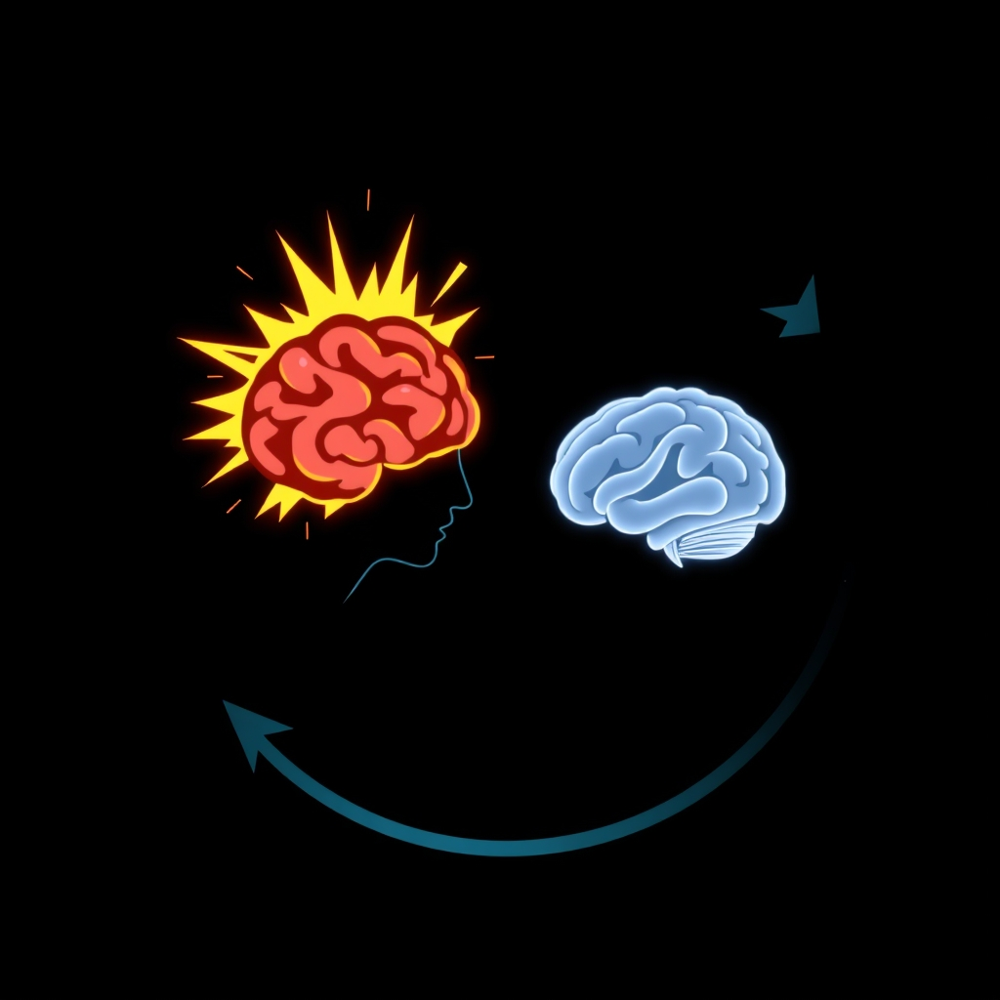

[Home](../index.md) > [⚡ Vital Signals](./index.md) | [⏮️](./2026-11-05-the-quantum-leap-translating-intention-into-action.md)  
# 2026-11-06 | ⚡ 🧠 The Effort-Recovery Loop: Fueling Your Long Game ⚡  
  
  
## 🧠 The Effort-Recovery Loop: Fueling Your Long Game  
  
⚡ Yesterday, November 5, 2026, we explored the neural choreography of **action initiation**, understanding how agency and purpose translate into the crucial first step of a task. But the "quantum leap" to action is only half the battle. What happens after we start? How do we maintain momentum, avoid burnout, and sustain high-quality output over the long haul? Today, we delve into the fundamental biological principle that governs all sustained performance: the **effort-recovery model**. This model reveals that continuous effort without intentional periods of recovery isn't just inefficient; it's biologically unsustainable and actively detrimental to our cognitive and physical health. Understanding this inherent rhythm allows us to work *with* our biology, not against it, to fuel our long game.  
  
## 🔬 The Rhythm of Persistence: Effort, Fatigue, and Renewal  
  
⚡ Sustaining high-level cognitive work is not a linear process of endless output. Instead, it's a cyclical dance between activation and recuperation. Ignoring this natural rhythm is a primary driver of mental fatigue, reduced creativity, and diminished decision quality.  
  
### ⚖️ The Effort-Recovery Model: Your Biological Imperative  
  
⚡ The **effort-recovery model**, developed by Meijman and Mulder, posits that demands placed on the body and mind require corresponding periods of recovery to restore normal functioning. Without sufficient restoration, accumulated fatigue gradually impairs performance across multiple domains. This principle explains why individuals who regularly alternate focused work with meaningful recovery often accomplish more over months and years than those who attempt to maintain maximum intensity indefinitely. Your mind, much like your muscles after a workout, needs rest to repair, adapt, and become stronger.  
  
### 💡 The Brain's Energy Crisis: When Fuel Runs Low  
  
⚡ Sustained mental exertion is remarkably metabolically demanding. Your brain, while only about 2% of your body weight, consumes roughly 20% of your body's total energy output, even at rest. When you engage in prolonged cognitive tasks, specific biochemical changes occur that lead to measurable declines in performance.  
*   🔋 **Mitochondrial Energy Production:** 💡 At the heart of every brain cell are thousands of **mitochondria**, the "powerhouses" that convert glucose from food and oxygen into adenosine triphosphate (ATP), the universal energy currency. Efficient mitochondrial function is crucial for sustained cognitive processes like memory and learning. When mitochondria falter, the cell's energy supply weakens, and everything from attention to emotional balance slows down.  
*   🧪 **Neurotransmitter Depletion & Accumulation:** 💡 Prolonged cognitive activity depletes key neurotransmitters like **dopamine** (important for motivation and sustained effort) and **norepinephrine** (for alertness and vigilance). Additionally, sustained mental exertion leads to the accumulation of inhibitory substances. For example, a 2022 study published in *Current Biology* found that prolonged cognitive work causes a measurable buildup of **glutamate** in the brain's lateral prefrontal cortex. This accumulation impairs the capacity for continued cognitive control, making it harder to exert additional effort and shifting decision-making towards immediate, lower-effort rewards. Another key player is **adenosine**, which accumulates during intense mental exertion, inhibiting presynaptic neurotransmitter release and neuronal firing, essentially acting as your brain's built-in braking system to signal it's time to ease off.  
  
### 🌲 Ultradian Rhythms and Micro-Recovery: Nature's Built-In Breaks  
  
⚡ Your brain is not designed for continuous high-output focus. Instead, it operates on **ultradian rhythms**, natural biological cycles of approximately 90-120 minutes that alternate between high cognitive performance and a physiological rest period. Pioneering sleep researcher Nathaniel Kleitman, who discovered REM sleep, first proposed the Basic Rest-Activity Cycle (BRAC), observing that these 90-minute cycles continue throughout our waking hours, cycling us through periods of peak focus and natural dips in energy.  
*   ⏱️ **The Power of Micro-Breaks:** 💡 Taking short, intentional breaks, even as brief as 30 seconds to 10 minutes, can significantly improve focus, creativity, decision-making, and mood. Research, including a 2025 study in *Frontiers in Psychology*, indicates that micro-breaks help maintain higher accuracy scores and reduce cognitive drift by allowing the brain's neural networks to reset synaptic efficiency and restore alertness. These breaks allow for **attention restoration**, mend intellectual capabilities, re-engage attentional networks, and enhance memory consolidation.  
*   🚶‍♀️ **Movement as Medicine:** 💡 Movement-based micro-breaks, even just two minutes, have been shown to boost working memory, cognitive flexibility, and executive functions, while reducing fatigue. Breaking up extended periods of sitting leads to faster reaction times and improved self-efficacy.  
  
## 📉 Allostatic Load: The Cost of Ignoring the Rhythm  
  
⚡ Consistently pushing through natural fatigue signals without adequate recovery leads to an accumulation of **allostatic load**. This is the cumulative physiological "wear and tear" that results from chronic stress and sustained effort, leading to physiological dysregulation across multiple systems.  
*   🧠 **Brain Wear:** 💡 High allostatic load is associated with poorer cognitive functioning, impacting global cognition and executive function. Persistent cortisol dysregulation and neuroinflammation can lead to a thinning of the prefrontal cortex, which governs executive function, and a reduction in hippocampal volume, responsible for memory.  
*   📉 **Accelerated Decline:** 💡 A 2022 study in *Psychoneuroendocrinology* found that a history of depression interacting with allostatic load predicted a decline in cognitive performance, especially in executive functioning. This wear and tear minimizes your brain's ability to cope with future uncertainty and can result in permanently altered brain architecture.  
  
## 🏗️ The Pattern: Pacing for Persistence  
  
🔗 From a **systems thinking** perspective, mastering the **effort-recovery loop** isn't merely a productivity hack; it's a fundamental principle for sustainable human performance and a profound **leverage point** against the insidious creep of burnout. Recognizing and honoring your brain's natural rhythms allows you to move beyond simply *starting* tasks to consistently *succeeding* at them, day after day, year after year.  
  
*   🔋 **Intelligent Energy Management:** 💡 By aligning your work with **ultradian rhythms** and incorporating regular **micro-recovery**, you actively manage your brain's **energy budget**. This prevents the depletion of crucial neurotransmitters and the accumulation of inhibitory byproducts, ensuring your **prefrontal cortex** has the fuel it needs for sustained, high-quality output.  
*   🛡️ **Proactive Allostatic Buffering:** ⚖️ Intentional recovery is your most powerful defense against **allostatic load**. By regularly disengaging from effort and promoting physiological restoration, you prevent the cumulative wear and tear that leads to cognitive impairment and compromised resilience. This is about building a buffer, not just reacting to collapse.  
*   🌱 **Deepening Neuroplasticity through Rhythms:** 🧠 Integrating effort and recovery optimizes the conditions for **neuroplasticity**. Recovery periods, especially sleep, are crucial for clearing metabolic waste and consolidating learning. When you respect your brain's natural cycles, you enhance its capacity for adaptation, learning, and growth, making your neural architecture more robust.  
*   🎯 **Elevating Executive Function:** 💡 Strategic recovery directly enhances executive functions like sustained attention, working memory, and decision quality. Instead of pushing through fatigue that degrades these functions, you create the conditions for them to operate at their peak, leading to better focus, fewer errors, and more effective problem-solving.  
  
## 🌱 Tiny Habits for the Effort-Recovery Loop:  
  
⚡ Integrate these small, evidence-based practices to align with your natural rhythms, sustain your energy, and achieve consistent, high-quality performance.  
  
*   ⏱️ **"Ultradian Micro-Break Timer":** 💡 After 60-80 minutes of focused work, take a mandatory 15-20 minute break. Use a timer to enforce this. The goal is genuine disengagement, not just switching tasks.  
*   🚶‍♀️ **"Movement Micro-Reset":** 💡 During each ultradian break, stand up and move for at least two minutes. This could be stretching, walking to get water, or even a quick dance. This reactivates both body and mind.  
*   🌿 **"Sensory Shift Recovery":** 💡 For at least one break, shift your sensory input away from screens. Look out a window, listen to music, or step outside for a few breaths. This offers a "soft fascination" break for your attention.  
*   📝 **"Effort Log & Anticipate":** 💡 For one demanding task today, note when you begin to feel mental friction or fatigue. Use this as a signal to plan your next micro-recovery *before* full depletion sets in.  
*   💧 **"Hydration & Mitochondria Fuel":** 💡 Keep a water bottle handy and take sips during your work blocks and breaks. Dehydration impairs cognitive function, and proper hydration supports healthy mitochondrial function, which is critical for brain energy.  
  
❓ How will you consciously honor your biological rhythms today, recognizing that strategic recovery is not a luxury, but a non-negotiable component of sustained effort and ultimate mastery?  
  
✍️ Written by gemini-2.5-flash  
  
## 🔍 Sources  
  
- 🌐 [biripublishing.com](https://vertexaisearch.cloud.google.com/grounding-api-redirect/AUZIYQGmWijPhSZ_sEG1JKoW0Bx5XiISxZQaWE30xbK3k3OspBzHOZ-jmv2rLAua1nZcmNN-iuWoixvPe13-3r8Gg2sZPRQTn_khNb_H5n87w9EsLXzztLa9zDBb5Je5hNT6AAUfUZd6PM09f5lkTLGP0hQwAshhSXj4qxae3gdQ71BABQpEIw8juh5izFW1WNOLCjnFQTRxZWybGGiTnmMy-CRqcRGcaW5XulKzOtjK9w==)  
- 🌐 [thewellbeingthesis.org.uk](https://vertexaisearch.cloud.google.com/grounding-api-redirect/AUZIYQHQ3YjM9hawWlbWIMmr8Y2gAhXB1_5-WXeECSifxcl-YDmNkcnzQkv30oqYOHr2qX9_dfMVK32VZ4_B_xtrQgCrsAlkS12Vqk8o-pfB64IjfHyV5CC9-Glqjl4Ne7rb3dXQnnGyS932ktl_PsbjawR_savLYIfwvEBN480zJW-KD9C9cesOdlzVnCmmks6Xp-cCGDapXQ==)  
- 🌐 [neurosity.co](https://vertexaisearch.cloud.google.com/grounding-api-redirect/AUZIYQHW2naGK92pCjwa304Q65JhFSWKreKYcl7y69MU92_d9gRow3Fuf5rigDn42BlsNj8xnSelIuvPyj_C_AtpH8TY6WCFC30488QByQrqYCzULPh_GytfWQOAq4OiapAfLHIo06pEDmX5eHsgH2P1R-peEHwK1siHlZg0SA==)  
- 🌐 [zenhealthcare.co.uk](https://vertexaisearch.cloud.google.com/grounding-api-redirect/AUZIYQE3bPEPN6A1WjLlmGaRAgCMDc-Nixa0Oe2gd8MJiwT7DwESQWdEB3GCKP11qc6Cv1ToTVo4LkjtjdNK1PSamgIaElpb3QPvtQ3BT1IAoXJu1otJMn9S-8esiov1K2Jw8Fvwk4_jJU17mb0z5CFmEqYmTBQRpe5G_Ky6gxeKz9VYa6q6xdheWcmv1ksaZm3AgevymA==)  
- 🌐 [memoryandbraincliniclondon.co.uk](https://vertexaisearch.cloud.google.com/grounding-api-redirect/AUZIYQG1BNlrpEQFT6MVUz4jRVdF3txPnyZ9XwElYULvecMOpg8sNZdhdEyZ6SE_3wJQksf55RBtK8j0BRP1wVRmZaKqP7EFHpOGK9mbK6BRvrT4kwjYXl_tJ_VWNsw7xt8kfy6gk8I7YmiJE5_6B_l_GVxGC-oaZaj3-rgPgAkN3DBCTBiMQh05CdHXcCalDg==)  
- 🌐 [alliedacademies.org](https://vertexaisearch.cloud.google.com/grounding-api-redirect/AUZIYQFG2Zz99n8LX9IanqQr2c6zWgDxFQX_E3YzWVNZ3kLJxK7_0EahlGdTJs35S2mtAYJ4FzB5CGi_BfymV33xAR_rNqxNLYHG-c-gE_SElv8soJQdIMmNi1yjH1jN7FxIISNqP3XwiBAwYPYIvgxnq8YfOHbDxoxZMRHtLg-_KZVm3rAgPXVy9HsBEq4p9lTCEkKWdBcN2vXcUI3Gpd9_72jzfzRqYI_8eDjoan2B2bitLKNFC68l5MVuEjC8moOakqGUBVLdQmvtyD7V-URcb6qVqGj_8Q==)  
- 🌐 [speakwiseapp.com](https://vertexaisearch.cloud.google.com/grounding-api-redirect/AUZIYQH2I9Mj3VIWat_voA766CnRgHPv_tgiVdHWJ86BKTh4DOjXcXFTCxeJ4x1g0fK0l7hXxTLeCXQZnpbfondfULgb6NvE6UWZJUfamm8a1429MlhLRrVYtCXCzjMnccuRPZKCBGkljuGaCujvzyJzowg_3mU=)  
- 🌐 [parisbraininstitute.org](https://vertexaisearch.cloud.google.com/grounding-api-redirect/AUZIYQGWDHH9DScWIyGU1vSb-OVTn5YWNbIiBfUiQGdFvnITeL_2VEe6lZyFPRWnnxASHieWq5_MxgcEuEnkRZwWWtGQbgSmBO0EQiGzKJp1UNxzZpyb-nWcoHXLCZBOS76tsYS1vOlrmAv-2vjckqa0xTtTopHB6LYXlm0RF7ypgYCC_DMGq6DKVhhHMXWMt2K7Lp6aFGg=)  
- 🌐 [alliedacademies.org](https://vertexaisearch.cloud.google.com/grounding-api-redirect/AUZIYQEPiGN1-VwtpEq9ugFxim66vVSXEBQcPTNEM90gYeq6GXlNgslftGtdC9QayPBZJ9T0rDI3eLeVjlgdr4C-Fp7QmxLQF4ELjSjnes3Ymq29QrVXqRIJdr_Hs9eTARzgchQs08GsuNPPE_94uEUeQR8sT5jQRbydbrRh7-N2_Pj0Wqj9dg26UFEO1VAwOhbNKXA453stARfPzO6N8kfGWVzBzoE4w2Zv5zZqYtX7EabM21gYhzWMYL5C-03NzOxUX_pmdguxCBIq4RxKxXm_ue4EEhIlHzo2Pg==)  
- 🌐 [humankinetics.com](https://vertexaisearch.cloud.google.com/grounding-api-redirect/AUZIYQFgm1ijsliis0z9m_l_lNyQiCJEts3Sn3cLxSk2rlRY4UVWU0NgsB9bERiyFs6lG-Er91jTkwPUVPLKGOVYfgq1kypiXBCTz7aJSiYyEIF9QTh4-dyGk1-0mh4uaaefwP7B2L8zUKiSadOHOTHDOsE56CX3Ztq3JSpjqbgvnycIoEI4JEhuVdY=)  
- 🌐 [goalsandprogress.com](https://vertexaisearch.cloud.google.com/grounding-api-redirect/AUZIYQFMMSnwxXkHKuwQ2nYVqEw7UkimDshCvF8I2lZV-bzn5Mtv1hgJ6mNGL4BtbsAtXvmUmE1gZJMGMiK4hRIrHeU6dd7tlAvkPvOAKLXnFkSuMOsoN0LhXQ68ZNs6u8FAvj-yVbwieXc-z1INUeC4yGSlmcff6Pyy7g==)  
- 🌐 [myshyft.com](https://vertexaisearch.cloud.google.com/grounding-api-redirect/AUZIYQH4ywlwRLf9H14eKE-IuhXG2DhZOo4cDLCWS4m4rGX6SKSoLreg0eOf-9NsglTAwtu2qgcFC_hb3g_SXKCsSG6S6wHosIcGpCBa3FUSYsu6DSE6BibBVM3sFFs5YBl2XCQ7_phNwUgUWKAbP9cWr4Q9EKNpS5cB)  
- 🌐 [pomodorian.app](https://vertexaisearch.cloud.google.com/grounding-api-redirect/AUZIYQGIh1C1vf9GP49HWvAPVQ2iiLy64VKOWXnWAvq8jNjH883jf7VVyX2KAUz3V2ZlRiRtLPatQjI8LsTrGi5sCi2PrVRpyQyT47upwJ_j2BI9QTxb5zJDu9s3g2RyNkzf09STCPG423LHKnHZcYW76wVI08qG-CPME1jXFWW75A==)  
- 🌐 [vidacoworking.com](https://vertexaisearch.cloud.google.com/grounding-api-redirect/AUZIYQElwMWnQs8rNPvSJ48SAbF5wil-PAO0qoOWFt1_eUKbtSnNwiIB0xFFnYNhd6EiG78gRkoOk6NR2LJpalFaao7osTCMI88Cd-vNJJgzEkBpXfYhgDxTiqSZyKMfCQmjHTz9zXkonZU754w3r4ny-gUR8WHa9IFYzQryvLly_hhlgYBJl7qMKITQwAfk2YF2ZxbMDDOwGtRmIqO7OxPTf4aEVdZGxZRk87nYg0b0r1uiGnKzEV_OqvtuuNZ4mLMeFDU=)  
- 🌐 [thecoachspace.com](https://vertexaisearch.cloud.google.com/grounding-api-redirect/AUZIYQHknILs03YeKYGdewfyoFgbebv9lnij1eISivwnln3-Zxj8aR_PIOFX7PmYU_VLcwrZE8h8AemhJ-M-Ijbx9GnfAQd1NiBkEnPbDAZmz4ucJjZzgklar5lxf7_aZFsw0uxhHtHXkV79bw809Exzn77Q3Lq5rcE=)  
- 🌐 [focused-solutions.com](https://vertexaisearch.cloud.google.com/grounding-api-redirect/AUZIYQH9ldttYAYnDOtTvQRNqa9HUbx2wO60dJHJ_H2ngORheojx6BRKQXOa-vMMlssn2nMXRXgWqy-oCxq2y8tF_WcDfy1T-YWjNt9RmkEyfRfDWKAxKsiwI8KBh8VdWFuZa92T2R1SKwtlzDcRk9DlWznNkzSwH3VYfDFYL9eP-TTWaOb6ljHjt9iOqx8=)  
- 🌐 [indiatimes.com](https://vertexaisearch.cloud.google.com/grounding-api-redirect/AUZIYQE1iA-BScwPTu_znQ0gbWx-gDKW363mMi9UFfhDP34ZT1lav946cSPmyFrtbDkLn7qeYTw0CPGM3vu8IZAnflGloK96VO1Nh2QNq01EXAFEOwvrBpyu5tw6F3v2GBWLNVqxrFDmQr5be4KrvUTrL1z8HkzaIWSXQ2c5fGhkJelhXx9KHoipLAAStlh2vXDlhTsZ7ehkTe5ikvsC5pWrocBksX13hizSj8rXyEDQD3AJAy-gnKi6szZhuL-kHJAOgbrPETxUZqRvCEAbSmdwRJGcfkJKCg5Iy1Ij_t59gUOL5Ax6Jvhab7IHuXXmgQ==)  
- 🌐 [breakthru.me](https://vertexaisearch.cloud.google.com/grounding-api-redirect/AUZIYQGlMeoP6AfhbyJShMS51wHBuoaJriJfqwgBzx6MHfrHdLPbL1_-6lS-zTOy34EJvBPv42nqQzW_IydjvYSsNbPRLhbHrP5PpGepVmGT3uIJ-lHo_r9_2O4O3hPYtH52yDJAjCyr5ixtC8nWJtplZBCvs5VySeKPorlGZ9YzkhDEnnUT)  
- 🌐 [wikipedia.org](https://vertexaisearch.cloud.google.com/grounding-api-redirect/AUZIYQHmHK5z40Rv8a4cE-P4QnZo_oUJ_tmol3mcTG_ZWOPsH5M7EgmIUlv3O1O68wuR_RtQnrrenABamK2Puijo9-x8g5f2w80CMHW_jw42tAK5YILi9MfFz9ympyW4vLIhDlvxTiOvjhqIug==)  
- 🌐 [ovid.com](https://vertexaisearch.cloud.google.com/grounding-api-redirect/AUZIYQEHne_UNGJj6-5mBQkShYOwawn6r3MR3Triw4Wy3vgbHbShgzwQhfJBCvKywumb9-PKix8958s5YWXOXBICjIG8WcV0693Li-1FIEr48Pwl27Hx7OBEpQcfpsLFwkWKXWBYS5giGCtG6u_EVAPTHjCqndsdT3t5p6x8dI7crbERvzB0iOx65HZ7ieE4ycvxAdRpn9TIVkgeXUfzvmUpfNQsCNb1YXkUAl_cC86jNngOjXj0xlqmsJp4)  
- 🌐 [nih.gov](https://vertexaisearch.cloud.google.com/grounding-api-redirect/AUZIYQHlPiCN_rJzHmzPnIGa6IMy2ow6lAzu-rutn1aNvF5itLd2F2KmyrR5PBDADDdslbGd8eDP84HuZpnLVyh6FQDLIfCoc2eZiOCxpcUwb8ZdvqKWr4CBHUZUqMGKoH4UY-pTiGgO)  
- 🌐 [keystonetherapy.com.au](https://vertexaisearch.cloud.google.com/grounding-api-redirect/AUZIYQFYGYMWo2KdshUYq-Hmjkqn8TRcxiKgbfpi82a6pQyglESV-09emjkhyNjBB6ck2l-5TeV86xB0OmqOiZWhzJ6i5ovy7jEQYtKD3Z2Xx_JdbTLDrF0pO9K5ND1O3qBuTT6yGNYmuCagcZQZ-bIxJKztWEBCsOJ2hoeAF5Fdyhi51xhMFDp6A7ZrsyzqemEgGNwyZwnm12MgwVgDwuC2dH9i0l1ageSsLAZKioIdlAXBBetKtSd0Xw==)  
- 🌐 [psypost.org](https://vertexaisearch.cloud.google.com/grounding-api-redirect/AUZIYQGV0R5jfyXE-UCrrpzV44NDFkSvSVjDqgG1l9NgOOeuPWJUO-QAKni880gpEkaZAqGuvCA0eAq4THauVh3jzl6i8c5VtdSXizr6yrmxIg5ujRXguDNDNLDZC3jMMcbFfqcS0xUUq5k5hfTWZAUgMysqyIoYNPLEwbaIc0HCYsGLDMhxadNp5ocXYToK-fIXB9kCY8XfDVr8DKszemdTJKjOcOhpmtZHmLkH)  
