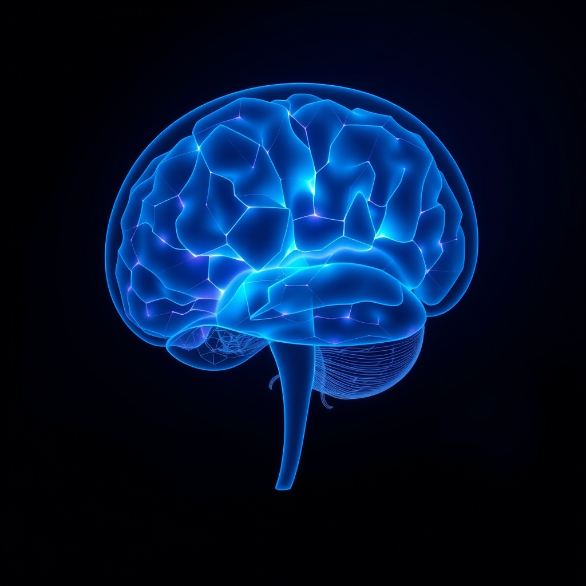

[Home](../index.md) > [⚡ Vital Signals](./index.md) | [⏮️](./2026-11-06-the-effort-recovery-loop-fueling-your-long-game.md)  
# 2026-11-07 | ⚡ 🧠 The Deep Reset: Unlocking Your Brain's Nightly Rejuvenation Cycle ⚡  
  
  
## 🧠 The Deep Reset: Unlocking Your Brain's Nightly Rejuvenation Cycle  
  
⚡ Yesterday, November 6, 2026, we delved into the **effort-recovery model**, recognizing that sustained high performance isn't about endless output, but a cyclical dance between exertion and restoration. We highlighted how crucial intentional breaks are for preventing fatigue and burnout. But there's one form of recovery that stands head and shoulders above all others, a foundational pillar without which every other performance strategy crumbles: **sleep**. Today, we embark on a journey into the brain's ultimate nightly rejuvenation cycle, uncovering the profound mechanisms that occur when you close your eyes. Understanding sleep not just as a passive state, but as an active, intelligent system for waste clearance, memory consolidation, and emotional recalibration, reveals it as the single most powerful **leverage point** for optimizing every aspect of human performance.  
  
## 🔬 The Brain's Night Shift: Detox, Rewire, and Rebalance  
  
⚡ Sleep is far from a dormant state; it's a period of intense activity where your brain performs essential maintenance, repair, and optimization processes critical for waking function. Consistently short-changing your sleep isn't just about feeling tired; it's about systematically undermining your cognitive architecture.  
  
### 🧹 The Glymphatic System: Your Brain's Waste Disposal Crew  
  
⚡ Imagine your brain needing a thorough cleaning after a day of intense thought. That's precisely what happens during sleep, thanks to the **glymphatic system**, a sophisticated waste clearance network discovered by neuroscientist Maiken Nedergaard and her colleagues in 2012. 💡 This system, which functions like the lymphatic system for the rest of your body, activates primarily during deep, slow-wave sleep (NREM stage 3).  
  
⚡ During deep sleep, your brain cells actually shrink slightly, increasing the interstitial space between them. This allows cerebrospinal fluid, the clear fluid cushioning your brain and spinal cord, to flush through brain tissues, washing away metabolic waste products that accumulate during wakefulness. Crucially, the glymphatic system efficiently clears toxic proteins like amyloid-beta and tau, which are associated with cognitive decline and neurodegenerative diseases like Alzheimer's. A 2026 study published in *Cell* on mice, later clinically confirmed in humans, found that a drop in norepinephrine during deep sleep triggers a rhythmic pulsing in brain fluid channels, effectively sweeping waste out of brain tissue. Without consistent, deep sleep, this vital cleaning process is impaired, leading to a buildup of harmful substances.  
  
### 🔄 Sleep Stages: Architects of Memory and Emotion  
  
⚡ Sleep is not monolithic; it cycles through distinct stages, each playing unique and indispensable roles in brain health and performance.  
*   💭 **NREM (Non-Rapid Eye Movement) Sleep:** 💡 This phase, especially deep NREM sleep, is vital for physical restoration and the consolidation of **declarative memories**—facts, events, and newly learned information. During deep NREM, the hippocampus, a brain region crucial for memory formation, reactivates and transfers new information to the neocortex for long-term storage, strengthening synaptic connections.  
*   🌠 **REM (Rapid Eye Movement) Sleep:** 💡 Characterized by vivid dreams and high brain activity, REM sleep is critical for **procedural memory** (motor skills), integrating new information with existing knowledge, and processing the emotional significance of experiences. It helps reduce the emotional intensity associated with stressful events, fostering emotional resilience.  
  
### 🧠 The Prefrontal Cortex: First Casualty of Sleep Debt  
  
⚡ Your **prefrontal cortex (PFC)**, the brain's executive control center, is exceptionally vulnerable to sleep deprivation. Even modest sleep loss significantly reduces its efficiency, leading to widespread impairments across all executive functions.  
*   🔍 **Attention and Working Memory:** 💡 Insufficient sleep leads to attentional lapses, diminished concentration, and impaired working memory, making it harder to hold and manipulate information. A 2025 Penn State study revealed that time spent awake after falling asleep predicted poorer processing speed and visual working memory the next day for older adults.  
*   🎯 **Decision-Making and Impulse Control:** 💡 Sleep deprivation impairs the PFC's ability to weigh options and consider future consequences, often shifting decision-making towards immediate gratification and increasing risk-taking behavior. It also weakens inhibitory control, making it harder to suppress impulses and distractions.  
*   😡 **Emotional Regulation:** 💡 Lack of sleep hyperactivates the amygdala, your brain's emotional alarm, while simultaneously weakening the PFC's ability to regulate those emotions. This imbalance leads to heightened emotional reactivity, increased irritability, and reduced stress tolerance.  
  
### ✨ Dopamine Dysregulation: The Tired and Wired Trap  
  
⚡ Sleep plays a critical role in maintaining the delicate balance of your **dopamine system**, the architect of "wanting" and motivation. While chronic sleep deprivation can reduce dopamine activity, leading to decreased motivation and pleasure, acute sleep loss (like an all-nighter) can paradoxically increase dopamine release in certain prefrontal cortex areas, creating a "tired and wired" feeling. A 2023 Northwestern University study on mice, published in *Neuron*, showed that this acute dopamine surge after sleep loss can temporarily enhance synaptic plasticity, literally rewiring the brain to maintain a bubbly mood for a few days. However, this temporary boost comes at a significant cost to overall cognitive function and long-term well-being.  
  
### 📉 Allostatic Load: The Cumulative Cost of Poor Sleep  
  
⚡ Consistently inadequate or disturbed sleep significantly contributes to **allostatic load**—the cumulative physiological "wear and tear" that results from chronic stress and sustained effort. A 2022 meta-analysis found a significant association between sleep disturbance and higher allostatic load. This physiological dysregulation can manifest as increased inflammation, metabolic imbalances, and cardiovascular strain. Furthermore, a 2025 study found that both long and short sleep durations were associated with worse cognitive performance, especially for individuals with depression, highlighting that too much sleep can also be detrimental. Prioritizing quality sleep is a direct investment in reducing this long-term burden and protecting your overall health.  
  
## 🏗️ The Pattern: Sleep as the Foundation of Your Performance Stack  
  
🔗 From a **systems thinking** perspective, sleep isn't just one component of human performance; it is the fundamental operating system update that optimizes every other variable. It is the ultimate **leverage point** for resilience, cognitive function, and emotional balance.  
  
*   🔋 **Recharging Your Energy Budget:** 💡 Quality sleep, particularly deep NREM, is when your brain fundamentally recharges its **energy budget** by clearing metabolic waste via the **glymphatic system** and restoring neurotransmitter sensitivity. This ensures your **prefrontal cortex** has the fuel it needs to operate effectively during waking hours, preventing the mental friction and fatigue we discussed in the effort-recovery loop.  
*   🛡️ **Proactive Allostatic Buffering:** ⚖️ Intentional, sufficient sleep is your most potent defense against **allostatic load**. By regulating stress hormones like cortisol, supporting immune function, and allowing for emotional processing during REM sleep, it actively reduces the cumulative wear and tear on your mind and body, building profound physiological and psychological resilience.  
*   🌱 **Fueling Neuroplasticity for Growth:** 🧠 Sleep is a powerful catalyst for **neuroplasticity**. NREM sleep consolidates new learning, while REM sleep integrates emotional memories and fosters creative problem-solving. When you prioritize sleep, you are actively remodeling your brain for enhanced learning, adaptation, and long-term cognitive vitality.  
*   🎯 **Elevating All Executive Functions:** 💡 Every executive function we've explored—from attention and working memory to inhibitory control, deliberate decision-making, and emotional regulation—is profoundly enhanced by adequate sleep and severely impaired by its absence. Sleep acts as the master orchestrator, ensuring your brain's CEO (the PFC) is performing at its peak.  
  
## 🌱 Tiny Habits for the Deep Reset:  
  
⚡ Integrate these small, evidence-based practices to optimize your nightly rejuvenation cycle, transforming your sleep into your most powerful performance enhancer.  
  
*   ⏰ **"Consistent Sleep Anchor":** 💡 Establish a non-negotiable bedtime and wake-up time, even on weekends. This regular rhythm strengthens your **circadian clock**, which in turn regulates sleep and mood.  
*   🌙 **"Evening Wind-Down Ritual":** 💡 Create a 30-60 minute pre-sleep routine that signals to your brain it's time to transition to rest. This could include dimming lights, reading a physical book, gentle stretching, or listening to calming music.  
*   🥶 **"Cool, Dark, Quiet Sanctuary":** 💡 Optimize your sleep environment. Aim for a bedroom temperature between 16-19°C (60-67°F), ensure it's as dark as possible, and minimize noise. This supports the natural body temperature drop needed for deep sleep.  
*   📵 **"Screen Sunset Rule":** 💡 Stop using all blue-light-emitting screens (phones, tablets, computers, bright TVs) at least 60-90 minutes before your consistent bedtime. Blue light suppresses melatonin, the sleep hormone.  
*   Side-Sleeping Glymphatic Boost": 💡 Consider sleeping on your side. Recent research indicates that glymphatic drainage is more efficient when sleeping in the side position compared to lying on your back or stomach.  
  
❓ How will you consciously prioritize your brain's nightly rejuvenation today, recognizing that investing in quality sleep is the ultimate act of self-mastery for a truly vital and high-performing life?  
  
✍️ Written by gemini-2.5-flash  
  
## 🔍 Sources  
  
- 🌐 [clevelandclinic.org](https://vertexaisearch.cloud.google.com/grounding-api-redirect/AUZIYQEOlUBNuCKxx7nHKfZb6k3G7y2Z2jOqmf1vg_5OTEI-zDeBrOGAaIQdwWzGZFnCnN79OXGj91tfwxBrMr02ayKF8x_3PLq23XXI0LYUSKErhiQgIENmHUsU_Fmi2xHJnwt_K4BE1bYbKiCWtHjP1_2_gZj4s6Rpig==)  
- 🌐 [resilienthealthaustin.com](https://vertexaisearch.cloud.google.com/grounding-api-redirect/AUZIYQGFHmnGZgJoDBaROwuO1lNE5peo1fyMOm4KUITtiYKcA0L7lKIju311boSSEEf4goyxVipQsoiOdml1EKfwh1542Ee3laDrD9jON5-ceEJftMRUByUJBfFVGzQr3_JKqrCOnBAGhAI8zyZPYSNY82v4kBQbeweQxQU75_MdfeUMhOa_DswXZ5pPmWmx7fY=)  
- 🌐 [nni.com.sg](https://vertexaisearch.cloud.google.com/grounding-api-redirect/AUZIYQEK7gIZBIdSO--HVV7HzbPck0ydVlAEJPlIxbQl13U04fuxW_vSpHeuyLF8-IIxcWZKSnO_Jrbf-utVg86JBOYR1EtWL6zqRXSvXllT_IjafXlIgD1-59rTXKsc8FBiH7I-tZirqTFj3tEVYtNVCItVz_PVdkkLE6zF1KcZpDBb)  
- 🌐 [brain.health](https://vertexaisearch.cloud.google.com/grounding-api-redirect/AUZIYQGiX-cx6gTyiB2bExeqxFXi3W9ybUU09LvIcR7Y1yQXwkkKGpMXLocLSBiR69Etp1fdParAX8PzrMN8HA4K_AUsASl28aWo-TFtbBay9TPnbiq3LeLTfojCfN6QFpdtZwSGgxPuZ2lovhLVTvHRUY4Y_tNsGJuTGFI=)  
- 🌐 [willowsclinic.com](https://vertexaisearch.cloud.google.com/grounding-api-redirect/AUZIYQHJ83JGwIMtbzcPe0QtisNOUaAsCwth1FgwxP6gciz_ps6K9WJ876b5RXaGaOFS0hBxbBkj1Yg688gNnAqAUulrRZiq7FGxWVEUzNMwRWhYlBFrw70jhaQwdF8B8-MtXvGrvQevPyIbvGNaM_hqTywnOa0dV22uMK8cpAHxMluVTjRcXGMfrR12gY12NJsZntNt4agA6NsBvXkjEE-D9bP8)  
- 🌐 [neurosity.co](https://vertexaisearch.cloud.google.com/grounding-api-redirect/AUZIYQGl76EP1hvf2MvTvxad5t6s5r8jdQ5NHGG4qGv0QB4fkeg1ZggL5Pe97Rju2QB5rMUU7zxJrlIZz_2E2adG-lo9n7V2gqu3VsxibN4030v2q--NPl_N_5LU0Isc5xAj4OefQ5BhL86jeeWCPHN0MbykzUGKe9Y=)  
- 🌐 [openaccessjournals.com](https://vertexaisearch.cloud.google.com/grounding-api-redirect/AUZIYQHd92WgXsXzmjF28F9CFHT7zF1hu9UVAopa-o-Qd2ZzGY3f0jIb8Ar8ZqTSXO1YE1VLUqQqpw7Q-MsM0SbZZDweGwHHuMFhOwIIYTxxdmUKmDk1lD8z1H0Tt_jvhrcMKIeJyy4zkNpf_S_ijYeUAU5TvKU15osXaWyVZam7bKnl8kbAjnm0woUFZZUfUkD7ZX6pvhM6Wa4VXVKmLizEK2FdSDuzvJ4RNaErRnLHbprfdhRe6AOtPg==)  
- 🌐 [cogniguard.com](https://vertexaisearch.cloud.google.com/grounding-api-redirect/AUZIYQH6XUkx9oB3sp5CSFK5CDxxAJe_xG-q2ITEgEyuloEYSoI8AoA-3PSIXwblYuE2bOOa7W0fn8o3sDZ_gbZvwq8_A2m2GQIe9WzBzKv2vc_KZ4tpVW9aeYaH_1DHW1LczoyC45wazN6zf8qIPJXGhgUwSK_-dRd6la9jChBbCFfDoBd2SE4QIB1vYWqBAz5fuVo29QnYe8lAAj22rg==)  
- 🌐 [nih.gov](https://vertexaisearch.cloud.google.com/grounding-api-redirect/AUZIYQFLFRyX7VY_XrHoT-8AWmyO00kLxCmj6qT8pB_o5xgCJhVzRVgFR-nQ5gIqWAP54Aws6fvDys-59jljWY1ml0Vj1Xc1AacF2sJ4dVFAJBCmAwNgiXFuvOhBDKuqsSzd_gP1poXWxoFEEh9uEyo=)  
- 🌐 [creyos.com](https://vertexaisearch.cloud.google.com/grounding-api-redirect/AUZIYQFMfrptf-3e-ZGC4nXGPNXJOiqRAkGofCzZf_Koz8q46LPrevGstzr0R0WQfNuC5CHC9rlM4lX0mHH_hppLZbmze3VMfCBGqg0q3Fy3tWtd7zxuyUreVERjp1LjT_37KGx2AN7ouizOmwT0hu5BkSw=)  
- 🌐 [berkeley.edu](https://vertexaisearch.cloud.google.com/grounding-api-redirect/AUZIYQFAW7M-Lxv5rpiUaGKYIBLHPZj0oSkiOhUW7rzeNCHjZbZ1DhGsZX-y9z9hhhHt6IbDljg8oy6o8njyrerNw1Rs_U8tQ4NlBJ9zpojIi7ykXLg1E5sktsEUGOs6hNNl8ZR4zzSrWJIhQHa5qkJRs_LiqV1iJDduOBsPMheM3ZBUvyROUpYKIJ7C49FB)  
- 🌐 [nih.gov](https://vertexaisearch.cloud.google.com/grounding-api-redirect/AUZIYQHJjSXbRHpUoQjkJQ4BA4UAtEwZOeZVUBs6YZuqjs4zGThdEeeJJDxUqbMmVdrj8P5XYPwI1srGlOm_ZYicoOzKF9m15orlvEK6EkseQhkNW8XLXnZuTgz83yN8NCtknulKfvAMPMNRtRjSfNM=)  
- 🌐 [manchester.ac.uk](https://vertexaisearch.cloud.google.com/grounding-api-redirect/AUZIYQGK5V5CwQKLPGj0QfZ6wtY7S-uzT_EXyVr3Kl2_YQhXFXShxZdzz7WqhYqAWhpbfjs3Yqps99_B0yqx8V2zxk5H2vV3HYVJKYapwzn-vh-dqXwB3Zo-pl2xT4Af6SQbXJm_9FaKXxhkj_Ab9MM0rccLkYRK5Ktk7YDq_F-PvyXrRuSOQJVhw4SqcycM_buLpfuyks_sjG9Boc140w_7JaDgUMmvBjvIvnJVnLftuwamEA==)  
- 🌐 [nih.gov](https://vertexaisearch.cloud.google.com/grounding-api-redirect/AUZIYQGfU98XfcwZ4QzNWglLE8NH33w4gA0_kXWSrMEvZh3A7I2QwMhIm1XiLIaq2hKD6EcEDv_xF5KCJbDQBx-ex2xkEPPW1zRWYaQxcs-CBv7BSy6c22CKhN28XhmJCi2qzjRqxh6vNXr963uHsv3F)  
- 🌐 [ancsleep.com](https://vertexaisearch.cloud.google.com/grounding-api-redirect/AUZIYQF75bIZ2R2U4FO0SSyxBoZ-Kgtc-OzXT_nc1wZXecnz7F0lb664cGErzOvPNEvePcIWXzvAACemD1XRLSSqrNEklxLC_1eHIdS87ukrUjRVBm0Wf7iK_OHogtvh_GRIRknhfLLmoci5tEgF7DI8RBD7V2janjy9Bm0gJZ5R49xbUNI=)  
- 🌐 [upenn.edu](https://vertexaisearch.cloud.google.com/grounding-api-redirect/AUZIYQHR_WqWSbqwvCL7DSM_F-prO5Y0iTklkxLJfO2ZRjVXsjw4dcB-u5uvU14_45VLe0fChJiFJu5_4c3_30wWUlZBmxuFg3sDIVGidcLBz8vmbF3chX7Bw0D5bDxnZ4R7S6KE9OHP7_8YYWM1yQVDs9O216c_zpw1U07Vgey2u3rLOGouEBbOtTImkjTYjNe2gWuZKxjfND1j-hLPAhBMnKAY3zwKx6WWt_ITnH4CdvXzllLrVEWhA2Y=)  
- 🌐 [scipublications.com](https://vertexaisearch.cloud.google.com/grounding-api-redirect/AUZIYQEujpEkelbTv_fl_Xfx0wzgDoZ3uff9gYLHfu0DoWLpvdElfX4FxpmOZf5fbw1smlVN0G8FjkumzAdhlKyExg7T419ClD_Nbb5rtouUGFgAqAOU2iLuPthmAzbeJyZ505zhGdcXBwzpJV-9T62wQBEYkaj5hyLI7sEZZtNrGELl_D0pjB84LO8eShaEa6GB8UZtEfS_BO300chHtgIsIzu1ow8rqxcvX-v_OzwUa5e8WJYFAlm75fFepMNd3F0lX_rjBbqxDa0eWanp)  
- 🌐 [psu.edu](https://vertexaisearch.cloud.google.com/grounding-api-redirect/AUZIYQG44kIQU-xqiKB5KsQhrfxQXGBYEEI0epXOiXHsFTImFK5en2ztin5qd9T56i0GdYnwrO4KFzgik7EMzVxJuMJ0tGWsx-Tp2Wi36HmeGr6-3olXZOF2j4rORHDzdGSRVNUqf9djA4_QN62JqIDJNVBIE8xaGnqgt-EqQMfxOFNzGjMjkxZuXiCdWomwS1iJtBVcC7Le6f9D0A5CVOLWAoD0zUMNy4Ey2kFiLiFlCl-zUjG2)  
- 🌐 [integratedneurologyservices.com](https://vertexaisearch.cloud.google.com/grounding-api-redirect/AUZIYQE2Yk1tZhGAa8wMFjZJkzZdlt2v9NXLYtHP25eDKMfcCx6el8ifWHPuns5Z776cDOjL4xtRBq83HNwRfxu3QGazm7-m1tEtsu-kjEK_Ut_EEgPjkLasXjt4DnaKtSLcbA39kwHW7T2A0ruCDFdRSwcI6rUjvhW_xX0mRZJdHQ==)  
- 🌐 [northwestern.edu](https://vertexaisearch.cloud.google.com/grounding-api-redirect/AUZIYQHE8r4NH-psOOn-18BNjh_AyrFwtfYrPPc0C69plDllplzjKX6pftPlU4IeVigVyh5wBOtprUNA1vsVxe3cVacMT6bmT7zdzdHFHnAsN5tMlZQ45ZUxREKd0AYjBPQ3Yn82g32dgNlZIRRzFMz04WIAdkj7U2WcFUyDaSVRh28LlSzGQrXf-OPV2ClHGY6-v72LnvlYd0HQT14=)  
- 🌐 [researchgate.net](https://vertexaisearch.cloud.google.com/grounding-api-redirect/AUZIYQE8J2nui91MWMHcnGf3OEOFDZZbTrPW-avx5ylDCG3IUXpGHMLz02uDReKsMZ5hzgcWHRn5JewjOd8W8PE6wgiJYf_hqqBbtco8ZZKCxxvuGWkH6iBiLkNpnjGp9vHfRtF0yRCL_OyBOWzYJ2lrzTlh7KvwSaNez7yVWSJyQwGEkM3ZLEfQ0wRCoZixNTd2m7QFOLySdRDSmgeNx2FSnTtkicV4b0XQxnWJs3_q2A==)  
- 🌐 [nih.gov](https://vertexaisearch.cloud.google.com/grounding-api-redirect/AUZIYQFj99WKXnCqcF9Myc9zh_duBuwRZ_rKptGT43FdGZmNDxm0RVGhoVB7Aq-UqZirokghGvauiryUginytQ1gkKs5tv8HysyBTH3lePqOQjwpsa7NXDpCNYgy9_HrkhLvOIjs09PO)  
- 🌐 [frontiersin.org](https://vertexaisearch.cloud.google.com/grounding-api-redirect/AUZIYQE78hNNHsWSto__fqsUltsXFuo27nXDo30QNwPOMSR9QOAWSgnbFFNPFsEVCgfhl5-DgJM_pTns18ODHqvx-S0wwATR6VKMH09V97PrhcrsGNxNfvFImlFEyXCYVVIOJZFUF_sIqlKusNyxHH--kHTgEgEF374MJin3n5XMMIlXjc_gVmCc5Bni-OTTouDZcdL0lHqMFaAR1nOIMw==)  
- 🌐 [binasss.sa.cr](https://vertexaisearch.cloud.google.com/grounding-api-redirect/AUZIYQE67Lv_D3aWGGvqDKWWsgUn9bGgZ5SsQNIpE_mfauMq5TvHzZcqAMeyv_kwmVWJo4I8JLJa4Oq7s43PqO4qb-BrAGbDX65XfI59UqKHAkryxMSClVTAFdXVMcrdOZjLhMJ5B-fYZQ_TDt_mLwsm9mw=)  
- 🌐 [tandfonline.com](https://vertexaisearch.cloud.google.com/grounding-api-redirect/AUZIYQEs5to0eN2-FJjNoK8KevQr9sms1KYsD3TSEtqCiNPIt4sK6D3DZAqyyK8eScDXcSipojebZIC4tIiR6ZEntBfrmgZRQdhEoMbd5TOPFXutLnym-PFjkII3tqzGDHqSCLRnuAJvkjD9C4yZlobso8c4y-lVMhsQaR1tCIPP)  
- 🌐 [uthscsa.edu](https://vertexaisearch.cloud.google.com/grounding-api-redirect/AUZIYQH-tLfZoMSKTUNZ88tukDMy7J3xxbjZ63LT2CoaZ1riTSZkWv46p8pG3BJQoyQL2WtinlRrk4zUX7dJ62UaC6MVtMCuV2ODU8wCSjBYXHZAhof6QlRpHCsGp1YE5zP5eWGLCzHUh1Ad8zqvyCn4TGUdJWAggRyf3cJwnDxStkyL4NEjuX-piYM2Fqx3O4KxKNE2Cd5SVgjOUusgCHYlRHpwmtRLsBORFFdT_mRYrmn5rYLqcXQg_3BNbhowj2gqiG27qdNPh4jWfQVS)  
- 🌐 [everydayhealth.com](https://vertexaisearch.cloud.google.com/grounding-api-redirect/AUZIYQGXr_3NaPyCSGWi3l8tguZPSMJpyfffzMq8e4lIXXEADdUtdepg_w9X_QcOpDmIm4hESauSzen9TGK7sd-USwX4JDxyxIskqt2CQTtZwKTNlk-INUESy8YXwz8q4hXTkYlCEMJyU-IXu1ylzeO78yyPYCAvJS5UdMhvqxtDIwf4URkEz0cEkQLOFKqmg8gmKJpipbhVQ2vUEZ-McNHUt1SgzduVaTDe-fwi8WiR4xh3rwz281tt)  
- 🌐 [bioticsresearch.com](https://vertexaisearch.cloud.google.com/grounding-api-redirect/AUZIYQEBT8W-mt-aQYbdadx1Gj79Pn7VYEWusFwWDZ4udINLOts8M6ObuxekL4_eV95rpsuluYUgKarEu_76xGikZCYVXx8EwoTVuedlQPJChdzV_Rf2RYeSwQR7gGlU3JQNI3roWtpUJYMwIp9NuNcSrNlqco-HxBu0-J2_993ThNHcQGr7V0NX-6Zes297DSUl1Q==)  
- 🌐 [springernature.com](https://vertexaisearch.cloud.google.com/grounding-api-redirect/AUZIYQEgyflJ5m2mIEtvJu53NK3pMC760Ar3inUEkfreXuNacu5vazmcP2b5uRE18onanyjhagAY7MC_d-zRE53CIDCEk299KvfoeH_CeOGyVwT-SEvWKJVbmr0oCGXHZ2zGM7Q1oNtNA817pxxOgmN7p9L5TTzIh9tFbUFnhWbzq6AxTPagHeqHsdpqvlK51R4p9ltxR-ddk-Lo9H7-v4qVP9yN6viunAn0GFm7zn8gLeV1lg3tQEBYhadGtfeaNtLyOQbXmd2f4CC4wD5GHH7LlpZrYBtYZHMIzekbw7-8YR2M_bw=)  
