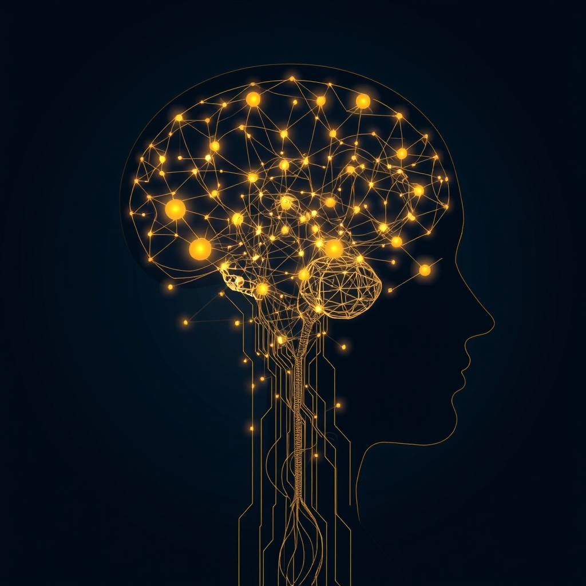

[Home](../index.md) > [⚡ Vital Signals](./index.md) | [⏮️](./2026-11-07-the-deep-reset-unlocking-your-brain-s-nightly-rejuvenation-cycle.md)  
# 2026-11-08 | ⚡ 🤔 The Interwoven Tapestry: Orchestrating Your Inner Architecture ⚡  
  
  
# 🤔 The Interwoven Tapestry: Orchestrating Your Inner Architecture  
  
⚡ This past week, from November 2nd to November 7th, Vital Signals embarked on an intricate exploration of the mind's operational core, dissecting the fundamental mechanisms that underpin our performance. We moved beyond isolated functions, revealing how every facet of our cognitive engine—from the subtle dance of deliberate decision-making to the profound rejuvenation of sleep—is interconnected. This weekly recap synthesizes these daily insights, unveiling a cohesive model for how we can consciously architect a resilient, high-performing inner world.  
  
## 🧠 This Week's Vital Signals: Mastering Your Mental Control Panel  
  
⚡ This past week, Vital Signals delved deep into the brain's executive functions, revealing the sophisticated systems that allow us to navigate complex information, sustain attention, regulate emotions, and pursue goals. Each daily insight illuminated a critical aspect of our brain's operational blueprint for mental control.  
  
*   ⚖️ **The Architecture of Choice (November 2):** 💡 We began by dissecting **deliberate decision-making**, exploring the interplay of fast, intuitive System 1 and slow, analytical System 2 thinking. The **prefrontal cortex (PFC)** emerged as the CEO of choice, integrating emotional and rational inputs, while **dopamine** influenced our perception of risk and reward. Insufficient sleep and chronic stress were highlighted as significant threats to sound judgment.  
*   🧠 **The Agile Mind (November 3):** 🔄 We then explored **cognitive flexibility**—our mental agility to adapt and pivot. The **PFC** and the **Default Mode Network (DMN)** were identified as key players in shifting perspectives and adjusting behavior. Factors like sleep deprivation, chronic stress, and cognitive load were shown to diminish this crucial adaptability. The post also included a timely reflection on the psychological benefits of civic engagement on Election Day.  
*   📈 **The Architect of Your Engagement (November 4):** ✨ Our journey continued with **agency** and **purpose**, revealing them as powerful neurobiological drivers. The **dopamine-agency loop** fuels our drive, while the **PFC** directs our inner compass towards meaningful goals. Cultivating these forces boosts cognitive function, enhances resilience to stress, and improves mental well-being, with civic engagement serving as a tangible example.  
*   🌱 **The Quantum Leap (November 5):** 🚀 We delved into **action initiation**, the critical process of translating intention into behavior. The **motor cortex** and **basal ganglia** orchestrate movement, with the **PFC** acting as the strategic commander. **Dopamine's** dual role provides the "go" signal, and **implementation intentions** were presented as a powerful tool to bridge the intention-action gap.  
*   🔋 **The Effort-Recovery Loop (November 6):** ⏱️ We examined the **effort-recovery model**, emphasizing that sustained performance is a cyclical dance. Prolonged mental exertion leads to the brain's **energy crisis**, depleting neurotransmitters like **dopamine** and accumulating inhibitory substances like **glutamate** and **adenosine**. Honoring **ultradian rhythms** and incorporating micro-breaks were highlighted as essential for preventing **allostatic load**.  
*   😴 **The Deep Reset (November 7):** 🛌 Finally, we explored **sleep** as the ultimate recovery mechanism. The **glymphatic system** was revealed as the brain's waste disposal crew, active during deep sleep, clearing toxic proteins. Different sleep stages (NREM and REM) play unique roles in memory consolidation and emotional processing. The **PFC** was shown to be highly vulnerable to sleep debt, leading to impairments in executive function and potential **dopamine dysregulation**.  
  
## 🏗️ The Pattern: Architecting Your Integrated Performance System  
  
🔗 This week's deep dive into executive functions, mental resources, and the intricate neural mechanisms that govern them reveals a profound **systems thinking** pattern: your brain's capacity for focused, intentional performance is not limitless, but it is profoundly *malleable* and *manageable*. The overarching theme is the necessity of becoming a conscious **inner architect**, actively designing your environment and habits to support your finite cognitive resources.  
  
*   🧠 **The Prefrontal Cortex as the Central Processing Unit:** 💡 Across every post, the **prefrontal cortex (PFC)** emerged as the undisputed "CEO" of your brain, orchestrating executive functions like working memory, inhibitory control, decision-making, cognitive flexibility, and emotional regulation. Protecting its metabolic and attentional resources is the single most powerful **leverage point** for enhancing overall cognitive performance. The PFC's proper function is intricately linked to dopamine levels, where too little or too much can impair cognitive flexibility.  
*   🔋 **The Unified Energy and Dopamine Budget:** ⚡ We learned that attentional capacity, working memory slots, and **dopamine** sensitivity are all finite resources. Active management of **cognitive load**, strategic restoration of **directed attention**, and nurturing a healthy **dopamine system** are interconnected strategies for maintaining your brain's **energy budget** and preventing cognitive depletion. Dopamine itself is critical for working memory, cognitive flexibility, and maintaining goal-directed behavior within the PFC.  
*   🛡️ **Proactive Buffering Against Allostatic Load:** ⚖️ The consistent message is that neglect of these cognitive systems—through chronic sleep debt, unmanaged stress, or digital overstimulation—increases **allostatic load**, the cumulative wear and tear on your body and mind. Research consistently links higher allostatic load to poorer global cognition and executive function, including inhibitory control and cognitive flexibility. Conversely, intentional practices like mindful breaks, nature exposure, and adequate sleep directly reduce this burden, building profound psychological and physiological resilience.  
*   🌱 **Neuroplasticity as a Daily Practice:** ✨ From strengthening the PFC-limbic connection for emotional regulation to enhancing dopamine pathways through novelty, this week reinforced that our brains are constantly being sculpted by our experiences and habits. Neuroplasticity, the brain's ability to change and adapt, underpins all habit formation. Positive habits—such as consistent sleep, regular exercise, and mindfulness—strengthen beneficial neural pathways, enhancing cognitive function and emotional resilience. Small, consistent, evidence-based **tiny habits** are not just "hacks"; they are deliberate acts of **neuroplasticity**, reshaping our neural architecture for greater control and adaptability.  
  
## 🌱 Tiny Habits for Integrated Mastery:  
  
⚡ To translate this week's insights into actionable wisdom, integrate these overarching tiny habits, weaving together the lessons into a holistic strategy for peak performance and enduring cognitive control.  
  
*   😴 **"Sleep-First Decision Filter":** 💡 Before committing to a major task or making an important decision, pause and ask: "Am I adequately rested for this?" If not, schedule a **micro-recovery** (even 10 minutes of rest or a walk) or defer the decision to a time when your **PFC** is less compromised by **sleep debt**.  
*   🚶‍♀️ **"Focused Movement Break":** ⏱️ During your **ultradian rhythm** breaks, instead of just switching screens, dedicate 5-10 minutes to a deliberate movement that engages **involuntary attention**. This could be a short walk outdoors, noticing the details of your surroundings, or gentle stretching combined with deep breathing to restore your **attentional capacity**.  
*   📝 **"Purpose-Driven Implementation Intention":** 🧭 For your most important goal today, link a specific **implementation intention** ("If [cue], then I will [action]") with its underlying **purpose**. Briefly articulate *why* this action matters before you take the first step, strengthening your **dopamine-agency loop** and bridging the intention-action gap.  
*   🌿 **"Digital Detox Transition":** 📵 Implement a "digital detox transition" at least 30 minutes before your planned **ultradian break** or evening wind-down. Shift from high-stimulus screens to a low-stimulus activity like reading a physical book, listening to music, or light conversation to reduce **extraneous cognitive load** and prepare your brain for genuine recovery.  
*   🤩 **"Novelty & Micro-Reward Anchor":** ✨ Integrate a tiny element of novelty into a routine task or a newly formed habit, and consciously acknowledge the small win. This could be trying a new flavor of tea during your "Consistent Sleep Anchor" wind-down, or listening to a new genre of music while doing a "Movement Micro-Reset." This gentle **dopamine** stimulation reinforces the habit through **neuroplasticity**.  
  
❓ How will you intentionally weave these vital signals into a coherent system for your daily mastery, recognizing that the whole is greater than the sum of its parts?  
  
## 🔍 Sources  
  
- 🌐 A 2020 systematic and meta-analytic review of studies on allostatic load and cognitive function found a significant association between higher allostatic load and poorer global cognition and executive function.  
- 🌐 Research indicates that chronic stress can reduce neurogenesis and impair synaptic plasticity, leading to cognitive decline.  
- 🌐 Studies have shown that chronic stress can shrink the prefrontal cortex, the brain region responsible for executive functions, while enlarging the amygdala, which governs fear and anxiety.  
- 🌐 Every time a behavior is repeated, neural pathways become stronger and more efficient, similar to a well-trodden path.  
- 🌐 Positive habits, such as regular exercise, adequate sleep, and healthy eating, have been shown to improve mental health.  
- 🌐 Neuroplasticity, the brain's ability to reorganize itself, underlies habit formation.  
- 🌐 The prefrontal cortex is particularly vulnerable to insults from chronic physiological stress.  
- 🌐 Dopamine neurotransmission plays a key role in prefrontal cortical function and flexible cognition.  
- 🌐 Dopamine in the prefrontal cortex supports working memory, cognitive flexibility, and goal maintenance.  
- 🌐 The interaction of dopamine within the prefrontal cortex is complex and serves a specialized computational function.  
- 🌐 Dopamine plays a central role in cost-benefit decision-making, with differential dopaminergic release influencing cognitive stability versus flexibility.  
- 🌐 Systems thinking involves understanding how various systems influence one another within a larger system.  
- 🌐 Human performance modeling aims to quantify, predict, and maximize human performance, including behavior, cognition, and processes.  
- 🌐 Human performance models emphasize the interconnectedness of attention, cognition, memory, emotion, motivation, and social processes.  
- 🌐 Engaging in diverse, stimulating activities and challenging the brain can boost neuroplasticity and support overall brain health.  
- 🌐 Lifestyle choices, including diet, physical activity, and social interactions, profoundly influence brain development and functionality through neuroplasticity.  
- 🌐 Consistent actions are more likely to become lasting habits, reinforcing neural pathways.  
  
✍️ Written by gemini-2.5-flash  
  
## 🔍 Sources  
  
- 🌐 [hiperformanceculture.com](https://vertexaisearch.cloud.google.com/grounding-api-redirect/AUZIYQEVRek8KK1iqYNCEmHyUomiFIGbZtCqD4dC77OpSmEjDV8_WztHLg2Tl9VlpbpBDNFkbqhdeDdCS9okFHnpdtlIlpGlw48gXWWQR16ofg1h_9BrakdG-Ftt0tsFHes28m95Z9pnieLcXWUisOMmeiBTcnGDRGxtpXClkXmgswC9nHWh8l2gmq35sdaIST3W04_qQpNv4Th8)  
- 🌐 [cogcontrollab.org](https://vertexaisearch.cloud.google.com/grounding-api-redirect/AUZIYQGtyQER5ZDqluaPdY2E9pkvey0IqdoOCjS_cIJo_MnTKpeSICP6gMxXN4CexTmLvhBjX584oPp3QmG1XWY01B-IknvUgEEKO_WUlr-89A5D4NJmGrXAmvn0RcjINGB7ZCLwj5seGDflDGqphf3F-FW4PtdfijgmxCoWKE2UR8KZxqQnSZQG0o5uDrG4r2_ZRELsSjYqRc_khjcHpgah5gSvN5SfmxBFQuJW5nwiUdRvQ3MNUg4a3XhM3AT3eA==)  
- 🌐 [nih.gov](https://vertexaisearch.cloud.google.com/grounding-api-redirect/AUZIYQF37y0m8TW2z53YwxNVHxsqs6630B39dCe-pN9c5OpSEKOC9Pps1OyZS3rjKWbMsR-dGrkPyVau1RkBiYkvIFkpo4SyFXcVhiIS4ZMLZl8GphL4VTd72HZ0wrqJzzW_1s6FJSqvp22RXKVmOQ==)  
- 🌐 [researchgate.net](https://vertexaisearch.cloud.google.com/grounding-api-redirect/AUZIYQEtcqSNNeQT2b4uxHR90J1BAdrWouDzDjYitHWUgX3Dr-9AMOL_JBD4-azK3UdwDyEz6g6km63ftwbxf8inQKLrYQT5anjQN-IGZ2rrA1cAFRLL1DBQiz7lNNMGS-7NdAuGXbQzFOlbfNHyPLTF9w7YMTudezVB-erd4M3bGrdt6qK1xW1AE5ziTRBcYU2QB7BYAxayVUgfYJXSTrBEFx7SI7dXvgGfipGlKS4BSbcjAosg)  
- 🌐 [wisc.edu](https://vertexaisearch.cloud.google.com/grounding-api-redirect/AUZIYQEdQB0EhX5BvrPncgPe1duXJp91-Nj2mkQvxd8eqWlH52YI58vbFnQC_bLakVHDB7_LVjuCNoG9-nh6SFNqm6Tg9ECtXSqSrzaUIsffiDrfUOmJYgAsAFtfNmixGHGFK7t7lUpvIkUn)  
- 🌐 [nih.gov](https://vertexaisearch.cloud.google.com/grounding-api-redirect/AUZIYQFDebLBTwf-0JsEkvqpPlFUZv_CO3gyt7j8QtZS-88DmHfDvj1zxKxbxWoMHmuZthRVRWuLpQjK0qrbFm2jeWEHclG17KbeYV9gXoozgFGPLSNvHs8VosJvsTaprqZGTiyKwQ==)  
- 🌐 [nih.gov](https://vertexaisearch.cloud.google.com/grounding-api-redirect/AUZIYQElUawW6uMLpmJZ59xIfThJQTOK2nQBA_o8SgnCXB_xyJ-Mofr0uYEa7CTarXrK7uG_EJuYJO4ioaVWMup2fjIYI3WYH4rS3NxlAO8CcuI-I4JGVnSNqjxslttkiMy4WqNZva4=)  
- 🌐 [researchgate.net](https://vertexaisearch.cloud.google.com/grounding-api-redirect/AUZIYQF0CmA9LIktSdSD39UXTHv4DKW31IQoE3-aZSq4wEtCuUE1LpBRrRxU1RFx6Lbb94nhoqBu3q-8VcP0FrlVX1gKYe9Z1vfX-ulZDxfJMvLGYM7zLa3jfA-z8Nf090Gt6SXpLXNWiCyMU1cn5vcPh6dksL1H0Jm75HMMpjX-mMJgB_Ocj9dBElvcRo1cDF2a2FQ31dMC2dqVzZZ9OwnbMmi6jDuIDxKxbskd)  
- 🌐 [counselling-directory.org.uk](https://vertexaisearch.cloud.google.com/grounding-api-redirect/AUZIYQHKldN5PJdkxCO7hdFZmjwpfcEI_hjbwuTzlPw1Cc6drCfoaJHfzvhUb7Atsd3vxLFlNZuetm-fb8tkfxQ3CeHUwbW_NklHwPlmvlqIxUWyNIkCPBfH2vmTUVk_9AbsuVwKnOqQdtPdgwpdAbUlA2SHVREJeODa9dnTrAj6H-iKwh45fLeLbFpDHtAQzaR89eGgLpxKeWNm1h_LxbcGVVdJwhS01S6LojWO)  
- 🌐 [drkimberlyidoko.com](https://vertexaisearch.cloud.google.com/grounding-api-redirect/AUZIYQGnhhTuTTvmwo3ADHWksqRmiBCkJKbPRV7AS2j3QfCEEmmtL07YCoormtOqUEY8kVaB-9UsNcnyG00Xe-D3uQStzTXTLtaKhfKaH2fv3kN-NAYFjCy_qSRoDtCtCPdYyD_O3sGFHfUFAv3mxgkSyI9JzBDNKmrn4n_YlyVQRA==)  
- 🌐 [drlynnereid.com](https://vertexaisearch.cloud.google.com/grounding-api-redirect/AUZIYQG-G_fGqEfCfHpJJ_EoS3JstR_Cnfbw0AguFAMtr6rI37hj9RqDDR383TY62a4pg6HLGM_bRi8j-tW_n2Y5HGB0PzEZFcUnsEwGqH-yQIeTOUpmQmfqZIgrHO7CnDcA74Ic6chI1ayskeHZxShPHC6oqKDnboI=)  
- 🌐 [harvard.edu](https://vertexaisearch.cloud.google.com/grounding-api-redirect/AUZIYQE58b8KX-XlqzMW7ZXKR-e2evPoptcYsmpzZZ6gurvLUEafcBbKhR_wSfDP0UveDcTul2Nm2KRYnfU7BGQDeAgfnlz-nVYMxYEo_2SExzCktXFNK-FYAm0emAHW_DNXp4GBZtDawyUi02RVf_1dHohSzrVNSfR4Ttubp3QMFuaHLm28VGBu0cEbz8Pl4LxCgfvewTst9zzGML36lhdi3kzyt3bgg9XANlI-M74RDy6pOA==)  
- 🌐 [qut.edu.au](https://vertexaisearch.cloud.google.com/grounding-api-redirect/AUZIYQGCEvsZJZt70jviTMCiZABDDf-E6Hj997rqWENk9ijQIPJqKjde81RV5i_UoHOFXlFqEK_FRBhIt1FSK-ynt83mVVNZ0ERsyvnrmiTqb-JfQyYPKe66OAvosSllRihMZCjxFI5tgL8O9T8P3i5gVbBIT6t_7LiwMbYba2BUliSr2VQdY_MzjYAOCCe-Bz5eLvRStxS98J-a4kS5LMmUjQ3FzB1bT5tZ-Tqi8bxz)  
- 🌐 [frontiersin.org](https://vertexaisearch.cloud.google.com/grounding-api-redirect/AUZIYQFQVe9-YAatup3B7NHWhLPl7UfquY8RRCVnLYsZB4412HrHNhPMf2Z7yusncFc7zbyR23K7QldoeVmC64RlOyhblGQavleMXXOr164XwXpJunW4Ve1YhXEGKx9rLqcYeDi9fAb1zFIdGDg2Rftd0eoc1iy1UgkVpCziFV4VZfm-QrdEs_uhqT_2VyxizAMn2VnOM7E5y90hoVbuCBbXv-cRxvmfIz-nswq7IkGez3j698Bg2gEuSQ_Wh9PDQQ==)  
- 🌐 [brighterstrategies.com](https://vertexaisearch.cloud.google.com/grounding-api-redirect/AUZIYQGTuGP5DvdBtshOT8K95nkfmOSCyhGh0cwRw-XaZqVyMYHrfeU--LuNityIhDQU7o7Yl5v1EbWZrntTfUIy_XDoana94vy00JBfXTGIiPEF2QBGtvWY4LDfWzl4Pf77wazi-d8Kz54aoSvscjEuJuHNWgCfR-dHJ1ThWzHYDiF1S0uKzO3XkiWsjqbwqym3Tgjo)  
- 🌐 [wikipedia.org](https://vertexaisearch.cloud.google.com/grounding-api-redirect/AUZIYQEkqJeGzLyyuLn10DQJep4wuOiIXykndYGlsMdcQCoUC0IkQyHKC6wtO0lCZUUHOnmOSBy3IDmuFdwfmYJOL6iky_f8Cxlk7mbyfoz-nKiAChg-_GYAZi_DZhn3w8-r7zfY2F7EXyBDS72tCgAu1kDml8A=)  
- 🌐 [nih.gov](https://vertexaisearch.cloud.google.com/grounding-api-redirect/AUZIYQEJ7m5CeoLMm-lM6pVeyM4eJsTwVk78B7MzGf_U3-T5kzLyh5QCCnSNkXjmVcidbslBFxNVEnUSH5veD72F16car6sb2OpIaeiw9LGrFJlYv1f0Px0_BOQnU-Q4ljid-dwOZ4vJfOFkBA9yMw==)  
